**Steel structures**

**Актуализированная редакция СНиП II-23-81***

ОКС 01.080.10

Дата введения 2017-08-28

# 1 ИСПОЛНИТЕЛИ - АО "НИЦ "Строительство" - ЦНИИСК им.В.А.Кучеренко, МГСУ, СПбГАСУ

2 ВНЕСЕН Техническим комитетом по стандартизации ТК 465 "Строительство"

3 ПОДГОТОВЛЕН к утверждению Департаментом градостроительной деятельности и архитектуры Министерства строительства и жилищнокоммунального хозяйства Российской Федерации (Минстрой России)

4 УТВЕРЖДЕН приказом Министерства строительства и жилищно-коммунального хозяйства Российской Федерации от 27 февраля 2017 г. N 126/пр и введен в действие с 28 августа 2017 г.

5 ЗАРЕГИСТРИРОВАН Федеральным агентством по техническому регулированию и метрологии (Росстандарт). Пересмотр СП 16.13330.2011 "СНиП II-23-81* Стальные конструкции"

_В случае пересмотра (замены) или отмены настоящего свода правил соответствующее уведомление будет опубликовано в установленном порядке. Соответствующая информация, уведомление и тексты размещаются также в информационной системе общего пользования - на официальном сайте разработчика (Минстрой России) в сети Интернет_

ВНЕСЕНЫ: поправка, опубликованная в ИУС N 10, 2018 год; поправка, опубликованная в ИУС N 7, 2021 год; поправка, опубликованная в ИУС N 4, 2023 год, введенная в действие с 28.02.2023; поправка, опубликованная в ИУС N 3, 2024 год

Поправки внесены

ВНЕСЕНЫ: Изменение N 1, утвержденное и введенное в действие приказом Министерства строительства и жилищно-коммунального хозяйства Российской Федерации (Минстрой России) от 16 августа 2018 г. N 530/пр c 17.02.2019; Изменение N 2, утвержденное и введенное в действие приказом Министерства строительства и жилищно-коммунального хозяйства Российской Федерации (Минстрой России) от 4 декабря 2019 г. N 769/пр c 05.06.2020; Изменение N 3, утвержденное и введенное в действие приказом Министерства строительства и жилищно-коммунального хозяйства Российской Федерации (Минстрой России) от 15 декабря 2021 г. N 946/пр c 16.01.2022; Изменение N 4, утвержденное и введенное в действие приказом Министерства строительства и жилищно-коммунального хозяйства Российской Федерации (Минстрой России) от 31 мая 2022 г. N 434/пр c 31.05.2022; Изменение N 5, утвержденное и введенное в действие приказом Министерства строительства и жилищно-коммунального хозяйства Российской Федерации (Минстрой России) от 27 июня 2023 г. N 448/пр c 28.07.2023; Изменение № 6, утвержденное и введенное в действие приказом Министерства строительства и жилищно-коммунального хозяйства Российской Федерации (Минстрой России) от 9 декабря 2024 г. № 844/пр c 10.01.2025

Изменения N 1, 2, 3, 4, 5, 6 внесены по тексту М.: Стандартинформ, 2019; М.: Стандартинформ, 2020; М.: ФГБУ "РСТ", 2022; М.: ФГБУ "РСТ", 2023

# Введение

Настоящий свод правил разработан в соответствии с Федеральным законом от 30 декабря 2009 г. N 384-ФЗ "Технический регламент о безопасности зданий и сооружений".

Пересмотр СП 16.13330.2011 выполнен авторским коллективом АО "НИЦ "Строительство" - ЦНИИСК им.В.А.Кучеренко (д-р техн. наук _И.И.Ведяков_ , д-р техн. наук _П.Д.Одесский_ ; канд. техн. наук _М.И.Гукова_ , канд. техн. наук _Д.В.Конин_ , канд. техн. наук _М.Р.Урицкий_ , канд. техн. наук _М.И.Фарфель_ , канд. техн. наук _Б.С.Цетлин_ ; инж. _С.В.Гуров_ ); НИУ МГСУ (д-р техн. наук _А.Р.Туснин_ ); ЗАО "Эркон" (д-р техн. наук _Г.И.Белый_ ); АРСС (инж. _Д.С.Еремеев_ , инж. _А.А.Сосков_ ).

Изменение N 1 к настоящему своду правил разработано авторским коллективом АО "НИЦ "Строительство" - ЦНИИСК им.В.А.Кучеренко (руководитель - д-р техн. наук _И.И.Ведяков_ ; исполнители - д-р техн. наук _П.Д.Одесский_ , канд. техн. наук _М.И.Гукова_ , канд. техн. наук _Д.В.Конин_ , канд. техн. наук _М.Р.Урицкий_ , канд. техн. наук _М.И.Фарфель_ , канд. техн. наук _Д.В.Соловьев_ , _С.В.Гуров_ ).

Изменение N 2 к СП 16.13330.2017 разработано авторским коллективом АО "НИЦ "Строительство" - ЦНИИСК им.В.А.Кучеренко (руководитель - д-р техн. наук _И.И.Ведяков_ ; исполнители - д-р техн. наук _П.Д.Одесский_ , канд. техн. наук _М.И.Гукова_ , канд. техн. наук _Д.В.Конин_ , канд. техн. наук _М.Р.Урицкий_ , канд. техн. наук _М.И.Фарфель_ , канд. техн. наук _Е.Р.Мацелинский_ ; _С.В.Гуров_ ); ООО "НИПИ" ЭРКОН" (д-р техн. наук _Г.И.Белый_ ); ООО "ПО "Энергожелезобетонинвест" ( _К.П.Романов_ ); ООО "Фирма Уникон" (канд. техн. наук _В.В.Катюшин_ ).

Изменение N 3 к СП 16.13330.2017 разработано авторским коллективом АО "НИЦ "Строительство" - ЦНИИСК им.В.А.Кучеренко (руководитель - д-р техн. наук _И.И.Ведяков_ ; исполнители - канд. техн. наук _М.И.Гукова_ , _Д.В.Конин_ , _Д.В.Соловьев_ , _М.Р.Урицкий_ , _М.И.Фарфель_ , _С.В.Гуров_ ); ООО "НИПИ" ЭРКОН" (д-р техн. наук _Г.И.Белый_ , канд. техн. наук _П.А.Пяткин_ , _А.А.Смирнов_ ); ГАУ НО "Управление госэкспертизы" (канд. техн. наук _А.Е.Святошенко_ ).

Изменение N 5 к СП 16.13330.2017 разработано авторским коллективом АО "НИЦ "Строительство" - ЦНИИСК им.В.А.Кучеренко (руководитель - д-р техн. наук _И.И.Ведяков_ ; исполнители - канд. техн. наук _Д.В.Конин_ , _А.Р.Олуромби_ ; инж. _П.В.Нахвальнов_ ).

Изменение № 6 к СП 16.13330.2017 разработано авторским коллективом АО "НИЦ "Строительство" - ЦНИИСК им.В.А.Кучеренко (руководитель - д-р техн. наук _И.И.Ведяков_ ; исполнители - канд. техн. наук _Д.В.Конин_ , канд. техн. наук _М.И.Фарфель_ , канд. техн. наук _М.И.Гукова_ , _А.Р.Олуромби_ ; инж. _П.В.Нахвальнов_ ).

*(Измененная редакция, Изменение N 1, 2, 3, 5, 6)*.

# 1 Область применения

1.1 Настоящий свод правил устанавливает требования и распространяется на проектирование и расчет стальных строительных конструкций зданий и сооружений различного назначения, работающих при температуре не выше 100°С и не ниже минус 60°С. ^c1-1

Настоящий свод правил не распространяется на проектирование стальных конструкций мостов, транспортных тоннелей и труб под насыпями.

1.2 При проектировании конструкций, находящихся в особых условиях эксплуатации (например, конструкций доменных печей; магистральных и технологических трубопроводов; резервуаров специального назначения; конструкций зданий, подвергающихся сейсмическим воздействиям, интенсивным воздействиям огня, температуры, радиации, агрессивных сред; конструкций гидротехнических и мелиоративных сооружений), конструкций уникальных зданий и сооружений, зданий атомных электростанций, а также конструкций специальных видов (например, предварительно напряженных, пространственных, висячих, сталежелезобетонных, стальных тонкостенных из холодногнутых оцинкованных профилей и гофрированных листов с самонарезающими винтами), следует соблюдать требования, предусмотренные соответствующими нормативными документами, в которых отражены особенности работы этих конструкций. ^c1-2

*(Измененная редакция, Изменение N 2)*.

# 2 Нормативные ссылки

В настоящем своде правил использованы ссылки на следующие нормативные документы:

[[ГОСТ 839]] Провода неизолированные для воздушных линий электропередачи. Технические условия [[ГОСТ 23118]] Конструкции стальные строительные. Общие технические условия [[ГОСТ 3822-79]] Проволока биметаллическая сталемедная. Технические условия [[ГОСТ 19425-74]] Балки двутавровые и швеллеры стальные специальные. Сортамент [[ГОСТ 27751]] Надежность строительных конструкций и оснований. Основные положения

|[[ГОСТ 27772]]|Прокат для строительных стальных конструкций. Общие технические условия|

|---|---|

|[[ГОСТ 28548-90]]|Трубы стальные. Термины и определения|

|[[ГОСТ 34017]]|Краны грузоподъемные. Классификация режимов работы|

|[[ГОСТ Р 54864]]|Трубы стальные бесшовные горячедеформированные для сварных стальных строительных конструкций. Технические условия|

|[[ГОСТ Р 57837]]|Двутавры стальные горячекатаные с параллельными гранями полок. Технические условия|

|[[ГОСТ Р 58064]]|Трубы стальные сварные для строительных конструкций. Технические условия|

|[[ГОСТ Р 58904]]/ISO/TR 25901-1:2016| Сварка и родственные процессы. Словарь. Часть 1. Общие термины|

|[[ГОСТ Р 58905]]/ISO/TR 25901-3:2016| Сварка и родственные процессы. Словарь. Часть 3. Сварочные процессы|

|[[ГОСТ Р ИСО 17659]]|Сварка. Термины многоязычные для сварных соединений|

|[[СП 14.13330]]|"СНиП II-7-81* Строительство в сейсмических районах" (с изменениями № 2, № 3, № 4)|

|[[СП 20.13330]]|"[[СП 20.13330|СНиП 2.01.07-85]] Нагрузки и воздействия" (с изменениями № 1, № 2, № 3, № 4, № 5, № 6)|

|[[СП 22.13330]]|"[[СП 22.13330|СНиП 2.02.01-83]] Основания зданий и сооружений" (с изменениями № 1, № 2, № 3, № 4, № 5)|

|[[СП 28.13330]]|"[[СНиП 2.03.11]] Защита строительных конструкций от коррозии" (с изменениями № 1, № 2, № 3, № 4)|

|[[СП 35.13330]]|"[[СНиП 2.05.03]] Мосты и трубы" (с изменениями № 1,№ 2, № 3, № 4, № 5)|

|[[СП 43.13330]]|"[[СНиП 2.09.03]] Сооружения промышленных предприятий" (с изменениями № 1, № 2, № 3, № 4)|

|[[СП 70.13330]]|"[[СНиП 3.03.01]] Несущие и ограждающие конструкции" (с изменениями № 1, № 3, № 4, № 5, № 6)|

|[[СП 131.13330]]|"[[СНиП 23-01-99]] Строительная климатология" (с изменениями № 1, № 2)|

[[СП 260.1325800]] Конструкции стальные тонкостенные из холодногнутых оцинкованных профилей и гофрированных листов. Правила проектирования

[[СП 266.1325800]] Конструкции сталежелезобетонные. Правила проектирования (с изменениями № 1, № 2, № 3)

[[СП 294.1325800]] Конструкции стальные. Правила проектирования (с изменениями N 1, N 2, N 3)

> **Примечание** — е - При пользовании настоящим сводом правил целесообразно проверить действие ссылочных документов в информационной системе общего пользования - на официальном сайте федерального органа исполнительной власти в сфере стандартизации в сети Интернет или по ежегодному информационному указателю "Национальные стандарты", который опубликован по состоянию на 1 января текущего года, и по выпускам ежемесячного информационного указателя "Национальные стандарты" за текущий год. Если заменен ссылочный документ, на который дана недатированная ссылка, то рекомендуется использовать действующую версию этого документа с учетом всех внесенных в данную версию изменений. Если заменен ссылочный документ, на который дана датированная ссылка, то рекомендуется использовать версию этого документа с указанным выше годом утверждения (принятия). Если после утверждения настоящего свода правил в ссылочный документ, на который дана датированная ссылка, внесено изменение, затрагивающее положение, на которое дана ссылка, то это положение рекомендуется применять без учета данного изменения. Если ссылочный документ отменен без замены, то положение, в котором дана ссылка на него, рекомендуется применять в части, не затрагивающей эту ссылку. Сведения о действии сводов правил целесообразно проверить в Федеральном информационном фонде стандартов.

*(Измененная редакция, Изменение N 2, 3, 4, 5, 6)*.

# 3 Термины и определения

В настоящем своде правил применены термины по [[ГОСТ Р 58904]], [[ГОСТ Р 58905]], [[ГОСТ Р ИСО 17659]] и [[ГОСТ 28548]], а также следующий термин с соответствующим определением:

3.1 **лямбда-профиль:** Уголковый профиль с развитым обушком цилиндрической формы, выпуклой стороной направленным наружу, с центром кривизны внутри профиля. ^c3-1

Раздел 3 *(Измененная редакция, Изменение N 4, 6)*.

# 4 Общие положения

## 4.1 Основные требования к конструкциям

4.1.1 При проектировании стальных строительных конструкций следует: ^c4-1-1

принимать конструктивные схемы, обеспечивающие прочность, устойчивость и пространственную неизменяемость зданий и сооружений в целом и их отдельных элементов при транспортировании, монтаже и эксплуатации;

соблюдать требования [[СП 28.13330]] в части защиты строительных конструкций от коррозии;

соблюдать требования [1];

учитывать их огнестойкость и обеспечивать их огнезащиту в соответствии с системой противопожарной защиты объектов;

применять атмосферостойкие (коррозионно-стойкие) и огнестойкие стали;

обосновывать увеличение расчетной толщины проката и стенок труб требованиями защиты от коррозии и повышения предела огнестойкости конструкций;

соблюдать требования нормативных документов на конструкции соответствующего вида;

выполнять расчет точности размеров конструкций и их элементов при техническом обосновании согласно нормативным документам.

Не допускается предусматривать использование восстановленных стальных труб и других, бывших в употреблении видов металлоконструкций, в проектной и рабочей документации на строительство, реконструкцию и капитальный ремонт зданий и сооружений повышенного и нормального уровней ответственности, а также при строительстве и эксплуатации особо опасных, технически сложных и уникальных объектов.

*(Измененная редакция, Изменение N 1)*.

4.1.1а При проектировании стальных тонкостенных конструкций из холодногнутых оцинкованных профилей и гофрированных листов необходимо соблюдать требования [[СП 260.1325800]]. При проектировании сталежелезобетонных конструкций следует соблюдать требования [[СП 266.1325800]].

*(Введен дополнительно, Изменение N 2)*.

4.1.2 Стальные конструкции открытых (эксплуатируемых на открытом воздухе, то есть незащищенных от атмосферных воздействий) сооружений (крановых эстакад, опор ЛЭП, опор трубопроводов и емкостей, площадок обслуживания, этажерок, навесов и т.п.) должны быть доступными для наблюдения, оценки технического состояния, выполнения профилактических и ремонтных работ и не должны задерживать влагу и затруднять проветривание. Данные требования не распространяются на конструкции, замурованные в бетоне или в кирпичной кладке, или другими способами, облицованные листовыми материалами и эксплуатируемые внутри отапливаемого здания. ^c4-1-2

Торцы конструкций из замкнутого профиля должны иметь заглушки, кроме элементов конструкций, подлежащих горячему цинкованию.

*(Измененная редакция, Изменение N 2)*.

4.1.3 Рабочие чертежи конструкций должны соответствовать требованиям нормативных документов по изготовлению, качеству и монтажу ([[СП 70.13330]]) стальных строительных конструкций. ^c4-1-3

В рабочих чертежах конструкций (КМ и КМД) и в документации на заказ материалов следует указывать:

стали и требования к ним, предусмотренные настоящим сводом правил;

способ выполнения сварных соединений, тип (способ) сварки; типы, марки, диаметры электродов, положение шва при сварке, тип подкладки для стыковых швов;

классы прочности и точности болтов; при использовании болтов с контролируемым натяжением - усилие предварительного натяжения и способ контроля натяжения болта;

способ подготовки контактных поверхностей для фрикционных соединений;

расположение и размеры сварных, болтовых и фрикционных соединений с указанием выполнения их в заводских или монтажных условиях и, в отдельных случаях, последовательность наложения швов и установки болтов;

способы и объем контроля качества при изготовлении и монтаже;

требования к защите конструкций от коррозии;

требования по огнезащите.

*(Измененная редакция, Изменение N 2)*.

## 4.2 Основные расчетные требования

4.2.1 Стальные конструкции и их расчет должны удовлетворять требованиям по надежности [[ГОСТ 27751]]. ^c4-2-1

Расчет стальных конструкций следует выполнять с учетом назначения конструкций, условий их изготовления, транспортирования, монтажа и эксплуатации, а также свойств материалов.

В расчетных схемах должны быть учтены деформационные характеристики опорных закреплений, оснований и фундаментов.

4.2.2 При расчете конструкций значения нагрузок и воздействий, а также предельные значения прогибов и перемещений элементов конструкций следует принимать согласно [[СП 20.13330]], [[СП 43.13330]] и разделам 16 и 17. ^c4-2-2

*(Измененная редакция, Изменение N 3)*.

4.2.3 За расчетную температуру в районе строительства следует принимать температуру наружного воздуха наиболее холодных суток обеспеченностью 0,98, определенную согласно [[СП 131.13330]]. ^c4-2-3

Расчетная технологическая температура устанавливается в задании на разработку строительной части проекта.

4.2.4 Расчетные схемы и основные предпосылки расчета должны отражать действительные условия работы стальных конструкций. ^c4-2-4

Рассматриваются следующие расчетные модели несущих конструкций:

отдельные конструктивные стержневые элементы (растянутые, сжатые, внецентренно сжатые, сжато-изгибаемые и изгибаемые);

плоские или пространственные системы, раскрепленные (несвободные - рисунок 1, _а_ ); расчет таких конструкций выполняется путем расчета отдельных элементов с учетом их взаимодействия между собой и с основанием по [[СП 22.13330]];

плоские или пространственные системы, нераскрепленные (свободные - рисунок 1, _б_ ); при расчете таких конструкций, наряду с проверкой отдельных элементов, следует учитывать возможность достижения предельного состояния системы в целом;

листовые конструкции (оболочки вращения).

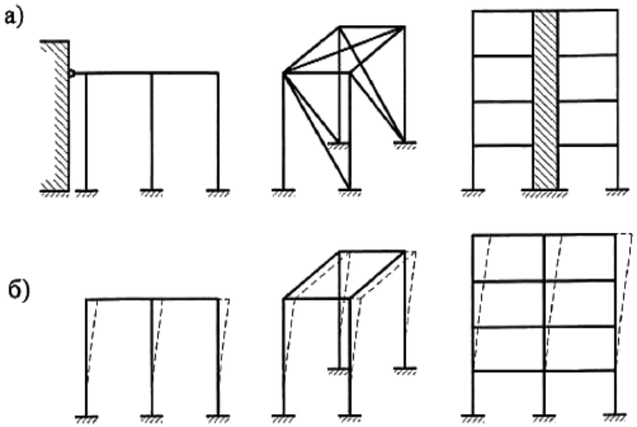

Рисунок 1 - Схемы систем, раскрепленных ( _а_ ) и не раскрепленных от перемещений ( _б_ )

При моделировании нелинейной работы стали для расчетов по первой группе предельных состояний следует использовать расчетную диаграмму работы сталей в обобщенных параметрах и , представленную на рисунке В.1 (приложение В). Значения соответствующих координат характерных точек диаграммы следует принимать по таблице В.9. Расчеты выполняют по одному из трех вариантов кривой: OBD, OACD, OACDE в зависимости от категории поставки проката и класса элементов конструкций (4.2.7).

*(Измененная редакция, Изменение N 1, 3, 6)*.

4.2.5 Пространственные стальные конструкции следует рассчитывать как единые системы с учетом факторов, определяющих напряженное и деформированное состояния, совместной работы элементов конструкций между собой и с основанием. ^c4-2-5

При расчете пространственных конструкций (мембран, пластинок, оболочек), а также конструкций с элементами с нелинейной диаграммой деформирования, следует учитывать влияние геометрической и физической нелинейности.

*(Измененная редакция, Изменение N 1, 2)*.

4.2.6 Несущая способность и жесткость каркасов производственных зданий обеспечивается поперек здания поперечными рамами, состоящими из колонн (стоек рамы) и ригелей в виде ферм или сплошностенчатых сечений (балок), а вдоль здания - элементами каркаса (подкрановыми конструкциями, подстропильными фермами, связями между колоннами и фермами, кровельными прогонами или ребрами стальных кровельных панелей). ^c4-2-6

Оценивать общую устойчивость каркаса по недеформированной схеме следует для: рамной (с жесткими узлами соединения ригелей с колоннами), рамно-связевой (рамный каркас с вертикальными диафрагмами жесткости или жесткими вставками) или связевой (с шарнирными узлами соединения ригелей с колоннами) систем, у которых есть в своем составе продольные и поперечные рамы и связи, установленные в соответствии с 15.4.

В рамно-связевой или в связевой системе, когда узлы связевого блока не совпадают с узлами каркаса, расчет следует выполнять по деформированной схеме (с учетом геометрической нелинейности системы).

*(Измененная редакция, Изменение N 2)*.

4.2.7 Элементы конструкций, рассматриваемые в настоящем своде правил, в зависимости от напряженно-деформированного состояния (НДС) расчетного сечения подразделяются на три класса: ^c4-2-7

1-й класс - НДС, при котором напряжения по всей площади сечения не превышают расчетного сопротивления стали (упругое состояние сечения);

2-й класс - НДС, при котором в одной части сечения , а в другой (упруго-пластическое состояние сечения);

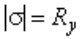

3-й класс - НДС, при котором по всей площади сечения

(пластическое состояние сечения, условный пластический шарнир).

4.2.8. Буквенные обозначения величин, использованные в настоящем своде правил, приведены в приложении А.

## 4.3 Учет назначения и условий работы конструкций

4.3.1 В зависимости от назначения, условий работы и наличия сварных соединений конструкции следует подразделять на четыре группы согласно приложению В. ^c4-3-1

4.3.2 При расчете конструкций и соединений следует учитывать: ^c4-3-2

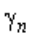

, принимаемые согласно требованиям [[ГОСТ 27751]];

коэффициенты надежности по ответственности коэффициент надежности =1,3 для элементов конструкций, рассчитываемых на прочность с использованием расчетных сопротивлений ;

коэффициенты условий работы элементов конструкций и соединений , и , принимаемые по таблице 1; пункту 7.1.2; таблице 45 и разделам 14, 16, 17 и 18.

Отношение критической нагрузки к расчетной для стержневых конструкций, рассчитываемых как идеализированные пространственные системы с использованием сертифицированных вычислительных комплексов (согласно 4.2.5, 4.2.6), должно быть не меньше коэффициента надежности по устойчивости системы в целом =1,3.

4.3.3 При проектировании конструкций, подвергающихся непосредственному воздействию подвижных, вибрационных и других переменных нагрузок, вызывающих усталость металла, следует применять такие конструктивные решения, которые не вызывают значительной концентрации напряжений, а в случаях, указанных в настоящем своде правил, выполнять расчет на усталость. ^c4-3-3

**Таблица 1**

|Элементы конструкций|Коэффициенты условий работы|

|---|---|

|1 Балки сплошного сечения и сжатые элементы ферм перекрытий под залами театров, клубов, кинотеатров, под трибунами, под| 0,90|

|помещениями магазинов, книгохранилищ и архивов и т.п. при временной нагрузке, не превышающей вес перекрытий||

|2 Колонны||

|---|---|

|общественных и жилых зданий при постоянной нагрузке, равной не менее 0,8 расчетной;|0,95|

|многоэтажных зданий высотой до 150 м включительно;|0,95|

|двутаврового сечения многоэтажных зданий высотой более 150 м;|0,90|

|коробчатого сечения многоэтажных зданий высотой более 150 м;|0,87|

|опоры водонапорных башен|0,95|

|3 Колонны одноэтажных производственных зданий с мостовыми кранами|1,05|

|4 Сжатые основные элементы (кроме опорных) решетки составного таврового сечения из двух уголков или лямбда-профилей в сварных фермах покрытий и перекрытий при расчете на устойчивость указанных элементов с гибкостью >60|0,80|

|5 Растянутые элементы (затяжки, тяги, оттяжки, подвески) при расчете на прочность по неослабленному сечению|0,90|

|6 Элементы конструкций из стали с пределом текучести до 440 Н/мм , несущие статическую нагрузку, при расчете на прочность по сечению, ослабленному отверстиями для болтов (кроме фрикционных соединений)|1,10|

|7 Сжатые элементы решетки пространственных решетчатых конструкций из одиночных уголков или лямбда-профилей, прикрепляемые одной полкой (для неравнополочных уголков - б льшей полкой):||

|а) непосредственно к поясам сварными швами либо двумя болтами и более, установленными вдоль уголка:||

|раскосы по рисунку 15,_а_и распорки по рисунку 15,_б, в, е_|0,90|

|раскосы по рисунку 15,_в, г, д, е_|0,80|

|б) непосредственно к поясам одним болтом или через фасонку независимо от вида соединения|0,75|

|8 Сжатые элементы из одиночных уголков или лямбда-профилей, прикрепляемых одной полкой (для неравнополочных уголков - полкой), за исключением элементов плоских ферм из одиночных уголков или лямбда-профилей и элементов, указанных в позиции 7 настоящей таблицы, раскосов по рисунку 15,_б_, прикрепляемых непосредственно к поясам сварными швами либо двумя болтами и более, установленными вдоль уголка, и плоских ферм из одиночных уголков или лямбда-профилей|0,75|

|9 Опорные плиты из стали с пределом текучести до 390 Н/мм , несущие статическую нагрузку, толщиной, мм:||

|а) до 40|1,20|

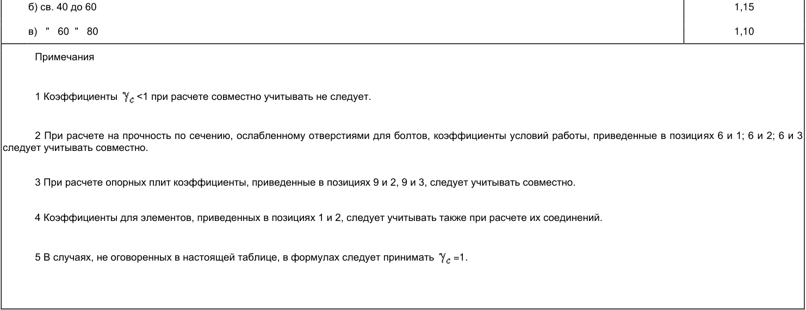

<!-- Start of picture text --> б) св. 40 до 60 1,15 в) " 60 " 80 1,10 Примечания 1 Коэффициенты <1 при расчете совместно учитывать не следует. 2 При расчете на прочность по сечению, ослабленному отверстиями для болтов, коэффициенты условий работы, приведенные в позициях 6 и 1; 6 и 2; 6 и 3 следует учитывать совместно. 3 При расчете опорных плит коэффициенты, приведенные в позициях 9 и 2, 9 и 3, следует учитывать совместно. 4 Коэффициенты для элементов, приведенных в позициях 1 и 2, следует учитывать также при расчете их соединений. 5 В случаях, не оговоренных в настоящей таблице, в формулах следует принимать =1. <!-- End of picture text -->

**Таблица 1 *(Измененная редакция, Изм. № 6)*.**

4.3.4 При проектировании конструкций, возводимых или эксплуатируемых в условиях низких температур ( _t_ <-45°С), при которых повышается возможность хрупкого разрушения, следует учитывать требования к материалу, конструированию и технологии изготовления. ^c4-3-4

4.3.5 При проектировании сварных конструкций следует снижать вредное влияние остаточных деформаций и напряжений, в том числе сварочных, а также концентрации напряжений, предусматривая соответствующие конструктивные решения (с наиболее равномерным распределением напряжений в элементах и деталях, без входящих углов, резких перепадов сечения и других концентраторов напряжений) и технологические мероприятия (порядок сборки и сварки, предварительный выгиб, механическую обработку соответствующих зон путем строжки, фрезерования, зачистки абразивным кругом и др.). ^c4-3-5

**5 Материалы для конструкций и соединений**

5.1 Физические характеристики материалов, применяемых для стальных конструкций, следует принимать согласно таблицам Б.1 и Б.2 (приложение Б). ^c5-1

5.2 При назначении стали для конструкций следует учитывать группу конструкций, расчетную температуру, требования по ударной вязкости и химическому составу согласно приложению В. Для объектов реконструкции следует руководствоваться требованиями раздела 18.2. ^c5-2

*(Измененная редакция, Изменение N 3)*.

5.3 Для конструкций следует использовать фасонный (уголки, двутавры, швеллеры), листовой, широкополосный универсальный прокат и гнутые профили; тонколистовой прокат из углеродистой стали и из стали повышенной прочности; холодногнутые профили; профили гнутые замкнутые квадратные и прямоугольные; сортовой прокат (круг, квадрат, полоса) в соответствии с действующими нормативными документами (НД); электросварные и горячедеформированные бесшовные трубы - в соответствии с таблицами В.1 и В.2 (приложение В). ^c5-3

Другие материалы, с сертификатом соответствия установленной формы, следует использовать при условии выполнения требований приложения В к механическим свойствам и химическому составу.

В зависимости от особенностей конструкций и узлов при назначении стали следует учитывать классификацию листового проката в зависимости от значения относительного сужения (см. 13.4) в соответствии с действующим стандартом.

*(Измененная редакция, Изменение N 3, 5)*.

5.4 Для отливок (опорных частей и т.п.) следует применять сталь, удовлетворяющую требованиям действующих стандартов для группы II (отливки ответственного назначения для деталей, рассчитываемых на прочность, работающих при статических и переменных нагрузках) или III (отливки особо ответственного назначения для деталей, рассчитываемых на прочность, работающих при динамических нагрузках). Расчетные сопротивления отливок из серого чугуна следует принимать по таблице В.8. ^c5-4

*(Измененная редакция, Изменение N 1)*.

5.5 Для сварки стальных конструкций следует применять: электроды для ручной дуговой сварки; сварочную проволоку; флюсы; порошковую проволоку для автоматической и механизированной сварки в соответствии с таблицей Г.1 (приложение Г), а также углекислый газ и аргон в соответствии с действующими стандартами. ^c5-5

Применяемые сварочные материалы и технология сварки должны обеспечивать значение временного сопротивления металла шва не ниже нормативного значения временного сопротивления основного металла, а также значения твердости, ударной вязкости и относительного удлинения металла сварных соединений, установленные соответствующими нормативными документами.

5.6 Для болтовых соединений следует применять стальные болты, гайки и шайбы, удовлетворяющие требованиям действующих стандартов, а также болты в комплектах с гайками и шайбами, указанные в 5.7. ^c5-6

Болты следует применять согласно таблице Г.3.

При работе болтов на растяжение классы прочности гаек следует принимать в соответствии с классом прочности болтов: 5 - при 5.6 и 5.8; 8 - при 8.8; 10 - при 10.9; 12 - при 12.9.

При работе болтов только на срез применяют класс прочности гаек при классе прочности болтов: 4 - при 5.6 и 5.8; 5 - при 8.8; 8 - при 10.9; 10 - при 12.9.

Шайбы следует применять: круглые, косые и пружинные нормальные в соответствии с действующими стандартами.

*(Измененная редакция, Изменение N 2, 3)*.

5.7 Для фрикционных и фланцевых соединений следует применять болты классов прочности 8.8, 10.9, 12.9, гайки и шайбы соответствующих классов, конструкцией и размерами, удовлетворяющими действующим стандартам. ^c5-7

*(Измененная редакция, Изменение N 2)*.

5.8 Болты U-образные (в том числе для крепления оттяжек антенных сооружений связи), а также фундаментные болты (в том числе для опор воздушных линий электропередачи и распределительных устройств), их конструкцию и размеры следует выбирать в соответствии с действующими стандартами и требованиями, приведенными в таблице Г.4. ^c5-8

Анкерные болты следует применять согласно требованиям [[СП 43.13330]].

*(Измененная редакция, Изменение N 3)*.

5.9 Гайки для фундаментных и U-образных болтов следует применять по соответствующим требованиям действующих стандартов. Для фундаментных болтов из стали С245 или С255 диаметром до 48 мм следует применять гайки класса прочности 4, диаметром свыше 48 мм - из материала не ниже группы 02 по соответствующему стандарту. ^c5-9

Для фундаментных болтов диаметром до 48 мм из стали с расчетным сопротивлением не менее 355 Н/мм следует применять гайки класса прочности не ниже 5-го, диаметром свыше 48 мм - из материала не ниже группы 05 по соответствующему стандарту.

*(Измененная редакция, Изменение N 1, 3)*.

5.10 Для шарниров, катков и болтов, работающих в качестве шарниров, а также подкладных листов под катки, следует применять поковки по [[СП 35.13330]]. ^c5-10

5.11 Для несущих элементов висячих покрытий, оттяжек опор воздушных линий электропередачи, распределительных устройств, контактных сетей транспорта, мачт и башен, а также напрягаемых элементов в предварительно напряженных конструкциях в соответствии с действующими стандартами следует применять: ^c5-11

канаты спиральные;

канаты двойной свивки;

канаты закрытые несущие;

пучки и пряди параллельных проволок, формируемых из канатной проволоки.

**6 Расчетные характеристики материалов и соединений** 6.1 Расчетные сопротивления проката, гнутых профилей и труб для различных видов напряженных состояний следует определять по формулам, приведенным в таблице 2, где нормативные сопротивления и следует принимать согласно НД.

**Таблица 2**

|Напряженное состояние|Расчетные сопротивления проката и труб|

|---|---|

|Растяжение, сжатие, изгиб:||

|по пределу текучести||

|по временному сопротивлению||

|Сдвиг||

|Смятие||

|торцевой поверхности (при наличии пригонки)||

|местное в цилиндрических шарнирах (цапфах)||

|при плотном касании||

|Диаметральное сжатие катков (при свободном касании в конструкциях с ограниченной подвижностью)||

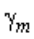

проката, гнутых профилей и труб следует принимать по таблице 3.

Значения коэффициентов надежности по материалу

# Таблица 3

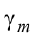

|Условия контроля свойств проката|Коэффициент надежности по материалу|

|---|---|

|Для проката при статистической процедуре контроля его свойств|1,025|

|Для проката, не использующего статистическую процедуру контроля его свойств, с пределом текучести свыше 380 Н/мм ; для горячедеформированных труб; для проката и труб зарубежного производства, получивших документ оценки соответствия для российского рынка|1,100|

|Для остального проката и труб, соответствующих требованиям настоящего свода правил|1,050|

|Для проката и труб, используемых в сооружениях класса КС-1 ([[ГОСТ 27751]]) с ограниченным сроком службы и пребыванием в них людей (шпунтовые ограждения котлованов, временные опоры и т.п.)|1,000|

**Таблица 3 *(Измененная редакция, Изменение N 1, 2, 3, 5)*.**

Значения нормативных и расчетных сопротивлений при растяжении, сжатии и изгибе листового, широкополосного универсального проката и труб приведены в таблице В.3, фасонного проката - в таблицах В.4 и В.5 (приложение В).

Значения расчетных сопротивлений проката смятию торцевой поверхности, местному смятию в цилиндрических шарнирах и диаметральному сжатию катков приведены в таблице В.6 (приложение В).

6.2 Расчетные сопротивления гнутых профилей следует принимать равными расчетным сопротивлениям листового проката, из которого они изготовлены. ^c6-2

6.3 Значения расчетных сопротивлений отливок из углеродистой стали следует принимать по таблице В.7 (приложение В). ^c6-3

6.4 Расчетные сопротивления сварных соединений для соединений различных видов и напряженных состояний следует определять по формулам, приведенным в таблице 4. ^c6-4

**Таблица 4**

|Сварные соединения|Напряженное состояние|Характеристика расчетного сопротивления Расчетные сопротивления сварных соединений|

|---|---|---|

|Стыковые|Сжатие, растяжение и изгиб при автоматической, механизированной или ручной сварке при контроле качества шва неразрушающими методами|По пределу текучести||

|---|---|---|---|

|||По временному сопротивлению||

||Растяжение и изгиб при автоматической, механизированной или ручной сварке|По пределу текучести||

||Сдвиг|||

|С угловыми швами|Срез (условный)|По металлу шва||

|||По металлу границы сплавления||

|Примечание - Значения|коэффициентов надежности по металлу шва|следует принимать равными: 1,25 - при|490 Н/мм ; 1,35 - при 590 Н/мм .|

**Таблица 4 *(Измененная редакция, Изменение N 1)*.**

Расчетное сопротивление сварного стыкового соединения элементов из сталей с разными нормативными сопротивлениями следует принимать как для стыкового соединения из стали с меньшим значением нормативного сопротивления. Значения нормативных и расчетных сопротивлений металла угловых швов приведены в таблице Г.2 (приложение Г).

6.5 Расчетные сопротивления одноболтового соединения следует определять по формулам, приведенным в таблице 5. ^c6-5

**Таблица 5**

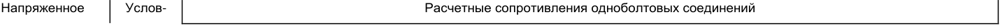

<!-- Start of picture text --> Напряженное Услов- Расчетные сопротивления одноболтовых соединений <!-- End of picture text -->

|состояние|ное||срезу и раст|яжению болтов клас|сов прочности|смятию|

|---|---|---|---|---|---|---|

||обо- значе- ние|5.6|5.8|8.8|10.9 12.9|соединя- емых элементов|

|Срез||||||-|

|Растяжение||||||-|

|Смятие:|||||||

|а) болты класса точности А|*|||-|||

|б) болты класса точности В||||-|||

|* следует опред|елять для сое|диняемых элементо|в из стали с пределом|текучести до 450 Н/м|м .||

**Таблица 5 *(Измененная редакция, Изменение N 3, 5)*.**

Значения нормативных и расчетных сопротивлений срезу и растяжению стали болтов в одноболтовых соединениях приведены в таблице Г.5, а смятию элементов, соединяемых болтами, в таблице Г.6 (приложение Г).

6.6 Расчетное сопротивление растяжению фундаментных и анкерных болтов следует определять по формуле ^c6-6

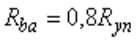

. (1)

Значения расчетных сопротивлений растяжению фундаментных болтов приведены в таблице Г.7 (приложение Г).

Расчетное сопротивление растяжению _U_ -образных болтов , указанных в 5.8, следует определять по формуле

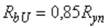

. (2)

# 6.7 *(Исключен, Изменение N 2)*.

6.8 Расчетное сопротивление растяжению высокопрочной стальной проволоки , применяемой в виде пучков или прядей, следует определять по формуле ^c6-8

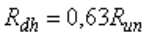

. (4)

6.9 Значение расчетного сопротивления (усилия) растяжению стального каната следует принимать равным значению разрывного усилия каната в целом, установленному НД на стальные канаты, деленному на коэффициент надежности по материалу =1,6. ^c6-9

**7 Расчет элементов стальных конструкций при центральном растяжении и сжатии**

## 7.1 Расчет элементов сплошного сечения

7.1.1 Расчет на прочность элементов из стали с нормативным сопротивлением 440 Н/мм при центральном растяжении или сжатии силой ^c7-1-1

_N_ следует выполнять по формуле

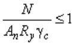

. (5)

Расчет на прочность растянутых элементов, эксплуатация которых возможна и после достижения металлом предела текучести, а также растянутых или сжатых элементов из стали с нормативным сопротивлением >440 Н/мм следует выполнять по формуле (5) с заменой значения на .

7.1.2 Расчет на прочность сечений в местах крепления растянутых элементов из одиночных уголков или лямбда-профилей, прикрепляемых одной полкой болтами, следует выполнять по формуле (5), а сечений растянутого одиночного уголка или лямбда-профиля из стали с пределом текучести до 380 Н/мм , прикрепляемого одной полкой болтами, поставленными в один ряд по оси, расположенной на расстоянии не менее 0,5 _b_ ( _b_ - ширина полки уголка, для лямбда-профиля от наружного края обушка до края пера) от обушка уголка и не менее 1,2 _d_ ( _d_ - диаметр отверстия для болта с учетом положительного допуска) от пера уголка, по формуле ^c7-1-2

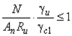

, (6)

где .

Здесь - площадь сечения уголка нетто;

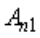

- площадь части сечения прикрепляемой полки уголка между краем отверстия и пером;

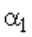

- , , - коэффициенты, принимаемые по таблице 6.

**Таблица 6**

|Коэффициент|||Значения коэффици|ентов , и|||

|---|---|---|---|---|---|---|

||при одно|м болте и расстоянии| , равном|при|и при числе бо|лтов в ряду|

||1,35_d_*|1,5_d_|2_d_|2|3|4|

||1,70|1,70|1,70|1,77|1,45|1,17|

||0,05|0,05|0,05|0,19|0,36|0,47|

||0,65|0,85|1,0|1,0|1,0|1,0|

* Только для элементов решеток (раскосов и распорок), кроме постоянно работающих на растяжение, при толщине полки до 6 мм.

_Обозначения, принятые в таблице 6:_

- " " - расстояние вдоль усилия от края элемента до центра ближайшего отверстия;

- " _s_ " - расстояние вдоль усилия между центрами отверстий.

При расчете тяг и поясов траверс, элементов опор ВЛ, ОРУ и КС, непосредственно примыкающих к узлам крепления проводов, а также элементов, соединяющих в стойках узлы крепления тяг и растянутых поясов траверс, коэффициент следует уменьшать на 10%.

*(Измененная редакция, Изм. № 6)*.

7.1.3 Расчет на устойчивость элементов сплошного сечения при центральном сжатии силой _N_ и удовлетворяющих требованиям 7.3.2-7.3.9, следует выполнять по формуле для прокатных двутавров расчет допускается выполнять по формуле ^c7-1-3

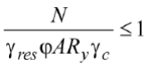

, (7а)

где - коэффициент учета распределения остаточных напряжений:

для сталей с 245 МПа (С255) 1 при 3, при 3; для сталей с 390 МПа (С390) 1 при 5, при 5; для сталей с другим расчетным сопротивлением (более 245 МПа и менее 390 МПа) определяется линейной интерполяцией в зависимости от .

Для сталей с расчетным сопротивлением более 390 МПа определяется как для сталей с 390 МПа, для сталей с расчетным сопротивлением менее 245 МПа принимается как для сталей с 245 МПа; - коэффициент устойчивости при центральном сжатии, значение которого при 0,6 следует определять по формуле

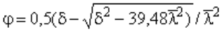

. (8)

Значение коэффициента в формуле (8) следует вычислять по формуле

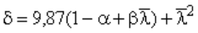

, (9)

где - условная гибкость стержня; и - коэффициенты, определяемые по таблице 7 в зависимости от типов сечений.

Значения коэффициента , вычисленные по формуле (8), следует принимать не более при значениях условной гибкости свыше 3,8; 4,4 и 5,8 для типов сечений _a_ , _b_ и _с_ , соответственно.

При значениях <0,6 для типов сечений _a_ и _b_ следует принимать =1.

Вычисленные по формуле (8) значения коэффициента приведены в таблице Д.1 (приложение Д).

*(Измененная редакция, Изм. № 6)*.

# Таблица 7

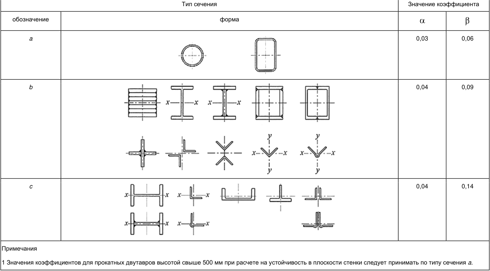

<!-- Start of picture text --> Тип сечения Значение коэффициента обозначение форма a 0,03 0,06 b 0,04 0,09 c 0,04 0,14 Примечания 1 Значения коэффициентов для прокатных двутавров высотой свыше 500 мм при расчете на устойчивость в плоскости стенки следует принимать по типу сечения a . <!-- End of picture text -->

2 На рисунках настоящей таблицы оси "x-x" и "y-y" обозначены в сечениях, нормально к которым располагается расчетная плоскость для определения по формуле (8); в остальных сечениях коэффициенты не зависят от расчетной плоскости.

**Таблица 7 *(Измененная редакция, Изменение N 1, 2, 6)*.**

7.1.4 Расчет на устойчивость стержней из одиночных уголков или лямбда-профилей следует выполнять с учетом требований 7.1.3. При определении гибкости этих стержней радиус инерции и расчетную длину следует принимать согласно 10.1.4 и 10.2.1. ^c7-1-4

При расчете поясов и элементов решетки пространственных конструкций из одиночных уголков следует выполнять требования 16.12.

*(Измененная редакция, Изм. № 6)*.

7.1.5 Сжатые элементы со сплошными стенками открытого П-образного сечения (рисунок 2) следует укреплять планками или решеткой, при этом должны быть выполнены требования 7.2.2; 7.2.3; 7.2.7 и 7.2.8. ^c7-1-5

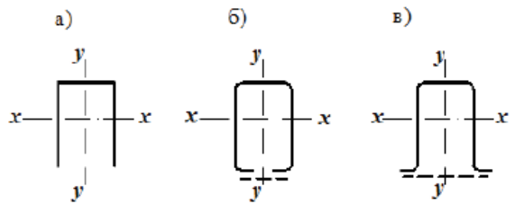

а) - открытое; б), в) - укрепленные планками или решетками

# Рисунок 2 - П-образные сечения элементов

При отсутствии планок или решеток такие элементы, помимо расчета по формуле (7) в главных плоскостях _х-х_ и _у-у_ , следует проверять на устойчивость при изгибно-крутильной форме потери устойчивости по формуле*

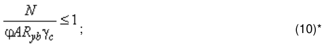

<!-- Start of picture text --> ; (10)* <!-- End of picture text -->

* В официальном издании - М.: Стандартинформ, 2017 год, в формуле допущена опечатка. Формула 10 должна иметь следующий вид:

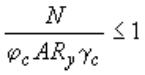

,

здесь - коэффициент, принимаемый равным

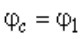

при ;

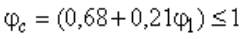

при ,

где значение следует вычислять по формуле

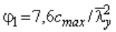

. (11)

В формуле (11) коэффициент следует определять по приложению Д.

7.1.6 Соединение пояса со стенкой в центрально сжатом элементе составного сплошного сечения следует рассчитывать по формулам таблицы 43 на сдвиг от условной поперечной силы , определяемой по формуле (18), при этом коэффициент следует принимать в плоскости стенки. ^c7-1-6

## 7.2 Расчет элементов сквозного сечения

7.2.1 Расчет на прочность элементов сквозного сечения при центральном растяжении и сжатии следует выполнять по формуле (5), где - площадь сечения нетто всего стержня. ^c7-2-1

7.2.2 Расчет на устойчивость сжатых стержней сквозного сечения, ветви которых соединены планками или решетками, следует выполнять по формуле (7); при этом коэффициент относительно свободной оси (перпендикулярной к плоскости планок или решеток) следует определять по формулам (8) и (9) для сечений типа _b_ с заменой в них на . Значение следует определять в зависимости от значений , приведенных в таблице 8 для стержней с числом панелей не менее шести. ^c7-2-2

Расчет на устойчивость сквозных стержней с числом панелей менее шести следует выполнять:

при планках - как расчет рамных систем;

при решетках - согласно требованиям 7.2.5.

7.2.3 В сквозных стержнях с планками условная гибкость отдельной ветви , или (см. таблицу 8) на участке между сварными швами или крайними болтами, прикрепляющими планки, должна быть не более 1,4. ^c7-2-3

При наличии в одной из плоскостей сплошного листа вместо планок (см. рисунок 2, _б_ ) и _в_ ) гибкость ветви следует вычислять по радиусу инерции полусечения относительно его центральной оси, перпендикулярной к плоскости планок.

7.2.4 В сквозных стержнях с решетками помимо расчета на устойчивость стержня в целом следует проверять устойчивость отдельных ветвей на участках между узлами. Влияние моментов в узлах следует учитывать, например, от расцентровки элементов решетки. ^c7-2-4

В сквозных стержнях с решетками условная гибкость отдельных ветвей между узлами должна быть не более 2,7 и не должна превышать условную приведенную гибкость стержня в целом.

Принимать более высокие значения условной гибкости ветвей, но не более 4,1, следует при условии, что расчет таких стержней выполнен согласно требованиям 7.2.5.

*(Измененная редакция, Изменение N 1)*.

7.2.5 Расчет сквозных стержней с решетками с учетом указанного в 7.2.2 и 7.2.4 следует выполнять по формуле (7) с заменой в ней значения на . ^c7-2-5

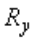

При этом коэффициент устойчивости для отдельной ветви при 2,7 следует принимать равным 1,0, а при 3,2 - определять по формуле (8) при расчетной длине , где - длина ветви (на рисунке 3, а длина ветви - 2 ).

В интервале условных гибкостей 2,7 3,2 значение следует определять линейной интерполяцией между 1,0 и значением при =3,2.

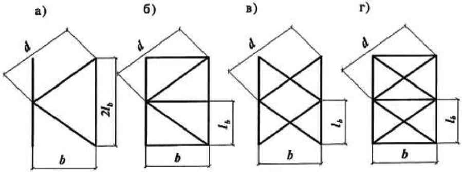

а) - треугольная; б) - треугольная с распорками; в) - крестовая; г) - крестовая с распорками

Рисунок 3 - Схемы решеток сквозных стержней

# Таблица 8

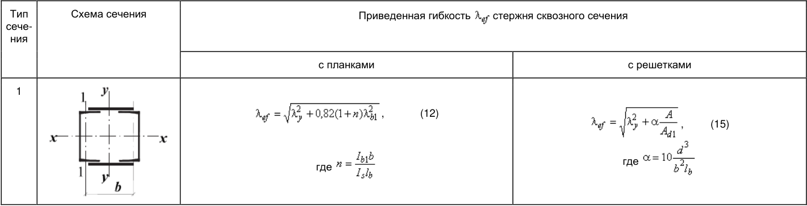

<!-- Start of picture text --> Тип Схема сечения Приведенная гибкость стержня сквозного сечения сече- ния с планками с решетками 1 , (12) , (15) где где <!-- End of picture text -->

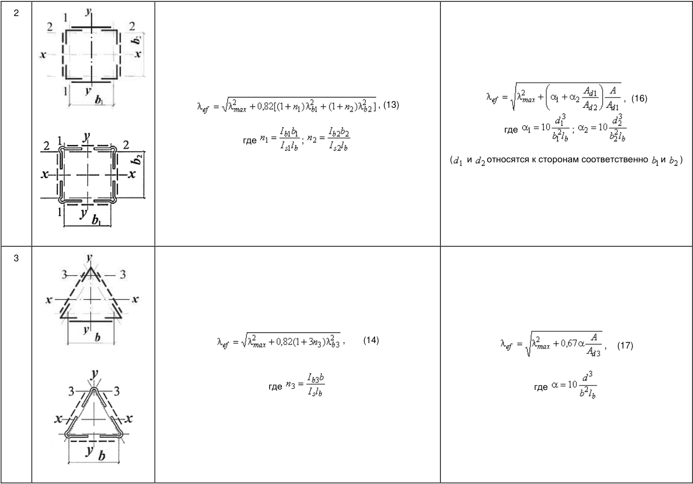

<!-- Start of picture text --> 2 , (16) , (13) где ; где ; ( и относятся к сторонам соответственно и ) 3 , (14) , (17) где где <!-- End of picture text -->

Обозначения, принятые в таблице 8:

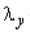

- гибкость сквозного стержня в целом в плоскости, перпендикулярной к оси _у-у_ ;

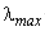

- наибольшая из гибкостей сквозного стержня в целом в плоскостях, перпендикулярных к осям _х-х_ или _у-у_ ;

- , , - гибкости отдельных ветвей при изгибе в плоскостях, перпендикулярных к осям соответственно 1-1, 2-2 и 3-3, на участках между сварными

- швами или крайними болтами, прикрепляющими планки; _b,_ ( , ) - расстояние между осями ветвей; _d_ , - размеры, определяемые по рисункам 3 и 4; _А_ - площадь сечения всего стержня; , - площади сечений раскосов решеток (при крестовой решетке - двух раскосов), расположенных соответственно в плоскостях,

- перпендикулярных к осям 1-1 и 2-2; - площадь сечения раскоса решетки (при крестовой решетке - двух раскосов), лежащей в плоскости одной грани (для трехгранного равностороннего

- стержня); , - моменты инерции сечения ветвей относительно осей соответственно 1-1 и 3-3 (для сечений типов 1 и 3); , - то же, двух уголков относительно осей соответственно 1-1 и 2-2 (для сечения типа 2);

- - момент инерции сечения одной планки относительно собственной оси _х-х_ (рисунок 4; для сечений типов 1 и 3); , - момент инерции сечения одной из планок, расположенных в плоскостях, перпендикулярных осям соответственно 1-1 и 2-2 (для сечения типа

- 2).

> **Примечание** — е - К типу 1 также следует относить сечения, у которых вместо швеллеров применены двутавры, трубчатые и другие профили для одной или обеих ветвей; при этом оси _у-у_ и 1-1 должны проходить через центры тяжести соответственно сечения в целом и отдельной ветви, а значения _n_ и в формуле (12) должны обеспечить наибольшее значение .

**Таблица 8 *(Измененная редакция, Изм. № 6)*.**

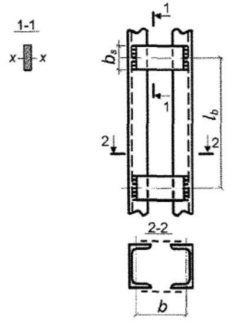

Рисунок 4* - Сквозной стержень с планками * Измененная редакция, Изм. N 1.

7.2.6 Расчет стержней составных сечений из уголков, лямбда-профилей, швеллеров и др., соединенных стенками вплотную или через прокладки, следует выполнять как сплошностенчатые при условии, что участки между соединяющими сварными швами или центрами крайних болтов не превышают для сжатых элементов 40 _i_ и для растянутых 80 _i_ . Здесь радиус инерции сечения _i_ уголка или швеллера следует принимать для тавровых или двутавровых сечений относительно оси, параллельной плоскости расположения прокладок, а для крестовых сечений - минимальный. ^c7-2-6

При этом в пределах длины сжатого элемента следует предусматривать не менее двух промежуточных связей (прокладок).

*(Измененная редакция, Изм. № 6)*.

7.2.7 Расчет соединительных планок и элементов решеток сжатых стержней сквозного сечения следует выполнять на условную поперечную силу ^c7-2-7

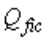

, принимаемую постоянной по всей длине стержня и определяемую по формуле

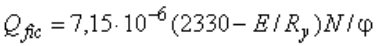

, (18)

где _N_ - продольное усилие в сквозном стержне;

- коэффициент устойчивости при центральном сжатии (для сечения типа _в_ ), принимаемый при расчете сквозного стержня в плоскости планок или решеток.

Условную поперечную силу следует распределять:

при наличии только соединительных планок (решеток) - поровну между планками (решетками), лежащими в плоскостях, перпендикулярных к оси, относительно которой производится проверка устойчивости;

при наличии сплошного листа и соединительных планок (решеток) - пополам между листом и планками (решетками), лежащими в плоскостях, параллельных листу;

при расчете равносторонних трехгранных сквозных стержней - равной 0,8 для каждой системы соединительных планок (решеток), расположенной в одной грани.

7.2.8 Расчет соединительных планок и их прикреплений (см. рисунок 4) должен выполняться, как расчет элементов безраскосных ферм, на совместное действие силы , срезывающей планку, и момента , изгибающего планку в ее плоскости, значения которых следует определять по формулам: ^c7-2-8

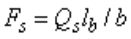

; (19)

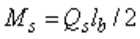

, (20)

где - условная поперечная сила, приходящаяся на планку одной грани. 7.2.9 Расчет элементов соединительных решеток составных стержней следует выполнять как расчет элементов решеток плоских ферм. При расчете раскосов решеток по рисунку 3 усилие в раскосе следует определять по формуле

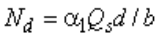

, (21)

где - коэффициент, принимаемый равным: 1,0 для решетки по рисункам 3, _a_ , _б_ и 0,5 - по рисунку 3, _в_ ; - условная поперечная сила, приходящаяся на одну плоскость решетки.

При расчете раскосов крестовой решетки с распорками (рисунок 3, г) следует учитывать дополнительное усилие , возникающее в каждом раскосе от обжатия ветвей и определяемое по формуле

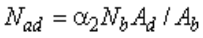

, (22)

где , , _d_ - размеры, указанные на рисунке 3; - усилие в одной ветви стержня;

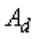

, - площадь сечения одного раскоса и одной ветви соответственно.

7.2.10 Расчет стержней, предназначенных для уменьшения расчетной длины сжатых элементов, должен выполняться на усилие, равное условной поперечной силе в основном сжатом элементе, определяемой по формуле (18). ^c7-2-10

Расчет распорок, предназначенных для уменьшения расчетной длины ветвей колонн в плоскости, перпендикулярной к плоскости поперечных рам, при наличии нагрузок от мостовых или подвесных кранов, следует выполнять на условную поперечную силу, определяемую по формуле (18), где значение _N_ следует принимать равным сумме продольных сил в двух ветвях колонн, соединенных распоркой.

**7.3 Проверка устойчивости стенок и поясных листов центрально сжатых элементов сплошного сечения**

7.3.1 При проверке устойчивости стенок расчетную высоту следует принимать по рисунку 5: ^c7-3-1

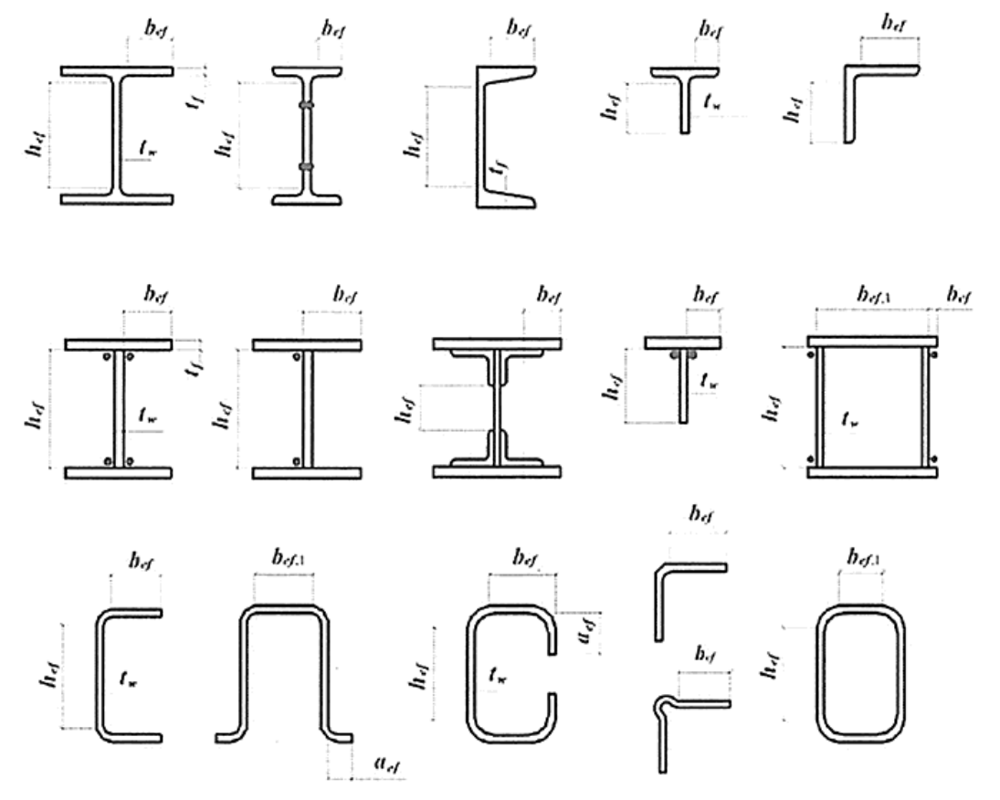

Рисунок 5* - Расчетные размеры стенок, свесов полок, поясных листов в прокатных, составных и гнутых профилях

- Измененная редакция, Изм. N 5, 6.

полную высоту стенки - в сварных элементах;

расстояние между ближайшими к оси элемента краями поясных уголков - в элементах с фрикционными поясными соединениями;

расстояние между началами внутренних закруглений - в прокатных профилях;

расстояние между краями выкружек - в гнутых профилях.

7.3.2 Устойчивость стенок центрально сжатых элементов сплошного сечения следует считать обеспеченной, если условная гибкость стенки не превышает значений предельной условной гибкости , определяемых по формулам таблицы 9. Более гибкие стенки следует применять при подтверждении их устойчивости (теоретическим или опытным путем). ^c7-3-2

**Таблица 9**

|Сечение|Условная гибкость элемента Предельная условная гибкость стенки|

|---|---|

||2 (23)|

||>2 (24)|

||1 1,2 (25)|

||>1 (26)|

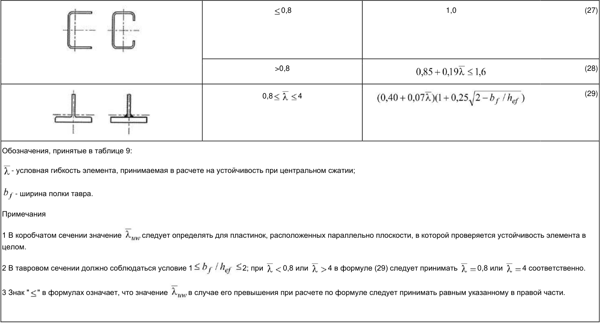

<!-- Start of picture text --> 0,8 1,0 (27) >0,8 (28) 0,8 4 (29) Обозначения, принятые в таблице 9: - условная гибкость элемента, принимаемая в расчете на устойчивость при центральном сжатии; - ширина полки тавра. Примечания 1 В коробчатом сечении значение следует определять для пластинок, расположенных параллельно плоскости, в которой проверяется устойчивость элемента в целом. 2 В тавровом сечении должно соблюдаться условие 1 2; при 0,8 или 4 в формуле (29) следует принимать 0,8 или 4 соответственно. 3 Знак " " в формулах означает, что значение в случае его превышения при расчете по формуле следует принимать равным указанному в правой части. <!-- End of picture text -->

**Таблица 9 *(Измененная редакция, Изменение N 1)*.**

7.3.3 Стенки центрально сжатых элементов сплошного сечения (колонн, стоек, опор и т.п.) при 2,3, за исключением рассчитанных с учетом геометрической нелинейности конструкций, следует укреплять поперечными ребрами жесткости с шагом от 2,5 до 3 . ^c7-3-3

В сплошностенчатых ветвях колонн сквозного сечения ребра жесткости следует устанавливать только в узлах крепления соединительных решеток (планок).

В стенке, укрепленной только поперечными ребрами, ширина их выступающей части должна быть не менее ( /30+40) мм - для парного симметричного ребра, не менее ( /20+50) мм - для одностороннего ребра; толщина ребра должна быть не менее .

При укреплении стенки односторонними поперечными ребрами жесткости одиночные уголки следует приваривать к стенке пером.

7.3.4 В центрально сжатых элементах двутаврового сечения с расчетной высотой стенки в случае укрепления стенки продольным ребром жесткости, расположенным посередине и с моментом инерции сечения , при , значение , установленное в 7.3.2, следует умножить на коэффициент ^c7-3-4

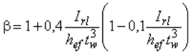

. (30)

При расположении ребра с одной стороны стенки, его момент инерции следует вычислять относительно оси, совпадающей с ближайшей гранью стенки и он должен быть не менее, чем для парного симметричного ребра.

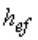

В случае выполнения продольного ребра в виде гофра стенки при вычислении следует учитывать развернутую длину гофра.

Продольные ребра жесткости следует включать в расчетные сечения элементов.

Минимальные размеры выступающей части продольных ребер жесткости следует принимать как для поперечных ребер согласно требованиям 7.3.3.

7.3.5 При расчете центральнои внецентренно сжатых стержней сплошного сечения в случаях, когда фактическое значение условной гибкости стенки превышает (при центральном сжатии не более чем в 2 раза) значение предельной условной гибкости стенки , полученное согласно требованиям 7.3.2, а также 9.4.2 и 9.4.3, в формулах (7), а также (109), (111), (115), (116), (120) и (121) принимают расчетную уменьшенную площадь сечения взамен _А_ . ^c7-3-5

*(Измененная редакция, Изменение N 1)*.

7.3.6 Значение следует вычислять по формулам: для двутаврового и швеллерного сечений , (31) для коробчатого сечения: при центральном сжатии ; (32) при внецентренном сжатии , (33) где и - расчетная и уменьшенная высота стенки, расположенной параллельно плоскости, в которой проверяется устойчивость; и - расчетная и уменьшенная ширина пояса коробчатого сечения, расположенного перпендикулярно к плоскости, в которой проверяется устойчивость. Значение в центрально сжатых элементах следует вычислять по формулам: для двутаврового сечения , (34) где при >3,5 следует принимать =3,5; для коробчатого сечения , (35) где при >2,3 следует принимать =2,3; для швеллерного сечения ^c7-3-6

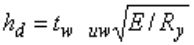

. (36)*

Значения и в формулах (34)-(36) для центрально сжатых элементов следует принимать согласно требованиям 7.3.2. При вычислении значения для коробчатого сечения по формуле (35) вместо , , и следует принимать соответственно , , и , при этом значение следует определять согласно требованиям 7.3.9.

Значение для внецентренно сжатых элементов двутаврового и коробчатого сечений следует вычислять по формулам соответственно (34) и (35); при этом в этих формулах значения и следует принимать согласно 9.4.2.

7.3.7 При проверке устойчивости поясных листов за расчетную ширину свеса следует принимать расстояние: ^c7-3-7

от грани стенки до края поясного листа (полки) - в сварных элементах;

от оси крайнего болта в поясе до края поясного листа - в элементах с фрикционными поясными соединениями;

от начала внутреннего закругления до края полки - в прокатных профилях;

от края выкружки до края полки - в гнутых профилях (см. рисунок 5).

7.3.8 Устойчивость поясных листов (полок) центрально сжатых элементов сплошного сечения следует считать обеспеченной, если условная гибкость свеса пояса (полки) не превышает значений предельной условной гибкости свеса пояса (полки) , определяемых по формулам таблицы 10, в которых при значениях <0,8 или >4 следует принимать соответственно =0,8 или =4. ^c7-3-8

*(Измененная редакция, Изменение N 2)*.

**Таблица 10**

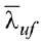

Сечение Предельная условная гибкость свеса пояса (полки)

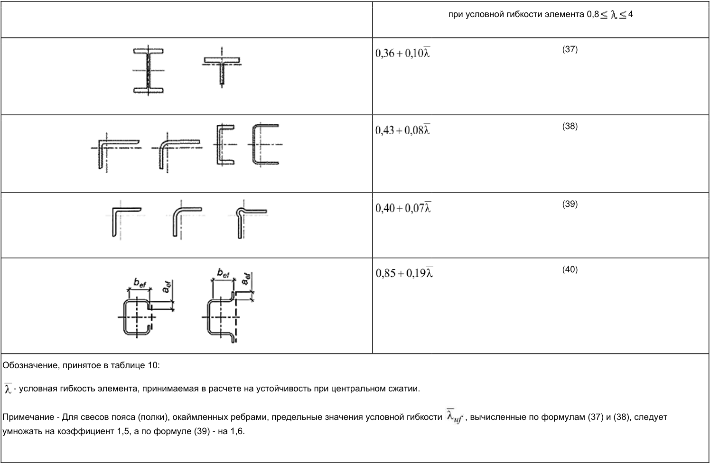

<!-- Start of picture text --> при условной гибкости элемента 0,8 4 (37) (38) (39) (40) Обозначение, принятое в таблице 10: - условная гибкость элемента, принимаемая в расчете на устойчивость при центральном сжатии. Примечание - Для свесов пояса (полки), окаймленных ребрами, предельные значения условной гибкости , вычисленные по формулам (37) и (38), следует умножать на коэффициент 1,5, а по формуле (39) - на 1,6. <!-- End of picture text -->

**Таблица 10 *(Измененная редакция, Изменение N 1, 2, 5, 6)*.**

7.3.9 В центрально сжатых элементах коробчатого сечения предельную условную гибкость поясного листа следует принимать по таблице 9 как для стенок коробчатого сечения. ^c7-3-9

*(Измененная редакция, Изм. № 6)*.

7.3.10 Высота отгиба свеса пояса (полки) по рисунку 5 или высота окаймляющего ребра, при его наличии, должна быть не менее 0,3 в элементах, не усиленных планками, и 0,2 - в элементах, усиленных планками (см. таблицу 10). Толщина окаймляющего ребра должна быть не менее . ^c7-3-10

*(Измененная редакция, Изменение N 2)*.

7.3.11 В случае, если проверка по предельной гибкости в двух плоскостях (раздел 10.4) является определяющей при назначении сечений центрально сжатых элементов, значения предельных условных гибкостей стенки и поясов ( ), вычисленных по таблицам 9 и 10 соответственно, следует увеличивать умножением на коэффициент , но не более чем на 1,25. ^c7-3-11

*(Измененная редакция, Изменение N 3)*.

**8 Расчет элементов стальных конструкций при изгибе**

## 8.1 Общие положения расчета

В зависимости от назначения и условий эксплуатации конструкций расчет изгибаемых элементов (балок) следует выполнять без учета или с учетом пластических деформаций в соответствии с подразделением элементов на три класса согласно 4.2.7.

Балки 1-го класса следует применять для нагрузок всех видов и рассчитывать в пределах упругих деформаций; балки 2-го и 3-го классов следует применять для статических нагрузок и рассчитывать с учетом развития пластических деформаций.

Балки крановых путей под краны групп режимов работы 1К-8К по [[СП 20.13330]] при расчете на прочность следует относить к 1-му классу.

Бистальные балки следует относить ко 2-му классу и рассчитывать с учетом ограниченных пластических деформаций в стенке, значения которых следует определять при достижении расчетного сопротивления в поясах, выполненных из более прочной стали.

*(Измененная редакция, Изменение N 2)*.

8.2 Расчет на прочность изгибаемых элементов сплошного сечения ^c8-2

8.2.1 Расчет на прочность балок 1-го класса следует выполнять по формулам: ^c8-2-1

при действии момента в одной из главных плоскостей ; (41) действии в сечении поперечной силы ; (42) при действии моментов в двух главных плоскостях (и при наличии бимомента) , (43) где _х_ и _у_ - расстояния от главных осей до рассматриваемой точки сечения, а - секториальная координата этой точки; при одновременном действии в стенке балки момента и поперечной силы , , (44) где - нормальное напряжение в срединной плоскости стенки, параллельное продольной оси балки; - то же, перпендикулярное к продольной оси балки, в том числе , определяемое по формуле (47); - касательное напряжение в стенке. Напряжения и , принимаемые в формуле (44) со своими знаками, а также следует определять в одной и той же точке стенки балки.

При проверке прочности на действие поперечной силы на опоре для разрезных балок формулу (42) следует использовать без учета работы поясов.

В балках, рассчитываемых по формуле (43), значения напряжений в стенке балки должны быть проверены по формуле (44) в двух главных плоскостях изгиба.

При ослаблении стенки отверстиями для болтов левую часть формулы (42), а также значение в формуле (44), следует умножать на коэффициент , определяемый по формуле

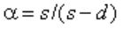

, (45)

где _s_ - шаг отверстий в одном вертикальном ряду; _d_ - диаметр отверстия.

*(Измененная редакция, Изменение N 3)*.

8.2.2 Расчет на прочность стенки балки, не укрепленной ребрами жесткости, при действии местного напряжения в местах приложения нагрузки к верхнему поясу, а также в опорных сечениях балки, следует выполнять по формуле ^c8-2-2

, (46) где . (47) Здесь _F_ - расчетное значение нагрузки (силы); - условная длина распределения нагрузки, определяемая по формулам: для случаев по рисунку 6, _а_ ) и _б_ ) ; (48) для случая по рисунку 6, _в_ , (49)

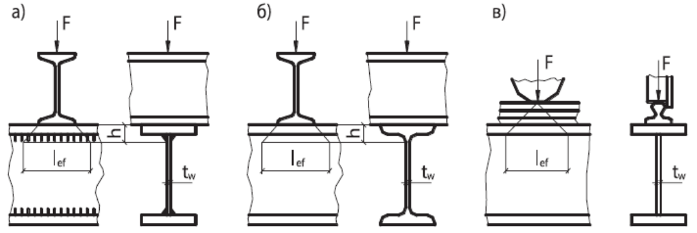

a) - сварная балка; б) - прокатная балка; в) - сварная или прокатная балки при нагрузке от колеса крана

Рисунок 6 - Схемы распределения сосредоточенной нагрузки на стенку балки где _h_ - размер, равный сумме толщины верхнего пояса балки и катета поясного шва, если нижняя балка сварная (см. рисунок 6, а), либо расстоянию от наружной грани полки до начала внутреннего закругления стенки, если нижняя балка прокатная (см. рисунок 6, б);

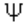

- коэффициент, принимаемый равным: 3,25 - для сварных и прокатных балок;

4,5 - для балок с фрикционными поясными соединениями;

- сумма собственных моментов инерции пояса балки и кранового рельса или момент инерции сечения, состоящего из пояса и рельса в случае приварки рельса швами, обеспечивающими совместную работу пояса и рельса;

_b_ - ширина опирания верхнего элемента.

- (Поправка. ИУС N 7-2021), *(Измененная редакция, Изменение N 3)*.

8.2.3 Расчет на прочность разрезных балок 2-го и 3-го классов двутаврового и коробчатого сечений (рисунок 7) из стали с нормативным сопротивлением 440 Н/мм при соблюдении требований 8.4.6, 8.5.8, 8.5.9 и 8.5.18 и при касательных напряжениях (кроме опорных сечений) следует выполнять по формулам: ^c8-2-3

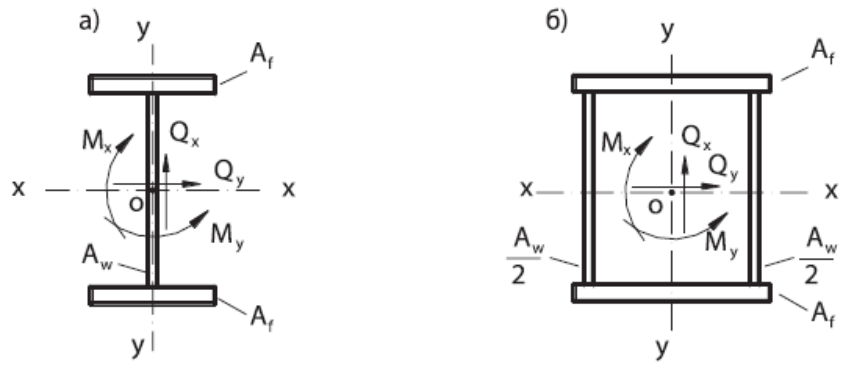

Рисунок 7 - Схемы двутаврового (а) и коробчатого (б) сечений балок с действующими на них усилиями при изгибе в плоскости наибольшей жесткости ( )

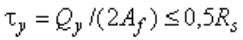

при изгибе в двух главных плоскостях и напряжениях

; (50)

. (51)

Здесь , - абсолютные значения изгибающих моментов;

- , - коэффициенты, принимаемые по таблице Е.1;

- коэффициент, принимаемый равным:

при =1;

# при

, (52)

где - отношение площади сечения пояса к площади сечения стенки (для несимметричного сечения - площадь меньшего пояса; для коробчатого сечения - суммарная площадь сечений двух стенок).

при изгибе в плоскости наибольшей жесткости ( ) и стесненном кручении симметричных двутавров

, (53)

где - определяется линейной интерполяцией по таблице 10а:

**Таблица 10а**

|0 1,470|0,1 1,636|0,2 1,845|0,3 2,054|0,4 2,263|0,5 2,472|0,6 2,681|0,7 2,890|0,8 3,099|0,9 3,308|0,99 3,496|

|---|---|---|---|---|---|---|---|---|---|---|

При расчете сечения в зоне чистого изгиба в формулах (50) и (51) следует принимать =1 и вместо коэффициентов и соответственно

; .

Расчет на прочность в опорном сечении балок (при =0 и =0) следует выполнять по формулам:

, (54)

. (55)

При ослаблении стенки отверстиями для болтов левую часть формул (54) и (55) следует умножать на коэффициент , определяемый по формуле (45).

Для установления размеров минимальных сечений составных балок коэффициенты и следует принимать меньше значений, приведенных в таблице Е.1, но не менее 1,0. Методика подбора минимальных сечений изгибаемых элементов приведена в правилах по проектированию стальных конструкций.

*(Измененная редакция, Изменение N 1)*.

8.2.4 Расчет на прочность разрезных балок переменного сечения согласно 8.2.3 с учетом пластических деформаций выполняется только в одном сечении с наиболее неблагоприятным сочетанием усилий _М_ и _Q_ ; в остальных сечениях балки расчет следует выполнять при значениях коэффициентов и меньших, чем в таблице Е.1 (приложение Е), или согласно 8.2.1. ^c8-2-4

8.2.5 Расчет на прочность неразрезных и защемленных балок постоянного двутаврового и коробчатого сечений с двумя осями симметрии, изгибаемых в плоскости наибольшей жесткости, со смежными пролетами, отличающимися не более чем на 20%, при соблюдении требований 8.4.6, 8.5.8, 8.5.9 и 8.5.18 следует выполнять по формуле (50) как расчет элементов 2-го класса с учетом частичного перераспределения опорных и пролетных моментов. ^c8-2-5

В этом случае расчетное значение момента следует определять по формуле

, (56)

где - наибольший изгибающий момент в пролете или на опоре, определяемый из расчета неразрезной балки в предположении упругой работы стали;

- условный изгибающий момент, равный:

а) в неразрезных балках с шарнирно опертыми концами б льшему из значений:

; (57)*

, (58)

где символ означает, что следует найти максимум всего следующего за ним выражения;

- изгибающий момент в крайнем пролете, вычисленный как в шарнирно опертой однопролетной балке;

- расстояние от сечения, в котором действует момент , до крайней опоры;

- длина крайнего пролета;

- максимальный изгибающий момент в промежуточном пролете, вычисленный как в шарнирно опертой однопролетной балке;

б) в однопролетных и неразрезных балках с защемленными концами ,

где - наибольший из моментов, вычисленных как в балках с шарнирами на опорах;

в) в балке с одним защемленным и другим свободно опертым концом значение следует определять по формуле (57).

Значение в формуле (52) следует вычислять в сечении, где действует ; если - момент в пролете, следует проверить опорное сечение балки.

*(Измененная редакция, Изменение N 1)*.

8.2.6 Расчет на прочность неразрезных и защемленных балок, удовлетворяющих 8.2.5, в случае изгиба в двух главных плоскостях следует выполнять по формуле (51) с учетом перераспределения опорных и пролетных моментов в двух главных плоскостях согласно 8.2.5. ^c8-2-6

8.2.7 Расчет на прочность неразрезных и защемленных балок, удовлетворяющих требованиям 8.2.5, 8.4.6, 8.5.8, 8.5.9 и 8.5.18, следует выполнять по формуле (50) как расчет элементов 3-го класса с учетом перераспределения изгибающих моментов и образования условных пластических шарниров, а также влияния касательных напряжений в соответствии с 8.2.3 в сечениях с максимальным изгибающим моментом. ^c8-2-7

*(Измененная редакция, Изменение N 1)*.

8.2.8 Расчет на прочность бистальных разрезных балок двутаврового и коробчатого сечений с двумя осями симметрии при соблюдении требований 8.4.4, 8.5.9 и 8.5.17 и при касательных напряжениях и (кроме опорных сечений) следует выполнять как расчет элементов 2-го класса по формулам: ^c8-2-8

при изгибе в одной главной плоскости

; (59)

при изгибе в двух главных плоскостях

. (60)

В формулах (59) и (60):

, (61)

<!-- Start of picture text --> где ; ; - коэффициент, принимаемый равным: при =1; (62) при ; <!-- End of picture text -->

- коэффициент, принимаемый равным 1,15 - для двутаврового сечения и 1,05/ _r_ - для коробчатого сечения.

Расчет бистальных балок при наличии зоны чистого изгиба и в опорном сечении, а также с учетом ослабления сечения следует выполнять согласно 8.2.3 и правил проектирования стальных конструкций.

*(Измененная редакция, Изменение N 1)*.

8.3 Расчет на прочность балок крановых путей сплошного сечения ^c8-3

8.3.1 Расчет на прочность балок крановых путей следует выполнять согласно 8.2.1 на действие вертикальных и горизонтальных нагрузок, определяемых по [[СП 20.13330]]. ^c8-3-1

8.3.2 Расчет на прочность стенок балок крановых путей (за исключением балок для кранов групп режимов работы 7К в цехах металлургических производств и 8К) следует выполнять по формуле (44), в которой при расчете сечений на опорах неразрезных балок вместо коэффициента 0,87 следует принимать коэффициент 0,77. ^c8-3-2

*(Измененная редакция, Изменение N 1)*.

8.3.3 При расчете на прочность стенок балок крановых путей из стали с пределом текучести не более 440 Н/мм для кранов групп режимов работы 7К (в цехах металлургических производств) и 8К должны быть выполнены условия: ^c8-3-3

<!-- Start of picture text --> ; (63) <!-- End of picture text -->

; (64)

; (65)

, (66)

где - коэффициент, принимаемый равным 0,87 для расчета разрезных балок и 0,77 для расчета сечений на опорах неразрезных балок; ; ; ; ;

<!-- Start of picture text --> ; ; . (67) <!-- End of picture text -->

В формулах (67):

_M_ и _Q_ - изгибающий момент и поперечная сила в сечении балки соответственно от расчетной нагрузки, определяемой согласно [[СП 20.13330]];

- коэффициент надежности по нагрузке для крановых нагрузок, принимаемый согласно [[СП 20.13330]];

- коэффициент увеличения сосредоточенной вертикальной нагрузки от одного колеса крана, принимаемый согласно дополнительному

- коэффициенту по [[СП 20.13330]];

- полное нормативное значение сосредоточенной вертикальной нагрузки от одного колеса крана;

- условная длина, определяемая согласно 8.2.2;

- расстояние между вертикальными ребрами стенки балки;

- местный крутящий момент, определяемый по формуле

, (68)

где _е_ =0,2 _b_ , (здесь _b_ - ширина подошвы рельса);

- расчетная горизонтальная нагрузка, направленная поперек кранового пути, вызываемая перекосами мостовых кранов и непараллельностью

- крановых путей и принимаемая согласно [[СП 20.13330]];

# - высота кранового рельса;

- сумма собственных моментов инерции при кручении рельса и пояса, где и - соответственно ширина и толщина верхнего пояса балки.

Все напряжения в формулах (63)-(67) следует принимать со знаком "плюс".

*(Измененная редакция, Изменение N 1)*.

8.3.4 Расчет на прочность подвесных балок крановых путей (монорельсов) следует выполнять с учетом местных нормальных напряжений от давления колеса крана, направленных вдоль и поперек оси балки. ^c8-3-4

8.3.5 Расчет на прочность бистальных балок крановых путей двутаврового сечения с двумя осями симметрии для кранов групп режимов работы 1K-5K при следует выполнять согласно требованиям 8.3.2 или по формуле (60), в которой: ^c8-3-5

- изгибающий момент в горизонтальной плоскости, полностью передающийся на верхний пояс балки;

- момент сопротивления сечения верхнего пояса относительно оси _у-у_ ;

- коэффициент, принимаемый равным 1,15.

8.4 Расчет на общую устойчивость изгибаемых элементов сплошного сечения ^c8-4

8.4.1 Расчет на устойчивость двутавровых балок 1-го класса, а также бистальных балок 2-го класса, удовлетворяющих требованиям 8.2.1 и 8.2.8, следует выполнять по формулам: ^c8-4-1

при изгибе в плоскости стенки, совпадающей с плоскостью симметрии сечения

; (69)

при изгибе в двух главных плоскостях (и при наличии бимомента)

. (70)

В формулах (69) и (70):

- коэффициент устойчивости при изгибе, определяемый по приложению Ж для балок с опорными сечениями, закрепленными от боковых смещений и поворота;

- момент сопротивления сечения относительно оси _х-х_ , вычисленный для наиболее сжатого волокна сжатого пояса;

- момент сопротивления сечения относительно оси _y-y_ , совпадающей с плоскостью изгиба, вычисленный для наиболее сжатого волокна

- сжатого пояса;

- секториальный момент сопротивления сечения, вычисленный для наиболее сжатого волокна сжатого пояса.

Знак "+" у второго и третьего членов в формуле (70) принимается, если в рассматриваемой точке соответствующее усилие вызывает сжатие.

Для бистальных балок в формулах (69) и (70), а также при определении , следует заменять на .

*(Измененная редакция, Изменение N 2, 3)*.

8.4.2 При определении значения за расчетную длину балки следует принимать расстояние между точками закреплений сжатого пояса от поперечных смещений (узлами продольных или поперечных связей, точками крепления жесткого настила); при отсутствии связей (где - пролет балки); за расчетную длину консоли следует принимать: при отсутствии закрепления сжатого пояса на конце консоли в горизонтальной плоскости (здесь - длина консоли) или расстояние между точками закрепления сжатого пояса в горизонтальной плоскости - при закреплении пояса на конце и по длине консоли. ^c8-4-2

8.4.3 Расчет на устойчивость балок крановых путей двутаврового сечения следует выполнять по формуле (70), в которой: - изгибающий момент в горизонтальной плоскости, полностью передающийся на верхний пояс балки; - момент сопротивления сечения верхнего пояса относительно оси _у-у_ . ^c8-4-3

8.4.4 Устойчивость балок 1-го класса, а также бистальных балок 2-го класса проверять не требуется: ^c8-4-4

а) при передаче нагрузки на балку через сплошной жесткий настил (железобетонные плиты из тяжелого, легкого и ячеистого бетонов, плоский и профилированный металлический настил, волнистая сталь и т.п.), непрерывно опирающийся на сжатый пояс балки и связанный с ним с помощью сварки, болтов, самонарезающих винтов и др.; при этом силы трения учитывать не следует; применение трехслойной сэндвич-панели в качестве сплошного жесткого настила должно быть обосновано расчетом;

б) при значениях условной гибкости сжатого пояса балки , не превышающих ее предельных значений , определяемых по формулам таблицы 11 для балок симметричного двутаврового сечения или асимметричного - с более развитым сжатым поясом, рассчитываемых по формуле (69) и имеющих отношение ширины растянутого пояса к ширине сжатого пояса не менее 0,75.

*(Измененная редакция, Изменение N 2, 3, 5)*.

**Таблица 11**

||Место приложения нагрузки|Условная предельная гибкость сжатого пояса прокатной или сварной балки|

|---|---|---|

|К верхнему поясу||0,35+0,0032_b_/_t_+(0,76-0,02_b_/_t_)_b/h_(71)|

К нижнему поясу 0,57+0,0032 _b_ / _t_ +(0,92-0,02 _b_ / _t_ ) _b_ / _h_ (72) Независимо от уровня приложения нагрузки при расчете участка балки между 0,41+0,0032 _b_ / _t_ +(0,73-0,016 _b_ / _t_ ) _b_ / _h_ (73) связями или при чистом изгибе Обозначения, принятые в таблице 11: _b_ и _t_ - соответственно ширина и толщина сжатого пояса; _h_ - расстояние (высота) между осями поясных листов. Примечания 1 Значения определены при 1 _h_ / _b_ 6 и 15 _b_ / _t_ 35; для балок с отношением _b_ / _t_ <15 в формулах таблицы 11 следует принимать _b_ / _t_ =15. 2 Для балок с фрикционными поясными соединениями значения следует умножать на 1,2. 3 Значения следует повышать умножением на коэффициент , где .

8.4.5 Прикрепления к сжатому поясу жесткого настила, продольных или поперечных связей, которые должны обеспечивать устойчивость изгибаемого элемента, следует рассчитывать на фактическую или условную поперечную силу. При этом условную поперечную силу следует определять: ^c8-4-5

при закреплении балки в отдельных точках - по формуле (18), в которой следует определять для сечения типа _b_ (см. таблицу 7) при гибкости (где _i_ - радиус инерции сечения сжатого пояса в горизонтальной плоскости), а _N_ - вычислять по формуле

, (74)

где и - площади сечения сжатого пояса и стенки соответственно;

;

и - расчетные сопротивления стали сжатого пояса и стенки соответственно;

при непрерывном закреплении - по формуле

, (75)

где - условная поперечная сила на единицу длины пояса балки; - условная поперечная сила, определяемая по формуле (18), в которой =1, а _N_ следует вычислять по формуле (74). 8.4.6 Устойчивость балок 2-го и 3-го классов следует считать обеспеченной при выполнении требований перечисления а) или б) 8.4.4 при условии умножения значений , определяемых по формулам таблицы 11, на коэффициент , (76) где - коэффициент, определяемый по б льшему значению из формул: или (77) и изменяющийся в пределах . Здесь - изгибающий момент в сечении; - коэффициент, принимаемый по формуле (52); - коэффициент, принимаемый согласно таблице Е.1. При этом значения условной предельной гибкости пояса балки, принимаемые: - на участке длины балки, где учитываются пластические деформации;

- на участках длины балки с напряжениями в сечениях

Учет пластических деформаций осуществляется при расчете балок со сжатым поясом, менее развитым, чем растянутый, - только при выполнении требований перечисления а) 8.4.4.

*(Измененная редакция, Изменение N 1)*.

**8.5 Проверка устойчивости стенок и поясных листов изгибаемых элементов сплошного сечения**

8.5.1 Устойчивость стенок балок 1-го класса проверять не требуется, если выполнены требования 8.2.1, 8.3.1-8.3.3, 8.4.1-8.4.5 и условная гибкость стенки ^c8-5-1

(рисунок 5) не превышает значений :

3,5 - при отсутствии местного напряжения ( =0) в балках с двусторонними поясными швами;

3,2 - то же, в балках с односторонними поясными швами;

2,5 - при наличии местного напряжения в балках с двусторонними поясными швами.

При этом следует устанавливать поперечные (и опорные) ребра жесткости согласно 8.5.9 или 8.5.11 и 8.5.12.

*(Измененная редакция, Изменение N 3)*.

8.5.2 Проверку устойчивости стенок балок 1-го класса следует выполнять с учетом наибольшего сжимающего напряжения у расчетной границы стенки, принимаемого со знаком "плюс", среднего касательного напряжения и местного напряжения в стенке под сосредоточенной нагрузкой. ^c8-5-2

Напряжения и следует вычислять по формулам:

; (78)

, (79)

где _М_ и _Q_ - средние значения изгибающего момента и поперечной силы соответственно в пределах отсека; если длина отсека (расстояние между осями поперечных ребер жесткости) больше его расчетной высоты , то значения _М_ и _Q_ следует вычислять как средние для более напряженного участка с длиной, равной ; если в пределах отсека момент или поперечная сила меняют знак, то их средние значения следует вычислять на участке отсека с одним знаком;

- расчетная высота стенки, принимаемая по 7.3.1;

- полная высота стенки.

Местное напряжение ( ) в стенке под сосредоточенной нагрузкой следует определять по 8.2.2 и 8.3.3.

В отсеках балки, где сосредоточенная нагрузка приложена к растянутому поясу, одновременно должны быть учтены только и или и .

8.5.3 Устойчивость стенок балок 1-го класса симметричного сечения, укрепленных только поперечными ребрами жесткости (рисунок 8), при наличии местного напряжения ( ) и при условной гибкости стенки следует считать обеспеченной, если выполнено условие ^c8-5-3

, (80)*

- , , - напряжения, определяемые согласно требованиям 8.5.2;

- критическое напряжение, вычисляемое по формуле

, (81)

где - коэффициент, определяемый согласно 8.5.4-8.5.6;

- критическое напряжение, вычисляемое по формуле

, (82)

- где и - коэффициенты, определяемые согласно 8.5.5; - критическое напряжение, вычисляемое по формуле

, (83)

здесь - отношение большей стороны отсека стенки к меньшей; ; _d_ - меньшая из сторон отсека стенки ( или ).

а) - при приложении сосредоточенной нагрузки к сжатому поясу; б) - то же, к растянутому поясу

Рисунок 8 - Схема участка балки, укрепленной поперечными ребрами жесткости 8.5.4 Для балок по 8.5.3 при =0 коэффициент в формуле (81) следует определять по таблице 12 в зависимости от вида поясных соединений и значения коэффициента , вычисляемого по формуле

, (84)

где - коэффициент, принимаемый по таблице 13;

- , - ширина и толщина сжатого пояса балки, соответственно.

# Таблица 12

|Поясные соединения балок|||Зн|ачение при , рав|ном|||

|---|---|---|---|---|---|---|---|

||0,8|1,0|2,0|4,0|6,0|10,0|30,0|

|Сварные|30,0|31,5|33,3|34,6|34,8|35,1|35,5|

|Фрикционные||||35,2||||

# Таблица 13

|Балки|Условия работы сжатого пояса||

|---|---|---|

|Крановых путей|Крановые рельсы не приварены|2,0|

||Крановые рельсы приварены||

|Прочие|При непрерывном опирании плит||

||В прочих случаях|0,8|

> **Примечание** — е - Для отсеков балок крановых путей, где сосредоточенная нагрузка приложена к растянутому поясу, при вычислении коэффициента следует принимать =0,8.

8.5.5 При вычислении значений по формуле (82) при следует принимать: ^c8-5-5

- по таблице 14 в зависимости от отношения и значения (здесь значение следует определять согласно требованиям 8.2.2);

- по таблице 15 в зависимости от отношения и значения , вычисляемого по формуле (84); для балок с фрикционными поясными соединениями следует принимать =10.

При проверку стенки по формуле (80) следует выполнять в зависимости от значения :

а) при отношении 0,8 значение следует определять по формуле (81) с учетом 8.5.4.

Если сосредоточенная нагрузка приложена к растянутому поясу (рисунок 8, б), то при проверке стенки с учетом только и при определении коэффициента по формуле (84) за и следует принимать ширину и толщину растянутого пояса соответственно.

**Таблица 14**

|||||Значения|при|(|), равн|ом|||

|---|---|---|---|---|---|---|---|---|---|---|

||0,50|0,60|0,67|0,80|1,0|1,2|1,4|1,6|1,8|2,0|

|0,10|56,7|46,6|41,8|34,9|28,5|24,5|21,7|19,5|17,7|16,2|

|0,15|38,9|31,3|27,9|23,0|18,6|16,2|14,6|13,6|12,7|12,0|

|0,20|33,9|26,7|23,5|19,2|15,4|13,3|12,1|11,3|10,7|10,2|

|0,25|30,6|24,9|20,3|16,2|12,9|11,1|10,0|9,4|9,0|8,7|

|0,30|28,9|21,6|18,5|14,5|11,3|9,6|8,7|8,1|7,8|7,6|

|0,35|28,0|20,6|17,4|13,4|10,2|8,6|7,7|7,2|6,9|6,7|

|---|---|---|---|---|---|---|---|---|---|---|

|0,40|27,4|20,0|16,8|12,7|9,5|7,9|7,0|6,6|6,3|6,1|

**Таблица 15**

|||Зна|чения коэфф|ициента|при|( ), р|авном||

|---|---|---|---|---|---|---|---|---|

||0,50|0,60|0,67|0,80|1,00|1,20|1,40|1,60|

|1|1,56|1,56|1,56|1,56|1,56|1,56|1,56|1,56|

|2|1,64|1,64|1,64|1,67|1,76|1,82|1,84|1,85|

|4|1,66|1,67|1,69|1,75|1,88|2,01|2,09|2,12|

|6|1,67|1,68|1,70|1,77|1,92|2,08|2,19|2,26|

|10|1,68|1,69|1,71|1,78|1,96|2,14|2,28|2,38|

|30|1,68|1,70|1,72|1,80|1,99|2,20|2,38|2,52|

б) при отношении >0,8 проверку по формуле (80) следует выполнять дважды: при значении , вычисленном по формуле (81) с учетом 8.5.4, и при таком значении по формуле (82), когда при определении коэффициентов и вместо размера принят при 0,8 1,33 или при >1,33; при значениях и , вычисленных при фактическом значении (если >2, в расчете следует принимать =2); при этом коэффициент в формуле (81) следует определять по таблице 16.

**Таблица 16**

|Значение|при|или|, равном|

|---|---|---|---|

|0,8|0,9|1,0|1,2|1,4|1,6|1,8|2,0|

|---|---|---|---|---|---|---|---|

|По таблице 12|37,0|39,2|45,2|52,8|62,0|72,6|84,7|

Значение во всех случаях следует вычислять по фактическим размерам отсека.

8.5.6 Устойчивость стенок балок 1-го класса асимметричного двутаврового сечения с более развитым сжатым поясом, укрепленных только поперечными ребрами жесткости, следует считать обеспеченной, если условие (80) выполнено с учетом следующих изменений: ^c8-5-6

при вычислении значений по формулам (81) и (84) вместо значения принята удвоенная высота сжатой зоны стенки ;

при >0,8 и выполнены две проверки, приведенные в 8.5.5, в которых при определении по таблице 16 и - по формуле (81) вместо значения принята удвоенная высота сжатой зоны стенки .

Значения и следует определять по фактическим размерам отсека стенки.

8.5.7 Устойчивость стенок балок 1-го класса асимметричного двутаврового сечения с более развитым растянутым поясом, укрепленных только поперечными ребрами жесткости, при одновременном действии напряжений и и отсутствии напряжений следует считать обеспеченной, если выполнено условие ^c8-5-7

, (85)

где ; ; - по формуле (81).

Здесь и - сжимающее и растягивающее напряжения у расчетных границ стенки, принимаемые соответственно со знаком "плюс" и "минус" и определяемые по формуле (78);

- и - касательные напряжения, определяемые по формулам (79) и (83) соответственно;

- коэффициент, определяемый по таблице 17 в зависимости от

# Таблица 17

|1,0|1,2|1,4|1,6|1,8|2,0|

|---|---|---|---|---|---|

|10,2|12,7|15,5|20,0|25,0|30,0|

8.5.8 Устойчивость стенок балок 2-го и 3-го классов из однородной стали и бистальных при отсутствии местного напряжения ( =0) и с соблюдением требований 7.3.1, 8.2.3 и 8.2.8 следует считать обеспеченной при выполнении условий: ^c8-5-8

а) для балок двоякосимметричного двутаврового и коробчатого сечений

, (86)

где - коэффициент, определяемый по таблице 18 (при и по 8.5.1);

**Таблица 18**

||||З|начения п|ри , рав|ном|||

|---|---|---|---|---|---|---|---|---|

||2,2|2,5|3,0|3,5|4,0|4,5|5,0|5,5|

|0|0,240|0,239|0,235|0,226|0,213|0,195|0,173|0,153|

|0,5|0,203|0,202|0,197|0,189|0,176|0,158|0,136|0,116|

|0,6|0,186|0,185|0,181|0,172|0,159|0,141|0,119|0,099|

|0,7|0,167|0,166|0,162|0,152|0,140|0,122|0,100|0,080|

|0,8|0,144|0,143|0,139|0,130|0,117|0,099|0,077|0,057|

|0,9|0,119|0,118|0,114|0,105|0,092|0,074|0,052|0,032|

_r_ - следует определять по 8.4.5;

б) для балок асимметричного двутаврового сечения с более развитым сжатым поясом, укрепленных только поперечными ребрами,

, (87)

- где , - напряжения в сжатом и растянутом поясах соответственно, если или , то следует принимать соответственно или .

В выражении (87) высоту сжатой зоны стенки следует определять по формуле

. (88)

Значения _М_ и _Q_ следует вычислять в одном сечении балки.

*(Измененная редакция, Изменение N 2)*.

8.5.9 Стенки балок следует укреплять поперечными ребрами жесткости: ^c8-5-9

в балках 1-го класса, если значение условной гибкости стенки превышает 3,2 - при отсутствии подвижной нагрузки на поясе балки или 2,2 - при наличии такой нагрузки;

в балках 2-го и 3-го классов - при любых значениях условной гибкости стенки на участках длины балки, где учитываются пластические деформации, а на остальных участках - как в балках 1-го класса.

Расстояние между поперечными ребрами не должно превышать 2 при 3,2 и 2,5 при <3,2.

Для балок 1-го класса увеличивать эти расстояния до значения 3 следует при условии, что устойчивость балки и стенки обеспечена выполнением требований перечисления а) или б) 8,4.4, если не превышает значений, определяемых по формуле (71).

Поперечные ребра жесткости следует устанавливать в местах приложения неподвижных сосредоточенных нагрузок и на опорах балок.

Отсутствие поперечных ребер жесткости должно быть обосновано расчетом по 8.2.2.

В стенке, укрепленной только поперечными ребрами, ширина их выступающей части должна быть не менее ( ) мм - для парного ребра, не менее ( ) мм - для одностороннего ребра; толщина ребра должна быть не менее .

При укреплении стенки односторонними поперечными ребрами жесткости из одиночных уголков, привариваемых к стенке пером, момент инерции такого ребра, вычисляемый относительно оси, совпадающей с ближайшей к ребру гранью стенки, должен быть не меньше, чем для парного ребра.

8.5.10 Поперечное ребро жесткости, расположенное в месте приложения сосредоточенной нагрузки к верхнему поясу, следует проверять расчетом на устойчивость: двустороннее ребро - как центрально сжатую стойку, а одностороннее - как стойку, сжатую с эксцентриситетом, равным расстоянию от срединной плоскости стенки до центра тяжести расчетного сечения стойки. При этом в расчетное сечение стойки необходимо включать сечение ребра жесткости и полосы стенки шириной с каждой стороны ребра, а расчетную длину стойки следует принимать равной расчетной высоте стенки . ^c8-5-10

8.5.11 Стенки балок 1-го класса, у которых при действии нормальных напряжений от изгиба устойчивость не обеспечена, а также при значениях условной гибкости стенки (где - напряжение в сжатом поясе балки), следует укреплять продольным ребром жесткости, устанавливаемым дополнительно к поперечным ребрам. ^c8-5-11

8.5.12 В стенке балки симметричного двутаврового сечения 1-го класса, укрепленной, кроме поперечных ребер, одной парой продольных ребер жесткости, расположенной на расстоянии от границы сжатого отсека (рисунок 9), обе пластинки, на которые это ребро разделяет отсек, следует рассчитывать порознь: ^c8-5-12

а) - балка со сжатым верхним поясом; б) - балка с растянутым верхним поясом

Рисунок 9 - Схема балки, укрепленной поперечными (3) и продольными (4) ребрами жесткости а) пластинку 1, расположенную между сжатым поясом и продольным ребром, по формуле

, (89)

здесь значения , , следует определять согласно требованиям 8.5.2, а значения и - по формулам: при =0

, (90)

где ; при и (при >2 следует принимать =2)

; (91)

, (92)

где

<!-- Start of picture text --> и ; (93) <!-- End of picture text -->

- критическое напряжение, которое следует определять по формуле (83) с подстановкой в нее размеров проверяемой пластинки;

б) пластинку 2, расположенную между продольным ребром и растянутым поясом, - по формуле

, (94)

где и - напряжения, определяемые по 8.5.2;

, (95)

при

; (96)

- напряжение, в зависимости от того, к какому поясу приложена нагрузка: к сжатому (см. рисунок 9, _а_ ) принимается равным 0,4 (здесь следует определять согласно 8.5.2); к растянутому (см. рисунок 9, _б_ ) - ;

- напряжение, определяемое по формуле (82), где и следует определять соответственно по таблице 14 при =0,4 и по таблице 15 при =1, заменяя значение значением ;

- напряжение, определяемое по формуле (83) с подстановкой в нее размеров проверяемой пластинки.

8.5.13 Промежуточные ребра, расположенные на пластинке 1 между сжатым поясом и продольным ребром, следует доводить до продольного ребра (рисунок 10). ^c8-5-13

В этом случае расчет пластинки 1 следует выполнять по формулам (89)-(93), в которых величину следует заменять величиной , где - расстояние между осями соседних промежуточных ребер (см. рисунок 10). Расчет пластинки 2 следует выполнять по 8.5.12 б).

*(Измененная редакция, Изменение N 1)*.

Рисунок 10 - Схема балки, укрепленной поперечными (3), продольными (4) и промежуточными (5) ребрами жесткости

8.5.14 Проверку устойчивости стенок балок асимметричного сечения (с более развитым сжатым поясом), укрепленных поперечными ребрами и парным продольным ребром, расположенным в сжатой зоне, следует выполнять по формулам (89) и (90); при этом в формулах (90), (91) и (94) следует заменить отношения на , а в формуле (95) ( ) следует заменить на , где - краевое растягивающее напряжение (со знаком "минус") у расчетной границы отсека. ^c8-5-14

8.5.15 При укреплении стенки поперечными ребрами и парным продольным ребром жесткости места расположения и моменты инерции сечений этих ребер должны удовлетворять требованиям 8.5.9 и формулам таблицы 19. ^c8-5-15

**Таблица 19**

<!-- Start of picture text --> Момент инерции ребра поперечного ( ) продольного ( ) требуемое предельное минимальное максимальное 0,20 0,25 0,30 - - Примечание - При вычислении промежуточные значения следует определять линейной интерполяцией. <!-- End of picture text -->

При расположении продольного и поперечных ребер жесткости с одной стороны стенки моменты инерции сечений каждого из них следует вычислять относительно оси, совпадающей с ближайшей к ребру гранью стенки.

8.5.16 При значениях условной гибкости стенки балки симметричного двутаврового сечения проектируют как балки 2-го класса с гибкими (неустойчивыми) стенками согласно правилам проектирования стальных конструкций. ^c8-5-16

8.5.17 Участок стенки балки над опорой следует рассчитывать на устойчивость при центральном сжатии из плоскости балки как стойку, нагруженную опорной реакцией. ^c8-5-17

При укреплении стенки балки опорными ребрами жесткости с шириной выступающей части ( не менее 0,5 , здесь - ширина нижнего пояса балки) в расчетное сечение этой стойки следует включать сечение опорных ребер и полосы стенки шириной не более с каждой стороны ребра.

Расчетную длину стойки следует принимать равной расчетной высоте стенки балки

Нижние торцы опорных ребер (рисунок 11) должны быть остроганы либо плотно пригнаны или приварены к нижнему поясу балки. Напряжения в этих сечениях при действии опорной реакции не должны превышать расчетного сопротивления стали: в первом случае (см. рисунок 11, _а_ ) - смятию при и сжатию при ; во втором случае (см. рисунок 11, _б_ ) - смятию .

а) - в торце с применением строжки; б) - удаленного от торца с плотной пригонкой или приваркой к нижнему поясу

Рисунок 11 - Схема опорного ребра жесткости

Сварные швы, прикрепляющие опорное ребро к нижнему поясу балки, следует рассчитывать на воздействие опорной реакции.

При отсутствии опорных ребер жесткости (в прокатных балках) расчетное сечение стойки - полоса стенки шириной, равной длине участка опирания балки.

*(Измененная редакция, Изменение N 3)*.

8.5.18 Устойчивость сжатых поясов следует считать обеспеченной, если условная гибкость свеса пояса или поясного листа балок 1-го класса, а также бистальных 2-го класса при выполнении требований 7.3.7, 8.2.1 и 8.2.8 не превышает предельных значений ( ), определяемых по формулам: ^c8-5-18

для свеса полки (без окаймления и отгиба) двутаврового сечения

; (97)

для поясного листа коробчатого сечения

. (98)

Здесь - напряжение в сжатом поясе, определяемое по формулам:

для однородного сечения

или ;

для бистального сечения

или ,

где - значения из таблицы 18 при =0; если , то следует принимать .

8.5.19 Устойчивость сжатых поясов следует считать обеспеченной, если условная гибкость свеса сжатого пояса или поясного листа балок 2-го и 3-го классов из однородной стали при выполнении требований 7.3.7, 8.2.3 и 8.5.8 не превышает предельных значений ( ), определяемых при 2,2 5,5 по формулам: ^c8-5-19

для свеса полки (без окаймления и отгиба) двутаврового сечения

; (99) для поясного листа коробчатого сечения . (100) При <2,2 или >5,5 следует принимать =2,2 или =5,5. 8.5.20 В случае окаймления или отгиба полки (стенки) сечения (рисунок 5), размером и толщиной , значения , определяемые по формулам (97) и (99), увеличивают в 1,5 раза.

*(Измененная редакция, Изменение N 1)*.

**8.6 Расчет опорных плит** 8.6.1 Площадь стальной опорной плиты должна удовлетворять требованиям расчета на прочность фундамента.

Передача расчетного усилия на опорную плиту может осуществляться через фрезерованный торец или через сварные швы конструкции, опирающейся на плиту. 8.6.2 Толщину опорной плиты следует определять расчетом на изгиб пластинки по формуле , (101) где - наибольший из изгибающих моментов _М_ , действующих на полосе единичной ширины разных участков опорной плиты и определяемых по формулам: для консольного участка плиты

, (101)

; (102) для участка плиты, опертого на четыре стороны в направлении короткой и длинной сторон соответственно ; ; (103) для участка плиты, опертого по трем сторонам

, (104)

для участка плиты, опертого на две стороны, сходящиеся под углом, по формуле (104), принимая при этом - диагональ прямоугольника, а размер в таблице Е.2 - расстояние от вершины угла до диагонали.

Здесь _с_ - вылет консольного участка плиты;

, , - коэффициенты, зависящие от условий опирания и отношения размеров сторон участка плиты и принимаемые согласно таблице Е.2

(приложение Е);

_q_ - реактивный отпор фундамента под рассматриваемым участком плиты на единицу площади плиты.

**9 Расчет элементов стальных конструкций при действии продольной силы с изгибом**

## 9.1 Расчет на прочность элементов сплошного сечения

9.1.1 Расчет на прочность внецентренно сжатых (сжато-изгибаемых) и внецентренно растянутых (растянуто-изгибаемых) элементов из стали с нормативным сопротивлением 440 Н/мм , не подвергающихся непосредственному воздействию динамических нагрузок, при напряжениях и следует выполнять по формуле ^c9-1-1

, (105)

где _N_ , и , _В_ - абсолютные значения соответственно продольной силы, изгибающих моментов и бимомента при наиболее неблагоприятном их сочетании;

_n_ , , - коэффициенты, принимаемые согласно таблице Е.1 (приложение Е).

Если , формулу (105) следует применять при выполнении требований 8.5.8 и 8.5.18.

Расчет на прочность элементов в случаях, не предусмотренных расчетом по формуле (105), следует выполнять по формуле

, (106)

где _х_ , _у_ - расстояния от главных осей до рассматриваемой точки сечения. *(Измененная редакция, Изменение N 3)*.

9.1.2 Расчет на прочность внецентренно сжатых (сжато-изгибаемых) элементов по формуле (105) выполнять не требуется при значении приведенного относительного эксцентриситета 20 (9.2.2), отсутствии ослабления сечения и одинаковых значениях изгибающих моментов, принимаемых в расчетах на прочность и устойчивость. ^c9-1-2

9.1.3 Внецентренно сжатые (сжато-изгибаемые) элементы из стали с нормативным сопротивлением >440 Н/мм , с несимметричными сечениями относительно оси, перпендикулярной к плоскости изгиба (например, сечения типов 10, 11 по таблице Д.2), следует проверять на прочность растянутого волокна сечения в плоскости действия момента по формуле ^c9-1-3

, (107)

где - момент сопротивления сечения, вычисленный для растянутого волокна; - коэффициент, определяемый по формуле

. (108)

_N_ следует принимать со знаком "+".

*(Измененная редакция, Изменение N 1, 5)*.

## 9.2 Расчет на устойчивость элементов сплошного сечения

9.2.1 Расчет на устойчивость внецентренно сжатых (сжато-изгибаемых) элементов при действии момента в одной из главных плоскостей следует выполнять как в этой плоскости (плоская форма потери устойчивости), так и из этой плоскости (изгибно-крутильная форма потери устойчивости). 9.2.2 Расчет на устойчивость внецентренно сжатых (сжато-изгибаемых) элементов постоянного сечения (колонн многоэтажных зданий - в пределах этажа) в плоскости действия момента, совпадающей с плоскостью симметрии, следует выполнять по формуле ^c9-2-1

. (109)

В формуле (109) коэффициент устойчивости при сжатии с изгибом следует определять по таблице Д.3 в зависимости от условной гибкости

и приведенного относительного эксцентриситета , определяемого по формуле

, (110)

где - коэффициент влияния формы сечения, определяемый по таблице Д.2 (приложение Д); - относительный эксцентриситет (здесь - эксцентриситет, при вычислении которого значения _М_ и _N_ следует принимать согласно требованиям 9.2.3); - момент сопротивления сечения, вычисленный для наиболее сжатого волокна). При значениях >20 расчет следует выполнять как для изгибаемых элементов (раздел 8). *(Измененная редакция, Изм. № 6)*. 9.2.3 Расчетные значения продольной силы _N_ и изгибающего момента _М_ в элементе следует принимать для одного и того же сочетания нагрузок из расчета системы по недеформированной схеме в предположении упругих деформаций стали. При этом значения _М_ следует принимать равными: для колонны постоянного сечения рамной системы - наибольшему моменту в пределах длины колонны; для ступенчатой колонны - наибольшему моменту на длине участка постоянного сечения; для колонны с одним защемленным, а другим свободным концом - моменту в заделке, но не менее момента в сечении, отстоящем на треть длины колонны от заделки; для сжатых поясов ферм и структурных плит, воспринимающих внеузловую поперечную нагрузку, - наибольшему моменту в пределах средней трети длины панели пояса, определяемому из расчета пояса как упругой неразрезной балки; для сжатого стержня с шарнирно опертыми концами и сечением, имеющим одну ось симметрии, совпадающую с плоскостью изгиба, - моменту, определяемому по формулам таблицы 20 в зависимости от относительного эксцентриситета и принимаемому равным не менее .

# Таблица 20

|Относительный эксцентриситет|Момент_М_при условной гибкости стержня|

|---|---|

||<4 4|

|3||

|3 20||

|_Обозначен_|_ия, принятые в таблице 20:_|

|- на|ибольший изгибающий момент в пределах длины стержня;|

|- наиб равным не менее|ольший изгибающий момент в пределах средней трети длины стержня, принимаемый 0,5 ;|

|- изги|бающий момент, принимаемый равным_М_при 3 и <4, но не менее 0,5 .|

(Поправка. ИУС N 7-2021).

Для сжатых стержней двоякосимметричного сплошного сечения с шарнирно опертыми концами, на которых действуют изгибающие моменты, значение , необходимое для определения , следует принимать согласно таблице Д.5 (приложение Д).

9.2.4 Расчет на устойчивость внецентренно сжатых (сжато-изгибаемых) стержней сплошного постоянного сечения, кроме коробчатого, из плоскости действия момента при изгибе их в плоскости наибольшей жесткости ( ), совпадающей с плоскостью симметрии, а также швеллеров следует выполнять по формуле ^c9-2-4

, (111) где _с_ - коэффициент, определяемый согласно требованиям 9.2.5; - коэффициент устойчивости при центральном сжатии, определяемый согласно требованиям 7.1.3. 9.2.5 Коэффициент _с_ в формуле (111) следует определять: при значениях 5 по формуле , (112) где , - коэффициенты, определяемые по таблице 21; при значениях 10 по формуле , (113) где - коэффициент устойчивости при изгибе, определяемый согласно требованиям 8.4.1 и приложению Ж как для балки с двумя и более закреплениями сжатого пояса; при значениях 5< <10 по формуле , (114) где следует определять: - по формуле (112) при =5; - по формуле (113) при =10. Здесь - относительный эксцентриситет, где следует принимать по 9.2.6. При гибкости >3,14 коэффициент _с_ не должен превышать значений , определяемых по приложению Д; в случае, если , в формулах (111) и (117) вместо _с_ следует принимать . При значении _c_ менее 0,3 следует принимать _c_ =0,3.

# *(Измененная редакция, Изменение N 3, 6)*.

# Таблица 21

|Тип сече- ния|Схема сечения и эксцентриситет||Значения ко|эффициенто|в|

|---|---|---|---|---|---|

||||при||при|

|||1|1 5|3,14|>3,14|

|1||0,7|0,65+0,05|1||

|2||||||

|3||||||

|4||||1|=1 при|

<!-- Start of picture text --> Обозначения, принятые в таблице 21: и - моменты инерции большей и меньшей полок относительно оси симметрии сечения у-у соответственно; - значение при =3,14. <!-- End of picture text -->

9.2.6 При определении относительного эксцентриситета в формулах (112)-(114) за расчетный момент следует принимать: ^c9-2-6

для стержней с концами, закрепленными от смещения перпендикулярно плоскости действия момента, - максимальный момент в пределах средней трети длины, но не менее половины наибольшего момента по длине стержня;

для стержней с одним защемленным, а другим свободным концом - момент в заделке, но не менее момента в сечении, отстоящем на треть длины стержня от заделки.

9.2.7 Расчет на устойчивость внецентренно сжатых (сжато-изгибаемых) элементов двутаврового сечения, непрерывно подкрепленных вдоль одной из полок, следует выполнять по формуле (111) с учетом формулы (Д.4) приложения Д. ^c9-2-7

*(Измененная редакция, Изменение N 2)*.

9.2.8 Внецентренно сжатые (сжато-изгибаемые) элементы постоянного сечения, изгибаемые в плоскости наименьшей жесткости ( и ^c9-2-8

), следует рассчитывать по формуле (109), а при гибкости - также проверять расчетом на устойчивость из плоскости действия момента как центрально сжатые элементы по формуле

, (115)

где - коэффициент устойчивости при центральном сжатии, определяемый согласно требованиям 7.1.3.

При проверки устойчивости из плоскости действия момента не требуется.

9.2.9 Расчет на устойчивость стержней сплошного постоянного сечения (кроме коробчатого), подверженных сжатию и изгибу в двух главных плоскостях, при совпадении плоскости наибольшей жесткости ( ) с плоскостью симметрии, а также при сечении типа 3 (см. таблицу 21) следует выполнять по формуле ^c9-2-9

, (116)

где

. (117) Здесь следует определять: - согласно требованиям 9.2.2, принимая в формулах вместо и соответственно и ;

_с_ - согласно требованиям 9.2.5: При вычислении значения для стержней двутаврового сечения с неодинаковыми полками коэффициент следует определять как для сечения типа 8 по таблице Д.2 (приложение Д). Если , то кроме расчета по формуле (116), следует произвести дополнительную проверку по формулам (109) и (111), принимая =0. Если , то кроме расчета по формуле (116), следует произвести дополнительную проверку по формуле (109), принимая =0.

Значения относительных эксцентриситетов следует вычислять по формулам:

; (118) , (119) где и - моменты сопротивления сечений для наиболее сжатого волокна относительно осей _х-х_ и _y-y_ соответственно. Если плоскость наибольшей жесткости сечения стержня ( ) не совпадает с плоскостью симметрии, то расчетное значение следует увеличивать на 25% (кроме сечения типа 3 по таблице 21).

*(Измененная редакция, Изменение N 1)*.

9.2.10 Расчет на устойчивость стержней сплошного постоянного коробчатого сечения при сжатии с изгибом в двух главных плоскостях следует выполнять, соблюдая оба условия, по формулам: ; (120) ^c9-2-10

<!-- Start of picture text --> , (121) <!-- End of picture text -->

Для двухсимметричного коробчатого сечения проверку устойчивости по формулам (120) и (121) допускается сводить к одному условию:

<!-- Start of picture text --> , (121а) <!-- End of picture text -->

где , - коэффициенты устойчивости при сжатии с изгибом, определяемые по таблице Д.3 (приложение Д);

- , - коэффициенты, принимаемые по таблице Е.1 (приложение Е); , - коэффициенты, определяемые по формулам:

и (122)

следует принимать со знаком "+"; и принимаемые равными 1,0 при и соответственно. При изгибе в плоскости наибольшей жесткости ( ; =0) вместо следует принимать . *(Измененная редакция, Изменение N 1, 5, 6)*.

## 9.3 Расчет на устойчивость элементов сквозного сечения

9.3.1 При проверке на устойчивость внецентренно сжатых (сжато-изгибаемых) стержней сквозного сечения с соединительными планками или решетками следует выполнять как расчет стержня в целом, так и отдельных ветвей. ^c9-3-1

9.3.2 При расчете стержня в целом относительно свободной оси ( _у-у_ ) по формуле (109), когда планки и решетки расположены в плоскостях, параллельных плоскости действия момента, коэффициент следует определять по таблице Д.4 в зависимости от условной приведенной гибкости ( - по таблице 8) и относительного эксцентриситета _m,_ определяемого по формуле ^c9-3-2

, (123)

- где - эксцентриситет, при вычислении которого значения _M_ и _N_ следует принимать по 9.2.3;

- расстояние от главной оси сечения, перпендикулярной к плоскости действия момента, до оси наиболее сжатой ветви, но не менее

- расстояния до оси стенки ветви;

- момент инерции сечения сквозного стержня относительно свободной оси.

При значениях >20 расчет на устойчивость стержня в целом не требуется; в этом случае расчет следует выполнять как для изгибаемых элементов.

9.3.3 При расчете отдельных ветвей сквозных стержней с решетками по формуле (7) продольную силу в каждой ветви следует определять с учетом дополнительного усилия от момента. Значение этого усилия следует вычислять по формулам: ^c9-3-3

- при изгибе стержня в плоскости, перпендикулярной к оси _у-у_ , для сечений типов 1 и 3 (см. таблицу 8);

- то же, для сечений типа 2 (см. таблицу 8);

- при изгибе стержня в плоскости, перпендикулярной к оси _х-x_ , для сечений типа 3 (таблица 8);

- то же, для сечений типа 2 (см. таблицу 8),

где , , - расстояния между осями ветвей (см. таблицу 8).

При изгибе стержня сквозного сечения типа 2 (см. таблицу 8) в двух плоскостях усилие следует определять по формуле

. (124)

9.3.4 При расчете отдельных ветвей сквозных стержней с планками в формуле (109) следует учитывать дополнительное усилие от момента _М_ и местный изгиб ветвей от фактической или условной поперечной силы (как в поясах безраскосной фермы). ^c9-3-4

9.3.5 Расчет на устойчивость внецентренно сжатых (сжато-изгибаемых) трехгранных сквозных стержней с решетками и постоянным по длине равносторонним сечением следует выполнять согласно требованиям раздела 16. ^c9-3-5

9.3.6 Расчет на устойчивость сквозных стержней из двух сплошностенчатых ветвей, симметричных относительно оси _х-х_ (рисунок 12), с решетками в двух параллельных плоскостях, подверженных сжатию и изгибу в обеих главных плоскостях, следует выполнять: ^c9-3-6

для стержня в целом - в плоскости, параллельной плоскостям решеток, согласно требованиям 9.3.2, принимая =0;

для отдельных ветвей - как внецентренно сжатых элементов по формулам (109) и (111); при этом продольную силу в каждой ветви следует определять с учетом дополнительного усилия от момента (9.3.3), а момент распределять между ветвями как (см. рисунок 12); если момент действует в плоскости одной из ветвей, то следует считать его полностью передающимся на эту ветвь. При расчете по формуле (109) гибкость отдельной ветви следует определять с учетом требований 10.3.10, а при расчете по формуле (111) - по максимальному расстоянию между узлами решетки.

Рисунок 12 - Схема сквозного сечения стержня из двух сплошностенчатых ветвей

9.3.7 Расчет соединительных планок или решеток сквозных внецентренно сжатых (сжато-изгибаемых) стержней следует выполнять согласно 7.2.8 и 7.2.9 на поперечную силу, равную б льшему из двух значений: фактической поперечной силе _Q_ , определенной при расчете стержня как элемента безраскосной фермы, или условной поперечной силе , вычисляемой согласно требованиям 7.2.7. ^c9-3-7

В случае, когда фактическая поперечная сила больше условной, следует соединять ветви сквозных внецентренно сжатых элементов решетками.

## 9.4 Проверка устойчивости стенок и поясов

9.4.1 Расчетные размеры проверяемых на устойчивость стенок и поясных листов (полок) следует принимать согласно 7.3.1 и 7.3.7. ^c9-4-1

9.4.2 Устойчивость стенок внецентренно сжатых (сжато-изгибаемых) элементов следует считать обеспеченной, если условная гибкость стенки не превышает значений предельной условной гибкости , определяемых по формулам таблицы 22. ^c9-4-2

# Таблица 22

|Тип сече- ния|Схема сечения и эксцентриситет|Условия при форму|менения л|Предельная условная гибкость стенки|

|---|---|---|---|---|

|1||1 10;|<2|(125)|

|||для двутавра|2|(126)|

|2||;|||

|||1 2||(127)|

|3||1 2||(128)|

<!-- Start of picture text --> 4 1 2; (129) 0,8 4 5 1 (130) Обозначения, принятые в таблице 22:  - условная гибкость стержня в плоскости действия момента;  - коэффициент, определяемый по таблице 17 в зависимости от ;  (здесь - наибольшее сжимающее напряжение у расчетной границы стенки, принимаемое со знаком "плюс" и вычисленное без учета коэффициентов , и ; - соответствующее напряжение у противоположной расчетной границы стенки); (здесь - среднее касательное напряжение в рассматриваемом сечении; для коробчатого сечения ; - ширина полки тавра).  Примечания  1 Для сечений типа 1 при значениях 0< <1 или 10 20 значения* следует определять линейной интерполяцией между значениями , вычисленными согласно 7.3.2 ( =0) или 8.5.1 ( =20) и по формуле (125) или (126) соответственно. 2 Для сечения типа 2 при 0,5 значение следует определять дважды; согласно 7.3.2 и с использованием формул (125), (126); при 0,5< <1 - линейной интерполяцией между значениями , вычисленными при =0,5 и =1. 3 Для сечения типа 4 при < 0,8 или >4 в формуле (129) следует принимать =0,8 или =4, соответственно. <!-- End of picture text -->

4 Для сечений типа 5 при значениях 0< <1 значения следует определять линейной интерполяцией между значениями , вычисленными согласно 7.3.2 ( =0), и по формуле (130).

* Письмом ФАУ "ФЦС" от 15.12.2023 N Исх-9147 разъясняется, что в СП 16.13330.2017 допущены опечатки. Таблица 22 имеет следующий вид:

|Тип cече- ния|Схема сечения и эксцентриситет|Условия применения формул|Предельная условная гибкость стенки|

|---|---|---|---|

|1||1 10; < 2|(125)|

|||для двутавра 2|(126)|

|2||;||

|||;|(127)|

|3||;|(128)|

|4||;|(129)|

<!-- Start of picture text --> 5 (130) Обозначения, принятые в таблице 22:  - условная гибкость стержня в плоскости действия момента;  - коэффициент, определяемый по таблице 17 в зависимости от ;  (здесь - наибольшее сжимающее напряжение у расчетной границы стенки, принимаемое со знаком "плюс" и вычисленное без учета коэффициентов , и ; - соответствующее напряжение у противоположной расчетной границы стенки); (здесь - среднее касательное напряжение в рассматриваемом сечении; для коробчатого сечения ; - ширина полки тавра.  Примечания  1 Для сечений типа 1 при значениях 0 < < 1 или 10 < 20 значения следует определять линейной интерполяцией между значениями , вычисленными согласно 7.3.2 ( = 0) или 8.5.1 ( = 20) и по формуле (125) или (126), соответственно.  2 Для сечения типа 2 при 0,5 значение следует определять дважды: согласно 7.3.2 и с использованием формул (125), (126); при 0,5 < < 1 - линейной интерполяцией между значениями , вычисленными при = 0,5 и = 1.  3 Для сечения типа 4 при < 0,8 или > 4 в формуле (129) следует принимать = 0,8 или = 4, соответственно. <!-- End of picture text -->

4 Для сечений типа 5 при значениях 0 < < 1 значения следует определять линейной интерполяцией между значениями , вычисленными согласно 7.3.2 ( = 0), и по формуле (130).

9.4.3 При выполнении условия предельную условную гибкость , вычисленную по формулам (125) и (126), увеличивают путем определения ее по формуле ^c9-4-3

, (131)

где и - значения , вычисленные по формулам (125), (126) и (127). При выполнении условия значение следует принимать равным .

9.4.4 Укреплять поперечными ребрами жесткости стенки внецентренно сжатых (сжато-изгибаемых) элементов сплошного сечения (колонн, стоек, опор и т.п.) при 2,3 следует в соответствии с требованиями 7.3.3. ^c9-4-4

9.4.5 При укреплении стенки внецентренно сжатого (сжато-изгибаемого) элемента продольным ребром жесткости (с моментом инерции ), расположенным посередине стенки, наиболее нагруженную часть стенки между поясом и осью ребра следует рассматривать как самостоятельную пластинку и проверять по формулам таблицы 22. При этом расчет и проектирование ребра и элемента в целом следует выполнять с учетом требований 7.3.4. ^c9-4-5

9.4.6 В случаях, когда фактическое значение условной гибкости стенки превышает предельное значение , вычисленное для сечений типа 1 по формулам таблицы 22, а для сечений типов 2 и 3 с учетом примечания 2 таблицы 22 (при 0,5), проверку устойчивости стержня по формулам (109), (115) и (116), а также при 0,5 по формуле (111), следует выполнять с учетом расчетной уменьшенной площади в соответствии с 7.3.6. ^c9-4-6

9.4.7 Устойчивость поясов (полок) внецентренно сжатых (сжато-изгибаемых) стержней с гибкостью следует считать обеспеченной, если условная гибкость свеса пояса (полки) или поясного листа не превышает значений предельной условной гибкости ( ), определяемых по формулам таблицы 23. ^c9-4-7

# *(Измененная редакция, Изменение N 1)*.

# Таблица 23

|Тип сече- ния|Схема сечения и эксцентриситет|Условия приме- нения формул|Предельная условная гибкость свеса поя или поясного листа при гибкости ст|са ержня|

|---|---|---|---|---|

|1||0 5||(132)|

|2||||(133)|

|3||-||(134)|

|4 |_Обозначение, принятое в таблице 23:_|||(135)|

- предельное значение условной гибкости свеса пояса или поясного листа центрально сжатого элемента, определяемое согласно требованиям 7.3.8 и 7.3.9.

> **Примечания**

1 При 5 20 значения ( ) следует определять линейной интерполяцией между значениями ( ), вычисленными по формулам настоящей таблицы, и согласно 8.5.18 и 8.5.19 (при _m_ =20) соответственно. 2 При гибкости стержня <0,8 или >4 следует принимать 0,8 и 4 соответственно.

9.4.8 Для полок (стенок) с отгибами (см. рисунок 5), значения предельной условной гибкости ( ), определяемые по формулам таблицы 23, следует умножать на коэффициент 1,5. ^c9-4-8

Размеры отгиба следует определять согласно 7.3.10.

9.4.9 В случае, если проверка по предельной гибкости в двух плоскостях (раздел 10.4) является определяющей при назначении сечений внецентренно сжатых и сжато-изгибаемых элементов, значения предельных условных гибкостей, вычисленные для стенки по формулам таблицы 22, а также для поясов ( ) по формулам таблицы 23 и согласно 9.4.8, следует увеличивать умножением на коэффициент (здесь - меньшее из значений , , , использованное при проверке устойчивости элемента), но не более чем в 1,25 раза. ^c9-4-9

*(Измененная редакция, Изменение N 3)*.

9.4.10 Проверку местной устойчивости стенок и поясов внецентренно растянутых (растянуто-изгибаемых) элементов при наличии в них сжимающих напряжений следует выполнять как для изгибаемых элементов. ^c9-4-10

*(Введен дополнительно, Изменение N 3)*.

**10 Расчетные длины и предельные гибкости элементов стальных конструкций**

10.1 Расчетные длины элементов плоских ферм, ветвей колонн и связей ^c10-1

- ________________ * Измененная редакция, Изм. N 2.

10.1.1 Расчетные длины сжатых элементов плоских ферм и связей в их плоскости и из плоскости (рисунок 13, а), б), в), г), за исключением элементов, указанных в 10.1.2 и 10.1.3, следует принимать по таблице 24. ^c10-1-1

а) - треугольная со стойками; б) - раскосная; в) - треугольная со шпренгелями; г) - полураскосная треугольная; д) - перекрестная

Рисунок 13 - Схемы для определения расчетных длин сжатых элементов (обозначения приведены в таблице 24) решеток ферм

10.1.2 Расчетные длины и верхнего пояса фермы (неразрезного стержня) постоянного сечения с различными сжимающими или растягивающими усилиями на участках (число участков равной длины 2) в предположении шарнирного сопряжения (рисунок 14, а) элементов решетки и связей, следует определять по формулам: ^c10-1-2

в плоскости пояса фермы

, (136)

где - отношение усилия, соседнего с максимальным, к максимальному усилию в панелях фермы; при этом ; из плоскости пояса фермы

, (137)

где - отношение суммы усилий на всех участках (рассматриваемой длины между точками закрепления пояса из плоскости), кроме максимального, к максимальному усилию; при этом . При вычислении параметра в формуле (137) растягивающие усилия в стержнях необходимо принимать со знаком "минус".

**Таблица 24**

|Направление продольного изгиба элемента фермы|Рас|четные длины и||

|---|---|---|---|

||поясов|опорных раскосов и опорных стоек|прочих элементов решетки|

|1 В плоскости фермы :||||

|а) для ферм, кроме указанных в позиции 1, б|||0,8|

|б) для ферм из одиночных уголков или лямбда-профилей и ферм с прикреплением элементов решетки к поясам впритык|||0,9|

|2 В направлении, перпендикулярном к плоскости фермы (из плоскости фермы) :|||

|---|---|---|

|а) для ферм, кроме указанных в позиции 2, б|||

|б) для ферм с прикреплением элементов решетки к поясам впритык||0,9|

|3 В любом направлении для ферм из одиночных уголков или лямбда-профилей при одинаковых расстояниях между точками закрепления элементов в плоскости и из плоскости фермы|0,85|0,85|

|_Обозначения, принятые в таблице 24 (см. рисунок 13):_|||

|- геометрическая длина элемента (расстояние меж фермы;|ду центрами|ближайших узлов) в плоскости|

|- расстояние между узлами, закрепленными от сме специальными связями, жесткими плитами покрытий, прик болтами, и т.п.).|щения из пл репленными|оскости фермы (поясами ферм, к поясу сварными швами или|

**Таблица 24 *(Измененная редакция, Изм. № 6)*.**

Расчетные длины и ветви сквозной колонны постоянного сечения (неразрезного стержня) с различными сжимающими усилиями на участках (число участков равной длины 2) с граничными условиями, когда один конец стержня (нижний) жестко закреплен, а другой - шарнирно оперт в плоскости решетки при шарнирном креплении к нему элементов решетки (рисунок 14, б), следует определять по формулам:

в плоскости ветви

, (138)*

где - отношение усилия, соседнего с максимальным, к максимальному усилию в месте заделки; при этом 1 0;

из плоскости ветви

, (139)

где - отношение суммы усилий на всех участках, кроме максимального, к максимальному усилию в месте заделки; при этом .

В обоих случаях - длина участка (см. рисунки 13 и 14); - расстояние между точками связей из плоскости стержня (см. рисунок 14), и расчет на устойчивость следует выполнять на максимальное усилие.

# а) - пояса фермы; б) - ветви колонны

# Рисунок 14 - Схемы для определения расчетной длины элементов

10.1.3 Расчетные длины (когда они не зависят от соотношения усилий) элементов перекрестной решетки, скрепленных между собой (см. рисунок 13, д), следует принимать по таблице 25. Определять расчетные длины пересекающихся связей (см. вид 1-1 рисунка 14, а) следует в соответствии с правилами по проектированию стальных конструкций. ^c10-1-3

**Таблица 25**

|Конструкция узла пересечения элементов решетки|Расчетная (связи) пр|длина из плоск и поддерживающем|ости фермы элементе|

|---|---|---|---|

||растянутом|неработающем|сжатом|

|Оба элемента не прерываются||0,7||

|Поддерживающий элемент прерывается и перекрывается фасонкой:||||

|рассматриваемый элемент не прерывается|0,7||1,4|

|рассматриваемый элемент прерывается и перекрывается фасонкой|0,7|-|-|

|_Обозначения, принятые в таблице 25 (см. рисуно_|_к 13, д):_|||

|- расстояние от центра узла фермы (связи) до то|чки пересечени|я элементов;||

|- полная геометрическая длина элемента.||||

10.1.4 Радиусы инерции _i_ сечений элементов из одиночных уголков или лямбда-профилей при определении гибкости следует принимать: ^c10-1-4

при расчетной длине элемента не менее 0,85 (где - расстояние между центрами ближайших узлов) - минимальными ( );

в остальных случаях - относительно оси уголка или лямбда-профиля, перпендикулярной или параллельной плоскости фермы ( в зависимости от направления продольного изгиба.

или ),

*(Измененная редакция, Изм. № 6)*.

**10.2 Расчетные длины элементов пространственных решетчатых конструкций, в том числе структурных**

10.2.1 Расчетные длины элементов структурных конструкций следует принимать по таблице 26 ( - геометрическая длина элемента - расстояние между центрами узлов структурных конструкций). ^c10-2-1

**Таблица 26**

|Элементы структурных конструкций|Расчетная длина|

|---|---|

|1 Кроме указанных в позициях 2 и 3||

|2 Неразрезные (не прерывающиеся в узлах) пояса, а также элементы поясов и решеток, прикрепляемых в узлах сваркой впритык к шаровым или цилиндрическим узловым элементам|0,85|

|3 Из одиночных уголков или лямбда-профилей, прикрепляемых в узлах одной полкой:||

|а) сварными швами или болтами (не менее двух), расположенными вдоль элемента, при :||

|до 90||

|св. 90 до 120|0,90|

|св. 120 до 150 (только для элементов решетки)|0,75|

|св. 150 до 200 (только для элементов решетки)|0,70|

|---|---|

|б) одним болтом при :||

|до 90||

|св. 90 до 120|0,95|

|св. 120 до 150 (только для элементов решетки)|0,85|

|св. 150 до 200 (только для элементов решетки)|0,80|

**Таблица 26 *(Измененная редакция, Изм. № 6)*.**

10.2.2 Радиусы инерции сечений _i_ элементов структурных конструкций при определении гибкости следует принимать: ^c10-2-2

для сжато-изгибаемых элементов - относительно оси, перпендикулярной к или параллельной плоскости изгиба ( или ); в остальных случаях - минимальными ( ).

10.2.3 Расчетные длины и радиусы инерции сечений _i_ сжатых, растянутых и ненагруженных элементов пространственных конструкций (рисунок 15) из одиночных уголков или лямбда-профилей при определении гибкости следует принимать по таблицам 27, 28 и 29. ^c10-2-3

*(Измененная редакция, Изм. № 6)*.

10.2.4 Для определения расчетных длин раскосов по рисунку 15, в, при прикреплении их без фасонок к распорке и поясу сварными швами или болтами (не менее двух), расположенными вдоль раскоса, значение коэффициента расчетной длины следует принимать по таблице 29 при значении _n_ "До 2". В случае прикрепления их концов одним болтом значение следует принимать по таблице 29 для прикрепления "Одним болтом без фасонки", а при вычислении значения по таблице 27 вместо следует принимать 0,5(1+ ). ^c10-2-4

10.2.5 Расчетные длины и радиусы инерции _i_ элементов из труб, парных уголков или парных лямбда-профилей следует принимать согласно 10.1.1-10.1.3. ^c10-2-5

*(Измененная редакция, Изм. № 6)*.

а), б), в) - с совмещенными в смежных гранях узлами; г), д) - с несовмещенными в смежных гранях узлами; е) - с частично совмещенными в смежных гранях узлами

Рисунок 15 - Схемы пространственных решетчатых конструкций

# Таблица 27

|Элементы пространственных|Сжатые и ненагруженные элементы|Растянутые элементы|

|---|---|---|

|конструкций|||

||_i_|_i_|

|Пояса:|||

|по рисунку 15, а), б), в)|||||

|---|---|---|---|---|

|по рисунку 15, г), д)|0,73||0,73||

|по рисунку 15, е)|0,64||0,64||

|Раскосы:|||||

|по рисунку 15, а), д)|||||

|по рисунку 15, б), в), г), е)|||||

|Распорки:|||||

|по рисунку 15, б), е)|0,80||-|-|

|по рисунку 15, в)|0,73||||

|_Обозначения, принятые в т_|_аблице 27 (рисунок 15):_||||

|- условная длина, прини|маемая по таблице 28;||||

|- коэффициент расчетно|й длины раскоса, принимае|мый по таблиц|е 29.||

|Примечания 1 Раскосы по рисунку 15, а),|д) в точках пересечения до|лжны быть скр|еплены между со|бой.|

|2 Значение для распор профилей.|ок по рисунку 15, в) привед|ено для равн|ополочных уголк|ов или лямбда-|

# 3 В скобках приведены значения и _i_ для раскосов из плоскости грани конструкции.

# Таблица 27 *(Измененная редакция, Изм. № 6)*.

# Таблица 28

|Конструкция узла пересечения элементов решетки|Условна подде|я длина раскоса рживающем элемен|при те|

|---|---|---|---|

||растянутом|неработающем|сжатом|

|Оба стержня не прерываются||1,3|0,8|

|Поддерживающий элемент прерывается и перекрывается фасонкой; рассматриваемый элемент не прерывается:||||

|в конструкциях по рисунку 15, а)|1,3|1,6||

|в конструкциях по рисунку 15, д)|(1,75-0,15_n_)|(1,9-0,1_n_)||

|Узел пересечения элементов закреплен от смещения из плоскости грани (диафрагмой и т.п.)||||

|_Обозначение, принятое в таблице 28 (рисунок 15):_||||

|,||||

где и - наименьшие моменты инерции сечения пояса и раскоса соответственно.

- Примечание - При _n_ <1 и _n_ >3 в формулах таблицы следует принимать _n_ =1 и _n_ =3 соответственно.

# Таблица 29

|Прикрепление раскоса к поясам|Значение_n_|Зна|чение при |, р|авном|

|---|---|---|---|---|---|

|||до 60|св. 60 до 160||св. 160|

|Сварными швами, болтами (не менее двух), расположенными вдоль раскоса|До 2|1,14|0,54+36||0,765|

||Свыше 6|1,04|0,54+28,8||0,740|

|Одним болтом без фасонки|При любых значениях|1,12|0,64+28,8||0,820|

_Обозначения, принятые в таблице 29:_

_n_ - по таблице 28;

- длина, принимаемая равной: - для раскосов по рисунку 15, б), в), г), е); по таблице 28 - для

- раскосов по рисунку 15, а), д). Примечания

1 Значение при 2 6 следует определять линейной интерполяцией. 2 При прикреплении одного конца раскоса к поясу без фасонок сваркой или болтами, а второго конца - через фасонку коэффициент расчетной длины раскоса следует принимать равным 0,5(1+ ); при прикреплении обоих концов раскосов через фасонки - =1,0.

**10.3 Расчетные длины колонн (стоек)**

10.3.1 Расчетные длины колонн (стоек) постоянного сечения или отдельных участков ступенчатых колонн следует определять по формуле ^c10-3-1

, (140)

где - длина колонны, отдельного участка ее или высота этажа; - коэффициент расчетной длины.

10.3.2 При определении коэффициентов расчетной длины колонн (стоек) значения продольных сил в элементах системы следует принимать для того сочетания нагрузок, для которого выполняется проверка устойчивости колонн (стоек) согласно разделам 7 и 9. ^c10-3-2

Значения коэффициентов расчетной длины для колонн постоянного сечения и отдельных участков ступенчатых колонн при любых сочетаниях нагрузок принимаются как для колонн постоянного сечения и отдельных участков ступенчатых колонн в рассчитываемой конструкции при сочетании нагрузок, дающем наибольшие значения продольных сил.

При этом необходимо различать несвободные (раскрепленные) рамы, у которых узлы крепления ригелей к колоннам не имеют свободы перемещения в направлении, перпендикулярном к оси колонны в плоскости рамы, и свободные (нераскрепленные) рамы, у которых такие перемещения возможны (см. рисунок 1).

10.3.3 Коэффициенты расчетной длины колонн (стоек) постоянного сечения следует определять в зависимости от условий закрепления их концов и вида нагрузки. Для определенных схем закрепления концов и вида нагрузки значения приведены в таблице 30. ^c10-3-3

# Таблица 30

<!-- Start of picture text --> Схема закреп- ления колонны (стойки) и вид нагрузки 1,0 0,7 0,5 2,0 1,0 2,0 0,725 1,12 <!-- End of picture text -->

Коэффициенты расчетной длины колонн (стоек) постоянного сечения с упругим закреплением концов следует определять по формулам, приведенным в своде правил по проектированию стальных конструкций.

10.3.4** Коэффициенты расчетной длины m колонн постоянного сечения в плоскости свободных или несвободных рам при одинаковом нагружении узлов, расположенных в одном уровне, следует определять по формулам таблицы 31. В свободных рамах при жестком креплении оснований колонн (0,03 50) и шарнирном креплении ригелей к верхним концам колонн в формулах (142) и (143) следует принимать _n_ =0.

**Таблица 31**

<!-- Start of picture text --> Схема рамы Параметры Коэффициент расчетной длины p n Свободные рамы <!-- End of picture text -->

<!-- Start of picture text --> p =0  (141)* ; 2  (142) ; 2 Верхний этаж <!-- End of picture text -->

<!-- Start of picture text --> При 0,2 ; (143) Средний этаж при n >0,2 Нижний этаж ; (144) Частные случаи p =0 От 0,03 до 0,2 Св. 0,2 <!-- End of picture text -->

<!-- Start of picture text --> 0,03 50 От 0,03 до 0,2 Св. 0,2 Несвободные рамы Верхний этаж  (145) <!-- End of picture text -->

<!-- Start of picture text --> Средний этаж Нижний этаж Частные случаи p =0 Обозначения, принятые в таблице 31: , и , - моменты инерции сечения ригелей, примыкающих соответственно к верхнему и нижнему концу проверяемой колонны; , - соответственно момент инерции сечения и длина проверяемой колонны; <!-- End of picture text -->

<!-- Start of picture text --> , , - пролеты рамы; k - число пролетов; ; ; ; . Примечание - Для крайней колонны свободной многопролетной рамы коэффициент следует определять при значениях риn как для колонн однопролетной рамы. <!-- End of picture text -->

- Письмом ФАУ "ФЦС" от 10.11.2023 г. N Исх-8076 разъясняется, что "В таблице 31, а именно в формуле (141) СП 16.13330.2017 допущена

- опечатка". Следует читать: (141).

** Письмом ФАУ "ФЦС" от 15.12.2023 N Исх-9147 разъясняется, что в СП 16.13330.2017 допущена опечатка. п.10.3.4 имеет следующий вид: 10.3.4 Коэффициенты расчетной длины колонн постоянного сечения в плоскости свободных или несвободных рам при одинаковом нагружении узлов, расположенных в одном уровне, следует определять по формулам таблицы 31. В свободных рамах при жестком креплении оснований колонн (0,03 р 50) и шарнирном креплении ригелей к верхним концам колонн в формулах (142) и (143) следует принимать _n_ = 0.

**Таблица 31**

<!-- Start of picture text --> Схема рамы Параметры Коэффициент расчетной длины p n Свободные рамы <!-- End of picture text -->

|_p_= 0||(141)|

|---|---|---|

||k 2||

|_p_=||(142)|

||; _k_ 2||

|Верхни|й этаж|При n 0,2|

|||; (143)|

<!-- Start of picture text --> Средний этаж при n > 0,2 Нижний этаж (144) Частные случаи p = 0 От 0,03 до 0,2 Св. 0,2 p = От 0,03 до 0,2 Св. 0,2 Несвободные рамы <!-- End of picture text -->

<!-- Start of picture text --> Верхний этаж 0,5 (145) Средний этаж 0,5 0,5( ) Нижний этаж 0,5( ) Частные случаи р = 0 р = Обозначения, принятые в таблице 31: <!-- End of picture text -->

, и , - моменты инерции сечения ригелей, примыкающих соответственно к верхнему и нижнему концу проверяемой колонны; , - соответственно момент инерции сечения и длина проверяемой колонны; , , - пролеты рамы; _k_ - число пролетов; ; ; ; . Примечание - Для крайней колонны свободной многопролетной рамы коэффициент следует определять при значениях _p_ и _n_ как для колонн однопролетной рамы.

где - изгибающий момент в середине длины стойки от поперечной нагрузки, определяемый как в балках;

- коэффициент, принимаемый согласно 16.6;

_N_ - продольная сила в стойке;

- прогиб стойки в середине длины от поперечной нагрузки, определяемый как в обычных балках с использованием приведенного момента

- инерции сечения ;

= 0,0013 - начальный прогиб стойки в плоскости изгиба;

Здесь: - длина стойки; ,

где _А_ - площадь сечения стойки;

- приведенная гибкость стойки, определяемая по таблице 8 для сечения типа 2 с заменой в формуле (16) на или

соответственно плоскости изгиба.

- Примечания.

10.3.5 При отношении (где _Н_ - полная высота свободной многоэтажной рамы, _В_ - ширина рамы) должна быть проверена общая устойчивость рамы в целом как составного стержня, защемленного в основании и свободного вверху. ^c10-3-5

10.3.6 При неравномерном нагружении верхних узлов колонн в свободной одноэтажной раме и наличии жесткого диска покрытия или продольных связей по верху всех колонн коэффициент расчетной длины наиболее нагруженной колонны в плоскости рамы следует определять по формуле ^c10-3-6

, (146)

где - коэффициент расчетной длины проверяемой колонны, вычисленный по формулам (141) и (142);

- , - момент инерции сечения и усилие в наиболее нагруженной колонне рассматриваемой рамы, соответственно;

, - сумма расчетных усилий и моментов инерции сечений всех колонн рассматриваемой рамы и четырех соседних рам (по две с каждой стороны) соответственно; все усилия следует определять при том же сочетании нагрузок, которое вызывает усилие в проверяемой колонне.

10.3.7 Коэффициенты расчетной длины отдельных участков ступенчатых колонн в плоскости рамы следует определять согласно приложению И или на основе расчетной схемы, учитывающей фактические условия закрепления концов колонн с учетом 10.3.1 и 10.3.2. ^c10-3-7

При определении коэффициентов расчетной длины для ступенчатых колонн рам одноэтажных производственных зданий не учитывается влияние степени загружения и жесткости соседних колонн; для многопролетных рам (с числом пролетов два и более) при наличии жесткого диска покрытия или продольных связей, связывающих поверху все колонны и обеспечивающих пространственную работу сооружения, расчетные длины колонн следует определять как для стоек, неподвижно закрепленных на уровне ригелей.

10.3.8 Коэффициенты расчетной длины , определенные для колонн свободных одноэтажных (при отсутствии жесткого диска покрытия) и многоэтажных рам, при учете влияния характера деформирования системы под нагрузкой, следует уменьшать умножением на коэффициент , определяемый по формуле ^c10-3-8

, (147)

где ; .

Здесь обозначено:

; ;

- условная гибкость колонны, вычисленная с учетом требований 7.3.2 и 7.3.3.

Расчетные значения продольной силы _N_ и изгибающего момента _М_ в рассчитываемой свободной раме следует определять согласно 9.2.3.

Значение изгибающего момента следует определять для того же сочетания нагрузок в том же сечении колонны, где действует момент _М_ , рассматривая раму в данном расчетном случае как несвободную.

*(Измененная редакция, Изменение N 3)*.

10.3.9 Расчетные длины колонн в направлении вдоль здания (из плоскости рамы) следует принимать равными расстояниям между закрепленными от смещения из плоскости рамы точками (опорами колонн, подкрановых балок и подстропильных ферм, узлами крепления связей и ригелей и т.п.) или определять на основе расчетной схемы, учитывающей фактические условия закрепления концов колонн. ^c10-3-9

10.3.10 Расчетную длину ветвей плоских опор транспортерных галерей следует принимать равной: ^c10-3-10

в продольном направлении галереи - высоте опоры (от низа базы до оси нижнего пояса фермы или балки), умноженной на коэффициент , определяемый как для стоек постоянного сечения в зависимости от условий закрепления их концов;

в поперечном направлении (в плоскости опоры) - расстоянию между центрами узлов; при этом должна быть проверена общая устойчивость опоры в целом как составного стержня, защемленного в основании и свободного вверху.

10.3.11 Определение расчетных длин колонн (стоек), в т.ч. сжатых элементов пространственных решетчатых конструкций, с использованием сертифицированных программных вычислительных комплексов выполняется в предположении упругой работы стали по недеформированной схеме. ^c10-3-11

## 10.4 Предельные гибкости элементов

10.4.1 Гибкости элементов ^c10-4-1

не должны превышать предельных значений , приведенных в таблице 32 для сжатых элементов и в таблице 33 - для растянутых.

10.4.2 Для элементов конструкций, которые согласно приложению В относятся к группе 4 в зданиях и сооружениях всех классов по [[ГОСТ 27751]], значение предельной гибкости повышается на 10%. ^c10-4-2

**Таблица 32**

|Элементы конструкций|Предельная гибкость сжатых элементов|

|---|---|

|1 Пояса, опорные раскосы и стойки, передающие опорные реакции:||

|а) плоских ферм, структурных конструкций и пространственных конструкций из труб, парных уголков или парных лямбда-профилей высотой до 50 м|180-60|

|б) пространственных конструкций из одиночных уголков или лямбда-профилей, а также пространственных конструкций из труб, парных уголков или парных лямбда-профилей высотой св. 50 м|120|

|2 Элементы, кроме указанных в позициях 1 и 7:||

|а) плоских ферм, сварных пространственных и структурных конструкций из одиночных уголков или лямбда-профилей, пространственных и структурных конструкций из труб, парных уголков или парных лямбда-профилей|210-60|

|б) пространственных и структурных конструкций из одиночных уголков или лямбда- профилей с болтовыми соединениями|220-40|

|3 Верхние пояса ферм, не закрепленные в процессе монтажа (предельную гибкость после завершения монтажа следует принимать по позиции 1)|220|

|4 Основные колонны|180-60|

|5 Второстепенные колонны (стойки фахверка, фонарей и т.п.), элементы решетки колонн, элементы вертикальных связей между колоннами (ниже балок крановых путей), балки и прогоны, с учетом работы на сжатие|210-60|

<!-- Start of picture text --> 6 Элементы связей, кроме указанных в позиции 5, а также стержни, служащие для 200 уменьшения расчетной длины сжатых стержней, и другие ненагруженные элементы, кроме указанных в позиции 7 7 Сжатые и ненагруженные элементы пространственных конструкций таврового и 150 крестового сечений, подверженные воздействию ветровых нагрузок, при проверке гибкости в вертикальной плоскости Обозначение, принятое в таблице 32: - коэффициент, принимаемый не менее 0,5 (в соответствующих случаях вместо следует принимать ). <!-- End of picture text -->

**Таблица 32 *(Измененная редакция, Изменение N 2, 6)*.**

**Таблица 33**

<!-- Start of picture text --> Элементы конструкций Предельная гибкость растянутых элементов при воздействии на конструкцию нагрузок динамических, статических от кранов (см. приложенных прим.4) и непосредственно к железно- конструкции дорожных составов 1 Пояса и опорные раскосы плоских ферм (включая 250 400 250 тормозные фермы) и структурных конструкций 2 Элементы ферм и структурных конструкций, кроме 350 400 300 указанных в позиции 1 3 Нижние пояса балок и ферм крановых путей - - 150 <!-- End of picture text -->

|4 Элементы вертикальных связей между колоннами (ниже балок крановых путей)|300|300 200|

|---|---|---|

|5 Прочие элементы связей|400|400 300|

|6 Пояса и опорные раскосы стоек и траверс, тяги траверс опор линий электропередачи, открытых распределительных устройств и контактных сетей транспорта|250|- -|

|7 Элементы опор линий электропередачи, открытых распределительных устройств и контактных сетей транспорта, кроме указанных в позициях 6 и 8|350|- -|

|8 Элементы пространственных конструкций таврового и крестового сечений (а в тягах траверс опор линий электропередачи и из одиночных уголков или лямбда- профилей), подверженных воздействию ветровых нагрузок, при проверке гибкости в вертикальной плоскости|150|- -|

|Примечания 1 В конструкциях, не подвергающихся динамичес следует проверять только в вертикальных плоскостях. 2 Для элементов связей (позиция 5), у котор превышает /150, при воздействии на конструкцию ста|ким воздействиям, г ых прогиб под дей тических нагрузок пр|ибкость растянутых элементов ствием собственного веса не инимают =500.|

|3 Гибкость растянутых элементов, подверг талрепами), не ограничивается. 4 Значения предельных гибкостей следует прини металлургических производств) и 8К в соответствии с С 5 Для нижних поясов балок и ферм крановых принимают =200.|нутых предварител мать при кранах гру П 20.13330. путей при кранах|ьному напряжению (тяжи с пп режимов работы 7К (в цехах групп режимов работы 1К-6К|

6 К динамическим нагрузкам, приложенным непосредственно к конструкции, относятся нагрузки, принимаемые в расчетах на усталость или с учетом коэффициентов динамичности по [[СП 20.13330]].

**Таблица 33 *(Измененная редакция, Изм. № 6)*.**

**11 Расчет листовых конструкций**

## 11.1 Расчет на прочность

11.1.1 Расчет на прочность листовых конструкций (оболочек вращения), находящихся в безмоментном напряженном состоянии, следует выполнять по формуле ^c11-1-1

, (148)

где и - нормальные напряжения по двум взаимно перпендикулярным направлениям;

- коэффициент условий работы конструкций, назначаемый в соответствии с требованиями [[СП 43.13330]].

При этом абсолютные значения главных напряжений должны быть не более значений расчетных сопротивлений, умноженных на .

11.1.2 Напряжения в безмоментных тонкостенных оболочках вращения (рисунок 16), находящихся под давлением жидкости, газа или сыпучего материала, следует определять по формулам: ^c11-1-2

; (149)

, (150)

где и - соответственно меридиональное и кольцевое напряжения;

_F_ - проекция на ось _z-z_ оболочки полного расчетного давления, действующего на часть оболочки (см. рисунок 16);

- _r_ и - радиус и угол, показанные на рисунке 16;

_t_ - толщина оболочки;

_р_ - расчетное давление на поверхность оболочки;

- , - радиусы кривизны в главных направлениях срединной поверхности оболочки.

Рисунок 16 - Схема оболочки вращения

11.1.3 Напряжения в замкнутых безмоментных тонкостенных оболочках вращения, находящихся под внутренним равномерным давлением, следует определять по формулам: ^c11-1-3

для цилиндрических оболочек ; ; (151) для сферических оболочек ; (152) для конических оболочек ; , (153)

# где _р_ - расчетное внутреннее давление на единицу поверхности оболочки;

_r_ - радиус срединной поверхности оболочки (рисунок 17);

- угол между образующей конуса и его осью _z-z_ (см. рисунок 17).

Рисунок 17 - Схема конической оболочки вращения

11.1.4 При проверке прочности оболочек в местах изменения их формы или толщины, а также изменения нагрузки следует учитывать местные напряжения (краевой эффект). ^c11-1-4

11.1.5 Напряжения и усилия в оболочках любой конфигурации следует выполнять в соответствии с требованиями 11.1.2-11.1.4, а также с использованием сертифицированных программных комплексов при расчетах по пространственной расчетной схеме. ^c11-1-5

## 11.2 Расчет на устойчивость

11.2.1 Расчет на устойчивость замкнутых круговых цилиндрических оболочек вращения, равномерно сжатых параллельно образующим, следует выполнять по формуле ^c11-2-1

, (154)

# где - расчетное напряжение в оболочке;

- критическое напряжение, равное меньшему из значений или (здесь _r_ - радиус срединной поверхности оболочки; _t_ - толщина оболочки) при 300; при 300 .

Значения коэффициентов при 0 300 следует определять по формуле

. (155)

Значения коэффициента _c_ следует определять по таблице 34.

**Таблица 34**

|_r_/_t_|100|200|300|400|600|800|1000|1500|2500|

|---|---|---|---|---|---|---|---|---|---|

|_c_|0,22|0,18|0,16|0,14|0,11|0,09|0,08|0,07|0,06|

В случае внецентренного сжатия параллельно образующим или чистого изгиба в диаметральной плоскости при касательных напряжениях в месте наибольшего момента, не превышающих значения , напряжение должно быть увеличено в (1,1-0,1 ) раза, где - наименьшее напряжение (растягивающие напряжения считать отрицательными).

11.2.2 В трубах, рассчитываемых как сжатые или внецентренно сжатые стержни при условной гибкости , должно быть выполнено условие . Такие трубы следует рассчитывать по формуле ^c11-2-2

, (156)

где , ;

здесь - критические напряжения труб при изгибе. При этом не требуется выполнять проверку на общую устойчивость в соответствии с требованиями разделов 7 и 9.

Расчет на устойчивость стенок бесшовных или электросварных труб не требуется, если . Такие трубы следует проверять только на общую устойчивость в соответствии с требованиями разделов 7 и 9.

(Поправка. ИУС N 4-2023), *(Измененная редакция, Изменение N 5)*. 11.2.3 Цилиндрическая панель, опертая по двум образующим и двум дугам направляющей, равномерно сжатая вдоль образующих, при (где _b_ - ширина панели, измеренная по дуге направляющей) должна быть рассчитана на устойчивость как пластинка по формулам: при расчетном напряжении ; (157) при расчетном напряжении . (158) При наибольшее отношение _b_ / _t_ следует определять линейной интерполяцией. Если , то панель следует рассчитывать на устойчивость как оболочку согласно требованиям 11.2.1. 11.2.4 Расчет на устойчивость замкнутой круговой цилиндрической оболочки вращения, при действии внешнего равномерного давления _р_ , нормального к боковой поверхности, следует выполнять по формуле , (159) где - расчетное кольцевое напряжение в оболочке; - критическое напряжение, определяемое по формулам: при ; (160) при

; (161)

при напряжение следует определять линейной интерполяцией.

Здесь - длина цилиндрической оболочки.

Та же оболочка, но укрепленная кольцевыми ребрами, расположенными с шагом между осями, должна быть рассчитана на устойчивость по формулам (159)-(161) с подстановкой в них значения _s_ вместо .

В этом случае должно быть удовлетворено условие устойчивости ребра в своей плоскости как сжатого стержня согласно требованиям 7.1.3 при _N_ = _prs_ и расчетной длине стержня ; при этом в сечение ребра следует включать участки оболочки шириной с каждой стороны от оси ребра, а условная гибкость стержня не должна превышать 6,5.

При одностороннем ребре жесткости его момент инерции следует вычислять относительно оси, совпадающей с ближайшей поверхностью оболочки.

11.2.5 Расчет на устойчивость замкнутой круговой цилиндрической оболочки вращения, подверженной одновременному действию нагрузок, указанных в 11.2.1 и 11.2.4, следует выполнять по формуле ^c11-2-5

, (162)

где должно быть вычислено согласно требованиям 11.2.1 и - согласно требованиям 11.2.4. 11.2.6 Расчет на устойчивость конической оболочки вращения с углом конусности 60°, сжатой силой _N_ вдоль оси (рисунок 18), следует выполнять по формуле

, (163)

где - критическая сила, определяемая по формуле

, (164)

здесь _t_ - толщина оболочки;

- значение напряжения, вычисленное согласно требованиям 11.2.1 с заменой радиуса радиусом , равным

<!-- Start of picture text --> . (165) <!-- End of picture text -->

11.2.7 Расчет на устойчивость конической оболочки вращения при действии внешнего равномерного давления _р_ , нормального к боковой поверхности, следует выполнять по формуле ^c11-2-7

<!-- Start of picture text --> , (166) <!-- End of picture text -->

Рисунок 18 - Схема конической оболочки вращения под действием продольного усилия сжатия здесь - расчетное кольцевое напряжение в оболочке;

- критическое напряжение, определяемое по формуле

<!-- Start of picture text --> , (167) <!-- End of picture text -->

где - радиус, определяемый по формуле (165);

_h_ - высота конической оболочки (между основаниями).

11.2.8 Расчет на устойчивость конической оболочки вращения, подверженной одновременному действию нагрузок, указанных в 11.2.6 и 11.2.7, следует выполнять по формуле ^c11-2-8

, (168)

где значения и следует вычислять по формулам (164) и (167).

11.2.9 Расчет на устойчивость полной сферической оболочки (или ее сегмента) при 750 и действии внешнего равномерного давления _р_ , нормального к ее поверхности, следует выполнять по формуле ^c11-2-9

, (169)

где - расчетное напряжение;

- критическое напряжение, принимаемое равным не более ,

здесь _r_ - радиус срединной поверхности сферы.

**12 Расчет элементов стальных конструкций на усталость**

## 12.1 Общие положения расчета

12.1.1 При проектировании стальных конструкций и их элементов, непосредственно воспринимающих нагрузки с количеством циклов нагружений менее 10 (проверяемых расчетом на малоцикловую усталость), а также стальных конструкций и их элементов (балки крановых путей, балки рабочих площадок, элементы конструкций бункерных и разгрузочных эстакад, конструкции под двигатели и др.), непосредственно воспринимающих многократно действующие подвижные, вибрационные или другого вида нагрузки с количеством циклов нагружений 10 и более, приводящие к явлению усталости (проверяемых расчетом на усталость), следует применять такие конструктивные решения, которые не вызывают значительной концентрации напряжений. ^c12-1-1

Количество циклов нагружений следует принимать по технологическим требованиям эксплуатации.

Расчет конструкций на усталость или на малоцикловую усталость следует производить на действие нагрузок, устанавливаемых согласно [[СП 20.13330]].

Расчет на усталость также следует выполнять для конструкций высоких сооружений (типа мачт, башен и т.п.), которые подвергаются воздействиям резонансного вихревого возбуждения согласно [[СП 20.13330]].

*(Измененная редакция, Изм. № 6)*.

12.1.2 Расчет на усталость следует производить по формуле ^c12-1-2

, (170)

где - наибольшее по абсолютному значению напряжение в рассчитываемом сечении элемента, вычисленное по сечению нетто без учета коэффициента динамичности и коэффициентов , , ;

- расчетное сопротивление усталости, принимаемое по таблице 35 в зависимости от временного сопротивления стали и групп элементов и соединений конструкций, приведенных в таблице К.1 (приложение К);

- коэффициент, учитывающий число циклов нагружений _n_ ,

при 3,9·10 , принимаемый равным =0,77;

при _n_ <3,9·10 , вычисляемый по формулам:

для групп элементов 1 и 2

; (171)

для групп элементов 3-8

; (172)

- коэффициент, определяемый по таблице 36 в зависимости от напряженного состояния и коэффициента асимметрии напряжений (здесь - наименьшее по абсолютному значению напряжение в рассчитываемом сечении элемента, вычисляемое также и при том же загружении, как и ). При разнозначных напряжениях и значение коэффициента следует принимать со знаком "минус".

При расчете по формуле (170) должно быть выполнено условие

**Таблица 35**

|Группа элементов|Значение|при нормативно|м значении временного с|опротивления ст|али , Н/мм|

|---|---|---|---|---|---|

||до 420|св. 420 до 440|св. 440 до 520|св. 520 до 580|св. 580 до 675|

|1|120|128|132|136|145|

|2|100|106|108|110|116|

|3|||Для всех марок стали|90||

|4|||То же|75||

|5|||"|60||

|6|||"|45||

|7|||"|36||

|8|||"|27||

# 12.1.3 *(Исключен, Изм. № 6)*.

**Таблица 36**

|Напряженное состояние (для )|Коэффициент асимметрии напряжений|Формулы для вычисления коэффициента|

|---|---|---|

|Растяжение|||

<!-- Start of picture text --> Сжатие <!-- End of picture text -->

## 12.2 Расчет балок крановых путей

Расчет на усталость балок крановых путей следует выполнять согласно требованиям 12.1.1 и 12.1.2 на действие крановых нагрузок, определяемых согласно [[СП 20.13330]]. При этом следует принимать =0,77 при кранах групп режимов работы 7К (в цехах металлургических производств) и 8К и =1,1 - в остальных случаях. Расчет на усталость верхней зоны стенок составных балок крановых путей под действием крановых нагрузок, определяемых согласно [[СП 20.13330]], следует выполнять по формуле

<!-- Start of picture text --> , (173) <!-- End of picture text -->

где - расчетное сопротивление усталости, принимаемое для всех марок сталей, равным для балок со сварными и фрикционными поясными соединениями соответственно:

для сжатой верхней зоны стенки (сечения в пролете балки)

<!-- Start of picture text --> =75 H/мм и 96 Н/мм ; <!-- End of picture text -->

для растянутой верхней зоны стенки (опорные сечения неразрезных балок)

=65 Н/мм и 89 Н/мм .

Значения напряжений в формуле (173) следует определять по формулам (67).

*(Измененная редакция, Изменение N 1)*.

# 13 Проектирование стальных конструкций с учетом предотвращения хрупкого разрушения

13.1 При проектировании стальных конструкций следует исключать возможность хрупкого разрушения, возникающую вследствие неблагоприятного влияния сочетания следующих факторов: ^c13-1

пониженной температуры, при которой сталь в зависимости от ее химического состава, структуры и толщины проката переходит в хрупкое состояние;

действия подвижных, динамических и вибрационных нагрузок;

высоких местных напряжений, вызванных воздействием сосредоточенных нагрузок или деформаций деталей соединения, а также сварочных и остаточных напряжений;

концентраторов напряжений, ориентированных поперек направления действия растягивающих напряжений.

*(Измененная редакция, Изменение N 1, 2)*.

13.2 Для предотвращения хрупкого разрушения конструкций следует: ^c13-2

выбирать сталь согласно требованиям 5.2 и таблице В.1 (приложение В);

при расположении сварных швов в зонах действия растягивающих напряжений, превышающих 0,4 , следует назначать повышенные объемы неразрушающих методов их контроля;

принимать меры по снижению неблагоприятного влияния концентрации напряжений и наклепа, вызванных конструктивным решением или возникающих при различных технологических операциях (правка, гибка, гильотинная резка, продавливание отверстий и т.п.);

избегать пересечений сварных швов;

применять выводные планки и неразрушающие методы контроля качества швов - для сварных соединений;

учитывать, что конструкции со сплошной стенкой имеют меньше концентраторов напряжений, чем решетчатые;

не доводить фланговые швы до оси стыка не менее чем на 25 мм с каждой стороны - в стыках элементов, перекрываемых накладками;

при гильотинной резке кромок и продавливании отверстий применять наименьшие толщины элементов сечения;

крепить фасонки связей, вспомогательных и других второстепенных элементов к растянутым элементам конструкций на болтах.

*(Измененная редакция, Изменение N 1, 2, 3)*.

13.3 При применении в сварных соединениях проката толщиной 25 мм из сталей С245 и выше в тавровых и угловых соединениях, а также у сварных швов с полным проплавлением, один из элементов в которых испытывает растягивающие напряжения по толщине листа, и остального проката толщиной более 40 мм возникает риск появления слоистого разрушения (дефекта в прокате, образующегося под действием сварки, в виде слоистых трещин, параллельных плоскости проката). Такой дефект обнаруживается при ультразвуковом контроле качества швов. ^c13-3

Возникновение слоистого разрушения существенно зависит от формы соединений и расположения сварных швов, от размера шва, толщины свариваемых элементов, степени жесткости соединения и технологии сварки, а также от категории сплошности проката по [[ГОСТ 27772]], [[ГОСТ Р 54864]], [[ГОСТ Р 57837]], [[ГОСТ Р 58064]].

*(Измененная редакция, Изменение N 1, 2, 3)*.

13.4 Склонность проката к слоистым разрушениям следует определять при испытаниях на растяжение по значению относительного сужения на образцах, ось которых нормальна к поверхности проката. ^c13-4

*(Измененная редакция, Изменение N 5)*.

13.5 Возможность слоистого разрушения исключается соблюдением условия ^c13-5

,

где - суммарный фактор риска, %;

- нормируемое, %, значение фактора риска для проката в соответствии с действующим стандартом; =15, =25, =35 соответственно для групп качества проката Z15, Z25, Z35.

При этом прокат по 13.3 должен удовлетворять: для конструкций группы 1 по приложению В (для сооружений класса КС-3 по [[ГОСТ 27751]]), а также для фланцевых соединений по 15.9.10 и в случае, когда усилие нормально к поверхности листа, - требованиям группы качества Z35; для других конструкций групп 1, 2, 3 по приложению В (для сооружений класса КС-2 по [[ГОСТ 27751]]) - требованиям группы качества Z25; для конструкций группы 4 по приложению В (для сооружений класса КС-1 по [[ГОСТ 27751]]) - требованиям группы качества Z15.

Расчетное значение следует определять по формуле

, (174)

где - форма соединения и расположение сварных швов;

- толщина свариваемого проката;

- катет шва;

- степень жесткости соединения;

- влияние технологии сварки (суммарный фактор от числа проходов, последовательности наложения швов и подогрева).

Значения , , , , представлены в таблице 37.

Расчетное значение может быть уменьшено на 50% в случае работы материала на статическое сжатие по толщине и увеличено на 10% - в случае действия по толщине динамических или вибрационных нагрузок.

*(Измененная редакция, Изменение N 1, 2, 3)*.

**Таблица 37**

<!-- Start of picture text --> Форма соединения и расположение сварного шва, Характеристики сварных соединений Фактор риска, % Соединение без напряжений в направлении Z =-25 Угловое соединение с симметрично расположенным швом =-10 Соединение с промежуточным наплавленным слоем <!-- End of picture text -->

<!-- Start of picture text --> =-5 Обычное тавровое соединение с угловыми швами =0 Тавровое соединение с угловыми швами с полным или частичным проваром =+3 Соединение с угловыми швами, расположенными вблизи свободного торца листа =+5 Угловые соединения с полным проваром =+8 Толщина листа, S , мм, работающего в Z направлении, Величина катета углового шва, , мм, <!-- End of picture text -->

|Степень жесткости соединения,||

|---|---|

|Низкая - возможна свободная усадка|=0|

|Средняя - частично возможны усадка шва и деформация конструкции|=+3|

|Высокая - жесткое закрепление без усадки шва|=+5|

|Технология сварки,||

|Число проходов Один|=0|

|Несколько|=-2|

|Последовательность наложения швов Попеременно с одной и с другой стороны соединения|=-2|

|Вначале с одной, затем с другой стороны соединения|=0|

|Подогрев Без подогрева|=0|

|С подогревом|=-8|

**14 Проектирование соединений стальных конструкций**

**14.1 Сварные соединения**

14.1.1 При проектировании стальных конструкций со сварными соединениями следует: ^c14-1-1

назначать размеры сварных швов с учетом требований 14.1.2, 14.1.4-14.1.6, а также применять необходимое число расчетных и конструктивных сварных швов;

обеспечивать свободный доступ к местам выполнения сварных соединений с учетом выбранного вида и технологии сварки.

*(Измененная редакция, Изменение N 1, 3)*.

14.1.2 Основные типы, конструктивные элементы и размеры сварных соединений следует принимать по действующим НД. ^c14-1-2

14.1.3 При выборе электродов, сварочной проволоки и флюсов следует учитывать группы конструкций и расчетные температуры, указанные в приложениях ВиГ. ^c14-1-3

14.1.4 При проектировании сварных соединений следует исключать возможность хрупкого разрушения конструкций согласно требованиям раздела 13. ^c14-1-4

14.1.5 При проектировании тавровых и угловых сварных соединений элементов стальных конструкций с растягивающими напряжениями в направлении толщины проката для исключения возможности слоистого разрушения металла под сварным швом следует: ^c14-1-5

применять стали для конструкций группы 1 согласно приложению В с гарантированными механическими свойствами в направлении толщины проката в соответствии с 13.5;

применять сварочные материалы с пониженной прочностью и повышенной пластичностью; технологические приемы сварки, направленные на снижение остаточных сварочных напряжений;

отказаться от применения одностороннего углового шва и перейти к двустороннему;

заменять угловые соединения тавровыми и обеспечивать в них отношение ширины свеса к толщине элементов не менее 1;

применять разделки кромок, обеспечивающие снижение объема наплавленного металла.

*(Измененная редакция, Изменение N 1)*.

14.1.6 Сварные стыковые соединения листовых деталей следует проектировать прямыми с полным проваром и с применением выводных планок. ^c14-1-6

В монтажных условиях применяется односторонняя сварка с подваркой корня и сварка на остающейся стальной подкладке.

14.1.7 Размеры сварных угловых швов и конструкция соединения должны удовлетворять следующим требованиям: ^c14-1-7

а) катет углового шва не должен превышать 1,2 _t_ , где _t_ - наименьшая из толщин свариваемых элементов;

катет шва, наложенного на закругленную кромку фасонного проката толщиной _t_ , не должен превышать 0,9 _t_ ;

б) катет углового шва должен удовлетворять требованиям расчета или быть не меньше указанного в таблице 38;

# Таблица 38

|Тип соединения|Вид сварки|Миним то|альный к лстого из|атет шва сваривае|, мм, п мых элем|ри толщин ентов *,|е более мм|

|---|---|---|---|---|---|---|---|

|||4-5|6-10|11-16|17-22|23-32|33-40|

|Тавровое с двусторонними угловыми швами; нахлесточное и угловое| Ручная дуговая, автоматическая и механизированная|3|4|6|10|12|16|

|Угловое и тавровое с односторонними угловыми швами||3|5|8|12|16|22|

|* При условии |, где - толщина более|тонкого и|з сварива|емых эле|ментов.|||

|Примечания||||||||

|1 В конструкциях из стал принимать по технологи|и с пределом текучест ческим регламентам на|и свыше 5 изготовл|90 Н/мм ение.|минимал|ьный кате|т швов сл|едует|

|2 Для всех сталей при то принимать по расчету.|лщине элементов бол|ее 40 мм м|инималь|ный катет|сварного|шва сл|едует|

|3 При толщине более то следует принимать п|нкого из свариваемых о расчету, но не более|элементов 1,2_t_.|_t_<0,6_T_, м|инимальн|ый катет с|варного ш|ва|

**Таблица 38 *(Измененная редакция, Изменение N 2, 3)*.**

в) расчетная длина углового шва должна быть не менее 4 и не менее 40 мм;

г) расчетная длина флангового шва должна быть не более 85 , за исключением швов, в которых усилие действует на всем протяжении шва

(здесь - коэффициент, принимаемый по таблице 39);

д) размер нахлестки должен быть не менее пяти толщин наиболее тонкого из свариваемых элементов;

е) соотношение размеров катетов угловых швов следует принимать 1:1; при разных толщинах свариваемых элементов допускается принимать швы с неравными катетами; при этом катеты, примыкающие к более тонкому или более толстому элементу, должны удовлетворять требованиям 14.1.7 а) или б) соответственно;

ж) угловые швы следует выполнять с плавным переходом к основному металлу; в конструкциях, возводимых в районах с расчетными температурами ниже минус 45°С, а также в случаях, когда плавный переход обеспечивает повышение расчетного сопротивления усталости сварных соединений.

*(Измененная редакция, Изменение N 1, 2, 3, 5)*.

**Таблица 39**

|Вид сварки при диаметре сварочной проволоки сплошного сечения_d_, мм|Положение шва|Коэффи- циент|Значени нормальны|е коэффициентов   х режимах сварки и ка мм|и при тетах швов,|

|---|---|---|---|---|---|

||||3-8|9-12 14-16|св. 16|

|Автоматическая при_d_=3-5|В лодочку|||1,1|0,7|

|||||1,15|1,0|

||Нижнее||1,1|0,9|0,7|

||||1,15|1,05|1,0|

|Автоматическая и механизированная при_d_=1,4-2|В лодочку|0,9||0,8|0,7|

|---|---|---|---|---|---|

|||1,0|5||1,0|

||Нижнее, горизонтальное, вертикальное|0,9|0,8||0,7|

|||1,05||1,0||

|Ручная и механизированная при_d_<1,4 или порошковой проволокой|В лодочку||0,7|||

||Нижнее, горизонтальное, вертикальное, потолочное||1,0|||

14.1.8 Для угловых швов, размеры которых установлены в соответствии с расчетом, в элементах из стали с пределом текучести до 290 Н/мм следует применять сварочные материалы, удовлетворяющие условиям: ^c14-1-8

- при механизированной сварке;

- при ручной сварке;

- при автоматизированной сварке.

( и - коэффициенты, зависящие от технологии сварки и катета шва и определяемые по таблице 39).

*(Измененная редакция, Изменение N 2, 5)*.

14.1.9* Односторонние угловые швы в угловых и тавровых соединениях элементов следует применять в конструкциях нормального и пониженного уровня ответственности по классификации [[ГОСТ 27751]], эксплуатируемых в неагрессивной или слабоагрессивной среде (классификация по [[СП 28.13330]]) в отапливаемых помещениях: ^c14-1-9-x

для прикрепления промежуточных ребер жесткости и диафрагм;

для поясных швов сварных двутавров - в конструкциях групп 2 и 3 (кроме балок с условной гибкостью стенки ) при толщине стенки в колоннах и стойках до 12 мм и в балках до 10 мм, при этом следует выполнять требования 15.3.3 и 15.5.5;

для всех конструктивных элементов - в конструкциях группы 4.

Односторонние угловые швы не следует применять без дополнительных компенсирующих технологических сварочных мероприятий, гарантирующих полное проплавление в конструкциях зданий и сооружений:

класса КС-3 ([[ГОСТ 27751]]);

возводимых в районах с сейсмичностью 8 баллов и выше;

в районах с расчетной температурой ниже минус 45°С;

в конструкциях групп 1, 2, 3 в зданиях с кранами режимов работы 7К (в цехах металлургических производств) и 8К по классификации [[СП 20.13330]];

в балках и ригелях рамных конструкций, рассчитываемых согласно требованиям 8.2.3, 8.2.6 и 8.2.7.

В качестве дополнительных компенсирующих технологических сварочных мероприятий, гарантирующих полное проплавление корня шва, следует применять скос свариваемой кромки совместно с остающимися подкладными элементами в виде стальных пластин (полос) или керамическими формообразователями обратного (от лицевой поверхности) валика шва. Указанные швы необходимо выполнять в соответствии с технологическим регламентом на выполнение сварных соединений с подтверждением качества швов протоколами испытаний в соответствии с требованиями [[ГОСТ 23118]].

* Письмом ФАУ "ФЦС" от 15.12.2023 N Исх-9147 разъясняется, что в СП 16.13330.2017 допущена опечатка. П. 14.1.9 имеет следующий вид: 14.1.9 Односторонние угловые швы в угловых и тавровых соединениях элементов следует применять в конструкциях нормального и пониженного уровня ответственности по классификации [[ГОСТ 27751]], эксплуатируемых в неагрессивной или слабоагрессивной среде (классификация по [[СП 28.13330]]) в отапливаемых помещениях:

для прикрепления промежуточных ребер жесткости и диафрагм;

для поясных швов сварных двутавров - в конструкциях групп 2 и 3 (кроме балок с условной гибкостью стенки при толщине стенки в колоннах и стойках до 12 мм и в балках до 10 мм, при этом следует выполнять требования 15.3.3 и 15.5.5;

для всех конструктивных элементов - в конструкциях группы 4.

Односторонние угловые швы не следует применять без дополнительных компенсирующих технологических сварочных мероприятий, гарантирующих полное проплавление в конструкциях зданий и сооружений:

класса КС-3 ([[ГОСТ 27751]]);

возводимых в районах с сейсмичностью 8 баллов и выше;

в районах с расчетной температурой ниже минус 45°С;

в конструкциях групп 1, 2, 3 в зданиях с кранами режимов работы 7К (в цехах металлургических производств) и 8К по классификации [[СП 20.13330]];

в балках и ригелях рамных конструкций, рассчитываемых согласно требованиям 8.2.3, 8.2.6 и 8.2.7.

В качестве дополнительных компенсирующих технологических сварочных мероприятий, гарантирующих полное проплавление корня шва, следует применять скос свариваемой кромки совместно с остающимися подкладными элементами в виде стальных пластин (полос) или керамическими формообразователями обратного (от лицевой поверхности) валика шва. Указанные швы необходимо выполнять в соответствии с технологическим регламентом на выполнение сварных соединений с подтверждением качества швов протоколами испытаний в соответствии с требованиями [[ГОСТ 23118]].

*(Измененная редакция, Изменение N 1, 2, 3, 4)*.

14.1.10 Прерывистые угловые сварные швы при статической нагрузке и избыточной несущей способности непрерывного шва минимального размера следует применять: для соединений в конструкциях группы 4; в реконструируемых конструкциях группы 3 во всех районах (кроме имеющих расчетную температуру ниже минус 45°С); эксплуатируемых в неагрессивных или слабоагрессивных средах. ^c14-1-10

Размеры сварного шва должны соответствовать требованиям 14.1.7.

Расстояние _s_ между участками сварных швов (рисунок 19) не должно превышать одного из значений: 200 мм, 12 в сжатом элементе ( - толщина самого тонкого из соединяемых элементов), 16 в растянутом элементе. В конструкциях группы 4 расстояние _s_ увеличивают на 50%.

_а_ - в нахлесточном соединении; _б_ - в тавровом соединении

Рисунок 19 - Схема прерывистых угловых сварных швов

При наложении прерывистого шва следует предусматривать шов по концам соединяемых частей элементов; длина этого шва в элементах составного сечения из пластин должна быть не менее 0,75 _b_ , где _b_ - ширина более узкой из соединяемых пластин.

*(Измененная редакция, Изменение N 1)*.

14.1.11 Угловые сварные швы, расположенные по периметру отверстий или прорезей, следует применять в нахлесточных соединениях в случаях, предусмотренных 14.1.10, для передачи усилий в плоскости нахлестки, предотвращения потери устойчивости элементов нахлестки или конструктивных соединений элементов. ^c14-1-11

14.1.12 Пробочные швы, заполняющие наплавленным металлом всю площадь круглых или щелевых отверстий, следует применять в нахлесточных соединениях в случаях, предусмотренных 14.1.10, только для предотвращения потери устойчивости элементов нахлестки или для конструктивных соединений элементов. ^c14-1-12

Толщина пробочного шва должна быть: не менее толщины _t_ просверленного или прорезанного элемента, но не более 16 мм; не менее 0,1 длины прорези или значений 0,45 _d_ или 0,45 _b_ (где _d_ и _b_ - диаметр отверстия и ширина прорези, равные мм и мм).

Расстояние между центрами отверстий или продольными осями прорезей должно быть не менее 4 _d_ или 4 _b_ .

14.1.13 Комбинированные соединения, в которых часть сдвигающего усилия воспринимается фрикционным соединением, а часть - сварными швами, применяют при условии, что сварка выполнена после затяжки болтов на расчетное усилие и с последующей их дотяжкой при необходимости. ^c14-1-13

Распределение усилия между фрикционными и сварными соединениями следует принимать пропорционально их несущим способностям. Применение в комбинированных соединениях болтов без контролируемого натяжения, а также использование срезных соединений, не допускается.

14.1.14 Расчет сварных стыковых соединений при действии осевой силы _N_ , проходящей через центр тяжести соединения, следует выполнять по формуле ^c14-1-14

, (175)

где _t_ - наименьшая из толщин соединяемых элементов;

- расчетная длина сварного шва, равная полной его длине, уменьшенной на 2 _t_ , или полной его длине, если концы шва выведены за пределы стыка.

При расчете сварных стыковых соединений элементов из стали с отношением , эксплуатация которых возможна и после достижения металлом предела текучести, а также из стали с пределом текучести 440 Н/мм в формуле (175) вместо следует принимать

*(Измененная редакция, Изменение N 2)*.

14.1.15 Сварные стыковые соединения, выполненные в отсутствие сплошного контроля качества неразрушающими методами, при одновременном действии в одном и том же сечении шва нормальных и и касательных напряжений следует проверять по формуле (44), принимая в ней ^c14-1-15

<!-- Start of picture text --> , , , . <!-- End of picture text -->

14.1.16 Расчет сварного соединения с угловыми швами, при действии силы _N_ , проходящей через центр тяжести соединения, следует выполнять на срез (условный) по одному из двух сечений (рисунок 20) по формулам: ^c14-1-16

при по металлу шва ; (176)

при по металлу границы сплавления , (177)

где - расчетная длина швов в сварном соединении, равная суммарной длине всех его участков за вычетом по 1 см на каждом непрерывном участке шва;

- , - коэффициенты, принимаемые по таблице 39.

# 1 - по металлу шва; 2 - по металлу границы сплавления

Рисунок 20 - Схема расчетных сечений сварного соединения с угловым швом

14.1.17 Расчет сварных соединений с угловыми швами при действии момента _М_ в плоскости, перпендикулярной к плоскости расположения швов, следует выполнять на срез (условный) по одному из двух сечений (см. рисунок 20) по формулам: ^c14-1-17

по металлу шва по металлу границы сплавления

<!-- Start of picture text --> ; (178) , (179) <!-- End of picture text -->

где и - моменты сопротивления расчетных сечений сварного соединения по металлу шва и по металлу границы сплавления соответственно.

14.1.18 Расчет сварного соединения с угловыми швами при действии момента _М_ в плоскости расположения этих швов следует выполнять на срез (условный) по одному из двух сечений (см. рисунок 20) по формулам: ^c14-1-18

# по металлу шва

; (180) по металлу границы сплавления

, (181)

- где _х_ и _у_ - координаты точки сварного соединения, наиболее удаленной от центра тяжести _О_ расчетного сечения этого соединения (рисунок 21); , - моменты инерции расчетного сечения сварного соединения по металлу шва относительно его главных осей _х-х_ и _у-у_ , соответственно;

- , - то же, по металлу границы сплавления.

Рисунок 21 - Расчетная схема сварного соединения

14.1.19 При расчете сварного соединения с угловыми швами на одновременное действие продольной _N_ и поперечной _V_ сил и момента _М_ (см. рисунок 21) должны быть выполнены условия ^c14-1-19

<!-- Start of picture text --> и , (182) <!-- End of picture text -->

где и - напряжения в точке расчетного сечения сварного соединения по металлу шва и по металлу границы сплавления соответственно, определяемые по формуле

. (183)

14.1.20 При выполнении нахлесточных соединений элементов толщиной до 4 мм точечным швом дуговой сварки сквозного проплавления, несущую способность одной точки следует принимать равной меньшему из двух предельных значений: ^c14-1-20

при срезе

; (184)

при вырыве

, (185)

- где _d_ - диаметр точечного шва в плоскости соединяемых элементов, принимаемый по действующим НД; =1,1 при сварке элементов равной толщины;

=1,9 при сварке элементов с разными толщинами, отличающимися в 2 и более раза; при меньшем отличии в толщинах значение следует принимать по интерполяции;

_t_ - меньшая из толщин свариваемых элементов.

*(Измененная редакция, Изменение N 1)*.

## 14.2 Болтовые соединения

14.2.1 Для болтовых соединений элементов стальных конструкций следует применять болты согласно таблицам Г.3-Г.7, Г.9 (приложение Г). ^c14-2-1

*(Измененная редакция, Изменение N 2)*.

14.2.2 Болты следует размещать согласно требованиям таблицы 40, при этом в стыках и в узлах - на минимальных расстояниях, а соединительные конструктивные болты - на максимальных расстояниях. ^c14-2-2

При прикреплении уголка одной полкой болтами, размещаемыми в шахматном порядке, отверстие, наиболее удаленное от его конца, следует размещать на риске, ближайшей к обушку.

14.2.3 Болты класса точности А следует применять для соединений, в которых отверстия просверлены на проектный диаметр в собранных элементах, или по кондукторам в отдельных элементах и деталях, или просверлены или продавлены на меньший диаметр в отдельных деталях с последующей рассверловкой до проектного диаметра в собранных элементах. ^c14-2-3

Болты класса точности В в многоболтовых соединениях следует применять для конструкций из стали с пределом текучести до 540 Н/мм

В соединениях, где болты работают преимущественно на растяжение, следует применять болты класса точности В или болты с контролируемым натяжением.

*(Измененная редакция, Изменение N 5)*.

14.2.4 Болты, имеющие по длине ненарезанной части участки с различными диаметрами, не следует применять в соединениях, в которых эти болты работают на срез. ^c14-2-4

14.2.5 Резьба болта, воспринимающего сдвигающее усилие, в элементах структурных конструкций, опор линий электропередачи и открытых распределительных устройств, а также в соединениях при толщине наружного элемента до 8 мм, должна находиться вне пакета соединяемых элементов; в остальных случаях резьба болта не должна входить вглубь отверстия более чем на половину толщины крайнего элемента со стороны гайки или свыше 5 мм. ^c14-2-5

14.2.6 Устанавливать шайбы на болты следует по [[СП 70.13330]]. ^c14-2-6

В расчетных соединениях с болтами классов точности АиВ (за исключением крепления второстепенных конструкций) следует предусматривать меры против самоотвинчивания гаек. Решения по постановке пружинных шайб, вторых гаек или других способов закрепления гаек от самоотвинчивания должны быть указаны в рабочих чертежах стадии КМ.

*(Измененная редакция, Изменение N 2, 5, 6)*.

14.2.7 На скошенных поверхностях соединяемых деталей и элементов (внутренние грани полок двутавров и швеллеров) под головки болтов или гайки следует устанавливать косые шайбы. ^c14-2-7

14.2.8 Диаметр отверстия для болтов в элементах из проката должен соответствовать примечанию 1 таблицы 40. ^c14-2-8

**Таблица 40**

|Характеристика расстояния и предела текучести соединяемых элементов|Расстояние при размещении болтов|

|---|---|

|1 Расстояние между центрами отверстий для болтов в любом направлении:||

|а) минимальное:||

|при 540 Н/мм|2,5_d_|

|при 540 Н/мм|3_d_|

|б) максимальное в крайних рядах при отсутствии окаймляющих уголков при|Меньшее из 8_d_или 12_t_|

|растяжении и сжатии||

|---|---|

|в) максимальное в средних рядах, а также в крайних рядах при наличии окаймляющих уголков:||

|при растяжении|Меньшее из 16_d_или 24_t_|

|при сжатии|Меньшее из 12_d_или 18_t_|

|2 Расстояние от центра отверстия для болта до края элемента||

|а) минимальное вдоль усилия:||

|при 540 Н/мм|2_d_|

|при 540 Н/мм|2,5_d_|

|б) то же, поперек усилия:||

|при обрезных кромках|1,5_d_|

|при прокатных кромках|1,2_d_|

|в) максимальное|Меньшее из 4_d_или 8_t_|

|г) минимальное во фрикционном соединении при любой кромке и любом направлении усилия|1,3_d_|

|3 Расстояние минимальное между центрами отверстий вдоль усилия для болтов, размещаемых в шахматном порядке|_u+_1,5_d_|

|_Обозначения, принятые в таблице 40:_||

|_d_- диаметр отверстия для болта;||

<!-- Start of picture text --> t - толщина наиболее тонкого наружного элемента; u - расстояние поперек усилия между рядами отверстий. Примечания 1 Диаметр отверстий следует принимать: для болтов класса точности А - ; для болтов класса точности В в конструкциях опор ВЛ, ОРУ и КС - мм, в остальных случаях - (1; 2 или 3 мм), где - диаметр болта. 2 В одноболтовых соединениях элементов решетки (раскосов и распорок), кроме постоянно работающих на растяжение, при толщине элементов до 6 мм из стали с пределом текучести до 375 H/мм расстояние от края элемента до центра отверстия вдоль усилия принимают 1,35 d (без допуска при изготовлении элементов в сторону уменьшения, о чем должно быть указано в проекте). 3 При размещении болтов в шахматном порядке на расстоянии, не менее указанного в позиции 3, сечение элемента следует определять с учетом ослабления его отверстиями, расположенными в одном сечении поперек усилия (не по зигзагу). 4 *(Исключено, Изм. № 6)*. 5 В соединяемых элементах из стали с пределом текучести до 540 Н/мм допускается уменьшение расстояния от центра болта до края элемента вдоль усилия и минимального расстояния между центрами болтов в случае расчета с учетом соответствующих коэффициентов условий работы соединений согласно требованиям 14.2.9. <!-- End of picture text -->

**Таблица 40 *(Измененная редакция, Изменение N 5, 6)*.**

14.2.9 Расчетное усилие, которое может быть воспринято одним болтом, в зависимости от вида напряженного состояния следует определять по формулам: ^c14-2-9

|при срезе||

|---|---|

|при смятии|;                                                        (186)|

|при растяжении|;                                                     (187)|

||,                                                           (188)|

|где , , - расчетные сопротивления одноболтовых соединений;||

|и - площади сечений стержня болта брутто и резьбовой части нетто с - число расчетных срезов одного болта;|оответственно, принимаемые согласно таблице Г.9;|

|- наружный диаметр стержня болта;||

|- наименьшая суммарная толщина соединяемых элементов, сминаемых в|одном направлении;|

|- коэффициент условий работы, определяемый по таблице 1;||

|- коэффициент условий работы болтового соединения, определяемый по т|аблице 41 и принимаемый не более 1,0.|

**Таблица 41**

|Характеристика соединения|Коэффициент условий|

|---|---|

||работы соединения|

|1 Многоболтовое в расчетах на срез и смятие при болтах:||

|а) класса точности A|1|

|---|---|

|б) класса точности B|0,9|

|2 Одноболтовое и многоболтовое в расчете на смятие при_a_= 1,5_d_и_s_= 2_d_в элементах конструкции из стали с пределом текучести до 540 Н/мм|0,8|

|_Обозначения, принятые в таблице 41:_||

|_a_- расстояние вдоль усилия от края элемента до центра ближайшего отверстия;||

|_d_- диаметр отверстия для болта;||

|_s_- расстояние вдоль усилия между центрами отверстий.||

|Примечания||

|1 Коэффициенты, установленные в пунктах 1 и 2 настоящей таблицы, следует учитыв|ать одновременно.|

|2 При значениях расстояний_a_и_s_, промежуточных между указанными в пункте 2 насто таблице 40, коэффициент следует определять линейной интерполяцией, принимая вычисленное значение.|ящей таблицы и в наименьшее|

**Таблица 41 *(Измененная редакция, Изменение N 3, 5, 6)*.**

14.2.10 При действии на болтовое соединение силы _N_ , проходящей через центр тяжести соединения, распределение этой силы между болтами следует принимать равномерным. В этом случае число болтов в соединении следует определять по формуле ^c14-2-10

, (189)

где - наименьшее из значений , и , вычисленное согласно требованиям 14.2.9. В случаях, когда в стыке расстояние между крайними болтами вдоль сдвигающего усилия превышает 16 _d_ , значение _n_ в формуле (189) следует увеличивать путем деления на коэффициент , принимаемый равным не менее 0,75. Это требование не учитывается при действии усилия по всей длине соединения (например, в поясном соединении балки).

14.2.11 При действии на болтовое соединение момента, вызывающего сдвиг соединяемых элементов, распределение усилий на болты следует принимать пропорционально расстояниям от центра тяжести соединения до рассматриваемого болта. ^c14-2-11

Усилие в наиболее нагруженном болте не должно превышать меньшего из значений или , вычисленных согласно требованиям 14.2.9.

14.2.12 При одновременном действии на болтовое соединение силы и момента, действующих в одной плоскости и вызывающих сдвиг соединяемых элементов, болты следует проверять на равнодействующее усилие. В наиболее нагруженном болте, оно не должно превышать меньшего из значений или , вычисленных согласно требованиям 14.2.9. ^c14-2-12

14.2.13 При одновременном действии на болтовое соединение усилий, вызывающих срез и растяжение болтов, наиболее напряженный болт, наряду с проверкой по формуле (188), следует проверять по формуле ^c14-2-13

, (190)

где и - усилия, действующие на болт, срезывающее и растягивающее соответственно;

- расчетные усилия, определяемые согласно требованиям 14.2.9.

,

14.2.14 В креплениях одного элемента к другому через прокладки или иные промежуточные элементы, а также в элементах с односторонней накладкой число болтов по сравнению с расчетом следует увеличивать на 10%. ^c14-2-14

При креплениях выступающих полок уголков или швеллеров с помощью коротышей число болтов, прикрепляющих коротыш к этой полке, по сравнению с результатом расчета следует увеличивать на 50%.

14.2.15 Фундаментные (анкерные) болты следует проверять согласно требованиям [[СП 43.13330]]. ^c14-2-15

14.3 Фрикционные соединения (на болтах c контролируемым натяжением) ^c14-3

14.3.1 Фрикционные соединения, в которых усилия передаются через трение, возникающее по соприкасающимся поверхностям соединяемых элементов вследствие натяжения болтов с контролируемым натяжением, следует применять: ^c14-3-1

в конструкциях из стали с пределом текучести свыше 375 Н/мм и непосредственно воспринимающих подвижные, вибрационные и другие динамические нагрузки;

в многоболтовых соединениях, к которым предъявляются повышенные требования в отношении ограничения деформативности.

*(Измененная редакция, Изменение N 2)*.

14.3.2 Во фрикционных соединениях следует применять болты, гайки и шайбы согласно требованиям 5.7 с увеличенными размерами головок и гаек с соответствующими шайбами. ^c14-3-2

Болты следует размещать согласно требованиям таблицы 40.

*(Измененная редакция, Изменение N 2, 5)*.

14.3.3 Расчетное усилие, которое может быть воспринято каждой плоскостью трения элементов, стянутых одним болтом с контролируемым натяжением, следует определять по формуле ^c14-3-3

, (191)

- где - расчетное сопротивление растяжению одноболтового соединения, определяемое согласно требованиям 6.5;

- площадь сечения болта по резьбе, принимаемая согласно таблице Г.9 (приложение Г);

- коэффициент трения, принимаемый по таблице 42;

- коэффициент, принимаемый по таблице 42.

*(Измененная редакция, Изменение N 2, 5)*.

**Таблица 42**

|Способ обработки (очистки) соединяемых поверхностей|Коэффициент трения|Коэффициент , при контроле натяжения б номинальных диаметров отверс|олтов по моменту закручивания при разности тий и болтов , мм, при нагрузке|

|---|---|---|---|

|||динамической 3-6; статической 5-6|динамической 1; статической 1-4|

|1 Абразивоструйная двух поверхностей по разработанному на основании испытаний регламенту, включающему выбор абразива, его тип,|0,58|1,35|1,12|

<!-- Start of picture text --> фракцию, расстояние до очищаемой поверхности, давление, угол наклона сопла и контроль шероховатости 2 Абразивоструйная без консервации, 0,42 1,35 1,12 газопламенный двух поверхностей горелками под высоким давлением с полным удалением прокатной окалины без консервации 3 Стальными щетками двух поверхностей без 0,35 1,35 1,17 эффекта шлифовки 4 Без специальной обработки с удалением масла, 0,25 1,70 1,30 краски, инея, льда Примечания 1 При контроле натяжения болтов по углу поворота гайки значения следует умножать на 0,9. 2 Применение фрикционно-защитного покрытия должно обосновываться проведением испытаний. <!-- End of picture text -->

# Таблица 42 *(Измененная редакция, Изм. № 6)*.

14.3.4 При действии на фрикционное соединение силы _N_ , вызывающей сдвиг соединяемых элементов и проходящей через центр тяжести соединения, распределение этой силы между болтами следует принимать равномерным. В этом случае число болтов в соединении следует определять по формуле ^c14-3-4

, (192)

где - расчетное усилие, определяемое по формуле (191);

- число плоскостей трения соединяемых элементов;

- коэффициент условий работы, принимаемый по таблице 1;

- коэффициент условий работы фрикционного соединения, зависящий от числа _n_ болтов, необходимых для восприятия расчетного усилия, и принимаемый равным:

<!-- Start of picture text --> 0,8 при 5; 0,9 при 5 10; 1,0 при 10. <!-- End of picture text -->

14.3.5 При действии на фрикционное соединение момента или силы и момента, вызывающих сдвиг соединяемых элементов, распределение усилий между болтами следует принимать согласно 14.2.11 и 14.2.12. ^c14-3-5

14.3.6 При действии на фрикционное соединение помимо силы _N_ , вызывающей сдвиг соединяемых элементов, силы _F_ , вызывающей растяжение в болтах, значение коэффициента , определяемое согласно требованиям 14.3.4, следует умножать на коэффициент ( ), где - растягивающее усилие, приходящееся на один болт, - усилие натяжения болта, принимаемое равным . ^c14-3-6

*(Измененная редакция, Изменение N 2)*.

14.3.7 Диаметр болта во фрикционном соединении следует принимать при условии , где - суммарная толщина соединяемых элементов, сдвигаемых в одном направлении, - диаметр болта. ^c14-3-7

Во фрикционных соединениях с большим числом болтов их диаметр следует назначать возможно

14.3.8 В проекте должны быть указаны марки стали и механические свойства болтов, гаек и шайб и обозначения НД, по которым они должны поставляться, способ обработки соединяемых поверхностей, осевое усилие , принимаемое согласно 14.3.6. ^c14-3-8

14.3.9 При проектировании фрикционных соединений следует обеспечивать возможность свободного доступа для установки болтов, плотного стягивания пакета болтами и закручивания гаек с применением динамометрических ключей, гайковертов и др. ^c14-3-9

14.3.10 Для болтов с контролируемым натяжением с увеличенными размерами головок и гаек и при разности номинальных диаметров отверстия и болта не более 3 мм, а в конструкциях из стали с временным сопротивлением не ниже 440 Н/мм - не более 4 мм, устанавливается одна шайба под гайку. ^c14-3-10

*(Измененная редакция, Изменение N 5)*.

14.3.11 Расчет на прочность соединяемых элементов, ослабленных отверстиями во фрикционном соединении, следует выполнять с учетом того, что половина усилия, приходящегося на каждый болт, передана силами трения. При этом проверку ослабленных сечений следует выполнять: при подвижных, вибрационных и других динамических нагрузках - по площади сечения нетто ; при статических нагрузках - по площади сечения брутто _А_ (при ) либо по условной площади (при ). ^c14-3-11

## 14.4 Поясные соединения в составных балках

14.4.1 Сварные и фрикционные поясные соединения составной двутавровой балки следует рассчитывать по формулам таблицы 43. ^c14-4-1

При отсутствии поперечных ребер жесткости для передачи неподвижных сосредоточенных нагрузок, приложенных к верхнему поясу, а также при приложении неподвижной сосредоточенной нагрузки к нижнему поясу независимо от наличия ребер жесткости в местах приложения нагрузки поясные соединения следует рассчитывать как для подвижной нагрузки.

Сварные швы, выполненные с проваром на всю толщину стенки, следует считать равнопрочными со стенкой.

**Таблица 43**

|Характер нагрузки|Поясные соединения|Формулы для расчета поясных соеди составных балках|нений в|

|---|---|---|---|

|Неподвижная|Сварные||(193)|

||||(194)|

||Фрикционные||(195)|

|Подвижная|Сварные (двусторонние швы)|||

||||(196)|

||||(197)|

<!-- Start of picture text --> Фрикционные  (198) Обозначения, принятые в таблице 43: - сдвигающее пояс усилие на единицу длины, вызываемое поперечной силой (здесь S  - статический момент брутто пояса балки относительно центральной оси); n - число угловых швов: при двусторонних швах n =2, при односторонних n =1; , - параметры, определяемые по 14.3.3, 14.3.4; - давление от сосредоточенного груза на единицу длины, определяемое с учетом требований 8.2.2 и 8.3.3 (для неподвижных грузов =1); и - коэффициенты надежности по нагрузке, принимаемые по [[СП 20.13330]]; s - шаг поясных болтов; - коэффициент, принимаемый равным: =0,4 при нагрузке по верхнему поясу балки, к которому пристрогана стенка, и =1,0 при отсутствии пристрожки стенки или при нагрузке по нижнему поясу. <!-- End of picture text -->

14.4.2 В балках с фрикционными поясными соединениями с многолистовыми поясными пакетами прикрепление каждого из листов за местом своего теоретического обрыва следует рассчитывать на половину усилия, которое может быть воспринято сечением листа. Прикрепление каждого листа на участке между действительным местом его обрыва и местом обрыва предыдущего листа следует рассчитывать на полное усилие, которое может быть воспринято сечением листа. ^c14-4-2

**15 Требования по проектированию зданий, сооружений и конструкций**

## 15.1 Расстояния между температурными швами

Расстояния между температурными швами стальных каркасов одноэтажных зданий и сооружений не должны превышать наибольших значений , приведенных в таблице 44.

При превышении более чем на 5% приведенных в таблице 44 расстояний, а также при увеличении жесткости каркаса стенами или другими конструкциями в расчете следует учитывать климатические температурные воздействия, неупругие деформации конструкций и податливость узлов.

# Таблица 44

||Характеристика||Наибольшее ра м, при расчетной воздуха, °С|сстояние , температуре , (4.2.3)|

|---|---|---|---|---|

|здания и сооружения|направле|ния|_t_ -45|_t_<-45|

|Отапливаемое здание|между температурными швами   |вдоль блока (по длине здания)| 230|160|

|||по ширине блока|150|110|

||от температурного шва или ближайшей вертикальной св|торца здания до оси язи|90|60|

|Неотапливаемое здание и горячий цех| между температурными швами   |вдоль блока (по длине здания)| 200|140|

|||по ширине блока|120|90|

||от температурного шва или ближайшей вертикальной св|торца здания до оси язи|75|50|

|Открытая эстакада|между температурными шва|ми вдоль блока|130|100|

||от температурного шва или ближайшей вертикальной св|торца здания до оси язи|50|40|

> **Примечание** — е - При наличии между температурными швами здания или сооружения двух вертикальных связей расстояние между последними в осях не должно превышать: для зданий - 40-50 м и для открытых эстакад 25-30 м, при этом для зданий и сооружений, возводимых при расчетных температурах t< минус 45°С, должны приниматься меньшие из указанных расстояний.

**15.2 Фермы и структурные плиты покрытий**

15.2.1 Оси стержней ферм и структур следует центрировать в узлах для сварных ферм по центрам тяжести сечений (с округлением до 5 мм), а для болтовых - по рискам уголков или лямбда-профилей, ближайших к обушку. ^c15-2-1

Если смещение осей поясов ферм при изменении сечений не превышает 1,5% высоты пояса меньшего сечения, оно не учитывается.

При наличии эксцентриситетов в узлах элементы ферм и структур следует рассчитывать с учетом соответствующих изгибающих моментов.

При приложении нагрузок вне узлов ферм пояса должны быть рассчитаны на совместное действие продольных усилий и изгибающих моментов.

*(Измененная редакция, Изменение N 5, 6)*.

15.2.2 При расчете плоских ферм соединения элементов в узлах ферм принимаются шарнирными: ^c15-2-2

при сечениях элементов из уголков, лямбда-профилей или тавров;

при двутавровых, Н-образных и трубчатых сечениях элементов, когда отношение высоты сечения _h_ к длине элемента между узлами не превышает: 1/15 - для конструкций, эксплуатируемых в районах с расчетными температурами ниже минус 45°С; 1/10 - для конструкций, эксплуатируемых в остальных районах.

При превышении указанных отношений следует учитывать дополнительные изгибающие моменты в элементах от жесткости узлов.

*(Измененная редакция, Изменение N 1, 6)*.

15.2.3 Расстояние а между краями элементов решетки и пояса в узлах сварных ферм с фасонками следует принимать не менее _a_ =(6 _t_ -20) мм, но не более 80 мм (здесь _t_ - толщина фасонки, мм). ^c15-2-3

Между торцами стыкуемых элементов поясов ферм, перекрываемых накладками, следует оставлять зазор не менее 50 мм.

Фланговые сварные швы, прикрепляющие элементы решетки ферм к фасонкам, следует выводить на торец элемента на длину не менее 20 мм.

*(Измененная редакция, Изменение N 5, 6)*.

15.2.4 В узлах ферм с поясами из тавров, двутавров и одиночных уголков или лямбда-профилей крепления фасонок к полкам поясов встык следует осуществлять с проваром на всю толщину фасонки. В конструкциях группы 1, а также эксплуатируемых в районах при расчетных температурах ниже минус 45°С примыкание узловых фасонок к поясам следует выполнять согласно приложению К (таблица К.1, позиция 7). ^c15-2-4

*(Измененная редакция, Изм. № 6)*.

15.2.5 При расчете узлов ферм со стержнями трубчатого и двутаврового сечений и прикреплением элементов решетки непосредственно к поясу (без фасонок) в соответствии с правилами проектирования следует проверять несущую способность: ^c15-2-5

стенки пояса при местном изгибе (продавливании) в местах примыкания элементов решетки - для круглых и прямоугольных труб;

боковой стенки пояса в месте примыкания сжатого элемента решетки - для прямоугольных труб;

полок пояса на отгиб - для двутаврового сечения;

стенки пояса - для двутаврового сечения;

элементов решетки в сечении, примыкающем к поясу;

сварных швов, прикрепляющих элементы решетки к поясу.

Кроме того, следует соблюдать требования по предотвращению слоистого разрушения поясов ферм (13.5).

15.2.6 При пролетах ферм покрытий свыше 36 м следует предусматривать строительный подъем, равный прогибу от постоянной и длительной нормативных нагрузок. При плоских кровлях строительный подъем следует предусматривать независимо от размера пролета, принимая его равным прогибу от суммарной нормативной нагрузки плюс 1/200 пролета. ^c15-2-6

15.2.7 Фермы с сечениями всех элементов из гнутосварных прямоугольных (квадратных) профилей с непосредственным примыканием решетки к поясам и с нисходящим опорным раскосом допускается применять в зданиях и сооружениях класса КС-3 (по [[ГОСТ 27751]]) с пролетами не более 30 м и высотой до низа конструкций до 18 м. В пролетах с фермами с нисходящим опорным раскосом классов КС-3 и КС-2 (по [[ГОСТ 27751]]) допускается крановое оборудование с режимом работы 1К-6К (по [[СП 20.13330]]), его грузоподъемность не должна превышать 50 т, подвесного оборудования - не более 5 т. ^c15-2-7

*(Введен дополнительно, Изменение N 2)*, *(Измененная редакция, Изменение N 3, 5)*.

## 15.3 Колонны

15.3.1 Отправочные элементы сквозных колонн с решетками в двух плоскостях следует укреплять диафрагмами, располагаемыми у концов отправочного элемента. ^c15-3-1

В сквозных колоннах с соединительной решеткой в одной плоскости диафрагмы следует располагать не реже, чем через 4 м.

15.3.2 В колоннах и стойках с односторонними поясными швами согласно 14.1.9 в узлах крепления связей, балок, распорок и других элементов в зоне передачи усилия следует применять двусторонние поясные швы, выходящие за контуры прикрепляемого элемента (узла) на длину 30 с каждой стороны. ^c15-3-2

15.3.3 Угловые швы, прикрепляющие фасонки соединительной решетки к колоннам внахлестку, следует назначать по расчету и располагать с двух сторон фасонки вдоль колонны в виде отдельных участков в шахматном порядке; при этом расстояние между концами таких швов не должно превышать 15 толщин фасонки. ^c15-3-3

В конструкциях, возводимых в районах с расчетными температурами ниже минус 45°С, а также при применении ручной дуговой сварки, угловые сварные швы должны быть непрерывными по всей длине фасонки.

15.3.4 Монтажные стыки колонн следует выполнять с фрезерованными торцами, сваренными встык, на накладках со сварными швами или болтовыми соединениями, в том числе фрикционными. При приварке накладок сварные швы не следует доводить до стыка на 25 мм с каждой стороны. При проектировании соединений, подобных фланцевым, следует учитывать требования 15.9. ^c15-3-4

*(Измененная редакция, Изменение N 1, 2)*.

15.3.5 В сквозных колоннах, ветви которых соединены планками, следует принимать: ^c15-3-5

ширину промежуточных планок - от 0,5 _b_ до 0,75 _b_ (здесь _b_ - габаритная ширина колонны в плоскости планок);

ширину концевых планок - от 1,3 до 1,7 .

## 15.4 Связи

15.4.1 В каждом температурном блоке здания следует предусматривать самостоятельную систему связей объединяющих плоские элементы в пространственную систему, способную воспринимать нагрузки, действующие на сооружение в любом направлении, а также раскреплять и обеспечивать устойчивость элементов, уменьшать расчетные длины элементов верхних поясов ригелей (ферм), колонн и других элементов каркаса. ^c15-4-1

При проектировании сооружений в сейсмических районах система связей каркаса должна соответствовать требованиям [[СП 14.13330]] (пункт

6.9).

При проектировании сооружений на подрабатываемых территориях и просадочных грунтах, а также в качестве конструктивных противокарстовых мероприятий, необходимо руководствоваться соответствующими нормативными документами.

*(Измененная редакция, Изменение N 2)*.

15.4.2 Нижние пояса балок и ферм крановых путей пролетом свыше 12 м следует укреплять горизонтальными связями. ^c15-4-2

15.4.3 Для зданий с балками крановых путей вертикальные связи между основными колоннами располагаются в двух уровнях по высоте. Ниже уровня балок крановых путей связи следует располагать в середине или около середины температурного блока; связи выше уровня балок крановых путей располагают по торцам здания и в шагах колонн, примыкающих к температурным швам, а также в тех шагах, где расположены связи нижнего уровня. При недостаточной жесткости ветвей колонн в продольном направлении здания, следует устанавливать дополнительные распорки, закрепленные в узлах связей. ^c15-4-3

При двухветвевых колоннах, если расстояние между ветвями более 500 мм, вертикальные связи следует располагать в плоскости каждой из ветвей колонны. Ветви двухветвевых связей следует соединять между собой.

*(Измененная редакция, Изменение N 2, 3)*.

15.4.4 Система связей покрытия зависит от: типа каркаса (стальной или смешанный); конструктивных особенностей ферм покрытия; наличия подстропильных ферм, колонн фахверков и их крепления к несущим элементам каркаса; типа покрытия (прогонное или беспрогонное); наличия или отсутствия жесткого диска покрытия; наличия подвесного подъемно-транспортного оборудования; грузоподъемности кранов и режима их работы. ^c15-4-4

*(Измененная редакция, Изменение N 2)*.

15.4.5 В уровне нижних поясов стропильных ферм с восходящими раскосами, опирающимися на колонны нижними поясами, в зданиях с прогонами следует предусматривать: ^c15-4-5

_поперечные горизонтальные связи:_ в каждом пролете здания у торцов, а также у температурных швов здания;

_промежуточные поперечные горизонтальные связи с шагом не более 60 м:_ при длине температурного блока более 144 м и при кранах грузоподъемностью 50 т и более;

_продольные горизонтальные связи_ по крайним панелям нижних поясов стропильных ферм, образующие совместно с поперечными связями жесткий контур в плоскости нижних поясов ферм:

в зданиях с подстропильными фермами;

в зданиях со стальным каркасом, оборудованных мостовыми кранами грузоподъемностью 10 т и более;

при отметке низа стропильных конструкций более 18 м - независимо от грузоподъемности кранов;

при опирании ферм на стойки фахверка, передающих на связи ветровую нагрузку, - независимо от наличия и грузоподъемности кранов.

*(Измененная редакция, Изменение N 1, 2, 6)*.

15.4.6 _По верхним поясам_ стропильных ферм поперечные горизонтальные связи при покрытии с прогонами следует назначать в любом одноэтажном промышленном здании. Поперечные связевые фермы по верхним и нижним поясам рационально совмещать в плане. ^c15-4-6

Прогоны покрытия, выполняемые по разрезной схеме, с шарнирным креплением к фермам покрытия сверху (когда один конец балки на опорном сечении не имеет возможности поступательного перемещения, а другой конец балки на опорном сечении его допускает) нельзя считать элементом связи или распоркой.

Включение прогонов в связевую систему осуществляется в проектных решениях по результатам проверочных расчетов, учитывающих работу прогонов на восприятие продольных сил, и при выполнении соответствующих конструктивных мероприятий по креплению прогонов к несущим конструкциям покрытия.

*(Измененная редакция, Изменение N 2, 3)*.

15.4.7 При наличии жесткого диска кровли в уровне верхних поясов ферм в покрытиях с уклоном кровли не более 10° без прогонов (в которых крупноразмерные железобетонные плиты приварены к верхним поясам или профилированный лист покрытия (по [[СП 294.1325800]]) прикреплен в каждом нижнем гофре) поперечные связи по верхним поясам ферм следует устраивать только в торцах здания и у температурных швов. В остальных шагах необходимы распорки у конька и у опор стропильных ферм. ^c15-4-7

В покрытиях без прогонов горизонтальные связи по нижним поясам ферм следует ставить независимо от типа покрытия только в зданиях с кранами грузоподъемностью 50 т, с группами режимов работы 7К в цехах металлургических производств и 8К (по [[СП 20.13330]]).

При наличии подстропильных ферм в однопролетных покрытиях без прогонов и многопролетных покрытиях, расположенных в одном уровне, необходимо устройство продольных горизонтальных связей в плоскости верхних поясов ферм в одной из крайних панелей ферм.

*(Измененная редакция, Изменение N 1, 2)*.

15.4.8 При наличии жесткого диска кровли в соответствии с требованиями 15.4.7 в уровне верхних поясов ферм следует предусматривать инвентарные съемные связи для выверки конструкций и обеспечения их устойчивости в процессе монтажа. ^c15-4-8

*(Измененная редакция, Изменение N 2)*.

15.4.9 При расположении покрытий в разных уровнях необходимо предусматривать по одной продольной системе связей в каждом уровне. ^c15-4-9

В пределах фонаря, где прогоны по верхнему поясу ферм отсутствуют, необходимо предусматривать распорки. Наличие таких распорок по коньковым узлам ферм является обязательным.

Связи по фонарям следует располагать в плоскости верхних поясов (ригелей) у торцов фонаря и с обеих сторон температурных швов.

*(Измененная редакция, Изменение N 2)*.

15.4.10 В местах расположения поперечных связей покрытия следует предусматривать установку _вертикальных связей между фермами_ . ^c15-4-10

В покрытиях зданий и сооружений, эксплуатируемых в районах с расчетными температурами ниже минус 45°С следует предусматривать (дополнительно к обычно применяемым) вертикальные связи посередине каждого пролета вдоль всего здания.

Вертикальные связи следует располагать в плоскостях опорных стоек стропильных ферм, еще одну в плоскостях коньковых стоек - для ферм пролетом до 30 м и не менее двух связей - для ферм пролетом более 30 м, а также в плоскостях стоек, находящихся под узлом крепления наружных ног фонаря. Раскрепление верхних и нижних узлов ферм из плоскости, не соединенных вертикальными связями, выполняется с помощью распорок и растяжек соответственно.

*(Измененная редакция, Изменение N 1, 2, 3)*.

15.4.11 Горизонтальные связи по верхним и нижним поясам разрезных ферм пролетных строений транспортерных галерей следует предусматривать раздельно для каждого пролета. ^c15-4-11

15.4.12 При применении крестовой решетки связей покрытий, за исключением уникальных зданий и сооружений, расчет производится по условной схеме в предположении, что раскосы решетки связей воспринимают только растягивающие усилия. ^c15-4-12

При определении усилий в элементах связей обжатие поясов ферм учитывать не следует.

*(Измененная редакция, Изменение N 2)*.

15.4.13 В висячих покрытиях с плоскостными несущими системами (двухпоясными, изгибно-жесткими вантами и т.п.) следует предусматривать вертикальные и горизонтальные связи между несущими системами. ^c15-4-13

15.4.14 Крепление связей осуществляют на болтах класса точности В. ^c15-4-14

В зданиях, оборудованных кранами большой грузоподъемности и режимов работы 7К и 8К, а также в случае значительных усилий в элементах связей (ветровые фермы и т.п.) крепление элементов связей следует осуществлять на монтажной сварке или на фрикционных соединениях, а в отдельных случаях и на болтах класса точности А.

*(Измененная редакция, Изменение N 3)*.

15.4.15 Тяжи в качестве элементов связей должны использоваться в несущих конструкциях для зданий и сооружений только классов КС-2 и КС-1 (по [[ГОСТ 27751]]), групп конструкций 2, 3, 4 (приложение В). Для создания в тяжах предварительного натяжения следует предусматривать специальные устройства с обеспечением доступа к ним и возможности подтяжки при эксплуатации. ^c15-4-15

*(Введен дополнительно, Изменение N 2)*.

## 15.5 Балки и рамные конструкции

* Измененная редакция, Изм. N 3.

15.5.1 Пакеты листов для поясов сварных двутавровых балок применять не следует. ^c15-5-1

Для поясов балок с фрикционными соединениями следует применять пакеты, состоящие не более чем из трех листов; при этом площадь сечения поясных уголков следует принимать равной не менее 30% всей площади сечения пояса.

15.5.2 Поясные швы сварных балок, а также швы, присоединяющие к основному сечению балки вспомогательные элементы (например, ребра жесткости) следует выполнять непрерывными. Поперечные ребра жесткости должны быть с вырезами для пропуска поясных швов. ^c15-5-2

В ригелях рамных конструкций у опорных узлов следует применять двусторонние поясные швы, протяженность которых должна быть не менее высоты сечения ригеля.

*(Измененная редакция, Изменение N 1)*.

15.5.3 При применении односторонних поясных швов в сварных двутавровых балках 1-го класса, несущих статическую нагрузку, следует выполнять следующие требования: ^c15-5-3

расчетная нагрузка должна быть приложена симметрично относительно поперечного сечения балки;

устойчивость сжатого пояса балки должна быть обеспечена в соответствии с перечислением а) 8.4.4;

расчет устойчивости стенок балок должен быть произведен в соответствии с требованиями 8.5.1 и 8.5.2;

должны быть установлены поперечные ребра жесткости в местах приложения к поясу балки сосредоточенных нагрузок, включая нагрузки от ребристых железобетонных плит; поперечные ребра жесткости не следует устанавливать при проведении проверки местной устойчивости по 8.2.2.

15.5.4 Ребра жесткости сварных балок должны быть удалены от стыков стенки на расстояние не менее 10 толщин стенки. В местах пересечения стыковых низов стенки балки с продольным ребром жесткости швы, прикрепляющие продольное ребро жесткости к стенке, не следует доводить до стыкового шва стенки в местах их пересечения на (6 _t_ -20) мм. 15.5.5 В сварных двутавровых балках конструкций групп 2-4 применяются односторонние ребра жесткости с расположением их с одной стороны балки и приваркой их к поясам балки. ^c15-5-4

В балках с односторонними поясными швами ребра жесткости на стенке следует располагать со стороны, противоположной расположению односторонних поясных швов.

Расчет устойчивости одностороннего ребра жесткости следует производить согласно требованиям 8.5.9 и 8.5.10.

*(Измененная редакция, Изменение N 1)*.

15.5.6 Рама - упругая неизменяемая система, составленная из прямолинейных или криволинейных элементов, связанных между собой жестко или шарнирно в узлах (в местах пересечения элементов) и с основанием. Рамы изготавливают плоскими и пространственными, составленными из плоских рам. ^c15-5-6

Расчет рамы состоит из определения внутренних усилий: моментов, поперечных и продольных (нормальных) сил для подбора сечений при проектировании.

Элементы сплошных рам выполняются из сварных и прокатных двутавров (сплошных, перфорированных, с гибкой или волнистой стенками сечений и др.), из гнутосварных замкнутых профилей (прямоугольных, квадратных и круглых труб), для легких конструкций, состоящих из профилированных листов, объединенных прокатными швеллерами в замкнутое сечение, и из других современных профилей. Применяются сквозные сплошные рамы из тех же сечений и угловых профилей.

В состав каркаса рамной конструкции входят плоские рамы, система горизонтальных связей, располагаемая по верхним поясам ригелей, и вертикальные связи по стойкам рам. Горизонтальные связи покрытия располагаются в торцах здания (температурного блока). При длине температурного блока более 96 м следует устанавливать промежуточные связевые фермы через каждые 42-60 м. При прогонных решениях покрытия прогоны устанавливаются по расчету.

Требования по установке связей по верхним поясам балок аналогичны требованиям, приведенным в 15.4.6.

Вертикальные связи по стойкам в температурном блоке, длиной менее 120 м, располагаются в середине блока, при большей длине - в соответствии с 15.1.

*(Введен дополнительно, Изменение N 3)*.

## 15.6 Балки крановых путей

15.6.1 Верхние поясные швы в балках крановых путей для кранов групп режимов работы 7К (в цехах металлургических производств) и 8К (по [[СП 20.13330]]) следует выполнять с проваром на всю толщину стенки. ^c15-6-1

15.6.2 Свободные кромки растянутых поясов балок крановых путей и балок рабочих площадок, непосредственно воспринимающих нагрузку от подвижных составов, должны быть прокатными, строганными или обрезанными машинной кислородной или плазменно-дуговой резкой. ^c15-6-2

15.6.3 Размеры ребер жесткости балок крановых путей должны удовлетворять требованиям 8.5.9, 8.5.10 и 8.5.17, при этом ширина выступающей части двустороннего промежуточного ребра должна быть не менее 90 мм. Двусторонние поперечные ребра жесткости не следует приваривать к поясам балки; при этом торцы ребер жесткости должны быть плотно пригнаны к верхнему поясу балки. В балках под краны групп режимов работы 7К и 8К (по [[СП 20.13330]]) необходимо строгать торцы, примыкающие к верхнему поясу. ^c15-6-3

Применять односторонние поперечные ребра жесткости из полосовой стали, одиночных уголков или лямбда-профилей с приваркой их к стенке и к верхнему поясу и расположением согласно 15.5.5 следует только в балках под краны групп режимов работы 1К-5К (по [[СП 20.13330]]).

*(Измененная редакция, Изм. № 6)*.

## 15.7 Листовые конструкции

15.7.1 Контур поперечных элементов жесткости оболочек следует проектировать замкнутым. ^c15-7-1

15.7.2 Передачу сосредоточенных нагрузок на листовые конструкции следует предусматривать через элементы жесткости. ^c15-7-2

15.7.3 В местах сопряжений оболочек различной формы следует применять плавные переходы для уменьшения местных напряжений. ^c15-7-3

15.7.4 Выполнение всех стыковых швов следует предусматривать двусторонней или односторонней сваркой с подваркой корня или на подкладках. ^c15-7-4

В проекте следует указывать на необходимость обеспечения плотности соединений конструкций, в которых эта плотность требуется.

15.7.5 В листовых конструкциях следует применять сварные соединения встык; соединения листов толщиной 5 мм и менее - внахлестку. ^c15-7-5

## 15.8 Висячие покрытия

15.8.1 Для конструкций из нитей следует применять канаты, пряди и высокопрочную проволоку (или прокат). ^c15-8-1

15.8.2 Кровля висячего покрытия должна быть расположена непосредственно на несущих нитях и повторять образуемую ими форму. Если форма кровли отличается от формы провисания нитей, кровлю поднимают над нитями, оперев на специальную надстроечную конструкцию, или подвешивают к нитям снизу. ^c15-8-2

15.8.3 Очертания опорных контуров следует назначать с учетом кривых давления от усилий в прикрепленных к ним нитях при расчетных нагрузках. ^c15-8-3

15.8.4 Для сохранения стабильности формы, которая должна обеспечивать герметичность принятой конструкции кровли, висячие покрытия следует рассчитывать на действие временных нагрузок, в том числе ветрового отсоса. При этом следует проверять изменение кривизны покрытия по двум направлениям - вдоль и поперек нитей. Необходимая стабильность достигается с помощью конструктивных мероприятий: увеличением натяжения нити за счет веса покрытия или предварительного напряжения; созданием специальной стабилизирующей конструкции; применением изгибно-жестких нитей; превращением системы нитей и кровельных плит в единую конструкцию. ^c15-8-4

15.8.5 Сечение нити должно быть рассчитано по наибольшему усилию, возникающему при расчетной нагрузке, с учетом изменения заданной геометрии покрытия. В сетчатых системах, кроме этого, сечение нити должно быть проверено на усилие от действия временной нагрузки, расположенной только вдоль данной нити. ^c15-8-5

15.8.6 Вертикальные и горизонтальные перемещения нитей и усилия в них следует определять с учетом нелинейности работы конструкций покрытия. ^c15-8-6

15.8.7 При расчете нитей из канатов и их закреплений коэффициенты условий работы следует принимать в соответствии с разделом 17. Для стабилизирующих канатов, если они не являются затяжками для опорного контура, коэффициент условий работы =1. ^c15-8-7

15.8.8 Опорные узлы нитей из прокатных профилей следует выполнять шарнирными. ^c15-8-8

## 15.9 Фланцевые соединения

15.9.1 К фланцевому соединению (ФС) стальных строительных конструкций следует относить соединение, в котором имеется хотя бы одна плоская деталь прямоугольной, круглой или иной формы (фланец), соединенная с торцом одного из элементов на сварке, с отверстиями для болтов либо для шпилек. ^c15-9-1

Передача усилий во ФС (продольных сил, изгибающих моментов и поперечных сил) осуществляется через фланец.

Фланцевые соединения принимают жесткими, шарнирными или конечной жесткости в зависимости от их поворотной жесткости для рассматриваемой рамы.

К жестким ФС относятся соединения, в которых поворот между соединяемыми элементами не допускается. К шарнирным ФС относятся соединения, в которых допускается поворот между элементами без передачи изгибающего момента. К ФС конечной жесткости относятся соединения, допускающие поворот между соединяемыми элементами с передачей изгибающего момента.

*(Измененная редакция, Изменение N 5, 6)*.

15.9.2 Применяют ФС в монтажных стыках ферм и пространственных конструкций с элементами различного очертания, опорах ЛЭП, башенных и антенно-мачтовых сооружениях, стыках балок, колонн, элементов рам двутаврового или коробчатого сечения, в узлах примыкания балок к колоннам или другим балкам. ^c15-9-2

15.9.3 Классифицируются ФС по следующим признакам. ^c15-9-3

**I - по условиям работы:**

а) ФС конструкций группы 1;

б) ФС конструкций группы 2 и 3;

в) ФС конструкций группы 4.

Группа конструкций определяется по 4.3.1 и приложению В.

**II - по действующим напряжениям в околофланцевой зоне** (рисунок 21а):

а) с однозначной эпюрой сжимающих нормальных напряжений (сжатое ФС);

б) с однозначной эпюрой растягивающих нормальных напряжений (растянутое ФС);

в) с двузначной эпюрой нормальных напряжений (сжато-изогнутое или изгибаемо-растянутое ФС).

_1_ - околофланцевая зона; _2_ - болты

Рисунок 21а - Классификация ФС по действующим напряжениям в околофланцевой зоне **III - по предварительному натяжению болтов во ФС:**

а) без предварительного натяжения болтов;

б) с предварительным натяжением болтов.

**IV - по способу передачи поперечных сил во ФС через:**

а) болты, работающие, в том числе на срез;

б) силы трения через контактирующие поверхности на сжатых участках ФС;

в) специальные противосдвиговые упоры (опорные столики, ребра и т.д.).

При отсутствии поперечной силы, ФС по признаку IV не классифицируется.

15.9.4 На основании расчетов в проектной документации ФС следует классифицировать в соответствии с 15.9.3 по всем признакам. ^c15-9-4

15.9.5 Фланцевые соединения конструкций группы 1 (I, а) следует проектировать только на болтах с предварительным натяжением (III, б); ^c15-9-5

конструкций группы 2 и 3 (I, б) - с учетом положений 15.9.6-15.9.13;

конструкций группы 4 (I, в) - по 14.2 из стали (раздел 5) без учета дополнительных требований по относительному сужению в направлении толщины проката.

15.9.6 Фланцевые соединения, подверженные сжатию или совместному действию сжатия с изгибом (II, а), следует проектировать и рассчитывать по 14.2. При передаче поперечных сил через поверхности трения (III,б + IV,б), учитывают положения 14.3. ^c15-9-6

15.9.7 Фланцевые соединения, отнесенные по классификации к II, б и II, в, следует рассчитывать по пространственной схеме работы пластины с использованием апробированных методик, или методом конечных элементов с учетом геометрической и физической нелинейности работы соединения, или методом предельного равновесия в соответствии с действующими НД. ^c15-9-7

При наличии начальных несовершенств ФС в виде грибовидности, используемые расчетные модели ФС должны учитывать, что болты работают на растяжение и на изгиб, возникающий при деформировании грибовидных фланцев под нагрузкой или из-за отсутствия параллельности опорных поверхностей головки болта и гайки, возникающей при фрезеровке грибовидных фланцев.

15.9.8 При проектировании ФС следует проверять: ^c15-9-8

а) прочность и местную устойчивость соединяемых элементов в околофланцевой зоне;

б) несущую способность сварных швов крепления фланца к элементам конструкции в соответствии с требованиями 14.1;

в) прочность фланца в растянутой зоне ФС, отнесенных по классификации к II,б и II,в;

г) несущую способность болтов в растянутой зоне ФС, отнесенных по классификации к II,б и II,в;

д) несущую способность на сдвиг: для ФС III,б + IV,б - в соответствии с требованиями 14.3; для ФС III,а + IV,a - в соответствии с требованиями 14.2; для ФС IV,в - несущую способность на сдвиг специального упора (опорного столика, ребра и т.д.).

15.9.9 Для ФС II,б и II,в узел примыкания балки к полке колонны, дополнительно к требованиям 15.9.8, следует проверять на: ^c15-9-9

а) прочность и местную устойчивость полки колонны;

б) прочность и местную устойчивость стенки колонны (в том числе от совместного действия в колонне продольных сил, моментов, сдвигающих сил).

15.9.10 При проектировании ФС для фланцев следует применять сталь в соответствии с разделом 5 и приложением В; для ФС, отнесенных по классификации к II,б и II в, - сталь с дополнительными требованиями по относительному сужению для образцов в направлении толщины проката не менее 35% с учетом положений 13.3 и 13.5. ^c15-9-10

15.9.11 При проектировании ФС II,б+III,б+IV,б и II,в+III,б+IV,б следует применять болты классов прочности 8.8, 10.9, 12.9 и соответствующие им гайки и шайбы. Для остальных ФС болты следует выбирать по 5.6 и 14.2. ^c15-9-11

Отверстия и болты следует размещать с учетом требований таблицы 40.

Гайки болтов, устанавливаемых без предварительного натяжения (ФС III, а)), должны быть зафиксированы от раскручивания контргайками, пружинными шайбами и т.д.

*(Измененная редакция, Изменение N 5)*.

15.9.12 Требования по натяжению болтов и к контролю плотности контакта между поверхностями фланцев для ФС III,б + IV,б приведены в [[СП 70.13330]]. ^c15-9-12

15.9.13 Приемка в эксплуатацию ФС при наличии начальных несовершенств в виде грибовидности должна осуществляться после получения положительных результатов при выполнении дополнительных расчетов. ^c15-9-13

Расчет ФС III,a+IV,a с неплоскими фланцами (при наличии зазоров между контактными поверхностями), выполняют, как соединений с плоскими фланцами (см. 15.9.5-15.9.9) без зазоров, принимая расчетное сопротивление одноболтового соединения , независимо от класса прочности болтов, и понижающий коэффициент условий работы фланца, равный 0,7. При этом зазоры между соединяемыми элементами с неплоскими фланцами должны удовлетворять следующим требованиям:

а) зазоры в зоне шайбы - не более 1,2 мм включительно;

б) краевые зазоры по периметру фланца - не более 4 мм включительно;

в) зазоры между фланцами по центральным линиям сжатых полок и сжатых зон стенок - не более 0,1 мм; по центральным линиям растянутых полок и растянутых зон стенок - не более 1,2 мм.

*(Измененная редакция, Изменение N 5)*.

15.9.14 При проектировании рамных каркасов допускается применять ФС III,б + IV,б без поперечных ребер на колонне в зоне узла. Такие ФС следует считать узлами конечной жесткости. Жесткость соединения определяется расчетным путем или экспериментально. При этом определяется зависимость изгибающего момента от угла поворота в соединении " ". Начальная изгибная жесткость определяется как тангенс угла наклона касательной к кривой " " при 0 или в случае кусочно-линейной функции " ": ^c15-9-14

, (198а)

где - значение изгибающего момента в первой точке функции;

- значение угла поворота соединения в первой точке функции.

Расчетная изгибная жесткость определяется как . Для расчета каркасов с применением узлов конечной жесткости следует учитывать расчетную изгибную жесткость.

В случае примыкания ФС III,б + IV,б к стенке и полкам двутавровой колонны по четырем сторонам местную устойчивость стенки колонны в зоне узла следует рассчитывать, принимая толщину стенки, увеличенную на половину толщины каждого примыкающего к ней фланца.

*(Введен дополнительно, Изм. № 6)*.

Подраздел 15.9 *(Измененная редакция, Изменение N 1, 2)*.

## 15.10 Соединения с фрезерованными торцами

В соединениях элементов с фрезерованными торцами (в стыках и базах колонн и т.п.) сжимающую силу следует считать полностью передающейся через торцы.

Во внецентренно сжатых (сжато-изгибаемых) элементах сварные швы и болты указанных соединений следует рассчитывать на максимальное растягивающее усилие от действия момента и продольной силы при наиболее неблагоприятном их сочетании, а также на сдвигающее усилие от действия поперечной силы.

*(Измененная редакция, Изменение N 3)*.

## 15.11 Монтажные крепления

15.11.1 Монтажные крепления конструкций зданий и сооружений с балками крановых путей, рассчитываемыми на усталость, а также конструкций под железнодорожные составы должны быть сварными или фрикционными. ^c15-11-1

В монтажных соединениях этих конструкций следует применять болты класса точности В:

для крепления прогонов, элементов фонарной конструкции, связей по верхним поясам ферм (при наличии связей по нижним поясам или жесткой кровли), вертикальных связей по фермам и фонарям, а также элементов фахверка;

для крепления связей по нижним поясам ферм при наличии жесткой кровли (приваренных к верхним поясам железобетонных или армированных плит из ячеистых бетонов или прикрепленного в каждую волну профилированного настила и т.п.);

для крепления стропильных и подстропильных ферм к колоннам и стропильных ферм к подстропильным при условии передачи вертикального опорного давления через столик;

для крепления разрезных балок крановых путей между собой, а также для крепления их нижнего пояса к колоннам, к которым не крепятся вертикальные связи;

для крепления балок рабочих площадок, не подвергающихся воздействию динамических нагрузок;

для крепления второстепенных конструкций.

15.11.2 Для перераспределения изгибающих моментов в элементах рамных систем каркасных зданий в узлах соединения ригелей с колоннами применяются стальные накладки, работающие в пластической стадии. Накладки следует выполнять из сталей с пределом текучести до 345 Н/мм . ^c15-11-2

Усилия в накладках следует определять при минимальном пределе текучести и максимальном пределе текучести Н/мм .

Продольные кромки накладок, работающих в пластической стадии, должны быть строганными или фрезерованными.

## 15.12 Опорные части

15.12.1 Неподвижные шарнирные опоры с центрирующими прокладками, тангенциальные, а при весьма больших реакциях - балансирные опоры следует применять при необходимости строго равномерного распределения давления под опорой. ^c15-12-1

Плоские или катковые подвижные опоры следует применять в случаях, когда нижележащая конструкция должна быть разгружена от горизонтальных усилий, возникающих при неподвижном опирании балки или фермы.

Коэффициент трения в плоских подвижных опорах следует принимать равным 0,3, в катковых - 0,03.

15.12.2 Расчет на смятие в цилиндрических шарнирах (цапфах) балансирных опор следует выполнять (при центральном угле касания поверхностей, равном или большем 90°) по формуле ^c15-12-2

, (199)

где _F_ - давление (сила) на опору;

- , - радиус и длина шарнира, соответственно;

- расчетное сопротивление местному смятию при плотном касании, принимаемое согласно требованиям 6.1.

15.12.3 Расчет на диаметральное сжатие катков следует выполнять по формуле ^c15-12-3

, (200)

где - число катков;

, - диаметр и длина катка, соответственно;

- расчетное сопротивление диаметральному сжатию катков при свободном касании, принимаемое согласно требованиям 6.1.

**16 Требования по проектированию конструкций опор воздушных линий электропередачи, открытых распределительных устройств и контактных сетей транспорта**

16.1 Для конструкций и соединений опор воздушных линий электропередачи (ВЛ), открытых распределительных устройств (ОРУ) и контактных сетей транспорта (КС) следует применять материалы в соответствии с требованиями раздела 5 и приложения В. ^c16-1

16.1а В зависимости от назначения и типа их соединений конструкции опор подразделяются на группы:

группа 1 - сварные специальные опоры больших переходов высотой свыше 60 м;

группа 2 - сварные опоры ВЛ, кроме указанных в группе 1; сварные опоры ошиновки и под выключатели ОРУ независимо от напряжения, сварные опоры под оборудование ОРУ напряжением свыше 330 кВ; конструкции и элементы КС, связанные с натяжением проводов (тяги, штанги, хомуты), а также опоры, указанные в группе 1, при отсутствии сварных соединений;

3 - сварные и болтовые опоры под оборудование ОРУ напряжением до 330 кВ, кроме опор под выключатели; конструкции и элементы несущих, поддерживающих и фиксирующих устройств КС (опоры, ригели жестких поперечин, прожекторные мачты, фиксаторы), а также конструкции группы 2, кроме КС, при отсутствии сварных соединений; 4 - сварные и болтовые конструкции кабельных каналов, детали путей перекатки трансформаторов, трапы, лестницы, ограждения и другие вспомогательные конструкции и элементы ОРУ, ВЛ и КС.

16.1, 16.1а *(Измененная редакция, Изменение N 1, 2)*.

16.2 Болты классов точности АиВ для опор ВЛ высотой до 60 м и конструкций ОРУ и КС следует принимать, как для конструкций, не рассчитываемых на усталость, а для фланцевых соединений и опор ВЛ высотой более 60 м - как для конструкций, рассчитываемых на усталость, по таблице Г.3 (приложение Г). ^c16-2

Фланцевые соединения без контролируемого натяжения болтов применяются для соединения конструкций, указанных в настоящем разделе, вне зависимости от классификации напряжений в околофланцевой зоне II по 15.9.3.

Для ФС, подверженных сжатию (сжатию с изгибом), с болтами без контролируемого натяжения следует применять болты, гайки и шайбы в соответствии с 5.6.

*(Измененная редакция, Изменение N 2)*.

16.3 *(Исключен, Изменение N 2)*. ^c16-3

16.4 При расчетах опор ВЛ, конструкций ОРУ и КС следует принимать коэффициенты условий работы, установленные в 7.1.2, разделах 4 и 14 и по таблице 45. ^c16-4

Для опор ВЛ, ОРУ и КС значение коэффициента надежности по ответственности 27751.

следует принимать в соответствии с требованиями ГОСТ

# Расчет на прочность растянутых элементов опор по формуле (5) с заменой в ней значения на

# не допускается.

*(Измененная редакция, Изменение N 2)*.

# Таблица 45

<!-- Start of picture text --> Элемент конструкций Коэффициент условий работы 1 Сжатые пояса из одиночных уголков или лямбда-профилей стоек свободно стоящей опоры в первых двух панелях от башмака при узловых соединениях: а) на сварке 0,95 б) на болтах 0,90 2 Сжатый элемент плоской решетчатой траверсы из одиночного равнополочного уголка или лямбда-профиля, прикрепляемого одной полкой (рисунок 22): а) пояс, прикрепляемый к стойке опоры непосредственно двумя болтами и более, 0,90 поставленными вдоль пояса траверсы б) пояс, прикрепляемый к стойке опоры одним болтом или через фасонку 0,75 в) раскос и распорка 0,75 3 Оттяжка из стального каната или пучка высокопрочной проволоки: а) для промежуточной опоры в нормальном режиме работы 0,90 б) для анкерной, анкерно-угловой и угловой опор: в нормальном режиме работы 0,80 в аварийном режиме работы 0,90 Примечание - Указанные в таблице коэффициенты условий работы не распространяются на <!-- End of picture text -->

соединения элементов в узлах.

**Таблица 45 *(Измененная редакция, Изм. № 6)*.**

16.5 При определении приведенной гибкости по таблице 8 наибольшую гибкость всего стержня следует вычислять по формулам: для четырехгранного стержня с параллельными поясами, шарнирно опертого по концам, ; (201) для трехгранного равностороннего стержня с параллельными поясами, шарнирно опертого по концам, ; (202) для свободно стоящей стойки пирамидальной формы (рисунок 15) , (203) где - геометрическая длина сквозного стержня; _b_ - расстояние между осями поясов наиболее узкой грани стержня с параллельными поясами; ^c16-5

_h_ - высота свободно стоящей стойки;

- коэффициент для определения расчетной длины, где и - расстояния между осями поясов

- пирамидальной опоры в верхнем и нижнем основаниях наиболее узкой грани соответственно.

Рисунок 22 - Схема траверсы с треугольной решеткой

16.6 Расчет на устойчивость при сжатии с изгибом сквозного стержня с решетками постоянного по длине сечения следует выполнять по разделу 9. ^c16-6

Для равностороннего трехгранного сквозного стержня с решетками постоянного по длине сечения относительный эксцентриситет следует вычислять по формулам:

при изгибе в плоскости, перпендикулярной к одной из граней,

; (204)

при изгибе в плоскости, параллельной одной из граней,

, (205)

где _b_ - расстояние между осями поясов в плоскости грани;

- коэффициент, равный 1,2 при болтовых соединениях и 1,0 - при сварных соединениях.

16.7 При расчете на устойчивость при сжатии с изгибом сквозного стержня с решетками по 9.3.1 и 9.3.2 значение эксцентриситета при болтовых соединениях элементов следует умножать на коэффициент 1,2. ^c16-7

16.8 При проверке устойчивости отдельных поясов стержня сквозного сечения опор с оттяжками при сжатии с изгибом, продольную силу в каждом поясе следует определять с учетом дополнительного усилия от изгибающего момента _М_ , вычисляемого по деформированной схеме. ^c16-8

Для шарнирно опертой по концам решетчатой стойки постоянного по длине прямоугольного сечения (тип 2, таблица 8) опоры с оттяжками значение момента _М_ в середине длины стойки при изгибе ее в одной из плоскостей, _х-х_ или _у-у_ , следует определять по формуле

, (206)*

где - изгибающий момент в середине длины стойки от поперечной нагрузки, определяемый как в балках; - коэффициент, принимаемый согласно 16.6;

_N_ - продольная сила в стойке;

- прогиб стойки в середине длины от поперечной нагрузки, определяемый как в обычных балках с использованием приведенного момента инерции сечения ;

- начальный прогиб стойки в плоскости изгиба;

Здесь: - длина стойки; *,

где _А_ - площадь сечения стойки;

- приведенная гибкость стойки, определяемая по таблице 8 для сечения типа 2 с заменой в формуле (16) на или соответственно плоскости изгиба.

При изгибе стойки в двух плоскостях усилие следует определять по формуле (124); при этом начальный прогиб следует учитывать только в той плоскости, в которой составляющая усилия от момента или имеет наибольшее значение.

16.9 Поперечную силу _Q_ в шарнирно опертой по концам стойке с решетками постоянного по длине прямоугольного сечения (тип 2, таблица 8) опоры с оттяжками при сжатии с изгибом в одной из плоскостей _х-х_ или _у-у_ следует принимать постоянной по длине стойки и определять по формуле ^c16-9

, (207)

где - максимальная поперечная сила от поперечной нагрузки в плоскости изгиба, определяемая как в балках.

Остальные обозначения в формуле (207) следует принимать такими же, как в формуле (206).

16.10 Для шарнирно опертой по концам решетчатой стойки постоянного по длине треугольного сквозного сечения (тип 3, таблица 8) опоры с оттяжками при сжатии с изгибом в одной из плоскостей _х-х_ или _у-у_ значение момента _М_ в середине ее длины следует определять по формуле (206), а приведенную гибкость - по таблице 8 для сечения типа 3. ^c16-10

При изгибе стойки в двух плоскостях значение усилия следует принимать б льшим из двух значений, определяемых по формуле

или . (208)

При учете обоих моментов и во второй формуле (208) начальный прогиб стойки в каждой из двух плоскостей следует принимать равным 0,001 .

16.11 Поперечную силу _Q_ в плоскости грани в шарнирно опертой по концам решетчатой стойке треугольного сквозного сечения опоры с оттяжками при сжатии с изгибом следует определять по формуле (207) с учетом приведенной гибкости , определяемой по таблице 8 для сечения типа 3. ^c16-11

16.12 Расчет на устойчивость сжатых элементов конструкций из одиночных уголков или лямбда-профилей (поясов, решетки) следует выполнять с учетом эксцентричного приложения продольной силы. ^c16-12

Как центрально сжатые по формуле (7) эти элементы следует рассчитывать при условии умножения продольных сил на коэффициенты и , принимаемые не менее 1,0.

В пространственных болтовых конструкциях по рисунку 15 (кроме рисунка 15, в) и концевых опор) при центрировании в узле элементов из одиночных равнополочных уголков или лямбда-профилей по их рискам при однорядном расположении болтов в элементах решетки и прикреплении раскосов в узле с двух сторон полки пояса значения коэффициентов и следует определять:

для поясов при 3,5 (при >3,5 следует принимать =3,5) по формулам:

при 0,55 0,66 и при 0,4 0,55 и

<!-- Start of picture text --> ; (209) <!-- End of picture text -->

<!-- Start of picture text --> ; (210) <!-- End of picture text -->

для раскосов, примыкающих к рассчитываемой панели пояса, по формулам:

при 0,55 0,66 и

при 0,4 0,55 и

; (211)

. (212) Для пространственных болтовых конструкций по рисунку 15, г), д) в формулах (210) и (212) следует принимать 0,45 0,55.

В формулах (211) и (212) отношение расстояния по полке уголка или лямбда-профиля раскоса от обушка до риски, на которой установлены болты, или лямбда-профиля раскоса принято от 0,54 до 0,6; при отношении, равном 0,5, коэффициент , вычисленный по формулам (211) и (212), должен быть увеличен на 5%. В пространственных сварных конструкциях из одиночных равнополочных уголков или лямбда-профилей по рисунку 15, б), г) (кроме концевых опор) с прикреплением раскосов в узле только с внутренней стороны полки пояса при значения коэффициентов и следует принимать:

при центрировании в узлах элементов по центрам тяжести сечений

<!-- Start of picture text --> ; <!-- End of picture text -->

при центрировании в узлах осей раскосов на обушок пояса

При расчете конструкций на совместное действие вертикальных и поперечных нагрузок и крутящего момента, вызванного обрывом проводов или тросов, принимают .

Обозначения, принятые в формулах (209)-(212):

_с_ - расстояние по полке уголка или лямбда-профиля пояса от обушка до риски, на которой расположен центр узла;

_b_ - ширина полки уголка пояса или лямбда-профиля;

- продольная сила в панели пояса;

- сумма проекций на ось пояса усилий в раскосах, примыкающих к одной полке пояса, передаваемая на него в узле и определяемая при том же сочетании нагрузок, как для ; при расчете пояса следует принимать большее из значений , полученных для узлов по концам панели, а при расчете раскосов - для узла, к которому примыкает раскос.

*(Измененная редакция, Изменение N 1, 6)*.

16.13 Расчетные длины и радиусы инерции сечений _i_ при определении гибкости элементов плоских траверс с поясами и решеткой из одиночных уголков или лямбда-профилей (см. рисунок 22) следует принимать равными: ^c16-13

для пояса , , , ;

для раскоса , ;

для распорки , ,

где - радиус инерции сечения относительно оси, параллельной плоскости решетки траверсы. *(Измененная редакция, Изм. № 6)*.

16.14 Гибкость первого снизу раскоса из одиночного уголка или лямбда-профиля решетчатой свободно стоящей опоры ВЛ не должна превышать ^c16-14

160.

*(Измененная редакция, Изм. № 6)*.

16.15 Отклонения верха опор и прогибы траверс не должны превышать значений, приведенных в таблице 46. ^c16-15

16.16 В стальных пространственных конструкциях опор ВЛ и ОРУ из одиночных уголков или лямбда-профилей следует предусматривать в поперечных сечениях диафрагмы, которые должны располагаться в стойках свободно стоящих опор не реже, чем через 25 м, и в стойках опор на оттяжках не реже, чем через 15 м. Диафрагмы должны также устанавливаться в местах приложения сосредоточенных нагрузок и переломов поясов. ^c16-16

*(Измененная редакция, Изм. № 6)*.

16.17 При расчете на смятие соединяемых элементов решетки в одноболтовых соединениях с расстоянием от края элемента до центра отверстия вдоль усилия менее 1,5 _d_ следует учитывать примечание 2 к таблице 40. ^c16-17

В одноболтовых соединениях элементов, постоянно работающих на растяжение (тяг траверс, элементов, примыкающих к узлам крепления проводов и тросов, и в местах крепления оборудования), расстояние от края элемента до центра отверстия вдоль усилия следует принимать не менее 2 _d_ .

16.18 Раскосы, прикрепляемые к поясу болтами в одном узле, должны быть расположены с двух сторон полки поясного уголка. ^c16-18

**Таблица 46**

|Конструкция и направление отклонения|Относительное отклонение верха опоры (к высоте опоры)|Относительн Вертик|ый прогиб трав или длине к альный|ерсы и балки (к пролету онсоли) Горизонтальный|

|---|---|---|---|---|

|||в пролете|на консоли|в пролете на консоли|

|1  Концевая и угловая опора ВЛ анкерного типа высотой до 60 м вдоль проводов|1 120|1 200|1 70|Не ограничивается|

|2  Опора ВЛ анкерного типа высотой до 60 м вдоль проводов|1 100|1 200|1 70|То же|

|3  Промежуточная опора ВЛ (кроме переходной) вдоль и поперек проводов|Не ограни- чивается|1 150|1 50|"|

<!-- Start of picture text --> 4 Переходные опоры ВЛ всех 1 1 1 " типов высотой свыше 60 м 140 200 70 вдоль проводов 5 Опора ОРУ вдоль проводов 1 1 1 1 1 100 200 70 200 70 6 То же, поперек проводов 1 Не ограни- Не ограни- Не ограничивается 70 чивается чивается 7 Стойка опоры под 1 - - - - оборудование 100 8 Балка под оборудование - 1 1 - - 300 250 Примечания 1 Отклонение опор ОРУ и траверс опор ВЛ в аварийном и монтажном режимах не нормируется. 2 Отклонения и прогибы по позициям 7 и 8 должны быть уменьшены, если техническими условиями на эксплуатацию оборудования установлены более жесткие требования. <!-- End of picture text -->

**Таблица 46 *(Измененная редакция, Изменение N 2)*.**

16.19 В болтовых стыках поясных равнополочных уголков или лямбда-профилях число болтов в стыке следует назначать четным и распределять болты поровну между полками уголка или лямбда-профиля. ^c16-19

Число болтов при однорядном и шахматном их расположении, а также число поперечных рядов болтов при двухрядном их расположении следует назначать не более пяти на одной полке уголка или лямбда-профиля с каждой стороны от стыка.

Указанное число болтов и поперечных рядов следует увеличивать до семи при условии уменьшения значения коэффициента , определяемого по таблице 41, умножением на 0,85.

*(Измененная редакция, Изм. № 6)*.

16.20 Расчет на устойчивость стенок опор из многогранных труб при числе граней от 8 до 12 следует выполнять по формуле ^c16-20

, (213)

где - наибольшее сжимающее напряжение в сечении опоры при ее расчете по деформированной схеме;

- критическое напряжение, вычисляемое по формуле

;

. (214)

- условная гибкость стенки грани шириной _b_ и толщиной _t_ ; ,

где следует принимать не более 2,4;

- наименьшее напряжение в сечении, принимаемое при растяжении со знаком "минус".

Многогранные трубы должны соответствовать требованиям 11.2.1 и 11.2.2 для круглых труб с радиусом описанной окружности.

**17 Требования по проектированию конструкций антенных сооружений связи высотой до 500 м**

17.1 Для стальных конструкций антенных сооружений (АС) следует применять стали согласно приложению В (кроме сталей С390К, С590, С590К), а также сварные прямошовные и бесшовные трубы из стали С245, С255, С345, С355. При этом следует принимать распределение конструкций по группам: ^c17-1

1 - оттяжки из стальных канатов и цепей различной конфигурации, несущие ванты антенных полотен и антенные провода; элементы (механические детали) оттяжек мачт и антенных полотен, детали крепления оттяжек к фундаментам и к стволам стальных опор; фланцы и фланцевые соединения элементов стволов мачт и башен, включая опорные фланцы и башмаки;

2 - сплошностенчатые и решетчатые стволы мачт и башен, решетка, диафрагмы стволов башенных опор;

3 - лестницы, переходные площадки; металлоконструкции крепления антенного оборудования.

Материалы для соединений следует принимать согласно разделу 5, нормативные и расчетные сопротивления материалов и соединений - согласно разделу 6 и приложениям ВиГ.

*(Измененная редакция, Изменение N 2)*.

17.2 Для оттяжек и элементов антенных полотен следует применять стальные круглые канаты оцинкованные по группе СС, грузовые нераскручивающиеся одинарной свивки (спиральные) или нераскручивающиеся двойной крестовой свивки с металлическим сердечником (круглопрядные), при этом спиральные канаты следует применять при расчетных усилиях до 325 кН. В канатах следует применять стальную круглую канатную проволоку наибольших диаметров марки 1. Для среднеи сильноагрессивных сред - применять канаты, оцинкованные по группе ЖС, с требованиями для канатов группы СС. При увеличении длины обвязок из мягкой оцинкованной проволоки, расположенных по концам канатов, на 25% следует применять раскручивающиеся канаты. ^c17-2

Для оттяжек со встроенными изоляторами орешкового типа следует применять стальные канаты с неметаллическими сердечниками, если это допускается радиотехническими требованиями.

Для оттяжек с усилиями, превышающими несущую способность канатов из круглой проволоки, следует применять стальные канаты закрытого типа из зетобразных и клиновидных оцинкованных проволок.

17.3 Концы стальных канатов в стаканах или муфтах следует закреплять заливкой цинковым сплавом ЦАМ9-1,5Л. ^c17-3

17.4 Для элементов антенных полотен следует применять провода согласно таблице Б.2. Применение медных проволок допускается только в случаях технологической необходимости. ^c17-4

17.5 Значение расчетного сопротивления (усилия) растяжению проводов и проволок следует принимать равным значению разрывного усилия, установленному государственными стандартами, деленному на коэффициент надежности по материалу : ^c17-5

для алюминиевых и медных проводов =2,5;

для сталеалюминиевых проводов при номинальных сечениях, мм :

<!-- Start of picture text --> 16 и 25 - =2,8; 35-95 - =2,5; 120 и более - =2,2; <!-- End of picture text -->

# для биметаллических сталемедных проволок =2,0.

17.6 При расчетах конструкций АС следует принимать коэффициенты условий работы, установленные в 4.3, разделе 14 и таблице 47. ^c17-6

**Таблица 47**

|Элементы конструкций|Коэффициент условий работы|

|---|---|

|Предварительно напряженные элементы решетки|0,90|

|Фланцы:||

|кольцевого типа|1,10|

|остальных типов|0,90|

|Стальные канаты оттяжек мачт или элементы антенных полотен при их количестве:||

|3-5 оттяжек в ярусе или элементов антенных полотен|0,80|

|6-8 оттяжек в ярусе|0,90|

|9 и более оттяжек в ярусе|0,95|

|Заделка концов на коуше зажимами или точечное опрессование во втулке|0,75|

|Оплетка каната на коуше или изоляторе|0,55|

|Элементы крепления оттяжек, антенных полотен, проводов, подкосов к опорным конструкциям и анкерным фундаментам|0,90|

|Анкерные тяжи без резьбовых соединений при работе их на растяжение с изгибом|0,65|

|Проушины при работе на растяжение|0,65|

|Детали креплений и соединений стальных канатов:||

|механические, кроме осей шарниров|0,80|

оси шарниров при смятии

0,90

17.7 Относительные отклонения опор (к высоте) не должны превышать значений (кроме отклонений опор, для которых техническим заданием на проектирование установлены иные значения): ^c17-7

1/100 - при ветровой или гололедной нагрузке;

1/300 - при односторонней подвеске антенны к опоре при отсутствии ветра.

17.8 Монтажные соединения элементов конструкций (в том числе, фланцевые), передающие расчетные усилия, следует проектировать на болтах класса точности В и классов прочности 8.8 и 10.9. При знакопеременных усилиях следует принимать соединения на болтах классов прочности 8.8 и 10.9 с обязательным натяжением болтов на усилие (по 14.3.6) или на монтажной сварке. ^c17-8

Применение монтажной сварки или болтов класса точности А должно быть согласовано с монтирующей организацией.

*(Измененная редакция, Изменение N 2)*.

17.9 Раскосы гибкостью более 250 при перекрестной решетке в местах пересечений должны быть скреплены между собой. ^c17-9

Прогибы распорок диафрагм и элементов технологических площадок в вертикальной и горизонтальной плоскостях не должны превышать 1/250 пролета.

17.10 В конструкциях решетчатых опор диафрагмы должны устанавливаться на расстоянии между ними не более трех размеров среднего поперечного сечения секции опоры, а также в местах приложения сосредоточенных нагрузок и переломов поясов. ^c17-10

17.11 Болты фланцевых соединений труб следует размещать на одной окружности минимально возможного диаметра на равных расстояниях между собой. ^c17-11

17.12 Элементы решетки ферм, сходящиеся в одном узле, следует центрировать на ось пояса в точке пересечения их осей. В местах примыкания раскосов к фланцам их расцентровка должна быть не более трети размера поперечного сечения пояса. При расцентровке на больший размер элементы должны быть рассчитаны с учетом узловых моментов. ^c17-12

В прорезных фасонках для крепления раскосов из круглой стали конец прорези следует засверливать отверстием диаметром в 1,2 раза больше диаметра раскоса.

17.13 Оттяжки в мачтах с решетчатым стволом следует центрировать в точке пересечения осей поясов и распорок. За условную ось оттяжек следует принимать хорду. ^c17-13

Листовые проушины для крепления оттяжек должны подкрепляться ребрами жесткости, предохраняющими их от изгиба.

Конструкции узлов крепления оттяжек, которые не вписываются в транспортные габариты секций ствола мачт, следует проектировать на отдельных вставках в стволе в виде жестких габаритных диафрагм.

17.14 Натяжные устройства (муфты), служащие для регулирования длины и закрепления оттяжек мачт, должны крепиться к анкерным устройствам гибкой канатной вставкой. Длина канатной вставки между торцами втулок должна быть не менее 20 диаметров каната. ^c17-14

17.15 Для элементов АС следует применять типовые механические детали, прошедшие испытания на прочность и усталость. ^c17-15

Резьбу на растянутых элементах следует принимать согласно действующим НД (исполнение впадины резьбы с закруглением).

17.16 В оттяжках мачт, на проводах и канатах горизонтальных антенных полотен для гашения вибрации следует предусматривать последовательную установку парных низкочастотных (1-2,5 Гц) и высокочастотных (4-40 Гц) виброгасителей рессорного типа. Низкочастотные гасители следует выбирать в зависимости от частоты основного тона оттяжки, провода или каната. Расстояние _s_ от концевой заделки каната до места подвески гасителей следует определять по формуле ^c17-16

, (215)

где _d_ - диаметр каната, провода, мм;

_m_ - масса 1 м каната, провода, кг;

_Р_ - предварительное натяжение в канате, проводе, Н.

Высокочастотные гасители следует устанавливать выше низкочастотных на расстоянии _s_ . При пролетах проводов и канатов антенных полотен, превышающих 300 м, гасители следует устанавливать независимо от расчета.

Для гашения колебаний типа "галопирование" следует изменять свободную длину каната (провода) поводками.

17.17 Антенные сооружения радиосвязи необходимо окрашивать согласно требованиям по маркировке и светоограждению высотных препятствий. ^c17-17

17.18 Механические детали оттяжек, арматуры изоляторов, а также метизы должны быть оцинкованными. ^c17-18

**18 Требования по проектированию конструкций зданий и сооружений при реконструкции**

## 18.1 Общие положения

18.1.1 Остаточный ресурс конструкций зданий и сооружений следует оценивать на основании анализа имеющейся технической документации, визуального, инструментального освидетельствований, проверочных расчетов несущей способности и деформативности конструктивных элементов, имеющих дефекты или получивших повреждение в процессе эксплуатации. В итоге освидетельствования техническое состояние элементов зданий и сооружений должно быть определено в соответствии с действующими нормативными документами. ^c18-1-1

*(Измененная редакция, Изм. № 6)*.

18.1.2 При усилении или изменении условий работы сохраняемых конструкций следует обеспечивать как минимум их работоспособное состояние. ^c18-1-2

На период от проведения обследования до усиления конструкции, находящиеся в ограниченно работоспособном состоянии, должны быть обеспечены необходимым контролем.

При усилении конструкций следует предусматривать конструктивные решения и методы производства работ, обеспечивающие плавное включение элементов и конструкций усиления в совместную работу с сохраняемыми конструкциями, в том числе при использовании искусственного регулирования усилий и временной разгрузки конструкций.

*(Измененная редакция, Изменение N 1)*.

18.1.3 Для конструкций, запроектированных по ранее действовавшим нормам и техническим условиям, проверочный расчет не следует проводить в случаях, если за период эксплуатации не менее 15 лет в них не возникли дефекты и повреждения, не изменились условия дальнейшей эксплуатации, нагрузки и воздействия, а при их изменении не увеличились усилия в основных элементах. ^c18-1-3

## 18.2 Расчетные характеристики стали и соединений

18.2.1 Оценивать качество материала конструкций следует по данным заводских сертификатов или по результатам испытаний образцов. Испытания следует выполнять при отсутствии исполнительной документации или сертификатов, недостаточности имеющихся в них сведений или обнаружении повреждений, которые могли быть вызваны низким качеством металла. ^c18-2-1

18.2.2 При исследовании и испытании металла следует определять следующие показатели: ^c18-2-2

химический состав - массовую долю элементов по таблице В.2 (приложение В);

предел текучести, временное сопротивление и относительное удлинение при испытаниях на растяжение (следует проводить испытания с построением диаграммы работы стали);

ударную вязкость для температур, соответствующих группе конструкций и расчетной температуре по таблице В.1 (приложение В);

в отдельных случаях макрои микроструктуру стали (в частности, для конструкций 1-й и 2-й групп приложения В.

Ударную вязкость не следует оценивать в случае кипящих и бессемеровских сталей, а также других углеродистых сталей с содержанием серы S>0,55% или фосфора P>0,050%.

Места отбора проб для определения перечисленных показателей, число проб и необходимость усиления мест вырезки устанавливает организация, производящая обследование конструкций.

*(Измененная редакция, Изменение N 2)*.

18.2.3 Исследования и испытания металла конструкций, изготовленных до 1950 г., следует проводить в специализированных научноисследовательских институтах, где, кроме свойств металла, устанавливается способ производства стали: пудлинговая, конвертерная с продувкой воздухом (бессемеровская или томасовская), мартеновская или электросталь. ^c18-2-3

*(Измененная редакция, Изменение N 2)*.

18.2.4 Расчетные сопротивления проката, гнутых профилей и труб сохраняемых конструкций следует назначать согласно требованиям 6.1, при этом значения , и следует принимать: ^c18-2-4

для металла конструкций, изготовленных до 1950 г., - по полученным при испытаниях минимальным значениям предела текучести и временного сопротивления, =1,2;

для пудлинговой стали должно быть не более 170 Н/мм , для конвертерной, мартеновской и электростали - не более 210 Н/мм ;

для металла конструкций, изготовленных после 1950 г.:

а) при наличии сертификата - по минимальным значениям предела текучести и временного сопротивления, установленным в НД, по которым изготовлена данная металлопродукция; =1,15 - для проката, изготовленного до 1982 г.; =1,1 - для проката, изготовленного после 1982 г.;

=1,05 - для проката, изготовленного после 1988 г. по НД, использующей статистическую процедуру контроля свойств проката;

б) при отсутствии сертификата (по результатам исследований металла согласно 18.2.2, а также по сведениям о виде проката и времени строительства следует определять марку стали и нормативный документ, по которому изготовлена данная металлопродукция) - по минимальным значениям предела текучести и временного сопротивления, установленным в нормативном документе для данной продукции, =1,15;

в) в случаях, когда идентифицировать сталь не удалось, - по минимальному результату испытаний, = 1,15; должно быть не более 210 Н/мм .

*(Измененная редакция, Изменение N 2)*.

18.2.5 Расчетные сопротивления сварных соединений сохраняемых конструкций, подлежащих реконструкции или усилению, следует назначать с учетом марки стали, сварочных материалов, видов сварки, положения швов и способов их контроля, примененных в конструкциях. ^c18-2-5

При отсутствии установленных нормами необходимых данных следует принимать:

для угловых швов ; =0,7 и =1,0, считая при этом =0,8;

для растянутых стыковых швов в конструкциях, изготовленных до 1972 г., и - после 1972 г. Уточнять несущую способность сварных соединений следует по результатам испытаний образцов, взятых из конструкции.

18.2.6 Расчетные сопротивления срезу и растяжению болтов, а также смятию элементов, соединяемых болтами, следует определять согласно 6.5. Если невозможно установить класс прочности болтов, то значения расчетных сопротивлений одноболтовых соединений следует принимать: =150 Н/мм и =160 Н/мм . ^c18-2-6

18.2.7 Расчетные сопротивления заклепочных соединений следует принимать по таблице 48. ^c18-2-7

Если в исполнительной документации отсутствуют указания о способе образования отверстий и материале заклепок и установить их по имеющимся данным не представляется возможным, расчетные сопротивления следует принимать по таблице 48, как для соединений на заклепках группы С из стали марки Ст2.

Расчет заклепочных соединений следует выполнять согласно формулам 14.2.9, принимая ; ; ; ; =1; .

**Таблица 48**

|Напряженное состояние|Условное обозначение|Группа соединения|Расчетное сопротивление соединения, Н/м|заклепочного м|

|---|---|---|---|---|

||||срезу и растяжению заклепок из стали марок|cмятию соединяемых элементов|

||||Ст2, Ст3 09Г2||

|Срез|_В_|180|220|-|

|---|---|---|---|---|

||_С_|160|-|-|

|Растяжение (отрыв головки)|_В_,_С_|120|150|-|

|Смятие|_В_|-|-||

||_С_|-|-||

|Примечания|||||

1 К группе В следует относить соединения, в которых заклепки поставлены в отверстия, сверленные в собранных элементах или в деталях по кондукторам; к группе С - соединения, в которых заклепки поставлены в отверстия, продавленные или сверленные без кондуктора в отдельных деталях. 2 При применении заклепок с потайными или полупотайными головками расчетные сопротивления заклепочных соединений срезу и смятию следует понижать умножением на коэффициент 0,8. Работа указанных заклепок на растяжение не допускается.

## 18.3 Усиление конструкций

18.3.1 Конструкции, эксплуатируемые при расчетной температуре -45°С и изготовленные из кипящей малоуглеродистой стали, а также из других сталей, у которых по результатам испытаний значения ударной вязкости ниже гарантированных государственными стандартами по сталям для групп конструкций в соответствии с требованиями приложения В, не подлежат усилению или замене при условии, что напряжения в элементах из этих сталей не будут превышать значений, имевшихся до реконструкции. Решение об использовании, усилении или замене таких конструкций, если эксплуатация их не будет соответствовать указанному условию, или эксплуатируемых при _t_ <-45°C, следует принимать на основании результатов заключения об обследовании конструкций перед началом реконструкции. ^c18-3-1

*(Измененная редакция, Изменение N 2, 6)*.

18.3.2 Расчетную схему конструкции следует принимать с учетом особенностей ее действительной работы, в том числе с учетом фактических отклонений геометрической формы, размеров сечений, условий закрепления и выполнения узлов сопряжения элементов. ^c18-3-2

Проверочные расчеты элементов конструкций и их соединений следует выполнять с учетом обнаруженных дефектов и повреждений, коррозионного износа, фактических условий сопряжения и опирания. Принимая для позиций 4 и 5 таблицы 1 коэффициент условий работы =1,0, расчет элементов следует выполнять по деформированной схеме.

18.3.3 Конструкции, не удовлетворяющие требованиям 15.7.1-15.7.5, 17.2 и разделов 7-9, 11-14, а также требованиям [[СП 20.13330]] по ограничению вертикальных прогибов, должны быть усилены или заменены, за исключением случаев, указанных в настоящем подразделе. ^c18-3-3

Отклонения от геометрической формы, размеров элементов и соединений от номинальных, превышающие допускаемые действующими стандартами и [[СП 70.13330]], но не препятствующие нормальной эксплуатации, не устраняются при условии обеспечения несущей способности конструкций с учетом требований 18.3.2.

18.3.4 Не следует усиливать элементы конструкций, если: ^c18-3-4

их вертикальные и горизонтальные прогибы и перемещения превышают предельные значения, установленные [[СП 20.13330]], но не препятствуют нормальной эксплуатации, исходя из технологических требований;

их гибкость превышает предельные значения, установленные в 10.4, но отклонения положения конструкций не превышают значений, установленных [[СП 70.13330]], и усилия в элементах не будут возрастать в процессе дальнейшей эксплуатации, а также в тех случаях, когда возможность использования таких элементов проверена расчетом или испытаниями.

18.3.5 При усилении конструкций следует учитывать возможность предварительного напряжения и активного регулирования усилий (в том числе за счет сварки, изменений конструктивной и расчетной схем), а также упругопластическую работу стали, закритическую работу тонкостенных элементов и обшивок конструкций в соответствии с действующими нормами. 18.3.6 Конструкции усиления и методы его выполнения должны предусматривать меры по снижению нежелательных дополнительных деформаций элементов в процессе усиления в соответствии с 4.3.5. ^c18-3-5

Несущая способность конструкций в процессе выполнения работ по усилению должна обеспечиваться с учетом влияния ослаблений сечений дополнительными отверстиями под болты и влияния сварки.

В зависимости от степени нагруженности элементов усиление конструкции должно производиться под полной нагрузкой, с частичной разгрузкой или с полной разгрузкой.

18.3.7 Прерывистые фланговые швы применяются в конструкциях 3-й и 4-й групп (согласно приложению В), эксплуатируемых при расчетной температуре не ниже минус 45°С в неагрессивной или слабоагрессивной среде, для обеспечения совместной работы деталей усиления и существующей конструкции. ^c18-3-7

Во всех случаях применения угловых швов следует назначать минимально необходимые катеты. Концевые участки швов следует проектировать с катетом б льшим, чем катет промежуточных участков, и устанавливать их размеры в соответствии с расчетом.

*(Измененная редакция, Изменение N 1)*.

18.3.8 При усилении элементов конструкций применяют комбинированные соединения: заклепочные с фрикционными или заклепочные с болтами класса точности А. ^c18-3-8

18.3.9 В элементах групп конструкций 1, 2, 3-4 (согласно приложению В), при усилении подверженных нагреву вследствие сварки, расчетное напряжение не должно превышать значений 0,2 ; 0,4 ; 0,8 соответственно. ^c18-3-9

Напряжение следует определять от нагрузок, действующих во время усиления, для неусиленного сечения с учетом фактического состояния конструкций (ослаблений сечения, искривлений элемента и др.).

При превышении указанных напряжений необходима разгрузка конструкций или подведение временных опор.

*(Измененная редакция, Изменение N 3, 6)*.

18.3.10 Основными способами усиления конструкций являются: ^c18-3-10

увеличение площади поперечного сечения отдельных элементов конструкции;

изменение конструктивной схемы всего каркаса или отдельных элементов его;

регулирование напряжений.

Каждый из этих способов применяется самостоятельно или в комбинации с другим.

18.3.11 При расчете элементов конструкций, усиленных путем увеличения сечения следует учитывать разные расчетные сопротивления материалов конструкции и усиления. Следует принимать одно расчетное сопротивление, равное меньшему из них, если они отличаются не более чем на 15%. ^c18-3-11

18.3.12 Расчет на прочность и устойчивость элементов, усиленных способом увеличения сечений, следует выполнять с учетом напряжений, существовавших в элементе в момент усиления (с учетом разгрузки конструкций). При этом следует учитывать начальные искривления элементов, смещение центра тяжести усиленного сечения и искривления, вызванные сваркой. ^c18-3-12

Искривления от сварки при проверке устойчивости элементов при центральном сжатии и сжатии с изгибом следует учитывать введением дополнительного коэффициента условий работы =0,8.

Проверку на прочность элементов, для которых согласно 18.3.11 принято одно расчетное сопротивление, кроме расчета по формулам (50), (51) и (105), следует выполнять на полное расчетное усилие без учета напряжений, существовавших до усиления, а при проверке стенок балок на местную устойчивость следует использовать дополнительный коэффициент условий работы =0,8.

18.3.13 Расчет на прочность элементов конструкций, усиливаемых методом увеличения сечений, следует выполнять по формулам: ^c18-3-13

а) для центрально растянутых симметрично усиливаемых элементов - (5); б) для центрально сжатых симметрично усиливаемых элементов , (216)

где =0,95 - коэффициент, принимаемый при усилении без использования сварки; - коэффициент, принимаемый при усилении с использованием сварки; в) для несимметрично усиливаемых центрально растянутых, центрально сжатых и внецентренно сжатых элементов , (217)

где =0,95 - коэффициент для конструкций группы 1; =1 - коэффициент для конструкций групп 2, 3 и 4; при следует принимать , здесь следует определять по формуле (216). Изгибающие моменты и следует определять относительно главных осей усиленного сечения. *(Измененная редакция, Изменение N 2)*. 18.3.14 Расчет на устойчивость сжатых элементов сплошного сечения в плоскости действия моментов выполняется по формуле , (218) где _А_ - площадь усиленного сечения; - коэффициент условий работы, принимаемый не более 0,9;

- коэффициент, определяемый по таблице Д.3 (приложение Д) в зависимости от условной гибкости усиленного элемента и приведенного относительного эксцентриситета ;

- коэффициент влияния формы сечения по таблице Д.2 (приложение Д);

, (219)

здесь - момент сопротивления для наиболее сжатого волокна;

- эквивалентный эксцентриситет, учитывающий особенности работы усиленного стержня и определяемый по формуле

, (220)

где - эксцентриситет продольной силы относительно центральной оси усиленного сечения после усиления; в тех случаях, когда эксцентриситет продольной силы остается неизменным, его значение определяется выражением , где - смещение центра тяжести сечения при усилении, принимаемое со своим знаком (рисунок 23);

в общем случае сжатия с изгибом, а также в случае приложения дополнительных продольных или поперечных сил после усиления, величина определяется выражением , где _М_ - расчетный момент относительно центральной оси усиленного сечения; при несимметричном усилении центрально сжатого (первоначально) элемента в качестве случайный эксцентриситет учитывается с таким знаком, чтобы учесть наиболее неблагоприятный случай;

Рисунок 23* - К определению эксцентриситета продольной силы при положительном [а), в)] и отрицательном [б), г)] значениях * Измененная редакция, Изм. № 6.

- определяется по формуле

, (221)

здесь - начальный прогиб усиливаемого элемента; в расчетах сжатых стержней на устойчивость значение определяется от расчетных начальных нагрузок; в расчетах на деформативность - от нормативных начальных нагрузок;

- сумма моментов инерции элементов усиления, присоединяемых одновременно, относительно их собственных центральных осей, перпендикулярных к плоскости изгиба;

- коэффициент, учитывающий влияние продольной силы:

при расчете изгибаемых элементов =1;

при малых значениях собственных моментов инерции элементов усиления (

) деформации не учитывают и ;

при присоединении элементов усиления к плоским поверхностям усиливаемого элемента, например, параллельным плоскости изгиба, принимается ;

- дополнительный остаточный прогиб, возникающий вследствие приварки элементов усиления, определяется по формуле

, (222)

здесь - средний коэффициент прерывности шпоночного шва с учетом протяженности концевых его участков (при сплошных швах =1); - параметр продольного укорочения элемента от наложения одиночного шва; - катет связующих швов, см; - расчетная длина элемента в плоскости изгиба (для однопролетных балок - пролет балки); - расстояние от _i_ -го шва до центральной оси усиленного сечения, принимаемое со своим знаком; - коэффициент, учитывающий начальное напряженно-деформированное состояние элемента и схему его усиления и зависящий от - коэффициента, характеризующего уровень начальных напряжений в зоне _i_ -го шва в наиболее нагруженном сечении элемента (рисунок 24).

_1_ - в растянутой зоне сечения; _2_ - в сжатой зоне, в расчетах на устойчивость; _3_ - в сжатой зоне в расчетах на деформативность; _4_ - в растянутой и сжатой зонах сечения при схемах усиления, связанных с наложением двусторонних швов

Рисунок 24 - Зависимости при швах

Если сварочный прогиб является разгружающим фактором (знак не совпадает со знаком суммы (с+ )) и приводит к уменьшению абсолютной величины эквивалентного эксцентриситета, то значение принимается равным 0,5; в противном случае =1.

*(Измененная редакция, Изм. № 6)*.

18.3.15 При расчете на устойчивость элементов при центральном сжатии и сжатии с изгибом следует принимать для усиленного сечения в целом приведенное значение расчетного сопротивления, вычисляемое по формуле ^c18-3-15

, (223)

где - расчетное сопротивление основного металла, определяемое согласно требованиям 18.2.4; - коэффициент, вычисляемый по формуле

. (224)

Здесь - расчетное сопротивление металла усиления; _А_ , - соответственно площадь и момент инерции неусиленного сечения элемента относительно оси, перпендикулярной к плоскости проверки устойчивости;

, - то же, усиленного сечения элемента в целом.

18.3.16 Не требуют усиления существующие стальные конструкции, выполненные с отступлением от требований 14.1.7, 14.1.10, 14.2.2, 15.1, 15.2.1, 15.2.3, 15.3.3-15.3.5, 15.4.2, 15.4.5, 15.5.2, 15.5.4, 15.11.1, 16.14, 16.16, 17.8-17.11, 17.16, при условии, что: ^c18-3-16

отсутствуют вызванные этими отступлениями повреждения элементов конструкций;

исключены изменения в неблагоприятную сторону условий эксплуатации конструкций;

несущая способность и жесткость обоснованы расчетом с учетом требований 18.3.2, 18.3.4, 18.3.9;

выполняются мероприятия по предупреждению усталостного и хрупкого разрушения конструкций, на которые распространяются требования 12.1.1, 12.1.3 и раздела 13.

При выполнении этих условий для проверок устойчивости центрально сжатых элементов следует принимать тип сечения " _b_ " вместо типа " _с_ " (см. таблицы 7 и Д.1 (приложение Д)).

*(Измененная редакция, Изменение N 1)*.

# Приложение А

# Основные буквенные обозначения величин

- _А_ - площадь сечения брутто;- площадь сечения болта нетто;- площадь сечения раскосов;- площадь сечения полки (пояса);- площадь сечения нетто;- площадь сечения стенки;- площадь сечения по металлу углового шва;- площадь сечения по металлу границы сплавления;

- _В_ - бимомент, изгибно-крутящий бимомент; _Е_ - модуль упругости; _F_ - сила; _G_ - модуль сдвига; - момент инерции сечения брутто;- момент инерции сечения ветви;

- ;- моменты инерции сечения пояса и раскосов фермы;- момент инерции сечения ребра, планки;

- момент инерции сечения продольного ребра;- момент инерции при свободном кручении;

- ;- моменты инерции сечения брутто относительно осей_х-х_и_у-у_соответственно;

- ;- то же, сечения нетто;- секториальный момент инерции сечения;- то же, сечения нетто;

- _М_ - момент, изгибающий момент;

- ;- моменты относительно осей_х-х_и_у-у_соответственно; _N_ - продольная сила;- дополнительное усилие;- продольная сила от момента в ветви колонны; - поперечная сила, сила сдвига;- условная поперечная сила для соединительных элементов;- условная поперечная сила, приходящаяся на систему планок, расположенных в одной плоскости;- расчетное сопротивление растяжению фундаментных болтов;- расчетное сопротивление смятию одноболтового соединения;

|- расчетное сопротивление срезу одноболтового соединения;  - расчетное сопротивление растяжению одноболтового соединения;  - нормативное сопротивление стали болтов, принимаемое равным временному сопротивлению по национальным стандартам и техническим условиям на болты;  - расчетное сопротивление растяжению U-образных болтов;|

|---|

|- нормативное сопротивление стали болтов, принимаемое равным пределу текучести по национальным стандартам и техническим условиям на болты;|

|- расчетное сопротивление диаметральному сжатию катков (при свободном касании в конструкциях с ограниченной подвижностью);|

|- расчетное сопротивление растяжению высокопрочной проволоки;  - расчетное сопротивление местному смятию в цилиндрических шарнирах (цапфах) при плотном касании;  - расчетное сопротивление стали смятию торцевой поверхности (при наличии пригонки);  - расчетное сопротивление стали сдвигу;|

|- расчетное сопротивление стали растяжению, сжатию, изгибу по временному сопротивлению;  - временное сопротивление стали, принимаемое равным минимальному значению по национальным стандартам и техническим условиям на сталь;  - расчетное сопротивление стали усталости;  - расчетное сопротивление угловых швов срезу (условному) по металлу шва; - расчетное сопротивление стыковых сварных соединений растяжению, сжатию,|

||изгибу по временному сопротивлению;|

|---|---|

||- нормативное сопротивление металла шва по временному сопротивлению;|

||- расчетное сопротивление стыковых сварных соединений сдвигу;|

||- расчетное сопротивление стыковых сварных соединений растяжению, сжатию, изгибу по пределу текучести;|

||- расчетное сопротивление угловых швов срезу (условному) по металлу границы сплавления;|

||- расчетное сопротивление стали растяжению, сжатию, изгибу по пределу текучести;|

||- то же, для полки (пояса);|

||- то же, для стенки;|

||- предел текучести стали, принимаемый равным значению предела текучести по национальным стандартам и техническим условиям на сталь;|

||- статический момент сдвигаемой части сечения брутто относительно нейтральной оси;|

|; |- моменты сопротивления сечения брутто относительно осей _х-х_ и _у-у_ соответственно;|

|; |- моменты сопротивления сечения для сжатой и растянутой полки соответственно;|

|; |- моменты сопротивления сечения нетто относительно осей_х-х_ и_у-у_ соответственно;|

||- секториальный момент сопротивления сечения брутто;|

||- секториальный момент сопротивления сечения нетто;|

|;  - секториальный момент сопротивления сечения для наиболее сжатой и растянутой точки сечения соответственно;|

|---|

|- ширина;|

|- расчетная ширина;|

|- ширина полки (пояса);|

|- ширина выступающей части ребра, свеса;|

|;  - коэффициенты для расчета с учетом развития пластических деформаций при изгибе относительно осей_х-х_,_у-у_соответственно;|

|- диаметр отверстия болта;|

|- наружный диаметр стержня болта;|

|- эксцентриситет силы;|

|- высота;|

|- расчетная высота стенки;|

|- высота стенки;|

|- радиус инерции сечения;|

|- наименьший радиус инерции сечения;|

|;  - радиусы инерции сечения относительно осей_х-х_, _у-у_ соответственно;|

|- катет углового шва;|

|- длина, пролет;|

- длина стойки, колонны, распорки;- длина раскоса;- расчетная длина;- длина панели пояса фермы или колонны;- длина планки;- длина сварного шва;

- ;- расчетные длины элемента в плоскостях, перпендикулярных осям_х-х,у-у_ соответственно;

- - относительный эксцентриситет, ; - радиус; - толщина;- толщина полки (пояса);- толщина стенки;

- - отношение площадей сечений полки (пояса) и стенки, ;

- ;- коэффициенты для расчета углового шва соответственно по металлу шва и по металлу границы сплавления;- коэффициент условий работы болтового соединения;- коэффициент условий работы;

|- коэффициент надежности по нагрузке;|

|---|

|- коэффициент надежности по материалу;|

|- коэффициент надежности по ответственности;  - коэффициент учета распределения остаточных напряжений;  - коэффициент надежности в расчетах по временному сопротивлению;  - коэффициент надежности по устойчивости системы;  - коэффициент влияния формы сечения; - гибкость, ; - условная гибкость, ;  - приведенная гибкость стержня сквозного сечения; - условная приведенная гибкость стержня сквозного сечения, ;|

|- условная гибкость свеса пояса, ; - условная гибкость поясного листа, ; - условная гибкость стенки, ; - предельная условная гибкость свеса пояса (поясного листа);|

|- предельная условная гибкость стенки;|

|---|

|;  - расчетные гибкости элемента в плоскостях, перпендикулярных осям_х-х_ и_у-у_ соответственно;|

|-  абсолютная величина нормального напряжения;|

|- местное напряжение;|

|;  - нормальные напряжения, параллельные осям_х-х_ и_у-у_ соответственно;|

|;  - касательное напряжение;|

|;  - касательные напряжения, параллельные осям_х-х_ и_у-у_ соответственно;|

|- коэффициент устойчивости при центральном сжатии;|

|- коэффициент устойчивости при сжатии;|

|- коэффициент устойчивости при изгибе;|

|- коэффициент устойчивости при сжатии с изгибом;|

|- коэффициент устойчивости при сжатии с изгибом в двух плоскостях;  - секториальная координата.|

|Приложение А *(Измененная редакция, Изменение N 2, 6)*.|

# Приложение Б

**Физические характеристики материалов для стальных конструкций**

**Таблица Б.1 - Физические характеристики материалов для стальных конструкций**

|Характеристики|Значение|

|---|---|

|Плотность , кг/м :||

|проката и стальных отливок|7850|

|отливок из чугуна|7200|

|Коэффициент линейного расширения , °С|0,12·10|

|Модуль упругости_Е_, Н/мм||

|прокатной стали, стальных отливок|2,06·10|

|отливок из чугуна марок:||

|СЧ15|0,83·10|

|СЧ20, СЧ25, СЧ30|0,98·10|

|пучков и прядей параллельных проволок|1,96·10|

|канатов стальных:||

|спиральных и закрытых несущих|1,67·10|

|двойной свивки|1,47·10|

|двойной свивки с неметаллическим сердечником|1,27·10|

|Модуль сдвига прокатной стали и стальных отливок_G_, Н/мм|0,79·10|

|Коэффициент поперечной деформации (Пуассона)|0,3|

> **Примечание** — е - Значения модуля упругости приведены для канатов, предварительно вытянутых усилием, равным не менее 60% разрывного усилия для каната в целом.

# Таблица Б.2 - Физические характеристики проводов и проволоки

|Наименование материалов|Марка и номинальное сечение, мм|Модуль упругости _Е_, Н/мм|Коэффициент линейного расширения , °C|

|---|---|---|---|

|Алюминиевые провода по [[ГОСТ 839]]|А, АНП; 16 800| 0,630·10|0,23·10|

|Медные провода по [[ГОСТ 839]]|М; 4 800|1,300·10|0,17·10|

|Сталеалюминевые провода по [[ГОСТ 839]] при отношении площадей алюминия к стали, равном:|   АС, АСК; АСКП, АСКС|||

|6 6,25|10 и более|0,825·10|0,192·10|

|0,65|95|1,460·10|0,139·10|

|4,29-4,39|120 и более|0,890·10|0,183·10|

|7,71-8,04|150 и более|0,770·10|0,198·10|

|1,46|185 и более|1,140·10|0,155·10|

|12,22|330|0,665·10|0,212·10|

|18,2 18,5|400 и 500|0,665·10|0,212·10|

<!-- Start of picture text --> Биметаллическая сталемедная проволока по БСМ 1 [[ГОСТ 3822]] диаметром, мм: 1,6 4 2,0 12,5 1,870·10 0,127·10 6 28,2 1,900·10 0,124·10 Примечание - Значения массы проводов и проволоки следует принимать по [[ГОСТ 839]] и [[ГОСТ 3822]]. <!-- End of picture text -->

# Приложение В

# Материалы для стальных конструкций и их расчетные сопротивления

# Группы стальных конструкций

**Группа 1.** Сварные конструкции* или их элементы, работающие в особо тяжелых условиях (согласно [[ГОСТ 34017]]), в том числе максимально стесняющих развитие пластических деформаций, или подвергающиеся непосредственному воздействию динамических**, вибрационных или подвижных нагрузок [балки крановых путей; балки рабочих площадок; балки путей подвесного транспорта; элементы конструкций бункерных и разгрузочных эстакад, непосредственно воспринимающих нагрузки от подвижных составов; главные балки и ригели рам при динамической нагрузке; пролетные строения транспортерных галерей; фасонки ферм; стенки, окрайки днищ, кольца жесткости, плавающие крыши, покрытия резервуаров и газгольдеров; бункерные балки; оболочки параболических бункеров; стальные оболочки свободно стоящих дымовых труб; сварные специальные опоры больших переходов линий электропередачи (ВЛ) высотой более 60 м; элементы оттяжек мачт и оттяжечных узлов].

* Конструкция или ее элемент считается имеющим сварные соединения, если они расположены в местах действия значительных расчетных растягивающих напряжений ( ; или ) либо в местах, где возможно разрушение сварного соединения, например, из-за значительных остаточных напряжений, что может привести к непригодности к эксплуатации конструкции в целом.

** Конструкции относятся к подвергающимся воздействию динамических нагрузок, если отношение абсолютного значения нормального напряжения, вызванного динамической нагрузкой, к суммарному растягивающему напряжению от всех нагрузок в том же сечении >0,2 - см. формулу (170).

*(Измененная редакция, Изменение N 5)*.

**Группа 2.** Сварные конструкции либо их элементы, работающие при статической нагрузке при наличии растягивающих напряжений [фермы; ригели рам; балки перекрытий и покрытий; косоуры лестниц; оболочки силосов; опоры ВЛ, за исключением сварных опор больших переходов; опоры ошиновки открытых распределительных устройств подстанций (ОРУ); опоры транспортерных галерей; прожекторные мачты; элементы комбинированных опор антенных сооружений (АС) и другие растянутые, растянуто-изгибаемые и изгибаемые элементы], а также конструкции и их элементы группы 1 при отсутствии сварных соединений и балки подвесных путей из двутавров по [[ГОСТ 19425]] при наличии сварных монтажных соединений.

**Группа 3.** Сварные конструкции либо их элементы, работающие при статической нагрузке, преимущественно на сжатие [колонны; стойки; опорные плиты; элементы настила перекрытий; конструкции, поддерживающие технологическое оборудование; вертикальные связи по колоннам с напряжениями в расчетных сечениях связей свыше 0,4Ry; анкерные, несущие и фиксирующие конструкции (опоры, ригели жестких поперечин, фиксаторы) контактной сети транспорта; опоры под оборудование ОРУ, кроме опор под выключатели; элементы стволов и башен АС; колонны бетоновозных эстакад; прогоны покрытий и другие сжатые и сжато-изгибаемые элементы], а также конструкции и их элементы группы 2 при отсутствии сварных соединений.

**Группа 4.** Вспомогательные конструкции зданий и сооружений (связи, кроме указанных в группе 3; элементы фахверка; лестницы; трапы; площадки; ограждения; металлоконструкции кабельных каналов; вспомогательные элементы сооружений и т.п.); сооружения класса КС-1 ([[ГОСТ 27751]]) - теплицы; парники; здания, в которых не предусматривается постоянное пребывание людей (мобильные сборно-разборные и контейнерного типа, временные склады и сооружения с ограниченным сроком службы, шпунтовые ограждения котлованов, временные опоры и т.п.), а также конструкции и их элементы группы 3 при отсутствии сварных соединений.

> **Примечания**

1 При назначении стали для конструкций зданий и сооружений класса КС-3 ([[ГОСТ 27751]]) номер группы конструкций следует уменьшать на единицу (для групп 2-4).

2 При толщине проката _t_ >40 мм номер группы конструкций следует уменьшать на единицу (для групп 2-4); при толщине проката 6 мм - увеличивать на единицу (для групп 1-3).

*(Измененная редакция, Изменение N 2)*.

**Таблица В.1 - Нормируемые показатели ударной вязкости проката и труб**

|Расчетная температура, °С|Группа конструкций||Нормативное со|противление стали|, Н/мм||

|---|---|---|---|---|---|---|

|||290|290 390|390 440|440 540|540|

||||Показатели ударно|й вязкости KCV, Дж|/см||

||||||при темп|ературе и|спытаний|на ударн|ый изгиб, °|С||

|---|---|---|---|---|---|---|---|---|---|---|---|

|||+20|0|-20|-20|-40|-40|-60|-40|-60|-60|

|_t_ -45|1, 2, 3|-|34|+|34|+|34|+|66/34|40|66|

||4|+ |34|+|+|+|+|+|+|+|-|

|-45>_t_ -55|1|-|-|-|-|34|34|+|66/34|+|66|

||2, 3|-|34|34|34|+|34|+|66/34|+|66|

||4|-|34|+|34|+|+|+|+|+|-|

|_t_<-55|1, 2, 3|-|-|-|-|34|-|34|-|66/34|66|

||4|-|-|-|34|+|+|+|+|+|-|

Обозначения, принятые в таблице В.1:

Знак " - " означает, что применение стали с такими гарантиями не допускается;

знак " + " - допускается использовать фактические результаты механических свойств в поставленной партии проката при нормативных значениях , , 34 Дж/см и для сталей с 440 Н/мм при , 66/34 Дж/см .

Нормы устанавливаются на основании испытаний на ударный изгиб образцов с острым V-образным надрезом проката с толщиной не менее 5 мм и труб с толщиной стенки не менее 5 мм. В случае толщины элемента менее 5 мм, проведение испытаний не требуется.

Применяются стали С235 без гарантий по ударной вязкости.

Для сооружений с ограниченным сроком службы и пребыванием в них людей.

Числитель - нормативные значения для листовой стали толщиной более 40 мм и труб с толщиной стенки более 40 мм;

знаменатель - для фасонного проката, а также для листовой стали толщиной до 40 мм включительно и труб с толщиной стенки до 40 мм включительно.

В листовом прокате испытываются поперечные образцы, в широкополосном универсальном, фасонном, сортовом прокате - продольные, в трубах и профилях - поперечные и продольные.

В электросварных трубах нормы распространяются на ударную вязкость основного металла, металла сварного шва и границы сплавления.

**Таблица В.1 *(Измененная редакция, Изменение N 1, 2, 3, 5)*.**

**Таблица В.2 - Требования по химическому составу**

|Нормативные сопротивления стали,|Содержани|е элементов*,|%, не более|, %, не более|

|---|---|---|---|---|

|Н/мм|C|P|S||

|<290|0,22|0,040|0,025|-|

|290 <390|0,14|0,025|0,025|0,46|

|390 <540|0,12|0,017**|0,010**|0,47|

|540 <590|0,13|0,015|0,010|0,48|

|590|0,15|0,015|0,004|0,60|

* Предельные отклонения по химическому составу в готовом прокате принимаются по действующему стандарту.

<!-- Start of picture text --> ** . Примечания 1 Углеродный эквивалент , %, следует определять по формуле , где C, Mn, Si, Cr, Ni, Cu, V, Nb, Mo, P - массовые доли элементов, %. 2 Для сталей с нормативным сопротивлением 290 <390 Н/мм в соответствии с [[ГОСТ 27772]] принимают повышение содержания углерода до 0,17%. 3 Для двутавров с параллельными гранями полок принимают повышение содержания углерода для сталей С345 и С355-1 - до 0,17%; для стали С390 - до 0,14%. 4 Гарантия свариваемости проката из стали с <290 Н/мм обеспечивается химическим составом, проката из стали 290 Н/мм - дополнительно углеродным эквивалентом. <!-- End of picture text -->

# Таблица В.2 *(Измененная редакция, Изменение N 1, 2, 3)*.

**Таблица В.3 - Нормативные и расчетные сопротивления при растяжении, сжатии и изгибе листового, широкополосного универсального, сортового проката и труб**

|Сталь|Толщина проката, мм|Нормат сопротивлени труб, Н|ивное е* проката и /мм|Расчет сопротивление* труб, Н/|ное * проката и мм|

|---|---|---|---|---|---|

|С235|От 2,0 до 4,0 включ.|235|360|230|350|

|С245|От 2,0 до 20 включ.|245|370|240|360|

|С255|От|2,0|до|3,9|включ.|255|380|250|370|

|---|---|---|---|---|---|---|---|---|---|

||"|4,0|"|10|"|245|380|240|370|

||Св.| 10|до|20|включ.|245|370|240|360|

||"|20|"|40|"|235|370|230|360|

|С345К|От 2,|0 до 10|включ.|||355|470|350|460|

|С355|От|2,0|до|16|включ.|355|490|350|480|

||"|16|"|40|"|345|490|340|480|

||"|40|"|60|"|335|490|330|480|

||"|60|"|80|"|325|490|320|480|

||"|80|"|100| "|315|470|310|460|

||"|100| "|160| "|295||285|460|

||"|160| "|200| "|285|470|280|460|

||"|200| "|260| "|270|450|265|440|

||"|260| "|300| "|260|450|255|440|

||"|300| "|360| "|245|440|240|430|

|С355-1;|От|2,0|до|16|включ.|355|490|350|480|

|С355-К|"|16|"|40|"|345|490|340|480|

|---|---|---|---|---|---|---|---|---|---|

||"|40|"|50|"|335|490|330|480|

|С355П|От|2,0|до|16|включ.|355|490|350|480|

||"|16|"|40|"|345|490|340|480|

|С390;|От|5,0|до|16|включ.|390|520|380|505|

|С390-1|"|16|"|40|"|390|520|380|505|

||"|40|"|60|"|385|520|375|505|

||"|60|"|80|"|375|510|365|500|

||"|80|"|100| "|365|510|355|500|

||"|100| "|160| "|360|510|350|500|

|С390П|От|2,0|до|40|включ.|390|520|380|505|

|С440|От|5,0|до|16|включ.|440|540|430|525|

||"|16|"|40|"|440|540|430|525|

||"|40|"|60|"|430|540|430|525|

||"|60|"|80|"|425|530|415|520|

||" 80 "|100|"|415|530|405|520|

|---|---|---|---|---|---|---|---|

||" 100 "|160|"|405|530|395|520|

|С550|От 8,0 до 50 включ.|||540|640|525|625|

|С590|От 8,0 до 50 включ.|||590|685|575|670|

|С690|От 8,0 до 50 включ.|||690|785|-|-|

* За нормативное сопротивление приняты значения предела текучести и временного сопротивления, приводимые в [[ГОСТ 27772]].

** Значения расчетных сопротивлений получены делением нормативных сопротивлений на коэффициенты надежности по материалу, определенные в соответствии с таблицей 3, с округлением до 5 Н/мм . В таблице приведены значения расчетных сопротивлений проката по [[ГОСТ 27772]].

# Таблица В.3 *(Измененная редакция, Изменение N 2, 3, 5)*.

**Таблица В.4 - Нормативные и расчетные сопротивления при растяжении, сжатии и изгибе фасонного проката в виде двутавров с параллельными гранями полок**

|Сталь|Толщина полки профилей, мм|Нормативное с проката,|опротивление Н/мм|Расчетное соп проката, Н|ротивление /мм|

|---|---|---|---|---|---|

|С255Б; С255Б-1| 10|255|380|250|370|

||Св. 10 до 20 включ.| 245|370|240|360|

||" 20 " 40 "|235|370|230|360|

||"|40|"|60|"|235|370|230|360|

|---|---|---|---|---|---|---|---|---|---|

||"|60|"|80|"|225|370|220|360|

||"|80|"|100| "|215|370|210|360|

||>100|||||200|360|195|350|

|С345Б|10|||||345|480|335|470|

||Св.|10|до|20|включ.|325|470|315|460|

||"|20|"|40|"|305|460|300|450|

||"|40|"|60|"|285|450|280|440|

|С345Б-1| 10|||||345|490|335|480|

||Св.|10|до|20|включ.|325|470|315|460|

||"|20|"|40|"|305|460|300|450|

||"|40|"|60|"|285|450|280|440|

|С355Б|20|||||355|470|345|460|

||Св.|20|до|40|включ.|345|470|335|460|

||"|40|"|60|"|340|470|325|460|

||"|60|"|80|"|325|460|315|450|

||"|80|"|100| "|315|460|305|450|

|---|---|---|---|---|---|---|---|---|---|

||>100|||||295|460|290|450|

|С355Б-1| 20|||||355|470|345|460|

||Св.|20|до|40|включ.|345|470|335|460|

||"|40|"|60|"|335|470|325|460|

|С390Б|30|||||390|520|380|505|

||Св.|30|до|60|включ.|370|490|360|480|

||"|60|"|80|"|360|480|350|470|

||"|80|"|10*| "|350|480|340|470|

||>100|||||330|470|320|460|

|С440Б|20|||||440|600|430|585|

||Св.|20|до|30|включ.|430|560|420|545|

||"|30|"|80|"|420|520|410|505|

||"|80|"|100| "|400|520|390|505|

||>100|||||380|500|370|490|

> **Примечание** — е - Цифра 1 в первой графе означает вариант химического состава.

**Таблица В.4 *(Измененная редакция, Изменение N 1, 3)*.**

**Таблица В.5 - Нормативные и расчетные сопротивления при растяжении, сжатии и изгибе фасонного проката**

|Сталь||Толщ|ина пр|оката*,|мм|Норма сопротивлен Н/м|тивное ие** проката, м|Расче сопротивлени Н/м|тное е*** проката, м|

|---|---|---|---|---|---|---|---|---|---|

|С245|От|4,0|до|20|включ.|245|370|240|360|

||"|20|"|40|"|235|370|230|360|

|С255|От|4,0|до|10|включ.|255|380|250|370|

||"|10|"|20|"|245|370|240|360|

||"|20|"|40|"|235|370|230|360|

|С345|От|4,0|до|10|включ.|345|480|340|470|

||"|10|"|2|"|325|470|320|460|

||"|20|"|4|"|305|460|300|450|

|С345К|От 4,|0 до 10|включ.|||345|480|340|470|

|---|---|---|---|---|---|---|---|---|---|

|С355|От|5,0|до|16|включ.|355|490|350|480|

||"|16| "|40|"|345|480|340|470|

||"|40| "|60|"|340|470|330|460|

|С355-1|От|5,0|до|16|включ.|355|490|350|480|

||"|16| "|40|"|345|480|340|470|

||"|40| "|60|"|340|470|330|460|

|С390|От|5,0|до|10|включ.|390|520|380|505|

||"|10| "|20|"|380|500|370|480|

||"|20| "|40|"|370|490|360|480|

||"|40| "|60|"|365|485|350|475|

|С440|От|5,0|до|10|включ.|440|600|430|585|

||"|10| "|20|"|440|580|430|565|

||"|20| "|40|"|430|550|420|535|

||"|40| "|60|"|420|520|410|505|

* За толщину фасонного проката следует принимать толщину полки.

** За нормативное сопротивление приняты гарантированные значения предела текучести и временного сопротивления, приводимые в национальных стандартах или технических условиях. В тех случаях, когда эти значения в национальных стандартах или технических условиях приведены только в одной системе единиц - кгс/мм , нормативные сопротивления, Н/мм , вычислены умножением соответствующих значений на 9,81 с округлением до 5 Н/мм .

*** Значения расчетных сопротивлений получены делением нормативных сопротивлений на коэффициенты надежности по материалу, определенные в соответствии с таблицей 3, с округлением до 5 Н/мм . В настоящей таблице приведены значения расчетных сопротивлений проката (за исключением двутавров с параллельными гранями полок) по [[ГОСТ 27772]].

**Таблица В.5 *(Измененная редакция, Изменение N 2, 3)*.**

**Таблица В.6 - Расчетные сопротивления проката смятию торцевой поверхности, местному смятию в цилиндрических шарнирах, диаметральному сжатию катков**

|Временное сопротивление, Н/мм| Р|асчетное сопротивление|, Н/мм|

|---|---|---|---|

||см|ятию|диаметральному сжатию катков (при свободном касании в конструкциях с ограниченной подвижностью)|

||торцевой поверхности (при наличии пригонки)|местному в цилиндрических шарнирах (цапфах) при плотном касании||

|360|351/343|176/171|9/9|

|370|361/352|180/176|9/9|

|---|---|---|---|

|380|371/362|185/181|9/9|

|390|380/371|190/185|10/10|

|400|390/381|195/190|10/10|

|430|420/409|210/204|10/10|

|440|429/419|215/209|11/11|

|450|439/428|220/214|11/11|

|460|449/438|224/219|11/11|

|470|459/448|229/224|11/11|

|480|468/457|234/228|12/12|

|490|478/467|239/233|12/12|

|510|498/486|249/243|12/12|

|540|527/514|263/257|13/13|

|570|556/543|278/271|14/14|

|590|576/562|288/281|14/14|

> **Примечание** — е - В таблице приведены значения расчетных сопротивлений, вычисленные по формулам раздела 6 при =1,025 (в числителе) и =1,050 (в знаменателе).

**Таблица В.7 - Расчетные сопротивления отливок из углеродистой стали**

|Напряженное состояние|Условное обозначение|Расчётные сопротивления, Н/мм , отливок из углеродистой стали марок|

|---|---|---|

||15Л|25Л|35Л|45Л, 40ХФА|

|---|---|---|---|---|

|Растяжение, сжатие и изгиб|150|180|210|250|

|Сдвиг|90|110|130|150|

|Смятие торцевой поверхности (при наличии пригонки)|230|270|320|370|

|Смятие местное в цилиндрических шарнирах (цапфах) при плоском касании|110|130|160|180|

|Диаметральное сжатие катков при свободном касании (в конструкциях с ограниченной подвижностью)|6|7|8|10|

# Таблица В.7 *(Измененная редакция, Изменение N 3)*.

**Таблица В.8 - Расчетные сопротивления отливок из серого чугуна**

|Напряженное состояние|Условное обозна- чение|Расчетные с|опротивления, чугуна м|Н/мм , отливо арок|к из серого|

|---|---|---|---|---|---|

|||СЧ 15|СЧ 20|СЧ 25|СЧ 30|

|Растяжение центральное и изгиб||55|65|85|100|

|Сжатие центральное и изгиб||160|200|230|250|

|Сдвиг||40|50|65|75|

|Смятие торцевой поверхности (при наличии пригонки)|240|300|340|370|

|---|---|---|---|---|

Рисунок B.1* - Обобщенная расчетная диаграмма работы строительных сталей

- ( - безразмерная координата нормального напряжения;

- безразмерная координата относительной деформации)

- Измененная редакция, Изм. N 3, 5, 6.

**Таблица В.9 - Характеристики сталей для обобщенной расчетной диаграммы работы (см. рисунок В.1)**

|Параметр|Обозначение|Сталь|

|---|---|---|

|диаграммы - безразмерная координата|С245, С255, С255Б, С255Б- 1|С345, С345К, С355, С355-1, С355П, С345Б, С345Б-1, С355Б, С355Б- 1|С390, С390-1, С390Б, С390П|С440, С440Б|С550, С590|

|---|---|---|---|---|---|

|Относительная деформация, соответствующая пределу пропорциональности|0,8|0,8|0,9|0,9|0,9|

|Нормальное напряжение, соответствующее пределу пропорциональности|0,8|0,8|0,9|0,9|0,9|

|Относительная деформация, соответствующая началу текучести|1,7|1,7|1,7|1,7|1,7|

|Нормальное напряжение, соответствующее пределу текучести|1|1|1|1|1|

|Относительная деформация, соответствующая концу текучести|14,0|16,0|17,0|17,0|18,0|

|Относительная деформация, соответствующая временному сопротивлению|141,6|88,3|67,1|49,6|26,2|

|Нормальное напряжение, соответствующее временному|1,653|1,415|1,345|1,33|1,16|

|сопротивлению||||||

|---|---|---|---|---|---|

|Относительная деформация, соответствующая разрыву|251|153|115|87,2|51,1|

|Нормальное напряжение, соответствующее разрыву|1,35|1,26|1,23|1,20|1,10|

> **Примечание** — е - При отсутствии в партиях проката из высокопрочных сталей (от С390 и более) площадки текучести CD в обобщенной диаграмме на рисунке В.1 следует использовать кривую OACEF.

**Таблица В.9 *(Измененная редакция, Изменение N 2, 3, 5)*.**

<!-- Start of picture text --> Приложение Г <!-- End of picture text -->

# Материалы для соединений стальных конструкций

**Таблица Г.1 - Материалы для сварки, соответствующие стали**

|Диапазон||Марка материал|а для сварки||Тип|

|---|---|---|---|---|---|

|расчетных сопротивлений стали|сварочной пр автоматической сва|оволокой для и механической рки|флюса|порошковой проволокой| электрода при ручной сварке|

||в углекислом газе или в его смеси с аргоном|под флюсом||||

|<290 Н/мм|Св-08Г2С, Св- 08ГСНТ,|Св-08А|АН-348-А|ПП-АН-3|Э42*, Э42А*|

||Св-08ГСМТ|Св-08ГА|АН-60*|ПП-АН-8|Э46*, Э46А*|

||||ПФК-56С UF-02; UF-03|||

|---|---|---|---|---|---|

|290 Н/мм <440||Св-10ГА**|АН-17-М||Э50, Э50А|

|Н/мм||Св-10Г2**, Св-10НМА|АН-43 АН-47 АН-348-А*** ПФК-56С UF-02; UF-03|||

|440 Н/мм <590 Н/мм|Св-08Г2С, Св- 08ГСНТ, Св- 08ГСМТ, Св-08ХНМ|Св-10Г2**, Св-10НМА|ПФК-56С UF-02; UF-03|ПП-АН-3, ПП-АН-8|Э50А, Э60|

|590 Н/мм|Св-08ХГСМА|Св-10НМА|АН-17-М,|ПП-АН-3, ПП-АН-8|Э60|

|* Электроды типов Э42, Э при расчетных температу ** Не применять в сочетан *** Для флюса марки АН-3 сварке соединений элеме при расчетных температу|Св-10ХГ2СМА 42А, Э46, Э46А, рах_t_ -45°С. ии с флюсом ма 48-А требуется нтов всех толщи рах_t_ -45°С.|Св-08ХН2ГМЮ флюс марки АН-60 рки АН-43. дополнительный ко н при расчетных те|ПФК-56С UF-02; UF-03 следует применять нтроль механически мпературах_t_<-45°С|для конструкци х свойств мета и толщин свыш|Э70 й групп 2, 3 лла шва при е 32 мм -|

Керамический флюс марки ПФК-56С по соответствующим техническим условиям.

Керамический флюс сварочный агломерированный марок UF-02 и UF-03 по соответствующим техническим условиям.

> **Примечание** — е - При соответствующем техническом обосновании для сварки конструкций могут применяться сварочные материалы (проволоки, флюсы, защитные газы), не указанные в настоящей таблице. При этом механические свойства металла шва, выполняемого с их применением, должны быть не ниже свойств, обеспечиваемых применением материалов, приведенных в настоящей таблице.

# Таблица Г.1 *(Измененная редакция, Изменение N 3)*.

**Таблица Г.2 - Нормативные и расчетные сопротивления металла швов сварных соединений с угловыми швами**

||Сварочные материалы|,|,|

|---|---|---|---|

|тип электрода|марка проволоки|Н/мм|Н/мм|

|Э42, Э42А|Св-08, Св-08А|410|180|

|Э46, Э46А|Св-08ГА|450|200|

|Э50, Э50А|Св-08Г2С, Св-10ГА, Св-10Г2, ПП-АН-8, ПП- АН-З|490|215|

|Э60|Св-08Г2С*, Св-08ГСНТ, Св-08ГСМТ, Св- 08ХНМ, Св-10НМА|590|240|

|Э70|Св-10ХГ2СМА, Св-08ХН2ГМЮ|685|280|

|Э85|-|835|340|

|* Только для швов с кат|етом 6 мм в конструкциях из стали с предел|ом текучести 440|Н/мм и более.|

# Таблица Г.2 *(Измененная редакция, Изменение N 3)*.

**Таблица Г.3 - Требования к болтам при различных условиях их применения**

|Расчетная температура_t_, °С|Класс прочности болтов и требования к конструкциях при ра|ним по действующим стандартам в боте болтов на|

|---|---|---|

||растяжение|срез|

|-45|5.6|5.6|

||5.8|5.8|

||8.8|8.8|

||10.9|10.9|

||12.9|12.9|

|-45>_t_ -55|5.6|5.6|

||8.8|8.8|

||10.9|10.9|

||12.9|12.9|

|<-55|5.6|5.6|

|8.8|8.8|

|---|---|

|10.9|10.9|

|12.9|12.9|

|С требованием испытания на разрыв на косой шайбе.||

**Таблица Г.3 *(Измененная редакция, Изменение N 2, 3)*.**

**Таблица Г.4 - Стали фундаментных болтов и условия их применения**

|Конструкции|Стали пр|и расчетной темпе|ратуре,_t_, °С|

|---|---|---|---|

||-45|-45>_t_ -55|<-55|

|Конструкции, кроме опор воздушных линий электропередачи, распределительных устройств и контактной сети|С245, С255, С355|С245, С255, С355, С390|С355|

|Для U-образных болтов, а также фундаментных болтов опор воздушных линий электропередачи, распределительных устройств и контактной сети|С245, С255|С355|С355|

|Примечание - Расчетные сопротивления болтов из других с|талей с|390 Н/мм следу|ет вычислять по|

|формулам (1) и (2) с округлением до 5 Н/мм .||||

**Таблица Г.4 *(Измененная редакция, Изменение N 3, 6)*.**

**Таблица Г.5 - Нормативные сопротивления стали болтов и расчетные сопротивления одноболтовых соединений срезу и растяжению, Н/мм**

|Класс прочности болтов|||||

|---|---|---|---|---|

|5.6|500|300|210|225|

|5.8|500|400|210|-|

|8.8|830|664|332|451|

|10.9|1040|936|416|728|

|12.9|1220|1098|427|854|

**Таблица Г.5 *(Измененная редакция, Изменение N 2)*.**

# Таблица Г.6 - Расчетные сопротивления смятию элементов, соединяемых болтами

|Временное сопротивление стали соединяемых элементов , Н/мм|Расчетные сопротивления , Н/мм , смятию элементов, соединяемых болтами класса точности|

|---|---|

||А В|

|360|560 475|

|370|580 485|

|380|590 500|

|390|610 515|

|430|670 565|

|440|685 580|

|450|700 595|

|460|720 605|

|470|735 620|

|480|750 630|

|490|765 645|

|510|795 670|

|540|845 710|

|570|890 750|

|590|920 775|

> **Примечание** — е - Значения расчетных сопротивлений, указанные в таблице, вычислены по формулам раздела 4 с округлением до 5 Н/мм .

# Таблица Г.7 - Расчетные сопротивления растяжению фундаментных болтов

|Номинальный диаметр болтов, мм||Расчетные сопротивления , Н/мм|

|---|---|---|

|||при нормативном сопротивлении стали болтов, Н/мм|

|||<290 290 <390|

|12, 16, 20||200 265|

|24, 30||190 245|

|36||190 230|

|42, 48, 56||180 230|

|64, 72, 80||180 220|

|90, 100||180 210|

|110, 125, 140||165 210|

|Примечания|||

|1 *(Исключен, Изменение N 5)*.|||

|2 Расчетные сопротивления б (1) и (2) с округлением до 5 Н|олтов из /мм .|других сталей с 390 Н/мм следует вычислять по формулам|

# Таблица Г.7 *(Измененная редакция, Изменение N 3, 5, 6)*.

**Таблица Г.8 *(Исключена, Изменение N 2)*. Таблица Г.9 - Площади сечения болтов**

|_d_, мм|16|(18)|20|(22)|24|(27)|30|36|42|48|

|---|---|---|---|---|---|---|---|---|---|---|

|, см|2,01|2,54|3,14|3,80|4,52|5,72|7,06|10,17|13,85|18,09|

|, см|1,57|1,92|2,45|3,03|3,53|4,59|5,61|8,16|11,20|14,72|

> **Примечания** — 1 Площади сечения болтов диаметром свыше 48 мм следует принимать по действующим стандартам. 2 Размеры, заключенные в скобки, следует применять только в конструкциях опор ВЛ и ОРУ.

# Приложение Д

**Коэффициенты для расчета на устойчивость центрально и внецентренно сжатых элементов**

**Таблица Д.1 - Коэффициенты устойчивости при центральном сжатии**

|Условная гибкость|Ко|эффициенты для типа сеч|ения|

|---|---|---|---|

|||_b_|_с_|

|0,4|1000|1000|984|

|0,6|994|986|956|

|0,8|981||967|929|

|---|---|---|---|---|

|1,0|968||948|901|

|1,2|953||927|872|

|1,4|938||905|842|

|1,6|920||881|811|

|1,8|900||855|778|

|2,0|877||826|744|

|2,2|851||794|709|

|2,4|821||760|672|

|2,6|786||723|635|

|2,8|747||683|598|

|3,0|704||643|562|

|3,2|660||602|527|

|3,4|616||562|493|

|3,6|572||524|460|

|3,8|526||487|430|

|4,0|475||453|402|

|4,2|431||422|375|

|4,4|393||392|351|

|4,6||359||329|

|4,8||330||308|

|5,0||304||289|

|5,2|281||271|

|---|---|---|---|

|5,4|261||255|

|5,6|242||241|

|5,8||226||

|6,0||211||

|6,2||198||

|6,4||186||

|6,6||174||

|6,8||164||

|7,0||155||

|7,2||147||

|7,4||139||

|7,6||132||

|7,8||125||

|8,0||119||

|8,5||105||

|9,0||094||

|9,5||084||

|10,0||076||

> **Примечание** — е - Значения коэффициентов в таблице увеличены в 1000 раз.

# Таблица Д.2 - Коэффициенты влияния формы сечения

|Тип сече- ния|Схема сечения и эксцентриситет|||Значения п|ри|

|---|---|---|---|---|---|

||||0|5|5|

||||0,1 5|5 20|0,1 5 5 20|

|1||-|1,0|1,0|1,0|

|2||-|0,85|0,85|0,85|

|3||-|0,75+0,02|0,75+0,02|0,85|

|4||-|(1,35-0,05_m_)-0,01(5- _m_)|1,1|1,1|

|5|0,25|(1,45-0,05_m_)-0,01(5- _m_)|1,2|1,2|

|---|---|---|---|---|

||0,5|(1,75-0,1_m_)-0,02(5-_m_)|1,25|1,25|

||1,0|(1,90-0,1_m_)-0,012(6- _m_)|1,4-0,02|1,3|

|6|-||||

|7|-||||

|8|0,25|(0,75+0,05_m_)+0,01(5- _m_)|1,0|1,0|

||0,5|(0,5+0,1_m_)+0,02(5-_m_)|1,0||1,0|

|---|---|---|---|---|---|

||1|(0,25+0,15_m_)+0,03(5- _m_)|1,0||1,0|

|9|0,5|(1,25-0,05_m_)-0,01(5- _m_)|1,0||1,0|

||1|(1,5-0,1_m_)-0,02(5-_m_)|1,0||1,0|

|10|0,5|1,4|1,4|1,4|1,4|

||1,0|1,6-0,01(5-_m_)|1,6|1,35+0,05_m_|1,6|

||2,0|1,8-0,02(5-_m_)|1,8|1,3+0,1_m_|1,8|

|11|0,5|1,45+0,04_m_|1,65|1,45+0,04_m_|1,65|

||1,0|1,8+0,12_m_|2,4|1,8+0,12_m_|2,4|

||1,5|2,0+0,25_m_+0,1|-|-|-|

|2,0|3,0+0,25_m_+0,1 - - -|

|---|---|

# Примечания

1 Для типов сечений 5-7 при подсчете значений площадь вертикальных элементов полок не следует учитывать. 2 Для типов сечений 6-7 значения следует принимать равными значениям для типа 5 при тех же значениях .

# Таблица Д.2 (Поправка. ИУС N 10-2018), *(Измененная редакция, Изм. № 6)*.

**Таблица Д.3 - Коэффициенты устойчивости при внецентренном сжатии сплошностенчатых стержней в плоскости действия момента, совпадающей с плоскостью симметрии**

|Условная гибкость||Значен|ие при|приведенн|ом относит|ельном эксц|ентриситет|е||

|---|---|---|---|---|---|---|---|---|---|

||0,1|0,25|0,5|0,75|1,0|1,25|1,5|1,75|2,0|

|0,5|967|922|850|782|722|669|620|577|538|

|1,0|925|854|778|711|653|600|563|520|484|

|1,5|875|804|716|647|593|548|507|470|439|

|2,0|813|742|653|587|536|496|457|425|397|

|2,5|742|672|587|526|480|442|410|383|357|

|3,0|667|597|520|465|425|395|365|342|320|

|3,5|587|522|455|408|375|350|325|303|287|

|4,0|505|447|394|356|330|309|289|270|256|

|4,5|418|382|342|310|288|272|257|242|229|

|---|---|---|---|---|---|---|---|---|---|

|5,0|354|326|295|273|253|239|225|215|205|

|5,5|302|280|256|240|224|212|200|192|184|

|6,0|258|244|223|210|198|190|178|172|166|

|6,5|223|213|196|185|176|170|160|155|149|

|7,0|194|186|173|163|157|152|145|141|136|

|8,0|152|146|138|133|128|121|117|115|113|

|9,0|122|117|112|107|103|100|098|096|093|

# Продолжение таблицы Д.3

|Условная гибкость||Значен|ие при|приведенн|ом относит|ельном эксц|ентрисите|те||

|---|---|---|---|---|---|---|---|---|---|

||2,5|3,0|3,5|4,0|4,5|5,0|5,5|6,0|6,5|

|0,5|469|417|370|337|307|280|260|237|222|

|1,0|427|382|341|307|283|259|240|225|209|

|1,5|388|347|312|283|262|240|223|207|195|

|2,0|352|315|286|260|240|222|206|193|182|

|2,5|317|287|262|238|220|204|190|178|168|

|3,0|287|260|238|217|202|187|175|166|156|

|3,5|258|233|216|198|183|172|162|153|145|

|4,0|232|212|197|181|168|158|149|140|135|

|4,5|208|192|178|165|155|146|137|130|125|

|---|---|---|---|---|---|---|---|---|---|

|5,0|188|175|162|150|143|135|126|120|117|

|5,5|170|158|148|138|132|124|117|112|108|

|6,0|153|145|137|128|120|115|109|104|100|

|6,5|140|132|125|117|112|106|101|097|094|

|7,0|127|121|115|108|102|098|094|091|087|

|8,0|106|100|095|091|087|083|081|078|076|

_Окончание таблицы Д.3_

|Условная гибкость|З|начение|при приве|денном от|носительно|м эксцентри|ситете||

|---|---|---|---|---|---|---|---|---|

||7,0|8,0|9,0|10|12|14|17|20|

|0,5|210|183|164|150|125|106|090|077|

|1,0|196|175|157|142|121|103|086|074|

|1,5|182|163|148|134|114|099|082|070|

|2,0|170|153|138|125|107|094|079|067|

|2,5|158|144|130|118|101|090|076|065|

|3,0|147|135|123|112|097|086|073|063|

|3,5|137|125|115|106|092|082|069|060|

|4,0|127|118|108|098|088|078|066|057|

|4,5|118|110|101|093|083|075|064|055|

|5,0|111|103|095|088|079|072|062|053|

|5,5 104|095|089 084 075|069|060|051|

|---|---|---|---|---|---|

|Примечания||||||

|1 Значения коэффициенто|в в таб|лице увеличены в 1000 раз.||||

|2 Значения следует пр|инимать не|более значений .||||

**Таблица Д.4 - Коэффициенты устойчивости при внецентренном сжатии сквозных стержней в плоскости действия момента, совпадающей с плоскостью симметрии**

|Условная приведенная гибкость||З|начение|при отно|сительном|эксцентри|ситете|||

|---|---|---|---|---|---|---|---|---|---|

||0,1|0,25|0,5|0,75|1,0|1,25|1,5|1,75|2,0|

|0,5|908|800|666|571|500|444|400|364|333|

|1,0|872|762|640|553|483|431|387|351|328|

|1,5|830|727|600|517|454|407|367|336|311|

|2,0|774|673|556|479|423|381|346|318|293|

|2,5|708|608|507|439|391|354|322|297|274|

|3,0|637|545|455|399|356|324|296|275|255|

|3,5|562|480|402|355|320|294|270|251|235|

|4,0|484|422|357|317|288|264|246|228|215|

|4,5|415|365|315|281|258|237|223|207|196|

|---|---|---|---|---|---|---|---|---|---|

|5,0|350|315|277|250|230|212|201|186|178|

|5,5|300|273|245|223|203|192|182|172|163|

|6,0|255|237|216|198|183|174|165|156|149|

|6,5|221|208|190|178|165|157|149|142|137|

|7,0|192|184|168|160|150|141|135|130|125|

|8,0|148|142|136|130|123|118|113|108|105|

# Продолжение таблицы Д.4

|Условная приведенная гибкость||З|начение|при отно|сительном|эксцентри|ситете|||

|---|---|---|---|---|---|---|---|---|---|

||2,5|3,0|3,5|4,0|4,5|5,0|5,5|6,0|6,5|

|0,5|286|250|222|200|182|167|154|143|133|

|1,0|280|243|218|197|180|165|151|142|131|

|1,5|271|240|211|190|178|163|149|137|128|

|2,0|255|228|202|183|170|156|143|132|125|

|2,5|238|215|192|175|162|148|136|127|120|

|3,0|222|201|182|165|153|138|130|121|116|

|3,5|206|187|170|155|143|130|123|115|110|

|4,0|191|173|160|145|133|124|118|110|105|

|4,5|176|160|149|136|124|116|110|105|096|

5,0 161 149 138 127 117 108 104 100 095

_Окончание таблицы Д.4_

|Условная приведенная гибкость||Знач|ение пр|и относите|льном эксце|нтриситете|||

|---|---|---|---|---|---|---|---|---|

||7,0|8,0|9,0|10|12|14|17|20|

|0,5|125|111|100|091|077|067|058|048|

|1,0|121|109|098|090|077|066|055|046|

|1,5|119|108|096|088|077|065|053|045|

|2,0|117|106|095|086|076|064|052|045|

|2,5|113|103|093|083|074|062|051|044|

|3,0|110|100|091|081|071|061|051|043|

|3,5|106|096|088|078|069|059|050|042|

|4,0|100|093|084|076|067|057|049|041|

|4,5|096|089|079|073|065|055|048|040|

|Примечания|||||||||

|1 Значения к 2 Значения|оэффициен следует п|тов в та ринимать|блице увел не более зн|ичены в 10 ачений .|00 раз. ||||

**Таблица Д.5 - Приведенные относительные эксцентриситеты для внецентренно сжатых стержней с шарнирно опертыми концами**

|Эпюры моментов|||||Значе|ние|при|,|равном||||

|---|---|---|---|---|---|---|---|---|---|---|---|---|

|||0,1|0,5|1,0|1,5|2,0|3,0|4,0|5,0|7,0|10,0|20,0|

|=-1,0|1|0,10|0,30|0,68|1,12|1,60|2,62|3,55|4,55|6,50|9,40|19,40|

||2|0,10|0,17|0,39|0,68|1,03|1,80|2,75|3,72|5,65|8,60|18,50|

||3|0,10|0,10|0,22|0,36|0,55|1,17|1,95|2,77|4,60|7,40|17,20|

||4|0,10|0,10|0,10|0,18|0,30|0,57|1,03|1,78|3,35|5,90|15,40|

||5|0,10|0,10|0,10|0,10|0,15|0,23|0,48|0,95|2,18|4,40|13,40|

||6|0,10|0,10|0,10|0,10|0,10|0,15|0,18|0,40|1,25|3,00|11,40|

||7|0,10|0,10|0,10|0,10|0,10|0,10|0,10|0,10|0,50|1,70|9,50|

|=-0,5|1|0,10|0,31|0,68|1,12|1,60|2,62|3,55|4,55|6,50|9,40|19,40|

||2|0,10|0,22|0,46|0,73|1,05|1,88|2,75|3,72|5,65|8,60|18,50|

||3|0,10|0,17|0,38|0,58|0,80|1,33|2,00|2,77|4,60|7,40|17,20|

||4|0,10|0,14|0,32|0,49|0,66|1,05|1,52|2,22|3,50|5,90|15,40|

||5|0,10|0,10|0,26|0,41|0,57|0,95|1,38|1,80|2,95|4,70|13,40|

||6|0,10|0,16|0,28|0,40|0,52|0,95|1,25|1,60|2,50|4,00|11,50|

||7|0,10|0,22|0,32|0,42|0,55|0,95|1,10|1,35|2,20|3,50|10,80|

|---|---|---|---|---|---|---|---|---|---|---|---|---|

|=0|1|0,10|0,32|0,70|1,12|1,60|2,62|2,55|4,55|6,50|9,40|19,40|

||2|0,10|0,28|0,60|0,90|1,28|1,96|2,75|3,72|5,65|8,40|18,50|

||3|0,10|0,27|0,55|0,84|1,15|1,75|2,43|3,17|4,80|7,40|17,20|

||4|0,10|0,26|0,52|0,78|1,10|1,60|2,20|2,83|4,00|6,30|15,40|

||5|0,10|0,25|0,52|0,78|1,10|1,55|2,10|2,78|3,85|5,90|14,50|

||6|0,10|0,28|0,52|0,78|1,10|1,55|2,00|2,70|3,80|5,60|13,80|

||7|0,10|0,32|0,52|0,78|1,10|1,55|1,90|2,60|3,75|5,50|13,00|

|=0,5|1|0,10|0,40|0,80|1,23|1,68|2,62|3,55|4,55|6,50|9,10|19,40|

||2|0,10|0,40|0,78|1,20|1,60|2,30|3,15|4,10|5,85|8,60|18,50|

||3|0,10|0,40|0,77|1,17|1,55|2,30|3,10|3,90|5,55|8,13|18,00|

||4|0,10|0,40|0,75|1,13|1,55|2,30|3,05|3,80|5,30|7,60|17,50|

||5|0,10|0,40|0,75|1,10|1,55|2,30|3,00|3,80|5,30|7,60|17,00|

||6|0,10|0,40|0,75|1,10|1,50|2,30|3,00|3,80|5,30|7,60|16,50|

||7|010|040|075|110|140|230|300|380|530|760|1600|

|Обозначения, принят| ые в|, таблиц|, е Д.5:|,|,|,|,|,|,|,|,|,|

|||||||;|||||||

**Коэффициент для расчета на устойчивость сжатых стержней открытого сечения**

# 1 Коэффициент для сечений типов 1, 2, 3, приведенных на рисунках в таблице Д.6, следует вычислять по формуле

<!-- Start of picture text --> , (Д.1) <!-- End of picture text -->

где

(Д.2)

# - отношение расстояния между центром тяжести и центром изгиба сечения к высоте сечения _h_ ;

- эксцентриситет приложения сжимающей силы относительно оси _х-_ х, принимаемый со своим знаком (в таблице Д.6 приведен со знаком "плюс");

_А_ - площадь сечения.

;

- здесь - секториальный момент инерции сечения;

- момент инерции сечения при свободном кручении,

и - ширина и толщина листов соответственно, образующих сечение, включая стенку; _k_ =1,29 - для двутаврового сечения с двумя осями симметрии; _k_ =1,25 - для двутаврового сечения с одной осью симметрии; _k_ =1,20 - для таврового сечения, _k_ =1,12 - для швеллерного (П-образного) сечения.

2 Коэффициент при расчете на устойчивость стержня П-образного сечения на центральное сжатие (тип 4 при обозначениях, принятых в таблице Д.6, и ) следует вычислять по формуле (Д.1) при =0 и =0 (тогда _B_ =1), учитывая при этом, что

<!-- Start of picture text --> ; <!-- End of picture text -->

<!-- Start of picture text --> ; <!-- End of picture text -->

<!-- Start of picture text --> ; <!-- End of picture text -->

2а Коэффициент при расчете на устойчивость стержня швеллерного сечения (тип 5 при обозначениях, принятых в таблице Д.6, и ) следует вычислять по формуле

, (Д.2а)

где ;

;

- отношение расстояния между центром тяжести и центром изгиба сечения к ширине сечения _b_ - см. таблицу Д.6; ;

<!-- Start of picture text --> ; <!-- End of picture text -->

; и - соответственно ширина и толщина листов, образующих сечение;

- см. таблицу Д.6.

При этом:

;

<!-- Start of picture text --> ; <!-- End of picture text -->

<!-- Start of picture text --> ; . <!-- End of picture text -->

Формулы для определения , и или их значения приведены в таблице Д.6.

*(Введен дополнительно, Изм. № 6)*.

3 *(Измененная редакция, Изменение N 2)*, *(Исключен, Изменение N 5)*.

**Таблица Д.6* - Коэффициенты *, * и ***

<!-- Start of picture text --> Сечение w * a * b * тип схема 1 0,25 0 0 2 По формуле (Ж.12) приложения Ж <!-- End of picture text -->

<!-- Start of picture text --> 3 0 То же 4 0 4а 0 5 *(Исключен, Изменение N 5)*. <!-- End of picture text -->

Обозначения, принятые в таблице Д.6: и - моменты инерции большего и меньшего поясов соответственно относительно оси симметрии сечения _у-у_ . , , где - толщина стенки; - толщина полок.

________________ * Письмом ФАУ "ФЦС" от 15.12.2023 N Исх-9147 разъясняется, что в СП 16.13330.2017 допущены опечатки. Таблица Д.6 имеет следующий вид: Таблица Д.6 - **Коэффициенты , ,**

||Сечение||||

|---|---|---|---|---|

|тип|схема||||

|1||0,25|0|0|

|2||||По формуле (Ж. 12) приложения Ж|

<!-- Start of picture text --> 3 0 То же 4 0 Обозначения, принятые в таблице Д.6:  и. - моменты инерции большего и меньшего поясов соответственно относительно оси симметрии сечения у-у. , , где - толщина стенки; - толщина полок. <!-- End of picture text -->

**Таблица Д.6 *(Измененная редакция, Изменение N 5, 6)*.**

4 Расчет на устойчивость внецентренно сжатых элементов двутаврового сечения с двумя осями симметрии, непрерывно подкрепленных вдоль одной из полок (рисунок Д.1), следует выполнять по формуле (111), в которой коэффициент следует вычислять по формуле

. (Д.4)

# Рисунок Д.1 - Схема сечения элемента, подкрепленного вдоль полки

Коэффициент следует определять по формуле (Ж.4) приложения Ж.

При определении значение следует принимать равным расстоянию между сечениями элемента, закрепленными от поворота относительно продольной оси (расстояние между узлами крепления связей, распорок и т.п.).

Эксцентриситет в формуле (Д.4) считается положительным, если точка приложения силы смещена в сторону свободной полки; для центрально сжатых элементов =0.

При определении за расчетный момент следует принимать наибольший момент в пределах расчетной длины элемента.

# Приложение Е

**Коэффициенты для расчета элементов конструкций с учетом развития пластических деформаций**

**Таблица Е.1 - Коэффициенты , , _n_**

Тип Схема сечения Наибольшие значения коэффициентов сечения

|||||_n_при =0*|

|---|---|---|---|---|

|1|0,25|1,19|1,47|1,5|

||0,5|1,12|||

||1,0|1,07|||

||2,0|1,04|||

|2|0,5|1,40|1,47|2,0|

||1,0 2,0|1,28 1,18|||

|3|0,25|1,19|1,07|1,5|

||0,5|1,12|1,12||

||1,0 2,0|1,07 1,04|1,19 1,26||

|---|---|---|---|---|

|4|0,5 1,0|1,40 1,28|1,12 1,20|2,0|

||2,0|1,18|1,31||

|5|-|1,47|1,47|а)  2,0 б) 3,0|

|6|0,25|1,47|1,04|3,0|

||0,5 1,0 2,0||1,07 1,12 1,19||

|7|-|1,26|1,26|1,5|

<!-- Start of picture text --> 8 - 1,60 1,47 а) 3,0 б) 1,0 9 0,5 1,60 1,07 а) 3,0 б) 1,0 1,0 1,12 2,0 1,19 * При следует принимать n= 1,5, за исключением сечения типа 5 а), для которого n= 2, и типа 5, б), для которого n= 3. Примечания 1 Коэффициенты для промежуточных значений следует определять линейной интерполяцией. 2 Значение коэффициентов , следует принимать не более 1,15 , где - коэффициент надежности по нагрузке, определяемый как отношение расчетного значения эквивалентной (по значению изгибающего момента) нагрузки к нормативному. <!-- End of picture text -->

**Таблица Е.2 - Коэффициенты , , для расчета на изгиб прямоугольных плит, опертых по четырем и трем сторонам**

|Плиты|||||||При|||||||

|---|---|---|---|---|---|---|---|---|---|---|---|---|---|

|||1,0|1,1|1,2|1,3|1,4|1,5|1,6|1,7|1,8|1,9|2,0|>2|

|Опертые по четырем сторонам||0,048|0,055|0,063|0,069|0,075|0,081|0,086|0,091|0,094|0,098|0,100|0,125|

|||0,048|0,049|0,050|0,050|0,050|0,050|0,049|0,048|0,048|0,047|0,046|0,037|

|Опертые по трем сторонам||||||При||||||||

|||0,5|0,6|0,7|0,8|0,9|1,0|1,2|1,4|2,0|>2|||

|||0,060|0,074|0,088|0,097|0,107|0,112|0,120|0,126|0,132|0,133|||

|Обозначе _b_- длин свободной.|ния, п ная ст|ринятые орона;|в таблиц - коротк|е Е.2: ая сторо|на; -|длина св|ободной|стороны|; - дл|ина стор|оны, пер|пендику|лярной к|

# Приложение Ж

# Коэффициент устойчивости при изгибе

Ж.1 Коэффициент для расчета на устойчивость изгибаемых элементов двутаврового, таврового и швеллерного сечения следует определять в зависимости от расстановки связей, раскрепляющих сжатый пояс, вида нагрузки и места ее приложения. При этом предполагается, что нагрузка действует в плоскости наибольшей жесткости ( ), а опорные сечения закреплены от боковых смещений и поворота.

Ж.2 Для балки и консоли двутаврового сечения с двумя осями симметрии коэффициент следует принимать равным:

при 0,85 ; (Ж.1) при 0,85 , (Ж.2)

где значение следует вычислять по формуле

, (Ж.3)

где - коэффициент, вычисляемый согласно требованиям Ж.3; _h_ - полная высота сечения прокатного двутавра или расстояние между осями поясов (пакетов поясных листов) составного двутавра;

- расчетная длина балки или консоли, определяемая согласно 8.4.2.

Ж.3 Значение коэффициента в формуле (Ж.3) следует вычислять по формулам таблиц Ж.1 и Ж.2 в зависимости от числа закреплений сжатого пояса, вида нагрузки и коэффициента равного:

а) для прокатных двутавров

, (Ж.4)*

где - момент инерции при свободном кручении, определяемый согласно приложению Д;

_h_ - полная высота сечения;

_k_ - коэффициент, зависящий от раскрепления сжатого пояса в пролете и принимаемый в формуле (Ж.4) равным: 1 - без закреплений; 1,54 - при наличии закреплений;

* Письмом ФАУ "ФЦС" от 15.12.2023 N Исх-9147 разъясняется, что в СП 16.13330.2017 допущена опечатка. Формула (Ж4) СП 16.13330.2017

б) для составных двутавров из листов со сварными и фрикционными поясными соединениями

, (Ж.5)

где для сварных двутавров:

- расчетная высота профиля, зависящая от раскрепления сжатого пояса в пролете и принимаемая равной: высоте профиля _h_ - без закреплений; расстоянию между осями поясов - при наличии раскрепления;

- ширина листов пояса;

- толщина листов пояса;

- толщина листов стенки;

- коэффициент, зависящий от раскрепления сжатого пояса в пролете и принимаемый в формуле (Ж.5) равным: 4 - без закреплений; 8 - при наличии закреплений.

В случаях, когда у консоли балки сжатый пояс закреплен от бокового перемещения в конце или по ее длине, значение принимается равным:

при сосредоточенной нагрузке, приложенной к растянутому поясу на конце консоли, , где значение следует принимать согласно примечанию к таблице Ж.1;

в остальных случаях - как для консоли без закреплений.

*(Измененная редакция, Изменение N 1, 3)*.

Ж.4 Для разрезной балки двутаврового сечения с одной осью симметрии (рисунок Ж.1) коэффициент следует определять по таблице Ж.3, где значения , и _n_ следует вычислять по формулам:

; (Ж.6)

; (Ж.7)

. (Ж.8)

В формулах (Ж.6)-(Ж.8) обозначено:

- коэффициент, вычисляемый по формуле

; (Ж.9)

_h_ - расстояние между осями поясов;

- и - расстояние от центра тяжести сечения до оси более развитого и менее развитого поясов соответственно;

- расчетная длина балки, определяемая согласно 8.4.2;

- и - моменты инерции сечения более развитого и менее развитого поясов относительно оси симметрии сечения балки соответственно.

# Таблица Ж.1 - Коэффициент для балок двутаврового сечения с двумя осями симметрии

|Число закреплений сжатого пояса в|Вид нагрузки в пролете|Эпюра на участке|||Пояс, к которому|Коэффициент при значениях|

|---|---|---|---|---|---|---|

|пролете|||||приложена нагрузка|40< 400|

|Без закреплений|||1,37|0,55|Сжатый Растянутый||

|||1,49|0,41||

|---|---|---|---|---|

|||1,1|0,5||

|||1,73|1,4||

|||1,13|0,46||

|||1,25|1,01||

|||1|-|-|

|||1,88|||

|||2,77|||

|Два и более, делящие пролет на равные части|Любая|-||Любой|

# Окончание таблицы Ж.1

|Число закреплений сжатого пояса в|Вид нагрузки в пролете|Эпюра на участке||Пояс, к которому|Коэффициент при значениях|

|---|---|---|---|---|---|

|пролете||||приложена нагрузка|40< 400|

|Одно в середине|Сосредоточенная в середине||-|Любой||

||Сосредоточенная в четверти||-|Сжатый Растянутый||

||Равномерно распределенная||-|Сжатый Растянутый||

|Для схем без закреплени нижнем поясе. Примечания|я сжатого пояса в пролете в|формулах для принимать: з|нак "-" - при действии|нагрузки на вер|хнем поясе; знак "+" - при действии нагрузки на|

|1 Значение следует|принимать равным при дв|ух и более закреплениях сжато|го пояса в пролете.|||

|2 Опорные сечения бало|к раскреплены от опрокидыв|ания.||||

**Таблица Ж.1 *(Измененная редакция, Изменение N 3)*.**

**Таблица Ж.2 - Коэффициент для жестко заделанных консолей двутаврового сечения с двумя осями симметрии**

|Вид нагрузки|Пояс, к которому приложена нагрузка|Коэффициент при отсут пояса и при з|ствии закреплений сжатого начениях|

|---|---|---|---|

|||4 28|28< 100|

|Сосредоточенная на конце консоли|Растянутый|||

||Сжатый|||

|Равномерно распределенная|Растянутый|||

|Примечание - Коэффици схем с раскреплениями|ент следует принимать сжатого пояса в пролете (|по формулам (Ж.4) и (Ж.5) при =1,54 и =8 при соответс|значениях , как для твенно).|

**Таблица Ж.2 *(Измененная редакция, Изменение N 3)*.**

Рисунок Ж.1 - Схема двутаврового сечения с одной осью симметрии

# Таблица Ж.3 - Коэффициент

|Сжатый пояс|Коэ|ффициент| при значении|

|---|---|---|---|

||до 0,85||свыше 0,85|

|Более развитый||||

|Менее развитый||||

Ж.5 Значения _В_ , _С_ и _D_ в формуле (Ж.9) определяют по таблицам Ж.4 и Ж.5 в зависимости от коэффициентов:

<!-- Start of picture text --> ; (Ж.10) ; (Ж.11) <!-- End of picture text -->

; (Ж.12) , (Ж.13)*

где значения _n_ , , _h_ , , следует принимать согласно настоящему приложению, a - согласно приложению Д.

Коэффициент в таблице Ж.5 следует определять по формуле (Ж.4).

# *(Измененная редакция, Изменение N 2)*.

# Таблица Ж.4 - Коэффициент _В

|Схема сечения и место|Коэ|ффициент_В_при нагрузке||

|---|---|---|---|

|приложения нагрузки||||

||сосредоточенной в|равномерно|вызывающей чистый|

||середине пролета|распределенной|изгиб|

**Таблица Ж.5 - Коэффициенты _С_ и _D_**

|Вид нагрузки|Коэффициент|_С_при сечении|Коэффициент_D_|

|---|---|---|---|

||двутавровом ( 0,9)|тавровом ( =1,0)||

|Сосредоточенная в середине пролета|0,330|0,0826|3,265|

|Равномерно распределенная|0,481|0,1202|2,247|

|Вызывающая чистый изгиб|0,101|0,0253|4,315|

Ж.6 Для двутаврового сечения при 0,9< _n_ <1,0 коэффициент следует определять линейной интерполяцией между значениями, полученными по формуле (Ж.9) для двутаврового сечения при _n_ =0,9 и для таврового при _n_ =1.

Для таврового сечения при сосредоточенной или равномерно распределенной нагрузке и <40 коэффициенты следует умножать на (0,8+0,004 ).

В балках с менее развитым сжатым поясом при _n_ >0,7 и 5 25 значение коэффициента необходимо уменьшать умножением на ( ) и следует принимать при этом не более 0,95. Значения 25 в таких балках не допускаются.

*(Измененная редакция, Изменение N 5)*.

Ж.7 Для балки швеллерного сечения коэффициент следует принимать равным , где следует определять как для балок двоякосимметричного двутаврового сечения, используя формулы (Ж.3) и (Ж.4), где значения , , следует принимать для швеллера.

# Приложение И

# Коэффициенты расчетной длины участков ступенчатых колонн

И.1 Коэффициент расчетной длины для защемленного в основании нижнего участка одноступенчатой колонны следует принимать:

при верхнем конце колонн, свободном от закреплений, - по таблице И.1;

при закреплении верхнего конца от поворота, но возможности его свободного смещения - по таблице И.2;

при закреплении верхнего конца от смещения по формуле

, (И.1)

где и - коэффициенты расчетной длины нижнего участка колонны при нагрузках =0 и =0 соответственно, определяемые при шарнирном опирании верхнего конца по таблице И.3, а при закреплении от поворота - по таблице И.4. В таблицах И.1-И.4 обозначено:

и ,

где , , , - моменты инерции сечений и длины нижнего и верхнего участков колонны соответственно;

И.2 Коэффициент расчетной длины для верхнего участка одноступенчатой колонны во всех случаях следует определять по формуле

. (И.2)

И.3 Коэффициент расчетной длины для защемленного в основании нижнего участка двухступенчатой колонны (рисунок И.1, а) при условиях закрепления верхнего конца, указанных в таблице И.5, следует определять по формуле

, (И.3)

где ; ; ;

, , - коэффициенты, определяемые по таблице И.5 как для одноступенчатых колонн по рисунку И.1, б, в, г);

- приведенное значение момента инерции сечения участка длиной ( ).

Здесь , , - продольные силы, приложенные к верху нижнего, среднего и верхнего участков колонн с моментами инерции , , и длинами , , соответственно.

Приведенное значение момента инерции сечения участка длиной ( ) на рисунке И.1, б следует определять по формуле

(Поправка. ИУС N 3-2024).

Рисунок И.1 - Схема двухступенчатой колонны (а) и условные схемы загружений при приложении сил , и соответственно к нижнему (б), к среднему (в), к верхнему (г) участкам

И.4 Коэффициенты расчетной длины: для среднего участка двухступенчатой колонны длиной и для верхнего участка колонны длиной следует определять по формулам:

; (И.4) , (И.5)

где ; .

**Таблица И.1 - Коэффициенты расчетной длины для одноступенчатых колонн с верхним концом, свободным от закреплений**

|Расчетная схема||||||||Ко|эффи|циент|при з|начени|и_n_||||||||

|---|---|---|---|---|---|---|---|---|---|---|---|---|---|---|---|---|---|---|---|---|

||0|0,1|0,2|0,3|0,4|0,5|0,6|0,7|0,8|0,9|1,0|1,2|1,4|1,6|1,8|2,0|2,5|5,0|10,0|20,0|

||0 2,0|2,0|2,0|2,0|2,0|2,0|2,0|2,0|2,0|2,0|2,0|2,0|2,0|2,0|2,0|2,0|2,0|2,0|2,0|2,0|

|0,2|2,0|2,01| 2,02|2,03|2,04|2,05|2,06|2,06|2,07|2,08|2,09|2,10|2,12|2,14|2,15|2,17|2,21|2,40|2,76| 3,38|

|---|---|---|---|---|---|---|---|---|---|---|---|---|---|---|---|---|---|---|---|---|

|0,4|2,0|2,04| 2,08|2,11|2,23|2,18|2,21|2,25|2,28|2,32|2,35|2,42|2,48|2,54|2,60|2,66|2,80|-|-|-|

|0,6|2,0|2,11| 2,20|2,28|2,36|2,44|2,52|2,59|2,66|2,73|2,80|2,93|3,05|3,17|3,28|3,39|-|-|-|-|

|0,8|2,0|2,25| 2,42|2,56|2,70|2,83|2,96|3,07|3,17|3,27|3,36|3,55|3,74|-|-|-|-|-|-|-|

|1,0|2,0|2,50| 2,73|2,94|3,13|3,29|3,44|3,59|3,74|3,87|4,0|-|-|-|-|-|-|-|-|-|

|1,5|3,0|3,43| 3,77|4,07|4,35|4,61|4,86|5,05|-|-|-|-|-|-|-|-|-|-|-|-|

|2,0|4,0|4,44| 4,90|5,29|5,67|6,03|-|-|-|-|-|-|-|-|-|-|-|-|-|-|

|2,5|5,0|5,55| 6,08|6,56|7,00|-|-|-|-|-|-|-|-|-|-|-|-|-|-|-|

|3,0|6,0|6,65| 7,25|7,82|-|-|-|-|-|-|-|-|-|-|-|-|-|-|-|-|

**Таблица И.2 - Коэффициенты расчетной длины для одноступенчатых колонн с верхним концом, закрепленным только от поворота**

|Расчетная схема|||||||||Коэффи|циент|при значении_n_||||||

|---|---|---|---|---|---|---|---|---|---|---|---|---|---|---|---|---|

||0|0,1|0,2|0,3|0,4|0,5|0,6|0,7|0,8|0,9|1,0 1,2 1,4 1,6|1,8|2,0 2,5|5,0|10,0| 20,0|

|0|2,0|1,92|1,86|1,80|1,76|1,70|1,67|1,64|1,60|1,57|1,55|1,50|1,46|1,43|1,40|1,37|1,32|1,18|1,10|1,05|

|---|---|---|---|---|---|---|---|---|---|---|---|---|---|---|---|---|---|---|---|---|

|0,2|2,0|1,93|1,87|1,82|1,76|1,71|1,68|1,64|1,62|1,59|1,56|1,52|1,48|1,45|1,41|1,39|1,33|1,20|1,11|-|

|0,4|2,0|1,94|1,88|1,83|1,77|1,75|1,72|1,69|1,66|1,62|1,61|1,57|1,53|1,50|1,48|1,45|1,40|-|-|-|

|0,6|2,0|1,95|1,91|1,86|1,83|1,79|1,77|1,76|1,72|1,71|1,69|1,66|1,63|1,61|1,59|-|-|-|-|-|

|0,8|2,0|1,97|1,94|1,92|1,90|1,88|1,87|1,86|1,85|1,83|1,82|1,80|1,79|-|-|-|-|-|-|-|

|1,0|2,0|2,00|2,00|2,00|2,00|2,00|2,00|2,00|2,00|2,00|2,00|-|-|-|-|-|-|-|-|-|

|1,5|2,0|2,12|2,25|2,33|2,38|2,43|2,48|2,52|-|-|-|-|-|-|-|-|-|-|-|-|

|2,0|2,0|2,45|2,66|2,81|2,91|3,00|-|-|-|-|-|-|-|-|-|-|-|-|-|-|

|2,5|2,5|2,94|3,17|3,34|3,50|-|-|-|-|-|-|-|-|-|-|-|-|-|-|-|

|3,0|3,0|3,43|3,70|3,93|4,12|-|-|-|-|-|-|-|-|-|-|-|-|-|-|-|

**Таблица И.3 - Коэффициенты расчетной длины и для одноступенчатых колонн с неподвижным шарнирно-опертым верхним концом**

|Расчетная схема|0,1|0,2|0,3|0,4|0,5|Коэфф 0,6|ициент 0,7|ы и 0,8|при 0,9|1,0 1,2|1,4|1,6|1,8|2,0|

|---|---|---|---|---|---|---|---|---|---|---|---|---|---|---|

||||||||Коэф |фициент | |||||||

|---|---|---|---|---|---|---|---|---|---|---|---|---|---|---|---|

|0,04|1,02|1,84|2,25|2,59|2,85|3,08|3,24|3,42|3,70|4,00|4,55|5,25|5,80|6,55|7,20|

|0,06 0,08|0,91 0,86|1,47 1,31|1,93 1,73|2,26 2,05|2,57 2,31|2,74 2,49|3,05 2,68|3,05 2,85|3,24 3,00|3,45 3,14|3,88 3,53|4,43 3,93|4,90 4,37|5,43 4,85|5,94 5,28|

|0,1|0,83|1,21|1,57|1,95|2,14|2,33|2,46|2,60|2,76|2,91|3,28|3,61|4,03|4,43|4,85|

|0,2|0,79|0,98|1,23|1,46|1,67|1,85|2,02|2,15|2,28|2,40|2,67|2,88|3,11|3,42|3,71|

|0,3|0,78|0,90|1,09|1,27|1,44|1,60|1,74|1,86|1,98|2,11|2,35|2,51|2,76|2,99|З,25|

|0,4|0,78|0,88|1,02|1,17|1,32|1,45|1,58|1,69|1,81|1,92|2,14|2,31|2,51|2,68|2,88|

|0,5|0,78|0,86|0,99|1,10|1,22|1,35|1,47|1,57|1,67|1,76|1,96|2,15|2,34|2,50|2,76|

|1,0|0,78|0,85|0,92|0,99|1,06|1,13|1,20|1,27|1,34|1,41|1,54|1,68|1,82|1,97|2,10|

||||||||Коэф|фициент||||||||

|0,04|0,67|0,67|0,83|1,25|1,43|1,55|1,65|1,70|1,75|1,78|1,84|1,87|1,88|1,90|1,92|

|---|---|---|---|---|---|---|---|---|---|---|---|---|---|---|---|

|0,06|0,67|0,67|0,81|1,07|1,27|1,41|1,51|1,60|1,64|1,70|1,78|1,82|1,84|1,87|1,88|

|0,08|0,67|0,67|0,75|0,98|1,19|1,32|1,43|1,51|1,58|1,63|1,72|1,77|1,81|1,82|1,84|

|0,1|0,67|0,67|0,73|0,93|1,11|1,25|1,36|1,45|1,52|1,57|1,66|1,72|1,77|1,80|1,82|

|0,2|0,67|0,67|0,69|0,75|0,89|1,02|1,12|1,21|1,29|1,36|1,46|1,54|1,60|1,65|1,69|

|0,3|0,67|0,67|0,67|0,71|0,80|0,90|0,99|1,08|1,15|1,22|1,33|1,41|1,48|1,54|1,59|

|0,4|0,67|0,67|0,67|0,69|0,75|0,84|0,92|1,00|1,07|1,13|1,24|1,33|1,40|1,47|1,51|

|0,5|0,67|0,67|0,67|0,69|0,73|0,81|0,87|0,94|1,01|1,07|1,17|1,26|1,33|1,39|1,44|

|1,0|0,67|0,67|0,67|0,68|0,71|0,74|0,78|0,82|0,87|0,91|0,99|1,07|1,13|1,19|1,24|

**Таблица И.4 - Коэффициенты расчетной длины и для одноступенчатых колонн с неподвижным верхним концом, закрепленным от поворота**

|Расчетная схема|0,1|0,2|0,3|0,4|0,5|Коэфф 0,6|ициенты 0,7|и 0,8|при 0,9|1,0|1,2|1,4|1,6|1,8|2,0|

|---|---|---|---|---|---|---|---|---|---|---|---|---|---|---|---|

||||||||Коэфф|ициен|т|||||||

|0,04|0,78|1,02|1,53|1,73|2,01|2,21|2,38|2,54|2,65|2,85|3,24|3,70|4,20|4,76|5,23|

|---|---|---|---|---|---|---|---|---|---|---|---|---|---|---|---|

|0,06|0,70|0,86|1,23|1,47|1,73|1,93|2,08|2,23|2,38|2,49|2,81|3,17|3,50|3,92|4,30|

|0,08|0,68|0,79|1,05|1,31|1,54|1,74|1,91|2,05|2,20|2,31|2,55|2,80|3,11|3,45|3,73|

|0,1|0,67|0,76|1,00|1,20|1,42|1,61|1,78|1,92|2,04|2,20|2,40|2,60|2,86|3,18|3,41|

|0,2|0,64|0,70|0,79|0,93|1,07|1,23|1,41|1,50|1,60|1,72|1,92|2,11|2,28|2,45|2,64|

|0,3|0,62|0,68|0,74|0,85|0,95|1,06|1,18|1,28|2,39|1,48|1,67|1,82|1,96|2,12|2,20|

|0,4|0,60|0,66|0,71|0,78|0,87|0,99|1,07|1,16|1,26|1,34|1,50|1,65|1,79|1,94|2,08|

|0,5|0,59|0,65|0,70|0,77|0,82|0,93|0,99|1,08|1,17|1,23|1,39|1,53|1,66|1,79|1,92|

|1,0|0,55|0,60|0,65|0,70|0,75|0,80|0,85 Коэфф|0,90 ициент|0,95 |1,00|1,10|1,20|1,30|1,40|1,50|

|0,04|0,66|0,68|0,75|0,94|1,08|1,24|1,37|1,47|1,55|1,64|1,72|1,78|1,81|1,85|1,89|

|---|---|---|---|---|---|---|---|---|---|---|---|---|---|---|---|

|0,06|0,65| 0,67|0,68| 0,76|0,94|1,10|1,25|1,35|1,44|1,50|1,61|1,69|1,74|1,79|1,82|

|0,08|0,64| 0,66|0,67| 0,68|0,84|1,00|1,12|1,25|1,34|1,41|1,53|1,62|1,68|1,75|1,79|

|0,1|0,64| 0,65|0,65| 0,65|0,78|0,92|1,05|1,15|1,25|1,33|1,45|1,55|1,62|1,68|1,71|

|0,2|0,62| 0,64|0,65| 0,65|0,66|0,73|0,83|0,92|1,01|1,09|1,23|1,33|1,41|1,48|1,54|

|0,3|0,60| 0,63|0,64| 0,65|0,66|0,67|0,73|0,81|0,89|0,94|1,09|1,20|1,28|1,35|1,41|

|0,4|0,58| 0,63|0,63| 0,64|0,64|0,66|0,68|0,75|0,82|0,88|1,01|1,10|1,19|1,26|1,32|

|0,5|0,57| 0,61|0,63| 0,64|0,64|0,65|0,68|0,72|0,77|0,83|0,94|1,04|1,12|1,19|1,25|

|1,0|0,55| 0,58|0,60| 0,61|0,62|0,63|0,65|0,67|0,70|0,73|0,80|0,88|0,93|1,01|1,05|

# Таблица И.5 - Коэффициенты , ,

<!-- Start of picture text --> Условие закрепления верхнего Значения коэффициентов конца колонны при условной схеме загружения по рисунку И.1, б) И.1, в) И.1, г) <!-- End of picture text -->

|Свободен от закреплений|2,0|2,0|( -  по таблиц|е И.1 при )|

|---|---|---|---|---|

|Закреплен от поворота, допускает смещение|||( - по табли|це И.2 при )|

||( - по таблице|И.2 при =0)|||

|Закреплен шарнирно, не допускает смещения|||||

||( - по таб|лице И.3)|( - по табл|ице И.3)|

|Закреплен от поворота и смещения|||||

||( - по таб|лице И.4)|( - по табл|ице И.4)|

# Приложение К

**К расчету элементов на усталость**

**Таблица К.1 - Группы элементов и соединений при расчете на усталость**

|Схема элемента и расположение расчетного сечения|Характеристика элемента|Группа элементов|

|---|---|---|

||Основной металл с прокатными или обработанными механическим путем кромками|1|

||То же, с кромками, обрезанными машинной газовой резкой|2|

|Основной металл с обработанными механическим путем кромками, при разной ширине и радиусе перехода r, мм:||

|---|---|

|200|1|

|10|4|

|Основной металл во фрикционных соединениях|1|

|Основной металл в болтовом (болты класса точности А) соединении в сечениях по отверстию:||

|а) при парных накладках|4|

|б) при односторонних накладках|5|

|Переход и закругление (класс чистоты газовой резки 1 или фрезеровка) при 72°,|2|

|---|---|

|Фасонки прямоугольной формы, приваренные встык или в тавр к элементам конструкций без механической обработки перехода от фасонки к элементу|7|

|Фасонки, приваренные встык или в тавр к стенкам и поясам балок, а также к элементам ферм при 45°|4|

|Фасонки прямоугольной или трапециевидной формы, приваренные к поясам балок внахлестку с обваркой по контуру нахлестки без механической обработки швов|7|

|---|---|

|Стыковой необработанный шов; нагрузка перпендикулярна сварному шву; стыкуемые элементы одинаковой ширины и толщины|4|

|Стыковой необработанный шов; стыкуемые элементы разной ширины или разной толщины|5|

|Основной металл в месте перехода к стыковому шву со снятым механическим способом усилением шва:||

|а) при стыковании элементов одинаковой толщины и ширины|2|

|б) то же, разной толщины и ширины|3|

|Сварные стыковые соединения: листового элемента на подкладном листе (нагрузка перпендикулярна к сварному шву)|4|

|---|---|

|труб на подкладном кольце|4|

|прокатных профилей в стык|4|

|Сварные сечения двутаврового, таврового и других типов, сваренные непрерывными продольными швами при действии усилия вдоль оси шва|2|

|Основной металл со вспомогательным элементом, прикрепленным продольными швами, при :||

|до 45°|4|

|90° Обрыв поясного листа без механической обработки поперечного (лобового) шва|7 7|

|---|---|

|Основной металл с поперечным швом; сварной шов двусторонний с плавным переходом к основному металлу|4|

|Основной металл растянутых поясов балок и элементов ферм вблизи диафрагм и ребер, приваренных угловыми швами|5|

|Основной металл в месте перехода к поперечному (лобовому) угловому шву|6 5|

|Основной металл в соединениях с фланговыми швами (в местах перехода от элемента к концам фланговых швов):||

|---|---|

|а) с двойными фланговыми швами|8|

|б) с фланговыми и лобовыми швами|7|

|в) при передаче усилия через основной металл|7|

|г) щеки анкеров для крепления стальных канатов|8|

|Основной металл трубы растянутого раскоса при отношении толщины к наружному диаметру трубы пояса||

||7|

||8|

|---|---|

|Основной металл трубы растянутого раскоса при отношении диаметров раскоса и пояса и отношении толщины к наружному диаметру трубы пояса:||

||6|

||7|

||8|

# Библиография

- [1] Федеральный закон от 22 июля 2008 г. N 123-ФЗ "Технический регламент о требованиях пожарной безопасности"

УДК 69+624.014.2.04 (083.74)

ОКС 01.080.10

Ключевые слова: стальные строительные конструкции зданий и сооружений, особые условия эксплуатации стальных конструкций, расчетные характеристики материалов и соединений, фланцевые соединения, фрезерованные торцы, напряженно деформированное состояние элементов, упругая, упруго-пластическая и пластическая работа, методика, устойчивость, прочность, коэффициенты, узлы, стержни, центрально и внецентренно сжатые, изгибаемые элементы,

проектирование стальных конструкций, предотвращение хрупкого разрушения, группы стальных конструкций, элементы конструкций, колонны, стойки, фермы, связи, прогоны, балки, балки крановых путей, листовые конструкции, висячие конструкции, конструкций опор воздушных линий электропередачи, открытых распределительных устройств и контактных сетей транспорта, антенные сооружения
