# СП 20.13330.2016 — Нагрузки и воздействия

НАГРУЗКИ И ВОЗДЕЙСТВИЯ

Loads and actions

____________________________________________________________________ СП 20.13330.2011 см. по ссылке.

ОКС 91.040.01

Дата введения 2017-06-04

## Предисловие

Сведения о своде правил

1 ИСПОЛНИТЕЛИ - ЦНИИСК им.В.А.Кучеренко АО "НИЦ "Строительство" при участии ФГБУ "Главная геофизическая обсерватория им.А.И.Воейкова"

2 ВНЕСЕН Техническим комитетом по стандартизации ТК 465 "Строительство"

3 ПОДГОТОВЛЕН к утверждению Департаментом градостроительной деятельности и архитектуры Министерства строительства и жилищно-коммунального хозяйства Российской Федерации (Минстрой России)

4 УТВЕРЖДЕН приказом Министерства строительства и жилищно-коммунального хозяйства Российской Федерации от 3 декабря 2016 г. № 891/пр и введен в действие с 4 июня 2017 г.

5 ЗАРЕГИСТРИРОВАН Федеральным агентством по техническому регулированию и метрологии (Росстандарт). Пересмотр СП 20.13330.2011 "СНиП 2.01.07-85* Нагрузки и воздействия"

6 ПЕРЕИЗДАНИЕ. Март 2018 г.

В случае пересмотра (замены) или отмены настоящего свода правил соответствующее уведомление будет опубликовано в установленном порядке. Соответствующая информация, уведомление и тексты размещаются также в информационной системе общего пользования - на официальном сайте разработчика (Минстрой России) в сети Интернет

ВНЕСЕНЫ: Изменение N 1, утвержденное и введенное в действие приказом Министерства строительства и жилищно-коммунального хозяйства Российской Федерации от 5 июля 2018 г. N 402/пр c 06.01.2019; Изменение N 2, утвержденное и введенное в действие приказом Министерства строительства и жилищно-коммунального хозяйства Российской Федерации (Минстрой России) от 28 января 2019 г. N 49/пр c 29.07.2019; Изменение N 3, утвержденное и введенное в действие приказом Министерства строительства и жилищно-коммунального хозяйства Российской Федерации (Минстрой России) от 30 декабря 2020 г. N 897/пр c 01.07.2021; Изменение N 4, утвержденное и введенное в действие приказом Министерства строительства и жилищно-коммунального хозяйства Российской Федерации (Минстрой России) от 30 мая 2022 г. N 430/пр c 30.05.2022; Изменение N 5, утвержденное и введенное в действие приказом Министерства строительства и жилищно-коммунального хозяйства Российской Федерации (Минстрой России) от 14 декабря 2023 г. № 918/пр c 15.01.2024; Изменение № 6, утвержденное и введенное в действие приказом Министерства строительства и жилищно-коммунального хозяйства Российской Федерации (Минстрой России) от 5 сентября 2024 г. № 597/пр c 25.09.2024

Изменения N 1, 2, 3, 4, 5, 6 внесены изготовителем базы данных по тексту издания - М.: Стандартинформ, 2018 год; М.: Стандартинформ, 2019; М.: ФГБУ "РСТ", 2022; М.: ФГБУ "РСТ", 2024; М.: ФГБУ "РСТ", 2024

## Введение

Настоящий свод правил разработан с учетом обязательных требований, установленных в федеральных законах от 27 декабря 2002 г. № 184-ФЗ "О техническом регулировании", от 30 декабря 2009 г. № 384-ФЗ "Технический регламент о безопасности зданий и сооружений", и содержит общие технические требования по назначению нагрузок, воздействий и их сочетаний при строительстве новых, расширении, реконструкции и перевооружении действующих предприятий, зданий и сооружений.

Свод правил разработан авторским коллективом ЦНИИСК им.В.А.Кучеренко АО "НИЦ "Строительство" (кандидаты техн. наук Н.А.Попов И.В.Лебедева И.И.Ведяков В.И.Травуш Н.В.КобышеваИ.В.Лебедева И.И.Ведяков В.И.Травуш Н.В.КобышеваИ.И.Ведяков В.И.Травуш Н.В.КобышеваВ.И.Травуш Н.В.КобышеваН.В.Кобышева

Изменение N 1 выполнено авторским коллективом АО "НИЦ "Строительство" - ЦНИИСК им.В.А.Кучеренко (руководитель разработки - канд. техн. наук Н.А.Попов И.В.Лебедева И.И.Ведяков В.И.Травуш Н.В.КобышеваИ.В.Лебедева И.И.Ведяков В.И.Травуш Н.В.КобышеваИ.И.Ведяков В.И.Травуш Н.В.КобышеваВ.И.Травуш Н.В.КобышеваН.В.Кобышева

Свод правил разработан авторским коллективом АО "НИЦ "Строительство" - ЦНИИСК им.В.А.Кучеренко (канд. техн. наукН.А.Попов И.В.Лебедева И.И.Ведяков В.И.Травуш А.М.Белостоцкий П.А.Акимов И.Н.Афанасьева Н.В.КобышеваИ.В.Лебедева И.И.Ведяков В.И.Травуш А.М.Белостоцкий П.А.Акимов И.Н.Афанасьева Н.В.КобышеваИ.И.Ведяков В.И.Травуш А.М.Белостоцкий П.А.Акимов И.Н.Афанасьева Н.В.КобышеваВ.И.Травуш А.М.Белостоцкий П.А.Акимов И.Н.Афанасьева Н.В.КобышеваА.М.Белостоцкий П.А.Акимов И.Н.Афанасьева Н.В.КобышеваП.А.Акимов И.Н.Афанасьева Н.В.КобышеваИ.Н.Афанасьева Н.В.КобышеваН.В.Кобышева

______________

* Четвертый абзац дополнен Изменением N 2. Вероятно, ошибка оригинала Изменения N 2. Во "Введении" уже имеется абзац соджержащий информацию о разработчиках. - Примечание изготовителя базы данных.

Изменение N 3 выполнено авторским коллективом АО "НИЦ "Строительство" - ЦНИИСК им.В.А.Кучеренко (руководитель разработки - канд. техн. наук Н.А.Попов И.В.Лебедева Л.М.Арутюнян Д.С.Богачев И.И.Ведяков В.И.Травуш Н.В.КобышеваИ.В.Лебедева Л.М.Арутюнян Д.С.Богачев И.И.Ведяков В.И.Травуш Н.В.КобышеваЛ.М.Арутюнян Д.С.Богачев И.И.Ведяков В.И.Травуш Н.В.КобышеваД.С.Богачев И.И.Ведяков В.И.Травуш Н.В.КобышеваИ.И.Ведяков В.И.Травуш Н.В.КобышеваВ.И.Травуш Н.В.КобышеваН.В.Кобышева

Изменение № 5 выполнено авторским коллективом АО "НИЦ "Строительство" - ЦНИИСК им.В.А.Кучеренко (руководитель разработки - канд. техн. наук И.В.Лебедева Л.М.Арутюнян Д.С.Богачев В.И.Травуш М.В.КлюеваЛ.М.Арутюнян Д.С.Богачев В.И.Травуш М.В.КлюеваД.С.Богачев В.И.Травуш М.В.КлюеваВ.И.Травуш М.В.КлюеваМ.В.Клюева

**(Изменение № 6 выполнено авторским коллективом ФАУ "ФЦС" при участии АО "НИЦ "Строительство").**

**(Измененная редакция, Изм. № 1, 2, 3, 5, 6).**

## 1 Область применения

1.1 Настоящий свод правил устанавливает требования по назначению нагрузок, воздействий и их сочетаний, учитываемых при расчетах зданий и сооружений по предельным состояниям первой и второй групп, в соответствии с положениями ГОСТ 27751. ^c1-1

> *Примечание* — Далее по тексту, где это возможно, термин "воздействие" опущен и заменен термином "нагрузка", а слова "здания и сооружения" заменены словом "сооружения".

^n1-1-1

1.2 При проектировании следует учитывать нагрузки, возникающие при возведении и эксплуатации сооружений, а также при изготовлении, хранении и перевозке строительных конструкций. ^c1-2

## 2 Нормативные ссылки

В настоящем своде правил использованы нормативные ссылки на следующие документы:

ГОСТ 27751-2014 Надежность строительных конструкций и оснований. Основные положения

СП 14.13330.2018 "СНиП II-7-81* Строительство в сейсмических районах" (с изменениями № 2, № 3)

СП 131.13330.2020 "СНиП 23-01-99* Строительная климатология" (с изменениями № 1, № 2)

СП 296.1325800.2017 Здания и сооружения. Особые воздействия (с изменениями № 1, № 2)

СП 385.1325800.2018 Защита зданий и сооружений от прогрессирующего обрушения. Правила проектирования. Основные положения (с изменениями № 1, № 2, № 3)

> *Примечание* — При пользовании настоящим сводом правил целесообразно проверить действие ссылочных документов в информационной системе общего пользования - на официальном сайте федерального органа исполнительной власти в сфере стандартизации в сети Интернет или по ежегодному информационному указателю "Национальные стандарты", который опубликован по состоянию на 1 января текущего года, и по выпускам ежемесячного информационного указателя "Национальные стандарты" за текущий год. Если заменен ссылочный документ, на который дана недатированная ссылка, то рекомендуется использовать действующую версию этого документа с учетом всех внесенных в данную версию изменений. Если заменен ссылочный документ, на который дана датированная ссылка, то рекомендуется использовать версию этого документа с указанным выше годом утверждения (принятия). Если после утверждения настоящего свода правил в ссылочный документ, на который дана датированная ссылка, внесено изменение, затрагивающее положение, на которое дана ссылка, то это положение рекомендуется применять без учета данного изменения. Если ссылочный документ отменен без замены, то положение, в котором дана ссылка на него, рекомендуется применять в части, не затрагивающей эту ссылку. Сведения о действии сводов правил целесообразно проверить в Федеральном информационном фонде стандартов.

^n1-2-1

**(Измененная редакция, Изм. № 2, 3, 5).**

## 3 Термины и определения

В настоящем своде правил применены термины по ГОСТ 27751, а также следующие термины с соответствующими определениями:

**(Измененная редакция, Изм. № 5).**

3.1 воздействия: Нагрузки, изменения температуры, влияния на строительный объект окружающей среды, действие ветра, осадка оснований, смещение опор, деградация свойств материалов во времени и другие эффекты, вызывающие изменения напряженно-деформированного состояния строительных конструкций. При проведении расчетов воздействия допускается задавать как эквивалентные нагрузки; ^c3-1

3.2 коэффициент надежности по нагрузке: Коэффициент, учитывающий в условиях нормальной эксплуатации сооружений возможное отклонение нагрузок в неблагоприятную (большую или меньшую) сторону от нормативных значений; ^c3-2

3.3 коэффициент сочетаний нагрузок: Коэффициент, учитывающий уменьшения вероятности одновременного достижения несколькими нагрузками их расчетных значений; ^c3-3

3.4 нагрузки: Внешние механические силы (вес конструкций, оборудования, снегоотложений, людей и т.п.), действующие на строительные объекты; ^c3-4

3.5 нагрузки длительные: Нагрузки, изменения расчетных значений которых в течение расчетного срока службы строительного объекта пренебрежимо малы по сравнению с их средними значениями; ^c3-5

3.6 нагрузки кратковременные: Нагрузки, длительность действия расчетных значений которых существенно меньше срока службы сооружения; ^c3-6

3.7 нормативное (базовое) значение нагрузок: Основная базовая характеристика, устанавливаемая соответствующими нормами проектирования, техническими условиями или заданием на проектирование; ^c3-7

3.8 особые нагрузки: Нагрузки и воздействия (например, взрыв, столкновение транспортных средств с частями сооружений, авария оборудования, пожар, землетрясение, некоторые климатические нагрузки, отказ работы несущего элемента конструкций), создающие аварийные ситуации с возможными катастрофическими последствиями; ^c3-8

**(Измененная редакция, Изм. № 1).**

3.9 расчетное значение нагрузки: Предельное (максимальное или минимальное) значение нагрузки в течение срока эксплуатации объекта; ^c3-9

3.10 расчетные сочетания нагрузок: Все возможные неблагоприятные комбинации нагрузок, которые необходимо учитывать при проектировании объекта. ^c3-10

## 4 Общие положения

4.1 Основными характеристиками нагрузок, установленных в настоящих нормах, являются их нормативные (базовые) значения. ^c4-1

При необходимости учета длительности нагрузок, в том числе влияния реологических или нелинейных свойств материалов, при проверке на выносливость, усталостную прочность и в других случаях, оговоренных в действующих документах по стандартизации в области проектирования конструкций и оснований, устанавливаются пониженные нормативные значения нагрузок от оборудования, людей, животных и транспортных средств на перекрытия жилых и общественных зданий, зданий сельскохозяйственного назначения, от мостовых и подвесных кранов, снеговых, температурных климатических воздействий.

**(Измененная редакция, Изм. № 3, 5).**

4.2 Расчетное значение нагрузки следует определять как произведение ее нормативного значения на коэффициент надежности по нагрузке ⟦IMG:data:image;base64,R0lGODdhFQAZAIABAAAAAP///ywAAAAAFQAZAAACLoyPqc|21x25⟧⟦IMG:data:image;base64,R0lGODdhFQAZAIABAAAAAP///ywAAAAAFQAZAAACLoyPqc|21x25⟧ ^c4-2

а) при расчете по предельным состояниям 1-й группы - в соответствии с 7.2, 7.3, 8.1.4, 8.2.7, 8.3.5, 8.4.5, 9.8, 10.12, разделом 11, 12.5 и 13.8;

б) при расчете по предельным состояниям 2-й группы - принимаются равными единице, если в нормах проектирования конструкций и оснований не установлены другие значения;

в) при расчете по особым предельным состояниям - принимают равными единице, если в действующих документах по стандартизации в области проектирования конструкций и оснований не установлены другие значения.

**(Измененная редакция, Изм. № 1, 2, 5).**

4.3 Расчетные значения особых проектных нагрузок (экстремальных климатических, ударных, взрывных, нагрузок от пожарных автомобилей на стилобатные и подземные части зданий) устанавливают в соответствии с СП 296.1325800 или заданием на проектирование, особых аварийных нагрузок - в соответствии с СП 385.1325800 или заданием на проектирование, сейсмических - в соответствии с СП 14.13330. ^c4-3

**(Измененная редакция, Изм. № 1, 5).**

4.4 Расчетные значения климатических нагрузок и воздействий (снеговые и гололедные нагрузки, воздействия ветра, температуры и др.) допускается назначать в установленном порядке на основе анализа соответствующих климатических данных для места строительства. ^c4-4

4.5 При расчете конструкций и оснований для условий возведения зданий и сооружений расчетные значения снеговых, ветровых, гололедных нагрузок и температурных климатических воздействий разрешается снижать на 20%. ^c4-5

4.6 Дополнительные требования по назначению нормативных и расчетных значений нагрузок, а также коэффициентов надежности по нагрузкам и коэффициентов сочетаний допускается устанавливать в нормативных документах на отдельные виды сооружений, строительных конструкций и оснований. ^c4-6

4.7 Для зданий и сооружений повышенного уровня ответственности, а также во всех случаях, не указанных в настоящем своде правил, дополнительные требования к нагрузкам и воздействиям на строительные конструкции и основания необходимо устанавливать в нормативных документах на отдельные виды сооружений, строительных конструкций и оснований, а также в заданиях на проектирование с учетом рекомендаций, разработанных в рамках научно-технического сопровождения проектирования. ^c4-7

4.8 Пониженные нормативные значения равномерно распределенных кратковременных нагрузок устанавливают в соответствии с 8.2.3; равномерно распределенных нагрузок от транспортных средств - в соответствии с 8.4.4; крановых нагрузок - в соответствии с 9.19 и 9.20; снеговых нагрузок - в соответствии с 10.11; температурных климатических воздействий - в соответствии с 13.7. ^c4-8

**(Введен дополнительно, Изм. № 5).**

## 5 Классификация нагрузок

5.1 В зависимости от продолжительности действия нагрузок следует различать постоянные ⟦IMG:data:image;base64,R0lGODdhFAAYAIABAAAAAP///ywAAAAAFAAYAAACL4yPqc|20x24⟧⟦IMG:data:image;base64,R0lGODdhEQAYAIABAAAAAP///ywAAAAAEQAYAAACKIyPqc|17x24⟧⟦IMG:data:image;base64,R0lGODdhEQAYAIABAAAAAP///ywAAAAAEQAYAAACKYyPqc|17x24⟧⟦IMG:data:image;base64,R0lGODdhEwAYAIABAAAAAP///ywAAAAAEwAYAAACK4yPqc|19x24⟧ ^c5-1

5.2 Нагрузки, возникающие при изготовлении, хранении и перевозке конструкций, а также при возведении сооружений, следует учитывать в расчетах как кратковременные. ^c5-2

Нагрузки, возникающие на стадии эксплуатации сооружений, следует учитывать в соответствии с указаниями 5.3-5.6.

5.3 К постоянным ^c5-3

а) вес частей сооружений, в том числе несущих и ограждающих строительных конструкций;

б) вес и давление грунтов (насыпей, засыпок), горное давление;

в) гидростатическое давление.

Сохраняющиеся в конструкции или основании усилия от предварительного напряжения следует учитывать в расчетах как усилия от постоянных нагрузок.

5.4 К длительным ^c5-4

а) вес временных перегородок, подливок и подбетонок под оборудование;

б) вес стационарного оборудования: станков, аппаратов, моторов, емкостей, трубопроводов с арматурой, опорными частями и изоляцией, воздуховодов, кабельных коммуникаций, ленточных конвейеров, постоянных подъемных машин с их канатами и направляющими, а также вес жидкостей и твердых тел, заполняющих оборудование;

в) давление газов, жидкостей и сыпучих тел в емкостях и трубопроводах, избыточное давление и разрежение воздуха, возникающее при вентиляции шахт;

г) нагрузки на перекрытия от складируемых материалов и стеллажного оборудования в складских помещениях, холодильниках, зернохранилищах, книгохранилищах, архивах и подобных помещениях;

д) температурные технологические воздействия от стационарного оборудования;

е) вес слоя воды на плоских водонаполненных покрытиях;

ж) вес отложений производственной пыли, если не предусмотрены соответствующие мероприятия по ее удалению;

и) кратковременные нагрузки с пониженным нормативным значением (см. 4.1, 4.8).

к) воздействия, обусловленные деформациями основания, не сопровождающимися коренным изменением структуры грунта, а также оттаиванием вечномерзлых грунтов;

л) воздействия, обусловленные изменением влажности, усадкой и ползучестью материалов.

**(Измененная редакция, Изм. № 3, 5).**

5.5 К кратковременным нагрузкам ^c5-5

а) нагрузки от оборудования, возникающие в пускоостановочном, переходном и испытательном режимах, а также при его перестановке или замене;

б) вес людей, ремонтных материалов в зонах обслуживания и ремонта оборудования;

в) нагрузки от людей, животных, оборудования на перекрытия жилых, общественных и сельскохозяйственных зданий, кроме нагрузок, указанных в 5.4, а, б, г, д;

г) нагрузки от подвижного подъемно-транспортного оборудования (погрузчиков, электрокаров, кранов-штабелеров, тельферов, а также от мостовых и подвесных кранов), включая вес транспортируемых грузов;

д) нагрузки от транспортных средств;

е) климатические (снеговые, ветровые, температурные и гололедные), указанные в разделах 10-13.

**(Измененная редакция, Изм. № 3).**

5.6 К особым ⟦IMG:data:image;base64,R0lGODdhEwAYAIABAAAAAP///ywAAAAAEwAYAAACK4yPqc|19x24⟧ ^c5-6

а) сейсмические;

б) взрывные;

в) ударные, в том числе нагрузки от столкновений транспортных средств с частями сооружения;

г) нагрузки, вызываемые резкими нарушениями технологического процесса, временной неисправностью или поломкой оборудования;

д) воздействия, обусловленные деформациями основания, сопровождающимися коренным изменением структуры грунта (например, при замачивании просадочных грунтов) или оседанием его в районах горных выработок и в карстовых районах;

е) нагрузки, обусловленные пожаром;

ж) климатические (снеговые, ветровые, температурные и гололедные) нагрузки, действие которых может привести к аварийной расчетной ситуации.

Другие типы особых воздействий устанавливаются в нормах проектирования конструкций и оснований.

**(Измененная редакция, Изм. № 1).**

## 6 Сочетания нагрузок

6.1 Расчет конструкций и оснований по предельным состояниям 1-й и 2-й групп следует выполнять с учетом неблагоприятных сочетаний нагрузок или соответствующих им усилий. ^c6-1

Эти сочетания устанавливаются из анализа реальных вариантов одновременного действия различных нагрузок для рассматриваемой стадии работы конструкции или основания.

6.2 В зависимости от учитываемого состава нагрузок следует различать: ^c6-2

а) основные сочетания нагрузок, состоящие из постоянных, длительных и кратковременных

б) особые сочетания нагрузок, состоящие из постоянных, длительных, кратковременных и одной из особых нагрузок.

⟦IMG:data:image;base64,R0lGODdhGAAYAIABAAAAAP///ywAAAAAGAAYAAACN4yPqc|24x24⟧i

⟦IMG:data:image;base64,R0lGODdhGAAYAIABAAAAAP///ywAAAAAGAAYAAACNoyPqc|24x24⟧i

6.3 Для основных и особых сочетаний нагрузок, за исключением случаев, оговоренных в нормах проектирования сооружений в сейсмических районах и в нормах проектирования конструкций и оснований, коэффициент сочетаний длительных нагрузок ⟦IMG:data:image;base64,R0lGODdhFAAYAIABAAAAAP///ywAAAAAFAAYAAACLoyPqc|20x24⟧ ^c6-3

⟦IMG:https://api.docs.cntd.ru/img/45/60/44/31/8/99bd5477-bade-485c-94|59x24⟧⟦IMG:https://api.docs.cntd.ru/img/45/60/44/31/8/99bd5477-bade-485c-94|137x24⟧

где ⟦IMG:data:image;base64,R0lGODdhGQAYAIABAAAAAP///ywAAAAAGQAYAAACOYyPqc|25x24⟧

⟦IMG:data:image;base64,R0lGODdhGwAYAIABAAAAAP///ywAAAAAGwAYAAACPIyPqc|27x24⟧⟦IMG:data:image;base64,R0lGODdhGwAYAIABAAAAAP///ywAAAAAGwAYAAACO4yPqc|27x24⟧

6.4 Для основных сочетаний необходимо использовать следующие значения коэффициентов сочетаний кратковременных нагрузок ^c6-4

⟦IMG:https://api.docs.cntd.ru/img/45/60/44/31/8/99bd5477-bade-485c-94|59x24⟧⟦IMG:https://api.docs.cntd.ru/img/45/60/44/31/8/99bd5477-bade-485c-94|64x24⟧⟦IMG:https://api.docs.cntd.ru/img/45/60/44/31/8/99bd5477-bade-485c-94|129x24⟧

где ⟦IMG:data:image;base64,R0lGODdhGQAYAIABAAAAAP///ywAAAAAGQAYAAACOYyPqc|25x24⟧

⟦IMG:data:image;base64,R0lGODdhGwAYAIABAAAAAP///ywAAAAAGwAYAAACPIyPqc|27x24⟧⟦IMG:data:image;base64,R0lGODdhGwAYAIABAAAAAP///ywAAAAAGwAYAAACQIyPqc|27x24⟧

Для крановых нагрузок коэффициенты сочетаний устанавливаются в соответствии с 9.18.

6.5 Для особых сочетаний, определяемых формулой (6.2), необходимо использовать следующие значения коэффициентов сочетаний кратковременных нагрузок: ^c6-5

⟦IMG:https://api.docs.cntd.ru/img/45/60/44/31/8/99bd5477-bade-485c-94|61x24⟧⟦IMG:https://api.docs.cntd.ru/img/45/60/44/31/8/99bd5477-bade-485c-94|129x24⟧

где ⟦IMG:data:image;base64,R0lGODdhGQAYAIABAAAAAP///ywAAAAAGQAYAAACOYyPqc|25x24⟧

⟦IMG:data:image;base64,R0lGODdhGwAYAIABAAAAAP///ywAAAAAGwAYAAACPoyPqc|27x24⟧⟦IMG:data:image;base64,R0lGODdhGwAYAIABAAAAAP///ywAAAAAGwAYAAACPIyPqc|27x24⟧

Другие значения коэффициентов сочетаний кратковременных нагрузок допускается устанавливать в нормативных документах на проектирование конструкций и оснований.

**(Измененная редакция, Изм. № 1).**

6.6 При учете сочетаний нагрузок в соответствии с 6.3-6.5 за одну временную нагрузку следует принимать: ^c6-6

а) нагрузку одного вида от одного источника (давление или разрежение в емкости, снеговую, ветровую, гололедную нагрузки, температурные климатические воздействия, нагрузку от одного погрузчика, электрокара, мостового или подвесного крана);

б) нагрузки от нескольких источников, принимаемые со своими расчетными значениями, если они действуют совместно (нагрузки от оборудования, людей и складируемых материалов на одно или несколько перекрытий с учетом коэффициентов ⟦IMG:https://api.docs.cntd.ru/img/45/60/44/31/8/99bd5477-bade-485c-94|51x23⟧6.7 и 6.8; нагрузки от нескольких мостовых или подвесных кранов с учетом коэффициента ⟦IMG:data:image;base64,R0lGODdhFAAYAIABAAAAAP///ywAAAAAFAAYAAACL4yPqc|20x24⟧9.18; гололедно-ветровую нагрузку, определяемую в соответствии с 12.3).

**(Измененная редакция, Изм. № 2).**

6.7 При расчете балок, ригелей, плит, стен, колонн и фундаментов, воспринимающих нагрузки от одного перекрытия, нормативные значения нагрузок, указанные в таблице 8.3, допускается снижать в зависимости от грузовой площади ⟦IMG:data:image;base64,R0lGODdhEAARAIABAAAAAP///ywAAAAAEAARAAACH4yPqc|16x17⟧⟦IMG:data:image;base64,R0lGODdhCwAXAIABAAAAAP///ywAAAAACwAXAAACGoyPqc|11x23⟧⟦IMG:data:image;base64,R0lGODdhEwAXAIABAAAAAP///ywAAAAAEwAXAAACLYyPqc|19x23⟧⟦IMG:data:image;base64,R0lGODdhFQAXAIABAAAAAP///ywAAAAAFQAXAAACMIyPqc|21x23⟧ ^c6-7

а) для позиций 1, 2, 12, а (при ⟦IMG:https://api.docs.cntd.ru/img/45/60/44/31/8/99bd5477-bade-485c-94|45x23⟧⟦IMG:data:image;base64,R0lGODdhCwAXAIABAAAAAP///ywAAAAACwAXAAACGoyPqc|11x23⟧

б) для позиций 4, 11, 12, б (при ⟦IMG:https://api.docs.cntd.ru/img/45/60/44/31/8/99bd5477-bade-485c-94|48x23⟧⟦IMG:data:image;base64,R0lGODdhCwAXAIABAAAAAP///ywAAAAACwAXAAACGoyPqc|11x23⟧

6.8 При определении усилий для расчета колонн, стен и фундаментов, воспринимающих нагрузки от двух перекрытий и более, полные нормативные значения нагрузок, указанные в позициях 1, 2, 4, 11, 12, а и 12, б таблицы 8.3, допускается снижать умножением на коэффициенты сочетания ⟦IMG:data:image;base64,R0lGODdhFAAYAIABAAAAAP///ywAAAAAFAAYAAACL4yPqc|20x24⟧⟦IMG:data:image;base64,R0lGODdhFQAXAIABAAAAAP///ywAAAAAFQAXAAACMoyPqc|21x23⟧ ^c6-8

а) для позиций 1, 2, 12, а

б) для позиций 4, 11, 12, б

где ⟦IMG:data:image;base64,R0lGODdhEwAXAIABAAAAAP///ywAAAAAEwAXAAACLYyPqc|19x23⟧⟦IMG:data:image;base64,R0lGODdhFQAXAIABAAAAAP///ywAAAAAFQAXAAACMIyPqc|21x23⟧6.7;

6.7, 6.8 **(Введены дополнительно, Изм. № 2).**

## 7 Вес конструкций и грунтов

7.1 Нормативное значение веса конструкций заводского изготовления следует определять на основании стандартов, рабочих чертежей или паспортных данных заводов-изготовителей, для других строительных конструкций и грунтов - по проектным размерам и удельному весу материалов и грунтов с учетом их влажности в условиях возведения и эксплуатации сооружений. ^c7-1

7.2 Коэффициенты надежности по нагрузке ⟦IMG:data:image;base64,R0lGODdhFQAZAIABAAAAAP///ywAAAAAFQAZAAACLoyPqc|21x25⟧таблице 7.1. ^c7-2

*Таблица* 7.1 ^t7-1
<table>
<tr><th scope="col"></th><th scope="col"></th></tr>
<tr><td>Конструкции сооружений и вид грунтов</td><td>Коэффициент надежности по нагрузке ⟦IMG:data:image;base64,R0lGODdhFQAZAIABAAAAAP///ywAAAAAFQAZAAACLoyPqc|21x25⟧</td></tr>
<tr><td>Конструкции</td><td></td></tr>
<tr><td>Металлические, за исключением случаев, указанных в 7.3</td><td>1,05</td></tr>
<tr><td>Бетонные (со средней плотностью свыше 1600 кг/м⟦IMG:data:image;base64,R0lGODdhCwAXAIABAAAAAP///ywAAAAACwAXAAACGYyPqc|11x23⟧</td><td>1,1</td></tr>
<tr><td>Бетонные (со средней плотностью 1600 кг/м⟦IMG:data:image;base64,R0lGODdhCwAXAIABAAAAAP///ywAAAAACwAXAAACGYyPqc|11x23⟧</td><td></td></tr>
<tr><td>в заводских условиях</td><td>1,2</td></tr>
<tr><td>на строительной площадке</td><td>1,3</td></tr>
<tr><td>Грунты</td><td></td></tr>
<tr><td>В природном залегании</td><td>1,1</td></tr>
<tr><td>На строительной площадке</td><td>1,15</td></tr>
<tr><th colspan="2" scope="row">Примечание - При определении нагрузок от грунта следует учитывать нагрузки от складируемых материалов, оборудования и транспортных средств, передаваемые на грунт.</th></tr>
</table>

7.3 При проверке конструкций на устойчивость положения против опрокидывания, а также в других случаях, когда уменьшение веса конструкций и грунтов может ухудшить условия работы конструкций, следует произвести расчет, принимая для веса конструкции или ее части коэффициент надежности по нагрузке ⟦IMG:data:image;base64,R0lGODdhFQAZAIABAAAAAP///ywAAAAAFQAZAAACLoyPqc|21x25⟧ ^c7-3

При этом следует учесть также случай пониженных значений кратковременных нагрузок.

## 8 Нагрузки от оборудования, людей, животных, складируемых материалов и изделий, транспортных средств

Правила настоящего раздела распространяются на нагрузки от людей, животных, оборудования, изделий, материалов, временных перегородок, транспортных средств, действующие на перекрытия, покрытия, лестницы зданий и сооружений и полы на грунтах.

Варианты загружения перекрытий этими нагрузками следует принимать в соответствии с предусмотренными условиями возведения и эксплуатации зданий, в наиболее неблагоприятном расчетном положении.

Если на стадии проектирования данные об этих условиях недостаточны, при расчете конструкций и оснований необходимо рассмотреть следующие варианты загружения отдельных перекрытий:

сплошное загружение принятой нагрузкой;

неблагоприятное частичное загружение при расчете конструкций и оснований, чувствительных к такой схеме загружения;

отсутствие временной нагрузки.

### 8.1 Определение нагрузок от оборудования, складируемых материалов и изделий

8.1.1 Нагрузки от оборудования (в том числе трубопроводов, воздуховодов, кабельных коммуникаций, транспортных средств), складируемых материалов и изделий устанавливаются в задании на проектирование на основании технологических решений, в которых должны быть приведены: ^c8-1-1

а) возможные на каждом перекрытии и полах на грунте места расположения и габариты опор оборудования, размеры участков складирования и хранения материалов и изделий, места возможного перемещения оборудования в процессе эксплуатации или перепланировки;

б) нормативные значения нагрузок и коэффициенты надежности по нагрузке, принимаемые в соответствии с указаниями настоящих норм, для машин с динамическими нагрузками - нормативные значения инерционных сил и коэффициенты надежности по нагрузке для инерционных сил, а также другие необходимые характеристики.

Фактические нагрузки на перекрытия допускается заменять эквивалентными равномерно распределенными нагрузками, рассчитанные значения которых должны обеспечивать несущую способность и жесткость элементов конструкций и их узлов, требуемые по условиям их загружения фактическими нагрузками.

**(Измененная редакция, Изм. № 5).**

8.1.2 Нормативное значение веса оборудования, в том числе трубопроводов, воздуховодов, кабельных коммуникаций, следует определять на основании стандартов, а для нестандартного оборудования - на основании паспортных данных заводов-изготовителей или рабочих чертежей. ^c8-1-2

Нагрузки от веса оборудования включают в себя: собственный вес установки или машины (в том числе привода, постоянных приспособлений, опорных устройств, подливок и подбетонок), вес изоляции, заполнителей оборудования, наиболее тяжелой обрабатываемой детали, вес транспортируемого груза, соответствующий номинальной грузоподъемности, и т.п.

При этом следует предусматривать мероприятия, исключающие необходимость усиления несущих конструкций, связанного с перемещением технологического оборудования во время монтажа или эксплуатации здания.

Число учитываемых одновременно погрузчиков или электрокаров и их размещение на перекрытии при расчете различных элементов следует принимать по заданию на проектирование на основании технологических решений.

Динамическое воздействие вертикальных нагрузок от погрузчиков и электрокаров допускается учитывать путем умножения нормативных значений статических нагрузок на коэффициент динамичности, равный 1,2.

**(Измененная редакция, Изм. № 5).**

8.1.3 При задании нормативных значений нагрузок в складских помещениях необходимо учитывать эквивалентную равномерно распределенную нагрузку на перекрытия, покрытия и полы на грунтах, а также вертикальную и, при необходимости, горизонтальную сосредоточенные нагрузки, прикладываемые для учета возможного неблагоприятного влияния местных нагрузок и воздействий. ^c8-1-3

Эти нагрузки следует определять по заданию на проектирование на основании технологических решений, с учетом удельного веса складируемых материалов и изделий, возможного их размещения по площади помещений и максимальных значений высоты складирования и принимать не менее нормативных значений, приведенных в таблице 8.1.

*Таблица* 8.1 ^t8-1
|  |  |  |
|---|---|---|
| Здания и помещения | Нормативные значения равномерно распределенных нагрузок ⟦IMG:data:image;base64,R0lGODdhEQAYAIABAAAAAP///ywAAAAAEQAYAAACKYyPqc\|17x24⟧ | Нормативные значения сосредоточенных нагрузок , кН |
| Торговые склады | Не менее 5,0 | Не менее 6,0 |
| Производственные и промышленные складские помещения | По заданию на проектирование, но не менее: | По заданию на проектирование, но не менее 3,0 |
| Книгохранилища; архивы | По заданию на проектирование, но не менее 5,0 | Не менее 6,0 |

Таблица 8.1 (Измененная редакция, Изм. N 1).

8.1.4 Коэффициент надежности по нагрузке ⟦IMG:data:image;base64,R0lGODdhFQAZAIABAAAAAP///ywAAAAAFQAZAAACLoyPqc|21x25⟧таблице 8.2. ^c8-1-4

*Таблица* 8.2 ^t8-2
|  |  |
|---|---|
| Оборудование и материалы | Коэффициент надежности по нагрузке ⟦IMG:data:image;base64,R0lGODdhFQAZAIABAAAAAP///ywAAAAAFQAZAAACLoyPqc\|21x25⟧ |
| Стационарное оборудование | 1,05 |
| Изоляция стационарного оборудования | 1,2 |
| Заполнители оборудования (в том числе резервуаров и трубопроводов): |  |
| жидкости | 1,0 |
| суспензии, шламы, сыпучие тела | 1,1 |
| Погрузчики и электрокары (с грузом) | 1,2 |
| Складируемые материалы и изделия | 1,2 |
| Книгохранилища; архивы | 1,2 |

Таблица 8.2 (Измененная редакция, Изм. N 1).

### 8.2 Равномерно распределенные нагрузки

8.2.1 Нормативные значения равномерно распределенных кратковременных нагрузок на плиты перекрытий, лестницы и полы на грунтах приведены в таблице 8.3. ^c8-2-1

8.2.2 Нормативные значения нагрузок на ригели и плиты перекрытий от веса временных перегородок следует принимать в зависимости от их конструкции, расположения и характера опирания на перекрытия и стены. Указанные нагрузки допускается учитывать как равномерно распределенные добавочные нагрузки, принимая их нормативные значения на основании расчета для предполагаемых схем размещения перегородок, но не менее 0,5 кПа. ^c8-2-2

*Таблица* 8.3 ^t8-3
<table>
<tr><th scope="col"></th><th scope="col"></th><th scope="col"></th></tr>
<tr><td>N</td><td>Помещения зданий и сооружений</td><td>Нормативные значения равномерно распределенных нагрузок</td></tr>
<tr><td>1</td><td>Квартиры жилых зданий; спальные помещения детских дошкольных учреждений и школ-интернатов; жилые помещения домов отдыха и пансионатов, общежитий и гостиниц; палаты больниц и санаториев; террасы</td><td>1,5</td></tr>
<tr><td>2</td><td>Служебные помещения административного, инженерно-технического, научного персонала организаций и учреждений; офисы, классные помещения учреждений просвещения; бытовые помещения (гардеробные, душевые, умывальные, уборные) промышленных предприятий и общественных зданий и сооружений</td><td>2,0</td></tr>
<tr><td>3</td><td>Кабинеты и лаборатории учреждений здравоохранения, лаборатории учреждений просвещения, науки; помещения электронно-вычислительных машин; кухни общественных зданий; помещения учреждений бытового обслуживания населения (парикмахерские, ателье и т.п.); технические этажи жилых и общественных зданий высотой менее 75 м; подвальные помещения</td><td>2,0</td></tr>
<tr><td>4</td><td>Залы:</td><td></td></tr>
<tr><td></td><td>а) читальные</td><td>2,0</td></tr>
<tr><td></td><td>б) обеденные (в кафе, ресторанах, столовых и т.п.)</td><td>3,0</td></tr>
<tr><td></td><td>в) собраний и совещаний, ожидания, зрительные и концертные, спортивные, танцевальные, фитнес-центры, бильярдные</td><td>4,0</td></tr>
<tr><td></td><td>г) торговые, выставочные и экспозиционные</td><td>4,0</td></tr>
<tr><td>5</td><td>(Исключен, Изм. N 1).</td><td></td></tr>
<tr><td>6</td><td>Сцены зрелищных предприятий</td><td>5,0</td></tr>
<tr><td>7</td><td>Трибуны:</td><td></td></tr>
<tr><td></td><td>а) с закрепленными сиденьями</td><td>4,0</td></tr>
<tr><td></td><td>б) для стоящих зрителей</td><td>5,0</td></tr>
<tr><td>8</td><td>Чердачные помещения</td><td>0,7</td></tr>
<tr><td>9</td><td>Покрытия на участках:</td><td></td></tr>
<tr><td></td><td>а) с возможным скоплением людей (выходящих из производственных помещений, залов, аудиторий и т.п.)</td><td>4,0</td></tr>
<tr><td></td><td>б) используемых для отдыха</td><td>1,5</td></tr>
<tr><td></td><td>в) прочих</td><td>0,7</td></tr>
<tr><td>10</td><td>Балконы (лоджии) с учетом нагрузки:</td><td></td></tr>
<tr><td></td><td>а) полосовой равномерной на участке шириной 0,8 м вдоль ограждения балкона (лоджии)</td><td>4,0</td></tr>
<tr><td></td><td>б) сплошной равномерной на площади балкона (лоджии), воздействие которой не благоприятнее, чем определяемое по 10,а</td><td>2,0</td></tr>
<tr><td>11</td><td>Участки обслуживания и ремонта оборудования в производственных помещениях</td><td>1,5</td></tr>
<tr><td>12</td><td>Вестибюли, фойе, коридоры, лестницы (с относящимися к ним проходами), примыкающие к помещениям, указанным в позициях:</td><td></td></tr>
<tr><td></td><td>а) 1, 2 и 3</td><td>3,0</td></tr>
<tr><td></td><td>б) 4, 5, 6, 11 и 13</td><td>4,0</td></tr>
<tr><td></td><td>в) 7</td><td>5,0</td></tr>
<tr><td>13</td><td>Перроны вокзалов, железнодорожные платформы и пассажирские переходы</td><td>4,0</td></tr>
<tr><td>14</td><td>Помещения для скота:</td><td></td></tr>
<tr><td></td><td>а) мелкого</td><td>2,0</td></tr>
<tr><td></td><td>б) крупного</td><td>5,0</td></tr>
<tr><th colspan="3" scope="row">Примечания 1 Нагрузки, указанные в поз.8, следует учитывать на площади, не занятой оборудованием и материалами. 2 Нагрузки, указанные в поз.9, не следует учитывать одновременно со снеговой нагрузкой. 3 Нагрузки, указанные в поз.10, следует учитывать при расчете несущих конструкций балконов (лоджий) и участков стен в местах защемления этих конструкций. При расчете нижележащих участков стен, фундаментов и оснований нагрузки на балконы (лоджии) следует принимать равными нагрузкам примыкающих основных помещений зданий и снижать их с учетом 6.7 и 6.8. 4 Нормативные значения нагрузок для зданий и помещений, указанных в позициях 3, 4, г 5 При проектировании танцевальных залов, сцен театрально-зрелищных предприятий и трибун спортивных сооружений необходимо учитывать динамическое действие нагрузок с частотой, равной 2 Гц, и интенсивностью (амплитудой), равной 1,7 кПа. Значение коэффициента динамичности, а также площадь воздействия устанавливаются в нормах проектирования или задании на проектирование.</th></tr>
</table>

**(Измененная редакция, Изм. № 1, 2, 3).**

8.2.3 Пониженные нормативные значения равномерно распределенных кратковременных нагрузок, указанных в таблице 8.3, устанавливают в зависимости от рассматриваемой расчетной ситуации: ^c8-2-3

- при определении вертикальных предельных прогибов элементов конструкций на основе физиологических и эстетико-психологических требований - по таблице Д.1 приложения Д.2;

- при определении вертикальных предельных прогибов элементов конструкций, ограничиваемых исходя из технологических и конструктивных требований - по таблице Л.1 приложения Л.

В других случаях пониженные нормативные значения равномерно распределенных кратковременных нагрузок устанавливают с понижающим коэффициентом, принимаемым в действующих документах по стандартизации в области проектирования строительных конструкций и оснований, но не менее 0,35.

**(Измененная редакция, Изм. № 1, 3, 5).**

8.2.4, 8.2.5 **(Исключены, Изм. № 2).**

8.2.6 Нормативные значения горизонтальных нагрузок на поручни перил лестниц и балконов следует принимать: ^c8-2-6

а) для жилых зданий, дошкольных организаций, домов отдыха, санаториев, больниц и других лечебных учреждений - 0,5 кН/м;

б) для трибун и спортивных залов - 1,5 кН/м;

в) для других зданий и помещений - 0,8 кН/м или по заданию на проектирование;

г) для обслуживающих площадок, мостиков, ограждений крыш, предназначенных для непродолжительного пребывания людей, нормативное значение горизонтальной нагрузки на поручни перил следует принимать 0,3 кН/м, если по заданию на проектирование на основании технологических решений не требуется большее значение нагрузки.

**(Введен дополнительно, Изм. № 2).**

8.2.7 Коэффициенты надежности по нагрузке ⟦IMG:https://api.docs.cntd.ru/img/45/60/44/31/8/99bd5477-bade-485c-94|22x25⟧8.2.1, следует принимать: ^c8-2-7

1,3 - при нормативном значении менее 2,0 кПа;

1.2 - при нормативном значении 2,0 кПа и более.

Коэффициент надежности по нагрузке от веса временных перегородок следует принимать в соответствии с 7.2.

Для нагрузок, указанных в 8.2.6, следует принимать коэффициент надежности по нагрузке ⟦IMG:data:image;base64,R0lGODdhFQAZAIABAAAAAP///ywAAAAAFQAZAAACLoyPqc|21x25⟧

(Введен дополнительно, Изм. N 2), (Измененная редакция, Изм. N 3, 4).

### 8.3 Сосредоточенные нагрузки*

________________

* Измененная редакция, Изм. N 2.

8.3.1 Несущие элементы перекрытий, покрытий, лестниц и балконов (лоджий) должны быть проверены на сосредоточенную вертикальную нагрузку, приложенную к элементу, в неблагоприятном положении на квадратной площадке со сторонами не более 10 см. ^c8-3-1

**(Измененная редакция, Изм. № 3).**

8.3.2, 8.3.3 **(Исключены, Изм. № 2).**

8.3.4 Если в задании на проектирование на основании технологических решений не предусмотрены более высокие нормативные значения сосредоточенных нагрузок, их следует принимать: ^c8-3-4

а) для перекрытий и лестниц - 1,5 кН;

б) для чердачных перекрытий, покрытий, террас и балконов - 1,0 кН;

в) для покрытий, по которым можно передвигаться только с помощью трапов и мостиков, - 0,5 кН.

Элементы, рассчитанные на возможные при возведении и эксплуатации местные нагрузки от оборудования и транспортных средств, допускается не проверять на указанную сосредоточенную нагрузку.

**(Измененная редакция, Изм. № 3).**

8.3.5 Для сосредоточенных нагрузок, указанных в 8.3.4, следует принимать коэффициент надежности по нагрузке ⟦IMG:data:image;base64,R0lGODdhFQAZAIABAAAAAP///ywAAAAAFQAZAAACLoyPqc|21x25⟧ ^c8-3-5

(Введен дополнительно, Изм. N 2), (Измененная редакция, Изм. N 3).

### 8.4 Нагрузки от транспортных средств

8.4.1 Настоящий раздел регламентирует значения вертикальных строительных нагрузок на перекрытия, покрытия и полы на грунтах от колесных транспортных средств, движущихся как свободно, так и по рельсовым путям. ^c8-4-1

Расчетные значения таких нагрузок включают собственный вес транспортных средств и полезные нагрузки, определяемые их техническими параметрами в соответствии с паспортной документацией заводов-изготовителей.

В случаях, оговоренных в нормах на проектирование конструкций, необходим также учет горизонтальных нагрузок, передаваемых на элементы несущих конструкций зданий и сооружений.

Вертикальные и горизонтальные нагрузки, способы их приложения и расположение должны определяться в каждом конкретном случае заданием на проектирование.

Нормативные значения эквивалентных вертикальных равномерно распределенных и местных сосредоточенных нагрузок на перекрытия, покрытия и полы на грунтах автостоянок следует определять по таблице 8.4.

*Таблица* 8.4 ^t8-4
<table>
<tr><th scope="col"></th><th scope="col"></th><th scope="col"></th><th scope="col"></th></tr>
<tr><td>N</td><td>Помещения зданий и сооружений</td><td>Нормативные значения равномерно распределенных нагрузок</td><td>Нормативные значения сосредоточенных нагрузок ⟦IMG:data:image;base64,R0lGODdhFAAYAIABAAAAAP///ywAAAAAFAAYAAACMIyPqc|20x24⟧</td></tr>
<tr><td>1</td><td>Автостоянки в зданиях для автомашин общим весом до 3 тс включительно:</td><td></td><td></td></tr>
<tr><td></td><td>а) площади парковки</td><td>3,5</td><td>20,0</td></tr>
<tr><td></td><td>б) пандусы и подъездные пути</td><td>5,0</td><td>25,0</td></tr>
<tr><td>2</td><td>Автостоянки в зданиях для автомашин общим весом от 3 до 16 тс:</td><td></td><td></td></tr>
<tr><td></td><td>а) площади парковки</td><td>5,0</td><td>90,0</td></tr>
<tr><td></td><td>б) пандусы и подъездные пути</td><td>7,0</td><td>100,0</td></tr>
<tr><td>3</td><td>Автостоянки для автомашин общим весом свыше 16 тс</td><th colspan="2" scope="row">По заданию на проектирование</th></tr>
<tr><th colspan="4" scope="row">Примечания 1 Общий вес - совокупность собственного веса автомобиля и максимальной полезной нагрузки. 2 Нормативные значения нагрузок для зданий и помещений, указанных в 2, а б,б, 3 Если внутригаражные проезды доступны для проезда автотранспорта, не размещаемого на автостоянке, то их следует относить к подъездным путям.</th></tr>
</table>

8.4.2 При расчете плит перекрытий на продавливание и в других случаях учета местных воздействий следует учитывать сосредоточенные нагрузки величиной 0,5⟦IMG:data:image;base64,R0lGODdhFAAYAIABAAAAAP///ywAAAAAFAAYAAACMIyPqc|20x24⟧а ббтаблицы 8.4 и 200 мм для позиций 2,а б б ^c8-4-2

8.4.3 Расчетные значения нагрузок, указанные в таблице 8.4, допускается уточнять в соответствии с техническими данными автотранспортных средств, с учетом заданной схемы их размещения и коэффициента динамичности, принимаемого не менее 1,4. ^c8-4-3

**(Измененная редакция, Изм. № 2).**

8.4.4 Пониженные нормативные значения равномерно распределенных нагрузок от транспортных средств устанавливают с понижающим коэффициентом, принимаемым в действующих документах по стандартизации в области проектирования или в задании на проектирование в зависимости от рассматриваемой расчетной ситуации, но не менее 0,35. ^c8-4-4

**(Измененная редакция, Изм. № 3, 5).**

8.4.5 Для нагрузок, указанных в 8.4.1, следует принимать коэффициент надежности по нагрузке ⟦IMG:data:image;base64,R0lGODdhFQAZAIABAAAAAP///ywAAAAAFQAZAAACLoyPqc|21x25⟧ ^c8-4-5

## 9 Нагрузки от мостовых и подвесных кранов

9.1 Нагрузки от мостовых и подвесных кранов следует определять в зависимости от групп режимов их работы, устанавливаемых в таблице А.1 приложения А и других нормативных документах, от вида привода и способа подвеса груза. ^c9-1

9.2 Нормативные значения вертикальных нагрузок, передаваемых колесами кранов на балки кранового пути, и другие необходимые для расчета данные следует принимать в соответствии с требованиями государственных стандартов на краны, а для нестандартных кранов - в соответствии с данными, указанными в паспортах заводов-изготовителей. ^c9-2

> *Примечание* — Под крановым путем понимаются обе балки, несущие один мостовой кран, и все балки, несущие один подвесной кран (две балки - при однопролетном, три - при двухпролетном подвесном кране и т.п.).

^n9-2-1

9.3 Нормативное значение горизонтальной нагрузки, направленной вдоль кранового пути и вызываемой торможением моста крана, следует принимать равным 0,1 полного нормативного значения вертикальной нагрузки на тормозные колеса рассматриваемой стороны крана. ^c9-3

При отсутствии данных допускается принимать, что половина колес крана являются тормозными.

9.4 Нормативное значение горизонтальной нагрузки, направленной поперек кранового пути и вызываемой торможением электрической тележки, следует принимать равным: ^c9-4

- для кранов с гибким подвесом груза - 0,05 суммы подъемной силы крана и веса тележки;

- для кранов с жестким подвесом груза - 0,1 суммы подъемной силы крана и веса тележки.

Эту нагрузку следует учитывать при расчете поперечных рам зданий и балок крановых путей. При этом принимается, что нагрузка передается на одну сторону (балку) кранового пути, распределяется поровну между всеми опирающимися на нее колесами крана и может быть направлена как внутрь, так и наружу рассматриваемого пролета.

9.5 Нормативное значение горизонтальной нагрузки, направленной поперек кранового пути и вызываемой перекосами мостовых кранов и непараллельностью крановых путей (боковой силой), для каждого ходового колеса крана следует принимать равным 0,2 полного нормативного значения вертикальной нагрузки на колесо. ^c9-5

Эту нагрузку необходимо учитывать только при расчете прочности и устойчивости балок крановых путей и их креплений к колоннам в зданиях с кранами групп режимов работы 7К, 8К. При этом принимается, что нагрузка передается на балку кранового пути от всех колес одной стороны крана и может быть направлена как внутрь, так и наружу рассматриваемого пролета здания. Нагрузку, указанную в 9.4, не следует учитывать совместно с боковой силой.

9.6 Горизонтальные нагрузки от торможения моста и тележки крана и боковые силы считаются приложенными в месте контакта ходовых колес крана с рельсом. ^c9-6

9.7 Нормативное значение горизонтальной нагрузки, направленной вдоль кранового пути и вызываемой ударом крана о тупиковый упор, следует определять в соответствии с указаниями, приведенными в А.2 приложения А. Эту нагрузку необходимо учитывать только при расчете упоров и их креплений к балкам кранового пути. ^c9-7

9.8 Коэффициент надежности по нагрузке для крановых нагрузок, в том числе при проверке местной устойчивости стенок балок, следует принимать равным ⟦IMG:data:image;base64,R0lGODdhFQAZAIABAAAAAP///ywAAAAAFQAZAAACLoyPqc|21x25⟧ ^c9-8

9.9 При учете местного и динамического действия сосредоточенной вертикальной нагрузки от одного колеса крана полное нормативное значение этой нагрузки следует умножать при расчете прочности балок крановых путей на дополнительный коэффициент, равный: ^c9-9

1,8 - для группы режима работы кранов 8К с жестким подвесом груза;

1,7 - для группы режима работы кранов 8К с гибким подвесом груза;

1,6 - для группы режима работы кранов 7К;

1,4 - для группы режима работы кранов 6К;

1,2 - для остальных групп режимов работы кранов.

9.10 При расчете прочности и устойчивости балок кранового пути и их креплений к несущим конструкциям нормативные значения вертикальных крановых нагрузок следует умножать на коэффициент динамичности, равный 1,2 независимо от шага колонн. ^c9-10

При расчете конструкций на выносливость, проверке прогибов балок крановых путей и смещений колонн, а также при учете местного действия сосредоточенной вертикальной нагрузки от одного колеса крана коэффициент динамичности учитывать не следует.

**(Измененная редакция, Изм. № 3).**

9.11 Вертикальные нагрузки при расчете прочности и устойчивости балок крановых путей следует учитывать не более чем от двух наиболее неблагоприятных по воздействию мостовых или подвесных кранов. ^c9-11

9.12 Вертикальные нагрузки при расчете прочности и устойчивости рам, колонн, фундаментов, а также оснований в зданиях с мостовыми кранами в нескольких пролетах (в каждом пролете на одном ярусе) следует принимать на каждом пути не более чем от двух наиболее неблагоприятных по воздействию кранов, а при учете совмещения в одном створе кранов разных пролетов - не более чем от четырех наиболее неблагоприятных по воздействию кранов. ^c9-12

9.13 Вертикальные нагрузки при расчете прочности и устойчивости рам, колонн, стропильных и подстропильных конструкций, фундаментов, а также оснований зданий с подвесными кранами на одном или нескольких путях следует принимать на каждом пути не более чем от двух наиболее неблагоприятных по воздействию кранов. При учете совмещения в одном створе подвесных кранов, работающих на разных путях, вертикальные нагрузки следует принимать: ^c9-13

не более чем от двух кранов:

- для колонн, подстропильных конструкций, фундаментов и оснований крайнего ряда при двух крановых путях в пролете;

не более чем от четырех кранов:

- для колонн, подстропильных конструкций, фундаментов и оснований среднего ряда;

- для колонн, подстропильных конструкций, фундаментов и оснований крайнего ряда при трех крановых путях в пролете;

- для стропильных конструкций при двух или трех крановых путях в пролете.

9.14 Горизонтальные нагрузки при расчете прочности и устойчивости балок крановых путей, колонн, рам, стропильных и подстропильных конструкций, фундаментов, а также оснований следует учитывать не более чем от двух наиболее неблагоприятных по воздействию кранов, расположенных на одном крановом пути или на разных путях в одном створе. При этом для каждого крана необходимо учитывать только одну горизонтальную нагрузку (поперечную или продольную). ^c9-14

9.15 Число кранов, учитываемое в расчетах прочности и устойчивости при определении вертикальных и горизонтальных нагрузок от мостовых кранов на двух или трех ярусах в пролете, при одновременном размещении в пролете как подвесных, так и мостовых кранов, а также при эксплуатации подвесных кранов, предназначенных для передачи груза с одного крана на другой с помощью перекидных мостиков, следует принимать по заданию на проектирование на основании технологических решений. ^c9-15

9.16 При определении вертикальных и горизонтальных прогибов балок крановых путей, а также горизонтальных смещений колонн нагрузку следует учитывать от одного наиболее неблагоприятного по воздействию крана. ^c9-16

9.17 При наличии на крановом пути одного крана и при условии, что второй кран не будет установлен во время эксплуатации сооружения, нагрузки на этом пути должны быть учтены только от одного крана. ^c9-17

9.18 При учете двух кранов нагрузки от них необходимо умножать на коэффициент сочетаний: ^c9-18

При учете четырех кранов нагрузки от них необходимо умножать на коэффициент сочетаний:

При учете одного крана вертикальные и горизонтальные нагрузки от него необходимо принимать без снижения.

9.19 При расчете на выносливость балок крановых путей под электрические мостовые краны и креплений этих балок к несущим конструкциям пониженные нормативные значения крановых нагрузок определяются умножением нормативного значения вертикальной нагрузки от одного крана (см. 9.2) в каждом пролете здания на коэффициент: 0,4 - для групп режимов работы кранов 1К-3К; 0,5 - для групп режимов работы кранов 4К-6К; 0,6 - для группы режима работы кранов 7К; 0,7 - для группы режима работы кранов 8К. ^c9-19

**(Измененная редакция, Изм. № 3, 5).**

9.20 Для проверки выносливости стенок балок в зоне действия сосредоточенной вертикальной нагрузки от одного колеса крана значения вертикального усилия от колеса, принимаемые с учетом 9.19, следует умножать на коэффициент, учитываемый при расчете прочности балок крановых путей в соответствии с 9.9. ^c9-20

Группы режимов работы кранов, при которых следует проводить расчет на выносливость, устанавливаются нормами на проектирование конструкций.

**(Измененная редакция, Изм. № 3).**

## 10 Снеговые нагрузки

10.1 Нормативное значение снеговой нагрузки на горизонтальную проекцию покрытия следует определять по формуле ^c10-1

где 10.5-10.9;

10.10;

⟦IMG:data:image;base64,R0lGODdhDQARAIABAAAAAP///ywAAAAADQARAAACHYyPqR|13x17⟧10.4;

⟦IMG:data:image;base64,R0lGODdhCwAXAIABAAAAAP///ywAAAAACwAXAAACGoyPqc|11x23⟧10.2.

**(Измененная редакция, Изм. № 2).**

10.2 Нормативное значение веса снегового покрова ⟦IMG:data:image;base64,R0lGODdhFQAZAIABAAAAAP///ywAAAAAFQAZAAACMoyPqc|21x25⟧⟦IMG:data:image;base64,R0lGODdhCwAXAIABAAAAAP///ywAAAAACwAXAAACGoyPqc|11x23⟧приложением К. ^c10-2

Для остальной территории Российской Федерации нормативное значение веса снегового покрова ⟦IMG:data:image;base64,R0lGODdhFQAZAIABAAAAAP///ywAAAAAFQAZAAACMoyPqc|21x25⟧⟦IMG:data:image;base64,R0lGODdhCwAXAIABAAAAAP///ywAAAAACwAXAAACGoyPqc|11x23⟧таблицы 10.1.

*Таблица* 10.1 ^t10-1
|  |  |  |  |  |  |  |  |  |
|---|---|---|---|---|---|---|---|---|
| Снеговые районы карте 1 приложения Е) | I | II | III | IV | V | VI | VII | VIII |
| ⟦IMG:data:image;base64,R0lGODdhFQAZAIABAAAAAP///ywAAAAAFQAZAAACMoyPqc\|21x25⟧⟦IMG:data:image;base64,R0lGODdhCwAXAIABAAAAAP///ywAAAAACwAXAAACGoyPqc\|11x23⟧ | 0,5 | 1,0 | 1,5 | 2,0 | 2,5 | 3,0 | 3,5 | 4,0 |

Значения ⟦IMG:data:image;base64,R0lGODdhFQAZAIABAAAAAP///ywAAAAAFQAZAAACMoyPqc|21x25⟧⟦IMG:data:image;base64,R0lGODdhFQAZAIABAAAAAP///ywAAAAAFQAZAAACMoyPqc|21x25⟧⟦IMG:https://api.docs.cntd.ru/img/45/60/44/31/8/99bd5477-bade-485c-94|93x25⟧⟦IMG:data:image;base64,R0lGODdhJAAZAIABAAAAAP///ywAAAAAJAAZAAACU4yPqc|36x25⟧

Нормативное значение веса снегового покрова необходимо определять по формуле, приведенной в примечании 1 к карте 1 приложения Е, с учетом высотного коэффициента, принимаемого по таблице Е.1, или устанавливать на основе данных организаций по гидрометеорологии в следующих случаях:

- для пунктов, расположенных в горных и малоизученных районах, обозначенных на карте 1 приложения Е;

- в местах со сложным изменением рельефа и высотой над уровнем моря более 500 м.

**(Измененная редакция, Изм. № 2, 5).**

10.3 В расчетах необходимо рассматривать схемы равномерно распределенных и неравномерно распределенных снеговых нагрузок на покрытия в их наиболее неблагоприятных расчетных сочетаниях. ^c10-3

10.4 Схемы распределения снеговой нагрузки и значения коэффициента формы ⟦IMG:data:image;base64,R0lGODdhDQARAIABAAAAAP///ywAAAAADQARAAACHYyPqR|13x17⟧приложением Б. ^c10-4

Для зданий и сооружений, имеющих габаритные размеры покрытия, превышающие 100 м в обоих направлениях, за исключением покрытий, указанных на схемах Б.1 и Б.5 приложения Б, а также во всех случаях, не предусмотренных приложением Б (при иных формах покрытий, при необходимости учета различных направлений переноса снега по покрытию, близко расположенных зданий и сооружений окружающей застройки и т.п.), схемы распределения снеговой нагрузки по покрытиям и значения коэффициента ⟦IMG:https://api.docs.cntd.ru/img/45/60/44/31/8/99bd5477-bade-485c-94|15x17⟧приложения Ж и И) с учетом 4.7 или имеющихся данных, с учетом оценки объемов снегопереноса и снегонакопления.

Значения коэффициента формы ⟦IMG:data:image;base64,R0lGODdhDQARAIABAAAAAP///ywAAAAADQARAAACHYyPqR|13x17⟧

В тех случаях, когда более неблагоприятные условия работы элементов конструкций возникают при частичном загружении покрытия, следует рассматривать дополнительные схемы приложения снеговых нагрузок:

- на одном скате двускатных покрытий и половине площади (вдоль пролета) сводчатых покрытий, указанных в Б.1, Б.2 приложения Б, имеющих наибольший уклон более 20°;

- на одном скате в каждом пролете либо на двух смежных скатах через пролет двух- и многопролетных зданий с двускатными покрытиями (Б.5 приложения Б) при уклоне ската более 20°;

- на половине площади двух смежных сводов через пролет многопролетных сводчатых покрытий (Б.6 приложения Б) при наибольшем уклоне поверхности свода более 20°;

- в секторе, равном половине или четверти площади покрытий, указанных в Б.10-Б.12 приложения Б, имеющих наибольший уклон более 20°;

- для покрытий с фонарями (Б.3 приложения Б) - на одном из участков шириной b

> *Примечания*

^n10-4-1

1 В необходимых случаях снеговые нагрузки следует определять с учетом предусмотренного дальнейшего расширения здания.

2 В приложении Б следует учитывать нормативное значение снеговой нагрузки ⟦IMG:https://api.docs.cntd.ru/img/45/60/44/31/8/99bd5477-bade-485c-94|55x25⟧

3 При расчетах конструкций допускается применение упрощенных схем снеговых нагрузок, эквивалентных по воздействию схемам нагрузок, приведенным в приложении Б.

4 При расчете прогонов покрытий на снеговую равномерно распределенную нагрузку следует учесть локальную неравномерность снегоотложений введением дополнительного коэффициента ⟦IMG:data:image;base64,iVBORw0KGgoAAAANSUhEUgAAAGAAAAA+CAIAAABbfonoAA|27x18⟧

5 При эксплуатации существующих зданий, запроектированных на более низкие расчетные значения снеговой нагрузки, чем установлено действующим сводом правил, до проведения реконструкции зданий необходимо предусмотреть мероприятия по очистке кровли от снега.

**(Измененная редакция, Изм. № 2, 3, 5).**

10.5 Коэффициент 11.1.6), формы покрытия и степени его защищенности от прямого воздействия ветра согласно 10.6-10.9. ^c10-5

10.6 Для покрытий зданий, защищенных от прямого воздействия ветра, в том числе: соседними более высокими зданиями, удаленными менее чем на 10⟦IMG:data:image;base64,R0lGODdhEQAbAIABAAAAAP///ywAAAAAEQAbAAACLYyPqc|17x27⟧⟦IMG:data:image;base64,R0lGODdhEQAbAIABAAAAAP///ywAAAAAEQAbAAACLYyPqc|17x27⟧11.1.6), а также во всех случаях, не предусмотренных в 10.7 и 10.8, следует принимать ^c10-6

10.7 Для пологих (с уклонами до 10° или с ⟦IMG:https://api.docs.cntd.ru/img/45/60/44/31/8/99bd5477-bade-485c-94|43x22⟧f ll11.1.6) и имеющих характерный размер в плане ⟦IMG:https://api.docs.cntd.ru/img/45/60/44/31/8/99bd5477-bade-485c-94|15x24⟧схемы Б.1, Б.2, Б.5 и Б.6 приложения Б), а также для покрытий высотных зданий допускается учитывать коэффициент сноса снега, принимаемый по формуле (10.2), но не менее 0,5 и не более 1,0: ^c10-7

*Таблица* ^tu001
|  |  |  |
|---|---|---|
| ⟦IMG:https://api.docs.cntd.ru/img/45/60/44/31/8/99bd5477-bade-485c-94\|208x27⟧ | (10.2) |  |

где ⟦IMG:https://api.docs.cntd.ru/img/45/60/44/31/8/99bd5477-bade-485c-94|18x24⟧таблице 10.2;

kтаблице 11.2 для типов местности А или В (см. 11.1.6);

*Таблица* ^tu002
<table>
<tr><th scope="col"></th></tr>
<tr><td>⟦IMG:https://api.docs.cntd.ru/img/45/60/44/31/8/99bd5477-bade-485c-94|92x49⟧</td></tr>
</table>

здесь b

*Таблица* 10.2 — Коэффициент ⟦IMG:https://api.docs.cntd.ru/img/45/60/44/31/8/99bd5477-bade-485c-94|18x24⟧ ^t10-2
<table>
<tr><th scope="col"></th><th scope="col"></th><th scope="col"></th><th scope="col"></th><th scope="col"></th><th scope="col"></th><th scope="col"></th></tr>
<tr><td>Среднемесячная температура воздуха в январе Tтаблице 5.1 СП 131.13330.2020)</td><th colspan="6" scope="row">Средняя скорость ветра ⟦IMG:data:image;base64,R0lGODdhDAAPAIABAAAAAP///ywAAAAADAAPAAACFYyPqc|12x15⟧, м/с, за период со средней суточной температурой воздуха ⟦IMG:data:image;base64,iVBORw0KGgoAAAANSUhEUgAAADAAAAA6CAIAAAB5+022AA|13x16⟧таблице 3.1 СП 131.13330.2020) для типов местности</th></tr>
<tr><td></td><th colspan="2" scope="row">3⟦IMG:https://api.docs.cntd.ru/img/45/60/44/31/8/99bd5477-bade-485c-94|36x18⟧</th><th colspan="2" scope="row">4⟦IMG:https://api.docs.cntd.ru/img/45/60/44/31/8/99bd5477-bade-485c-94|36x18⟧</th><th colspan="2" scope="row">v</th></tr>
<tr><td></td><td>А</td><td>В</td><td>А</td><td>В</td><td>А</td><td>В</td></tr>
<tr><td>-15⟦IMG:https://api.docs.cntd.ru/img/45/60/44/31/8/99bd5477-bade-485c-94|38x18⟧</td><td>1,4</td><td>1,4</td><td>1,3</td><td>1,4</td><td>1,3</td><td>1,3</td></tr>
<tr><td>-25⟦IMG:https://api.docs.cntd.ru/img/45/60/44/31/8/99bd5477-bade-485c-94|38x18⟧</td><td>1,4</td><td>1,4</td><td>1,3</td><td>1,4</td><td>1,2</td><td>1,3</td></tr>
<tr><td>Т</td><td>1,3</td><td>1,4</td><td>1,2</td><td>1,3</td><td>1,2</td><td>1,2</td></tr>
<tr><th colspan="7" scope="row">Примечания</th></tr>
</table>

**(Измененная редакция, Изм. № 2, 3, 5).**

10.8 Для купольных сферических и конических покрытий зданий на круглом плане, регламентируемых схемами Б.13, Б.14 приложения Б, при задании равномерно распределенной снеговой нагрузки значения коэффициента dd ^c10-8

dd⟦IMG:data:image;base64,R0lGODdhDQAQAIABAAAAAP///ywAAAAADQAQAAACF4yPqc|13x16⟧

dd

dd

10.9 Снижение снеговой нагрузки, предусматриваемое 10.7, 10.8, не распространяется: ^c10-9

а) на покрытия зданий в районах со среднемесячной температурой воздуха в январе выше минус 5°C (см. таблицу 5.1 СП 131.13330);

б) на участки покрытий длиной b⟦IMG:data:image;base64,R0lGODdhEAAXAIABAAAAAP///ywAAAAAEAAXAAACJoyPqc|16x23⟧⟦IMG:data:image;base64,R0lGODdhEwAXAIABAAAAAP///ywAAAAAEwAXAAACLIyPqc|19x23⟧схемы Б.8-Б.11 приложения Б).

10.10 Термический коэффициент ⟦IMG:data:image;base64,R0lGODdhCwAXAIABAAAAAP///ywAAAAACwAXAAACGoyPqc|11x23⟧ ^c10-10

При определении снеговых нагрузок для неутепленных покрытий зданий с повышенными тепловыделениями, приводящими к таянию снега, при уклонах кровли свыше 3% и обеспечении надлежащего отвода талой воды следует вводить термический коэффициент ⟦IMG:data:image;base64,R0lGODdhEAAYAIABAAAAAP///ywAAAAAEAAYAAACI4yPqc|16x24⟧

> *Примечание* — Значения коэффициента

^n10-10-1

10.11 Для районов со средней температурой января минус 5°С и ниже (по таблице 5.1 СП 131.13330.2020) пониженное нормативное значение снеговой нагрузки устанавливают в зависимости от рассматриваемой расчетной ситуации, но не ниже 0,5 от ее полного нормативного значения. При этом коэффициенты ⟦IMG:https://api.docs.cntd.ru/img/45/60/44/31/8/99bd5477-bade-485c-94|17x24⟧⟦IMG:https://api.docs.cntd.ru/img/45/60/44/31/8/99bd5477-bade-485c-94|17x24⟧ ^c10-11

Для районов со средней температурой января выше минус 5°С пониженное значение снеговой нагрузки не учитывают.

> *Примечание* — Положения настоящего пункта распространяются на все случаи применения пониженных нормативных значений снеговой нагрузки, в том числе приведенных в таблице Д.1 приложения Д.2, таблице Л.1 приложения Л.

^n10-11-1

**(Измененная редакция, Изм. № 2, 3, 5).**

10.12 Коэффициент надежности по нагрузке ⟦IMG:data:image;base64,R0lGODdhFQAZAIABAAAAAP///ywAAAAAFQAZAAACLoyPqc|21x25⟧ ^c10-12

10.13 Нормативное значение горизонтальной нагрузки Т⟦IMG:https://api.docs.cntd.ru/img/45/60/44/31/8/99bd5477-bade-485c-94|15x15⟧ ^c10-13

где ⟦IMG:https://api.docs.cntd.ru/img/45/60/44/31/8/99bd5477-bade-485c-94|18x24⟧

⟦IMG:https://api.docs.cntd.ru/img/45/60/44/31/8/99bd5477-bade-485c-94|20x24⟧⟦IMG:data:image;base64,iVBORw0KGgoAAAANSUhEUgAAACYAAABSCAIAAAC37DEuAA|11x23⟧10.1;

⟦IMG:data:image;base64,iVBORw0KGgoAAAANSUhEUgAAADAAAAA1CAIAAACIrf9jAA|13x15⟧таблице 10.3;

L

*Таблица* 10.3 — Коэффициент трения ⟦IMG:data:image;base64,iVBORw0KGgoAAAANSUhEUgAAADAAAAA1CAIAAACIrf9jAA|13x15⟧ ^t10-3
<table>
<tr><th scope="col"></th><th scope="col"></th><th scope="col"></th><th scope="col"></th></tr>
<tr><td>Материал поверхности покрытия</td><td>Коэффициент трения ⟦IMG:data:image;base64,iVBORw0KGgoAAAANSUhEUgAAADAAAAA1CAIAAACIrf9jAA|13x15⟧</td><td>Материал поверхности покрытия</td><td>Коэффициент трения ⟦IMG:data:image;base64,iVBORw0KGgoAAAANSUhEUgAAADAAAAA1CAIAAACIrf9jAA|13x15⟧</td></tr>
<tr><td>Сталь листовая</td><td>0,02</td><td>Дерево, сухой снег</td><td>0,035</td></tr>
<tr><td>Сталь, фальцевая кровля</td><td>0,03</td><td>Дерево, влажный снег</td><td>0,1</td></tr>
<tr><td>Алюминий</td><td>0,04</td><td>Лед</td><td>0,028</td></tr>
<tr><td>Стекло</td><td>0,012</td><td>Металлочерепица</td><td>0,1</td></tr>
<tr><td>Полимерное покрытие из поливинилхлорида</td><td>0,014</td><td>Керамическая черепица</td><td>0,2</td></tr>
<tr><th colspan="4" scope="row">Примечание - Для других материалов покрытия коэффициент трения принимают на основе опубликованных данных.</th></tr>
</table>

Коэффициент надежности по нагрузке следует принимать согласно 10.12.

(Введен дополнительно, Изм. N 2), (Измененная редакция, Изм. N 3).

10.14 Экстремальные значения снеговой нагрузки необходимо учитывать в соответствии с СП 296.1325800.2017 (таблица А.1 приложения А) в особых сочетаниях для населенных пунктов или в задании на проектирование. ^c10-14

**(Введен дополнительно, Изм. № 5).**

## 11 Воздействия ветра

Для зданий и сооружений необходимо учитывать следующие воздействия ветра:

а) основной тип ветровой нагрузки (в дальнейшем - "основная ветровая нагрузка", см. раздел 11.1.);

б) пиковые значения ветровой нагрузки, действующие на конструктивные элементы ограждения и элементы их крепления (в дальнейшем - "пиковая ветровая нагрузка", см. раздел 11.2);

в) резонансное вихревое возбуждение (см. раздел 11.3 и приложение В.2.);

г) аэродинамически неустойчивые колебания типа галопирования, дивергенции и флаттера.

Основной тип ветровой нагрузки и пиковые ветровые нагрузки связаны с непосредственным действием на здания и сооружения максимальных для места строительства ураганных ветров и должны учитываться при проектировании всех сооружений.

Резонансное вихревое возбуждение и аэродинамические неустойчивые колебания необходимо учитывать для зданий, сплошностенчатых сооружений или их отдельных участков, имеющих прямолинейную (или близкую к прямолинейной) центральную ось, а также неизменяющиеся или плавно изменяющиеся формы и размеры поперечного сечения, для которых ⟦IMG:data:image;base64,R0lGODdhFAAYAIABAAAAAP///ywAAAAAFAAYAAACKoyPqc|20x24⟧⟦IMG:data:image;base64,R0lGODdhFAAYAIABAAAAAP///ywAAAAAFAAYAAACKoyPqc|20x24⟧В.1.15. Критерии возможности возбуждения аэродинамически неустойчивых колебаний устанавливаются в нормах проектирования. При проектировании сооружений должны использоваться такие архитектурные и конструктивные решения, которые исключают возбуждение аэродинамически неустойчивых колебаний.

При разработке архитектурно-планировочных решений городских кварталов, а также при планировании возведения зданий внутри существующих городских кварталов необходимо провести оценку комфортности пешеходных зон.

**(Измененная редакция, Изм. № 1, 5).**

### 11.1 Основная ветровая нагрузка

11.1.1 Нормативное значение основной ветровой нагрузки w ww ^c11-1-1

а) нормального давления ⟦IMG:data:image;base64,R0lGODdhFQAYAIABAAAAAP///ywAAAAAFQAYAAACLIyPqc|21x24⟧

б) сил трения ⟦IMG:data:image;base64,R0lGODdhGAAZAIABAAAAAP///ywAAAAAGAAZAAACNIyPqc|24x25⟧

в) нормального давления ⟦IMG:data:image;base64,R0lGODdhEwAYAIABAAAAAP///ywAAAAAEwAYAAACK4yPqc|19x24⟧

Во втором случае нагрузка w

а) проекций ⟦IMG:data:image;base64,R0lGODdhFQAYAIABAAAAAP///ywAAAAAFQAYAAACK4yPqc|21x24⟧⟦IMG:data:image;base64,R0lGODdhFwAZAIABAAAAAP///ywAAAAAFwAZAAACMYyPqc|23x25⟧х уу

б) крутящего момента ⟦IMG:data:image;base64,R0lGODdhHwAXAIABAAAAAP///ywAAAAAHwAXAAACQ4yPqc|31x23⟧z

> *Примечание* — Для линейных конструктивных элементов (проводов, тросов и т.п.), покрытых гололедом, их диаметр необходимо принимать с учетом толщины стенки гололеда (см. раздел 12).

^n11-1-1-1

**(Измененная редакция, Изм. № 3).**

11.1.2 Во всех случаях нормативное значение основной ветровой нагрузки ⟦IMG:data:image;base64,R0lGODdhEAAPAIABAAAAAP///ywAAAAAEAAPAAACHYyPqc|16x15⟧⟦IMG:data:image;base64,R0lGODdhGAAYAIABAAAAAP///ywAAAAAGAAYAAACMoyPqc|24x24⟧⟦IMG:data:image;base64,R0lGODdhFwAZAIABAAAAAP///ywAAAAAFwAZAAACMoyPqc|23x25⟧ ^c11-1-2

При определении внутреннего давления ⟦IMG:data:image;base64,R0lGODdhEwAYAIABAAAAAP///ywAAAAAEwAYAAACK4yPqc|19x24⟧

**(Измененная редакция, Изм. № 2).**

11.1.3 Нормативное значение средней составляющей основной ветровой нагрузки ⟦IMG:data:image;base64,R0lGODdhEQAYAIABAAAAAP///ywAAAAAEQAYAAACJIyPqc|17x24⟧ ^c11-1-3

11.1 4); ^c11-1 11.1.5 и 11.1.6); с11.1.7).

11.1.4 Нормативное значение ветрового давления таблице 11.1. Нормативное значение ветрового давления допускается уточнять в установленном порядке на основе данных местных метеостанций (см. 4.4). В этом случае ^c11-1-4

где 11.1.6), определяемая с 10-минутным интервалом осреднения и с периодом повторяемости 50 лет, т.е. превышаемая в среднем один раз в 50 лет.

*Таблица* 11.1 ^t11-1
|  |  |  |  |  |  |  |  |  |
|---|---|---|---|---|---|---|---|---|
| Ветровые районы (принимаются по карте 2 приложения Е) | Iа | I | II | III | IV | V | VI | VII |
| ⟦IMG:data:image;base64,R0lGODdhEwAUAIABAAAAAP///ywAAAAAEwAUAAACK4yPqc\|19x20⟧ | 0,17 | 0,23 | 0,30 | 0,38 | 0,48 | 0,60 | 0,73 | 0,85 |

11.1.5 Эквивалентная высота ^c11-1-5

1 Для башенных сооружений, мачт, труб, решетчатых конструкций и т.п. сооружений zz

2 Для зданий:

а) при ⟦IMG:https://api.docs.cntd.ru/img/45/60/44/31/8/99bd5477-bade-485c-94|100x24⟧

б) при ⟦IMG:https://api.docs.cntd.ru/img/45/60/44/31/8/99bd5477-bade-485c-94|73x19⟧

для ⟦IMG:https://api.docs.cntd.ru/img/45/60/44/31/8/99bd5477-bade-485c-94|123x24⟧

для ⟦IMG:https://api.docs.cntd.ru/img/45/60/44/31/8/99bd5477-bade-485c-94|148x24⟧

в) при ⟦IMG:https://api.docs.cntd.ru/img/45/60/44/31/8/99bd5477-bade-485c-94|48x19⟧

для ⟦IMG:https://api.docs.cntd.ru/img/45/60/44/31/8/99bd5477-bade-485c-94|123x24⟧

для ⟦IMG:https://api.docs.cntd.ru/img/45/60/44/31/8/99bd5477-bade-485c-94|148x24⟧

для ⟦IMG:https://api.docs.cntd.ru/img/45/60/44/31/8/99bd5477-bade-485c-94|125x24⟧

Здесь z

d

h

**(Измененная редакция, Изм. № 5).**

11.1.6 Коэффициент⟦IMG:https://api.docs.cntd.ru/img/45/60/44/31/8/99bd5477-bade-485c-94|41x24⟧⟦IMG:data:image;base64,R0lGODdhIQAYAIABAAAAAP///ywAAAAAIQAYAAACOYyPqc|33x24⟧таблице 11.2 или по формуле (11.4), в которых принимаются следующие типы местности: ^c11-1-6

А - открытые побережья морей, озер и водохранилищ, сельские местности, в том числе с постройками высотой менее 10 м, пустыни, степи, лесостепи, тундра;

В - городские территории, лесные массивы и другие местности, равномерно покрытые препятствиями высотой более 10 м;

С - городские районы с плотной застройкой зданиями высотой более 25 м.

Сооружение считается расположенным в местности данного типа, если эта местность сохраняется с наветренной стороны сооружения на расстоянии 30h h hh hh

> *Примечания*

^n11-1-6-1

1 Для высот ⟦IMG:data:image;base64,R0lGODdhEwAYAIABAAAAAP///ywAAAAAEwAYAAACJYyPqc|19x24⟧⟦IMG:https://api.docs.cntd.ru/img/45/60/44/31/8/99bd5477-bade-485c-94|41x24⟧⟦IMG:data:image;base64,R0lGODdhJwAYAIABAAAAAP///ywAAAAAJwAYAAACUoyPqc|39x24⟧11.1.8) определяются в рекомендациях, разработанных в рамках научно-технического сопровождения.

2 Типы местности могут быть различными для разных расчетных направлений ветра.

3 Для высот ⟦IMG:https://api.docs.cntd.ru/img/45/60/44/31/8/99bd5477-bade-485c-94|31x24⟧⟦IMG:https://api.docs.cntd.ru/img/45/60/44/31/8/99bd5477-bade-485c-94|37x24⟧⟦IMG:https://api.docs.cntd.ru/img/45/60/44/31/8/99bd5477-bade-485c-94|36x24⟧

*Таблица* 11.2 ^t11-2
<table>
<tr><th scope="col"></th><th scope="col"></th><th scope="col"></th><th scope="col"></th></tr>
<tr><td>Высота ⟦IMG:data:image;base64,R0lGODdhEQAYAIABAAAAAP///ywAAAAAEQAYAAACJIyPqc|17x24⟧</td><th colspan="3" scope="row">Коэффициент k</th></tr>
<tr><td></td><td>А</td><td>В</td><td>С</td></tr>
<tr><td>⟦IMG:data:image;base64,R0lGODdhDQAQAIABAAAAAP///ywAAAAADQAQAAACF4yPqc|13x16⟧</td><td>0,75</td><td>0,5</td><td>0,4</td></tr>
<tr><td>10</td><td>1,0</td><td>0,65</td><td>0,4</td></tr>
<tr><td>20</td><td>1,25</td><td>0,85</td><td>0,55</td></tr>
<tr><td>40</td><td>1,5</td><td>1,1</td><td>0,8</td></tr>
<tr><td>60</td><td>1,7</td><td>1,3</td><td>1,0</td></tr>
<tr><td>80</td><td>1,85</td><td>1,45</td><td>1,15</td></tr>
<tr><td>100</td><td>2,0</td><td>1,6</td><td>1,25</td></tr>
<tr><td>150</td><td>2,25</td><td>1,9</td><td>1,55</td></tr>
<tr><td>200</td><td>2,45</td><td>2,1</td><td>1,8</td></tr>
<tr><td>250</td><td>2,65</td><td>2,3</td><td>2,0</td></tr>
<tr><td>300</td><td>2,75</td><td>2,5</td><td>2,2</td></tr>
</table>

⟦IMG:https://api.docs.cntd.ru/img/45/60/44/31/8/99bd5477-bade-485c-94|137x28⟧⟦IMG:https://api.docs.cntd.ru/img/45/60/44/31/8/99bd5477-bade-485c-94|89x24⟧

> *Примечание* — Для высот ⟦IMG:data:image;base64,R0lGODdhEQAYAIABAAAAAP///ywAAAAAEQAYAAACJYyPqc|17x24⟧⟦IMG:data:image;base64,R0lGODdhJwAYAIABAAAAAP///ywAAAAAJwAYAAACU4yPqc|39x24⟧таблице 11.2.

^n11-1-6-2

Значения параметров ⟦IMG:data:image;base64,R0lGODdhFwAYAIABAAAAAP///ywAAAAAFwAYAAACNoyPqc|23x24⟧⟦IMG:data:image;base64,R0lGODdhDwAPAIABAAAAAP///ywAAAAADwAPAAACHYyPqc|15x15⟧таблице 11.3.

*Таблица* 11.3 ^t11-3
<table>
<tr><th scope="col"></th><th scope="col"></th><th scope="col"></th><th scope="col"></th></tr>
<tr><td>Параметр</td><th colspan="3" scope="row">Тип местности</th></tr>
<tr><td></td><td>А</td><td>В</td><td>С</td></tr>
<tr><td>⟦IMG:data:image;base64,R0lGODdhDwAPAIABAAAAAP///ywAAAAADwAPAAACHYyPqc|15x15⟧</td><td>0,15</td><td>0,2</td><td>0,25</td></tr>
<tr><td>⟦IMG:data:image;base64,R0lGODdhFwAYAIABAAAAAP///ywAAAAAFwAYAAACNoyPqc|23x24⟧</td><td>1,0</td><td>0,65</td><td>0,4</td></tr>
<tr><td>⟦IMG:data:image;base64,R0lGODdhGAAYAIABAAAAAP///ywAAAAAGAAYAAACOIyPqc|24x24⟧</td><td>0,76</td><td>1,06</td><td>1,78</td></tr>
</table>

**(Измененная редакция, Изм. № 2, 5).**

11.1.7 При определении компонентов ветровой нагрузки ⟦IMG:data:image;base64,R0lGODdhFQAYAIABAAAAAP///ywAAAAAFQAYAAACLIyPqc|21x24⟧⟦IMG:data:image;base64,R0lGODdhGAAZAIABAAAAAP///ywAAAAAGAAZAAACNIyPqc|24x25⟧⟦IMG:data:image;base64,R0lGODdhFAAYAIABAAAAAP///ywAAAAAFAAYAAACK4yPqc|20x24⟧⟦IMG:data:image;base64,R0lGODdhFQAYAIABAAAAAP///ywAAAAAFQAYAAACK4yPqc|21x24⟧⟦IMG:data:image;base64,R0lGODdhFwAZAIABAAAAAP///ywAAAAAFwAZAAACMYyPqc|23x25⟧⟦IMG:data:image;base64,R0lGODdhHwAXAIABAAAAAP///ywAAAAAHwAXAAACQ4yPqc|31x23⟧⟦IMG:data:image;base64,R0lGODdhEQAYAIABAAAAAP///ywAAAAAEQAYAAACI4yPqc|17x24⟧⟦IMG:data:image;base64,R0lGODdhFAAZAIABAAAAAP///ywAAAAAFAAZAAACKYyPqc|20x25⟧⟦IMG:data:image;base64,R0lGODdhEAAYAIABAAAAAP///ywAAAAAEAAYAAACIIyPqc|16x24⟧⟦IMG:data:image;base64,R0lGODdhEwAYAIABAAAAAP///ywAAAAAEwAYAAACIoyPqc|19x24⟧⟦IMG:data:image;base64,R0lGODdhEwAZAIABAAAAAP///ywAAAAAEwAZAAACJoyPqc|19x25⟧⟦IMG:data:image;base64,R0lGODdhHAAXAIABAAAAAP///ywAAAAAHAAXAAACO4yPqc|28x23⟧приложению В.1, где стрелками показано направление ветра. Знак "плюс" у коэффициентов ⟦IMG:data:image;base64,R0lGODdhEQAYAIABAAAAAP///ywAAAAAEQAYAAACI4yPqc|17x24⟧⟦IMG:data:image;base64,R0lGODdhEAAYAIABAAAAAP///ywAAAAAEAAYAAACIIyPqc|16x24⟧ ^c11-1-7

При определении ветровой нагрузки на поверхности внутренних стен и перегородок при отсутствии наружного ограждения (на стадии монтажа) следует использовать аэродинамические коэффициенты внешнего давления ⟦IMG:data:image;base64,R0lGODdhEQAYAIABAAAAAP///ywAAAAAEQAYAAACI4yPqc|17x24⟧⟦IMG:data:image;base64,R0lGODdhEwAYAIABAAAAAP///ywAAAAAEwAYAAACIoyPqc|19x24⟧

Для сооружений повышенного уровня ответственности, которые указаны в [1, статья 48.1, часть 2, перечисления 1-3] или в примечании 2, а также во всех случаях, не предусмотренных В.1 (иные формы сооружений, учет других направлений ветрового потока или учет составляющих общего сопротивления тела по другим направлениям, необходимость учета влияния близстоящих зданий и сооружений, рельефа местности и т.п.), аэродинамические коэффициенты устанавливают на основе результатов модельных испытаний сооружений в аэродинамических трубах (см. приложения Ж и И) или на основе опыта нормирования воздействия ветра с учетом имеющихся данных в рамках проведения научного сопровождения архитектурно-строительного проектирования.

> *Примечания*

^n11-1-7-1

1 При назначении коэффициентов ⟦IMG:data:image;base64,R0lGODdhEwAYAIABAAAAAP///ywAAAAAEwAYAAACIoyPqc|19x24⟧⟦IMG:data:image;base64,R0lGODdhEwAZAIABAAAAAP///ywAAAAAEwAZAAACJoyPqc|19x25⟧⟦IMG:data:image;base64,R0lGODdhEQAXAIABAAAAAP///ywAAAAAEQAXAAACI4yPqc|17x23⟧

2 Для градирен, наружных кабельных эстакад, эстакад под технологические трубопроводы, наружных этажерок с оборудованием или с защитными экранами, козырьков с вылетом более 7 м, групп сооружений с круговой цилиндрической поверхностью, расстояние между которыми менее 3d 1,5d d -1,5d d -d -

3 Значения аэродинамических коэффициентов, указанных в В.1 приложения В, допускается уточнять на основе данных модельных аэродинамических испытаний сооружений.

4 Для зданий и сплошностенчатых сооружений аэродинамические коэффициенты полного давления ⟦IMG:data:image;base64,R0lGODdhFAAZAIABAAAAAP///ywAAAAAFAAZAAACJoyPqc|20x25⟧⟦IMG:data:image;base64,R0lGODdhEQAYAIABAAAAAP///ywAAAAAEQAYAAACI4yPqc|17x24⟧⟦IMG:data:image;base64,R0lGODdhDwAYAIABAAAAAP///ywAAAAADwAYAAACIIyPqc|15x24⟧

**(Измененная редакция, Изм. № 1, 2, 3, 5, 6).**

11.1.8 Нормативное значение пульсационной составляющей основной ветровой нагрузки ⟦IMG:data:image;base64,R0lGODdhFwAZAIABAAAAAP///ywAAAAAFwAZAAACMoyPqc|23x25⟧⟦IMG:data:image;base64,R0lGODdhEQAYAIABAAAAAP///ywAAAAAEQAYAAACJYyPqc|17x24⟧ ^c11-1-8

а) для сооружений (и их конструктивных элементов), у которых первая частота собственных колебаний ⟦IMG:data:image;base64,R0lGODdhEQAXAIABAAAAAP///ywAAAAAEQAXAAACJoyPqc|17x23⟧⟦IMG:data:image;base64,R0lGODdhHAAbAIABAAAAAP///ywAAAAAHAAbAAACQYyPqc|28x27⟧11.1.10), - по формуле

где 11.1.3;

⟦IMG:data:image;base64,R0lGODdhJwAYAIABAAAAAP///ywAAAAAJwAYAAACUoyPqc|39x24⟧таблице 11.4 или формуле (11.6) для эквивалентной высоты 11.1.5);

⟦IMG:data:image;base64,R0lGODdhDQAPAIABAAAAAP///ywAAAAADQAPAAACF4yPqc|13x15⟧11.1.11).

*Таблица* 11.4 ^t11-4
<table>
<tr><th scope="col"></th><th scope="col"></th><th scope="col"></th><th scope="col"></th></tr>
<tr><td>Высота ⟦IMG:data:image;base64,R0lGODdhEwAYAIABAAAAAP///ywAAAAAEwAYAAACJYyPqc|19x24⟧</td><th colspan="3" scope="row">Коэффициент пульсаций давления ветра ⟦IMG:data:image;base64,R0lGODdhDQAVAIABAAAAAP///ywAAAAADQAVAAACG4yPqc|13x21⟧</th></tr>
<tr><td></td><td>А</td><td>В</td><td>С</td></tr>
<tr><td>⟦IMG:data:image;base64,R0lGODdhDQAQAIABAAAAAP///ywAAAAADQAQAAACF4yPqc|13x16⟧</td><td>0,85</td><td>1,22</td><td>1,78</td></tr>
<tr><td>10</td><td>0,76</td><td>1,06</td><td>1,78</td></tr>
<tr><td>20</td><td>0,69</td><td>0,92</td><td>1,50</td></tr>
<tr><td>40</td><td>0,62</td><td>0,80</td><td>1,26</td></tr>
<tr><td>60</td><td>0,58</td><td>0,74</td><td>1,14</td></tr>
<tr><td>80</td><td>0,56</td><td>0,70</td><td>1,06</td></tr>
<tr><td>100</td><td>0,54</td><td>0,67</td><td>1,00</td></tr>
<tr><td>150</td><td>0,51</td><td>0,62</td><td>0,90</td></tr>
<tr><td>200</td><td>0,49</td><td>0,58</td><td>0,84</td></tr>
<tr><td>250</td><td>0,47</td><td>0,56</td><td>0,80</td></tr>
<tr><td>300</td><td>0,46</td><td>0,54</td><td>0,76</td></tr>
</table>

⟦IMG:https://api.docs.cntd.ru/img/45/60/44/31/8/99bd5477-bade-485c-94|140x28⟧⟦IMG:https://api.docs.cntd.ru/img/45/60/44/31/8/99bd5477-bade-485c-94|89x24⟧

> *Примечание* — Для высот ⟦IMG:data:image;base64,R0lGODdhEQAYAIABAAAAAP///ywAAAAAEQAYAAACJYyPqc|17x24⟧⟦IMG:data:image;base64,R0lGODdhJwAYAIABAAAAAP///ywAAAAAJwAYAAACUoyPqc|39x24⟧таблице 11.4.

^n11-1-8-1

Значение параметров ⟦IMG:data:image;base64,R0lGODdhGAAYAIABAAAAAP///ywAAAAAGAAYAAACOIyPqc|24x24⟧⟦IMG:data:image;base64,R0lGODdhDwAPAIABAAAAAP///ywAAAAADwAPAAACHYyPqc|15x15⟧таблице 11.3;

б) для всех сооружений (и их конструктивных элементов), у которых ⟦IMG:https://api.docs.cntd.ru/img/45/60/44/31/8/99bd5477-bade-485c-94|89x27⟧

⟦IMG:data:image;base64,R0lGODdhDQAVAIABAAAAAP///ywAAAAADQAVAAACH4yPqc|13x21⟧рисунку 11.1 в зависимости от суммарного логарифмического декремента колебаний ⟦IMG:data:image;base64,R0lGODdhDQATAIABAAAAAP///ywAAAAADQATAAACHoyPqc|13x19⟧11.1.10) и безразмерного периода ⟦IMG:data:image;base64,R0lGODdhHQAZAIABAAAAAP///ywAAAAAHQAZAAACQIyPqc|29x25⟧⟦IMG:data:image;base64,R0lGODdhEQAXAIABAAAAAP///ywAAAAAEQAXAAACJoyPqc|17x23⟧

Здесь 11.1.4);

⟦IMG:https://api.docs.cntd.ru/img/45/60/44/31/8/99bd5477-bade-485c-94|45x24⟧11.1.6, при ⟦IMG:https://api.docs.cntd.ru/img/45/60/44/31/8/99bd5477-bade-485c-94|53x24⟧

⟦IMG:data:image;base64,R0lGODdhFQAZAIABAAAAAP///ywAAAAAFQAZAAACLoyPqc|21x25⟧11.4).

Для конструктивных элементов, а также конструкций, расположенных горизонтально или с малым уклоном (например, переходных или транспортных галерей) ⟦IMG:data:image;base64,R0lGODdhGAAYAIABAAAAAP///ywAAAAAGAAYAAACMYyPqc|24x24⟧z⟦IMG:data:image;base64,R0lGODdhGAAYAIABAAAAAP///ywAAAAAGAAYAAACMYyPqc|24x24⟧h hh

> *Примечание* — Суммарный логарифмический декремент колебаний ⟦IMG:data:image;base64,R0lGODdhDQATAIABAAAAAP///ywAAAAADQATAAACHoyPqc|13x19⟧⟦IMG:data:image;base64,R0lGODdhEgAYAIABAAAAAP///ywAAAAAEgAYAAACK4yPqc|18x24⟧⟦IMG:data:image;base64,R0lGODdhEwAZAIABAAAAAP///ywAAAAAEwAZAAACLoyPqc|19x25⟧⟦IMG:data:image;base64,R0lGODdhEwAZAIABAAAAAP///ywAAAAAEwAZAAACMYyPqc|19x25⟧⟦IMG:data:image;base64,R0lGODdhDQATAIABAAAAAP///ywAAAAADQATAAACHoyPqc|13x19⟧⟦IMG:data:image;base64,R0lGODdhHQAZAIABAAAAAP///ywAAAAAHQAZAAACP4yPqc|29x25⟧

^n11-1-8-2

^e11-2

________________

* Измененная редакция, Изм. N 1.

в) для сооружений, у которых вторая собственная частота меньше предельной, необходимо производить динамический расчет с учетом s

Число s⟦IMG:https://api.docs.cntd.ru/img/45/60/44/31/8/99bd5477-bade-485c-94|101x24⟧

При численной реализации используют уточненную методику, приведенную в приложении М;

г) при расчете зданий допускается учитывать динамическую реакцию по трем низшим собственным формам колебаний (двум изгибных и одной крутильной или смешанным крутильно-изгибным).

> *Примечания*

^n11-1-8-3

1 При расчете многоэтажных железобетонных зданий высотой до 40 м и одноэтажных железобетонных производственных зданий высотой до 36 м при отношении высоты к пролету менее 1,5, размещаемых в местностях типа А и В (см. 11.1.6), пульсационную составляющую ветровой нагрузки допускается определять по формуле (11.5).

2 Собственные частоты допускается определять при действии нормативных значений нагрузок (постоянных, длительных, кратковременных), учитываемых для рассматриваемой расчетной ситуации.

3 Расчет зданий и сооружений на действие пульсационной составляющей основной ветровой нагрузки включает:

- определение усилий и перемещений (суммарных и по формам колебаний);

- определение сил инерции по формам колебаний;

- определение предельных частот колебаний;

- оценку усталостной прочности и выносливости элементов сооружения согласно требованиям действующих документов по стандартизации в области проектирования.

**(Измененная редакция, Изм. № 1, 2, 3, 5).**

11.1.9 Усилия и перемещения при учете динамической реакции по s ^c11-1-9

Х

X⟦IMG:data:image;base64,R0lGODdhCwAYAIABAAAAAP///ywAAAAACwAYAAACF4yPqc|11x24⟧s

11.1.10 Предельное значение частоты собственных колебаний ⟦IMG:data:image;base64,R0lGODdhHAAYAIABAAAAAP///ywAAAAAHAAYAAACP4yPqc|28x24⟧⟦IMG:data:image;base64,R0lGODdhJwAZAIABAAAAAP///ywAAAAAJwAZAAACVIyPqc|39x25⟧ ^c11-1-10

где значение параметра ⟦IMG:data:image;base64,R0lGODdhJwAZAIABAAAAAP///ywAAAAAJwAZAAACU4yPqc|39x25⟧таблице 11.5 для трех значений суммарного логарифмического декремента колебаний ⟦IMG:data:image;base64,R0lGODdhDQATAIABAAAAAP///ywAAAAADQATAAACHoyPqc|13x19⟧

*Таблица* 11.5 ^t11-5
|  |  |  |  |
|---|---|---|---|
| ⟦IMG:data:image;base64,R0lGODdhDQATAIABAAAAAP///ywAAAAADQATAAACHoyPqc\|13x19⟧ | 0,15 | 0,22 | 0,3 |
| ⟦IMG:data:image;base64,R0lGODdhJwAZAIABAAAAAP///ywAAAAAJwAZAAACU4yPqc\|39x25⟧ | 0,0077 | 0,014 | 0,023 |

Значение суммарного логарифмического декремента колебаний ⟦IMG:data:image;base64,R0lGODdhDQATAIABAAAAAP///ywAAAAADQATAAACHoyPqc|13x19⟧

а) для железобетонных и каменных зданий и сооружений, а также для зданий со стальным или смешанным сталежелезобетонным каркасом при наличии сплошных наружных ограждающих конструкций ⟦IMG:https://api.docs.cntd.ru/img/45/60/44/31/8/99bd5477-bade-485c-94|25x19⟧

б) для стальных сооружений, футерованных дымовых труб, аппаратов колонного типа, в том числе на железобетонных постаментах, ⟦IMG:data:image;base64,R0lGODdhDQATAIABAAAAAP///ywAAAAADQATAAACHoyPqc|13x19⟧

в) для конструкций из стекла, а также для смешанных сооружений, имеющих одновременно стальные и железобетонные несущие конструкции при отсутствии сплошных наружных ограждающих конструкций, ⟦IMG:https://api.docs.cntd.ru/img/45/60/44/31/8/99bd5477-bade-485c-94|25x19⟧

> *Примечание* — В тех случаях, когда используются различные типы демпфирующих устройств (гасители колебаний), значение суммарного логарифмического декремента колебаний ⟦IMG:data:image;base64,R0lGODdhDQATAIABAAAAAP///ywAAAAADQATAAACHoyPqc|13x19⟧

^n11-1-10-1

**(Измененная редакция, Изм. № 1, 5).**

11.1.11 Коэффициент пространственной корреляции пульсаций давления v ^c11-1-11

Расчетная поверхность включает в себя те части наветренных и подветренных поверхностей, боковых стен, кровли и подобных конструкций, с которых давление ветра передается на рассчитываемый элемент сооружения.

Если расчетная поверхность близка к прямоугольнику, ориентированному так, что его стороны параллельны основным осям (рисунок 11.2), то коэффициент vтаблице 11.6 в зависимости от параметров ⟦IMG:data:image;base64,R0lGODdhDQARAIABAAAAAP///ywAAAAADQARAAACHIyPqX|13x17⟧⟦IMG:data:image;base64,R0lGODdhDQARAIABAAAAAP///ywAAAAADQARAAACHYyPqW|13x17⟧таблице 11.7.

^e11-4

v

*Таблица* 11.6 ^t11-6
<table>
<tr><th scope="col"></th><th scope="col"></th><th scope="col"></th><th scope="col"></th><th scope="col"></th><th scope="col"></th><th scope="col"></th><th scope="col"></th></tr>
<tr><td>⟦IMG:data:image;base64,R0lGODdhDQARAIABAAAAAP///ywAAAAADQARAAACHIyPqX|13x17⟧</td><th colspan="7" scope="row">Коэффициент v⟦IMG:data:image;base64,R0lGODdhDQARAIABAAAAAP///ywAAAAADQARAAACHYyPqW|13x17⟧</th></tr>
<tr><td></td><td>5</td><td>10</td><td>20</td><td>40</td><td>80</td><td>160</td><td>350</td></tr>
<tr><td>0,1</td><td>0,95</td><td>0,92</td><td>0,88</td><td>0,83</td><td>0,76</td><td>0,67</td><td>0,56</td></tr>
<tr><td>5</td><td>0,89</td><td>0,87</td><td>0,84</td><td>0,80</td><td>0,73</td><td>0,65</td><td>0,54</td></tr>
<tr><td>10</td><td>0,85</td><td>0,84</td><td>0,81</td><td>0,77</td><td>0,71</td><td>0,64</td><td>0,53</td></tr>
<tr><td>20</td><td>0,80</td><td>0,78</td><td>0,76</td><td>0,73</td><td>0,68</td><td>0,61</td><td>0,51</td></tr>
<tr><td>40</td><td>0,72</td><td>0,72</td><td>0,70</td><td>0,67</td><td>0,63</td><td>0,57</td><td>0,48</td></tr>
<tr><td>80</td><td>0,63</td><td>0,63</td><td>0,61</td><td>0,59</td><td>0,56</td><td>0,51</td><td>0,44</td></tr>
<tr><td>160</td><td>0,53</td><td>0,53</td><td>0,52</td><td>0,50</td><td>0,47</td><td>0,44</td><td>0,38</td></tr>
</table>

При расчете сооружения в целом размеры расчетной поверхности следует определять с учетом указаний В.1 приложения В, при этом для решетчатых сооружений в качестве расчетной поверхности необходимо принимать размеры поверхности по его внешнему контуру.

*Таблица* 11.7 ^t11-7
|  |  |  |
|---|---|---|
| Основная координатная плоскость, параллельно которой расположена расчетная поверхность | ⟦IMG:data:image;base64,R0lGODdhDQARAIABAAAAAP///ywAAAAADQARAAACHIyPqX\|13x17⟧ | ⟦IMG:data:image;base64,R0lGODdhDQARAIABAAAAAP///ywAAAAADQARAAACHYyPqW\|13x17⟧ |
| ⟦IMG:data:image;base64,R0lGODdhHAARAIABAAAAAP///ywAAAAAHAARAAACNIyPqc\|28x17⟧ | ⟦IMG:data:image;base64,R0lGODdhDQATAIABAAAAAP///ywAAAAADQATAAACHYyPqc\|13x19⟧ | ⟦IMG:data:image;base64,R0lGODdhDQATAIABAAAAAP///ywAAAAADQATAAACHYyPqc\|13x19⟧ |
| ⟦IMG:data:image;base64,R0lGODdhHAAPAIABAAAAAP///ywAAAAAHAAPAAACL4yPqc\|28x15⟧ | 0,4⟦IMG:data:image;base64,R0lGODdhDQAPAIABAAAAAP///ywAAAAADQAPAAACGYyPqc\|13x15⟧ | ⟦IMG:data:image;base64,R0lGODdhDQATAIABAAAAAP///ywAAAAADQATAAACHYyPqc\|13x19⟧ |
| ⟦IMG:data:image;base64,R0lGODdhHAARAIABAAAAAP///ywAAAAAHAARAAACNYyPqc\|28x17⟧ | ⟦IMG:data:image;base64,R0lGODdhDQATAIABAAAAAP///ywAAAAADQATAAACHYyPqc\|13x19⟧ | ⟦IMG:data:image;base64,R0lGODdhDQAPAIABAAAAAP///ywAAAAADQAPAAACGYyPqc\|13x15⟧ |

**(Измененная редакция, Изм. № 2).**

### 11.2 Пиковая ветровая нагрузка

Для элементов ограждения и узлов их креплений (в частности, конструкций фахверка, навесных фасадных систем и светопрозрачных конструкций фасадов и покрытий) необходимо учитывать пиковые положительные ⟦IMG:data:image;base64,R0lGODdhFwAXAIABAAAAAP///ywAAAAAFwAXAAACLoyPqc|23x23⟧⟦IMG:data:image;base64,R0lGODdhFwAXAIABAAAAAP///ywAAAAAFwAXAAACKIyPqc|23x23⟧

где ⟦IMG:data:image;base64,R0lGODdhEwAUAIABAAAAAP///ywAAAAAEwAUAAACK4yPqc|19x20⟧11.1.4); 11.1.5);

⟦IMG:data:image;base64,R0lGODdhJwAYAIABAAAAAP///ywAAAAAJwAYAAACU4yPqc|39x24⟧⟦IMG:data:image;base64,R0lGODdhJwAYAIABAAAAAP///ywAAAAAJwAYAAACUoyPqc|39x24⟧11.1.6 и 11.1.8);

⟦IMG:data:image;base64,R0lGODdhJAAZAIABAAAAAP///ywAAAAAJAAZAAACQ4yPqc|36x25⟧таблице 11.8 в зависимости от площади ограждения А

*Таблица* 11.8 ^t11-8
|  |  |  |  |  |
|---|---|---|---|---|
| А⟦IMG:data:image;base64,R0lGODdhCwAXAIABAAAAAP///ywAAAAACwAXAAACGoyPqc\|11x23⟧ | <2 | 5 | 10 | >20 |
| ⟦IMG:data:image;base64,R0lGODdhEwAXAIABAAAAAP///ywAAAAAEwAXAAACJYyPqc\|19x23⟧ | 1,0 | 0,9 | 0,8 | 0,75 |
| ⟦IMG:data:image;base64,R0lGODdhEwAXAIABAAAAAP///ywAAAAAEwAXAAACIIyPqc\|19x23⟧ | 1,0 | 0,85 | 0,75 | 0,65 |

Для отдельно стоящих прямоугольных в плане зданий значения аэродинамических коэффициентов ⟦IMG:https://api.docs.cntd.ru/img/45/60/44/31/8/99bd5477-bade-485c-94|31x25⟧⟦IMG:https://api.docs.cntd.ru/img/45/60/44/31/8/99bd5477-bade-485c-94|31x25⟧В.1.17. Во всех остальных случаях коэффициенты ⟦IMG:https://api.docs.cntd.ru/img/45/60/44/31/8/99bd5477-bade-485c-94|31x25⟧⟦IMG:https://api.docs.cntd.ru/img/45/60/44/31/8/99bd5477-bade-485c-94|31x25⟧

> *Примечание* — При определении пиковой ветровой нагрузки по формуле (11.10) принято, что конструктивные элементы ограждения и узлы их крепления к зданию являются достаточно жесткими и в них не возникает заметных динамических усилий и перемещений. В случае если собственные частоты системы "элементы ограждения - их несущие конструкции - элементы их крепления" менее их предельных значений, определяемых в соответствии с указаниями 11.1.10, расчетные значения пиковой ветровой нагрузки должны быть уточнены на основе результатов динамического расчета указанной системы конструктивных элементов.

^n11-1-11-1

**(Измененная редакция, Изм. № 1, 2, 3, 5).**

### 11.3 Резонансное вихревое возбуждение

11.3.1 Для зданий сплошностенчатых сооружений или их отдельных участков с неизменяющимися или плавно изменяющимися формой и размерами поперечного сечения, удовлетворяющих условию ⟦IMG:https://api.docs.cntd.ru/img/45/60/44/31/8/99bd5477-bade-485c-94|35x24⟧⟦IMG:https://api.docs.cntd.ru/img/45/60/44/31/8/99bd5477-bade-485c-94|20x24⟧В.1.15. ^c11-3-1

**(Измененная редакция, Изм. № 1, 3).**

11.3.2 Критические скорости ветра ii ^c11-3-2

⟦IMG:data:image;base64,R0lGODdhEQAYAIABAAAAAP///ywAAAAAEQAYAAACJYyPqc|17x24⟧i

d

St St StSt StSt

Значение коэффициента ⟦IMG:data:image;base64,R0lGODdhEwAYAIABAAAAAP///ywAAAAAEwAYAAACKYyPqc|19x24⟧⟦IMG:data:image;base64,R0lGODdhEwAYAIABAAAAAP///ywAAAAAEwAYAAACKYyPqc|19x24⟧

11.3.3 Резонансное вихревое возбуждение не возникает в том случае, если ^c11-3-3

где ⟦IMG:https://api.docs.cntd.ru/img/45/60/44/31/8/99bd5477-bade-485c-94|67x24⟧⟦IMG:data:image;base64,R0lGODdhFgASAIABAAAAAP///ywAAAAAFgASAAACKYyPqc|22x18⟧

где ⟦IMG:data:image;base64,R0lGODdhJwAYAIABAAAAAP///ywAAAAAJwAYAAACU4yPqc|39x24⟧11.1.4 и 11.1.6.

Для зданий и башенных сооружений с плавно изменяющейся формой поперечного сечения, а также труб и мачт без оттяжек hh

11.3.4 Ветровые нагрузки, возникающие при резонансном вихревом возбуждении, допускается определять в соответствии с указаниями раздела В.2 приложения В. ^c11-3-4

11.4 Коэффициент надежности по нагрузке для основной и пиковой ветровых нагрузок следует принимать равным 1,4. ^c11-4

При расчете на резонансное вихревое возбуждение коэффициент надежности по нагрузке принимают равным 1,0.

**(Введен дополнительно, Изм. № 5).**

11.5 Экстремальные значения ветровой нагрузки, которые могут привести к возбуждению аэродинамически неустойчивых колебаний типа галопирования, дивергенции и различных видов флаттера, необходимо учитывать в соответствии с СП 296.1325800 в особых сочетаниях. ^c11-5

**(Введен дополнительно, Изм. № 5).**

## 12 Гололедные нагрузки

12.1 Гололедные нагрузки необходимо учитывать для воздушных линий электропередачи и связи, контактных сетей электрифицированного транспорта, антенно-мачтовых устройств, канатов, решетчатых конструкций, шпилей и подобных сооружений. ^c12-1

Для вентилируемых фасадов, стен и покрытий высотных зданий, металлических ограждений балконов и т.п. гололедные нагрузки необходимо учитывать для их элементов, расположенных на высоте более 100 м.

**(Измененная редакция, Изм. № 3).**

12.2 Нормативное значение линейной гололедной нагрузки для элементов конструкций кругового сечения диаметром до 70 мм включительно i ^c12-2

Нормативное значение поверхностной гололедной нагрузки ⟦IMG:data:image;base64,R0lGODdhDQATAIABAAAAAP///ywAAAAADQATAAACG4yPqc|13x19⟧

В (12.1) и (12.2):

bтаблице 12.1, а на высоте 200 м и более - по таблице 12.2. Нормативное значение толщины стенки гололеда допускается уточнять в установленном порядке на основе метеорологических данных для места строительства (см. 4.4);

kтаблице 12.3; при высоте от 100 до 200 м по формуле: ⟦IMG:https://api.docs.cntd.ru/img/45/60/44/31/8/99bd5477-bade-485c-94|77x28⟧h⟦IMG:https://api.docs.cntd.ru/img/45/60/44/31/8/99bd5477-bade-485c-94|69x41⟧⟦IMG:https://api.docs.cntd.ru/img/45/60/44/31/8/99bd5477-bade-485c-94|17x23⟧таблице 12.2 для высоты 200 м; при больших высотах - по формуле: ⟦IMG:https://api.docs.cntd.ru/img/45/60/44/31/8/99bd5477-bade-485c-94|172x51⟧⟦IMG:https://api.docs.cntd.ru/img/45/60/44/31/8/99bd5477-bade-485c-94|17x23⟧и⟦IMG:https://api.docs.cntd.ru/img/45/60/44/31/8/99bd5477-bade-485c-94|17x23⟧⟦IMG:https://api.docs.cntd.ru/img/45/60/44/31/8/99bd5477-bade-485c-94|19x23⟧⟦IMG:https://api.docs.cntd.ru/img/45/60/44/31/8/99bd5477-bade-485c-94|17x23⟧таблице 12.2;

d

⟦IMG:data:image;base64,R0lGODdhEwAXAIABAAAAAP///ywAAAAAEwAXAAACK4yPqc|19x23⟧таблице 12.4;

⟦IMG:data:image;base64,R0lGODdhDQARAIABAAAAAP///ywAAAAADQARAAACHIyPqX|13x17⟧⟦IMG:data:image;base64,R0lGODdhCwAXAIABAAAAAP///ywAAAAACwAXAAACGYyPqc|11x23⟧

⟦IMG:data:image;base64,R0lGODdhDwARAIABAAAAAP///ywAAAAADwARAAACHoyPqc|15x17⟧⟦IMG:data:image;base64,R0lGODdhCwAXAIABAAAAAP///ywAAAAACwAXAAACGoyPqc|11x23⟧

*Таблица* 12.1 ^t12-1
|  |  |  |  |  |  |
|---|---|---|---|---|---|
| Гололедные районы (принимаются по карте 3 приложения Е) | I | II | III | IV | V |
| Толщина стенки гололеда b | Не менее 3 | 5 | 10 | 15 | Не менее 20 |

*Таблица* 12.2 ^t12-2
<table>
<tr><th scope="col"></th><th scope="col"></th><th scope="col"></th><th scope="col"></th><th scope="col"></th></tr>
<tr><td>Высота над поверхностью земли, м</td><th colspan="4" scope="row">Толщина стенки гололеда b</th></tr>
<tr><td></td><td>I района гололедности азиатской части</td><td>V района гололедности и горных местностей</td><td>северной части европейской территории</td><td>остальных</td></tr>
<tr><td>200</td><td>15</td><td>Принимается на основании специальных обследований</td><td>Принимается по карте 3, г приложения Е</td><td>35</td></tr>
<tr><td>300</td><td>20</td><td>То же</td><td>То же, по карте 3, д</td><td>45</td></tr>
<tr><td>400</td><td>25</td><td>"</td><td>" по карте 3, е</td><td>60</td></tr>
</table>

*Таблица* 12.3 ^t12-3
|  |  |  |  |  |  |  |  |
|---|---|---|---|---|---|---|---|
| Высота над поверхностью земли, м | 5 | 10 | 20 | 30 | 50 | 70 | 100 |
| Коэффициент k | 0,8 | 1,0 | 1,2 | 1,4 | 1,6 | 1,8 | 2,0 |

*Таблица* 12.4 ^t12-4
<table>
<tr><th scope="col"></th><th scope="col"></th><th scope="col"></th><th scope="col"></th><th scope="col"></th><th scope="col"></th><th scope="col"></th></tr>
<tr><td>Диаметр провода, троса или каната, мм</td><td>5</td><td>10</td><td>20</td><td>30</td><td>50</td><td>70</td></tr>
<tr><td>Коэффициент ⟦IMG:data:image;base64,R0lGODdhEwAXAIABAAAAAP///ywAAAAAEwAXAAACK4yPqc|19x23⟧</td><td>1,1</td><td>1,0</td><td>0,9</td><td>0,8</td><td>0,7</td><td>0,6</td></tr>
<tr><th colspan="7" scope="row">Примечания (к таблицам 12.1-12.4) 1 В V районе, горных и малоизученных районах, обозначенных на карте 3 приложения Е, а также в сильнопересеченных местностях (на вершинах гор и холмов, на перевалах, на высоких насыпях, в закрытых горных долинах, котловинах, глубоких выемках и т.п.) толщину стенки гололеда необходимо определять на основании данных специальных обследований и наблюдений. 2 Промежуточные значения величин следует определять линейной интерполяцией. 3 Толщину стенки гололеда на подвешенных горизонтальных элементах кругового сечения (тросах, проводах, канатах) допускается принимать на высоте расположения их приведенного центра тяжести.</th></tr>
</table>

Для определения гололедной нагрузки на горизонтальные элементы круговой цилиндрической формы диаметром до 70 мм толщину стенки гололеда, приведенную в таблице 12.2, следует снижать на 10%.

**(Измененная редакция, Изм. № 3, 5).**

12.3 При совместном действии ветровой и гололедной нагрузок коэффициенты сочетаний определяются следующим образом: ^c12-3

а) В том случае, если ветровая нагрузка является основной по степени влияния кратковременной нагрузкой, то гололедные нагрузки допускается не учитывать.

б) В том случае, если гололедная нагрузка является основной по степени влияния кратковременной нагрузкой, коэффициенты сочетаний (см. 6.4) для ветровой нагрузки принимают равными:

- для покрытых гололедом гибких элементов (провода, тросы, оттяжки, мачты, ванты и др.) коэффициент сочетаний для ветровой нагрузки ⟦IMG:https://api.docs.cntd.ru/img/45/60/44/31/8/99bd5477-bade-485c-94|40x24⟧

- для остальных конструктивных элементов, в том числе и при использовании формулы (12.2), коэффициент сочетаний для ветровой нагрузки ⟦IMG:https://api.docs.cntd.ru/img/45/60/44/31/8/99bd5477-bade-485c-94|40x24⟧

> *Примечания*

^n12-3-1

1 В отдельных районах, где наблюдаются сочетания значительных скоростей ветра с большими размерами гололедно-изморозевых отложений, толщину стенки гололеда и его плотность, а также давление ветра следует принимать в соответствии с фактическими данными.

**(Измененная редакция, Изм. № 3).**

12.4 Температуру воздуха при гололеде следует принимать для сооружений высотой до 100 м - минус 5°С, более 100 м - минус 10°С. ^c12-4

**(Измененная редакция, Изм. № 3).**

12.5 Коэффициент надежности по нагрузке ⟦IMG:data:image;base64,R0lGODdhFQAZAIABAAAAAP///ywAAAAAFQAZAAACLoyPqc|21x25⟧ ^c12-5

12.6 Экстремальные значения гололедной нагрузки необходимо учитывать в соответствии с СП 296.1325800.2017 (таблица А.2 приложения А) в особых сочетаниях для населенных пунктов или в задании на проектирование. ^c12-6

**(Введен дополнительно, Изм. № 5).**

## 13 Температурные климатические воздействия

13.1 Температурные климатические воздействия подразделяются на два типа: ^c13-1

а) воздействия, связанные с условиями замыкания конструкций;

б) воздействия, обусловленные перепадом температуры по сечению элемента, связанные с действием солнечной радиации и (или) с условиями эксплуатации.

**(Измененная редакция, Изм. № 3).**

13.2 Нормативные значения изменений температур при замыкании конструкций в теплое ⟦IMG:https://api.docs.cntd.ru/img/45/60/44/31/8/99bd5477-bade-485c-94|28x24⟧⟦IMG:https://api.docs.cntd.ru/img/45/60/44/31/8/99bd5477-bade-485c-94|25x24⟧ ^c13-2

⟦IMG:https://api.docs.cntd.ru/img/45/60/44/31/8/99bd5477-bade-485c-94|91x24⟧ ⟦IMG:https://api.docs.cntd.ru/img/45/60/44/31/8/99bd5477-bade-485c-94|88x24⟧

где ⟦IMG:https://api.docs.cntd.ru/img/45/60/44/31/8/99bd5477-bade-485c-94|18x24⟧⟦IMG:https://api.docs.cntd.ru/img/45/60/44/31/8/99bd5477-bade-485c-94|15x24⟧таблице 13.1;

⟦IMG:https://api.docs.cntd.ru/img/45/60/44/31/8/99bd5477-bade-485c-94|24x24⟧⟦IMG:https://api.docs.cntd.ru/img/45/60/44/31/8/99bd5477-bade-485c-94|22x24⟧13.6.

**(Измененная редакция, Изм. № 3).**

13.3 Нормативные значения температурных воздействий ⟦IMG:https://api.docs.cntd.ru/img/45/60/44/31/8/99bd5477-bade-485c-94|24x24⟧⟦IMG:https://api.docs.cntd.ru/img/45/60/44/31/8/99bd5477-bade-485c-94|22x24⟧таблице 13.1. ^c13-3

*Таблица* 13.1 ^t13-1
<table>
<tr><th scope="col"></th><th scope="col"></th><th scope="col"></th><th scope="col"></th></tr>
<tr><td>Конструкции зданий</td><th colspan="3" scope="row">Здания и сооружения в стадии эксплуатации</th></tr>
<tr><td></td><td>неотапливаемые здания (без технологических источников тепла) и открытые сооружения</td><td>отапливаемые здания</td><td>здания с искусственным климатом или с постоянными технологическими источниками тепла</td></tr>
<tr><td>Не защищенные от воздействия солнечной радиации (в том числе наружные ограждающие)</td><th colspan="2" scope="row">⟦IMG:https://api.docs.cntd.ru/img/45/60/44/31/8/99bd5477-bade-485c-94|112x24⟧</th><td>⟦IMG:https://api.docs.cntd.ru/img/45/60/44/31/8/99bd5477-bade-485c-94|213x24⟧</td></tr>
<tr><td></td><th colspan="2" scope="row">⟦IMG:https://api.docs.cntd.ru/img/45/60/44/31/8/99bd5477-bade-485c-94|55x24⟧</th><td>⟦IMG:https://api.docs.cntd.ru/img/45/60/44/31/8/99bd5477-bade-485c-94|180x24⟧</td></tr>
<tr><td></td><td>⟦IMG:https://api.docs.cntd.ru/img/45/60/44/31/8/99bd5477-bade-485c-94|96x24⟧</td><th colspan="2" scope="row">⟦IMG:https://api.docs.cntd.ru/img/45/60/44/31/8/99bd5477-bade-485c-94|188x24⟧</th></tr>
<tr><td></td><td>⟦IMG:https://api.docs.cntd.ru/img/45/60/44/31/8/99bd5477-bade-485c-94|45x24⟧</td><th colspan="2" scope="row">⟦IMG:https://api.docs.cntd.ru/img/45/60/44/31/8/99bd5477-bade-485c-94|161x24⟧</th></tr>
<tr><td>Защищенные от воздействия солнечной радиации (в том числе внутренние)</td><th colspan="2" scope="row">⟦IMG:https://api.docs.cntd.ru/img/45/60/44/31/8/99bd5477-bade-485c-94|52x24⟧</th><td>⟦IMG:https://api.docs.cntd.ru/img/45/60/44/31/8/99bd5477-bade-485c-94|51x24⟧</td></tr>
<tr><td></td><th colspan="3" scope="row">⟦IMG:https://api.docs.cntd.ru/img/45/60/44/31/8/99bd5477-bade-485c-94|48x24⟧</th></tr>
<tr><td></td><td>⟦IMG:https://api.docs.cntd.ru/img/45/60/44/31/8/99bd5477-bade-485c-94|48x24⟧</td><th colspan="2" scope="row">⟦IMG:https://api.docs.cntd.ru/img/45/60/44/31/8/99bd5477-bade-485c-94|45x24⟧</th></tr>
<tr><td></td><th colspan="3" scope="row">⟦IMG:https://api.docs.cntd.ru/img/45/60/44/31/8/99bd5477-bade-485c-94|45x24⟧</th></tr>
<tr><th colspan="4" scope="row">Обозначения, принятые втаблице 13.1: ⟦IMG:data:image;base64,R0lGODdhFwAYAIABAAAAAP///ywAAAAAFwAYAAACMoyPqc|23x24⟧, ⟦IMG:data:image;base64,R0lGODdhFAAYAIABAAAAAP///ywAAAAAFAAYAAACKoyPqc|20x24⟧13.4; ⟦IMG:data:image;base64,R0lGODdhFAAYAIABAAAAAP///ywAAAAAFAAYAAACL4yPqc|20x24⟧⟦IMG:data:image;base64,R0lGODdhEwAYAIABAAAAAP///ywAAAAAEwAYAAACJoyPqc|19x24⟧ ⟦IMG:data:image;base64,R0lGODdhEQAXAIABAAAAAP///ywAAAAAEQAXAAACKoyPqc|17x23⟧⟦IMG:data:image;base64,R0lGODdhFAAXAIABAAAAAP///ywAAAAAFAAXAAACLoyPqc|20x23⟧⟦IMG:data:image;base64,R0lGODdhEwAYAIABAAAAAP///ywAAAAAEwAYAAACL4yPqc|19x24⟧таблице 13.2; ⟦IMG:data:image;base64,R0lGODdhFAAXAIABAAAAAP///ywAAAAAFAAXAAACMYyPqc|20x23⟧⟦IMG:data:image;base64,R0lGODdhEwAYAIABAAAAAP///ywAAAAAEwAYAAACLoyPqc|19x24⟧13.5. Примечания 1 При наличии исходных данных о температуре конструкций в стадии эксплуатации зданий с постоянными технологическими источниками тепла значения ⟦IMG:data:image;base64,R0lGODdhEQAYAIABAAAAAP///ywAAAAAEQAYAAACJIyPqc|17x24⟧⟦IMG:data:image;base64,R0lGODdhDwAYAIABAAAAAP///ywAAAAADwAYAAACH4yPqc|15x24⟧⟦IMG:data:image;base64,R0lGODdhFwAYAIABAAAAAP///ywAAAAAFwAYAAACM4yPqc|23x24⟧⟦IMG:data:image;base64,R0lGODdhFAAYAIABAAAAAP///ywAAAAAFAAYAAACLYyPqc|20x24⟧ 2 Для зданий и сооружений в стадии возведения ⟦IMG:data:image;base64,R0lGODdhEQAYAIABAAAAAP///ywAAAAAEQAYAAACJIyPqc|17x24⟧⟦IMG:data:image;base64,R0lGODdhDwAYAIABAAAAAP///ywAAAAADwAYAAACH4yPqc|15x24⟧⟦IMG:data:image;base64,R0lGODdhFwAYAIABAAAAAP///ywAAAAAFwAYAAACM4yPqc|23x24⟧⟦IMG:data:image;base64,R0lGODdhFAAYAIABAAAAAP///ywAAAAAFAAYAAACLYyPqc|20x24⟧ 3 Для многослойных конструкций ⟦IMG:https://api.docs.cntd.ru/img/45/60/44/31/8/99bd5477-bade-485c-94|18x24⟧⟦IMG:https://api.docs.cntd.ru/img/45/60/44/31/8/99bd5477-bade-485c-94|15x24⟧⟦IMG:https://api.docs.cntd.ru/img/45/60/44/31/8/99bd5477-bade-485c-94|24x24⟧⟦IMG:https://api.docs.cntd.ru/img/45/60/44/31/8/99bd5477-bade-485c-94|22x24⟧</th></tr>
</table>

*Таблица* ^tu003
<table>
<tr><th scope="col"></th><th scope="col"></th><th scope="col"></th><th scope="col"></th></tr>
<tr><td>Конструкции зданий</td><th colspan="3" scope="row">Приращения температуры ⟦IMG:data:image;base64,R0lGODdhDQATAIABAAAAAP///ywAAAAADQATAAACH4yPqc|13x19⟧</th></tr>
<tr><td></td><td>⟦IMG:data:image;base64,R0lGODdhEQAXAIABAAAAAP///ywAAAAAEQAXAAACKoyPqc|17x23⟧</td><td>⟦IMG:data:image;base64,R0lGODdhFAAXAIABAAAAAP///ywAAAAAFAAXAAACLoyPqc|20x23⟧</td><td>⟦IMG:data:image;base64,R0lGODdhEwAYAIABAAAAAP///ywAAAAAEwAYAAACL4yPqc|19x24⟧</td></tr>
<tr><td>Металлические</td><td>8</td><td>6</td><td>4</td></tr>
<tr><td>Железобетонные, бетонные, армокаменные и каменные толщиной, см:</td><td></td><td></td><td></td></tr>
<tr><td>до 15</td><td>8</td><td>6</td><td>4</td></tr>
<tr><td>от 15 до 39</td><td>6</td><td>4</td><td>6</td></tr>
<tr><td>свыше 40</td><td>2</td><td>2</td><td>4</td></tr>
</table>

**(Измененная редакция, Изм. № 3).**

13.4 Средние суточные температуры наружного воздуха в теплое ⟦IMG:data:image;base64,R0lGODdhFwAYAIABAAAAAP///ywAAAAAFwAYAAACMoyPqc|23x24⟧⟦IMG:data:image;base64,R0lGODdhFAAYAIABAAAAAP///ywAAAAAFAAYAAACKoyPqc|20x24⟧ ^c13-4

⟦IMG:https://api.docs.cntd.ru/img/45/60/44/31/8/99bd5477-bade-485c-94|111x24⟧ ⟦IMG:https://api.docs.cntd.ru/img/45/60/44/31/8/99bd5477-bade-485c-94|121x22⟧

где ⟦IMG:data:image;base64,R0lGODdhHAAXAIABAAAAAP///ywAAAAAHAAXAAACOoyPqc|28x23⟧⟦IMG:data:image;base64,R0lGODdhHwAYAIABAAAAAP///ywAAAAAHwAYAAACQIyPqc|31x24⟧картам 4 и 5 приложения Е;

⟦IMG:data:image;base64,R0lGODdhEwAXAIABAAAAAP///ywAAAAAEwAXAAACKYyPqc|19x23⟧⟦IMG:data:image;base64,R0lGODdhIAAYAIABAAAAAP///ywAAAAAIAAYAAACRIyPqc|32x24⟧таблицам 3.1 и 4.1 СП 131.13330.

Нормативное значение минимальной и максимальной температуры воздуха допускается уточнять в установленном порядке на основе данных Росгидромета для места строительства (см. 4.4). В этом случае значения ⟦IMG:data:image;base64,R0lGODdhHAAXAIABAAAAAP///ywAAAAAHAAXAAACOoyPqc|28x23⟧⟦IMG:data:image;base64,R0lGODdhHwAYAIABAAAAAP///ywAAAAAHwAYAAACQIyPqc|31x24⟧⟦IMG:https://api.docs.cntd.ru/img/45/60/44/31/8/99bd5477-bade-485c-94|105x27⟧⟦IMG:https://api.docs.cntd.ru/img/45/60/44/31/8/99bd5477-bade-485c-94|111x27⟧⟦IMG:https://api.docs.cntd.ru/img/45/60/44/31/8/99bd5477-bade-485c-94|45x27⟧⟦IMG:https://api.docs.cntd.ru/img/45/60/44/31/8/99bd5477-bade-485c-94|47x27⟧

Средние суточные температуры наружного воздуха в теплое ⟦IMG:data:image;base64,R0lGODdhFwAYAIABAAAAAP///ywAAAAAFwAYAAACMoyPqc|23x24⟧⟦IMG:data:image;base64,R0lGODdhFAAYAIABAAAAAP///ywAAAAAFAAYAAACKoyPqc|20x24⟧

⟦IMG:https://api.docs.cntd.ru/img/45/60/44/31/8/99bd5477-bade-485c-94|83x24⟧ ⟦IMG:https://api.docs.cntd.ru/img/45/60/44/31/8/99bd5477-bade-485c-94|87x24⟧

где ⟦IMG:https://api.docs.cntd.ru/img/45/60/44/31/8/99bd5477-bade-485c-94|49x23⟧⟦IMG:https://api.docs.cntd.ru/img/45/60/44/31/8/99bd5477-bade-485c-94|51x24⟧приложению Г в зависимости от глубины h

При расчетах подземной части сооружений следует принимать ⟦IMG:https://api.docs.cntd.ru/img/45/60/44/31/8/99bd5477-bade-485c-94|171x24⟧

При глубинах более 5 м суточные и сезонные изменения температуры почвы допускается не учитывать.

> *Примечания*

^n13-4-1

1 При отсутствии данных для места строительства значения ⟦IMG:data:image;base64,R0lGODdhEwAXAIABAAAAAP///ywAAAAAEwAXAAACKYyPqc|19x23⟧⟦IMG:data:image;base64,R0lGODdhIAAYAIABAAAAAP///ywAAAAAIAAYAAACRIyPqc|32x24⟧⟦IMG:https://api.docs.cntd.ru/img/45/60/44/31/8/99bd5477-bade-485c-94|49x23⟧⟦IMG:https://api.docs.cntd.ru/img/45/60/44/31/8/99bd5477-bade-485c-94|51x24⟧

2 Промежуточные значения для глубины h

13.5 Приращения ⟦IMG:data:image;base64,R0lGODdhFAAXAIABAAAAAP///ywAAAAAFAAXAAACMYyPqc|20x23⟧⟦IMG:data:image;base64,R0lGODdhEwAYAIABAAAAAP///ywAAAAAEwAYAAACLoyPqc|19x24⟧ ^c13-5

⟦IMG:https://api.docs.cntd.ru/img/45/60/44/31/8/99bd5477-bade-485c-94|112x24⟧ ⟦IMG:https://api.docs.cntd.ru/img/45/60/44/31/8/99bd5477-bade-485c-94|143x24⟧

где ⟦IMG:data:image;base64,R0lGODdhDQARAIABAAAAAP///ywAAAAADQARAAACHIyPqX|13x17⟧таблице 13.3;

⟦IMG:data:image;base64,R0lGODdhCwAXAIABAAAAAP///ywAAAAACwAXAAACGoyPqc|11x23⟧таблице 13.4, для вертикальных поверхностей различной ориентации - по таблице 13.5;

kтаблице 13.6.

*Таблица* 13.3 — Коэффициенты поглощения солнечной радиации материалом наружной поверхности ограждающей конструкции ^t13-3
<table>
<tr><th scope="col"></th><th scope="col"></th><th scope="col"></th></tr>
<tr><th colspan="2" scope="row">Материал наружной поверхности ограждающей конструкции</th><td>Коэффициент поглощения солнечной радиации ⟦IMG:data:image;base64,R0lGODdhDQARAIABAAAAAP///ywAAAAADQARAAACHIyPqX|13x17⟧</td></tr>
<tr><td>1</td><td>Алюминий</td><td>0,5</td></tr>
<tr><td>2</td><td>Хризотилцементные листы</td><td>0,65</td></tr>
<tr><td>3</td><td>Асфальтобетон</td><td>0,9</td></tr>
<tr><td>4</td><td>Бетоны</td><td>0,7</td></tr>
<tr><td>5</td><td>Дерево неокрашенное</td><td>0,6</td></tr>
<tr><td>6</td><td>Защитный слой рулонной кровли из светлого гравия</td><td>0,65</td></tr>
<tr><td>7</td><td>Кирпич глиняный красный</td><td>0,7</td></tr>
<tr><td>8</td><td>Кирпич силикатный</td><td>0,6</td></tr>
<tr><td>9</td><td>Облицовка природным камнем белым</td><td>0,45</td></tr>
<tr><td>10</td><td>Окраска силикатная темно-серая</td><td>0,7</td></tr>
<tr><td>11</td><td>Окраска известковая белая</td><td>0,3</td></tr>
<tr><td>12</td><td>Плитка облицовочная керамическая</td><td>0,8</td></tr>
<tr><td>13</td><td>Плитка облицовочная стеклянная синяя</td><td>0,6</td></tr>
<tr><td>14</td><td>Плитка облицовочная белая или палевая</td><td>0,45</td></tr>
<tr><td>15</td><td>Рубероид с песчаной посыпкой</td><td>0,9</td></tr>
<tr><td>16</td><td>Сталь листовая, окрашенная белой краской</td><td>0,45</td></tr>
<tr><td>17</td><td>Сталь листовая, окрашенная темно-красной краской</td><td>0,8</td></tr>
<tr><td>18</td><td>Сталь листовая, окрашенная зеленой краской</td><td>0,6</td></tr>
<tr><td>19</td><td>Сталь кровельная оцинкованная</td><td>0,65</td></tr>
<tr><td>20</td><td>Стекло облицовочное</td><td>0,7</td></tr>
<tr><td>21</td><td>Штукатурка известковая темно-серая или терракотовая</td><td>0,7</td></tr>
<tr><td>22</td><td>Штукатурка цементная светло-голубая</td><td>0,3</td></tr>
<tr><td>23</td><td>Штукатурка цементная темно-зеленая</td><td>0,6</td></tr>
<tr><td>24</td><td>Штукатурка цементная кремовая</td><td>0,4</td></tr>
</table>

*Таблица* 13.4 — Суммарная солнечная радиация (прямая и рассеянная) в июле месяце на горизонтальную поверхность при безоблачном небе, Вт·ч/м⟦IMG:data:image;base64,R0lGODdhCwAXAIABAAAAAP///ywAAAAACwAXAAACGoyPqc|11x23⟧ ^t13-4
<table>
<tr><th scope="col"></th><th scope="col"></th><th scope="col"></th><th scope="col"></th><th scope="col"></th><th scope="col"></th><th scope="col"></th><th scope="col"></th></tr>
<tr><th colspan="8" scope="row">Географическая широта, град. с. ш.</th></tr>
<tr><td>38</td><td>40</td><td>42</td><td>44</td><td>46</td><td>48</td><td>50</td><td>52</td></tr>
<tr><td>987</td><td>968</td><td>950</td><td>931</td><td>913</td><td>895</td><td>876</td><td>858</td></tr>
<tr><th colspan="8" scope="row">Географическая широта, град. с. ш.</th></tr>
<tr><td>54</td><td>56</td><td>58</td><td>60</td><td>62</td><td>64</td><td>66</td><td>68</td></tr>
<tr><td>839</td><td>821</td><td>803</td><td>784</td><td>766</td><td>748</td><td>729</td><td>711</td></tr>
</table>

*Таблица* 13.5 — Суммарная солнечная радиация (прямая, рассеянная и отраженная), поступающая в июле месяце на вертикальную поверхность при безоблачном небе, Вт·ч/м⟦IMG:data:image;base64,R0lGODdhCwAXAIABAAAAAP///ywAAAAACwAXAAACGoyPqc|11x23⟧ ^t13-5
<table>
<tr><th scope="col"></th><th scope="col"></th><th scope="col"></th><th scope="col"></th><th scope="col"></th><th scope="col"></th><th scope="col"></th><th scope="col"></th><th scope="col"></th></tr>
<tr><th colspan="9" scope="row">Географическая широта, град. с. ш.</th></tr>
<tr><td></td><td>38</td><td>40</td><td>42</td><td>44</td><td>46</td><td>48</td><td>50</td><td>52</td></tr>
<tr><td>Южная ориентация</td><td>389</td><td>415</td><td>440</td><td>465</td><td>490</td><td>515</td><td>540</td><td>566</td></tr>
<tr><td>Восточная и западная ориентации</td><td>731</td><td>737</td><td>742</td><td>748</td><td>754</td><td>760</td><td>765</td><td>771</td></tr>
<tr><td>Северная ориентация</td><td>209</td><td>209</td><td>205</td><td>203</td><td>204</td><td>206</td><td>211</td><td>219</td></tr>
<tr><th colspan="9" scope="row">Географическая широта, град. с. ш.</th></tr>
<tr><td></td><td>54</td><td>56</td><td>58</td><td>60</td><td>62</td><td>64</td><td>66</td><td>68</td></tr>
<tr><td>Южная ориентация</td><td>591</td><td>616</td><td>641</td><td>666</td><td>691</td><td>717</td><td>742</td><td>767</td></tr>
<tr><td>Восточная и западная ориентации</td><td>777</td><td>783</td><td>789</td><td>794</td><td>800</td><td>806</td><td>812</td><td>817</td></tr>
<tr><td>Северная ориентация</td><td>228</td><td>240</td><td>254</td><td>270</td><td>288</td><td>309</td><td>331</td><td>356</td></tr>
</table>

*Таблица* ^tu004
|  |  |
|---|---|
| Конструкции зданий | Коэффициент k |
| Металлические | 0,7 |
| Железобетонные, бетонные, армокаменные и каменные толщиной, см: |  |
| до 15 | 0,6 |
| от 15 до 39 | 0,4 |
| свыше 40 | 0,3 |

**(Измененная редакция, Изм. № 3).**

13.6 Начальную температуру, соответствующую замыканию конструкции или ее части в законченную систему, в теплое ⟦IMG:data:image;base64,R0lGODdhGAAYAIABAAAAAP///ywAAAAAGAAYAAACNIyPqc|24x24⟧⟦IMG:data:image;base64,R0lGODdhFQAYAIABAAAAAP///ywAAAAAFQAYAAACL4yPqc|21x24⟧ ^c13-6

⟦IMG:https://api.docs.cntd.ru/img/45/60/44/31/8/99bd5477-bade-485c-94|127x24⟧ ⟦IMG:https://api.docs.cntd.ru/img/45/60/44/31/8/99bd5477-bade-485c-94|124x24⟧

где ⟦IMG:data:image;base64,R0lGODdhDQAXAIABAAAAAP///ywAAAAADQAXAAACIIyPqc|13x23⟧⟦IMG:data:image;base64,R0lGODdhGQAYAIABAAAAAP///ywAAAAAGQAYAAACOoyPqc|25x24⟧таблице 5.1 СП 131.13330.

Для подземной части сооружений ⟦IMG:https://api.docs.cntd.ru/img/45/60/44/31/8/99bd5477-bade-485c-94|89x24⟧⟦IMG:https://api.docs.cntd.ru/img/45/60/44/31/8/99bd5477-bade-485c-94|76x23⟧

> *Примечания*

^n13-6-1

1 При наличии данных о календарном сроке замыкания конструкции, порядке производства работ и других начальную температуру допускается уточнять в соответствии с этими данными.

2 При отсутствии данных для места строительства значения ⟦IMG:data:image;base64,R0lGODdhDQAXAIABAAAAAP///ywAAAAADQAXAAACIIyPqc|13x23⟧⟦IMG:data:image;base64,R0lGODdhGQAYAIABAAAAAP///ywAAAAAGQAYAAACOoyPqc|25x24⟧

13.7 Температурные климатические воздействия с пониженными нормативными значениями необходимо устанавливать в соответствии с указаниями 13.2-13.6 при условии: ⟦IMG:https://api.docs.cntd.ru/img/45/60/44/31/8/99bd5477-bade-485c-94|171x24⟧⟦IMG:https://api.docs.cntd.ru/img/45/60/44/31/8/99bd5477-bade-485c-94|61x24⟧⟦IMG:https://api.docs.cntd.ru/img/45/60/44/31/8/99bd5477-bade-485c-94|47x24⟧ ^c13-7

13.8 Коэффициент надежности по нагрузке ⟦IMG:data:image;base64,R0lGODdhFQAZAIABAAAAAP///ywAAAAAFQAZAAACLoyPqc|21x25⟧⟦IMG:data:image;base64,R0lGODdhFAATAIABAAAAAP///ywAAAAAFAATAAACKoyPqc|20x19⟧⟦IMG:data:image;base64,R0lGODdhDwATAIABAAAAAP///ywAAAAADwATAAACIIyPqc|15x19⟧ ^c13-8

13.9 Экстремальные значения температурных климатических воздействий необходимо учитывать в соответствии с СП 296.1325800.2017 (таблица А.3 приложения А) в особых сочетаниях для населенных пунктов или в задании на проектирование. ^c13-9

**(Введен дополнительно, Изм. № 5).**

## 14 Прочие нагрузки

Нагрузки и воздействия, не включенные в настоящий свод правил (специальные технологические нагрузки, вибрационные нагрузки от всех видов транспорта, влажностные и усадочные воздействия, нагрузки от отложения производственной пыли, от вулканического пепла, песка в пустынных районах), устанавливаются в иных нормах проектирования строительных конструкций, задании на проектирование или в рекомендациях, разработанных в рамках научно-технического сопровождения.

**(Измененная редакция, Изм. № 2).**

## 15 Прогибы и перемещения

Нормы настоящего раздела устанавливают предельные прогибы и перемещения несущих и ограждающих конструкций зданий и сооружений при расчете по второй группе предельных состояний при действии статических нагрузок.

> *Примечание* — Требования по ограничению уровня колебаний конструкций устанавливаются в нормах проектирования, санитарных нормах или задании на проектирование.

^n13-9-1

Положения настоящего раздела не распространяются на сооружения гидротехнические, транспорта, атомных электростанций, а также опор воздушных линий электропередачи, открытых распределительных устройств и антенных сооружений связи.

**(Измененная редакция, Изм. № 3).**

### 15.1 Общие указания

15.1.1 При расчете строительных конструкций должно быть выполнено условие ^c15-1-1

где ⟦IMG:data:image;base64,R0lGODdhEAAVAIABAAAAAP///ywAAAAAEAAVAAACHYyPqc|16x21⟧приложением Д;

Расчет необходимо производить исходя из следующих требований:

а) технологических (обеспечение условий нормальной эксплуатации технологического и подъемно-транспортного оборудования, контрольно-измерительных приборов и т.д.);

б) конструктивных (обеспечение целостности примыкающих друг к другу элементов конструкций и их стыков, обеспечение заданных уклонов);

в) физиологических (предотвращение вредных воздействий и ощущений дискомфорта при колебаниях);

г) эстетико-психологических (обеспечение благоприятных впечатлений от внешнего вида конструкций, предотвращение ощущения опасности).

Каждое из указанных требований должно быть выполнено при расчете независимо от других.

**(Измененная редакция, Изм. № 3).**

15.1.2 Расчетные ситуации, для которых следует определять прогибы и перемещения, соответствующие им нагрузки, а также требования, касающиеся строительного подъема, приведены в Д.1.5 приложения Д. ^c15-1-2

15.1.3 Прогибы элементов конструкций не ограничиваются исходя из эстетико-психологических требований, если не ухудшают внешний вид конструкций (например, мембранные покрытия, наклонные козырьки, конструкции с провисающим или приподнятым нижним поясом) или если элементы конструкций скрыты от обзора. ^c15-1-3

> *Примечание* — Для всех типов покрытий целостность кровельного ковра следует обеспечивать конструктивными мероприятиями (например, использованием компенсаторов, созданием неразрезности элементов покрытия), а не повышением жесткости несущих элементов.

^n15-1-3-1

**(Измененная редакция, Изм. № 3).**

15.1.4 Прогибы элементов покрытий должны быть такими, чтобы, несмотря на их наличие, был обеспечен уклон кровли не менее 1/200 в одном из направлений (кроме случаев, оговоренных в других нормативных документах). ^c15-1-4

15.1.5 Коэффициент динамичности для нагрузок от погрузчиков, электрокаров, мостовых и подвесных кранов следует принимать равным единице. ^c15-1-5

### 15.2 Предельные прогибы

15.2.1 Предельные прогибы элементов конструкций покрытий и перекрытий, ограничиваемые исходя из технологических, конструктивных и физиологических требований, следует отсчитывать от изогнутой оси, соответствующей состоянию элемента в момент приложения нагрузки, от которой вычисляется прогиб, а ограничиваемые исходя из эстетико-психологических требований - от прямой, соединяющей опоры этих элементов (см. также Д.1.7 приложения Д). ^c15-2-1

15.2.2 Расстояние (зазор) от верхней точки тележки мостового крана до нижней точки прогнутых несущих конструкций покрытий (или предметов, прикрепленных к ним) должно быть не менее 100 мм. ^c15-2-2

15.2.3 Предельные прогибы для различных расчетных ситуаций приведены в Д.2 приложения Д. ^c15-2-3

**(Измененная редакция, Изм. № 3).**

## Приложение А

Мостовые и подвесные краны

А.1 Мостовые и подвесные краны

Таблица А.1 - Мостовые и подвесные краны различных групп режимов работы (перечень)

*Таблица* ^tu005
|  |  |  |
|---|---|---|
| Краны | Группы режимов работы | Условия использования |
| Ручные всех видов | 1К-3К | Любые |
| С приводными подвесными талями, в том числе с навесными захватами |  | Ремонтные и перегрузочные работы ограниченной интенсивности |
| С лебедочными грузовыми тележками, в том числе с навесными захватами |  | Здания электростанций, монтажные работы, перегрузочные работы ограниченной интенсивности |
| То же | 4К-6К | Перегрузочные работы средней интенсивности, технологические работы в механических цехах, склады готовых изделий предприятий строительных материалов, склады металлосбыта |
| С грейферами двухканатного типа, магнитно-грейферные |  | Смешанные склады, работа с разнообразными грузами |
| Магнитные |  | Склады полуфабрикатов, работа с разнообразными грузами |
| Закалочные, ковочные, штыревые, литейные | 7К | Цехи металлургических предприятий |
| С грейферами двухканатного типа, магнитно-грейферные |  | Склады насыпных грузов и металлолома с однородными грузами (при работе в одну или две смены) |
| С лебедочными грузовыми тележками, в том числе с навесными захватами |  | Технологические краны при круглосуточной работе |
| Траверсные, мульдогрейферные, мульдозавалочные, для раздевания слитков, копровые, ваграночные, колодцевые | 8К | Цехи металлургических предприятий |
| Магнитные |  | Цехи и склады металлургических предприятий, крупные металлобазы с однородными грузами |
| С грейферами двухканатного типа, магнитно-грейферные |  | Склады насыпных грузов и металлолома с однородными грузами (при круглосуточной работе) |

А.2 Нагрузка от удара крана о тупиковой упор

Нормативное значение горизонтальной нагрузки F

где ⟦IMG:data:image;base64,R0lGODdhDAAPAIABAAAAAP///ywAAAAADAAPAAACFYyPqc|12x15⟧

⟦IMG:data:image;base64,R0lGODdhDQATAIABAAAAAP///ywAAAAADQATAAACHIyPqc|13x19⟧⟦IMG:data:image;base64,R0lGODdhDQATAIABAAAAAP///ywAAAAADQATAAACHIyPqc|13x19⟧⟦IMG:data:image;base64,R0lGODdhDQATAIABAAAAAP///ywAAAAADQATAAACHIyPqc|13x19⟧

Расчетное значение рассматриваемой нагрузки с учетом коэффициента надежности по нагрузке ⟦IMG:data:image;base64,R0lGODdhFQAZAIABAAAAAP///ywAAAAAFQAZAAACLoyPqc|21x25⟧9.8) принимается не более предельных значений, приведенных в таблице А.2, или на основе паспортных данных.

Таблица А.2

*Таблица* ^tu006
<table>
<tr><th scope="col"></th><th scope="col"></th><th scope="col"></th></tr>
<tr><th colspan="2" scope="row">Краны</th><td>Предельные значения нагрузок F</td></tr>
<tr><th colspan="2" scope="row">Подвесные (ручные и электрические) и мостовые ручные</th><td>10</td></tr>
<tr><th colspan="2" scope="row">Электрические мостовые:</th><td></td></tr>
<tr><td></td><td>общего назначения групп режимов работы 1К-3К</td><td>50</td></tr>
<tr><td></td><td>общего назначения и специальные группы режимов работы 4К-7К, а также литейные</td><td>150</td></tr>
<tr><th colspan="2" scope="row">Специальные группы режима работы 8К с подвесом груза:</th><td></td></tr>
<tr><th colspan="2" scope="row">гибким</th><td>250</td></tr>
<tr><th colspan="2" scope="row">жестким</th><td>500</td></tr>
</table>

**(Измененная редакция, Изм. № 3).**

## Приложение Б

________________

* Измененная редакция, Изм. N 2.

Б.1 Здания с односкатными и двускатными покрытиями

а) Для зданий с односкатными и двускатными покрытиями (рисунок Б.1) коэффициент ⟦IMG:data:image;base64,R0lGODdhDQARAIABAAAAAP///ywAAAAADQARAAACHYyPqR|13x17⟧таблице Б.1. Промежуточные значения определяются линейной интерполяцией.

^fb-1

Таблица Б.1

*Таблица* ^tu007
|  |  |
|---|---|
| Уклон покрытия ⟦IMG:data:image;base64,R0lGODdhDwAPAIABAAAAAP///ywAAAAADwAPAAACHYyPqc\|15x15⟧ | ⟦IMG:data:image;base64,R0lGODdhDQARAIABAAAAAP///ywAAAAADQARAAACHYyPqR\|13x17⟧ |
| ⟦IMG:data:image;base64,R0lGODdhHAARAIABAAAAAP///ywAAAAAHAARAAACMYyPqc\|28x17⟧ | 1 |
| ⟦IMG:data:image;base64,R0lGODdhHAARAIABAAAAAP///ywAAAAAHAARAAACMIyPqc\|28x17⟧ | 0 |

б) Варианты 2 и 3 следует учитывать для зданий с двускатными покрытиями (профиль б⟦IMG:data:image;base64,R0lGODdhKAARAIABAAAAAP///ywAAAAAKAARAAACQIyPqc|40x17⟧⟦IMG:data:image;base64,R0lGODdhKAARAIABAAAAAP///ywAAAAAKAARAAACQIyPqc|40x17⟧

> *Примечания*

^n15-2-3-1

1 Для конструктивных схем покрытий, чувствительных к локальной неравномерности распределения снеговой нагрузки, необходимо рассмотреть дополнительную схему с коэффициентами ⟦IMG:data:image;base64,R0lGODdhDQARAIABAAAAAP///ywAAAAADQARAAACHYyPqR|13x17⟧⟦IMG:data:image;base64,R0lGODdhDQARAIABAAAAAP///ywAAAAADQARAAACHYyPqR|13x17⟧рисунок Б.1) или в смежных пролетах покрытия по длине здания.

2 Для покрытий, имеющих габаритные размеры, превышающие 100 м в обоих направлениях, помимо равномерно распределенной снеговой нагрузки необходимо учитывать случай неравномерно распределенной снеговой нагрузки согласно вариантам 2 или 3 для двускатных покрытий или примечанию 1 для односкатных независимо от их уклона.

**(Измененная редакция, Изм. № 3).**

Б.2 Здания со сводчатыми и близкими к ним по очертанию покрытиями

Здания со сводчатыми и близкими к ним по очертанию покрытиями

Для зданий со сводчатыми и близкими к ним по очертанию покрытиями (см. рисунок Б.2) следует принимать

⟦IMG:https://api.docs.cntd.ru/img/45/60/44/31/8/99bd5477-bade-485c-94|95x23⟧⟦IMG:https://api.docs.cntd.ru/img/45/60/44/31/8/99bd5477-bade-485c-94|95x23⟧

где ⟦IMG:data:image;base64,R0lGODdhDwAPAIABAAAAAP///ywAAAAADwAPAAACHYyPqc|15x15⟧⟦IMG:data:image;base64,R0lGODdhEwAXAIABAAAAAP///ywAAAAAEwAXAAACK4yPqc|19x23⟧

Для сводчатых поверхностей кругового очертания значения ⟦IMG:data:image;base64,R0lGODdhFAAXAIABAAAAAP///ywAAAAAFAAXAAACLoyPqc|20x23⟧⟦IMG:data:image;base64,R0lGODdhDwAPAIABAAAAAP///ywAAAAADwAPAAACHYyPqc|15x15⟧⟦IMG:data:image;base64,R0lGODdhDwAPAIABAAAAAP///ywAAAAADwAPAAACHYyPqc|15x15⟧рисунке Б.2). Промежуточные значения ⟦IMG:data:image;base64,R0lGODdhFAAXAIABAAAAAP///ywAAAAAFAAXAAACLoyPqc|20x23⟧⟦IMG:data:image;base64,R0lGODdhFAAXAIABAAAAAP///ywAAAAAFAAXAAACLoyPqc|20x23⟧⟦IMG:data:image;base64,R0lGODdhHAARAIABAAAAAP///ywAAAAAHAARAAACMIyPqc|28x17⟧⟦IMG:data:image;base64,R0lGODdhEwAXAIABAAAAAP///ywAAAAAEwAXAAACK4yPqc|19x23⟧⟦IMG:data:image;base64,R0lGODdhFAAXAIABAAAAAP///ywAAAAAFAAXAAACLoyPqc|20x23⟧

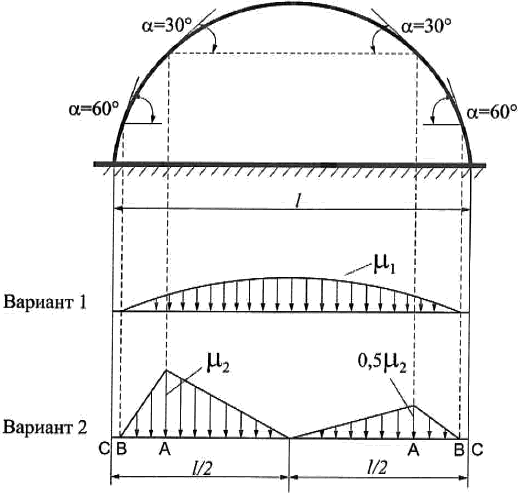

^fb-6

Покрытия в виде стрельчатых арок

Для покрытий в виде стрельчатых арок (рисунок Б.3) при ⟦IMG:data:image;base64,R0lGODdhGQAVAIABAAAAAP///ywAAAAAGQAVAAACNoyPqc|25x21⟧схему Б.1 - рисунок Б.1,б, принимая ⟦IMG:data:image;base64,R0lGODdhIwATAIABAAAAAP///ywAAAAAIwATAAACOYyPqc|35x19⟧⟦IMG:data:image;base64,R0lGODdhDQAVAIABAAAAAP///ywAAAAADQAVAAACIoyPqc|13x21⟧схему Б.2 - рисунок Б.2.

^fb-7

Подраздел Б.2 (Измененная редакция, Изм. N 2).

Б.3 Здания с продольными фонарями

Здания с продольными фонарями, закрытыми сверху

Для зданий с продольными фонарями (независимо от их расположения на покрытии), закрытыми сверху (рисунок Б.4), для двух схем снеговой нагрузки (рисунок Б.5) коэффициенты ⟦IMG:data:image;base64,R0lGODdhDQARAIABAAAAAP///ywAAAAADQARAAACHYyPqR|13x17⟧

⟦IMG:data:image;base64,R0lGODdhEwAXAIABAAAAAP///ywAAAAAEwAXAAACK4yPqc|19x23⟧⟦IMG:https://api.docs.cntd.ru/img/45/60/44/31/8/99bd5477-bade-485c-94|88x41⟧⟦IMG:https://api.docs.cntd.ru/img/45/60/44/31/8/99bd5477-bade-485c-94|93x45⟧

но не более 4,0 и не более ⟦IMG:https://api.docs.cntd.ru/img/45/60/44/31/8/99bd5477-bade-485c-94|49x24⟧⟦IMG:https://api.docs.cntd.ru/img/45/60/44/31/8/99bd5477-bade-485c-94|44x24⟧b⟦IMG:https://api.docs.cntd.ru/img/45/60/44/31/8/99bd5477-bade-485c-94|44x24⟧f⟦IMG:https://api.docs.cntd.ru/img/45/60/44/31/8/99bd5477-bade-485c-94|89x24⟧

При определении нагрузки у торца фонаря для зоны В значение коэффициента ⟦IMG:data:image;base64,R0lGODdhDQARAIABAAAAAP///ywAAAAADQARAAACHYyPqR|13x17⟧

^fb-8

Рисунок Б.4

^fb-11

> *Примечания*

^n15-2-3-2

1 Схемы вариантов 1, 2 (рисунок Б.5) следует также применять для двускатных и сводчатых покрытий двух- или многопролетных зданий с фонарями в середине зданий.

2 Влияние ветроотбойных щитов на распределение снеговой нагрузки возле фонарей не учитывать.

3 Для плоских скатов при bрисунки Б.11,а, б).

Здания с продольными фонарями, открытыми сверху

Для зданий с продольными фонарями, открытыми сверху (рисунок Б.6):

⟦IMG:https://api.docs.cntd.ru/img/45/60/44/31/8/99bd5477-bade-485c-94|121x51⟧ ⟦IMG:https://api.docs.cntd.ru/img/45/60/44/31/8/99bd5477-bade-485c-94|127x51⟧

Значения b⟦IMG:data:image;base64,R0lGODdhEQAbAIABAAAAAP///ywAAAAAEQAbAAACK4yPqc|17x27⟧⟦IMG:data:image;base64,R0lGODdhEwAXAIABAAAAAP///ywAAAAAEwAXAAACLIyPqc|19x23⟧mсхеме Б.8; пролет ⟦IMG:data:image;base64,R0lGODdhCQATAIABAAAAAP///ywAAAAACQATAAACFIyPqc|9x19⟧

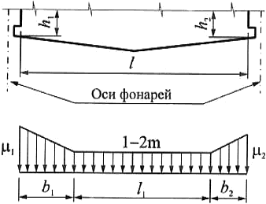

^fb-13

Рисунок Б.6

Здания с зенитными фонарями

Для зданий с зенитными фонарями, имеющими диагональ не более 15 м, следует применять схемы по Б.11, имеющими диагональ более 15 м - наиболее неблагоприятные схемы снеговых нагрузок по Б.3 и Б.8.

Подраздел Б.3 (Измененная редакция, Изм. N 1, 3, 5).

Б.4 Шедовые покрытия

Схемы рисунка Б.7 следует применять для шедовых покрытий, в том числе с наклонным остеклением и сводчатым очертанием кровли.

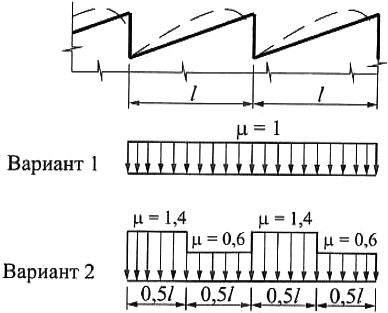

^fu009

Рисунок Б.7

Б.5 Двух- и многопролетные здания с двускатными покрытиями

Для двух- и многопролетных зданий с двускатными покрытиями (см. рисунок Б.8) вариант 1 следует учитывать во всех случаях, вариант 2 - для двухпролетных зданий при ⟦IMG:data:image;base64,R0lGODdhHAARAIABAAAAAP///ywAAAAAHAARAAACMIyPqc|28x17⟧⟦IMG:data:image;base64,R0lGODdhHAARAIABAAAAAP///ywAAAAAHAARAAACMIyPqc|28x17⟧⟦IMG:data:image;base64,R0lGODdhHAARAIABAAAAAP///ywAAAAAHAARAAACMIyPqc|28x17⟧рисунке Б.9. Для покрытий, имеющих габаритные размеры, превышающие 100 м в обоих направлениях, при ⟦IMG:data:image;base64,R0lGODdhDwAPAIABAAAAAP///ywAAAAADwAPAAACHYyPqc|15x15⟧⟦IMG:data:image;base64,R0lGODdhDQARAIABAAAAAP///ywAAAAADQARAAACHYyPqR|13x17⟧⟦IMG:data:image;base64,R0lGODdhDQARAIABAAAAAP///ywAAAAADQARAAACHYyPqR|13x17⟧

**(Измененная редакция, Изм. № 2).**

^fu010

________________

* Измененная редакция, Изм. N 2.

Б.6 Двух- и многопролетные здания со сводчатыми и близкими к ним по очертанию покрытиями

Для двух- и многопролетных зданий со сводчатыми и близкими к ним по очертанию покрытиями (рисунок Б.9) вариант 2 следует учитывать при ⟦IMG:https://api.docs.cntd.ru/img/45/60/44/31/8/99bd5477-bade-485c-94|19x41⟧

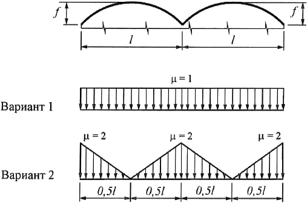

^fu011

Рисунок Б.9

Б.7 Двух- и многопролетные здания с двускатными и сводчатыми покрытиями с продольным фонарем

а) Для пролетов с фонарем двух- и многопролетных зданий с двускатными и сводчатыми покрытиями (рисунок Б.10) коэффициент ⟦IMG:data:image;base64,iVBORw0KGgoAAAANSUhEUgAAADAAAAA+CAIAAADiag+gAA|13x18⟧Б.3 (рисунок Б.5), для пролетов без фонаря - с вариантами 1 и 2 Б.5 и Б.6 (рисунки Б.8, Б.9).

б) Для плоских двускатных (⟦IMG:data:image;base64,R0lGODdhDwAPAIABAAAAAP///ywAAAAADwAPAAACHYyPqc|15x15⟧⟦IMG:https://api.docs.cntd.ru/img/45/60/44/31/8/99bd5477-bade-485c-94|19x41⟧⟦IMG:data:image;base64,R0lGODdhDQATAIABAAAAAP///ywAAAAADQATAAACHYyPqc|13x19⟧рисунок Б.11, а).

^fu012

Рисунок Б.10

Подраздел Б.7 (Измененная редакция, Изм. N 3).

Б.8 Здания с перепадом высоты

а) Для зданий с перепадом высоты снеговую нагрузку на верхнее покрытие следует принимать в соответствии со схемами Б.1-Б.7, а на нижнее - в двух вариантах: по схемам Б.1-Б.7 и схеме Б.8 (для зданий - профили а ббрисунки Б.11, а, Б.11, б), для навесов - профиль врисунок Б.11, в).

^fu013

б) Коэффициент ⟦IMG:data:image;base64,R0lGODdhDQARAIABAAAAAP///ywAAAAADQARAAACHYyPqR|13x17⟧

где h hh⟦IMG:data:image;base64,iVBORw0KGgoAAAANSUhEUgAAADAAAAA+CAIAAADiag+gAA|13x18⟧h

⟦IMG:data:image;base64,R0lGODdhDQAXAIABAAAAAP///ywAAAAADQAXAAACI4yPqc|13x23⟧⟦IMG:data:image;base64,R0lGODdhDwAXAIABAAAAAP///ywAAAAADwAXAAACJoyPqc|15x23⟧⟦IMG:data:image;base64,R0lGODdhDQAXAIABAAAAAP///ywAAAAADQAXAAACI4yPqc|13x23⟧⟦IMG:data:image;base64,R0lGODdhDwAXAIABAAAAAP///ywAAAAADwAXAAACJoyPqc|15x23⟧

для покрытия без продольных фонарей или с поперечными фонарями

⟦IMG:data:image;base64,R0lGODdhJwAXAIABAAAAAP///ywAAAAAJwAXAAACSoyPqc|39x23⟧⟦IMG:https://api.docs.cntd.ru/img/45/60/44/31/8/99bd5477-bade-485c-94|43x23⟧

для покрытия с продольными фонарями или ступенчатыми перепадами высот

⟦IMG:https://api.docs.cntd.ru/img/45/60/44/31/8/99bd5477-bade-485c-94|77x27⟧⟦IMG:https://api.docs.cntd.ru/img/45/60/44/31/8/99bd5477-bade-485c-94|81x27⟧

При этом ⟦IMG:data:image;base64,R0lGODdhDQAXAIABAAAAAP///ywAAAAADQAXAAACI4yPqc|13x23⟧⟦IMG:data:image;base64,R0lGODdhDwAXAIABAAAAAP///ywAAAAADwAXAAACJoyPqc|15x23⟧

⟦IMG:data:image;base64,R0lGODdhFQAXAIABAAAAAP///ywAAAAAFQAXAAACMIyPqc|21x23⟧⟦IMG:data:image;base64,R0lGODdhFwAXAIABAAAAAP///ywAAAAAFwAXAAACMoyPqc|23x23⟧

0,4 - для плоского покрытия с ⟦IMG:data:image;base64,R0lGODdhGwARAIABAAAAAP///ywAAAAAGwARAAACMIyPqc|27x17⟧⟦IMG:https://api.docs.cntd.ru/img/45/60/44/31/8/99bd5477-bade-485c-94|43x21⟧

0,3 - для плоского покрытия с ⟦IMG:data:image;base64,R0lGODdhDwAPAIABAAAAAP///ywAAAAADwAPAAACHYyPqc|15x15⟧⟦IMG:data:image;base64,R0lGODdhHwAVAIABAAAAAP///ywAAAAAHwAVAAACOYyPqc|31x21⟧

Длину ⟦IMG:data:image;base64,R0lGODdhDwAXAIABAAAAAP///ywAAAAADwAXAAACJoyPqc|15x23⟧

в) Для пониженных покрытий шириной ⟦IMG:data:image;base64,R0lGODdhDQAPAIABAAAAAP///ywAAAAADQAPAAACGYyPqc|13x15⟧рисунок Б.11,б) значение

⟦IMG:https://api.docs.cntd.ru/img/45/60/44/31/8/99bd5477-bade-485c-94|99x24⟧⟦IMG:https://api.docs.cntd.ru/img/45/60/44/31/8/99bd5477-bade-485c-94|64x47⟧⟦IMG:https://api.docs.cntd.ru/img/45/60/44/31/8/99bd5477-bade-485c-94|75x41⟧⟦IMG:data:image;base64,R0lGODdhEwAXAIABAAAAAP///ywAAAAAEwAXAAACK4yPqc|19x23⟧⟦IMG:https://api.docs.cntd.ru/img/45/60/44/31/8/99bd5477-bade-485c-94|73x41⟧⟦IMG:data:image;base64,R0lGODdhDQAPAIABAAAAAP///ywAAAAADQAPAAACGYyPqc|13x15⟧⟦IMG:data:image;base64,R0lGODdhDQAVAIABAAAAAP///ywAAAAADQAVAAACIoyPqc|13x21⟧⟦IMG:data:image;base64,R0lGODdhDwARAIABAAAAAP///ywAAAAADwARAAACIIyPqa|15x17⟧

г) Длину зоны повышенных снегоотложений b

при ⟦IMG:https://api.docs.cntd.ru/img/45/60/44/31/8/99bd5477-bade-485c-94|49x45⟧⟦IMG:https://api.docs.cntd.ru/img/45/60/44/31/8/99bd5477-bade-485c-94|45x19⟧

при ⟦IMG:https://api.docs.cntd.ru/img/45/60/44/31/8/99bd5477-bade-485c-94|49x45⟧

но не более 5h⟦IMG:data:image;base64,R0lGODdhDQARAIABAAAAAP///ywAAAAADQARAAACHYyPqR|13x17⟧

д) Коэффициенты ⟦IMG:data:image;base64,R0lGODdhDQARAIABAAAAAP///ywAAAAADQARAAACHYyPqR|13x17⟧

⟦IMG:https://api.docs.cntd.ru/img/45/60/44/31/8/99bd5477-bade-485c-94|24x45⟧h

4 - если нижнее покрытие является покрытием здания, а ⟦IMG:data:image;base64,R0lGODdhDQAXAIABAAAAAP///ywAAAAADQAXAAACI4yPqc|13x23⟧⟦IMG:data:image;base64,R0lGODdhHQAXAIABAAAAAP///ywAAAAAHQAXAAACP4yPqc|29x23⟧

________________

* Текст документа соответствует оригиналу. - Примечание изготовителя базы данных.

6 - если нижнее покрытие является навесом или покрытием здания и ⟦IMG:data:image;base64,R0lGODdhDQAXAIABAAAAAP///ywAAAAADQAXAAACI4yPqc|13x23⟧⟦IMG:data:image;base64,R0lGODdhDwAXAIABAAAAAP///ywAAAAADwAXAAACJoyPqc|15x23⟧

Промежуточные значения определяются интерполяцией для наибольшего значения из ⟦IMG:data:image;base64,R0lGODdhDQAXAIABAAAAAP///ywAAAAADQAXAAACI4yPqc|13x23⟧⟦IMG:data:image;base64,R0lGODdhDwAXAIABAAAAAP///ywAAAAADwAXAAACJoyPqc|15x23⟧

е) Коэффициент ⟦IMG:data:image;base64,R0lGODdhEwAXAIABAAAAAP///ywAAAAAEwAXAAACK4yPqc|19x23⟧

⟦IMG:https://api.docs.cntd.ru/img/45/60/44/31/8/99bd5477-bade-485c-94|81x23⟧⟦IMG:data:image;base64,R0lGODdhJwAXAIABAAAAAP///ywAAAAAJwAXAAACT4yPqc|39x23⟧

⟦IMG:https://api.docs.cntd.ru/img/45/60/44/31/8/99bd5477-bade-485c-94|80x23⟧⟦IMG:https://api.docs.cntd.ru/img/45/60/44/31/8/99bd5477-bade-485c-94|49x45⟧⟦IMG:https://api.docs.cntd.ru/img/45/60/44/31/8/99bd5477-bade-485c-94|15x17⟧

⟦IMG:https://api.docs.cntd.ru/img/45/60/44/31/8/99bd5477-bade-485c-94|93x45⟧⟦IMG:data:image;base64,R0lGODdhKAAXAIABAAAAAP///ywAAAAAKAAXAAACT4yPqc|40x23⟧⟦IMG:https://api.docs.cntd.ru/img/45/60/44/31/8/99bd5477-bade-485c-94|49x45⟧⟦IMG:data:image;base64,R0lGODdhDQARAIABAAAAAP///ywAAAAADQARAAACHYyPqR|13x17⟧

⟦IMG:https://api.docs.cntd.ru/img/45/60/44/31/8/99bd5477-bade-485c-94|101x45⟧⟦IMG:data:image;base64,R0lGODdhDQARAIABAAAAAP///ywAAAAADQARAAACHYyPqR|13x17⟧

ж) При наличии между нижерасположенным покрытием и стенкой перепада высот разрыва шириной не более 1,5 м местную повышенную снеговую нагрузку на покрытие в зоне перепада следует определять так же, как для покрытий без разрыва. При этом для нижерасположенного покрытия принимается только приходящаяся на него часть трапециевидной эпюры коэффициента ⟦IMG:data:image;base64,R0lGODdhDQARAIABAAAAAP///ywAAAAADQARAAACHYyPqR|13x17⟧

> *Примечания*

^n15-2-3-3

1 При ⟦IMG:data:image;base64,R0lGODdhEwAbAIABAAAAAP///ywAAAAAEwAbAAACLoyPqc|19x27⟧⟦IMG:data:image;base64,R0lGODdhFQAbAIABAAAAAP///ywAAAAAFQAbAAACMoyPqc|21x27⟧⟦IMG:data:image;base64,R0lGODdhDQARAIABAAAAAP///ywAAAAADQARAAACHYyPqR|13x17⟧⟦IMG:data:image;base64,R0lGODdhEwAbAIABAAAAAP///ywAAAAAEwAbAAACLoyPqc|19x27⟧⟦IMG:data:image;base64,R0lGODdhFQAbAIABAAAAAP///ywAAAAAFQAbAAACMoyPqc|21x27⟧рисунок Б.11,а) следует определять без учета влияния фонарей на повышенном (пониженном) покрытии.

2 Если пролеты верхнего (нижнего) покрытия имеют различный профиль, то при определении ⟦IMG:data:image;base64,R0lGODdhDQARAIABAAAAAP///ywAAAAADQARAAACHYyPqR|13x17⟧ ⟦IMG:data:image;base64,R0lGODdhJQAXAIABAAAAAP///ywAAAAAJQAXAAACVYyPqc|37x23⟧

3 Местную нагрузку у перепада не следует учитывать, если высота перепада, м, между двумя смежными покрытиями менее ⟦IMG:https://api.docs.cntd.ru/img/45/60/44/31/8/99bd5477-bade-485c-94|24x41⟧⟦IMG:data:image;base64,R0lGODdhFAAYAIABAAAAAP///ywAAAAAFAAYAAACMYyPqc|20x24⟧

4 При наличии возле перепада на верхнем покрытии сплошного парапета высотой h⟦IMG:data:image;base64,R0lGODdhFAAYAIABAAAAAP///ywAAAAAFAAYAAACMYyPqc|20x24⟧

Подраздел Б.8 (Измененная редакция, Изм. N 1, 2, 3, 5).

Б.9 Здания с двумя перепадами высоты

Для зданий с двумя перепадами высоты снеговую нагрузку на верхние и нижние покрытия следует принимать по схеме, приведенной на рисунке Б.12. Значения ⟦IMG:data:image;base64,R0lGODdhEwAXAIABAAAAAP///ywAAAAAEwAXAAACK4yPqc|19x23⟧⟦IMG:data:image;base64,R0lGODdhEAAXAIABAAAAAP///ywAAAAAEAAXAAACJoyPqc|16x23⟧⟦IMG:data:image;base64,R0lGODdhFAAXAIABAAAAAP///ywAAAAAFAAXAAACLoyPqc|20x23⟧⟦IMG:data:image;base64,R0lGODdhEQAXAIABAAAAAP///ywAAAAAEQAXAAACK4yPqc|17x23⟧ схеме Б.9 (при определении нагрузок возле перепадов ⟦IMG:data:image;base64,R0lGODdhEQAbAIABAAAAAP///ywAAAAAEQAbAAACLYyPqc|17x27⟧⟦IMG:data:image;base64,R0lGODdhFAAbAIABAAAAAP///ywAAAAAFAAbAAACMoyPqc|20x27⟧схеме Б.8 и ⟦IMG:data:image;base64,R0lGODdhFQAYAIABAAAAAP///ywAAAAAFQAYAAACMoyPqc|21x24⟧схеме Б.8.

При наложении зон повышенных снегоотложений (см. вариант 2 на рисунке Б.12):

⟦IMG:https://api.docs.cntd.ru/img/45/60/44/31/8/99bd5477-bade-485c-94|101x24⟧ ⟦IMG:https://api.docs.cntd.ru/img/45/60/44/31/8/99bd5477-bade-485c-94|201x45⟧ ⟦IMG:https://api.docs.cntd.ru/img/45/60/44/31/8/99bd5477-bade-485c-94|207x45⟧

Если ⟦IMG:https://api.docs.cntd.ru/img/45/60/44/31/8/99bd5477-bade-485c-94|45x24⟧⟦IMG:https://api.docs.cntd.ru/img/45/60/44/31/8/99bd5477-bade-485c-94|48x24⟧⟦IMG:data:image;base64,R0lGODdhEwAXAIABAAAAAP///ywAAAAAEwAXAAACK4yPqc|19x23⟧⟦IMG:data:image;base64,R0lGODdhFAAXAIABAAAAAP///ywAAAAAFAAXAAACLoyPqc|20x23⟧

^fu014

Б.10 Висячие покрытия цилиндрической формы

Для висячих покрытий цилиндрической формы (рисунок Б.13) следует принимать:

⟦IMG:https://api.docs.cntd.ru/img/45/60/44/31/8/99bd5477-bade-485c-94|53x23⟧⟦IMG:https://api.docs.cntd.ru/img/45/60/44/31/8/99bd5477-bade-485c-94|48x41⟧

^fu015

Рисунок Б.13

Б.11 Здания с купольными круговыми и близкими к ним по очертанию покрытиями

а) Для зданий с купольными круговыми и близкими к ним по очертанию покрытиями (рисунок Б.14) коэффициент ⟦IMG:data:image;base64,R0lGODdhEwAXAIABAAAAAP///ywAAAAAEwAXAAACK4yPqc|19x23⟧таблице Б.2. Промежуточные значения определяются линейной интерполяцией. При максимальном уклоне ⟦IMG:data:image;base64,R0lGODdhDwAPAIABAAAAAP///ywAAAAADwAPAAACHYyPqc|15x15⟧⟦IMG:https://api.docs.cntd.ru/img/45/60/44/31/8/99bd5477-bade-485c-94|56x27⟧

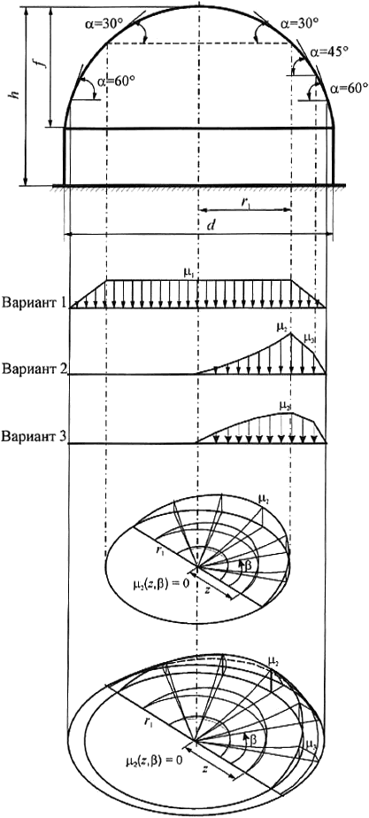

^fu016

Рисунок Б.14

*Таблица* ^tu008
|  |  |
|---|---|
| Уклон покрытия ⟦IMG:data:image;base64,R0lGODdhDwAPAIABAAAAAP///ywAAAAADwAPAAACHYyPqc\|15x15⟧ | ⟦IMG:data:image;base64,R0lGODdhEwAXAIABAAAAAP///ywAAAAAEwAXAAACK4yPqc\|19x23⟧ |
| ⟦IMG:data:image;base64,R0lGODdhHAARAIABAAAAAP///ywAAAAAHAARAAACMYyPqc\|28x17⟧ | 1 |
| ⟦IMG:data:image;base64,R0lGODdhHAARAIABAAAAAP///ywAAAAAHAARAAACMIyPqc\|28x17⟧ | 0 |

Для пологих куполов с отношением ⟦IMG:https://api.docs.cntd.ru/img/45/60/44/31/8/99bd5477-bade-485c-94|47x21⟧

Для куполов с отношением ⟦IMG:data:image;base64,R0lGODdhIwAVAIABAAAAAP///ywAAAAAIwAVAAACQoyPqc|35x21⟧⟦IMG:data:image;base64,R0lGODdhDwAPAIABAAAAAP///ywAAAAADwAPAAACHYyPqc|15x15⟧

Для варианта 2 на рисунке Б.14 следует принимать при ⟦IMG:data:image;base64,R0lGODdhJQAXAIABAAAAAP///ywAAAAAJQAXAAACQoyPqc|37x23⟧

при ⟦IMG:data:image;base64,R0lGODdhJAAYAIABAAAAAP///ywAAAAAJAAYAAACQIyPqc|36x24⟧⟦IMG:https://api.docs.cntd.ru/img/45/60/44/31/8/99bd5477-bade-485c-94|85x24⟧⟦IMG:data:image;base64,R0lGODdhDwAPAIABAAAAAP///ywAAAAADwAPAAACHYyPqc|15x15⟧⟦IMG:data:image;base64,R0lGODdhFAAYAIABAAAAAP///ywAAAAAFAAYAAACLoyPqc|20x24⟧⟦IMG:data:image;base64,R0lGODdhDwAPAIABAAAAAP///ywAAAAADwAPAAACHYyPqc|15x15⟧

Промежуточные значения определяются линейной интерполяцией.

Для варианта 3 следует принимать

Вариант 3 следует учитывать для куполов с ⟦IMG:data:image;base64,R0lGODdhIwAVAIABAAAAAP///ywAAAAAIwAVAAACQoyPqc|35x21⟧

б) Для покрытий в виде сочетания двух сферических поверхностей различной кривизны на круглом плане следует учитывать снеговые нагрузки, как показано на рисунке Б.14а.

Здесь В-В - линия сопряжения поверхностей различной кривизны; ⟦IMG:https://api.docs.cntd.ru/img/45/60/44/31/8/99bd5477-bade-485c-94|20x23⟧⟦IMG:https://api.docs.cntd.ru/img/45/60/44/31/8/99bd5477-bade-485c-94|21x23⟧

Для варианта 1 на участке A-B шириной ⟦IMG:https://api.docs.cntd.ru/img/45/60/44/31/8/99bd5477-bade-485c-94|113x23⟧⟦IMG:https://api.docs.cntd.ru/img/45/60/44/31/8/99bd5477-bade-485c-94|120x23⟧⟦IMG:data:image;base64,R0lGODdhIQAXAIABAAAAAP///ywAAAAAIQAXAAACQIyPqc|33x23⟧⟦IMG:https://api.docs.cntd.ru/img/45/60/44/31/8/99bd5477-bade-485c-94|56x23⟧

Для вариантов 2 и 3 коэффициент ⟦IMG:https://api.docs.cntd.ru/img/45/60/44/31/8/99bd5477-bade-485c-94|20x23⟧⟦IMG:https://api.docs.cntd.ru/img/45/60/44/31/8/99bd5477-bade-485c-94|20x24⟧⟦IMG:https://api.docs.cntd.ru/img/45/60/44/31/8/99bd5477-bade-485c-94|60x23⟧

При 7°<⟦IMG:data:image;base64,R0lGODdhJAAXAIABAAAAAP///ywAAAAAJAAXAAACQ4yPqc|36x23⟧⟦IMG:data:image;base64,R0lGODdhJAAXAIABAAAAAP///ywAAAAAJAAXAAACQ4yPqc|36x23⟧⟦IMG:data:image;base64,R0lGODdhFQAXAIABAAAAAP///ywAAAAAFQAXAAACL4yPqc|21x23⟧Б.11 без учета изменения геометрии поверхности.

Для покрытий в виде сочетания двух сферических поверхностей различной кривизны на эллиптическом плане следует выполнить расчет коэффициентов ⟦IMG:https://api.docs.cntd.ru/img/45/60/44/31/8/99bd5477-bade-485c-94|19x23⟧⟦IMG:https://api.docs.cntd.ru/img/45/60/44/31/8/99bd5477-bade-485c-94|20x23⟧⟦IMG:https://api.docs.cntd.ru/img/45/60/44/31/8/99bd5477-bade-485c-94|20x24⟧

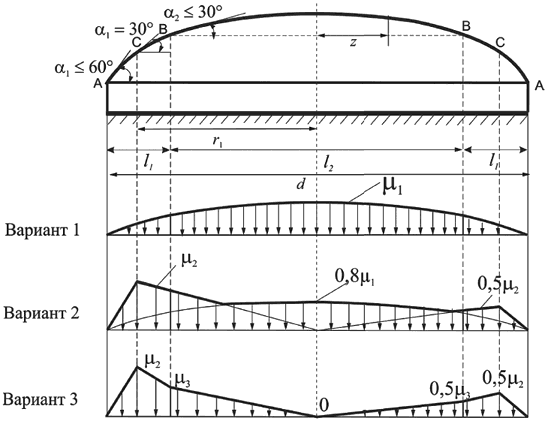

^fu017

Подраздел Б.11. (Измененная редакция, Изм. N 2, 5).

Б.12 Здания с коническими круговыми покрытиями и покрытиями в виде сочетания сферической и конической поверхностей*

________________

* Измененная редакция, Изм. N 2.

а) Для зданий с коническими круговыми покрытиями (см. рисунок Б.15) коэффициент ⟦IMG:data:image;base64,R0lGODdhEwAXAIABAAAAAP///ywAAAAAEwAXAAACK4yPqc|19x23⟧таблице Б.3. Промежуточные значения определяются линейной интерполяцией.

Таблица Б.3

*Таблица* ^tu009
|  |  |
|---|---|
| Уклон покрытия ⟦IMG:data:image;base64,R0lGODdhDwAPAIABAAAAAP///ywAAAAADwAPAAACHYyPqc\|15x15⟧ | ⟦IMG:data:image;base64,R0lGODdhEwAXAIABAAAAAP///ywAAAAAEwAXAAACK4yPqc\|19x23⟧ |
| ⟦IMG:data:image;base64,R0lGODdhHAARAIABAAAAAP///ywAAAAAHAARAAACMYyPqc\|28x17⟧ | 1 |
| 60° | 0 |

Для пологих куполов при ⟦IMG:data:image;base64,R0lGODdhHAARAIABAAAAAP///ywAAAAAHAARAAACMYyPqc|28x17⟧

Для менее пологих куполов при 7°⟦IMG:data:image;base64,R0lGODdhKAARAIABAAAAAP///ywAAAAAKAARAAACP4yPqc|40x17⟧

При 30°⟦IMG:data:image;base64,R0lGODdhKAAPAIABAAAAAP///ywAAAAAKAAPAAACOYyPqc|40x15⟧

⟦IMG:https://api.docs.cntd.ru/img/45/60/44/31/8/99bd5477-bade-485c-94|128x23⟧⟦IMG:https://api.docs.cntd.ru/img/45/60/44/31/8/99bd5477-bade-485c-94|111x27⟧

где ⟦IMG:data:image;base64,R0lGODdhDwAPAIABAAAAAP///ywAAAAADwAPAAACHYyPqc|15x15⟧

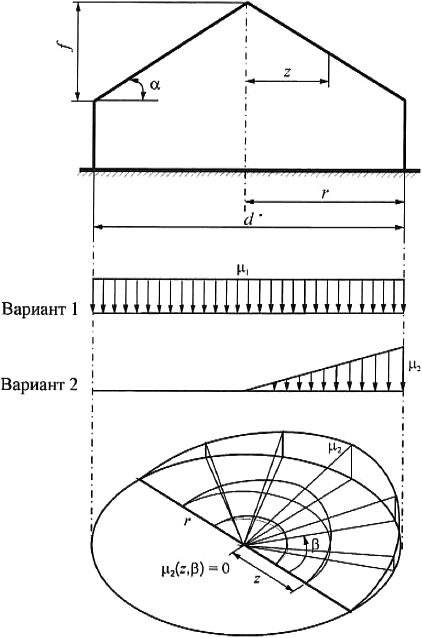

^fu018

б) Для зданий с круговыми покрытиями в виде сочетания сферической и конической поверхностей (см. рисунок Б.15а) коэффициент ⟦IMG:data:image;base64,R0lGODdhEwAXAIABAAAAAP///ywAAAAAEwAXAAACK4yPqc|19x23⟧таблице Б.3.

Коэффициент ⟦IMG:data:image;base64,R0lGODdhFAAXAIABAAAAAP///ywAAAAAFAAXAAACLoyPqc|20x23⟧рисунок Б.15а) определяется следующим образом:

- на участке 1 - по формуле (Б.10) в зависимости от уклона ⟦IMG:data:image;base64,R0lGODdhFAAXAIABAAAAAP///ywAAAAAFAAXAAACLIyPqc|20x23⟧⟦IMG:data:image;base64,R0lGODdhDQANAIABAAAAAP///ywAAAAADQANAAACFIyPqc|13x13⟧

- на участке 2 - 0,5⟦IMG:https://api.docs.cntd.ru/img/45/60/44/31/8/99bd5477-bade-485c-94|45x25⟧⟦IMG:https://api.docs.cntd.ru/img/45/60/44/31/8/99bd5477-bade-485c-94|45x25⟧⟦IMG:data:image;base64,R0lGODdhDQAVAIABAAAAAP///ywAAAAADQAVAAACIoyPqc|13x21⟧

- на участках 3 и 4 - по формулам (Б.12) или (Б.13) в зависимости от уклона ⟦IMG:data:image;base64,R0lGODdhFQAXAIABAAAAAP///ywAAAAAFQAXAAACL4yPqc|21x23⟧

- на участке 5 - ⟦IMG:https://api.docs.cntd.ru/img/45/60/44/31/8/99bd5477-bade-485c-94|71x23⟧⟦IMG:data:image;base64,R0lGODdhIQAXAIABAAAAAP///ywAAAAAIQAXAAACQIyPqc|33x23⟧⟦IMG:data:image;base64,R0lGODdhFAAXAIABAAAAAP///ywAAAAAFAAXAAACLoyPqc|20x23⟧⟦IMG:data:image;base64,R0lGODdhIQAXAIABAAAAAP///ywAAAAAIQAXAAACQIyPqc|33x23⟧⟦IMG:data:image;base64,R0lGODdhFAAXAIABAAAAAP///ywAAAAAFAAXAAACLoyPqc|20x23⟧⟦IMG:data:image;base64,R0lGODdhFAAXAIABAAAAAP///ywAAAAAFAAXAAACLIyPqc|20x23⟧

- на участке 6 - 0,5⟦IMG:data:image;base64,R0lGODdhFAAXAIABAAAAAP///ywAAAAAFAAXAAACLoyPqc|20x23⟧⟦IMG:data:image;base64,R0lGODdhFQAXAIABAAAAAP///ywAAAAAFQAXAAACMIyPqc|21x23⟧⟦IMG:data:image;base64,R0lGODdhFAAXAIABAAAAAP///ywAAAAAFAAXAAACLIyPqc|20x23⟧

Для пологих куполов при ⟦IMG:data:image;base64,R0lGODdhIQAXAIABAAAAAP///ywAAAAAIQAXAAACQIyPqc|33x23⟧⟦IMG:data:image;base64,R0lGODdhJAAXAIABAAAAAP///ywAAAAAJAAXAAACQ4yPqc|36x23⟧

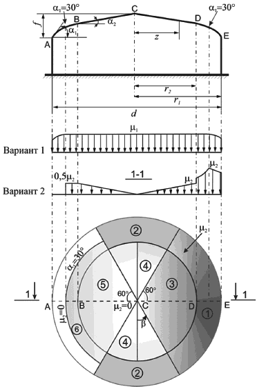

^fu019

Для покрытий, рассматриваемых в перечислении б), должно соблюдаться условие ⟦IMG:https://api.docs.cntd.ru/img/45/60/44/31/8/99bd5477-bade-485c-94|53x23⟧

Подраздел Б.12. (Измененная редакция, Изм. N 2).

Б.13 Покрытие с парапетами

а) Снеговую нагрузку на покрытие возле парапетов следует принимать по схеме, приведенной на рисунке Б.16.

^fu020

Рисунок Б.16

б) Схему на рисунке Б.16 для покрытий с парапетами следует применять при ⟦IMG:https://api.docs.cntd.ru/img/45/60/44/31/8/99bd5477-bade-485c-94|48x41⟧h SS⟦IMG:data:image;base64,R0lGODdhCwAYAIABAAAAAP///ywAAAAACwAYAAACHIyPqc|11x24⟧

в) Для плоских (⟦IMG:data:image;base64,R0lGODdhDwAPAIABAAAAAP///ywAAAAADwAPAAACHYyPqc|15x15⟧⟦IMG:https://api.docs.cntd.ru/img/45/60/44/31/8/99bd5477-bade-485c-94|67x45⟧⟦IMG:data:image;base64,R0lGODdhCQATAIABAAAAAP///ywAAAAACQATAAACFIyPqc|9x19⟧рисунк Б.11), в том случае, если эта схема более неблагоприятна, чем показанная на рисунке Б.16. При этом коэффициент формы ⟦IMG:https://api.docs.cntd.ru/img/45/60/44/31/8/99bd5477-bade-485c-94|15x17⟧⟦IMG:https://api.docs.cntd.ru/img/45/60/44/31/8/99bd5477-bade-485c-94|45x24⟧

Подраздел Б.13 (Измененная редакция, Изм. N 1, 5).

Б.14 Участки покрытий, примыкающие к возвышающимся над кровлей вентиляционным шахтам и другим надстройкам

а) Схема на рисунке Б.17 относится к участкам с надстройками с диагональю основания не более 15 м.

б) В зависимости от рассчитываемой конструкции (плит покрытия, подстропильных и стропильных конструкций) необходимо учитывать самое неблагоприятное положение зоны повышенной нагрузки (при произвольном угле ⟦IMG:data:image;base64,R0lGODdhDQAVAIABAAAAAP///ywAAAAADQAVAAACIoyPqc|13x21⟧

в) Коэффициент ⟦IMG:data:image;base64,R0lGODdhDQARAIABAAAAAP///ywAAAAADQARAAACHYyPqR|13x17⟧рисунок Б.17), постоянный в пределах указанной зоны, следует принимать равным:

1,0 при d⟦IMG:data:image;base64,R0lGODdhDQAQAIABAAAAAP///ywAAAAADQAQAAACF4yPqc|13x16⟧ ⟦IMG:https://api.docs.cntd.ru/img/45/60/44/31/8/99bd5477-bade-485c-94|24x45⟧d

⟦IMG:data:image;base64,R0lGODdhKAATAIABAAAAAP///ywAAAAAKAATAAACQYyPqc|40x19⟧ ⟦IMG:data:image;base64,R0lGODdhKAATAIABAAAAAP///ywAAAAAKAATAAACQYyPqc|40x19⟧ ⟦IMG:data:image;base64,R0lGODdhKAATAIABAAAAAP///ywAAAAAKAATAAACQYyPqc|40x19⟧

⟦IMG:https://api.docs.cntd.ru/img/45/60/44/31/8/99bd5477-bade-485c-94|49x23⟧d

Наличие зенитных фонарей и надстроек с диагональю не более 5 м, возвышающихся над кровлей не более чем на 0,4 м, допускается не учитывать.

^fu021

Для лестниц или иных надстроек, имеющих диагональ более 5 м, высоту более 2 м и примыкающих к парапетам зданий, следует дополнительно учитывать местную повышенную нагрузку, как у перепадов высоты (см. на рисунке Б.11).

Подраздел Б.14 (Измененная редакция, Изм. N 1, 3).

## Приложение В

В.1 Аэродинамические коэффициенты

В.1.1 Отдельно стоящие плоские сплошные конструкции (стены, заборы и т.д.)

Для различных участков конструкций (рисунок В.1) коэффициент ⟦IMG:data:image;base64,R0lGODdhEwAYAIABAAAAAP///ywAAAAAEwAYAAACIoyPqc|19x24⟧таблице В.1;

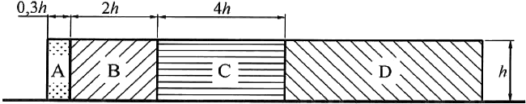

^fv-1

*Таблица* ^tu010
<table>
<tr><th scope="col"></th><th scope="col"></th><th scope="col"></th><th scope="col"></th></tr>
<tr><th colspan="4" scope="row">Участки плоских сплошных конструкций на земле (см. рисунок В.1)</th></tr>
<tr><td>А</td><td>В</td><td>С</td><td>D</td></tr>
<tr><td>2,1</td><td>1,8</td><td>1,4</td><td>1,2</td></tr>
</table>

Рекламные щиты

Для рекламных щитов, поднятых над землей на высоту не менее dрисунок В.2): ⟦IMG:https://api.docs.cntd.ru/img/45/60/44/31/8/99bd5477-bade-485c-94|69x24⟧⟦IMG:data:image;base64,R0lGODdhFAAYAIABAAAAAP///ywAAAAAFAAYAAACLYyPqc|20x24⟧В.1.15.

^fv

Рисунок B.2

Равнодействующую нагрузку, направленную по нормали к плоскости щита, следует прикладывать на высоте его геометрического центра с эксцентриситетом в горизонтальном направлении е bb

B.1.2 Прямоугольные в плане здания с двускатными покрытиями

Вертикальные стены прямоугольных в плане зданий

*Таблица* ^tu011
<table>
<tr><th scope="col"></th><th scope="col"></th><th scope="col"></th><th scope="col"></th><th scope="col"></th></tr>
<tr><th colspan="3" scope="row">Боковые стены</th><td>Наветренная стена</td><td>Подветренная стена</td></tr>
<tr><th colspan="3" scope="row">Участки</th><td></td><td></td></tr>
<tr><td>А</td><td>В</td><td>С</td><td>D</td><td>Е</td></tr>
<tr><td>-1,0</td><td>-0,8</td><td>-0,5</td><td>0,8</td><td>-0,5</td></tr>
</table>

Для наветренных, подветренных и различных участков боковых стен (рисунок В.3) аэродинамические коэффициенты таблице В.2. Для стен с отрицательным уклоном при 45°<⟦IMG:data:image;base64,R0lGODdhDQATAIABAAAAAP///ywAAAAADQATAAACH4yPqc|13x19⟧рисунок В.3) аэродинамические коэффициенты определяются так же, как и для вертикальных стен.

Для боковых стен с выступающими лоджиями аэродинамический коэффициент трения ⟦IMG:data:image;base64,R0lGODdhFAAZAIABAAAAAP///ywAAAAAFAAZAAACKoyPqc|20x25⟧

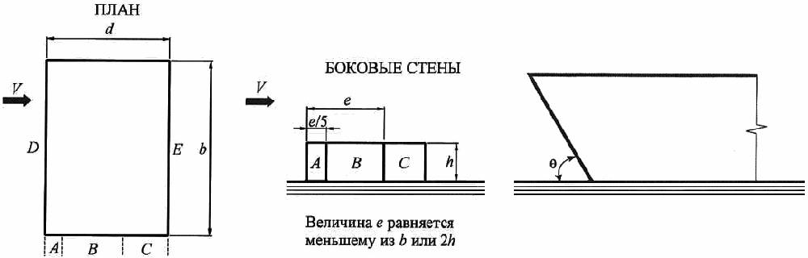

^fv-4

________________

* Измененная редакция, Изм. N 2.

Двускатные покрытия

Для различных участков покрытия (рисунок В.4) коэффициент таблицам В.3,а и В.3,б в зависимости от направления средней скорости ветра.

Для углов 15°⟦IMG:data:image;base64,R0lGODdhJQAVAIABAAAAAP///ywAAAAAJQAVAAACSIyPqc|37x21⟧⟦IMG:data:image;base64,R0lGODdhDwAPAIABAAAAAP///ywAAAAADwAPAAACHYyPqc|15x15⟧

Для протяженных гладких покрытий при ⟦IMG:data:image;base64,R0lGODdhDwAPAIABAAAAAP///ywAAAAADwAPAAACHYyPqc|15x15⟧рисунок В.4,б) аэродинамический коэффициент трения ⟦IMG:data:image;base64,R0lGODdhFAAZAIABAAAAAP///ywAAAAAFAAZAAACKoyPqc|20x25⟧

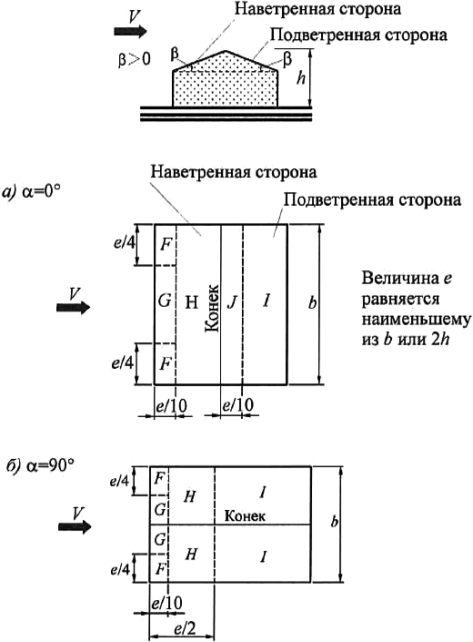

^fv-5

*Таблица* ^tu012
|  |  |  |  |  |  |
|---|---|---|---|---|---|
| Уклон ⟦IMG:data:image;base64,R0lGODdhDQAVAIABAAAAAP///ywAAAAADQAVAAACIoyPqc\|13x21⟧ | F | G | Н | ⟦IMG:data:image;base64,R0lGODdhDQARAIABAAAAAP///ywAAAAADQARAAACF4yPqc\|13x17⟧ | J |
| 0° | -1,8 | -1,3 | -0,7 | -0,5 | -0,5 |
| 15° | -0,9 | -0,8 | -0,3 | -0,4 | -1,0 |
|  | 0,2 | 0,2 | 0,2 |  |  |
| 30° | -0,5 | -0,5 | -0,2 | -0,4 | -0,5 |
|  | 0,7 | 0,7 | 0,4 |  |  |
| 45° | 0,7 | 0,7 | 0,6 | -0,2 | -0,3 |
| 60° | 0,7 | 0,7 | 0,7 | -0,2 | -0,3 |
| 75° | 0,8 | 0,8 | 0,8 | -0,2 | -0,3 |

*Таблица* ^tu013
|  |  |  |  |  |
|---|---|---|---|---|
| Уклон ⟦IMG:data:image;base64,R0lGODdhDQAVAIABAAAAAP///ywAAAAADQAVAAACIoyPqc\|13x21⟧ | F | G | H | ⟦IMG:data:image;base64,R0lGODdhDQARAIABAAAAAP///ywAAAAADQARAAACF4yPqc\|13x17⟧ |
| 0° | -1,8 | -1,3 | -0,7 | -0,5 |
| 15° | -1,3 | -1,3 | -0,6 | -0,5 |
| 30° | -1,1 | -1,4 | -0,8 | -0,5 |
| 45° | -1,1 | -1,4 | -0,9 | -0,5 |
| 60° | -1,1 | -1,2 | -0,8 | -0,5 |
| 75° | -1,1 | -1,2 | -0,8 | -0,5 |

Пункт В.1.2 (Измененная редакция, Изм. N 2).

В.1.3 Прямоугольные в плане здания со сводчатыми и близкими к ним по очертанию покрытиями

^fv-9

> *Примечание* — При 0,2⟦IMG:https://api.docs.cntd.ru/img/45/60/44/31/8/99bd5477-bade-485c-94|53x23⟧⟦IMG:https://api.docs.cntd.ru/img/45/60/44/31/8/99bd5477-bade-485c-94|42x23⟧⟦IMG:data:image;base64,R0lGODdhFQAXAIABAAAAAP///ywAAAAAFQAXAAACLIyPqc|21x23⟧

^n15-2-3-4

Рисунок В.5*

________________

* Измененная редакция, Изм. N 1, 3.

Распределение аэродинамических коэффициентов рисунке В.5.

Аэродинамические коэффициенты таблицей В.2.

При определении эквивалентной высоты ⟦IMG:data:image;base64,R0lGODdhEwAYAIABAAAAAP///ywAAAAAEwAYAAACJYyPqc|19x24⟧11.1.5) и коэффициента v11.1.11: ⟦IMG:https://api.docs.cntd.ru/img/45/60/44/31/8/99bd5477-bade-485c-94|88x23⟧

В.1.4 Круглые в плане сооружения с купольными и коническими покрытиями

а) Для купольных покрытий значения коэффициентов ⟦IMG:https://api.docs.cntd.ru/img/45/60/44/31/8/99bd5477-bade-485c-94|18x24⟧А ССрисунке В.6, а. Для промежуточных сечений коэффициенты ⟦IMG:https://api.docs.cntd.ru/img/45/60/44/31/8/99bd5477-bade-485c-94|18x24⟧

б) Для конических покрытий значения аэродинамических коэффициентов внешнего давления ⟦IMG:data:image;base64,R0lGODdhEQAYAIABAAAAAP///ywAAAAAEQAYAAACI4yPqc|17x24⟧⟦IMG:data:image;base64,R0lGODdhDwAPAIABAAAAAP///ywAAAAADwAPAAACHYyPqc|15x15⟧рисунок В.6, б) следующим образом:

- для участка A⟦IMG:data:image;base64,R0lGODdhEQAYAIABAAAAAP///ywAAAAAEQAYAAACI4yPqc|17x24⟧

- для участка B⟦IMG:data:image;base64,R0lGODdhEQAYAIABAAAAAP///ywAAAAAEQAYAAACI4yPqc|17x24⟧

- для участка C⟦IMG:data:image;base64,R0lGODdhEQAYAIABAAAAAP///ywAAAAAEQAYAAACI4yPqc|17x24⟧

- для участка D⟦IMG:data:image;base64,R0lGODdhEQAYAIABAAAAAP///ywAAAAAEQAYAAACI4yPqc|17x24⟧

- для участка E⟦IMG:data:image;base64,R0lGODdhEQAYAIABAAAAAP///ywAAAAAEQAYAAACI4yPqc|17x24⟧

- для купольных и конических покрытий при определении эквивалентной высоты ⟦IMG:data:image;base64,R0lGODdhEQAYAIABAAAAAP///ywAAAAAEQAYAAACJYyPqc|17x24⟧11.1.5 и коэффициента ⟦IMG:data:image;base64,R0lGODdhDQAPAIABAAAAAP///ywAAAAADQAPAAACF4yPqc|13x15⟧11.1.11 ⟦IMG:https://api.docs.cntd.ru/img/45/60/44/31/8/99bd5477-bade-485c-94|88x23⟧

^fv-10

Пункт В.1.4 (Измененная редакция, Изм. N 2, 3).

В.1.5 Здания с продольными фонарями и здания переменной высоты*

________________

* Измененная редакция, Изм. N 2.

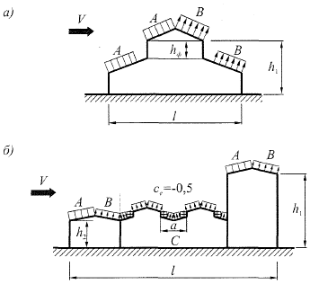

^fv-12

Для участков А и В (рисунок В.7) коэффициенты таблицами В.3,а и В.3,б.

Для фонарей участка С⟦IMG:data:image;base64,R0lGODdhGwATAIABAAAAAP///ywAAAAAGwATAAACMoyPqc|27x19⟧⟦IMG:data:image;base64,R0lGODdhJwATAIABAAAAAP///ywAAAAAJwATAAACQoyPqc|39x19⟧⟦IMG:https://api.docs.cntd.ru/img/45/60/44/31/8/99bd5477-bade-485c-94|61x24⟧⟦IMG:data:image;base64,R0lGODdhDQATAIABAAAAAP///ywAAAAADQATAAACHIyPqc|13x19⟧⟦IMG:data:image;base64,R0lGODdhEwAYAIABAAAAAP///ywAAAAAEwAYAAACIoyPqc|19x24⟧⟦IMG:https://api.docs.cntd.ru/img/45/60/44/31/8/99bd5477-bade-485c-94|64x25⟧

Для остальных участков покрытия

Для вертикальных поверхностей и стен зданий коэффициенты таблицей В.2.

При определении эквивалентной высоты ⟦IMG:data:image;base64,R0lGODdhEwAYAIABAAAAAP///ywAAAAAEwAYAAACJYyPqc|19x24⟧11.1.5) и коэффициента v11.1.11: h⟦IMG:data:image;base64,R0lGODdhEQAbAIABAAAAAP///ywAAAAAEQAbAAACLYyPqc|17x27⟧

В.1.6 Здания с зенитными фонарями

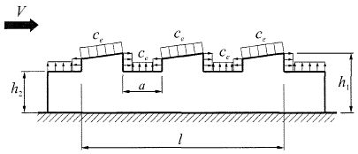

^fv-16

Для наветренного фонаря коэффициент таблицами В.3,а и В.3,б.

Для остальных фонарей коэффициенты ССраздел В.1.5).

Для остальной части покрытия

Для вертикальных поверхностей и стен зданий коэффициенты таблицей В.2.

При определении эквивалентной высоты ⟦IMG:data:image;base64,R0lGODdhEwAYAIABAAAAAP///ywAAAAAEwAYAAACJYyPqc|19x24⟧11.1.5) и коэффициента v11.1.11 h⟦IMG:data:image;base64,R0lGODdhEQAbAIABAAAAAP///ywAAAAAEQAbAAACLYyPqc|17x27⟧

В.1.7 Здания с шедовыми покрытиями

^fv-18

Для участка А коэффициент таблицами В.3,а и В.3,б. Для остальной части покрытия

Для вертикальных поверхностей и стен зданий коэффициенты таблицей В.2.

При определении эквивалентной высоты ⟦IMG:data:image;base64,R0lGODdhEwAYAIABAAAAAP///ywAAAAAEwAYAAACJYyPqc|19x24⟧11.1.5) и коэффициента v11.1.11) h

Для шедовых покрытий аэродинамический коэффициент трения ⟦IMG:data:image;base64,R0lGODdhFAAZAIABAAAAAP///ywAAAAAFAAZAAACKYyPqc|20x25⟧

В.1.8 Здания с уступами

^fv-19

Для участка М

Для участка K таблицей В.2.

Для участка L

Для остальных вертикальных поверхностей коэффициент таблицей В.2.

Для покрытия зданий коэффициенты таблицами В.3,а и В.3,б.

В.1.9 Учет внутреннего давления*

________________

* Измененная редакция, Изм. N 3.

^fv-20

При проницаемости ограждения ⟦IMG:data:image;base64,R0lGODdhGwAUAIABAAAAAP///ywAAAAAGwAUAAACMoyPqc|27x20⟧⟦IMG:https://api.docs.cntd.ru/img/45/60/44/31/8/99bd5477-bade-485c-94|100x24⟧

При ⟦IMG:data:image;base64,R0lGODdhGwAUAIABAAAAAP///ywAAAAAGwAUAAACM4yPqc|27x20⟧⟦IMG:data:image;base64,R0lGODdhFAAYAIABAAAAAP///ywAAAAAFAAYAAACKYyPqc|20x24⟧⟦IMG:data:image;base64,R0lGODdhFQAYAIABAAAAAP///ywAAAAAFQAYAAACLoyPqc|21x24⟧

Аэродинамические коэффициенты для внешней поверхности следует принимать в соответствии с В.1.2-В.1.7.

> *Примечание* — Проницаемость ограждения ⟦IMG:data:image;base64,R0lGODdhDQARAIABAAAAAP///ywAAAAADQARAAACHYyPqR|13x17⟧

^n15-2-3-5

В.1.10 Навесы

Аэродинамические коэффициенты ⟦IMG:data:image;base64,R0lGODlhEAAYAOcBAAAAAP//////37+cdEgAAHSc35xIAA|16x24⟧рисунок В.12) без сплошностенчатых вертикальных ограждающих конструкций определяются по таблице В.4.

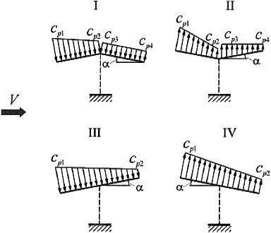

^fv-22

Рисунок В.12

*Таблица* ^tu014
<table>
<tr><th scope="col"></th><th scope="col"></th><th scope="col"></th><th scope="col"></th><th scope="col"></th><th scope="col"></th></tr>
<tr><td>Тип схемы</td><td>⟦IMG:data:image;base64,R0lGODdhDwAPAIABAAAAAP///ywAAAAADwAPAAACHYyPqc|15x15⟧</td><th colspan="4" scope="row">Значения коэффициентов</th></tr>
<tr><td></td><td></td><td></td><td></td><td></td><td></td></tr>
<tr><td>I</td><td>10</td><td>0,5</td><td>-1,3</td><td>-1,1</td><td>0</td></tr>
<tr><td></td><td>20</td><td>1,1</td><td>0</td><td>0</td><td>-0,4</td></tr>
<tr><td></td><td>30</td><td>2,1</td><td>0,9</td><td>0,6</td><td>0</td></tr>
<tr><td>II</td><td>10</td><td>0</td><td>-1,1</td><td>-1,5</td><td>0</td></tr>
<tr><td></td><td>20</td><td>1,5</td><td>0,5</td><td>0</td><td>0</td></tr>
<tr><td></td><td>30</td><td>2</td><td>0,8</td><td>0,4</td><td>0,4</td></tr>
<tr><td>III</td><td>10</td><td>1,4</td><td>0,4</td><td>-</td><td>-</td></tr>
<tr><td></td><td>20</td><td>1,8</td><td>0,5</td><td>-</td><td>-</td></tr>
<tr><td></td><td>30</td><td>2,2</td><td>0,6</td><td>-</td><td>-</td></tr>
<tr><td>IV</td><td>10</td><td>1,3</td><td>0,2</td><td>-</td><td>-</td></tr>
<tr><td></td><td>20</td><td>1,4</td><td>0,3</td><td>-</td><td>-</td></tr>
<tr><td></td><td>30</td><td>1,6</td><td>0,4</td><td>-</td><td>-</td></tr>
<tr><th colspan="6" scope="row">Примечания 1 Коэффициенты ⟦IMG:data:image;base64,R0lGODdhGAAZAIABAAAAAP///ywAAAAAGAAZAAACMoyPqc|24x25⟧⟦IMG:data:image;base64,R0lGODdhGwAZAIABAAAAAP///ywAAAAAGwAZAAACOYyPqc|27x25⟧⟦IMG:data:image;base64,R0lGODdhGwAZAIABAAAAAP///ywAAAAAGwAZAAACOIyPqc|27x25⟧⟦IMG:data:image;base64,R0lGODdhGwAZAIABAAAAAP///ywAAAAAGwAZAAACO4yPqc|27x25⟧ 2 Для отрицательных значений ⟦IMG:data:image;base64,R0lGODdhGAAZAIABAAAAAP///ywAAAAAGAAZAAACMoyPqc|24x25⟧⟦IMG:data:image;base64,R0lGODdhGwAZAIABAAAAAP///ywAAAAAGwAZAAACOYyPqc|27x25⟧⟦IMG:data:image;base64,R0lGODdhGwAZAIABAAAAAP///ywAAAAAGwAZAAACOIyPqc|27x25⟧⟦IMG:data:image;base64,R0lGODdhGwAZAIABAAAAAP///ywAAAAAGwAZAAACO4yPqc|27x25⟧ 3 Для навесов с волнистыми покрытиями аэродинамический коэффициент трения ⟦IMG:data:image;base64,R0lGODdhFAAZAIABAAAAAP///ywAAAAAFAAZAAACKYyPqc|20x25⟧ 4 Для горизонтально расположенных навесов необходимо рассмотреть два варианта нагружения, соответствующие схемам III и IV при ⟦IMG:data:image;base64,R0lGODdhDwAPAIABAAAAAP///ywAAAAADwAPAAACHYyPqc|15x15⟧</th></tr>
</table>

В.1.11 Сфера

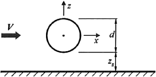

^fv-23

Аэродинамические коэффициенты лобового сопротивления ⟦IMG:data:image;base64,R0lGODdhEwAYAIABAAAAAP///ywAAAAAEwAYAAACIoyPqc|19x24⟧⟦IMG:https://api.docs.cntd.ru/img/45/60/44/31/8/99bd5477-bade-485c-94|65x25⟧рисунок В.13) приведены на рисунке В.14 в зависимости от числа Рейнольдса Re⟦IMG:https://api.docs.cntd.ru/img/45/60/44/31/8/99bd5477-bade-485c-94|57x19⟧⟦IMG:data:image;base64,R0lGODdhDwARAIABAAAAAP///ywAAAAADwARAAACHYyPqc|15x17⟧В.1.16). При ⟦IMG:https://api.docs.cntd.ru/img/45/60/44/31/8/99bd5477-bade-485c-94|65x25⟧⟦IMG:data:image;base64,R0lGODdhEwAYAIABAAAAAP///ywAAAAAEwAYAAACIoyPqc|19x24⟧

Коэффициент подъемной силы сферы ⟦IMG:data:image;base64,R0lGODdhEQAXAIABAAAAAP///ywAAAAAEQAXAAACI4yPqc|17x23⟧

при ⟦IMG:https://api.docs.cntd.ru/img/45/60/44/31/8/99bd5477-bade-485c-94|65x25⟧⟦IMG:https://api.docs.cntd.ru/img/45/60/44/31/8/99bd5477-bade-485c-94|44x23⟧

при ⟦IMG:https://api.docs.cntd.ru/img/45/60/44/31/8/99bd5477-bade-485c-94|65x25⟧⟦IMG:https://api.docs.cntd.ru/img/45/60/44/31/8/99bd5477-bade-485c-94|56x23⟧

Эквивалентная высота (см. 11.1.5) ⟦IMG:https://api.docs.cntd.ru/img/45/60/44/31/8/99bd5477-bade-485c-94|96x25⟧

При определении коэффициента v11.1.11 следует принимать

.

Число Рейнольдса Re

d

⟦IMG:data:image;base64,R0lGODdhFQAYAIABAAAAAP///ywAAAAAFQAYAAACL4yPqc|21x24⟧11.1.4;

⟦IMG:data:image;base64,R0lGODdhJwAYAIABAAAAAP///ywAAAAAJwAYAAACU4yPqc|39x24⟧11.1.6;

⟦IMG:data:image;base64,R0lGODdhFQAZAIABAAAAAP///ywAAAAAFQAZAAACLoyPqc|21x25⟧разделу 11).

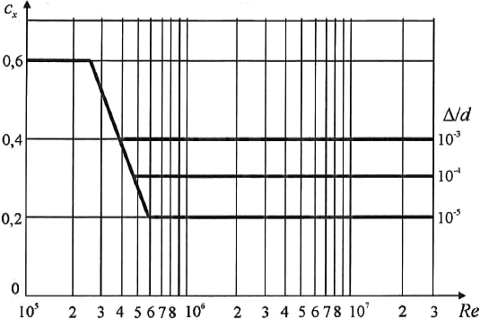

^fv-24

Рисунок В.14

В.1.11 (Измененная редакция, Изм. N 3).

В.1.12 Сооружения и конструктивные элементы с круговой цилиндрической поверхностью

Аэродинамический коэффициент

⟦IMG:data:image;base64,R0lGODdhGAAYAIABAAAAAP///ywAAAAAGAAYAAACOYyPqc|24x24⟧⟦IMG:data:image;base64,R0lGODdhEQAZAIABAAAAAP///ywAAAAAEQAZAAACKYyPqc|17x25⟧⟦IMG:https://api.docs.cntd.ru/img/45/60/44/31/8/99bd5477-bade-485c-94|108x25⟧В.1.15.

Распределение коэффициентов ⟦IMG:data:image;base64,R0lGODdhEQAZAIABAAAAAP///ywAAAAAEQAZAAACKYyPqc|17x25⟧⟦IMG:https://api.docs.cntd.ru/img/45/60/44/31/8/99bd5477-bade-485c-94|112x24⟧В.1.16) приведено на рисунке В.16 для различных чисел Рейнольдса Re⟦IMG:data:image;base64,R0lGODdhIQAXAIABAAAAAP///ywAAAAAIQAXAAACSIyPqc|33x23⟧⟦IMG:data:image;base64,R0lGODdhFAAYAIABAAAAAP///ywAAAAAFAAYAAACMoyPqc|20x24⟧⟦IMG:data:image;base64,R0lGODdhHwAXAIABAAAAAP///ywAAAAAHwAXAAACO4yPqc|31x23⟧⟦IMG:data:image;base64,R0lGODdhEQAYAIABAAAAAP///ywAAAAAEQAYAAACJoyPqc|17x24⟧таблице В.5.

Значения аэродинамических коэффициентов давления ⟦IMG:data:image;base64,R0lGODdhGAAYAIABAAAAAP///ywAAAAAGAAYAAACMoyPqc|24x24⟧⟦IMG:data:image;base64,R0lGODdhEAAYAIABAAAAAP///ywAAAAAEAAYAAACIIyPqc|16x24⟧рисунок В.15) приведены в таблице В.6. Коэффициент ⟦IMG:data:image;base64,R0lGODdhEAAYAIABAAAAAP///ywAAAAAEAAYAAACIIyPqc|16x24⟧

Аэродинамические коэффициенты лобового сопротивления

где ⟦IMG:data:image;base64,R0lGODdhFAAYAIABAAAAAP///ywAAAAAFAAYAAACLYyPqc|20x24⟧В.1 в зависимости от относительного удлинения сооружения (см. В.1.15). Значения коэффициентов рисунке В.17 в зависимости от числа Рейнольдса Re⟦IMG:https://api.docs.cntd.ru/img/45/60/44/31/8/99bd5477-bade-485c-94|57x19⟧В.1.16); для цилиндрических сооружений с ребрами ⟦IMG:data:image;base64,R0lGODdhDwARAIABAAAAAP///ywAAAAADwARAAACHYyPqc|15x17⟧

^fu036

Рисунок В.15*

________________

* Измененная редакция, Изм. N 5.

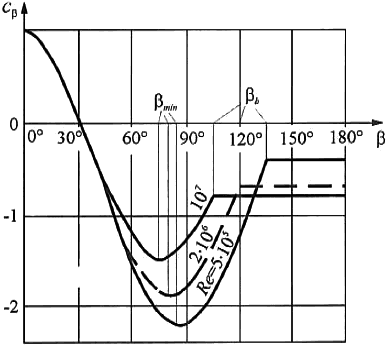

^fu037

Рисунок В.16

*Таблица* ^tu015
|  |  |  |  |  |
|---|---|---|---|---|
| Re | ⟦IMG:data:image;base64,R0lGODdhIQAXAIABAAAAAP///ywAAAAAIQAXAAACSIyPqc\|33x23⟧ |  | ⟦IMG:data:image;base64,R0lGODdhFAAYAIABAAAAAP///ywAAAAAFAAYAAACMoyPqc\|20x24⟧ | ⟦IMG:data:image;base64,R0lGODdhEQAYAIABAAAAAP///ywAAAAAEQAYAAACJoyPqc\|17x24⟧ |
| 5·10⟦IMG:data:image;base64,R0lGODdhCwAXAIABAAAAAP///ywAAAAACwAXAAACF4yPqc\|11x23⟧ | 85 | -2,2 | 135 | -0,4 |
| 2·10⟦IMG:data:image;base64,R0lGODdhCwAXAIABAAAAAP///ywAAAAACwAXAAACG4yPqc\|11x23⟧ | 80 | -1,9 | 120 | -0,7 |
| 10⟦IMG:data:image;base64,R0lGODdhCwAXAIABAAAAAP///ywAAAAACwAXAAACF4yPqc\|11x23⟧ | 75 | -1,5 | 105 | -0,8 |

*Таблица* ^tu016
|  |  |  |  |  |  |  |
|---|---|---|---|---|---|---|
| ⟦IMG:https://api.docs.cntd.ru/img/45/60/44/31/8/99bd5477-bade-485c-94\|37x23⟧ | 1/6 | 1/4 | 1/2 | 1 | 2 | ⟦IMG:data:image;base64,iVBORw0KGgoAAAANSUhEUgAAAIAAAACaCAIAAADuEddhAA\|13x17⟧ |
| ⟦IMG:https://api.docs.cntd.ru/img/45/60/44/31/8/99bd5477-bade-485c-94\|24x24⟧⟦IMG:https://api.docs.cntd.ru/img/45/60/44/31/8/99bd5477-bade-485c-94\|15x24⟧ | -0,5 | -0,55 | -0,7 | -0,8 | -0,9 | -1,05 |

Изм. N 5).

^fu038

________________

* Измененная редакция, Изм. N 3.

Для проводов и тросов (в том числе покрытых гололедом)

Аэродинамические коэффициенты лобового сопротивления наклонных элементов (рисунок В.18) определяются по формуле

где В.1.12, В.1.13 и В.1.14;

⟦IMG:data:image;base64,R0lGODdhDQAVAIABAAAAAP///ywAAAAADQAVAAACIoyPqc|13x21⟧V хх

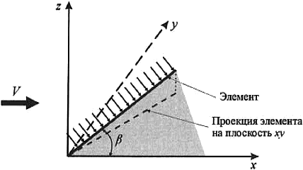

^fu039

Рисунок В.18

При определении коэффициента v11.1.11:

⟦IMG:https://api.docs.cntd.ru/img/45/60/44/31/8/99bd5477-bade-485c-94|59x21⟧⟦IMG:https://api.docs.cntd.ru/img/45/60/44/31/8/99bd5477-bade-485c-94|88x23⟧

Число Рейнольдса ReВ.1.11,

где hh ⟦IMG:data:image;base64,R0lGODdhDgATAIABAAAAAP///ywAAAAADgATAAACIIyPqc|14x19⟧

В.1.13 Призматические сооружения и конструктивные элементы

Аэродинамические коэффициенты лобового сопротивления призматических сооружений определяются по формуле

где ⟦IMG:data:image;base64,R0lGODdhFAAYAIABAAAAAP///ywAAAAAFAAYAAACLYyPqc|20x24⟧В.1.15 в зависимости от относительного удлинения сооружения ⟦IMG:data:image;base64,R0lGODdhFAAYAIABAAAAAP///ywAAAAAFAAYAAACKoyPqc|20x24⟧

Значения коэффициента рисунке В.19, а для nтаблице В.7.

Аэродинамические коэффициенты лобового сопротивления для конструкционных профилей принимаются равными 1,4 (

Таблица В.7

*Таблица* ^tu017
|  |  |  |  |
|---|---|---|---|
| Эскизы сечений и направлений ветра | ⟦IMG:data:image;base64,R0lGODdhDQAVAIABAAAAAP///ywAAAAADQAVAAACIoyPqc\|13x21⟧ | n | ReRe⟦IMG:data:image;base64,R0lGODdhCwAXAIABAAAAAP///ywAAAAACwAXAAACF4yPqc\|11x23⟧ |
| Правильный многоугольник | Произвольный | 5 | 1,8 |
| ⟦IMG:https://api.docs.cntd.ru/img/45/60/44/31/8/99bd5477-bade-485c-94\|245x133⟧ |  | 6-8 | 1,5 |
|  |  | 10 | 1,2 |
|  |  | 12 | 1,0 |

^fu040

________________

* Измененная редакция, Изм. N 2.

В.1.14 Решетчатые конструкции

Аэродинамические коэффициенты решетчатых конструкций отнесены к площади граней пространственных ферм или площади контура плоских ферм.

Направление оси хтаблице В.8.

Аэродинамические коэффициенты

где В.1.12 и В.1.13 для элементов с круглым и прямоугольным поперечными сечениями, соответственно; при этом ⟦IMG:data:image;base64,R0lGODdhFAAYAIABAAAAAP///ywAAAAAFAAYAAACLYyPqc|20x24⟧

ii

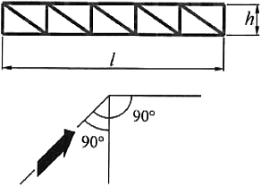

^fu041

Рисунок В.20

Ряд плоских параллельно расположенных решетчатых конструкций

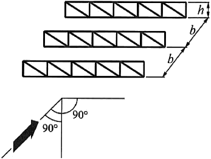

^fu042

Для наветренной конструкции коэффициент ⟦IMG:data:image;base64,R0lGODdhFwAYAIABAAAAAP///ywAAAAAFwAYAAACLYyPqc|23x24⟧

Для второй и последующих конструкций ⟦IMG:https://api.docs.cntd.ru/img/45/60/44/31/8/99bd5477-bade-485c-94|69x24⟧

Для ферм из труб при Re⟦IMG:https://api.docs.cntd.ru/img/45/60/44/31/8/99bd5477-bade-485c-94|11x23⟧⟦IMG:data:image;base64,iVBORw0KGgoAAAANSUhEUgAAAIAAAACmCAIAAACdqRC3AA|13x17⟧b/h⟦IMG:https://api.docs.cntd.ru/img/45/60/44/31/8/99bd5477-bade-485c-94|83x45⟧

Таблица В.8

*Таблица* ^tu018
<table>
<tr><th scope="col"></th><th scope="col"></th><th scope="col"></th><th scope="col"></th><th scope="col"></th><th scope="col"></th></tr>
<tr><td>⟦IMG:data:image;base64,R0lGODdhDwARAIABAAAAAP///ywAAAAADwARAAACIIyPqa|15x17⟧</td><th colspan="5" scope="row">b/h</th></tr>
<tr><td></td><td>1/2</td><td>1</td><td>2</td><td>4</td><td>6</td></tr>
<tr><td>0,1</td><td>0,93</td><td>0,99</td><td>1</td><td>1</td><td>1</td></tr>
<tr><td>0,2</td><td>0,75</td><td>0,81</td><td>0,87</td><td>0,9</td><td>0,93</td></tr>
<tr><td>0,3</td><td>0,56</td><td>0,65</td><td>0,73</td><td>0,78</td><td>0,83</td></tr>
<tr><td>0,4</td><td>0,38</td><td>0,48</td><td>0,59</td><td>0,65</td><td>0,72</td></tr>
<tr><td>0,5</td><td>0,19</td><td>0,32</td><td>0,44</td><td>0,52</td><td>0,61</td></tr>
<tr><td>⟦IMG:data:image;base64,R0lGODdhDQAQAIABAAAAAP///ywAAAAADQAQAAACF4yPqc|13x16⟧</td><td>0</td><td>0,15</td><td>0,3</td><td>0,4</td><td>0,5</td></tr>
</table>

Для ферм из труб при Re⟦IMG:data:image;base64,iVBORw0KGgoAAAANSUhEUgAAADAAAAA6CAIAAAB5+022AA|13x16⟧⟦IMG:data:image;base64,iVBORw0KGgoAAAANSUhEUgAAACYAAABSCAIAAAC37DEuAA|11x23⟧⟦IMG:data:image;base64,iVBORw0KGgoAAAANSUhEUgAAAGAAAAA+CAIAAABbfonoAA|27x18⟧

> *Примечание* — Число Рейнольдса ReВ.1.11, где d

^n15-2-3-6

Решетчатые башни и пространственные фермы

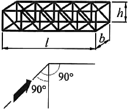

^fu043

Аэродинамические коэффициенты

где

Значения коэффициента ⟦IMG:data:image;base64,R0lGODdhEAAXAIABAAAAAP///ywAAAAAEAAXAAACKIyPqc|16x23⟧таблице В.9.

Таблица В.9

*Таблица* ^tu019
|  |  |
|---|---|
| Форма контура поперечного сечения и направление ветра | ⟦IMG:data:image;base64,R0lGODdhEAAXAIABAAAAAP///ywAAAAAEAAXAAACKIyPqc\|16x23⟧ |
| ⟦IMG:https://api.docs.cntd.ru/img/45/60/44/31/8/99bd5477-bade-485c-94\|127x67⟧ | 1 |
| ⟦IMG:https://api.docs.cntd.ru/img/45/60/44/31/8/99bd5477-bade-485c-94\|121x72⟧ | 0,9 |
| ⟦IMG:https://api.docs.cntd.ru/img/45/60/44/31/8/99bd5477-bade-485c-94\|103x49⟧ | 1,2 |

В.1.14 (Измененная редакция, Изм. N 3, 5).

В.1.15 Учет относительного удлинения

Значения коэффициента ⟦IMG:data:image;base64,R0lGODdhFAAYAIABAAAAAP///ywAAAAAFAAYAAACLYyPqc|20x24⟧⟦IMG:data:image;base64,R0lGODdhFAAYAIABAAAAAP///ywAAAAAFAAYAAACKoyPqc|20x24⟧рисунке В.23. Относительное удлинение ⟦IMG:data:image;base64,R0lGODdhFAAYAIABAAAAAP///ywAAAAAFAAYAAACKoyPqc|20x24⟧⟦IMG:https://api.docs.cntd.ru/img/45/60/44/31/8/99bd5477-bade-485c-94|52x19⟧таблице В.10; степень заполнения ⟦IMG:https://api.docs.cntd.ru/img/45/60/44/31/8/99bd5477-bade-485c-94|83x45⟧

^fu044

*Таблица* ^tu020
<table>
<tr><th scope="col"></th><th scope="col"></th><th scope="col"></th><th scope="col"></th></tr>
<tr><td>⟦IMG:https://api.docs.cntd.ru/img/45/60/44/31/8/99bd5477-bade-485c-94|63x24⟧</td><td>⟦IMG:https://api.docs.cntd.ru/img/45/60/44/31/8/99bd5477-bade-485c-94|47x24⟧</td><td>⟦IMG:https://api.docs.cntd.ru/img/45/60/44/31/8/99bd5477-bade-485c-94|56x24⟧</td><td>⟦IMG:https://api.docs.cntd.ru/img/45/60/44/31/8/99bd5477-bade-485c-94|49x24⟧</td></tr>
<tr><td>⟦IMG:https://api.docs.cntd.ru/img/45/60/44/31/8/99bd5477-bade-485c-94|126x207⟧</td><td>⟦IMG:https://api.docs.cntd.ru/img/45/60/44/31/8/99bd5477-bade-485c-94|202x242⟧</td><td>⟦IMG:https://api.docs.cntd.ru/img/45/60/44/31/8/99bd5477-bade-485c-94|116x204⟧</td><td>⟦IMG:https://api.docs.cntd.ru/img/45/60/44/31/8/99bd5477-bade-485c-94|94x159⟧</td></tr>
<tr><th colspan="4" scope="row">Примечание - ⟦IMG:data:image;base64,R0lGODdhCQATAIABAAAAAP///ywAAAAACQATAAACFIyPqc|9x19⟧⟦IMG:data:image;base64,R0lGODdhDQATAIABAAAAAP///ywAAAAADQATAAACHYyPqc|13x19⟧</th></tr>
</table>

В.1.16 Учет шероховатости внешней поверхности

Шероховатость ⟦IMG:data:image;base64,R0lGODdhDwARAIABAAAAAP///ywAAAAADwARAAACHYyPqc|15x17⟧таблице В.11.

Таблица В.11

*Таблица* ^tu021
|  |  |  |  |
|---|---|---|---|
| Тип поверхности | Шероховатость ⟦IMG:data:image;base64,iVBORw0KGgoAAAANSUhEUgAAADUAAAA+CAIAAAAEQ8TkAA\|15x18⟧ | Тип поверхности | Шероховатость ⟦IMG:data:image;base64,iVBORw0KGgoAAAANSUhEUgAAADUAAAA+CAIAAAAEQ8TkAA\|15x18⟧ |
| Стекло | 1,5·10⟦IMG:data:image;base64,iVBORw0KGgoAAAANSUhEUgAAAD4AAABSCAIAAACDlfAyAA\|18x23⟧ | Оцинкованная сталь | 2·10⟦IMG:data:image;base64,iVBORw0KGgoAAAANSUhEUgAAAD4AAABSCAIAAACDlfAyAA\|18x23⟧ |
| Полированный металл | 2·10⟦IMG:data:image;base64,iVBORw0KGgoAAAANSUhEUgAAAD4AAABSCAIAAACDlfAyAA\|18x23⟧ | Шлифованный бетон | 2·10⟦IMG:data:image;base64,iVBORw0KGgoAAAANSUhEUgAAAD4AAABSCAIAAACDlfAyAA\|18x23⟧ |
| Тонкомолотая масляная краска | 6·10⟦IMG:data:image;base64,iVBORw0KGgoAAAANSUhEUgAAAD4AAABSCAIAAACDlfAyAA\|18x23⟧ | Шероховатый бетон | 10⟦IMG:data:image;base64,iVBORw0KGgoAAAANSUhEUgAAAD4AAABSCAIAAACDlfAyAA\|18x23⟧ |
| Распыленная краска | 2·10⟦IMG:data:image;base64,iVBORw0KGgoAAAANSUhEUgAAAD4AAABSCAIAAACDlfAyAA\|18x23⟧ | Ржавчина | 2·10⟦IMG:data:image;base64,iVBORw0KGgoAAAANSUhEUgAAAD4AAABSCAIAAACDlfAyAA\|18x23⟧ |
| Литейный чугун | 2·10⟦IMG:data:image;base64,iVBORw0KGgoAAAANSUhEUgAAAD4AAABSCAIAAACDlfAyAA\|18x23⟧ | Каменная, кирпичная кладка | 3·10⟦IMG:data:image;base64,iVBORw0KGgoAAAANSUhEUgAAAD4AAABSCAIAAACDlfAyAA\|18x23⟧ |

В.1.16 (Измененная редакция, Изм. N 3).

В.1.17 Пиковые значения аэродинамических коэффициентов для прямоугольных в плане зданий

а) Для стен прямоугольных в плане зданий пиковое положительное значение аэродинамического коэффициента ⟦IMG:data:image;base64,R0lGODdhIwAbAIABAAAAAP///ywAAAAAIwAbAAACQIyPqc|35x27⟧

б) Пиковые значения отрицательного аэродинамического коэффициента ⟦IMG:data:image;base64,R0lGODdhIQAbAIABAAAAAP///ywAAAAAIQAbAAACOYyPqc|33x27⟧рисунок В.24) приведены в таблице В.12.

Таблица В.12

*Таблица* ^tu022
|  |  |  |  |  |  |
|---|---|---|---|---|---|
| Участок | А | В | С | D | E |
| ⟦IMG:data:image;base64,R0lGODdhIQAbAIABAAAAAP///ywAAAAAIQAbAAACOYyPqc\|33x27⟧ | -2,2 | -1,2 | -3,4 | -2,4 | -1,5 |

^fu045

В.2 Резонансное вихревое возбуждение

В.2.1 Для однопролетных сооружений и конструктивных элементов интенсивность воздействия F z i-z i-i-

где d

⟦IMG:data:image;base64,R0lGODdhHwAZAIABAAAAAP///ywAAAAAHwAZAAACQYyPqc|31x25⟧11.3.2;

⟦IMG:data:image;base64,R0lGODdhEwAYAIABAAAAAP///ywAAAAAEwAYAAACK4yPqc|19x24⟧⟦IMG:data:image;base64,R0lGODdhEwAYAIABAAAAAP///ywAAAAAEwAYAAACK4yPqc|19x24⟧

z

⟦IMG:data:image;base64,R0lGODdhJwAYAIABAAAAAP///ywAAAAAJwAYAAACU4yPqc|39x24⟧i-

> *Примечание* — В тех случаях, когда используются различные типы демпфирующих устройств (гасители колебаний), значение суммарного логарифмического декремента конструкционного демпфирования ⟦IMG:data:image;base64,R0lGODdhEwAYAIABAAAAAP///ywAAAAAEwAYAAACK4yPqc|19x24⟧

^n15-2-3-7

Для высотных зданий воздействие, возникающее при резонансном вихревом возбуждении, необходимо устанавливать на основе данных их модельных испытаний в аэродинамических трубах.

**(Измененная редакция, Изм. № 1).**

В.2.2 Аэродинамические коэффициенты

а) Для круглых поперечных сечений

б) Для прямоугольных поперечных сечений при b/d

⟦IMG:https://api.docs.cntd.ru/img/45/60/44/31/8/99bd5477-bade-485c-94|51x25⟧⟦IMG:https://api.docs.cntd.ru/img/45/60/44/31/8/99bd5477-bade-485c-94|133x27⟧ ⟦IMG:https://api.docs.cntd.ru/img/45/60/44/31/8/99bd5477-bade-485c-94|56x25⟧⟦IMG:https://api.docs.cntd.ru/img/45/60/44/31/8/99bd5477-bade-485c-94|136x27⟧

b

При b/d⟦IMG:data:image;base64,R0lGODdhDQAQAIABAAAAAP///ywAAAAADQAQAAACF4yPqc|13x16⟧

В.2.3 При расчете сооружения на резонансное вихревое возбуждение наряду с воздействием (В.2.1) необходимо учитывать также действие ветровой нагрузки, параллельной средней скорости ветра. Средняя ⟦IMG:data:image;base64,R0lGODdhJwAZAIABAAAAAP///ywAAAAAJwAZAAACSIyPqc|39x25⟧⟦IMG:data:image;base64,R0lGODdhJQAZAIABAAAAAP///ywAAAAAJQAZAAACSIyPqc|37x25⟧

⟦IMG:https://api.docs.cntd.ru/img/45/60/44/31/8/99bd5477-bade-485c-94|153x29⟧⟦IMG:https://api.docs.cntd.ru/img/45/60/44/31/8/99bd5477-bade-485c-94|152x29⟧

где ⟦IMG:data:image;base64,R0lGODdhIQAYAIABAAAAAP///ywAAAAAIQAYAAACR4yPqc|33x24⟧⟦IMG:data:image;base64,R0lGODdhGAAYAIABAAAAAP///ywAAAAAGAAYAAACMYyPqc|24x24⟧

⟦IMG:data:image;base64,R0lGODdhGAAYAIABAAAAAP///ywAAAAAGAAYAAACMoyPqc|24x24⟧⟦IMG:data:image;base64,R0lGODdhFwAZAIABAAAAAP///ywAAAAAFwAZAAACMoyPqc|23x25⟧11.1.

**(Измененная редакция, Изм. № 2).**

В.2.4 Критические скорости

Для предотвращения резонансного вихревого возбуждения могут быть использованы различные конструктивные мероприятия: установка вертикальных и спиралевидных ребер, перфорация ограждения и установка соответствующим образом настроенных гасителей колебаний.

В.3 Динамическая комфортность

При оценке комфортности пребывания людей в зданиях (динамическая комфортность) расчетные значения ветровой нагрузки ⟦IMG:data:image;base64,R0lGODdhFQAYAIABAAAAAP///ywAAAAAFQAYAAACK4yPqc|21x24⟧

где ⟦IMG:data:image;base64,R0lGODdhFwAZAIABAAAAAP///ywAAAAAFwAZAAACMoyPqc|23x25⟧11.1.8).

При этом максимальное ускорение этажа здания не должно превышать величины:

а) для жилых зданий

⟦IMG:https://api.docs.cntd.ru/img/45/60/44/31/8/99bd5477-bade-485c-94|58x25⟧⟦IMG:data:image;base64,iVBORw0KGgoAAAANSUhEUgAAACYAAABSCAIAAAC37DEuAA|11x23⟧

б) для общественных, административных и офисных зданий

⟦IMG:https://api.docs.cntd.ru/img/45/60/44/31/8/99bd5477-bade-485c-94|58x25⟧⟦IMG:data:image;base64,iVBORw0KGgoAAAANSUhEUgAAACYAAABSCAIAAAC37DEuAA|11x23⟧

> *Примечание* — Методику оценки динамической комфортности допускается уточнять в зависимости от собственных частот колебаний здания.

^n15-2-3-8

**(Измененная редакция, Изм. № 2, 3).**

## Приложение Г

*Таблица* ^tu023
<table>
<tr><th scope="col"></th><th scope="col"></th><th scope="col"></th><th scope="col"></th><th scope="col"></th><th scope="col"></th><th scope="col"></th></tr>
<tr><td>Субъект РФ</td><th colspan="2" scope="row">t</th><th colspan="2" scope="row">t</th><th colspan="2" scope="row">t</th></tr>
<tr><td></td><td>⟦IMG:data:image;base64,R0lGODdhHwAYAIABAAAAAP///ywAAAAAHwAYAAACQIyPqc|31x24⟧</td><td>⟦IMG:data:image;base64,R0lGODdhHQAXAIABAAAAAP///ywAAAAAHQAXAAACOoyPqc|29x23⟧</td><td>⟦IMG:data:image;base64,R0lGODdhHwAYAIABAAAAAP///ywAAAAAHwAYAAACQIyPqc|31x24⟧</td><td>⟦IMG:data:image;base64,R0lGODdhHQAXAIABAAAAAP///ywAAAAAHQAXAAACOoyPqc|29x23⟧</td><td>⟦IMG:data:image;base64,R0lGODdhHwAYAIABAAAAAP///ywAAAAAHwAYAAACQIyPqc|31x24⟧</td><td>⟦IMG:data:image;base64,R0lGODdhHQAXAIABAAAAAP///ywAAAAAHQAXAAACOoyPqc|29x23⟧</td></tr>
<tr><td>Алтайский край</td><td>18,1</td><td>-4,8</td><td>14,9</td><td>-1,3</td><td>10,8</td><td>2,5</td></tr>
<tr><td>Амурская обл.</td><td>16,5</td><td>-8,0</td><td>13,3</td><td>-4,6</td><td>9,3</td><td>0,0</td></tr>
<tr><td>Архангельская обл.</td><td>14,7</td><td>-2,6</td><td>13,0</td><td>-0,9</td><td>9,3</td><td>1,0</td></tr>
<tr><td>Астраханская обл.</td><td>26,6</td><td>0,6</td><td>23,0</td><td>3,9</td><td>15,9</td><td>7,6</td></tr>
<tr><td>Белгородская обл.</td><td>17,8</td><td>0,8</td><td>14,6</td><td>3,2</td><td>12,0</td><td>5,4</td></tr>
<tr><td>Брянская обл.</td><td>16,5</td><td>1,2</td><td>14,3</td><td>2,8</td><td>11,1</td><td>4,8</td></tr>
<tr><td>Владимирская обл.</td><td>16,0</td><td>1,0</td><td>13,9</td><td>2,1</td><td>11,4</td><td>3,7</td></tr>
<tr><td>Волгоградская обл.</td><td>24,0</td><td>0,2</td><td>21,5</td><td>1,8</td><td>18,4</td><td>4,4</td></tr>
<tr><td>Вологодская обл.</td><td>14,0</td><td>0,9</td><td>12,4</td><td>1,7</td><td>9,5</td><td>3,2</td></tr>
<tr><td>Воронежская обл.</td><td>16,8</td><td>1,1</td><td>13,9</td><td>3,1</td><td>11,1</td><td>5,3</td></tr>
<tr><td>Еврейская а.о.</td><td>18,9</td><td>-3,1</td><td>15,5</td><td>0,0</td><td>11,0</td><td>1,9</td></tr>
<tr><td>Забайкальский край</td><td>14,7</td><td>-14,3</td><td>10,7</td><td>-8,3</td><td>6,6</td><td>-2,3</td></tr>
<tr><td>Ивановская обл.</td><td>14,7</td><td>1,0</td><td>13,1</td><td>2,2</td><td>9,9</td><td>3,9</td></tr>
<tr><td>Иркутская обл.</td><td>17,0</td><td>-8,4</td><td>14,9</td><td>-4,1</td><td>10,8</td><td>-1,0</td></tr>
<tr><td>Кабардино-Балкарская Респ.</td><td>21,0</td><td>2,9</td><td>18,1</td><td>5,8</td><td>14,9</td><td>9,1</td></tr>
<tr><td>Калининградская обл.</td><td>16,3</td><td>2,9</td><td>13,9</td><td>4,4</td><td>11,1</td><td>6,3</td></tr>
<tr><td>Калужская обл.</td><td>15,5</td><td>0,7</td><td>13,9</td><td>1,9</td><td>11,8</td><td>3,3</td></tr>
<tr><td>Камчатский край</td><td>14,1</td><td>-0,8</td><td>14,5</td><td>0,5</td><td>16,7</td><td>1,3</td></tr>
<tr><td>Карачаево-Черкесская Респ.</td><td>15,4</td><td>0,0</td><td>13,5</td><td>3,4</td><td>11,2</td><td>5,8</td></tr>
<tr><td>Кемеровская обл.</td><td>14,9</td><td>-2,0</td><td>12,2</td><td>0,2</td><td>8,8</td><td>2,4</td></tr>
<tr><td>Кировская обл.</td><td>15,5</td><td>0,7</td><td>13,8</td><td>1,9</td><td>9,2</td><td>3,9</td></tr>
<tr><td>Костромская обл.</td><td>15,3</td><td>0,9</td><td>13,2</td><td>2,0</td><td>10,4</td><td>3,6</td></tr>
<tr><td>Краснодарский край</td><td>22,9</td><td>3,5</td><td>20,7</td><td>6,4</td><td>18,4</td><td>9,1</td></tr>
<tr><td>Красноярский край</td><td>17,1</td><td>-6,6</td><td>13,8</td><td>-1,5</td><td>9,7</td><td>0,2</td></tr>
<tr><td>Курганская обл.</td><td>17,7</td><td>-2,5</td><td>14,7</td><td>-0,1</td><td>11,2</td><td>2,3</td></tr>
<tr><td>Курская обл.</td><td>17,4</td><td>0,7</td><td>14,9</td><td>2,4</td><td>11,5</td><td>4,8</td></tr>
<tr><td>Ленинградская обл.</td><td>15,5</td><td>0,6</td><td>13,8</td><td>1,6</td><td>11,4</td><td>3,0</td></tr>
<tr><td>Липецкая обл.</td><td>17,3</td><td>0,7</td><td>15,3</td><td>1,9</td><td>12,3</td><td>4,1</td></tr>
<tr><td>Магаданская обл.</td><td>9,6</td><td>-14,6</td><td>6,8</td><td>-3,8</td><td>2,6</td><td>-0,8</td></tr>
<tr><td>Московская обл.</td><td>15,4</td><td>0,6</td><td>13,3</td><td>1,8</td><td>11,2</td><td>3,8</td></tr>
<tr><td>Мурманская обл.</td><td>12,6</td><td>-2,5</td><td>10,5</td><td>0,2</td><td>7,6</td><td>1,0</td></tr>
<tr><td>Ненецкий а.о.</td><td>10,5</td><td>-3,9</td><td>8,6</td><td>-0,6</td><td>5,5</td><td>0,1</td></tr>
<tr><td>Нижегородская обл.</td><td>16,7</td><td>0,1</td><td>14,9</td><td>1,6</td><td>12,2</td><td>3,9</td></tr>
<tr><td>Новгородская обл.</td><td>14,6</td><td>1,1</td><td>12,6</td><td>2,3</td><td>10,5</td><td>3,7</td></tr>
<tr><td>Новосибирская обл.</td><td>15,1</td><td>-2,3</td><td>12,4</td><td>0,3</td><td>8,0</td><td>2,7</td></tr>
<tr><td>Омская обл.</td><td>15,0</td><td>-2,2</td><td>12,7</td><td>0,4</td><td>9,2</td><td>2,3</td></tr>
<tr><td>Оренбургская обл.</td><td>20,2</td><td>-1,5</td><td>17,6</td><td>1,3</td><td>13,5</td><td>3,9</td></tr>
<tr><td>Орловская обл.</td><td>16,6</td><td>0,9</td><td>14,4</td><td>2,6</td><td>11,2</td><td>4,8</td></tr>
<tr><td>Пензенская обл.</td><td>16,2</td><td>0,6</td><td>13,6</td><td>2,4</td><td>11,4</td><td>4,1</td></tr>
<tr><td>Пермский край</td><td>15,7</td><td>0,1</td><td>13,7</td><td>1,3</td><td>10,5</td><td>2,4</td></tr>
<tr><td>Приморский край</td><td>19,3</td><td>-2,8</td><td>15,9</td><td>0,1</td><td>12,0</td><td>2,9</td></tr>
<tr><td>Псковская обл.</td><td>17,1</td><td>0,8</td><td>14,7</td><td>2,4</td><td>11,6</td><td>4,0</td></tr>
<tr><td>Респ. Адыгея (Адыгея)</td><td>21,9</td><td>4,5</td><td>20,0</td><td>6,7</td><td>17,2</td><td>10,2</td></tr>
<tr><td>Респ. Алтай</td><td>15,2</td><td>-8,9</td><td>12,3</td><td>-7,7</td><td>9,8</td><td>-3,5</td></tr>
<tr><td>Респ. Башкортостан</td><td>15,4</td><td>0,0</td><td>13,0</td><td>1,7</td><td>9,9</td><td>3,6</td></tr>
<tr><td>Респ. Бурятия</td><td>16,9</td><td>-14,2</td><td>13,3</td><td>-10,3</td><td>9,2</td><td>-0,1</td></tr>
<tr><td>Респ. Дагестан</td><td>25,2</td><td>3,5</td><td>22,1</td><td>6,1</td><td>18,6</td><td>8,7</td></tr>
<tr><td>Респ. Калмыкия</td><td>23,6</td><td>0,7</td><td>20,4</td><td>4,1</td><td>16,2</td><td>8,3</td></tr>
<tr><td>Респ. Карелия</td><td>17,1</td><td>0,0</td><td>14,5</td><td>1,0</td><td>10,7</td><td>2,5</td></tr>
<tr><td>Респ. Коми</td><td>14,6</td><td>-2,3</td><td>12,3</td><td>-0,2</td><td>10,7</td><td>0,1</td></tr>
<tr><td>Респ. Марий Эл</td><td>15,7</td><td>0,5</td><td>13,1</td><td>2,1</td><td>10,4</td><td>3,7</td></tr>
<tr><td>Респ. Саха (Якутия)</td><td>15,0</td><td>-18,9</td><td>11,5</td><td>-16,2</td><td>6,8</td><td>-12,6</td></tr>
<tr><td>Респ. Северная Осетия - Алания</td><td>23,8</td><td>2,8</td><td>21,1</td><td>5,4</td><td>16,0</td><td>11,2</td></tr>
<tr><td>Респ. Татарстан</td><td>15,7</td><td>0,2</td><td>13,0</td><td>1,7</td><td>9,5</td><td>3,9</td></tr>
<tr><td>Респ. Тыва</td><td>14,5</td><td>-10,9</td><td>10,9</td><td>-5,9</td><td>7,3</td><td>-1,8</td></tr>
<tr><td>Респ. Хакасия</td><td>14,3</td><td>-6,6</td><td>11,1</td><td>-2,6</td><td>8,0</td><td>0,8</td></tr>
<tr><td>Ростовская обл.</td><td>22,8</td><td>0,9</td><td>18,6</td><td>3,6</td><td>15,8</td><td>6,0</td></tr>
<tr><td>Рязанская обл.</td><td>17,5</td><td>0,8</td><td>15,9</td><td>1,9</td><td>13,0</td><td>3,7</td></tr>
<tr><td>Самарская обл.</td><td>18,3</td><td>-1,2</td><td>15,0</td><td>1,1</td><td>11,9</td><td>3,3</td></tr>
<tr><td>Саратовская обл.</td><td>20,1</td><td>-1,2</td><td>17,3</td><td>1,0</td><td>13,1</td><td>3,9</td></tr>
<tr><td>Сахалинская обл.</td><td>14,5</td><td>-1,1</td><td>12,2</td><td>0,4</td><td>9,3</td><td>3,0</td></tr>
<tr><td>Свердловская обл.</td><td>16,8</td><td>-2,2</td><td>13,9</td><td>0,2</td><td>10,6</td><td>1,6</td></tr>
<tr><td>Смоленская обл.</td><td>15,3</td><td>1,4</td><td>13,1</td><td>2,8</td><td>10,9</td><td>4,5</td></tr>
<tr><td>Ставропольский край</td><td>23,8</td><td>3,0</td><td>20,7</td><td>4,8</td><td>17,1</td><td>8,2</td></tr>
<tr><td>Таймырский (Долгано-Ненецкий) м.р.</td><td>2,4</td><td>-22,6</td><td>-0,4</td><td>-4,7</td><td>-1,6</td><td>-3,1</td></tr>
<tr><td>Тамбовская обл.</td><td>17,4</td><td>1,1</td><td>15,4</td><td>2,5</td><td>12,3</td><td>4,5</td></tr>
<tr><td>Тверская обл.</td><td>18,0</td><td>0,9</td><td>15,7</td><td>1,9</td><td>12,3</td><td>3,4</td></tr>
<tr><td>Томская обл.</td><td>16,5</td><td>-1,5</td><td>13,5</td><td>0,6</td><td>10,0</td><td>2,3</td></tr>
<tr><td>Тульская обл.</td><td>15,9</td><td>0,8</td><td>13,5</td><td>2,5</td><td>11,2</td><td>4,2</td></tr>
<tr><td>Тюменская обл.</td><td>15,2</td><td>-0,9</td><td>13,1</td><td>0,4</td><td>9,0</td><td>2,5</td></tr>
<tr><td>Удмуртская Респ.</td><td>16,0</td><td>0,4</td><td>13,4</td><td>1,5</td><td>9,8</td><td>3,5</td></tr>
<tr><td>Ульяновская обл.</td><td>15,3</td><td>0,8</td><td>12,9</td><td>2,4</td><td>10,0</td><td>4,6</td></tr>
<tr><td>Хабаровский край</td><td>18,9</td><td>-10,4</td><td>15,5</td><td>-6,4</td><td>11,8</td><td>-1,6</td></tr>
<tr><td>Ханты-Мансийский а.о.</td><td>16,0</td><td>-1,8</td><td>12,9</td><td>0,1</td><td>9,3</td><td>1,5</td></tr>
<tr><td>Челябинская обл.</td><td>15,2</td><td>-1,4</td><td>12,5</td><td>0,6</td><td>9,6</td><td>2,9</td></tr>
<tr><td>Чеченская Респ.</td><td>23,2</td><td>3,2</td><td>20,0</td><td>6,3</td><td>16,8</td><td>10,1</td></tr>
<tr><td>Чувашская Респ.</td><td>15,6</td><td>0,1</td><td>13,0</td><td>1,9</td><td>9,4</td><td>3,9</td></tr>
<tr><td>Чукотский а.о.</td><td>10,0</td><td>-14,0</td><td>7,4</td><td>-12,2</td><td>4,7</td><td>-10,0</td></tr>
<tr><td>Эвенкийский а.о.</td><td>12,8</td><td>-7,6</td><td>10,3</td><td>-2,9</td><td>6,3</td><td>-1,2</td></tr>
<tr><td>Ямало-Ненецкий а.о.</td><td>12,5</td><td>-3,2</td><td>10,2</td><td>-1,5</td><td>6,8</td><td>1,3</td></tr>
<tr><td>Ярославская обл.</td><td>15,2</td><td>1,0</td><td>13,2</td><td>2,2</td><td>10,4</td><td>3,8</td></tr>
</table>

## Приложение Д

Д.1 Определение прогибов и перемещений

Д.1.1 При определении прогибов и перемещений следует учитывать все основные факторы, влияющие на их значения (неупругие деформации материалов, образование трещин, учет деформированной схемы, учет смежных элементов, податливость узлов сопряжения и оснований). При достаточном обосновании отдельные факторы можно не учитывать или учитывать приближенным способом.

При учете ветровых нагрузок перемещения несущих конструкций определяются от действия ее средней составляющей. При этом действия ее пиковой и пульсационной составляющих не учитываются.

**(Измененная редакция, Изм. № 3).**

Д.1.2 Для конструкций из материалов, обладающих ползучестью, необходимо учитывать увеличение прогибов во времени. При ограничении прогибов исходя из физиологических требований следует учитывать только кратковременную ползучесть, проявляемую сразу после приложения нагрузки, а исходя из технологических и конструктивных (за исключением расчета с учетом ветровой нагрузки) и эстетико-психологических требований - полную ползучесть.

Д.1.3 При определении прогибов колонн одноэтажных зданий и эстакад от горизонтальных крановых нагрузок расчетную схему колонн следует принимать с учетом условий их закрепления, считая, что колонна:

а) в зданиях и крытых эстакадах не имеет горизонтального смещения на уровне верхней опоры (если покрытие не создает жесткого в горизонтальной плоскости диска, следует учитывать горизонтальную податливость этой опоры);

б) в открытых эстакадах рассматривается как консоль.

Д.1.4 При колебаниях строительных конструкций зданий и сооружений классификацию вибраций, нормируемые параметры, их предельно допустимые значения в жилых, общественных и производственных зданиях необходимо устанавливать согласно требованиям соответствующих действующих нормативных документов.

При наличии высокоточного оборудования и приборов, чувствительных к колебаниям конструкций, на которых они установлены, предельные значения виброперемещений, виброскорости, виброускорения следует определять в соответствии с заданием на проектирование.

Д.1.5 Расчетные ситуации, для которых необходимо определять прогибы и перемещения и соответствующие им нагрузки, следует принимать в зависимости от того, исходя из каких требований производится расчет.

Расчетная ситуация характеризуется расчетной схемой конструкции, видами нагрузок, значениями коэффициентов условий работы и коэффициентов надежности, перечнем предельных состояний, которые следует рассматривать в данной ситуации.

Если расчет производится исходя из технологических требований, расчетная ситуация должна соответствовать действию нагрузок, влияющих на работу технологического оборудования.

Если расчет производится исходя из конструктивных требований, расчетная ситуация должна соответствовать действию нагрузок, которые могут привести к повреждению смежных элементов в результате значительных прогибов и перемещений.

Если расчет производится исходя из физиологических требований, расчетная ситуация должна соответствовать состоянию, связанному с колебаниями конструкций, и при этом необходимо учитывать нагрузки, влияющие на колебания конструкций, ограничиваемые требованиями настоящего свода правил.

Если расчет производится исходя из эстетико-психологических требований, расчетная ситуация должна соответствовать действию постоянных и длительных нагрузок.

Для конструкций покрытий и перекрытий, проектируемых со строительным подъемом при ограничении прогиба эстетико-психологическими требованиями, определяемый вертикальный прогиб следует уменьшать на размер строительного подъема.

Д.1.6 Прогиб элементов покрытий и перекрытий, ограниченный исходя из конструктивных требований, не должен превышать расстояния (зазора) между нижней поверхностью этих элементов и верхом перегородок, витражей, оконных и дверных коробок и других конструктивных элементов, расположенных под несущими элементами.

**(Измененная редакция, Изм. № 3).**

Д.1.7 При наличии между стенами капитальных перегородок (практически такой же высоты, как и стены) значения ⟦IMG:data:image;base64,R0lGODdhCQATAIABAAAAAP///ywAAAAACQATAAACFIyPqc|9x19⟧атаблицы Д.1 следует принимать равными расстояниям между внутренними поверхностями несущих стен (или колонн) и этими перегородками (или между внутренними поверхностями перегородок, рисунок Д.1).

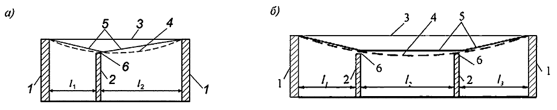

^fd-1

а) б)б) ⟦IMG:data:image;base64,R0lGODdhCQATAIABAAAAAP///ywAAAAACQATAAACFIyPqc|9x19⟧⟦IMG:data:image;base64,R0lGODdhDQAXAIABAAAAAP///ywAAAAADQAXAAACHoyPqc|13x23⟧⟦IMG:data:image;base64,R0lGODdhDwAXAIABAAAAAP///ywAAAAADwAXAAACI4yPqc|15x23⟧⟦IMG:data:image;base64,R0lGODdhDwAYAIABAAAAAP///ywAAAAADwAYAAACI4yPqc|15x24⟧

________________

* Измененная редакция, Изм. N 5.

Д.1.8 Прогибы стропильных конструкций при наличии подвесных крановых путей (см. таблицу Д.1, позиция 2, перечисление б) следует принимать как разность между прогибами ⟦IMG:data:image;base64,R0lGODdhEQAXAIABAAAAAP///ywAAAAAEQAXAAACJoyPqc|17x23⟧⟦IMG:data:image;base64,R0lGODdhFAAXAIABAAAAAP///ywAAAAAFAAXAAACLIyPqc|20x23⟧рисунок Д.2).

**(Измененная редакция, Изм. № 3, 6).**

Д.1.9 Горизонтальные перемещения каркаса следует определять в плоскости стен и перегородок, целостность которых должна быть обеспечена.

**(Измененная редакция, Изм. № 3).**

^fd-2

⟦IMG:data:image;base64,R0lGODdhEQAXAIABAAAAAP///ywAAAAAEQAXAAACJoyPqc|17x23⟧⟦IMG:data:image;base64,R0lGODdhFAAXAIABAAAAAP///ywAAAAAFAAXAAACLIyPqc|20x23⟧

Рисунок Д.3 (Исключен, Изм. N 3).

Д.2 Предельные прогибы

Д.2.1 Вертикальные предельные прогибы элементов конструкций

Вертикальные предельные прогибы элементов конструкций и нагрузки, от которых следует определять прогибы, приведены в таблице Д.1.

Таблица Д.1

*Таблица* ^tu024
<table>
<tr><th scope="col"></th><th scope="col"></th><th scope="col"></th><th scope="col"></th></tr>
<tr><td>Элементы конструкций</td><td>Предъявляемые требования</td><td>Вертикальные предельные прогибы ⟦IMG:https://api.docs.cntd.ru/img/45/60/44/31/8/99bd5477-bade-485c-94|20x24⟧</td><td>Нагрузки для определения вертикальных прогибов</td></tr>
<tr><td>1 Балки крановых путей подмостовые и подвесные краны, управляемые из кабины при группах режимов работы:</td><td>Физиологические</td><td></td><td></td></tr>
<tr><td>1К-6К</td><td></td><td>l</td><td>От одного крана</td></tr>
<tr><td>7К</td><td></td><td>l</td><td>То же</td></tr>
<tr><td>8К</td><td></td><td>l</td><td>"</td></tr>
<tr><td>2 Балки, фермы, ригели, прогоны, плиты, настилы (включая поперечные ребра плит и настилов):</td><td></td><td></td><td></td></tr>
<tr><td>а) покрытий и перекрытий, открытых для обзора, при пролете l</td><td></td><td></td><td>Постоянные и длительные, а также нагрузки, указанные в таблице 8.3, с</td></tr>
<tr><td>l</td><td>Эстетико-</td><td>l</td><td>понижающим коэффициентом, равным</td></tr>
<tr><td>l</td><td></td><td>l</td><td>0,35, и снеговые нагрузки с понижающим</td></tr>
<tr><td>l</td><td></td><td>l</td><td>коэффициентом, равным 0,5</td></tr>
<tr><td>l</td><td></td><td>l</td><td></td></tr>
<tr><td>l</td><td></td><td>l</td><td></td></tr>
<tr><td>б) покрытий и перекрытий при наличии тельферов (талей), подвесных кранов, управляемых из кабины</td><td>Физиологические</td><td>l aa</td><td>От одного крана или тельфера (тали) на одном пути</td></tr>
<tr><td>в) перекрытий, подверженных действию:</td><td>Физиологические</td><td></td><td>Наиболее неблагоприятное из следующих двух значений:</td></tr>
<tr><td>перемещаемых грузов, материалов, узлов и элементов оборудования и других подвижных нагрузок (в том числе при безрельсовом напольном транспорте)</td><td></td><td>l</td><td>0,7 полных нормативных значений кратковременных нагрузок на перекрытие или нагрузки от одного транспортного средства</td></tr>
<tr><td>нагрузок от рельсового транспорта:</td><td></td><td></td><td></td></tr>
<tr><td>узкоколейного</td><td></td><td>I</td><td>От одного состава вагонов (или одной напольной машины) на одном пути</td></tr>
<tr><td>ширококолейного</td><td></td><td>I</td><td>То же</td></tr>
<tr><td>г) покрытий и перекрытий автостоянок в зданиях, при пролете I</td><td></td><td></td><td>Постоянные и длительные, а также нагрузки, указанные в таблице 8.3 с</td></tr>
<tr><td>l</td><td>Физиологические</td><td>l</td><td>понижающим коэффициентом, равным</td></tr>
<tr><td>l</td><td></td><td>l</td><td>0,35, и снеговые нагрузки с понижающим</td></tr>
<tr><td>l⟦IMG:data:image;base64,iVBORw0KGgoAAAANSUhEUgAAADAAAAA6CAIAAAB5+022AA|13x16⟧</td><td></td><td>l</td><td>коэффициентом, равным 0,5</td></tr>
<tr><td>3 Элементы лестниц (марши, площадки, косоуры), балконов,</td><td>Эстетико-</td><th colspan="2" scope="row">Те же, что в позиции 2, перечисление а)</th></tr>
<tr><td>лоджий</td><td>Физиологические</td><th colspan="2" scope="row">Определяются в соответствии с Д.2.2</th></tr>
<tr><td>4 Перемычки и навесные стеновые панели над оконными и дверными проемами (ригели и прогоны остекления)</td><td>Эстетико-</td><th colspan="2" scope="row">Те же, что в позиции 2, перечисление а)</th></tr>
<tr><th colspan="4" scope="row">Обозначения, принятые в настоящей таблице: l а ⟦IMG:https://api.docs.cntd.ru/img/45/60/44/31/8/99bd5477-bade-485c-94|11x19⟧ ⟦IMG:https://api.docs.cntd.ru/img/45/60/44/31/8/99bd5477-bade-485c-94|11x19⟧ ⟦IMG:https://api.docs.cntd.ru/img/45/60/44/31/8/99bd5477-bade-485c-94|11x19⟧ lД.1.7 приложения Д. Д.1.8 приложения Д. l</th></tr>
</table>

**(Измененная редакция, Изм. № 3, 5).**

Д.2.2 Физиологические требования*

________________

* Измененная редакция, Изм. N 1.

Предельные прогибы элементов перекрытий (балок, ригелей, плит), лестниц, балконов, лоджий, помещений жилых и общественных зданий, а также бытовых помещений производственных зданий исходя из физиологических требований (от людей, возбуждающих колебания) следует определять по формуле

ртаблице Д.2;

таблице Д.2;

q

nтаблице Д.2;

bтаблице Д.2.

Таблица Д.2

*Таблица* ^tu025
<table>
<tr><th scope="col"></th><th scope="col"></th><th scope="col"></th><th scope="col"></th><th scope="col"></th></tr>
<tr><td>Помещения, принимаемые по таблице 8.3</td><td>р</td><td></td><td>n</td><td>b</td></tr>
<tr><td>Позиции 1, 2, кроме классных и бытовых а б бб бб</td><td>0,25</td><td>Принимают по таблице 8.3 с понижающим коэффициентом, равным 0,35</td><td>1,5</td><td>⟦IMG:https://api.docs.cntd.ru/img/45/60/44/31/8/99bd5477-bade-485c-94|83x55⟧</td></tr>
<tr><td>Позиция 2 - классные и бытовые б-г а аа</td><td>0,5</td><td>Принимают по таблице 8.3 с понижающим коэффициентом, равным 0,35</td><td>1,5</td><td>⟦IMG:https://api.docs.cntd.ru/img/45/60/44/31/8/99bd5477-bade-485c-94|83x55⟧</td></tr>
<tr><th colspan="5" scope="row">Обозначения, принятые втаблице Д.2: Q ⟦IMG:data:image;base64,R0lGODdhDwAPAIABAAAAAP///ywAAAAADwAPAAACHYyPqc|15x15⟧ ⟦IMG:data:image;base64,R0lGODdhDQAPAIABAAAAAP///ywAAAAADQAPAAACGYyPqc|13x15⟧ ⟦IMG:data:image;base64,R0lGODdhCQATAIABAAAAAP///ywAAAAACQATAAACFIyPqc|9x19⟧</th></tr>
</table>

Прогибы следует определять от суммы нагрузок ⟦IMG:https://api.docs.cntd.ru/img/45/60/44/31/8/99bd5477-bade-485c-94|84x23⟧⟦IMG:data:image;base64,R0lGODdhEwAXAIABAAAAAP///ywAAAAAEwAXAAACLYyPqc|19x23⟧

Подраздел Д.2.2 (Измененная редакция, Изм. N 1, 3).

Д.2.3 Горизонтальные предельные прогибы колонн и тормозных конструкций от крановых нагрузок

Д.2.3.1 Горизонтальные предельные прогибы колонн зданий, оборудованных мостовыми кранами, крановых эстакад, а также балок крановых путей и тормозных конструкций (балок или ферм), следует принимать по таблице Д.3, но не менее 6 мм.

Прогибы следует проверять на отметке головки крановых рельсов от сил торможения тележки одного крана, направленных поперек кранового пути, без учета крена фундаментов.

Таблица Д.3

*Таблица* ^tu026
<table>
<tr><th scope="col"></th><th scope="col"></th><th scope="col"></th><th scope="col"></th></tr>
<tr><td>Группы режимов работы кранов</td><th colspan="3" scope="row">Предельные прогибы ⟦IMG:data:image;base64,R0lGODdhFAAYAIABAAAAAP///ywAAAAAFAAYAAACKoyPqc|20x24⟧</th></tr>
<tr><td></td><th colspan="2" scope="row">колонн</th><td>балок крановых путей и тормозных конструкций, зданий и крановых эстакад (крытых и открытых)</td></tr>
<tr><td></td><td>зданий и крытых крановых эстакад</td><td>открытых крановых эстакад</td><td></td></tr>
<tr><td>1К-3К</td><td>h</td><td>h</td><td>⟦IMG:data:image;base64,R0lGODdhCQATAIABAAAAAP///ywAAAAACQATAAACFIyPqc|9x19⟧</td></tr>
<tr><td>4К-6К</td><td>h</td><td>h</td><td>⟦IMG:data:image;base64,R0lGODdhCQATAIABAAAAAP///ywAAAAACQATAAACFIyPqc|9x19⟧</td></tr>
<tr><td>7К-8К</td><td>h</td><td>h</td><td>⟦IMG:data:image;base64,R0lGODdhCQATAIABAAAAAP///ywAAAAACQATAAACFIyPqc|9x19⟧</td></tr>
<tr><th colspan="4" scope="row">Обозначения, принятые втаблице Д.3: h ⟦IMG:data:image;base64,R0lGODdhCQATAIABAAAAAP///ywAAAAACQATAAACFIyPqc|9x19⟧</th></tr>
</table>

Д.2.3.2 (Исключен, Изм. N 3).

Д.2.4 Горизонтальные предельные перемещения и прогибы зданий, отдельных элементов конструкций от ветровой нагрузки и температурных климатических воздействий*

________________

* Измененная редакция, Изм. N 3.

Д.2.4.1 (Измененная редакция, Изм. N 1), (Исключен, Изм. N 3).

Д.2.4.2 Для 2-го предельного состояния горизонтальные перемещения бескаркасных зданий от ветровых нагрузок не ограничиваются.

Д.2.4.3, Д.2.4.4 (Исключены, Изм. N 3).

Д.2.4.5 Горизонтальные предельные прогибы колонн (стоек) каркасных зданий от температурных климатических и усадочных воздействий следует принимать равными:

При этом температурные воздействия следует принимать без учета суточных колебаний температур наружного воздуха и перепада температур от солнечной радиации.

При определении горизонтальных прогибов от температурных климатических и усадочных воздействий их значения не следует суммировать с прогибами от ветровых нагрузок и от крена фундаментов.

Д.2.4.6 Горизонтальные предельные прогибы конструктивных элементов витражей, стеклопакетов, навесных фасадных систем и т.п. конструкций устанавливаются нормативными документами по их проектированию.

(Введен дополнительно, Изм. N 1), (Измененная редакция, Изм. N 5).

Д.2.5 (Исключен, Изм. N 3).

## Приложение E

(См. вкладки)

Таблица Е.1 - Высотный коэффициент ⟦IMG:https://api.docs.cntd.ru/img/45/60/44/31/8/99bd5477-bade-485c-94|18x24⟧карте 1 приложения Е, а также в местах со сложным изменением рельефа и высотой над уровнем моря более 500 м

*Таблица* ^tu027
<table>
<tr><th scope="col"></th><th scope="col"></th><th scope="col"></th><th scope="col"></th></tr>
<tr><td>Территориальный район Российской Федерации</td><td>Снеговой район</td><td>Начальная высота ⟦IMG:https://api.docs.cntd.ru/img/45/60/44/31/8/99bd5477-bade-485c-94|18x24⟧</td><td>⟦IMG:https://api.docs.cntd.ru/img/45/60/44/31/8/99bd5477-bade-485c-94|18x24⟧</td></tr>
<tr><td>Республика Дагестан</td><td>II</td><td>500</td><td>1,0</td></tr>
<tr><td>Краснодарский край:</td><td></td><td></td><td></td></tr>
<tr><td>Адлерский район</td><td>VII</td><td>500</td><td>2,15</td></tr>
<tr><td>Остальные районы</td><td>II</td><td>500</td><td>5,0</td></tr>
<tr><td>Республика Адыгея (Адыгея)</td><td>VII</td><td>500</td><td>2,15</td></tr>
<tr><td>Ставропольский край</td><td>II</td><td>500</td><td>1,0</td></tr>
<tr><td>Эвенкийский автономный округ</td><td>VI</td><td>500</td><td>0,35</td></tr>
<tr><td>Красноярский край:</td><td></td><td></td><td></td></tr>
<tr><td>Кемеровская область - Кузбасс, Кузнецкий Алатау, Горная Шория</td><td>VI, VII</td><td>500</td><td>2,25</td></tr>
<tr><td>Саянский хр., Куртушибинский хр.</td><td>IV</td><td>500</td><td>3,15</td></tr>
<tr><td>Северо-Енисейский район</td><td>VI</td><td>500</td><td>0,95</td></tr>
<tr><td>Норильский промышленный район:</td><td></td><td></td><td></td></tr>
<tr><td>- к северо-востоку от г.Норильска</td><td>V</td><td>500</td><td>3,75</td></tr>
<tr><td>- до 20 км к югу от г.Норильска</td><td>VI</td><td>500</td><td>2,5</td></tr>
<tr><td>Республика Бурятия:</td><td></td><td></td><td></td></tr>
<tr><td>хр. Хамар-Дабан</td><td>IV</td><td>500</td><td>1,0</td></tr>
<tr><td>Байкальский хр.</td><td>IV</td><td>500</td><td>2,3</td></tr>
<tr><td>Забайкальский край:</td><td></td><td></td><td></td></tr>
<tr><td>Каларский район, хр.Удокан</td><td>II</td><td>1000</td><td>1,8</td></tr>
<tr><td>Республика Якутия:</td><td></td><td></td><td></td></tr>
<tr><td>Алданское нагорье</td><td>III</td><td>500</td><td>1,35</td></tr>
<tr><th colspan="4" scope="row">Примечание - Значения высотного коэффициента ⟦IMG:https://api.docs.cntd.ru/img/45/60/44/31/8/99bd5477-bade-485c-94|18x24⟧</th></tr>
</table>

Таблица Е.1 (Измененная редакция, Изм. N 2, 3, 5).

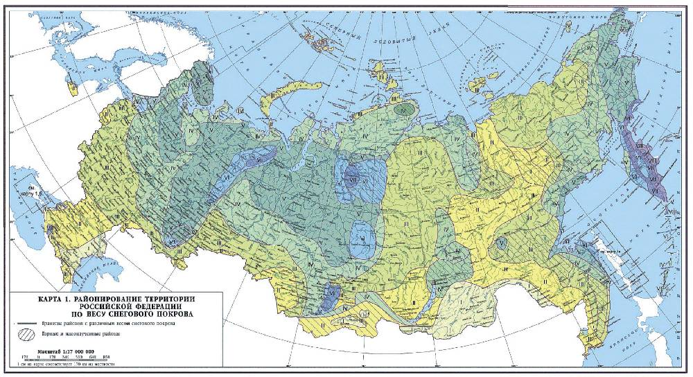

^fd

________________

Оригинал Карты 1 см. по ссылке. - Примечание изготовителя базы данных.

> *Примечания*

^n15-2-3-9

1 Для горных районов при высоте местности над уровнем моря h ⟦IMG:https://api.docs.cntd.ru/img/45/60/44/31/8/99bd5477-bade-485c-94|22x25⟧h

⟦IMG:https://api.docs.cntd.ru/img/45/60/44/31/8/99bd5477-bade-485c-94|207x25⟧⟦IMG:data:image;base64,iVBORw0KGgoAAAANSUhEUgAAACYAAABSCAIAAAC37DEuAA|11x23⟧

где ⟦IMG:https://api.docs.cntd.ru/img/45/60/44/31/8/99bd5477-bade-485c-94|18x24⟧h

2 Значения ⟦IMG:https://api.docs.cntd.ru/img/45/60/44/31/8/99bd5477-bade-485c-94|18x24⟧таблице Е.1 или по данным организаций по гидрометеорологии.

3 Для различных высот над уровнем моря одного горного района значение высотного коэффициента может быть различным.

4 Высотный коэффициент ⟦IMG:https://api.docs.cntd.ru/img/45/60/44/31/8/99bd5477-bade-485c-94|19x24⟧

⟦IMG:https://api.docs.cntd.ru/img/45/60/44/31/8/99bd5477-bade-485c-94|186x51⟧⟦IMG:https://api.docs.cntd.ru/img/45/60/44/31/8/99bd5477-bade-485c-94|44x24⟧

Здесь: ⟦IMG:https://api.docs.cntd.ru/img/45/60/44/31/8/99bd5477-bade-485c-94|133x25⟧⟦IMG:https://api.docs.cntd.ru/img/45/60/44/31/8/99bd5477-bade-485c-94|36x25⟧h

h

________________

* Формула и экспликация к ней соответствуют оригиналу. - Примечание изготовителя базы данных.

Для других высот в данном районе местности используют полученное значение высотного коэффициента.

Карта 1 (Измененная редакция, Изм. N 2, 3, 5).

КАРТА 1,а. РАЙОНИРОВАНИЕ ТЕРРИТОРИИ ОСТРОВА САХАЛИН ПО ВЕСУ СНЕГОВОГО ПОКРОВА

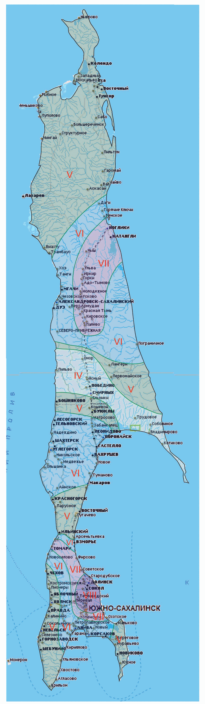

^fu049

КАРТА 1,б. РАЙОНИРОВАНИЕ ТЕРРИТОРИИ РЕСПУБЛИКИ КРЫМ ПО ВЕСУ СНЕГОВОГО ПОКРОВА

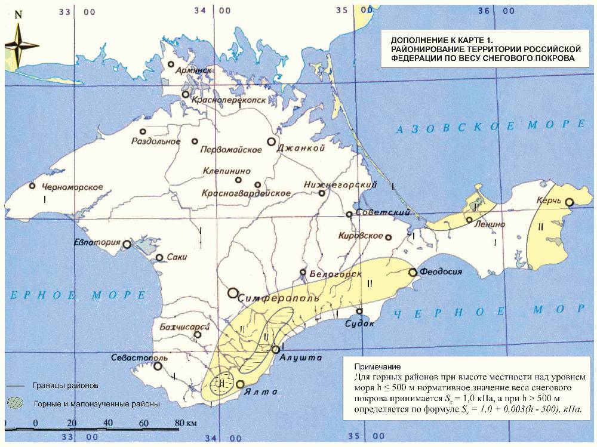

^fu050

КАРТА 1,в. Районирование территории Донецкой Народной Республики, Луганской Народной Республики, Запорожской области, Херсонской области по весу снегового покрова (дополнение к карте 1. Районирование территории Российской Федерации по весу снегового покрова)

^fu051

Изм. N 5).

^fu052

________________

Оригинал Карты 2 см. по ссылке. - Примечание изготовителя базы данных.

^fu053

КАРТА 2,е. РАЙОНИРОВАНИЕ ТЕРРИТОРИИ РЕСПУБЛИКИ КРЫМ ПО ДАВЛЕНИЮ ВЕТРА

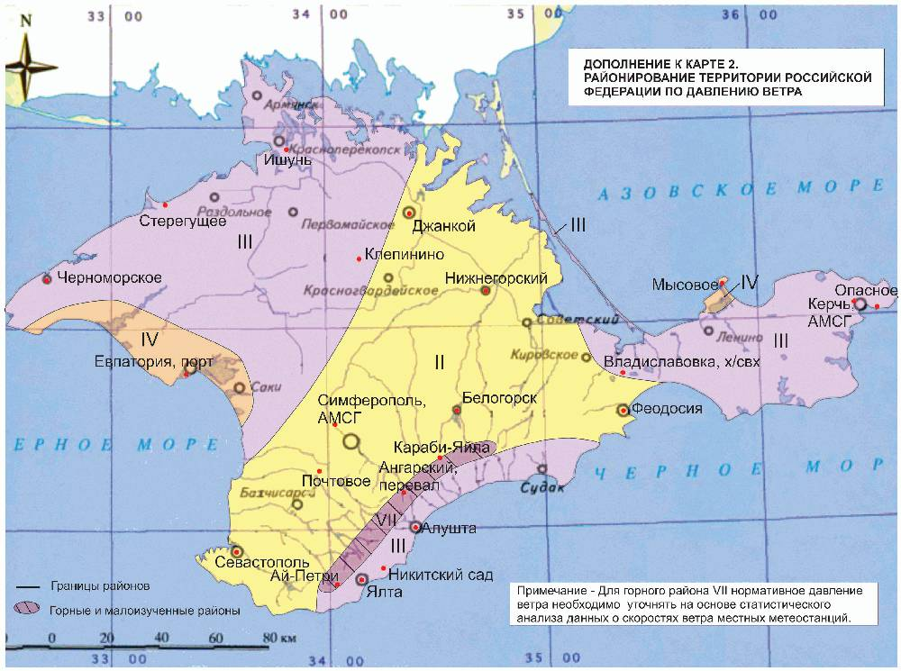

^fu054

КАРТА 2,ж. Районирование территории Донецкой Народной Республики, Луганской Народной Республики, Запорожской области и Херсонской области по давлению ветра (дополнение к карте 2. Районирование территории Российской Федерации по давлению ветра)

^fu055

Изм. N 5).

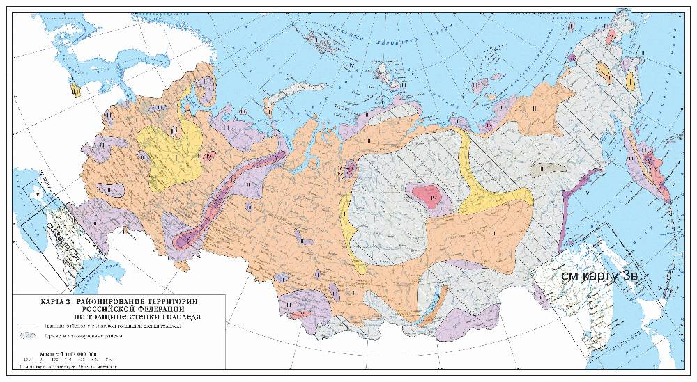

^fu056

________________

Оригинал Карты 3 см. по ссылке. - Примечание изготовителя базы данных.

КАРТА 3,а. РАЙОНИРОВАНИЕ ТЕРРИТОРИИ ГОРНОГО КАВКАЗА ПО ТОЛЩИНЕ СТЕНКИ ГОЛОЛЁДА

^fu057

КАРТА 3,б. РАЙОНИРОВАНИЕ ТЕРРИТОРИИ РЕСПУБЛИКИ КРЫМ ПО ТОЛЩИНЕ СТЕНКИ ГОЛОЛЁДА

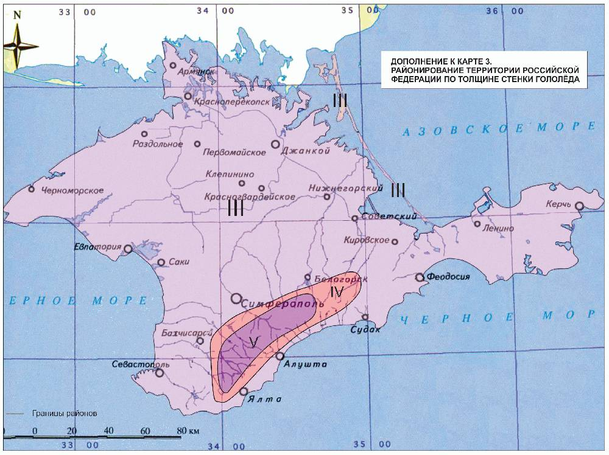

^fu058

КАРТА 3,в. РАЙОНИРОВАНИЕ ТЕРРИТОРИИ ПРИМОРСКОГО КРАЯ И ОСТРОВА САХАЛИН ПО ТОЛЩИНЕ СТЕНКИ ГОЛОЛЁДА

^fu059

^fu060

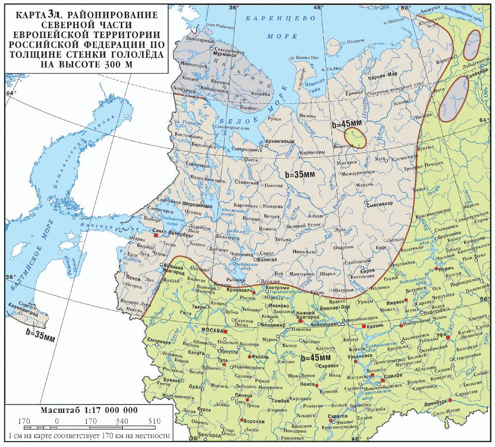

^fu061

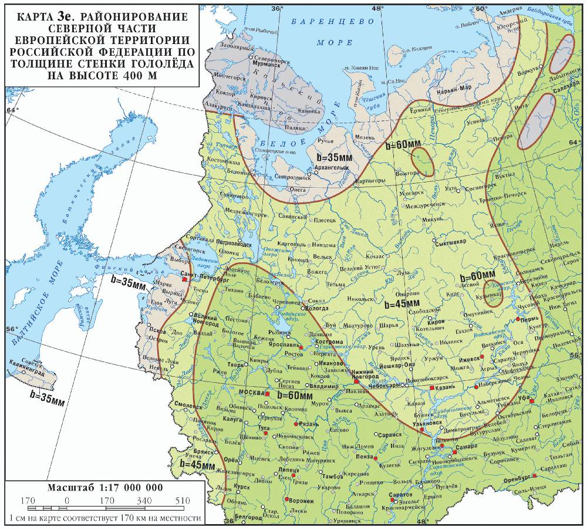

^fu062

КАРТА 3,ж. Районирование территории Донецкой Народной Республики, Луганской Народной Республики, Запорожской области и Херсонской области по толщине стенки гололеда (дополнение к карте 3. Районирование территории Российской Федерации по толщине стенки гололеда)

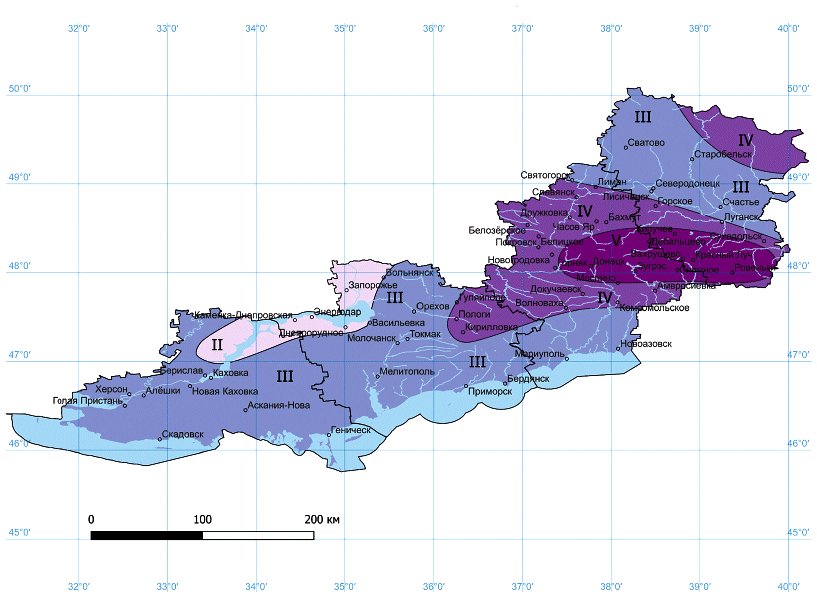

^fu063

Изм. N 5).

^fu064

________________

Оригинал Карты 4 см. по ссылке. - Примечание изготовителя базы данных.

КАРТА 4,а. РАЙОНИРОВАНИЕ ТЕРРИТОРИИ РЕСПУБЛИКИ КРЫМ ПО НОРМАТИВНЫМ ЗНАЧЕНИЯМ МИНИМАЛЬНОЙ ТЕМПЕРАТУРЫ ВОЗДУХА, °C

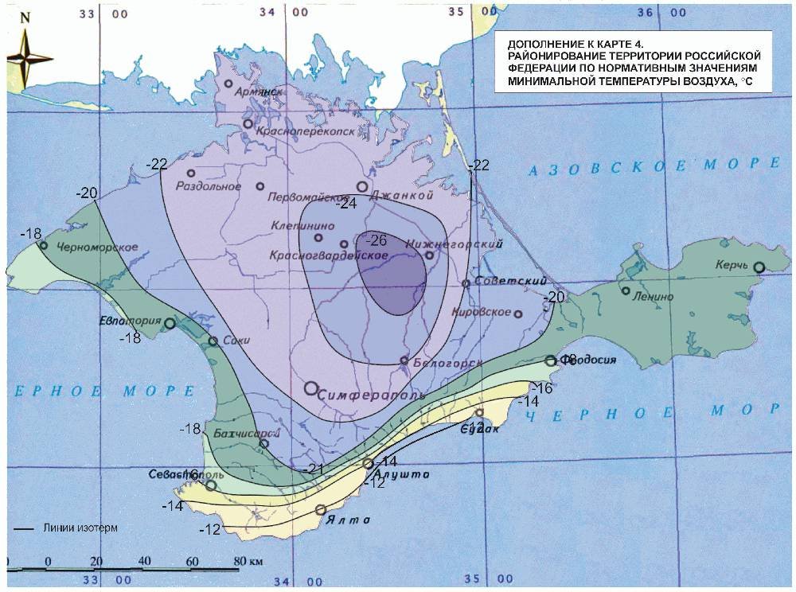

^fu065

КАРТА 4,б. Районирование территории Донецкой Народной Республики, Луганской Народной Республики, Запорожской области и Херсонской области по нормативным значениям минимальной температуры воздуха, °С (дополнение к карте 3. Районирование территории Российской Федерации по нормативным значениям минимальной температуры воздуха, °С)

^fu066

Изм. N 5).

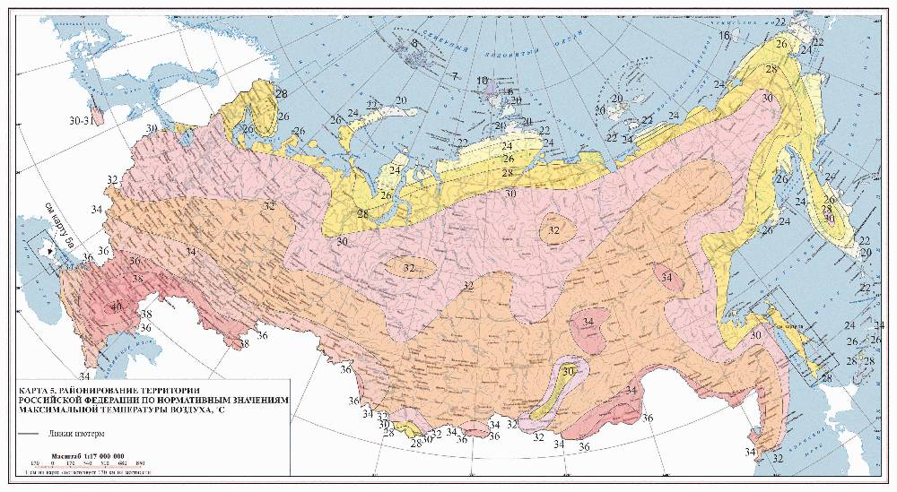

^fu067

________________

Оригинал Карты 5 см. по ссылке. - Примечание изготовителя базы данных.

КАРТА 5,a. РАЙОНИРОВАНИЕ ТЕРРИТОРИИ РЕСПУБЛИКИ КРЫМ ПО НОРМАТИВНЫМ ЗНАЧЕНИЯМ МАКСИМАЛЬНОЙ ТЕМПЕРАТУРЫ ВОЗДУХА,°C

^fu068

КАРТА 5,б. Районирование территории Донецкой Народной Республики, Луганской Народной Республики, Запорожской области и Херсонской области по нормативным значениям максимальной температуры воздуха, °С (дополнение к карте 3. Районирование территории Российской Федерации по нормативным значениям максимальной температуры воздуха, °С)

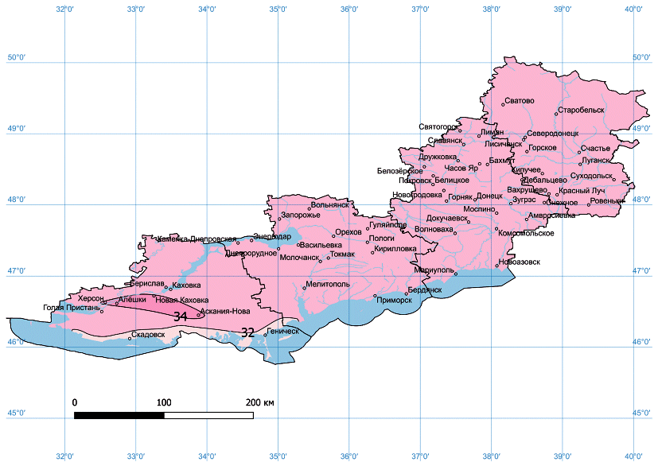

^fu069

Карта 5,б (Введена дополнительно, Изм. N 5).

## Приложение Ж

Ж.1 Целью проведения модельных испытаний зданий и сооружений в аэродинамических трубах является определение одного или нескольких из следующих параметров, необходимых для нормирования ветровых воздействий:

а) аэродинамические коэффициенты внутреннего (⟦IMG:data:image;base64,R0lGODdhDwAYAIABAAAAAP///ywAAAAADwAYAAACIIyPqc|15x24⟧⟦IMG:data:image;base64,R0lGODdhEQAYAIABAAAAAP///ywAAAAAEQAYAAACI4yPqc|17x24⟧

б) аэродинамические коэффициенты лобового сопротивления (⟦IMG:data:image;base64,R0lGODdhEwAYAIABAAAAAP///ywAAAAAEwAYAAACIoyPqc|19x24⟧⟦IMG:data:image;base64,R0lGODdhEwAZAIABAAAAAP///ywAAAAAEwAZAAACJoyPqc|19x25⟧⟦IMG:data:image;base64,R0lGODdhGQAYAIABAAAAAP///ywAAAAAGQAYAAACMYyPqc|25x24⟧

в) пиковые (положительные (⟦IMG:data:image;base64,R0lGODdhGwAZAIABAAAAAP///ywAAAAAGwAZAAACNYyPqc|27x25⟧⟦IMG:data:image;base64,R0lGODdhGwAZAIABAAAAAP///ywAAAAAGwAZAAACL4yPqc|27x25⟧

г) числа Струхаля St

д) плотность вероятности ⟦IMG:https://api.docs.cntd.ru/img/45/60/44/31/8/99bd5477-bade-485c-94|45x25⟧⟦IMG:data:image;base64,R0lGODdhHwAVAIABAAAAAP///ywAAAAAHwAVAAACRIyPqc|31x21⟧

е) динамическая реакция сооружений или ее спектральные характеристики (энергетический спектр, авто- и взаимные корреляционные функции) при действии основного типа ветровой нагрузки, а также реакция, связанная с появлением аэродинамически неустойчивых колебаний (галопирование, различные виды флаттера) или с резонансным вихревым возбуждением.

Ж.2 При проведении модельных испытаний должны быть установлены основные закономерности снегопереноса по покрытиям сооружений, на основе которых определяются коэффициенты формы ⟦IMG:data:image;base64,R0lGODdhDQARAIABAAAAAP///ywAAAAADQARAAACHYyPqR|13x17⟧

Ж.3 При проведении модельных аэродинамических испытаний должны быть выполнены определенные условия (критерии) подобия, которые обеспечивают получение наиболее достоверной информации о действующих на здание ветровых нагрузках. Основными и наиболее существенными критериями являются следующие:

- геометрическое подобие, включая степень шероховатости внешних поверхностей моделей;

- подобие структуры потока в аэродинамической трубе реальным ветровым режимам в месте строительства.

> *Примечание* — В тех случаях, когда модельные испытания проводятся в аэродинамических трубах с гладким полом или приземный слой атмосферы моделируется за счет применения турбулизирующих решеток, использование полученных результатов для проектирования сооружений должно быть дополнительно обосновано;

^n15-2-3-10

- подобие по числу Рейнольдса ⟦IMG:data:image;base64,R0lGODdhFwATAIABAAAAAP///ywAAAAAFwATAAACL4yPqc|23x19⟧

- подобие основных динамических характеристик модели и здания (при экспериментальном определении динамической реакции сооружения).

Ж.4 При изготовлении моделей линейный масштаб моделирования ⟦IMG:data:image;base64,R0lGODdhGQAYAIABAAAAAP///ywAAAAAGQAYAAACPoyPqc|25x24⟧⟦IMG:data:image;base64,R0lGODdhFwAcAIABAAAAAP///ywAAAAAFwAcAAACPYyPqc|23x28⟧

где ⟦IMG:data:image;base64,R0lGODdhFAAYAIABAAAAAP///ywAAAAAFAAYAAACLoyPqc|20x24⟧

⟦IMG:data:image;base64,R0lGODdhHQAZAIABAAAAAP///ywAAAAAHQAZAAACQYyPqc|29x25⟧⟦IMG:data:image;base64,R0lGODdhEAARAIABAAAAAP///ywAAAAAEAARAAACIYyPqb|16x17⟧

В тех случаях, когда условие (Ж.1) не выполняется, результаты эксперимента нуждаются в корректировке. Ее методика, а также значение ⟦IMG:data:image;base64,R0lGODdhHQAZAIABAAAAAP///ywAAAAAHQAZAAACQYyPqc|29x25⟧

Ж.5 Во избежание искажений результатов испытаний скорость потока в рабочей части аэродинамической трубы не должна превышать 60 м/с.

Ж.6 Перед проведением экспериментальных исследований необходимо измерить скорость и уровень турбулентных пульсаций скорости потока (степень турбулентности) по высоте пограничного слоя на всей области размещения модели в рабочей части аэродинамической трубы.

Ж.7 Аэродинамическая установка, используемое оборудование, приборы и инструменты должны быть аттестованы в соответствии с требованиями по их эксплуатации и использованию.

Ж.8 При определении пиковых аэродинамических коэффициентов ⟦IMG:data:image;base64,R0lGODdhGwAZAIABAAAAAP///ywAAAAAGwAZAAACNYyPqc|27x25⟧⟦IMG:data:image;base64,R0lGODdhGwAZAIABAAAAAP///ywAAAAAGwAZAAACL4yPqc|27x25⟧

Ж.9 При оформлении результатов модельных аэродинамических испытаний в отчетных документах должны быть приведены следующие данные:

а) линейный масштаб моделирования;

б) состояние поверхности модели (гладкая, с искусственно нанесенной шероховатостью и др.) и ее соответствие поверхности реального сооружения;

в) место расположения модели в рабочей части аэродинамической трубы и степень заполнения ее поперечного сечения;

г) схема дренирования модели (при измерении средних и пиковых значений аэродинамических коэффициентов);

д) основные характеристики набегающего потока, в том числе:

- способ моделирования приземного слоя атмосферы (генераторы вихрей и расположение элементов шероховатости на нижней стенке аэродинамической трубы, используемых для турбулизации потока);

- распределение средней скорости и интенсивности турбулентности потока по высоте сечения трубы в месте расположения модели с оценкой параметров их степенной или логарифмической аппроксимации.

> *Примечание* — При использовании турбулизирующих решеток для моделирования приземного слоя атмосферы, кроме того, необходимо указать интегральные масштабы турбулентности и энергетический спектр набегающего потока;

^n15-2-3-11

е) числа Рейнольдса, при которых проводились испытания, и обоснование реализации автомодельного режима обтекания модели, соответствующего режиму обтекания реального сооружения;

ж) скорость или давление потока, по отношению к которым нормировались аэродинамические коэффициенты, давления, сил и моментов, а также числа Струхаля и энергетические спектры (при проведении соответствующих экспериментальных исследований).

> *Примечание* — Для аэродинамических коэффициентов сил и моментов необходимо дополнительно указать оси, в направлении которых эти коэффициенты определялись, а также площади сечений, использованных при их определении;

^n15-2-3-12

и) границы достоверности диапазона частот (при измерении энергетических спектров, пиковых аэродинамических коэффициентов, динамической реакции модели и других подобных явлений) с учетом собственных частот приемной и регистрирующей аппаратуры;

к) числа Струхаля St

Приложение Ж (Введено дополнительно, Изм. N 2).

## Приложение И

Критерии подобия, указанные в приложении Ж, должны выполняться при проведении всех модельных испытаний зданий и сооружений в аэродинамических трубах.

> *Примечание* — При решении некоторых специальных задач строительной аэродинамики, кроме того, может потребоваться выполнение других критериев подобия: по числам Ричардсона (Ri Ro FrRo FrFr

^n15-2-3-13

И.1 Геометрическое подобие

Следствием геометрического подобия модели и сооружения является равенство безразмерных координат соответствующих точек моделей и сооружения

⟦IMG:https://api.docs.cntd.ru/img/45/60/44/31/8/99bd5477-bade-485c-94|72x51⟧⟦IMG:https://api.docs.cntd.ru/img/45/60/44/31/8/99bd5477-bade-485c-94|49x45⟧⟦IMG:data:image;base64,R0lGODdhCQARAIABAAAAAP///ywAAAAACQARAAACEoyPqX|9x17⟧

где ⟦IMG:data:image;base64,R0lGODdhHQAcAIABAAAAAP///ywAAAAAHQAcAAACR4yPqc|29x28⟧⟦IMG:data:image;base64,R0lGODdhEAAYAIABAAAAAP///ywAAAAAEAAYAAACIIyPqc|16x24⟧⟦IMG:data:image;base64,R0lGODdhCQARAIABAAAAAP///ywAAAAACQARAAACEoyPqX|9x17⟧⟦IMG:data:image;base64,R0lGODdhCQARAIABAAAAAP///ywAAAAACQARAAACEoyPqX|9x17⟧

⟦IMG:data:image;base64,R0lGODdhFwAYAIABAAAAAP///ywAAAAAFwAYAAACPIyPqY|23x24⟧⟦IMG:data:image;base64,R0lGODdhCQAUAIABAAAAAP///ywAAAAACQAUAAACGIyPqW|9x20⟧

Линейный масштаб ⟦IMG:data:image;base64,R0lGODdhGAAYAIABAAAAAP///ywAAAAAGAAYAAACPIyPqc|24x24⟧

При изготовлении модели линейный масштаб моделирования ⟦IMG:data:image;base64,R0lGODdhGAAYAIABAAAAAP///ywAAAAAGAAYAAACPIyPqc|24x24⟧⟦IMG:data:image;base64,R0lGODdhEAARAIABAAAAAP///ywAAAAAEAARAAACIYyPqb|16x17⟧

В тех случаях, когда это условие не выполняется, результаты эксперимента нуждаются в корректировке. Ее методика для каждой аэродинамической установки определяется экспериментально.

При модельных испытаниях зданий и сооружений ⟦IMG:data:image;base64,R0lGODdhGAAYAIABAAAAAP///ywAAAAAGAAYAAACPIyPqc|24x24⟧⟦IMG:data:image;base64,R0lGODdhEQAXAIABAAAAAP///ywAAAAAEQAXAAACIYyPqc|17x23⟧⟦IMG:data:image;base64,R0lGODdhEQAXAIABAAAAAP///ywAAAAAEQAXAAACIIyPqc|17x23⟧⟦IMG:data:image;base64,R0lGODdhGAAYAIABAAAAAP///ywAAAAAGAAYAAACPIyPqc|24x24⟧

И.2 Подобие по параметру шероховатости

Подобие по параметру шероховатости ⟦IMG:data:image;base64,R0lGODdhDwARAIABAAAAAP///ywAAAAADwARAAACHYyPqc|15x17⟧

Учитывая, что в большинстве случаев ⟦IMG:data:image;base64,R0lGODdhGAAYAIABAAAAAP///ywAAAAAGAAYAAACPIyPqc|24x24⟧⟦IMG:data:image;base64,R0lGODdhEQAXAIABAAAAAP///ywAAAAAEQAXAAACIYyPqc|17x23⟧⟦IMG:data:image;base64,R0lGODdhEQAXAIABAAAAAP///ywAAAAAEQAXAAACIIyPqc|17x23⟧

**(Измененная редакция, Изм. № 5).**

И.3 Моделирование по числу Рейнольдса

Число Рейнольдса ⟦IMG:data:image;base64,R0lGODdhFwATAIABAAAAAP///ywAAAAAFwATAAACL4yPqc|23x19⟧

где ⟦IMG:data:image;base64,R0lGODdhEwAYAIABAAAAAP///ywAAAAAEwAYAAACL4yPqc|19x24⟧⟦IMG:data:image;base64,R0lGODdhFwAcAIABAAAAAP///ywAAAAAFwAcAAACPIyPqc|23x28⟧

⟦IMG:data:image;base64,R0lGODdhEAAZAIABAAAAAP///ywAAAAAEAAZAAACI4yPqc|16x25⟧⟦IMG:data:image;base64,R0lGODdhEwAYAIABAAAAAP///ywAAAAAEwAYAAACL4yPqc|19x24⟧

⟦IMG:data:image;base64,R0lGODdhGwAPAIABAAAAAP///ywAAAAAGwAPAAACK4yPqc|27x15⟧⟦IMG:data:image;base64,R0lGODdhEQAXAIABAAAAAP///ywAAAAAEQAXAAACHoyPqc|17x23⟧⟦IMG:data:image;base64,R0lGODdhCwAXAIABAAAAAP///ywAAAAACwAXAAACGoyPqc|11x23⟧

Так как ⟦IMG:data:image;base64,R0lGODdhDQAPAIABAAAAAP///ywAAAAADQAPAAACF4yPqc|13x15⟧

то отношение чисел Рейнольдса, соответствующих модели и натурному сооружению, пропорционально линейному масштабу ⟦IMG:data:image;base64,R0lGODdhGAAYAIABAAAAAP///ywAAAAAGAAYAAACPIyPqc|24x24⟧

Учитывая, что при модельных испытаниях реальных сооружений ⟦IMG:data:image;base64,R0lGODdhGAAYAIABAAAAAP///ywAAAAAGAAYAAACPIyPqc|24x24⟧⟦IMG:data:image;base64,R0lGODdhFwATAIABAAAAAP///ywAAAAAFwATAAACL4yPqc|23x19⟧⟦IMG:data:image;base64,R0lGODdhFwATAIABAAAAAP///ywAAAAAFwATAAACL4yPqc|23x19⟧⟦IMG:data:image;base64,R0lGODdhJwAYAIABAAAAAP///ywAAAAAJwAYAAACVIyPqc|39x24⟧

С практической точки зрения основной особенностью зоны автомодельности является то, что в ней аэродинамические коэффициенты слабо зависят от числа Рейнольдса. Это обстоятельство позволяет с достаточной степенью надежности использовать результаты модельных испытаний при назначении ветровых нагрузок, действующих на реальные сооружения.

Границы области автомодельности зависят от степени шероховатости ⟦IMG:data:image;base64,R0lGODdhDwARAIABAAAAAP///ywAAAAADwARAAACHYyPqc|15x17⟧

Для сооружений с острыми кромками (поперечное сечение которых имеет угловые точки) нижняя граница зоны автомодельности ⟦IMG:data:image;base64,R0lGODdhKAAXAIABAAAAAP///ywAAAAAKAAXAAACT4yPqc|40x23⟧⟦IMG:data:image;base64,R0lGODdhCwAXAIABAAAAAP///ywAAAAACwAXAAACGoyPqc|11x23⟧⟦IMG:data:image;base64,R0lGODdhCwAXAIABAAAAAP///ywAAAAACwAXAAACGYyPqc|11x23⟧

Для сооружений с гладкой формой поперечного сечения нижняя граница зоны автомодельности, соответствующей его закризисному обтеканию, и числа Рейнольдса ⟦IMG:data:image;base64,R0lGODdhJwAYAIABAAAAAP///ywAAAAAJwAYAAACVIyPqc|39x24⟧⟦IMG:data:image;base64,R0lGODdhCwAXAIABAAAAAP///ywAAAAACwAXAAACF4yPqc|11x23⟧⟦IMG:data:image;base64,R0lGODdhCwAXAIABAAAAAP///ywAAAAACwAXAAACG4yPqc|11x23⟧

Выполнение условия автомодельности обтекания модели при проведении каждого эксперимента должно устанавливаться непосредственно на основе анализа полученных результатов.

> *Примечание* — Выполнение условий геометрического подобия модели (с учетом степени шероховатости ее поверхности) и автомодельности ее обтекания в аэродинамической трубе обеспечивает выполнение критерия подобия по числу Струхаля при проведении экспериментальных исследований.

^n15-2-3-14

И.4 Для моделирования структуры погранслоя атмосферы при проведении модельных испытаний рекомендуется использовать аэродинамические трубы метеорологического или геофизического типа, длина рабочей части которых превышает шесть высот их поперечного сечения и имеющих прямоугольную форму.

Учитывая, что образование приземного слоя атмосферы при сильных ветрах и в трубах с длинной рабочей частью происходит единообразно, за счет взаимодействия потоков с соответствующими подстилающими поверхностями, в обоих этих случаях их структура - профиль средней составляющей скорости и энергетические спектры пульсационной составляющей - оказываются подобными.

Основным параметром, характеризующим свойства реальных ветровых режимов и потоков, реализуемых в аэродинамических трубах с длинной рабочей частью, является параметр шероховатости ⟦IMG:data:image;base64,R0lGODdhEwAYAIABAAAAAP///ywAAAAAEwAYAAACKYyPqc|19x24⟧

За счет использования различных элементов шероховатости (турбулизаторов) и различных способов их размещения на полу аэродинамической трубы значение ⟦IMG:data:image;base64,R0lGODdhHAAcAIABAAAAAP///ywAAAAAHAAcAAACSoyPqc|28x28⟧⟦IMG:data:image;base64,R0lGODdhHAAcAIABAAAAAP///ywAAAAAHAAcAAACSoyPqc|28x28⟧

Для использования результатов модельных испытаний в трубах с длинной рабочей частью вполне достаточно знать параметр шероховатости ⟦IMG:data:image;base64,R0lGODdhHAAcAIABAAAAAP///ywAAAAAHAAcAAACSoyPqc|28x28⟧

> *Примечание* — Иногда при испытаниях в трубах с короткой рабочей частью для турбулизации потока на выходе из сопла устанавливаются турбулизирующие решетки. Поскольку турбулентная структура подобных потоков существенно отличается от структуры погранслоя атмосферы, то для практического использования результаты, полученные при экспериментах с "решетчатой" турбулентностью, нуждаются в дополнительных обоснованиях.

^n15-2-3-15

И.5 Энергетические спектры скорости потока или давления, определяемые по результатам модельных испытаний в аэродинамических трубах, могут быть использованы на практике только для частот ⟦IMG:https://api.docs.cntd.ru/img/45/60/44/31/8/99bd5477-bade-485c-94|76x23⟧⟦IMG:data:image;base64,R0lGODdhEQAXAIABAAAAAP///ywAAAAAEQAXAAACJoyPqc|17x23⟧⟦IMG:data:image;base64,R0lGODdhFAAXAIABAAAAAP///ywAAAAAFAAXAAACLIyPqc|20x23⟧⟦IMG:https://api.docs.cntd.ru/img/45/60/44/31/8/99bd5477-bade-485c-94|41x23⟧⟦IMG:data:image;base64,R0lGODdhJQAYAIABAAAAAP///ywAAAAAJQAYAAACT4yPqc|37x24⟧

где ⟦IMG:data:image;base64,R0lGODdhGQAYAIABAAAAAP///ywAAAAAGQAYAAACPoyPqc|25x24⟧⟦IMG:data:image;base64,R0lGODdhGQAYAIABAAAAAP///ywAAAAAGQAYAAACOoyPqc|25x24⟧И.1 и И.3 соответственно.

Приложение И (Введено дополнительно, Изм. N 2).

## Приложение К

Таблица К.1 - Нормативные значения веса снегового покрова

*Таблица* ^tu028
<table>
<tr><th scope="col"></th><th scope="col"></th><th scope="col"></th></tr>
<tr><td>N</td><td>Город, населенный пункт</td><td>⟦IMG:data:image;base64,R0lGODdhFQAZAIABAAAAAP///ywAAAAAFQAZAAACMoyPqc|21x25⟧⟦IMG:data:image;base64,R0lGODdhCwAXAIABAAAAAP///ywAAAAACwAXAAACGoyPqc|11x23⟧</td></tr>
<tr><th colspan="3" scope="row">Республика Адыгея (Адыгея)</th></tr>
<tr><td>1</td><td>Майкоп</td><td>0,90</td></tr>
<tr><th colspan="3" scope="row">Алтайский край. Республика Алтай</th></tr>
<tr><td>1</td><td>Барнаул</td><td>1,55</td></tr>
<tr><td>2</td><td>Бийск</td><td>2,15</td></tr>
<tr><td>3</td><td>Горно-Алтайск</td><td>1,90</td></tr>
<tr><td>4</td><td>Рубцовск</td><td>1,00</td></tr>
<tr><th colspan="3" scope="row">Амурская область</th></tr>
<tr><td>1</td><td>Благовещенск</td><td>0,50</td></tr>
<tr><th colspan="3" scope="row">Архангельская область</th></tr>
<tr><td>1</td><td>Архангельск</td><td>1,80</td></tr>
<tr><td>2</td><td>Северодвинск</td><td>2,25</td></tr>
<tr><th colspan="3" scope="row">Астраханская область</th></tr>
<tr><td>1</td><td>Астрахань</td><td>0,40</td></tr>
<tr><th colspan="3" scope="row">Республика Башкортостан</th></tr>
<tr><td>1</td><td>Нефтекамск</td><td>2,05</td></tr>
<tr><td>2</td><td>Октябрьский</td><td>1,85</td></tr>
<tr><td>3</td><td>Салават</td><td>2,45</td></tr>
<tr><td>4</td><td>Стерлитамак</td><td>2,20</td></tr>
<tr><td>5</td><td>Уфа</td><td>2,45</td></tr>
<tr><th colspan="3" scope="row">Белгородская область</th></tr>
<tr><td>1</td><td>Белгород</td><td>1,55</td></tr>
<tr><td>2</td><td>Старый Оскол</td><td>1,55</td></tr>
<tr><th colspan="3" scope="row">Брянская область</th></tr>
<tr><td>1</td><td>Брянск</td><td>1,60</td></tr>
<tr><th colspan="3" scope="row">Республика Бурятия</th></tr>
<tr><td>1</td><td>Улан-Уде</td><td>0,45</td></tr>
<tr><th colspan="3" scope="row">Владимирская область</th></tr>
<tr><td>1</td><td>Владимир</td><td>1,85</td></tr>
<tr><td>2</td><td>Ковров</td><td>1,60</td></tr>
<tr><td>3</td><td>Муром</td><td>1,55</td></tr>
<tr><th colspan="3" scope="row">Волгоградская область</th></tr>
<tr><td>1</td><td>Волгоград</td><td>1,00</td></tr>
<tr><td>2</td><td>Волжский</td><td>1,00</td></tr>
<tr><td>3</td><td>Камышин</td><td>1,15</td></tr>
<tr><th colspan="3" scope="row">Вологодская область</th></tr>
<tr><td>1</td><td>Вологда</td><td>1,65</td></tr>
<tr><td>2</td><td>Череповец</td><td>1,85</td></tr>
<tr><th colspan="3" scope="row">Воронежская область</th></tr>
<tr><td>1</td><td>Воронеж</td><td>1,55</td></tr>
<tr><th colspan="3" scope="row">Республика Дагестан</th></tr>
<tr><td>1</td><td>Каспийск</td><td>0,60</td></tr>
<tr><td>2</td><td>Махачкала</td><td>0,60</td></tr>
<tr><td>3</td><td>Хасавьюрт</td><td>0,65</td></tr>
<tr><th colspan="3" scope="row">Донецкая Народная Республика</th></tr>
<tr><td>1</td><td>Артемовск (Бахмут)</td><td>1,05</td></tr>
<tr><td>2</td><td>Донецк</td><td>1,1</td></tr>
<tr><td>3</td><td>Дружковка</td><td>1,15</td></tr>
<tr><td>4</td><td>Мариуполь</td><td>0,75</td></tr>
<tr><td>5</td><td>Покровск</td><td>0,5</td></tr>
<tr><th colspan="3" scope="row">Еврейская автономная область</th></tr>
<tr><td>1</td><td>Биробиджан</td><td>0,95</td></tr>
<tr><th colspan="3" scope="row">Забайкальский край</th></tr>
<tr><td>1</td><td>Чита</td><td>0,40</td></tr>
<tr><th colspan="3" scope="row">Запорожская область</th></tr>
<tr><td>1</td><td>Бердянск</td><td>0,45</td></tr>
<tr><td>2</td><td>Запорожье</td><td>0,5</td></tr>
<tr><td>3</td><td>Мелитополь</td><td>0,95</td></tr>
<tr><th colspan="3" scope="row">Ивановская область</th></tr>
<tr><td>1</td><td>Иваново</td><td>1,70</td></tr>
<tr><td>2</td><td>Кинешма</td><td>1,90</td></tr>
<tr><th colspan="3" scope="row">Республика Ингушетия</th></tr>
<tr><td>1</td><td>Назрань</td><td>0,65</td></tr>
<tr><th colspan="3" scope="row">Иркутская область</th></tr>
<tr><td>1</td><td>Ангарск</td><td>1,05</td></tr>
<tr><td>2</td><td>Братск</td><td>1,25</td></tr>
<tr><td>3</td><td>Иркутск</td><td>1,05</td></tr>
<tr><td>4</td><td>Усть-Илимск</td><td>1,25</td></tr>
<tr><th colspan="3" scope="row">Кабардино-Балкарская Республика</th></tr>
<tr><td>1</td><td>Нальчик</td><td>0,50</td></tr>
<tr><th colspan="3" scope="row">Калининградская область</th></tr>
<tr><td>1</td><td>Калининград</td><td>0,80</td></tr>
<tr><th colspan="3" scope="row">Республика Калмыкия</th></tr>
<tr><td>1</td><td>Элиста</td><td>0,70</td></tr>
<tr><th colspan="3" scope="row">Калужская область</th></tr>
<tr><td>1</td><td>Калуга</td><td>1,90</td></tr>
<tr><th colspan="3" scope="row">Камчатский край</th></tr>
<tr><td>1</td><td>Петропавловск-Камчатский</td><td>4,10</td></tr>
<tr><th colspan="3" scope="row">Карачаево-Черкесская Республика</th></tr>
<tr><td>1</td><td>Черкесск</td><td>0,60</td></tr>
<tr><th colspan="3" scope="row">Республика Карелия</th></tr>
<tr><td>1</td><td>Петрозаводск</td><td>1,70</td></tr>
<tr><th colspan="3" scope="row">Кемеровская область</th></tr>
<tr><td>1</td><td>Кемерово</td><td>1,80</td></tr>
<tr><td>2</td><td>Киселевск</td><td>1,60</td></tr>
<tr><td>3</td><td>Междуреченск</td><td>3,50</td></tr>
<tr><td>4</td><td>Новокузнецк</td><td>1,80</td></tr>
<tr><td>5</td><td>Прокопьевск</td><td>1,60</td></tr>
<tr><th colspan="3" scope="row">Кировская область</th></tr>
<tr><td>1</td><td>Киров</td><td>2,10</td></tr>
<tr><th colspan="3" scope="row">Республика Коми</th></tr>
<tr><td>1</td><td>Сыктывкар</td><td>2,45</td></tr>
<tr><td>2</td><td>Ухта</td><td>2,15</td></tr>
<tr><th colspan="3" scope="row">Костромская область</th></tr>
<tr><td>1</td><td>Кострома</td><td>1,80</td></tr>
<tr><th colspan="3" scope="row">Краснодарский край</th></tr>
<tr><td>1</td><td>Армавир</td><td>0,85</td></tr>
<tr><td>2</td><td>Краснодар</td><td>1,10</td></tr>
<tr><td>3</td><td>Кропоткин</td><td>0,70</td></tr>
<tr><th colspan="3" scope="row">Красноярский край</th></tr>
<tr><td>1</td><td>Ачинск</td><td>1,25</td></tr>
<tr><td>2</td><td>Канск</td><td>1,10</td></tr>
<tr><td>3</td><td>Красноярск</td><td>1,35</td></tr>
<tr><td>4</td><td>Норильск</td><td>2,40</td></tr>
<tr><th colspan="3" scope="row">Республика Крым</th></tr>
<tr><td>1</td><td>Евпатория</td><td>0,45</td></tr>
<tr><td>2</td><td>Ялта</td><td>0,50</td></tr>
<tr><th colspan="3" scope="row">Курганская область</th></tr>
<tr><td>1</td><td>Курган</td><td>1,30</td></tr>
<tr><th colspan="3" scope="row">Курская область</th></tr>
<tr><td>1</td><td>Железногорск</td><td>1,40</td></tr>
<tr><td>2</td><td>Курск</td><td>1,25</td></tr>
<tr><th colspan="3" scope="row">Ленинградская область</th></tr>
<tr><td>1</td><td>Выборг</td><td>1,80</td></tr>
<tr><td>2</td><td>Гатчина</td><td>1,40</td></tr>
<tr><td>3</td><td>Пушкин</td><td>1,30</td></tr>
<tr><td>4</td><td>Санкт-Петербург</td><td>1,30</td></tr>
<tr><th colspan="3" scope="row">Липецкая область</th></tr>
<tr><td>1</td><td>Елец</td><td>1,35</td></tr>
<tr><td>2</td><td>Липецк</td><td>1,50</td></tr>
<tr><th colspan="3" scope="row">Луганская Народная Республика</th></tr>
<tr><td>1</td><td>Лисичанск</td><td>0,9</td></tr>
<tr><td>2</td><td>Луганск</td><td>1,0</td></tr>
<tr><th colspan="3" scope="row">Магаданская область</th></tr>
<tr><td>1</td><td>Магадан</td><td>1,35</td></tr>
<tr><th colspan="3" scope="row">Республика Марий Эл</th></tr>
<tr><th colspan="2" scope="row">1 Йошкар-Ола</th><td>1,80</td></tr>
<tr><th colspan="3" scope="row">Республика Мордовия</th></tr>
<tr><td>1</td><td>Саранск</td><td>1,60</td></tr>
<tr><th colspan="3" scope="row">Московская область</th></tr>
<tr><td>1</td><td>Дмитров</td><td>1,45</td></tr>
<tr><td>2</td><td>Клин</td><td>1,85</td></tr>
<tr><td>3</td><td>Коломна</td><td>1,45</td></tr>
<tr><td>4</td><td>Москва</td><td>1,45</td></tr>
<tr><td>5</td><td>Сергиев Посад</td><td>1,60</td></tr>
<tr><td>6</td><td>Серпухов</td><td>1,50</td></tr>
<tr><th colspan="3" scope="row">Мурманская область</th></tr>
<tr><td>1</td><td>Мурманск</td><td>3,20</td></tr>
<tr><th colspan="3" scope="row">Нижегородская область</th></tr>
<tr><td>1</td><td>Арзамас</td><td>1,60</td></tr>
<tr><td>2</td><td>Нижний Новгород</td><td>2,10</td></tr>
<tr><td>3</td><td>Саров</td><td>1,65</td></tr>
<tr><th colspan="3" scope="row">Новгородская область</th></tr>
<tr><td>1</td><td>Великий Новгород</td><td>1,55</td></tr>
<tr><th colspan="3" scope="row">Новосибирская область</th></tr>
<tr><td>1</td><td>Бердск</td><td>1,60</td></tr>
<tr><td>2</td><td>Новосибирск</td><td>1,60</td></tr>
<tr><th colspan="3" scope="row">Омская область</th></tr>
<tr><td>1</td><td>Омск</td><td>1,35</td></tr>
<tr><th colspan="3" scope="row">Оренбургская область</th></tr>
<tr><td>1</td><td>Бузулук</td><td>1,30</td></tr>
<tr><td>2</td><td>Оренбург</td><td>1,25</td></tr>
<tr><td>3</td><td>Орск</td><td>1,20</td></tr>
<tr><th colspan="3" scope="row">Орловская область</th></tr>
<tr><td>1</td><td>Орел</td><td>1,40</td></tr>
<tr><th colspan="3" scope="row">Пензенская область</th></tr>
<tr><td>1</td><td>Кузнецк</td><td>1,80</td></tr>
<tr><td>2</td><td>Пенза</td><td>1,45</td></tr>
<tr><th colspan="3" scope="row">Пермский край</th></tr>
<tr><td>1</td><td>Березники</td><td>2,45</td></tr>
<tr><td>2</td><td>Пермь</td><td>1,95</td></tr>
<tr><td>3</td><td>Соликамск</td><td>2,60</td></tr>
<tr><td>4</td><td>Чайковский</td><td>1,85</td></tr>
<tr><th colspan="3" scope="row">Приморский край</th></tr>
<tr><td>1</td><td>Уссурийск</td><td>0,70</td></tr>
<tr><th colspan="3" scope="row">Псковская область</th></tr>
<tr><td>1</td><td>Великие Луки</td><td>1,10</td></tr>
<tr><td>2</td><td>Псков</td><td>1,30</td></tr>
<tr><th colspan="3" scope="row">Ростовская область</th></tr>
<tr><td>1</td><td>Волгодонск</td><td>0,85</td></tr>
<tr><td>2</td><td>Новочеркасск</td><td>0,85</td></tr>
<tr><td>3</td><td>Новошахтинск</td><td>0,80</td></tr>
<tr><td>4</td><td>Ростов-на-Дону</td><td>0,85</td></tr>
<tr><td>5</td><td>Таганрог</td><td>0,85</td></tr>
<tr><td>6</td><td>Шахты</td><td>0,80</td></tr>
<tr><th colspan="3" scope="row">Рязанская область</th></tr>
<tr><td>1</td><td>Рязань</td><td>1,55</td></tr>
<tr><th colspan="3" scope="row">Самарская область</th></tr>
<tr><td>1</td><td>Новокуйбышевск</td><td>1,60</td></tr>
<tr><td>2</td><td>Самара</td><td>1,60</td></tr>
<tr><td>3</td><td>Сызрань</td><td>1,55</td></tr>
<tr><td>4</td><td>Тольятти</td><td>1,65</td></tr>
<tr><th colspan="3" scope="row">Саратовская область</th></tr>
<tr><td>1</td><td>Саратов</td><td>1,40</td></tr>
<tr><td>2</td><td>Энгельс</td><td>1,40</td></tr>
<tr><th colspan="3" scope="row">Республика Саха (Якутия)</th></tr>
<tr><td>1</td><td>Якутск</td><td>0,70</td></tr>
<tr><th colspan="3" scope="row">Сахалинская область</th></tr>
<tr><td>1</td><td>Южно-Сахалинск</td><td>3,85</td></tr>
<tr><th colspan="3" scope="row">Свердловская область</th></tr>
<tr><td>1</td><td>Екатеринбург</td><td>1,35</td></tr>
<tr><td>2</td><td>Каменск-Уральский</td><td>1,25</td></tr>
<tr><td>3</td><td>Нижний Тагил</td><td>1,50</td></tr>
<tr><td>4</td><td>Первоуральск</td><td>1,40</td></tr>
<tr><td>5</td><td>Серов</td><td>1,55</td></tr>
<tr><th colspan="3" scope="row">Республика Северная Осетия - Алания</th></tr>
<tr><td>1</td><td>Владикавказ</td><td>0,65</td></tr>
<tr><th colspan="3" scope="row">Смоленская область</th></tr>
<tr><td>1</td><td>Смоленск</td><td>1,60</td></tr>
<tr><th colspan="3" scope="row">Ставропольский край</th></tr>
<tr><td>1</td><td>Ессентуки</td><td>0,65</td></tr>
<tr><td>2</td><td>Кисловодск</td><td>0,65</td></tr>
<tr><td>3</td><td>Невинномысск</td><td>0,75</td></tr>
<tr><td>4</td><td>Пятигорск</td><td>0,45</td></tr>
<tr><td>5</td><td>Ставрополь</td><td>0,95</td></tr>
<tr><th colspan="3" scope="row">Тамбовская область</th></tr>
<tr><td>1</td><td>Мичуринск</td><td>1,50</td></tr>
<tr><td>2</td><td>Тамбов</td><td>1,40</td></tr>
<tr><th colspan="3" scope="row">Республика Татарстан (Татарстан)</th></tr>
<tr><td>1</td><td>Альметьевск</td><td>1,85</td></tr>
<tr><td>2</td><td>Бугульма</td><td>2,55</td></tr>
<tr><td>3</td><td>Казань</td><td>2,30</td></tr>
<tr><td>4</td><td>Набережные Челны</td><td>2,25</td></tr>
<tr><td>5</td><td>Нижнекамск</td><td>2,10</td></tr>
<tr><th colspan="3" scope="row">Тверская область</th></tr>
<tr><td>1</td><td>Тверь</td><td>1,60</td></tr>
<tr><th colspan="3" scope="row">Томская область</th></tr>
<tr><td>1</td><td>Северск</td><td>2,15</td></tr>
<tr><td>2</td><td>Томск</td><td>2,15</td></tr>
<tr><th colspan="3" scope="row">Республика Тыва</th></tr>
<tr><td>1</td><td>Кызыл</td><td>0,50</td></tr>
<tr><th colspan="3" scope="row">Тульская область</th></tr>
<tr><td>1</td><td>Новомосковск</td><td>1,45</td></tr>
<tr><td>2</td><td>Тула</td><td>1,50</td></tr>
<tr><th colspan="3" scope="row">Тюменская область</th></tr>
<tr><td>1</td><td>Тобольск</td><td>1,55</td></tr>
<tr><td>2</td><td>Тюмень</td><td>1,60</td></tr>
<tr><th colspan="3" scope="row">Ханты-Мансийский автономный округ - Югра</th></tr>
<tr><td>3</td><td>Нефтеюганск</td><td>1,80</td></tr>
<tr><td>4</td><td>Нижневартовск</td><td>2,30</td></tr>
<tr><td>5</td><td>Сургут</td><td>1,80</td></tr>
<tr><td>6</td><td>Ханты-Мансийск</td><td>1,95</td></tr>
<tr><th colspan="3" scope="row">Ямало-Ненецкий автономный округ</th></tr>
<tr><td>7</td><td>Новый Уренгой</td><td>2,55</td></tr>
<tr><th colspan="3" scope="row">Удмуртская Республика</th></tr>
<tr><td>1</td><td>Воткинск</td><td>2,35</td></tr>
<tr><td>2</td><td>Глазов</td><td>1,70</td></tr>
<tr><td>3</td><td>Ижевск</td><td>2,15</td></tr>
<tr><td>4</td><td>Сарапул</td><td>1,80</td></tr>
<tr><th colspan="3" scope="row">Ульяновская область</th></tr>
<tr><td>1</td><td>Ульяновск</td><td>1,40</td></tr>
<tr><td>2</td><td>Димитровград</td><td>2,05</td></tr>
<tr><th colspan="3" scope="row">Хабаровский край</th></tr>
<tr><td>1</td><td>Комсомольск-на-Амуре</td><td>1,25</td></tr>
<tr><td>2</td><td>Хабаровск</td><td>1,10</td></tr>
<tr><th colspan="3" scope="row">Херсонская область</th></tr>
<tr><td>1</td><td>Новая Каховка</td><td>0,5</td></tr>
<tr><td>2</td><td>Херсон</td><td>0,5</td></tr>
<tr><th colspan="3" scope="row">Челябинская область</th></tr>
<tr><td>1</td><td>Златоуст</td><td>1,85</td></tr>
<tr><td>2</td><td>Копейск</td><td>1,20</td></tr>
<tr><td>3</td><td>Магнитогорск</td><td>1,30</td></tr>
<tr><td>4</td><td>Миасс</td><td>1,10</td></tr>
<tr><td>5</td><td>Челябинск</td><td>1,20</td></tr>
<tr><th colspan="3" scope="row">Чеченская Республика</th></tr>
<tr><td>1</td><td>Грозный</td><td>0,45</td></tr>
<tr><th colspan="3" scope="row">Чувашская Республика - Чувашия</th></tr>
<tr><td>1</td><td>Новочебоксарск</td><td>1,95</td></tr>
<tr><td>2</td><td>Чебоксары</td><td>1,95</td></tr>
<tr><th colspan="3" scope="row">Ярославская область</th></tr>
<tr><td>1</td><td>Рыбинск</td><td>2,00</td></tr>
<tr><td>2</td><td>Ярославль</td><td>1,80</td></tr>
</table>

Приложение К (Введено дополнительно, Изм. N 2), (Измененная редакция, Изм. N 5).

## Приложение Л

Значения предельных прогибов и перемещений зданий и их отдельных элементов, ограничиваемые исходя из технологических и конструктивных требований

Л.1 Вертикальные предельные прогибы элементов конструкций, ограничиваемые исходя из технологических и конструктивных требований

Л.1.1 Вертикальные предельные прогибы элементов конструкций, ограничиваемые исходя из технологических и конструктивных требований, приведены в таблице Л.1. Требования к зазорам между смежными элементами приведены в Л.1.2.

Таблица Л.1

*Таблица* ^tu029
<table>
<tr><th scope="col"></th><th scope="col"></th><th scope="col"></th><th scope="col"></th></tr>
<tr><td>Элементы конструкций</td><td>Предъявляемые требования</td><td>Вертикальные предельные прогибы ⟦IMG:https://api.docs.cntd.ru/img/45/60/44/31/8/99bd5477-bade-485c-94|20x24⟧</td><td>Нагрузки для определения вертикальных прогибов</td></tr>
<tr><td>1 Балки крановых путей подмостовые и подвесные краны, управляемые:</td><td></td><td></td><td></td></tr>
<tr><td>- с пола, в том числе тельферы (тали)</td><td></td><td>l</td><td>От одного крана</td></tr>
<tr><td>- из кабины при группах режимов работы:</td><td>Технологические</td><td></td><td></td></tr>
<tr><td>1К-6К</td><td></td><td>l</td><td>То же</td></tr>
<tr><td>7К</td><td></td><td>l</td><td>"</td></tr>
<tr><td>8К</td><td></td><td>l</td><td>"</td></tr>
<tr><td>2 Балки, фермы, ригели, прогоны, плиты, настилы (включая поперечные ребра плит и настилов):</td><td></td><td></td><td></td></tr>
<tr><td>а) покрытий и перекрытий при наличии перегородок под ними</td><td>Конструктивные</td><td>Принимаются в соответствии с Л.1.2</td><td>Приводящие к уменьшению зазора между несущими элементами конструкций и перегородками, расположенными под элементами</td></tr>
<tr><td>б) покрытий и перекрытий при наличии тельферов (талей), подвесных кранов, управляемых с пола</td><td>Технологические</td><td>l аа</td><td>Кратковременные с учетом нагрузки от одного крана или тельфера (тали) на одном пути</td></tr>
<tr><td>в) перекрытий, подверженных действию:</td><td></td><td></td><td>Наиболее неблагоприятное из следующих двух значений: 0,7 полных</td></tr>
<tr><td>- перемещаемых грузов, материалов, узлов и элементов оборудования и других подвижных нагрузок (в том числе при безрельсовом напольном транспорте)</td><td>Технологические</td><td>l</td><td>нормативных значений кратковременных нагрузок на перекрытие или нагрузки от одного транспортного средства</td></tr>
<tr><td>- нагрузок от рельсового транспорта:</td><td></td><td></td><td></td></tr>
<tr><td>узкоколейного</td><td></td><td>//400</td><td>От одного состава вагонов (или одной напольной машины) на одном пути</td></tr>
<tr><td>ширококолейного</td><td></td><td>//500</td><td>То же</td></tr>
<tr><td>г) покрытий и перекрытий стоянок автомобилей в зданиях, при пролете l</td><td>Технологические</td><td></td><td>Постоянные и длительные, а также нагрузки, указанные в таблице 8.3, с понижающим</td></tr>
<tr><td>l</td><td></td><td>//200</td><td>коэффициентом, равным 0,35, и снеговые</td></tr>
<tr><td>l</td><td></td><td>//250</td><td>нагрузки с понижающим коэффициентом, равным</td></tr>
<tr><td>l</td><td></td><td>//300</td><td>0,5</td></tr>
<tr><td>3 Перемычки и навесные стеновые панели над оконными и дверными проемами (ригели и прогоны остекления)</td><td>Конструктивные</td><td>//200</td><td>Приводящие к уменьшению зазора между несущими элементами и оконным или дверным заполнением, расположенным под элементами</td></tr>
<tr><th colspan="4" scope="row">Обозначения, принятые втаблице Л.1: l а Для консоли за расчетный пролет l следует принимать удвоенный ее вылет.Для безбалочного железобетонного перекрытия за расчетный пролет l следует принимать:а) для монолитной конструкции - расстояние между осями колонн; б) для сборной конструкции:- для ригелей рам - расстояние между осями колонн;- для квадратных в плане пролетных плит - размер диагонали плиты;- для прямоугольных в плане пролетных плит с отношением сторон более 1,5:1 - размер большей стороны плиты. 2 Особенности вычисления прогибов по позиции 2, перечисление б), указаны в Д.1.8 приложения Д. Схема для определения прогибов стропильных конструкций при наличии подвесных крановых путей приведена на рисунке Д.2 приложения Д.</th></tr>
</table>

Таблица Л.1 (Измененная редакция, Изм. N 5, 6).

Л.1.2 Зазор между нижней поверхностью элементов покрытий и перекрытий и верхом перегородок, расположенных под элементами, не должен превышать 40 мм. В тех случаях, когда выполнение указанных требований связано с увеличением жесткости покрытий и перекрытий, необходимо конструктивными мероприятиями избегать этого увеличения (например, размещением перегородок не под изгибаемыми балками, а рядом с ними).

Л.2 Горизонтальные предельные сближения крановых путей открытых эстакад, ограничиваемые исходя из технологических требований

Горизонтальные предельные сближения крановых путей открытых эстакад от горизонтальных и внецентренно приложенных вертикальных нагрузок от одного крана (без учета крена фундаментов), ограничиваемые исходя из технологических требований, следует принимать равными 20 мм.

Л.3 Горизонтальные предельные перемещения и прогибы зданий, отдельных элементов конструкций и опор конвейерных галерей от ветровой нагрузки и крена фундаментов

Л.3.1 Горизонтальные предельные перемещения зданий, ограничиваемые исходя из конструктивных требований (обеспечение целостности заполнения каркаса стенами, перегородками, оконными и дверными элементами), приведены в таблице Л.2. Указания по определению перемещений приведены в Л.3.2.

Горизонтальные перемещения зданий следует определять с учетом крена (неравномерных осадок) фундаментов. При этом нагрузки от веса оборудования, мебели, людей, складируемых материалов и изделий следует учитывать только при сплошном равномерном загружении всех перекрытий многоэтажных зданий этими нагрузками (с учетом их снижения в зависимости от числа этажей), за исключением случаев, при которых по условиям нормальной эксплуатации предусматривается иное загружение.

Для зданий высотой до 40 м (и опор конвейерных галерей любой высоты), расположенных в ветровых районах I-IV, крен фундаментов, вызываемый ветровой нагрузкой, допускается не учитывать.

Таблица Л.2

*Таблица* ^tu030
<table>
<tr><th scope="col"></th><th scope="col"></th><th scope="col"></th></tr>
<tr><td>Здания, стены и перегородки</td><td>Крепление стен и перегородок к каркасу здания</td><td>Предельные перемещения ⟦IMG:https://api.docs.cntd.ru/img/45/60/44/31/8/99bd5477-bade-485c-94|20x24⟧</td></tr>
<tr><td>1 Многоэтажные здания, многоэтажные этажерки промышленных зданий</td><td>Любое</td><td>h</td></tr>
<tr><td>2 Один этаж многоэтажных зданий:</td><td></td><td></td></tr>
<tr><td>а) стены и перегородки из кирпича, гипсобетона, железобетонных панелей</td><td>Жесткое</td><td>⟦IMG:https://api.docs.cntd.ru/img/45/60/44/31/8/99bd5477-bade-485c-94|18x24⟧</td></tr>
<tr><td>б) стены, облицованные естественным камнем, из керамических блоков</td><td>"</td><td>⟦IMG:https://api.docs.cntd.ru/img/45/60/44/31/8/99bd5477-bade-485c-94|18x24⟧</td></tr>
<tr><td>в) стены и перегородки из кирпича, гипсобетона, железобетонных панелей, облицованные естественным камнем, из керамических блоков</td><td>Податливое</td><td>⟦IMG:https://api.docs.cntd.ru/img/45/60/44/31/8/99bd5477-bade-485c-94|18x24⟧</td></tr>
<tr><td>3 Одноэтажные здания (с самонесущими стенами) высотой этажа ⟦IMG:https://api.docs.cntd.ru/img/45/60/44/31/8/99bd5477-bade-485c-94|18x24⟧</td><td></td><td></td></tr>
<tr><td>⟦IMG:https://api.docs.cntd.ru/img/45/60/44/31/8/99bd5477-bade-485c-94|32x24⟧</td><td>Податливое</td><td>⟦IMG:https://api.docs.cntd.ru/img/45/60/44/31/8/99bd5477-bade-485c-94|51x24⟧</td></tr>
<tr><td>⟦IMG:https://api.docs.cntd.ru/img/45/60/44/31/8/99bd5477-bade-485c-94|32x24⟧</td><td></td><td>⟦IMG:https://api.docs.cntd.ru/img/45/60/44/31/8/99bd5477-bade-485c-94|52x24⟧</td></tr>
<tr><td>⟦IMG:https://api.docs.cntd.ru/img/45/60/44/31/8/99bd5477-bade-485c-94|32x24⟧</td><td></td><td>⟦IMG:https://api.docs.cntd.ru/img/45/60/44/31/8/99bd5477-bade-485c-94|52x24⟧</td></tr>
<tr><th colspan="3" scope="row">Обозначения, принятые в принятые в принятые в в в таблице Л.2: h ⟦IMG:https://api.docs.cntd.ru/img/45/60/44/31/8/99bd5477-bade-485c-94|18x24⟧ - высота этажа в одноэтажных зданиях, равная расстоянию от верха фундамента до низа стропильных конструкций; в многоэтажных зданиях: для нижнего этажа - равная расстоянию от верха фундамента до оси ригеля перекрытия; для остальных этажей - равная расстоянию между осями смежных ригелей. ⟦IMG:https://api.docs.cntd.ru/img/45/60/44/31/8/99bd5477-bade-485c-94|18x24⟧ ⟦IMG:https://api.docs.cntd.ru/img/45/60/44/31/8/99bd5477-bade-485c-94|18x24⟧</th></tr>
</table>

Таблица Л.2 (Измененная редакция, Изм. N 5).

Л.3.2 При связевых каркасах многоэтажных зданий высотой более 40 м перекос этажных ячеек, примыкающих к диафрагмам жесткости, равный ⟦IMG:https://api.docs.cntd.ru/img/45/60/44/31/8/99bd5477-bade-485c-94|88x24⟧рисунок Л.1), не должен превышать (см. таблицу Л.2): 1/500 - для позиции 2, перечисление а), 1/700 - для позиции 2, перечисление б), и 1/300 для позиции 2, перечисление в).

^fu070

Рисунок Л.1 - Схема перекоса этажных ячеек, примыкающих к диафрагмам жесткости в зданиях со связевым каркасом

Л.3.3 Горизонтальные предельные прогибы стоек и ригелей фахверка, а также навесных стеновых панелей от ветровой нагрузки, ограничиваемые исходя из конструктивных требований, следует принимать равными l ll

Л.3.4 Горизонтальные предельные прогибы опор конвейерных галерей от ветровых нагрузок, ограничиваемые исходя из технологических требований, следует принимать равными h hh

Л.4 Предельные выгибы элементов междуэтажных перекрытий от усилий предварительного обжатия

Предельные выгибы ⟦IMG:https://api.docs.cntd.ru/img/45/60/44/31/8/99bd5477-bade-485c-94|20x24⟧l⟦IMG:data:image;base64,iVBORw0KGgoAAAANSUhEUgAAADAAAAA6CAIAAAB5+022AA|13x16⟧l l ll

Выгибы f

Приложение Л (Введено дополнительно, Изм. N 3).

## Приложение М

Методика определения пульсационной составляющей основной ветровой нагрузки

М.1 При проектировании и расчетах несущих конструкций сооружения, имеющего сложную пространственную расчетную схему, требуется учет совместных колебаний сооружения по различным собственным формам и их взаимной корреляции при действии пульсационной составляющей ветровой нагрузки.

М.2 Пульсационные ветровые нагрузки являются динамическими и имеют случайную природу, поэтому в расчетах сооружений они должны учитываться исходя из статистических характеристик скорости ветра и наиболее неблагоприятных возможных мест приложения ветровой нагрузки.

Расчетные значения усилий ⟦IMG:https://api.docs.cntd.ru/img/45/60/44/31/8/99bd5477-bade-485c-94|24x25⟧⟦IMG:https://api.docs.cntd.ru/img/45/60/44/31/8/99bd5477-bade-485c-94|20x25⟧

где ⟦IMG:https://api.docs.cntd.ru/img/45/60/44/31/8/99bd5477-bade-485c-94|24x25⟧⟦IMG:https://api.docs.cntd.ru/img/45/60/44/31/8/99bd5477-bade-485c-94|21x24⟧

М.3 Статистические характеристики для определения пульсационной составляющей основной ветровой нагрузки

Стандарт перемещений ⟦IMG:https://api.docs.cntd.ru/img/45/60/44/31/8/99bd5477-bade-485c-94|21x24⟧⟦IMG:https://api.docs.cntd.ru/img/45/60/44/31/8/99bd5477-bade-485c-94|24x25⟧

При этом используют метод разложения усилий и перемещений в ряды по ортонормированным собственным формам колебаний сооружения.

М.3.1 Стандарт перемещений

Стандарт перемещений определяют по формуле

где ⟦IMG:https://api.docs.cntd.ru/img/45/60/44/31/8/99bd5477-bade-485c-94|23x24⟧

Дисперсию перемещений определяют как

где ⟦IMG:https://api.docs.cntd.ru/img/45/60/44/31/8/99bd5477-bade-485c-94|104x24⟧

s

⟦IMG:https://api.docs.cntd.ru/img/45/60/44/31/8/99bd5477-bade-485c-94|20x24⟧k

⟦IMG:https://api.docs.cntd.ru/img/45/60/44/31/8/99bd5477-bade-485c-94|39x25⟧k xx

⟦IMG:https://api.docs.cntd.ru/img/45/60/44/31/8/99bd5477-bade-485c-94|32x27⟧k ии⟦IMG:https://api.docs.cntd.ru/img/45/60/44/31/8/99bd5477-bade-485c-94|17x23⟧

М.3.2 Стандарт усилий

Принимая, что усилие Q

Q L uL uu

где L uu

где ⟦IMG:https://api.docs.cntd.ru/img/45/60/44/31/8/99bd5477-bade-485c-94|25x25⟧

М.4 Обобщенное динамическое воздействие ⟦IMG:https://api.docs.cntd.ru/img/45/60/44/31/8/99bd5477-bade-485c-94|33x27⟧

Обобщенное динамическое воздействие ⟦IMG:https://api.docs.cntd.ru/img/45/60/44/31/8/99bd5477-bade-485c-94|32x27⟧⟦IMG:https://api.docs.cntd.ru/img/45/60/44/31/8/99bd5477-bade-485c-94|11x23⟧⟦IMG:https://api.docs.cntd.ru/img/45/60/44/31/8/99bd5477-bade-485c-94|11x23⟧

где

где ⟦IMG:https://api.docs.cntd.ru/img/45/60/44/31/8/99bd5477-bade-485c-94|36x23⟧x⟦IMG:https://api.docs.cntd.ru/img/45/60/44/31/8/99bd5477-bade-485c-94|11x23⟧

A

z xx

⟦IMG:https://api.docs.cntd.ru/img/45/60/44/31/8/99bd5477-bade-485c-94|29x27⟧k⟦IMG:https://api.docs.cntd.ru/img/45/60/44/31/8/99bd5477-bade-485c-94|17x23⟧

f

⟦IMG:https://api.docs.cntd.ru/img/45/60/44/31/8/99bd5477-bade-485c-94|92x28⟧⟦IMG:https://api.docs.cntd.ru/img/45/60/44/31/8/99bd5477-bade-485c-94|138x28⟧⟦IMG:https://api.docs.cntd.ru/img/45/60/44/31/8/99bd5477-bade-485c-94|148x28⟧

Коэффициент пульсаций ⟦IMG:https://api.docs.cntd.ru/img/45/60/44/31/8/99bd5477-bade-485c-94|31x23⟧z

М.5 Нормированный энергетический спектр пульсационной составляющей скорости ветра ⟦IMG:https://api.docs.cntd.ru/img/45/60/44/31/8/99bd5477-bade-485c-94|51x25⟧

где ⟦IMG:https://api.docs.cntd.ru/img/45/60/44/31/8/99bd5477-bade-485c-94|15x19⟧

f

**(Измененная редакция, Изм. № 6).**

М.6 Коэффициент корреляции ⟦IMG:https://api.docs.cntd.ru/img/45/60/44/31/8/99bd5477-bade-485c-94|92x28⟧⟦IMG:https://api.docs.cntd.ru/img/45/60/44/31/8/99bd5477-bade-485c-94|138x28⟧⟦IMG:https://api.docs.cntd.ru/img/45/60/44/31/8/99bd5477-bade-485c-94|148x28⟧

⟦IMG:https://api.docs.cntd.ru/img/45/60/44/31/8/99bd5477-bade-485c-94|115x29⟧⟦IMG:https://api.docs.cntd.ru/img/45/60/44/31/8/99bd5477-bade-485c-94|108x35⟧

где ⟦IMG:https://api.docs.cntd.ru/img/45/60/44/31/8/99bd5477-bade-485c-94|85x28⟧⟦IMG:https://api.docs.cntd.ru/img/45/60/44/31/8/99bd5477-bade-485c-94|25x24⟧⟦IMG:https://api.docs.cntd.ru/img/45/60/44/31/8/99bd5477-bade-485c-94|28x24⟧

⟦IMG:https://api.docs.cntd.ru/img/45/60/44/31/8/99bd5477-bade-485c-94|84x24⟧⟦IMG:https://api.docs.cntd.ru/img/45/60/44/31/8/99bd5477-bade-485c-94|25x24⟧⟦IMG:https://api.docs.cntd.ru/img/45/60/44/31/8/99bd5477-bade-485c-94|28x24⟧⟦IMG:https://api.docs.cntd.ru/img/45/60/44/31/8/99bd5477-bade-485c-94|28x23⟧⟦IMG:https://api.docs.cntd.ru/img/45/60/44/31/8/99bd5477-bade-485c-94|28x24⟧

⟦IMG:https://api.docs.cntd.ru/img/45/60/44/31/8/99bd5477-bade-485c-94|75x24⟧⟦IMG:https://api.docs.cntd.ru/img/45/60/44/31/8/99bd5477-bade-485c-94|29x23⟧⟦IMG:https://api.docs.cntd.ru/img/45/60/44/31/8/99bd5477-bade-485c-94|60x24⟧

М.7 Предельную частоту колебаний ⟦IMG:https://api.docs.cntd.ru/img/45/60/44/31/8/99bd5477-bade-485c-94|29x23⟧s

где ⟦IMG:https://api.docs.cntd.ru/img/45/60/44/31/8/99bd5477-bade-485c-94|19x24⟧s⟦IMG:https://api.docs.cntd.ru/img/45/60/44/31/8/99bd5477-bade-485c-94|65x23⟧

где ⟦IMG:https://api.docs.cntd.ru/img/45/60/44/31/8/99bd5477-bade-485c-94|29x27⟧

Здесь

Коэффициент динамичности для формы s⟦IMG:https://api.docs.cntd.ru/img/45/60/44/31/8/99bd5477-bade-485c-94|19x25⟧

М.8 Для каждого варианта нагружения расчетные значения перемещений и внутренних усилий в элементах конструкции от действия пульсационной составляющей ветровой нагрузки при проведении расчетов необходимо учесть совместно с перемещениями и внутренними усилиями от средней составляющей ветровой нагрузки соответствующего направления.

Приложение М (Введено дополнительно, Изм. N 5).

## Библиография

[1] Федеральный закон от 29 декабря 2004 г. N 190-ФЗ "Градостроительный кодекс Российской Федерации"

*Таблица* ^tu031
<table>
<tr><th scope="col"></th><th scope="col"></th></tr>
<tr><td>УДК 69:006</td><td>ОКС 91.040.01</td></tr>
<tr><th colspan="2" scope="row"></th></tr>
<tr><th colspan="2" scope="row">Ключевые слова: нагрузка; воздействие; сочетание нагрузок; постоянная, длительная, кратковременная, особая нагрузка; прогиб, перемещение</th></tr>
</table>

(Введено дополнительно, Изм. N 1), (Измененная редакция, Изм. N 3).

Редакция документа с учетом
