# СП 64.13330.2017 — Деревянные конструкции

## Предисловие

Сведения о своде правил

1 ИСПОЛНИТЕЛЬ - АО "НИЦ "Строительство" - ЦНИИСК им. В.А. Кучеренко

2 ВНЕСЕН Техническим комитетом по стандартизации ТК 465 "Строительство"

3 ПОДГОТОВЛЕН к утверждению Департаментом градостроительной деятельности и архитектуры Министерства строительства и жилищно-коммунального хозяйства Российской Федерации (Минстрой России)

4 УТВЕРЖДЕН приказом Министерства строительства и жилищно-коммунального хозяйства Российской Федерации от 27 февраля 2017 г. N 129/пр и введен в действие с 28 августа 2017 г.

5 ЗАРЕГИСТРИРОВАН Федеральным агентством по техническому регулированию и метрологии (Росстандарт). Пересмотр СП 64.13330.2011 "СНиП II-25-80 Деревянные конструкции"

В случае пересмотра (замены) или отмены настоящего свода правил соответствующее уведомление будет опубликовано в установленном порядке. Соответствующая информация, уведомление и тексты размещаются также в информационной системе общего пользования - на официальном сайте разработчика (Минстрой России) в сети Интернет

## Содержание

- [[#Предисловие]]
- [[#Введение]]
- [[#1 Область применения]]
- [[#2 Нормативные ссылки]]
- [[#3 Термины и определения]]
- [[#4 Общие положения]]
- [[#5 Материалы]]
- [[#6 Расчетные характеристики материалов]]
- [[#7 Расчет элементов деревянных конструкций]]
  - [[#Расчет элементов деревянных конструкций по предельным состояниям 1-й группы]]
    - [[#Центрально-растянутые и центрально-сжатые элементы]]
    - [[#Изгибаемые элементы]]
    - [[#Элементы, подверженные действию осевой силы с изгибом]]
    - [[#Расчетные длины и предельные гибкости элементов деревянных конструкций]]
    - [[#Особенности расчета клееных элементов из фанеры с древесиной]]
  - [[#Расчет элементов деревянных конструкций по предельным состояниям 2-й группы]]
- [[#8 Расчет соединений элементов деревянных конструкций]]
  - [[#Общие указания]]
  - [[#Клеевые соединения]]
  - [[#Соединения на врубках]]
  - [[#Соединения на цилиндрических нагелях]]
  - [[#Соединения на гвоздях и шурупах, работающих на выдергивание]]
  - [[#Соединения на пластинчатых нагелях]]
  - [[#Соединения на вклеенных стержнях]]
- [[#9 Указания по проектированию деревянных конструкций]]
  - [[#Общие указания]]
  - [[#Прогоны, обрешетки и настилы]]
  - [[#Балки из цельной и клееной древесины]]
  - [[#Составные балки]]
  - [[#Фермы]]
  - [[#Арки и своды]]
  - [[#Рамы]]
  - [[#Крупнопанельное домостроение]]
  - [[#Опоры воздушных линий электропередачи]]
  - [[#Конструкционные требования по обеспечению надежности деревянных конструкций]]
- [[#10 Пожарно-технические требования к конструкциям из древесины]]
  - [[#Предел огнестойкости]]
  - [[#Пожарная опасность конструкций]]
  - [[#Огнезащитные составы]]
- [[#Приложение А]]
  - [[#КЛАССИФИКАЦИЯ ДЕРЕВЯННЫХ КОНСТРУКЦИЙ]]
- [[#Приложение Б]]
  - [[#ДОПОЛНИТЕЛЬНЫЕ ТРЕБОВАНИЯ К КАЧЕСТВУ ДРЕВЕСИНЫ]]
- [[#Приложение В]]
  - [[#ФИЗИКО-МЕХАНИЧЕСКИЕ ХАРАКТЕРИСТИКИ ЦЕЛЬНЫХ И КЛЕЕНЫХ]]
- [[#Приложение Г]]
  - [[#ПЛОТНОСТЬ ДРЕВЕСИНЫ И ДРЕВЕСНЫХ МАТЕРИАЛОВ]]
- [[#Приложение Д]]
- [[#Приложение Е]]
- [[#Приложение Ж]]
- [[#Приложение И]]
- [[#Приложение К]]
  - [[#ОСОБЕННОСТИ ПРОЕКТИРОВАНИЯ ДОЩАТЫХ ФЕРМ С СОЕДИНЕНИЯМИ]]
- [[#Приложение Л]]
- [[#Приложение М]]
- [[#Приложение Н]]
- [[#Приложение П]]
  - [[#ПАРАМЕТРЫ ШУРУПОВ И ГЛУХАРЕЙ]]
- [[#Приложение Р]]
- [[#Приложение С]]
  - [[#РАСЧЕТ СРОКА СЛУЖБЫ ДЕРЕВЯННЫХ КОНСТРУКЦИЙ]]
- [[#Приложение Т]]
- [[#Библиография]]

## Введение

Настоящий свод правил разработан в целях обеспечения соблюдения требований Федерального закона от 30 декабря 2009 г. N 384-ФЗ "Технический регламент о безопасности зданий и сооружений" с учетом требований федеральных законов от 27 декабря 2002 г. N 184-ФЗ "О техническом регулировании", от 22 июня 2008 г. N 123-ФЗ "Технический регламент о требованиях пожарной безопасности", от 23 ноября 2009 г. N 261-ФЗ "Об энергосбережении и о повышении энергетической эффективности и о внесении изменений в отдельные законодательные акты Российской Федерации.

*(в ред. Изменения № 4)*

Работа выполнена институтом АО "НИЦ "Строительство" - ЦНИИСК им. В.А. Кучеренко: канд. техн. наук А.А. Погорельцев (руководитель разработки), д-р техн. наук, проф. Л.М. Ковальчук , д-р техн. наук С.Б. Турковский , канд. техн. наук А.Д. Ломакин , канд. техн. наук И.П. Преображенская , канд. техн. наук Ю.Ю. Славик , канд. техн. наук П.Н. Смирнов , инж. И.А. Кондрашев , инж. А.Н. Пьянов , инж. Д.С. Солоницын , инж. М.А. Филимонов , при участии д-ра техн. наук, проф. А.Я. Найчука ("Институт БелНИИС" - НТЦ), д-ра техн. наук, проф. Д.К. Арленинова (МГСУ), д-ра техн. наук, проф. Е.Н. Серова (СПбГАСУ).

Изменение N 2 к СП 64.13330.2017 разработано авторским коллективом АО "НИЦ "Строительство" - ЦНИИСК им. В.А. Кучеренко (руководитель - канд. техн. наук А.А. Погорельцев ).

*(абзац введён Изменением № 2)*

Изменение N 3 к СП 64.13330.2017 разработано авторским коллективом АО "НИЦ "Строительство" - ЦНИИСК им. В.А. Кучеренко (руководитель разработки - канд. техн. наук А.А. Погорельцев , д-р наук С.Б. Турковский , канд. техн. наук А.Д. Ломакин , канд. техн. наук П.Н. Смирнов , К.А. Устименко , М.А. Филимонов ).

*(абзац введён Изменением № 3)*

Изменение N 4 разработано авторским коллективом АО "НИЦ "Строительство" - ЦНИИСК им. В.А. Кучеренко (руководитель разработки - канд. техн. наук А.А. Погорельцев , д-р техн. наук С.Б. Турковский , канд. техн. наук А.Д. Ломакин , канд. техн. наук П.Н. Смирнов , К.А. Устименко , М.А. Филимонов ).

*(абзац введён Изменением № 4)*

## 1 Область применения

1.1 Настоящий свод правил распространяется на методы проектирования и расчета конструкций из цельной и клееной древесины (далее - ДК), применяемых в общественной, жилищной, промышленной и других отраслях строительства в новых, эксплуатируемых и реконструируемых зданиях и сооружениях. ^c1-1

1.2 Настоящий свод правил не распространяется на проектирование ДК гидротехнических сооружений, мостов, фундаментов и свай. ^c1-2

## 2 Нормативные ссылки

В настоящем своде правил использованы нормативные ссылки на следующие документы:

ГОСТ 1144-80 Шурупы с полукруглой головкой. Конструкция и размеры

(ссылка введена Изменением N 4, утв. Приказом Минстроя России от 28.12.2023 N 1014/пр)

ГОСТ 1145-80 Шурупы с потайной головкой. Конструкция и размеры

(ссылка введена Изменением N 4, утв. Приказом Минстроя России от 28.12.2023 N 1014/пр)

ГОСТ 1146-80 Шурупы с полупотайной головкой. Конструкция и размеры

(ссылка введена Изменением N 4, утв. Приказом Минстроя России от 28.12.2023 N 1014/пр)

ГОСТ 8486-86 Пиломатериалы хвойных пород. Технические условия

Ссылка исключена с 29.01.2024. - Изменение N 4, утв. Приказом Минстроя России от 28.12.2023 N 1014/пр.

ГОСТ 9463-2016 Лесоматериалы круглые хвойных пород. Технические условия

*(в ред. Изменения № 1)*

ГОСТ 10587-84 Смолы эпоксидно-диановые неотвержденные. Технические условия

ГОСТ 11473-75 Шурупы с шестиграной головкой. Конструкция и размеры

(ссылка введена Изменением N 4, утв. Приказом Минстроя России от 28.12.2023 N 1014/пр)

ГОСТ 18288-87 Производство лесопильное. Термины и определения

(ссылка введена Изменением N 4, утв. Приказом Минстроя России от 28.12.2023 N 1014/пр)

ГОСТ 20850-2014 Конструкции деревянные клееные несущие. Общие технические условия

(ссылка введена Изменением N 4, утв. Приказом Минстроя России от 28.12.2023 N 1014/пр)

ГОСТ 27751-2014 Надежность строительных конструкций и оснований. Основные положения

ГОСТ 30247.0-94 (ИСО 834-75) Конструкции строительные. Методы испытаний на огнестойкость. Общие требования

*(в ред. Изменения № 1)*

ГОСТ 30247.1-94 Конструкции строительные. Методы испытаний на огнестойкость. Несущие и ограждающие конструкции

ГОСТ 30403-2012 Конструкции строительные. Метод испытания на пожарную опасность

Ссылка исключена с 31.07.2019. - Изменение N 2, утв. Приказом Минстроя России от 30.01.2019 N 62/пр.

ГОСТ 33082-2014 Конструкции деревянные. Методы определения несущей способности узловых соединений

(ссылка введена Изменением N 4, утв. Приказом Минстроя России от 28.12.2023 N 1014/пр)

ГОСТ Р 56705-2015 Конструкции деревянные для строительства. Термины и определения

ГОСТ Р 56706-2022 Плиты из перекрестноклееной древесины. Общие технические условия

(ссылка введена Изменением N 4, утв. Приказом Минстроя России от 28.12.2023 N 1014/пр)

СП 14.13330.2018 "СНиП II-7-81* Строительство в сейсмических районах" (с изменениями N 2, N 3)

*(в ред. Изменений № 3, № 4)*

СП 16.13330.2017 "СНиП II-23-81* Стальные конструкции" (с изменениями N 1, N 2, N 3, N 4, N 5)

*(в ред. Изменений № 3, № 4)*

СП 20.13330.2016 "СНиП 2.01.07-85* Нагрузки и воздействия" (с изменениями N 1, N 2, N 3, N 4, N 5)

*(в ред. Изменений № 3, № 4)*

СП 28.13330.2017 "СНиП 2.03.11-85 Защита строительных конструкций от коррозии" (с изменениями N 1, N 2, N 3)

*(в ред. Изменений № 3, № 4)*

СП 50.13330.2012 "СНиП 23-02-2003 Тепловая защита зданий" (с изменениями N 1, N 2)

(ссылка введена Изменением N 4, утв. Приказом Минстроя России от 28.12.2023 N 1014/пр)

СП 51.13330.2011 "СНиП 23-03-2003 Защита от шума" (с изменениями N 1, N 2, N 3, N 4)

(ссылка введена Изменением N 4, утв. Приказом Минстроя России от 28.12.2023 N 1014/пр)

СП 63.13330.2018 "СНиП 52-01-2003 Бетонные и железобетонные конструкции. Основные положения" (с изменениями N 1, N 2)

*(в ред. Изменений № 3, № 4)*

СП 70.13330.2012 "СНиП 3.03.01-87 Несущие и ограждающие конструкции" (с изменениями N 1, N 3, N 4, N 5, N 6)

*(в ред. Изменений № 3, № 4)*

СП 352.1325800.2017 Здания жилые одноквартирные с деревянным каркасом. Правила проектирования и строительства (с изменением N 1)

(ссылка введена Изменением N 4, утв. Приказом Минстроя России от 28.12.2023 N 1014/пр)

СП 382.1325800.2017 Конструкции деревянные клееные на вклеенных стержнях. Методы расчета (с изменениями N 1, N 2)

(ссылка введена Изменением N 4, утв. Приказом Минстроя России от 28.12.2023 N 1014/пр)

СП 515.1325800.2022 Здания из клееного деревянного бруса. Правила проектирования и строительства

(ссылка введена Изменением N 4, утв. Приказом Минстроя России от 28.12.2023 N 1014/пр)

СП 516.1325800.2022 Здания из деревянных срубных конструкций. Правила проектирования и строительства

(ссылка введена Изменением N 4, утв. Приказом Минстроя России от 28.12.2023 N 1014/пр)

Ссылка исключена с 29.01.2024. - Изменение N 4, утв. Приказом Минстроя России от 28.12.2023 N 1014/пр.

Сноска исключена с 29.01.2024. - Изменение N 4, утв. Приказом Минстроя России от 28.12.2023 N 1014/пр.

> *Примечание* — При пользовании настоящим сводом правил целесообразно проверить действие ссылочных документов в информационной системе общего пользования - на официальном сайте федерального органа исполнительной власти в сфере стандартизации в сети Интернет или по ежегодному информационному указателю "Национальные стандарты", который опубликован по состоянию на 1 января текущего года, и по выпускам ежемесячного информационного указателя "Национальные стандарты" за текущий год. Если заменен ссылочный документ, на который дана недатированная ссылка, то рекомендуется использовать действующую версию этого документа с учетом всех внесенных в данную версию изменений. Если заменен ссылочный документ, на который дана датированная ссылка, то рекомендуется использовать версию этого документа с указанным выше годом утверждения (принятия). Если после утверждения настоящего свода правил в ссылочный документ, на который дана датированная ссылка, внесено изменение, затрагивающее положение, на которое дана ссылка, то это положение рекомендуется применять без учета данного изменения. Если ссылочный документ отменен без замены, то положение, в котором дана ссылка на него, рекомендуется применять в части, не затрагивающей эту ссылку. Сведения о действии сводов правил целесообразно проверить в Федеральном информационном фонде стандартов.

^n1-2-1

## 3 Термины и определения

В настоящем своде правил применены термины и определения по ГОСТ 18288-87, ГОСТ Р 56705-2015.

## 4 Общие положения

4.1 ДК подразделяют (классифицируют) по основным признакам: функциональному назначению, условиям эксплуатации, сроку службы (приложение А). ^c4-1

4.2 При проектировании ДК следует руководствоваться требованиями СП 70.13330, предусматривать их защиту от увлажнения, биоповреждения, от коррозии (для конструкций, эксплуатируемых в условиях агрессивных сред) в соответствии с нормами по проектированию защиты строительных конструкций от коррозии СП 28.13330, от воздействия огня в случае пожара в соответствии с [1], а также с учетом сейсмических воздействий при строительстве в сейсмических районах согласно СП 14.13330. ^c4-2

4.3 ДК должны удовлетворять требованиям расчета по несущей способности (1-я группа предельных состояний) и по деформациям, не препятствующим нормальной эксплуатации (2-я группа предельных состояний), с учетом характера и длительности действия нагрузок. ^c4-3

4.4 ДК следует проектировать с учетом особенностей изготовления, а также условий их эксплуатации, транспортирования и монтажа. ^c4-4

4.5 ДК в условиях постоянного или периодического длительного нагрева допускается применять, если температура окружающего воздуха не превышает 50 °C. Для конструкций из клееной древесины (далее - КДК) температура выше 35 °C допускается в отапливаемых помещениях при относительной влажности воздуха не менее 50%. ^c4-5

*(в ред. Изменения № 4)*

4.6 Долговечность ДК должна быть обеспечена конструкционными мерами в соответствии с указаниями раздела 9 и, в необходимых случаях, защитной обработкой, предусматривающей их предохранение от увлажнения, биоповреждения и возгорания. ^c4-6

*(в ред. Изменений № 1, № 2)*

## 5 Материалы

5.1 Для изготовления ДК (кроме LVL) следует применять древесину хвойных пород. Древесину твердых лиственных пород следует использовать для изготовления LVL, нагелей, подушек и других деталей. ^c5-1

*(в ред. Изменения № 4)*

> *Примечание* — Для конструкций деревянных опор воздушных линий электропередачи следует применять древесину сосны и лиственницы, а для конструкций опор линий электропередачи напряжением 35 кВ и менее, за исключением элементов стоек и приставок, заглубленных в грунт, и траверс, допускается применять древесину ели и пихты.

^n5-1-1

5.2 Качество древесины, используемой для элементов несущих ДК, должно соответствовать дополнительным требованиям, указанным в приложении Б. ^c5-2

Прочность древесины соответствующих сортов или классов прочности должна быть не ниже нормативных сопротивлений, приведенных в приложении В.

5.3 В зависимости от температурно-влажностных условий эксплуатации (классов условий эксплуатации) следует предъявлять требования к максимальным значениям эксплуатационной влажности древесины и учитывать зависимость ее прочности от этих значений. ^c5-3

Классификация условий эксплуатации приведена в таблице 1, особенности их учета при проектировании и изготовлении конструкций - в таблице А.2 приложения А.

*(в ред. Изменения № 2)*

5.4 Для класса эксплуатации 1а (эксплуатационная влажность древесины не более 8% при относительной влажности воздуха в зоне расположения конструкций менее 40%) применение КДК классов функционального назначения 1а, 1б и 2а (А.1 приложения А) не допускается. Допускается применение КДК классов функционального назначения 2б, 2в и 3, а также защищенных обшивками или влагозащитными составами (показатели паропроницаемости не выше 3,5 мг/(см2 ·сут) и водопроницаемости не выше 5 мг/(см 2 ·сут) КДК многоэтажных зданий классов функционального назначения 1а, 1б и 2а при относительной влажности воздуха не менее 30%. Допускается кратковременное понижение минимальной относительной влажности воздуха помещений с суммарным периодом меньшей влажности не более 3 недель в году. ^c5-4

Для КДК всех классов функционального назначения с высотой сечения не более 300 мм минимальная относительная влажность воздуха не ограничивается.

*(в ред. Изменения № 4)*

5.5 В конструкциях из цельной древесины, эксплуатируемых в условиях классов эксплуатации 2, 3 и 4, когда усушка древесины не вызывает расстройства или увеличения податливости соединений, допускается применять древесину с влажностью не более 40% при условии ее защиты от гниения. ^c5-5

*Таблица* 1 ^t1
<table>
<tr><th colspan="2" scope="col">Класс условий эксплуатации</th><th scope="col">Эксплуатационная влажность древесины, %</th><th scope="col">Максимальная относительная влажность воздуха при температуре 20 °C, %</th></tr>
<tr><th rowspan="2" scope="row">1 (сухой)</th><td>1а</td><td>Не более 8</td><td>40</td></tr>
<tr><td>1б</td><td>Не более 10</td><td>50</td></tr>
<tr><th colspan="2" scope="row">2 (нормальный)</th><td>Не более 12</td><td>65</td></tr>
<tr><th colspan="2" scope="row">3 (влажный)</th><td>Не более 15</td><td>75</td></tr>
<tr><th rowspan="2" scope="row">4 (мокрый)</th><td>4а</td><td>Не более 20</td><td>85</td></tr>
<tr><td>4б</td><td>Более 20</td><td>Более 85</td></tr>
<tr><th colspan="4" scope="row">Примечания1 Допускается в качестве "эксплуатационной" принимать "равновесную" влажность древесины (рисунок А.1)..2 Допускается кратковременное превышение максимальной влажности не более 3 недель в году.</th></tr>
<tr><th colspan="4" scope="row">*(в ред. Изменения № 4)*, утв. Приказом Минстроя России от 28.12.2023 N 1014/пр)</th></tr>
</table>

5.6 Древесина нагелей, вкладышей и других деталей должна быть прямослойной, без сучков и других пороков, влажность древесины не должна превышать 12%. Такие детали из древесины малостойких в отношении загнивания пород (береза, бук) следует подвергать антисептированию. ^c5-6

5.7 Величину сбега круглых лесоматериалов при расчете элементов конструкций следует принимать равной 0,8 см на 1 м длины, а для лиственницы - 1 см на 1 м длины. ^c5-7

5.8 Древесину многослойную клееную из шпона (LVL) используют в строительстве для несущих конструкций в основном из однонаправленного шпона и для несущих ограждающих конструкций, когда часть слоев шпона расположена в перпендикулярном направлении. ^c5-8

*(в ред. Изменения № 4)*

5.8а Исключен с 29.01.2024. - Изменение N 4, утв. Приказом Минстроя России от 28.12.2023 N 1014/пр. ^c5-8a

5.9 Для конструкций клееных фанерных следует применять фанеру марки ФСФ, а также бакелизированную фанеру марки ФБС. ^c5-9

5.10 Плотность древесины, включая клееную, древесину перекрестноклееную (ДПК), фанеры и материала из однонаправленного шпона, для определения собственного веса конструкций при расчете следует принимать по приложению Г. ^c5-10

*(в ред. Изменений № 3, № 4)*

5.11 Клеи, используемые для склеивания древесины, ДПК, LVL и фанеры и для вклеивания арматурных стержней, должны соответствовать таблице 2. ^c5-11

*(в ред. Изменения № 3)*

Абзац исключен с 29.01.2024. - Изменение N 4, утв. Приказом Минстроя России от 28.12.2023 N 1014/пр.

*Таблица* 2 ^t2
<table>
<tr><th scope="col">Тип клея</th><th scope="col">Склеиваемый материал</th><th scope="col">Класс функционального назначения А.1 приложения А приложения А</th><th scope="col">Класс условий эксплуатации (таблица 1)</th></tr>
<tr><td>1</td><th rowspan="3" scope="row">Древесина, древесные плитные материалы</th><td>1 - 3</td><td>1 - 4</td></tr>
<tr><td>2</td><td>1б - 3</td><td>1 - 3</td></tr>
<tr><td>3</td><td>2б - 3</td><td>1, 2</td></tr>
<tr><td>4</td><td>Древесина с металлом</td><td>1 - 3</td><td>1 - 3</td></tr>
</table>

*(в ред. Изменения № 4)*

5.12 Для стальных элементов деревянных конструкций следует применять стали в соответствии с СП 16.13330 и арматурные стали в соответствии с СП 63.13330. ^c5-12

5.13 В соединениях элементов конструкций, эксплуатируемых в условиях агрессивной по отношению к стали среды, следует использовать коррозионностойкие стали, алюминиевые сплавы, полимерные композиты, древесно-слоистые пластики ДСПБ, а также древесину твердых лиственных пород. ^c5-13

*(в ред. Изменения № 3)*

5.14 Для конструкций на вклеенных стержнях следует использовать стержни повышенной прочности из стали, алюминиевых сплавов, полимерных композитов, древесно-слоистых пластиков и прямослойной древесины. ^c5-14

Стальные стержни следует выполнять из арматуры периодического профиля классов А300 - А600 и из круглой стали и арматуры класса А240 с резьбой на всю расчетную длину (глубину) вклеивания.

Высокопрочную винтовую арматуру следует использовать с четырехрядной винтовой формой профиля, в том числе с соответствующими гайками без сварки. Допускается использовать двухрядную винтовую арматуру с обязательной ориентацией выступов-ребер в направлении, совпадающем с направлением волокон древесины.

Для вклеенных нагелей допускается использовать круглую сталь и арматуру класса А240 без нарезки (резьбы).

Стержни допускается защищать от коррозии гальваническим или термодиффузионным цинкованием толщиной до 60 мкм.

*(в ред. Изменения № 4)*

Стержни из алюминиевых сплавов должны иметь нарезку (резьбу) на всю расчетную длину (глубину) вклеивания.

Стержни из полимерных композитных материалов следует выполнять из углекомпозитов, стеклокомпозитов, базальтокомпозитов, арамидокомпозитов.

*(в ред. Изменения № 3)*

5.15 В композитных конструкциях из ДК и бетона используют следующие материалы: ДК; бетон тяжелый классов B20 и выше; вклеенные арматурные стержни или другие типы связей сдвига. ^c5-15

*(в ред. Изменения № 4)*

5.16 Для защитной обработки ДК материалы следует выбирать в соответствии с положениями СП 28.13330. ^c5-16

## 6 Расчетные характеристики материалов

6.1 Расчетные сопротивления древесины сосны, ели и лиственницы европейской отсортированной по сортам следует определять по формуле ^c6-1

$$R ^{р} = R ^{A} m _{дл} \cdot\Pi m _{i}\tag{1}$

^e6-1

где $R^{А}$ - расчетное сопротивление древесины влажностью 12%, приведенное в таблице 3, для режима нагружения А по таблице 4, МПа;

*(в ред. Изменения № 4)*

$m_{дл}$ - коэффициент длительной прочности, соответствующий режиму нагружения (таблица 4);

*(в ред. Изменения № 4)*

Пm - произведение коэффициентов условий работы(6.9).

*(в ред. Изменения № 4)*

Расчетные сопротивления для других пород древесины устанавливают путем умножения величин, приведенных в таблице 3, на переходные коэффициенты $m_{п}$, указанные в таблице 5.

*Таблица* 3 ^t3
<table>
<tr><th rowspan="2" scope="col">Напряженное состояние и характеристика элементов</th><th colspan="4" scope="col">Расчетное сопротивление R A, МПа, для сортов древесиныA, МПа, для сортов древесины</th></tr>
<tr><td>Обозначение</td><td>1</td><td>2</td><td>3</td></tr>
<tr><td>1 Изгиб, сжатие и смятие вдоль волокон:</td><td>⟦IMG:assets/20344ee9e2ac.png|0x0⟧⟦IMG:assets/d42b22b1064d.png|0x0⟧⟦IMG:assets/d3a78ee66f0b.png|0x0⟧</td><td></td><td></td><td></td></tr>
<tr><td>а) элементы прямоугольного сечения [за исключением указанных в б), , в)] высотой не более 50 см. При высоте сечения более 50 см [см. ] высотой не более 50 см. При высоте сечения более 50 см [см. 6.9 в)]]</td><td></td><td>21</td><td>19,5</td><td>13</td></tr>
<tr><td>б) элементы прямоугольного сечения шириной от 11 до 13 см при высоте сечения от 11 до 50 смб) элементы прямоугольного сечения шириной от 11 до 13 см при высоте сечения от 11 до 50 см</td><td></td><td>22,5</td><td>21</td><td>15</td></tr>
<tr><td>в) элементы прямоугольного сечения шириной более 13 см при высоте сечения от 13 до 50 смв) элементы прямоугольного сечения шириной более 13 см при высоте сечения от 13 до 50 см</td><td></td><td>24</td><td>22,5</td><td>16,5</td></tr>
<tr><td>г) элементы из круглых лесоматериалов без врезок в расчетном сечении</td><td></td><td>-</td><td>24</td><td>15</td></tr>
<tr><td>2 Растяжение вдоль волокон:</td><td>⟦IMG:assets/c52d710b5c43.png|0x0⟧</td><td></td><td></td><td></td></tr>
<tr><td>а) элементы из цельной древесиныа) элементы из цельной древесины</td><td></td><td>15</td><td>10,5</td><td>-</td></tr>
<tr><td>б) клееные элементы</td><td></td><td>18</td><td>13,5</td><td>-</td></tr>
<tr><td>3 Сжатие и смятие по всей площади поперек волокон</td><td>⟦IMG:assets/a4d6fa9ea5b3.png|0x0⟧⟦IMG:assets/88fad49cf135.png|0x0⟧</td><td>2,7</td><td>2,7</td><td>2,7</td></tr>
<tr><td>4 Смятие поперек волокон местное:</td><td>⟦IMG:assets/88fad49cf135.png|0x0⟧</td><td></td><td></td><td></td></tr>
<tr><td>а) в опорных частях конструкций, лобовых врубках и узловых примыканиях элементов</td><td></td><td>4,5</td><td>4,5</td><td>4,5</td></tr>
<tr><td>б) под шайбами при углах смятия от 90° до 60°</td><td></td><td>6</td><td>6</td><td>6</td></tr>
<tr><td>5 Скалывание вдоль волокон:</td><td>⟦IMG:assets/f5069b3d8a13.png|0x0⟧</td><td></td><td></td><td></td></tr>
<tr><td>а) при изгибе элементов из цельной древесины</td><td></td><td>2,7</td><td>2,4</td><td>2,4</td></tr>
<tr><td>б) при изгибе клееных элементов</td><td></td><td>2,4</td><td>2,25</td><td>2,25</td></tr>
<tr><td>в) в лобовых врубках для максимального напряженияв) в лобовых врубках для максимального напряжения</td><td></td><td>3,6</td><td>3,2</td><td>3,2</td></tr>
<tr><td>г) местное в клеевых соединениях для максимального напряженияг) местное в клеевых соединениях для максимального напряжения</td><td></td><td>3,2</td><td>3,2</td><td>3,2</td></tr>
<tr><td>6 Скалывание поперек волокон в соединениях:</td><td>⟦IMG:assets/c13c1a4bfca1.png|0x0⟧</td><td></td><td></td><td></td></tr>
<tr><td>а) элементов из цельной древесины</td><td></td><td>1,5</td><td>1,2</td><td>0,9</td></tr>
<tr><td>б) клееных элементов</td><td></td><td>1,05</td><td>1,05</td><td>0,9</td></tr>
<tr><td>7 Растяжение поперек волокон элементов из клееной древесины</td><td>⟦IMG:assets/0c416b6a6f3d.png|0x0⟧</td><td>0,23</td><td>0,15</td><td>0,12</td></tr>
<tr><td>8 Срез под углом к волокнам 45°</td><td>⟦IMG:assets/1da7265a34e7.png|0x0⟧</td><td>9</td><td>7,5</td><td>6</td></tr>
<tr><td>То же 90°</td><td>⟦IMG:assets/3a03d594de6e.png|0x0⟧</td><td>16,5</td><td>13,5</td><td>12</td></tr>
<tr><th colspan="5" scope="row">Примечания1 В конструкциях построечного изготовления величины расчетных сопротивлений на растяжение, принятые по пункту 2 а) настоящей таблицы, следует снижать на 30%. настоящей таблицы, следует снижать на 30%.2 Расчетное сопротивление изгибу для элементов настила и обрешетки под кровлю из древесины 3-го сорта следует принимать равным 19,5 МПа.</th></tr>
<tr><th colspan="5" scope="row">*(в ред. Изменения № 1)*, утв. Приказом Минстроя России от 19.12.2017 N 1684/пр)</th></tr>
</table>

*(в ред. Изменения № 3)*

*(в ред. Изменения № 2)*

Минстроя России от 30.01.2019 N 62/пр)

*Таблица* 4 ^t4
<table>
<tr><th scope="col">Обозначение режимов нагружения</th><th scope="col">Характеристика режимов нагружения</th><th scope="col">Приведенное расчетное время действия нагрузки, с</th><th scope="col">Коэффициент длительной прочности m длдл</th></tr>
<tr><td>А</td><td>Линейно возрастающая нагрузка при стандартных машинных испытаниях</td><td>1 - 10</td><td>1,0</td></tr>
<tr><td>Б</td><td>Совместное действие постоянной и длительной временной нагрузок, напряжение от которых превышает 80% полного напряжения в элементах конструкций от всех нагрузок</td><td>108 99</td><td>0,53</td></tr>
<tr><td>В</td><td>Совместное действие постоянной, длительной временной нагрузок и нагрузок от людей на перекрытия жилых и общественных зданий</td><td>106 77</td><td>0,66</td></tr>
<tr><td>Г</td><td>Совместное действие постоянной и снеговой нагрузок</td><td>106 77</td><td>0,66</td></tr>
<tr><th colspan="4" scope="row">*(в ред. Изменения № 3)*, утв. Приказом Минстроя России от 23.12.2021 N 988/пр)</th></tr>
<tr><td>Д</td><td>Совместное действие постоянной и ветровой нагрузок или постоянной, снеговой и ветровой нагрузок</td><td>103 44</td><td>0,8</td></tr>
<tr><th colspan="4" scope="row">*(в ред. Изменения № 3)*, утв. Приказом Минстроя России от 23.12.2021 N 988/пр)</th></tr>
<tr><td>Е</td><td>Совместное действие постоянной и монтажной нагрузок</td><td>103 44</td><td>0,8</td></tr>
<tr><td>Ж</td><td>Совместное действие постоянной и сейсмической нагрузок</td><td>10 - 102</td><td>0,92</td></tr>
<tr><td>И</td><td>Действие импульсных и ударных нагрузок</td><td>10-1 -8-8</td><td>1,1</td></tr>
<tr><th colspan="4" scope="row">*(в ред. Изменения № 3)*, утв. Приказом Минстроя России от 23.12.2021 N 988/пр)</th></tr>
<tr><td>К</td><td>Совместное действие постоянной и кратковременной снеговой нагрузок в условиях пожара</td><td>103 44</td><td>0,8</td></tr>
<tr><td>Л</td><td>Для опор воздушных линий электропередачи - гололедная, монтажная, ветровая при гололеде, от тяжения проводов при температуре ниже среднегодовой и обрыва</td><td>104 55</td><td>0,75</td></tr>
<tr><th colspan="4" scope="row">*(в ред. Изменения № 3)*, утв. Приказом Минстроя России от 23.12.2021 N 988/пр)</th></tr>
<tr><td>М</td><td>Для опор воздушных линий электропередачи - при обрыве проводов и тросов</td><td>10-1 -2-2</td><td>1,0</td></tr>
<tr><th colspan="4" scope="row">Примечания1 Для определения процентной доли от полного напряжения для режима Б рассматриваются расчетные нагрузки.2 Для растяжения и скалывания поперек волокон древесины, LVL и ДПК для режимов нагружения В, Г и К табличное значение m дл следует умножать на 0,9.дл следует умножать на 0,9.</th></tr>
<tr><th colspan="4" scope="row">*(в ред. Изменения № 4)*, утв. Приказом Минстроя России от 28.12.2023 N 1014/пр)</th></tr>
</table>

*Таблица* 5 ^t5
<table>
<tr><th rowspan="2" scope="col">Древесная порода</th><th colspan="3" scope="col">Коэффициент m п для расчетных сопротивленийп для расчетных сопротивлений</th></tr>
<tr><td>растяжению, изгибу, сжатию и смятию вдоль волокон R р R и R с R смр R и R с R смR и R с R сми R с R смR с R смс R смR смсм</td><td>сжатию и смятию поперек волокон R с90 R см90с90 R см90R см90см90</td><td>скалыванию R скск</td></tr>
<tr><td>Хвойные</td><td></td><td></td><td></td></tr>
<tr><td>1 Лиственница, кроме европейской</td><td>1,2</td><td>1,2</td><td>1</td></tr>
<tr><td>2 Кедр сибирский, кроме кедра Красноярского края</td><td>0,9</td><td>0,9</td><td>0,9</td></tr>
<tr><td>3 Кедр Красноярского края</td><td>0,65</td><td>0,65</td><td>0,65</td></tr>
<tr><td>4 Пихта</td><td>0,8</td><td>0,8</td><td>0,8</td></tr>
<tr><td>Твердые лиственные</td><td></td><td></td><td></td></tr>
<tr><td>5 Дуб</td><td>1,3</td><td>2</td><td>1,3</td></tr>
<tr><td>6 Ясень, клен, граб</td><td>1,3</td><td>2</td><td>1,6</td></tr>
<tr><td>7 Акация</td><td>1,5</td><td>2,2</td><td>1,8</td></tr>
<tr><td>8 Береза, бук</td><td>1,1</td><td>1,6</td><td>1,3</td></tr>
<tr><td>9 Вяз, ильм</td><td>1</td><td>1,6</td><td>1</td></tr>
<tr><td>Мягкие лиственные</td><td></td><td></td><td></td></tr>
<tr><td>10 Ольха, липа, осина, тополь</td><td>0,8</td><td>1</td><td>0,8</td></tr>
<tr><th colspan="4" scope="row">Примечание - Коэффициенты m п, указанные в таблице, для конструкций опор воздушных линий электропередачи, изготавливаемых из не пропитанной антисептиками лиственницы (при влажности <= 25%), умножаются на коэффициент 0,85.п, указанные в таблице, для конструкций опор воздушных линий электропередачи, изготавливаемых из не пропитанной антисептиками лиственницы (при влажности <= 25%), умножаются на коэффициент 0,85.</th></tr>
</table>

6.2 Расчетные сопротивления древесины и древесных материалов $R^{р}$, отсортированных по классам прочности, определяют по формуле ^c6-2

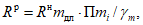

^eu002

где $R^{н}$ - нормативная прочность материала, МПа, определенная с обеспеченностью 0,95, приведенная в приложении В;

⟦IMG:sp_64_13330_2017_svod_pravil_derevyannye_konstruktsii_/meganorm_231846.png|20x0⟧ - коэффициент надежности по материалу (таблица 6), определяемый из условия перехода от обеспеченности 0,95 для $R^{н}R^{р}кобеспеченности0,99для$ по формуле

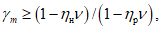

^eu003

⟦IMG:sp_64_13330_2017_svod_pravil_derevyannye_konstruktsii_/meganorm_409083.png|63x0⟧ - квантиль в предполагаемой статистической функции распределения с обеспеченностью 0,95;

⟦IMG:sp_64_13330_2017_svod_pravil_derevyannye_konstruktsii_/meganorm_914886.png|64x0⟧ - квантиль в предполагаемой статистической функции распределения с обеспеченностью 0,99;

⟦IMG:sp_64_13330_2017_svod_pravil_derevyannye_konstruktsii_/meganorm_677102.png|14x0⟧ - коэффициент вариации (таблица 6).

*Таблица* 6 ^t6
| Nп.п. | Напряженное состояние | Коэффициент вариации ⟦IMG:assets/1cd47723069c.png\|0x0⟧ | Коэффициент надежности по материалу ⟦IMG:assets/32b51f5c954d.png\|0x0⟧ |
|---|---|---|---|
| 1 | Изгиб | 0,15 | 1,2 |
| 2 | Сжатие и смятие вдоль волокон | 0,13 | 1,15 |
| 3 | Растяжение вдоль волокон | 0,2 | 1,25 |
| 4 | Скалывание вдоль волокон | 0,2 | 1,25 |
| 5 | Сжатие и смятие поперек волокон | 0,13 | 1,15 |
| 6 | Растяжение поперек волокон | 0,25 | 1,4 |
| 7 | Скалывание поперек волокон | 0,2 | 1,25 |
| 8 | Модуль упругости | 0,15 | - |

6.3 Расчетные сопротивления LVL следует определять по формуле (1), где ⟦IMG:sp_64_13330_2017_svod_pravil_derevyannye_konstruktsii_/meganorm_615098.png|24x0⟧ принимают по таблице 7 с учетом коэффициентов условия работ $m_{б}m_{в}m_{т}m_{о}m_{а}m_{с.с}m_{см},,,,,,$. ^c6-3

*(в ред. Изменения № 4)*

*(в ред. Изменения № 4)*

Минстроя России от 28.12.2023 N 1014/пр)

*Таблица* 7 ^t7
<table>
<tr><th rowspan="2" scope="col">Напряженное состояние</th><th colspan="4" scope="col">Расчетное сопротивление ⟦IMG:assets/35dd3e0c87da.png|0x0⟧</th></tr>
<tr><td>Обозначение</td><td>1/К45</td><td>2/К40</td><td>3/К35</td></tr>
<tr><td>1 Изгиб:</td><td></td><td></td><td></td><td></td></tr>
<tr><td>- в плоскости листа</td><td>⟦IMG:assets/412dbeebf6eb.png|0x0⟧</td><td>39</td><td>34</td><td>30</td></tr>
<tr><td>- из плоскости листа</td><td>⟦IMG:assets/a789b23043e5.png|0x0⟧</td><td>35</td><td>31</td><td>27</td></tr>
<tr><td>2 Сжатие в плоскости листа вдоль волокон</td><td>⟦IMG:assets/f05a8ab4b597.png|0x0⟧⟦IMG:assets/3d594d327ddf.png|0x0⟧</td><td>32</td><td>30</td><td>27</td></tr>
<tr><td>3 Сжатие в плоскости листа поперек волокон</td><td>⟦IMG:assets/78b33f4df40a.png|0x0⟧⟦IMG:assets/7ad6878a656d.png|0x0⟧</td><td>4,8</td><td>4,7</td><td>4,5</td></tr>
<tr><td>4 Смятие местное в плоскости листа поперек волокон в опорных частях конструкций и узловых примыканиях</td><td>⟦IMG:assets/7ad6878a656d.png|0x0⟧</td><td>7,5</td><td>7,4</td><td>7,25</td></tr>
<tr><td>5 Растяжение вдоль волокон</td><td>⟦IMG:assets/959a2c20fedd.png|0x0⟧</td><td>31</td><td>27</td><td>24</td></tr>
<tr><td>6 Растяжение поперек волокон в плоскости листа</td><td>⟦IMG:assets/59e13717e46c.png|0x0⟧</td><td>0,45</td><td>0,45</td><td>0,45</td></tr>
<tr><td>7 Скалывание вдоль волокон поперек плоскости листа</td><td>⟦IMG:assets/709f985f728f.png|0x0⟧</td><td>4,1</td><td>3,9</td><td>3,9</td></tr>
<tr><td>8 Скалывание вдоль волокон в плоскости листа</td><td>⟦IMG:assets/effe225e6aef.png|0x0⟧</td><td>3,2</td><td>3</td><td>2,9</td></tr>
<tr><td>9 Скалывание поперек волокон в плоскости листа</td><td>⟦IMG:assets/b1edd5e143f0.png|0x0⟧</td><td>1,5</td><td>1,5</td><td>1,5</td></tr>
</table>

6.4 Расчетное сопротивление древесины местному смятию поперек волокон на части длины $R_{см90}$ (при длине незагруженных участков не менее длины площадки смятия и толщины элементов), кроме смятия в опорных частях конструкций, лобовых врубках и узловых примыканиях элементов и под шайбами при углах смятия от 90° до 60°, вычисляют по формуле ^c6-4

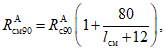

^eu004

где ⟦IMG:sp_64_13330_2017_svod_pravil_derevyannye_konstruktsii_/meganorm_727926.png|28x0⟧ - расчетное сопротивление древесины сжатию и смятию по всей поверхности поперек волокон;

$l_{см}$ - длина площадки смятия вдоль волокон древесины, мм.

6.5 Расчетное сопротивление древесины смятию под углом ⟦IMG:sp_64_13330_2017_svod_pravil_derevyannye_konstruktsii_/meganorm_817829.png|16x0⟧ к направлению волокон вычисляют по формуле ^c6-5

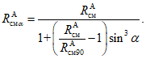

^eu005

6.6 Расчетное сопротивление древесины растяжению под углом ⟦IMG:sp_64_13330_2017_svod_pravil_derevyannye_konstruktsii_/meganorm_680079.png|16x0⟧ к направлению волокон вычисляют по формуле ^c6-6

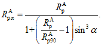

^eu006

6.7 Расчетное сопротивление древесины скалыванию под углом ⟦IMG:sp_64_13330_2017_svod_pravil_derevyannye_konstruktsii_/meganorm_555148.png|16x0⟧ к направлению волокон определяется по формуле ^c6-7

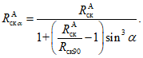

^eu007

6.8 Расчетные сопротивления строительной фанеры следует определять по формуле (1), где $R^{A}$ должны принимать по таблице 8. ^c6-8

*(в ред. Изменения № 2)*

Минстроя России от 30.01.2019 N 62/пр)

*Таблица* 8 ^t8
<table>
<tr><th rowspan="2" scope="col">Вид фанеры</th><th colspan="5" scope="col">Расчетное сопротивление R A, МПаA, МПа</th></tr>
<tr><td>растяжению в плоскости листа ⟦IMG:assets/9a978c3dbf91.png|0x0⟧</td><td>сжатию в плоскости листа ⟦IMG:assets/66e8390c52b6.png|0x0⟧</td><td>изгибу из плоскости листа ⟦IMG:assets/0c0c9a3a3e5c.png|0x0⟧</td><td>скалыванию в плоскости листа ⟦IMG:assets/bc1983f4cdf0.png|0x0⟧</td><td>срезу перпендикулярно плоскости листа ⟦IMG:assets/54a6bea4b5f4.png|0x0⟧</td></tr>
<tr><td>1 Фанера клееная березовая марки ФСФ сортов В/ВВ, В/С, ВВ/С:</td><td></td><td></td><td></td><td></td><td></td></tr>
<tr><td>а) 7-слойная толщиной 8 мм и более:</td><td></td><td></td><td></td><td></td><td></td></tr>
<tr><td>вдоль волокон</td><td>21</td><td>18</td><td>24</td><td>1,2</td><td>9</td></tr>
<tr><td>поперек волокон наружных слоев</td><td>13,5</td><td>13</td><td>10</td><td>1,2</td><td>9</td></tr>
<tr><td>под углом 45° к волокнам</td><td>7</td><td>10,5</td><td>-</td><td>1,2</td><td>13,5</td></tr>
<tr><td>б) 5-слойная толщиной 5 - 7 мм:</td><td></td><td></td><td></td><td></td><td></td></tr>
<tr><td>вдоль волокон наружных слоев</td><td>21</td><td>19,5</td><td>27</td><td>1,2</td><td>7,5</td></tr>
<tr><td>поперек волокон наружных слоев</td><td>9</td><td>10,5</td><td>4,5</td><td>1,2</td><td>9</td></tr>
<tr><td>под углом 45° к волокнам</td><td>6</td><td>9</td><td>-</td><td>1,2</td><td>13,5</td></tr>
<tr><td>2 Фанера клееная из древесины лиственницы марки ФСФ сортов В/ВВ и ВВ/С 7-слойная толщиной 8 мм и более:</td><td></td><td></td><td></td><td></td><td></td></tr>
<tr><td>вдоль волокон наружных слоев</td><td>13,5</td><td>26</td><td>27</td><td>0,9</td><td>7,5</td></tr>
<tr><td>поперек волокон наружных слоев</td><td>11,5</td><td>19,5</td><td>16,5</td><td>0,75</td><td>7,5</td></tr>
<tr><td>под углом 45° к волокнам</td><td>4,5</td><td>7,5</td><td>-</td><td>1,05</td><td>11,5</td></tr>
<tr><td>3 Фанера бакелизированная марки ФБС толщиной 7 мм и более:</td><td></td><td></td><td></td><td></td><td></td></tr>
<tr><td>вдоль волокон наружных слоев</td><td>48,5</td><td>42,5</td><td>50</td><td>2,7</td><td>16,5</td></tr>
<tr><td>поперек волокон наружных слоев</td><td>36,5</td><td>35</td><td>38</td><td>2,7</td><td>18</td></tr>
<tr><td>под углом 45° к волокнам</td><td>25</td><td>32</td><td>-</td><td>2,7</td><td>24</td></tr>
<tr><th colspan="6" scope="row">*(в ред. Изменения № 3)*, утв. Приказом Минстроя России от 23.12.2021 N 988/пр)</th></tr>
<tr><th colspan="6" scope="row">Примечания1 Расчетные сопротивления смятию и сжатию перпендикулярно плоскости листа для березовой фанеры марки ФСФ - ⟦IMG:assets/820fe8dca0a9.png|0x0⟧⟦IMG:assets/4bd2e287a16c.png|0x0⟧2 Расчетные сопротивления растяжению перпендикулярно к плоскости листа - отрыв шпона принимают ⟦IMG:assets/8dc402d9139c.png|0x0⟧</th></tr>
</table>

*(в ред. Изменения № 3)*

6.8а Расчетные сопротивления строительных древесных плит с ориентированной стружкой ОСП-3 следует определять по формуле (1), где $R^{А}$ принимают по приложению В (таблица В.6). ^c6-8a

(п. 6.8а введен Изменением N 4, утв. Приказом Минстроя России от 28.12.2023 N 1014/пр)

6.9 При определении расчетного сопротивления в соответствующих случаях следует применять коэффициенты условий работы: ^c6-9

а) для различных условий эксплуатации конструкций - коэффициент $m_{в}$, указанный в таблице 9;

б) конструкций, эксплуатируемых при установившейся температуре воздуха ниже плюс 35 °C, - коэффициент $m_{т}m_{т}-1;притемпературеплюс50°C-коэффициент$ = 0,8. Для промежуточных значений температуры коэффициент принимают по интерполяции;

в) изгибаемых, внецентренно сжатых, сжато-изгибаемых и сжатых клееных элементов прямоугольного сечения высотой более 50 см значения расчетных сопротивлений изгибу и сжатию вдоль волокон - коэффициент $m_{б}$, указанный в таблице 10;

г) растянутых элементов с ослаблением в расчетном сечении и изгибаемых элементов из круглых лесоматериалов с подрезкой в расчетном сечении - коэффициент $m_{о}$ = 0,8;

д) элементов, подвергнутых глубокой пропитке антипиренами под давлением, - коэффициент $m_{а}$ = 0,9;

е) изгибаемых, внецентренно сжатых, сжато-изгибаемых и сжатых клееных деревянных элементов, в зависимости от толщины слоев, значения расчетных сопротивлений изгибу, скалыванию и сжатию вдоль волокон - коэффициент $m_{сл}$, указанный в таблице 11;

ж) гнутых элементов конструкций значения расчетных сопротивлений растяжению, сжатию и изгибу - коэффициент $m_{гн}$, указанный в таблице 12;

и) в зависимости от срока службы, назначаемого в соответствии с ГОСТ 27751-2014 (пункт 4.3), - коэффициент $m_{с.с}$, указанный в таблице 13;

*(в ред. Изменения № 4)*

к) для смятия поперек волокон при режимах нагружения Г - К (таблица 4) - коэффициент $m_{см}$ = 1,15.

л) для опор воздушных линий электропередачи - коэффициент $m_{лэп}$ = 1,25.

(перечисление "л" введено Изменением N 2, утв. Приказом Минстроя России от 30.01.2019 N 62/пр)

*(в ред. Изменения № 1)*

Минстроя России от 19.12.2017 N 1684/пр)

*Таблица* 9 ^t9
| Условие эксплуатации (таблица 1) | 1 и 2 | 3 | 4а | 4б |
|---|---|---|---|---|
| Коэффициент m вв | 1 | 0,9 | 0,85 | 0,75 |

*Таблица* 10 ^t10
| Высота сечения, см | 50 и менее | 60 | 70 | 80 | 100 | 120 и более |
|---|---|---|---|---|---|---|
| Коэффициент m бб | 1 | 0,96 | 0,93 | 0,90 | 0,85 | 0,8 |

*Таблица* 11 ^t11
| Толщина слоя, мм | 10 и менее | 19 | 26 | 33 | 42 |
|---|---|---|---|---|---|
| Коэффициент m слсл | 1,2 | 1,1 | 1,05 | 1,0 | 0,95 |

*Таблица* 12 ^t12
<table>
<tr><th rowspan="2" scope="col">Напряженное состояние</th><th rowspan="2" scope="col">Обозначение расчетных сопротивлений</th><th colspan="4" scope="col">Коэффициент m гн r к aгн r к ar к aк aa</th></tr>
<tr><td>150</td><td>200</td><td>250</td><td>500 и более</td></tr>
<tr><td>Сжатие и изгиб</td><td>R с R ис R иR ии</td><td>0,8</td><td>0,9</td><td>1</td><td>1</td></tr>
<tr><td>Растяжение</td><td>R рр</td><td>0,6</td><td>0,7</td><td>0,8</td><td>1</td></tr>
<tr><th colspan="6" scope="row">Примечание - r к a - толщина слоя гнутоклееного элемента в радиальном направлении.к a - толщина слоя гнутоклееного элемента в радиальном направлении.a - толщина слоя гнутоклееного элемента в радиальном направлении.</th></tr>
<tr><th colspan="6" scope="row">*(в ред. Изменения № 4)*, утв. Приказом Минстроя России от 28.12.2023 N 1014/пр)</th></tr>
</table>

*Таблица* 13 ^t13
<table>
<tr><th rowspan="2" scope="col">Вид напряженного состояния</th><th colspan="3" scope="col">Значение коэффициента m с.с при сроке службы сооруженияс.с при сроке службы сооружения</th></tr>
<tr><td><= 50 лет</td><td>75 лет</td><td>100 лет и более</td></tr>
<tr><td>Изгиб, сжатие, смятие вдоль и поперек волокон древесины</td><td>1,0</td><td>0,9</td><td>0,8</td></tr>
<tr><td>Растяжение и скалывание вдоль волокон древесины</td><td>1,0</td><td>0,85</td><td>0,7</td></tr>
<tr><td>Растяжение поперек волокон древесины</td><td>1,0</td><td>0,8</td><td>0,5</td></tr>
<tr><th colspan="4" scope="row">Примечание - Значение коэффициента m с.с для промежуточных сроков службы сооружения принимаются по линейной интерполяции.с.с для промежуточных сроков службы сооружения принимаются по линейной интерполяции.</th></tr>
</table>

6.10 Расчетный модуль упругости (модуль сдвига) древесины и древесных материалов при расчете по предельным состояниям 2-й группы $E^{II}G^{II}($) следует вычислять по формуле ^c6-10

$$E ^{II} ( G ^{II} ) = E _{ср} ( G _{ср} ) m _{дл,E} \Pi m _{i}\tag{8}$

^e6-8

где $E_{ср}G_{ср}($) - средний модуль упругости при изгибе (модуль сдвига), МПа, согласно приложению В;

*(в ред. Изменения № 1)*

$m_{дл,Е}$ - коэффициент длительности нагружения для упругих характеристик, для режима нагружения Б (таблица 4) принимают равным 0,75, для режимов нагружения В и Г - 0,9, для остальных режимов нагружения - 1.

*(в ред. Изменения № 4)*

При определении модулей упругости и сдвига ДПК для режима нагружения Б $m_{дл,}_{E}$ принимают равным 0,7, для режима нагружения В - 0,75;

*(абзац введён Изменением № 4)*

Пm - произведение коэффициентов условий работы [6.9 а), 6.9 б) и 6.9 и)].

6.11 Расчетный модуль упругости (модуль сдвига) древесины и древесных материалов при расчете по предельным состояниям 1-й группы по деформированной схеме $E^{I}G^{I}($) следует вычислять по формуле ^c6-11

*(в ред. Изменения № 3)*

$$E ^{I} ( G ^{I} ) = E _{н} ( G _{н} ) m _{дл,E} \Pi m _{i}\tag{9}$

^e6-9

*(в ред. Изменения № 3)*

Минстроя России от 23.12.2021 N 988/пр)

где $E_{н}G_{н}($) - нормативный модуль упругости при изгибе (нормативный модуль сдвига) с обеспеченностью 0,95, МПа, согласно приложению В;

$m_{дл,E}m_{i}иП$ - в соответствии с 6.10.

*(в ред. Изменения № 3)*

Коэффициент Пуассона древесины поперек волокон при напряжениях, направленных вдоль волокон, следует принимать равным ⟦IMG:sp_64_13330_2017_svod_pravil_derevyannye_konstruktsii_/meganorm_776083.png|76x0⟧, а вдоль волокон при напряжениях, направленных поперек волокон, - ⟦IMG:sp_64_13330_2017_svod_pravil_derevyannye_konstruktsii_/meganorm_600743.png|84x0⟧.

*(в ред. Изменения № 4)*

6.12 Расчетный модуль упругости в расчетах конструкций (кроме опор ЛЭП) на устойчивость следует принимать равным для древесины и LVL ⟦IMG:sp_64_13330_2017_svod_pravil_derevyannye_konstruktsii_/meganorm_749438.png|77x0⟧ (⟦IMG:sp_64_13330_2017_svod_pravil_derevyannye_konstruktsii_/meganorm_186798.png|21x0⟧ - нормативное сопротивление сжатию вдоль волокон, принимаемое по приложению Г), а модуль сдвига относительно осей, направленных вдоль и поперек волокон, - ⟦IMG:sp_64_13330_2017_svod_pravil_derevyannye_konstruktsii_/meganorm_981398.png|95x0⟧; для фанеры - ⟦IMG:sp_64_13330_2017_svod_pravil_derevyannye_konstruktsii_/meganorm_323559.png|85x0⟧; ⟦IMG:sp_64_13330_2017_svod_pravil_derevyannye_konstruktsii_/meganorm_835541.png|83x0⟧ ($E_{ф}G_{ф},$ принимаются по приложению В). ^c6-12

*(в ред. Изменения № 2)*

6.13 Физико-механические характеристики древесины и LVL приведены в приложении В. ^c6-13

6.14 Нормативные сопротивления ДПК, приведенные в таблице 13а, должны определяться с учетом количества слоев и особенностей технологии производства в соответствии с нормативными документами на изготовление. ^c6-14

*(в ред. Изменения № 4)*

Минстроя России от 28.12.2023 N 1014/пр)

*Таблица* 13а ^t13а
<table>
<tr><th scope="col">Напряженное состояние</th><th scope="col">Нормативные сопротивления, МПа</th></tr>
<tr><th colspan="2" scope="row">Для нагрузок, приложенных перпендикулярно плоскости плиты</th></tr>
<tr><td>1 Изгиб</td><td>⟦IMG:assets/7984d3ff6939.png|0x0⟧</td></tr>
<tr><td>2 Сжатие поперек волокон</td><td>⟦IMG:assets/bb09cb5339e5.png|0x0⟧</td></tr>
<tr><td>3 Скалывание поперек волокон при изгибе</td><td>⟦IMG:assets/697de6394731.png|0x0⟧</td></tr>
<tr><th colspan="2" scope="row">Для нагрузок, приложенных в плоскости плиты</th></tr>
<tr><td>4 Изгиб</td><td>⟦IMG:assets/144fa3faa33f.png|0x0⟧</td></tr>
<tr><td>5 Сжатие вдоль наружных слоев</td><td>⟦IMG:assets/9c8095906206.png|0x0⟧</td></tr>
<tr><td>6 Сжатие поперек наружных слоев</td><td>⟦IMG:assets/9c92c3a49dd0.png|0x0⟧</td></tr>
<tr><td>7 Скалывание поперек волокон при изгибе</td><td>⟦IMG:assets/697de6394731.png|0x0⟧</td></tr>
</table>

Для элементов из ДПК, не обработанных влагозащитными лакокрасочными покрытиями, нормативные сопротивления следует уменьшать путем умножения значений на 0,9.

*(абзац введён Изменением № 4)*

## 7 Расчет элементов деревянных конструкций

### Расчет элементов деревянных конструкций по предельным состояниям 1-й группы

#### Центрально-растянутые и центрально-сжатые элементы

7.1 Расчет центрально-растянутых элементов следует производить по формуле ^c7-1

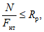

^eu010

*(в ред. Изменения № 4)*

Минстроя России от 28.12.2023 N 1014/пр)

где N - расчетная продольная сила;

$R_{р}$ - расчетное сопротивление древесины растяжению вдоль волокон;

⟦IMG:sp_64_13330_2017_svod_pravil_derevyannye_konstruktsii_/meganorm_431751.png|29x0⟧ - то же, для древесины из однонаправленного шпона (6.3);

$F_{нт}$ - площадь нетто поперечного сечения элемента.

При определении $F_{нт}$ ослабления, расположенные на участке длиной не более 200 мм, следует принимать совмещенными в одном сечении.

7.2 Расчет центрально-сжатых элементов постоянного цельного сечения следует производить по формулам: ^c7-2

а) на прочность

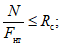

^eu011

*(в ред. Изменения № 4)*

Минстроя России от 28.12.2023 N 1014/пр)

б) на устойчивость

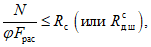

^eu012

где $R_{с}$ - расчетное сопротивление древесины сжатию вдоль волокон;

⟦IMG:sp_64_13330_2017_svod_pravil_derevyannye_konstruktsii_/meganorm_829411.png|29x0⟧ - то же, для древесины из однонаправленного шпона;

⟦IMG:sp_64_13330_2017_svod_pravil_derevyannye_konstruktsii_/meganorm_433618.png|15x0⟧ - коэффициент продольного изгиба, определяемый согласно 7.3;

$F_{нт}$ - площадь нетто поперечного сечения элемента;

$F_{рас}$ - расчетная площадь поперечного сечения элемента, принимаемая равной:

при отсутствии ослаблений или ослаблениях в опасных сечениях, не выходящих на кромки (рисунок 1, а), если площадь ослаблений не превышает 25% $F_{бр}F_{расч}F_{бр}F_{бр}F_{бр}F_{рас}F_{нт}F_{рас}F_{нт},=,где-площадьсечениябрутто;приослаблениях,невыходящихнакромки,еслиплощадьослабленияпревышает25%,=4/3;присимметричныхослаблениях,выходящихнакромки(рисунок1,б),=$.

а - не выходящие на кромку; б - выходящие на кромку

Рисунок 1 - Ослабление сжатых элементов

Для ДПК $F_{нт}F_{рас}и$ определяют без учета слоев, расположенных перпендикулярно направлению нормальных напряжений.

*(в ред. Изменения № 4)*

7.3 Коэффициент продольного изгиба ⟦IMG:sp_64_13330_2017_svod_pravil_derevyannye_konstruktsii_/meganorm_484592.png|15x0⟧ следует определять по формулам: ^c7-3

при гибкости элемента ⟦IMG:sp_64_13330_2017_svod_pravil_derevyannye_konstruktsii_/meganorm_955716.png|47x0⟧

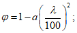

^eu013

при гибкости элемента ⟦IMG:sp_64_13330_2017_svod_pravil_derevyannye_konstruktsii_/meganorm_625149.png|47x0⟧

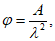

^eu014

где коэффициент a = 0,8 для древесины и LVL из однонаправленного шпона и a = 1,0 для фанеры;

*(в ред. Изменения № 4)*

коэффициент A = 3000 для древесины и LVL из однонаправленного шпона, A = 2500 для фанеры и трехслойной ДПК, A = 2000 для пятислойной и более ДПК.

*(в ред. Изменения № 4)*

7.4 Гибкость элементов цельного сечения определяют по формуле ^c7-4

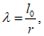

^eu015

где $l_{0}$ - расчетная длина элемента;

r - радиус инерции сечения элемента с максимальными размерами брутто относительно осей x и y .

Для ДПК при вычислении радиуса инерции $F_{рас}I_{рас}и$ определяют без учета слоев, расположенных перпендикулярно направлению нормальных напряжений.

*(абзац введён Изменением № 3)*

7.5 Расчетную длину элемента $l_{0}lследуетопределятьумножениемегосвободнойдлины$ на коэффициент ⟦IMG:sp_64_13330_2017_svod_pravil_derevyannye_konstruktsii_/meganorm_284062.png|20x0⟧ ^c7-5

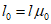

^eu016

согласно 7.23.

7.6 Составные элементы на податливых соединениях, опертые всем сечением, следует рассчитывать на прочность и устойчивость по формулам (11) и (12), при этом $F_{нт}F_{рас}и$ определять как суммарные площади всех ветвей. Гибкость составных элементов ⟦IMG:sp_64_13330_2017_svod_pravil_derevyannye_konstruktsii_/meganorm_980507.png|15x0⟧ следует определять с учетом податливости соединений по формуле ^c7-6

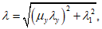

^eu017

где ⟦IMG:sp_64_13330_2017_svod_pravil_derevyannye_konstruktsii_/meganorm_382344.png|19x0⟧ - гибкость всего элемента относительно оси y(рисунок 2), вычисленная по расчетной длине элемента $l_{0}$ без учета податливости;

⟦IMG:sp_64_13330_2017_svod_pravil_derevyannye_konstruktsii_/meganorm_621262.png|16x0⟧ - гибкость отдельной ветви относительно оси I-I (рисунок 2), вычисленная по расчетной длине ветви $l_{1}l_{1}h_{1};применьшесемитолщин$ ветви принимаются с ⟦IMG:sp_64_13330_2017_svod_pravil_derevyannye_konstruktsii_/meganorm_406587.png|41x0⟧;

⟦IMG:sp_64_13330_2017_svod_pravil_derevyannye_konstruktsii_/meganorm_673327.png|20x0⟧ - коэффициент приведения гибкости, определяемый по формуле

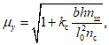

^eu018

где b и h - ширина и высота поперечного сечения элемента, см;

$n_{ш}$ - расчетное число швов в элементе, определяемое числом швов, по которым суммируется взаимный сдвиг элементов (на рисунке 2, а - 4 шва, на рисунке 2, б - 5 швов);

$l_{0}$ - расчетная длина элемента, м;

$n_{с}$ - расчетное число срезов связей в 1 шве на 1 м элемента (при нескольких швах с различным числом срезов следует принимать среднее для всех швов число срезов);

$k_{с}$ - коэффициент податливости соединений, который следует определять по формулам таблицы 14.

а - с прокладками; б - без прокладок

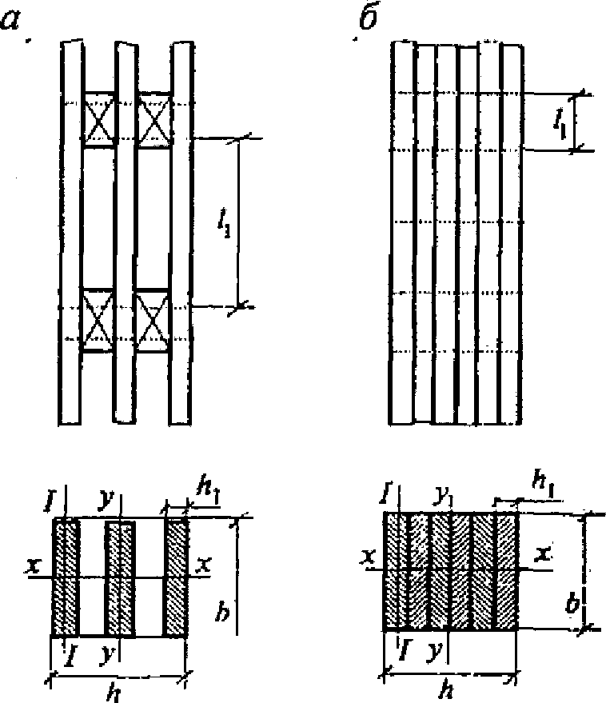

^f2

*Таблица* 14 ^t14
<table>
<tr><th rowspan="2" scope="col">Вид связей</th><th colspan="2" scope="col">Коэффициент k сс</th></tr>
<tr><td>при центральном сжатии</td><td>сжатии с изгибом</td></tr>
<tr><td>1 Гвозди, шурупы</td><td>⟦IMG:assets/1d68e024f6f6.png|0x0⟧</td><td>⟦IMG:assets/8c98168ea45a.png|0x0⟧</td></tr>
<tr><td>2 Стальные цилиндрические нагели:</td><td></td><td></td></tr>
<tr><td>а) диаметром <= 1/7 толщины соединяемых элементов</td><td>⟦IMG:assets/8c98168ea45a.png|0x0⟧</td><td>⟦IMG:assets/2e8d2c5163f0.png|0x0⟧</td></tr>
<tr><td>б) диаметром > 1/7 толщины соединяемых элементов</td><td>⟦IMG:assets/4431fac0bbc0.png|0x0⟧</td><td>⟦IMG:assets/fb78bc83bf8c.png|0x0⟧</td></tr>
<tr><td>3 Вклеенные стержни из арматуры А400 - А600</td><td>⟦IMG:assets/1d68e024f6f6.png|0x0⟧</td><td>⟦IMG:assets/8c98168ea45a.png|0x0⟧</td></tr>
<tr><td>4 Дубовые цилиндрические нагели</td><td>⟦IMG:assets/2f8f248a679c.png|0x0⟧</td><td>⟦IMG:assets/bbd6be2701c0.png|0x0⟧</td></tr>
<tr><td>5 Дубовые пластинчатые нагели</td><td>-</td><td>⟦IMG:assets/bb4aca44eb0d.png|0x0⟧</td></tr>
<tr><td>6 Клей</td><td>0</td><td>0</td></tr>
<tr><th colspan="3" scope="row">Примечание - Диаметры гвоздей, шурупов, нагелей и вклеенных стержней d a b пл и толщина a b пл и толщина b пл и толщина пл и толщина ⟦IMG:assets/7273f458f98b.png|0x0⟧</th></tr>
</table>

При определении $k_{с}dk_{с}aдиаметргвоздейследуетприниматьнеболее0,1толщинысоединяемыхэлементов.Еслиразмерзащемленныхконцовгвоздейменее4,тосрезывпримыкающихкнимшвахврасчетенеучитывают.Значениесоединенийнастальныхцилиндрическихнагеляхследуетопределятьпотолщине$ более тонкого из соединяемых элементов.

При определении $k_{с}$ диаметр дубовых цилиндрических нагелей следует принимать не более 0,25 толщины более тонкого из соединяемых элементов.

Связи в швах следует расставлять равномерно по длине элемента. В шарнирно-опертых прямолинейных элементах допускается в средних четвертях длины ставить связи в половинном количестве, вводя в расчет по формуле (18) величину $n_{с}$, принятую для крайних четвертей длины элемента.

Гибкость составного элемента, вычисленную по формуле (17), следует принимать не более гибкости ⟦IMG:sp_64_13330_2017_svod_pravil_derevyannye_konstruktsii_/meganorm_769840.png|16x0⟧ отдельных ветвей, рассчитываем по формуле

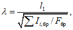

^eu019

где ⟦IMG:sp_64_13330_2017_svod_pravil_derevyannye_konstruktsii_/meganorm_677792.png|48x0⟧ - сумма моментов инерции брутто поперечных сечений отдельных ветвей относительно собственных осей, параллельных оси y(рисунок 2);

$F_{бр}$ - площадь сечения брутто элемента;

$l_{1}$ - расчетная длина ветви элемента.

*(в ред. Изменения № 2)*

Гибкость составного элемента относительно оси, проходящей через центры тяжести сечений всех ветвей (ось x нарисунке 2), следует определять как для цельного элемента, т.е. без учета податливости связей, если ветви нагружены равномерно. В случае неравномерно нагруженных ветвей следует руководствоваться 7.7.

Если ветви составного элемента имеют различное сечение, то расчетную гибкость ⟦IMG:sp_64_13330_2017_svod_pravil_derevyannye_konstruktsii_/meganorm_577691.png|16x0⟧ ветви в формуле (17) следует принимать равной

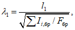

^eu020

определение $l_{1}$ приведено на рисунке 2.

7.7 Составные элементы на податливых соединениях, часть ветвей которых не оперта по концам, допускается рассчитывать на прочность и устойчивость по формулам (11), (12) при соблюдении следующих условий: ^c7-7

а) площади поперечного сечения элемента $F_{нт}F_{рас}и$ следует определять по сечению опертых ветвей;

б) гибкость элемента относительно оси y(рисунок 2) определяют по формуле (11); при этом момент инерции вычисляют с учетом всех ветвей, а площадь - только опертых;

в) при определении гибкости относительно оси x(рисунок 2) момент инерции следует вычислять по формуле

$$I = I _{о} + 0,5 I _{но}\tag{21}$

^e7-21

где $I_{о}I_{но}и$ - моменты инерции поперечных сечений соответственно опертых и неопертых ветвей.

7.8 Расчет на устойчивость центрально-сжатых элементов переменного по высоте сечения следует выполнять по формуле ^c7-8

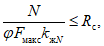

^eu022

*(в ред. Изменения № 4)*

Минстроя России от 28.12.2023 N 1014/пр)

где $F_{макс}$ - площадь поперечного сечения брутто с максимальными размерами;

$k_{ж}_{N}$ - коэффициент, учитывающий переменность высоты сечения, определяемый по таблице Е.2 приложения Е (для элементов постоянного сечения $k_{ж}_{N}$ = 1);

*(в ред. Изменения № 4)*

⟦IMG:sp_64_13330_2017_svod_pravil_derevyannye_konstruktsii_/meganorm_232753.png|15x0⟧ - коэффициент продольного изгиба, определяемый по 7.3 для гибкости, соответствующей сечению с максимальными размерами.

#### Изгибаемые элементы

7.9 Расчет изгибаемых элементов, обеспеченных от потери устойчивости плоской формы деформирования (см. 7.14 и 7.15), на прочность по нормальным напряжениям следует выполнять по формуле ^c7-9

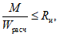

^eu023

*(в ред. Изменения № 4)*

Минстроя России от 28.12.2023 N 1014/пр)

где M - расчетный изгибающий момент;

$R_{и}$ - расчетное сопротивление изгибу;

исключено с 29.01.2024. - Изменение N 4, утв. Приказом Минстроя России от 28.12.2023 N 1014/пр;

$W_{расч}W_{расч}W_{нт}-расчетныймоментсопротивленияпоперечногосеченияэлемента;дляцельныхэлементов=$.

Для ДПК при вычислении $W_{расч}$ расчетный момент инерции определяют без учета слоев, расположенных перпендикулярно направлению нормальных напряжений.

*(абзац введён Изменением № 3)*

Для изгибаемых составных элементов на податливых соединениях расчетный момент сопротивления следует принимать равным моменту сопротивления нетто $W_{нт}k_{w}k_{w}W_{нт},умноженномунакоэффициент;значениядляэлементов,составленныхизодинаковыхслоев,приведенывтаблице15.Приопределении$ ослабления сечений, расположенные на участке элемента длиной не более 200 мм, принимают совмещенными в одном сечении.

*Таблица* 15 ^t15
<table>
<tr><th rowspan="2" scope="col">Коэффициент</th><th rowspan="2" scope="col">Число слоев в элементе</th><th colspan="4" scope="col">Значение коэффициента для расчета изгибаемых составных элементов при пролетах, м</th></tr>
<tr><td>2</td><td>4</td><td>6</td><td>9 и более</td></tr>
<tr><th rowspan="3" scope="row">k</th><td>2</td><td>0,7</td><td>0,85</td><td>0,9</td><td>0,9</td></tr>
<tr><td>3</td><td>0,6</td><td>0,8</td><td>0,85</td><td>0,9</td></tr>
<tr><td>10</td><td>0,4</td><td>0,7</td><td>0,8</td><td>0,85</td></tr>
<tr><th rowspan="3" scope="row">k жж</th><td>2</td><td>0,45</td><td>0,65</td><td>0,75</td><td>0,8</td></tr>
<tr><td>3</td><td>0,25</td><td>0,5</td><td>0,6</td><td>0,7</td></tr>
<tr><td>10</td><td>0,07</td><td>0,2</td><td>0,3</td><td>0,4</td></tr>
<tr><th colspan="6" scope="row">Примечания1 Для промежуточных значений величины пролета и числа слоев коэффициенты определяются интерполяцией.2 Для составных балок на наклонно вклеенных связях при числе слоев не более четырех следует принимать k k ж k = 0,85 при пролетах 4 м и менее. k ж k = 0,85 при пролетах 4 м и менее.k ж k = 0,85 при пролетах 4 м и менее.ж k = 0,85 при пролетах 4 м и менее.k = 0,85 при пролетах 4 м и менее. = 0,85 при пролетах 4 м и менее.</th></tr>
<tr><th colspan="6" scope="row">*(в ред. Изменения № 4)*, утв. Приказом Минстроя России от 28.12.2023 N 1014/пр)</th></tr>
</table>

7.10 Расчет изгибаемых элементов на прочность по скалыванию следует выполнять по формуле ^c7-10

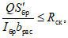

^eu024

*(в ред. Изменения № 4)*

Минстроя России от 28.12.2023 N 1014/пр)

где Q - расчетная поперечная сила;

⟦IMG:sp_64_13330_2017_svod_pravil_derevyannye_konstruktsii_/meganorm_257152.png|24x0⟧ - статический момент брутто сдвигаемой части поперечного сечения элемента относительно нейтральной оси;

$I_{бр}$ - момент инерции брутто поперечного сечения элемента относительно нейтральной оси;

$b_{рас}$ - расчетная ширина сечения элемента;

$R_{ск}$ - расчетное сопротивление скалыванию при изгибе.

*(в ред. Изменения № 4)*

исключено с 29.01.2024. - Изменение N 4, утв. Приказом Минстроя России от 28.12.2023 N 1014/пр.

При определении $R_{ск,пк}$ в формуле (2) $m_{дл}$ следует заменить на ⟦IMG:sp_64_13330_2017_svod_pravil_derevyannye_konstruktsii_/meganorm_468045.png|28x0⟧.

*(абзац введён Изменением № 4)*

Для ДПК $S'_{бр}I_{бр}и$ определяют без учета слоев, расположенных перпендикулярно направлению сдвига. Границу сдвигаемой части назначают в зависимости от направления волокон в среднем слое:

- при направлении волокон среднего слоя вдоль направления сдвига границей сдвигаемой части является клеевой шов между средним и соседним слоями;

- при направлении волокон среднего слоя поперек направления сдвига границей сдвигаемой части является нейтральная ось.

*(абзац введён Изменением № 3)*

7.11 Число срезов связей $n_{с}$, равномерно расставленных в каждом шве составного элемента на участке с однозначной эпюрой поперечных сил, следует определять по формуле ^c7-11

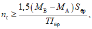

^eu025

где $M_{A}M_{B},$ - изгибающие моменты в начальном A и конечном B сечениях рассматриваемого участка;

T - расчетная несущая способность связи в данном шве.

> *Примечание* — При наличии в шве связей разной несущей способности, но одинаковых по характеру работы (например, нагелей и гвоздей), их несущие способности следует суммировать.

^n7-11-1

7.12 Расчет элементов цельного сечения на прочность при косом изгибе следует выполнять по формуле ^c7-12

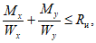

^eu026

*(в ред. Изменения № 4)*

Минстроя России от 28.12.2023 N 1014/пр)

где M и M - составляющие расчетного изгибающего момента для главных осей сечения x и y ;

W и W - моменты сопротивлений поперечного сечения нетто относительно главных осей сечения x и y .

7.13 Криволинейные (гнутые) участки (рисунок 3) КДК, изгибаемые моментом M , уменьшающим их кривизну, следует рассчитывать по формулам кривых брусьев: ^c7-13

а) по тангенциальным нормальным напряжениям на внутренней и наружной кромках бруса:

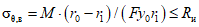

^eu027

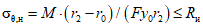

^eu028

где ⟦IMG:sp_64_13330_2017_svod_pravil_derevyannye_konstruktsii_/meganorm_467987.png|25x0⟧, ⟦IMG:sp_64_13330_2017_svod_pravil_derevyannye_konstruktsii_/meganorm_734856.png|25x0⟧ - соответственно тангенциальные нормальные напряжения на внутренней (ближней к центру кривизны) и наружной кромках бруса;

M - расчетный изгибающий момент;

$rr_{0}r_{1}r_{2},,и$ - соответственно радиусы кривизны геометрической оси, нейтрального слоя, внутренней и наружной кромок бруса;

F - площадь поперечного сечения кривого бруса;

$y_{0}IFr=/($) - смещение нейтрального слоя от геометрической оси криволинейного участка;

I - момент инерции поперечного сечения кривого бруса;

$R_{и}$ - расчетное сопротивление древесины изгибу;

*(в ред. Изменения № 3)*

б) по максимальным радиальным нормальным напряжениям

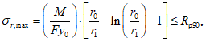

^eu029

где $R_{р90}$ - расчетное сопротивление ДК растяжению поперек волокон.

*(в ред. Изменения № 3)*

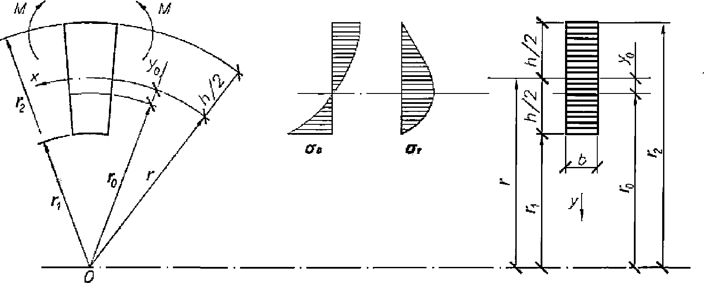

^f3

При невыполнении условия по формуле (29) допускается выполнять усиление постановкой вклеенных или ввинченных стержней, рассчитанных на восприятие растягивающего усилия, определяемого по формуле

⟦IMG:sp_64_13330_2017_svod_pravil_derevyannye_konstruktsii_/meganorm_872155.png|188x0⟧ (29а)

где $l_{2}$ - длина хорды криволинейного участка, на котором не выполняется условие по формуле (29).

7.14 Расчет на устойчивость плоской формы деформирования изгибаемых элементов прямоугольного постоянного сечения следует выполнять по формуле ^c7-14

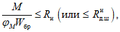

^eu030

где $Ml_{р}-максимальныйизгибающиймоментнарассматриваемомучастке$;

$W_{бр}l_{р}-максимальныймоментсопротивлениябруттонарассматриваемомучастке$.

Коэффициент ⟦IMG:sp_64_13330_2017_svod_pravil_derevyannye_konstruktsii_/meganorm_863745.png|24x0⟧ для изгибаемых элементов прямоугольного постоянного поперечного сечения, шарнирно закрепленных от смещения из плоскости изгиба и закрепленных от поворота вокруг продольной оси в опорных сечениях, следует вычислять по формуле

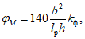

^eu031

где $l_{р}$ - расстояние между опорными сечениями элемента, а при закреплении сжатой кромки элемента в промежуточных точках от смещения из плоскости изгиба - расстояние между этими точками;

b - ширина поперечного сечения;

$hl_{р}-максимальнаявысотапоперечногосечениянаучастке$;

$k_{ф}l_{р}-коэффициент,зависящийотформыэпюрыизгибающихмоментовнаучастке$, определяемый по таблице Е.1 приложения Е.

При расчете изгибаемых элементов с линейно меняющейся по длине высотой и постоянной шириной поперечного сечения, не имеющих закреплений из плоскости по растянутой от момента M кромке, или при m < 4 коэффициент⟦IMG:sp_64_13330_2017_svod_pravil_derevyannye_konstruktsii_/meganorm_600018.png|24x0⟧ по формуле (31) следует умножать на дополнительный коэффициент $k_{ж}_{M}k_{ж}_{M}.Значения$ приведены в таблице Е.3 приложения Е; при $mk_{ж}_{M}>=4$ = 1.

При подкреплении из плоскости изгиба в промежуточных точках растянутой кромки элемента на участке $l_{р}$ коэффициент ⟦IMG:sp_64_13330_2017_svod_pravil_derevyannye_konstruktsii_/meganorm_584426.png|24x0⟧, вычисляемый по формуле (31), следует умножать на коэффициент $k_{п}_{M}$

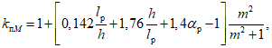

^eu032

где ⟦IMG:sp_64_13330_2017_svod_pravil_derevyannye_konstruktsii_/meganorm_255736.png|20x0⟧ - центральный угол в радианах, определяющий участок $l_{р}$ элемента кругового очертания (для прямолинейных элементов ⟦IMG:sp_64_13330_2017_svod_pravil_derevyannye_konstruktsii_/meganorm_194043.png|45x0⟧);

$ml_{р}m-числоподкрепленных(содинаковымшагом)точекрастянутойкромкинаучастке(при$ >= 4 величину ⟦IMG:sp_64_13330_2017_svod_pravil_derevyannye_konstruktsii_/meganorm_681356.png|45x0⟧ следует принимать равной 1).

7.15 Проверку устойчивости плоской формы деформирования изгибаемых элементов постоянного двутаврового или коробчатого поперечного сечений следует производить в тех случаях, когда ^c7-15

$$l _{р} >= 7 b\tag{33}$

^e7-33

где b - ширина сжатого пояса поперечного сечения.

Расчет следует выполнять по формуле

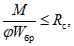

^eu034

*(в ред. Изменения № 4)*

Минстроя России от 28.12.2023 N 1014/пр)

где ⟦IMG:sp_64_13330_2017_svod_pravil_derevyannye_konstruktsii_/meganorm_830083.png|15x0⟧ - коэффициент продольного изгиба из плоскости изгиба сжатого пояса элемента, определяемый по 7.3;

$R_{с}$ - расчетное сопротивление сжатию;

исключено с 29.01.2024. - Изменение N 4, утв. Приказом Минстроя России от 28.12.2023 N 1014/пр;

$W_{бр}$ - момент сопротивления брутто поперечного сечения; в случае фанерных стенок - приведенный момент сопротивления в плоскости изгиба элемента.

#### Элементы, подверженные действию осевой силы с изгибом

7.16 Расчет внецентренно растянутых и растянуто-изгибаемых элементов по нормальным напряжениям следует выполнять по формуле ^c7-16

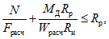

^eu035

где $M_{Д}$ - изгибающий момент от действия поперечных и продольных нагрузок, определяемый из расчета по деформированной схеме;

$W_{расч}$ - расчетный момент сопротивления поперечного сечения (см. 7.9);

$F_{расч}$ - площадь расчетного сечения нетто.

Для древесины из однонаправленного шпона в формуле (35) следует использовать соответствующие значения расчетных сопротивлений.

*(в ред. Изменения № 2)*

Допускается в расчете вместо $M_{Д}Mиспользовать$ - изгибающий момент в расчетном сечении без учета дополнительного момента от продольной силы.

7.17 Расчет на прочность по нормальным напряжениям внецентренно сжатых и сжато-изгибаемых элементов следует выполнять по формуле ^c7-17

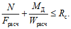

^eu036

*(в ред. Изменения № 4)*

Минстроя России от 28.12.2023 N 1014/пр)

> *Примечания*

^n7-17-1

1 Для шарнирно-опертых сжато-изгибаемых и внецентренно сжатых элементов при симметричных эпюрах изгибающих моментов синусоидального, параболического, полигонального и близких к ним очертаний, а также для консольных элементов $M_{Д}$ допускается выполнять по формуле

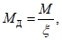

^eu037

где ⟦IMG:sp_64_13330_2017_svod_pravil_derevyannye_konstruktsii_/meganorm_884494.png|13x0⟧ - коэффициент, изменяющийся от 1 до 0, учитывающий дополнительный момент от продольной силы вследствие прогиба элемента, рассчитываемый по формуле

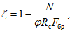

^eu038

M - изгибающий момент в расчетном сечении без учета дополнительного момента от продольной силы;

⟦IMG:sp_64_13330_2017_svod_pravil_derevyannye_konstruktsii_/meganorm_954425.png|15x0⟧ - коэффициент, рассчитываемый по формуле (14);

$R_{с}$ - расчетное сопротивление сжатию вдоль волокон древесины или древесины из однонаправленного шпона.

2 В тех случаях, когда в шарнирно-опертых элементах эпюры изгибающих моментов имеют треугольное или прямоугольное очертание, коэффициент по формуле (38) следует умножать на поправочный коэффициент $k_{и}$.

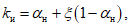

^eu039

где ⟦IMG:sp_64_13330_2017_svod_pravil_derevyannye_konstruktsii_/meganorm_972479.png|20x0⟧ - коэффициент, который следует принимать равным 1,22 при эпюрах изгибающих моментов треугольного очертания (от сосредоточенной силы) и 0,81 - при эпюрах прямоугольного очертания (от постоянного изгибающего момента).

3 При несимметричном загружении шарнирно-опертых элементов величину изгибающего момента $M_{Д}$ допускается определять по формуле

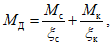

^eu040

где $M_{с}M_{к}и$ - изгибающие моменты в расчетном сечении элемента от симметричной и кососимметричной составляющих нагрузки;

⟦IMG:sp_64_13330_2017_svod_pravil_derevyannye_konstruktsii_/meganorm_259024.png|17x0⟧ и ⟦IMG:sp_64_13330_2017_svod_pravil_derevyannye_konstruktsii_/meganorm_273654.png|17x0⟧ - коэффициенты, рассчитываемые по формуле (38) при величине гибкости, соответствующей симметричной и кососимметричной формам продольного изгиба.

4 Для элементов, переменных по высоте сечения, площадь $F_{бр}$ в формуле (38) следует принимать для максимального по высоте сечения, а коэффициент ⟦IMG:sp_64_13330_2017_svod_pravil_derevyannye_konstruktsii_/meganorm_290280.png|15x0⟧ - умножать на коэффициент $k_{ж}_{N}$, принимаемый по таблице Е.2 приложения Е.

5 При отношении напряжений от изгиба к напряжениям от сжатия менее 0,1, сжато-изгибаемые элементы следует проверять также на устойчивость по формуле (12) без учета изгибающего момента.

7.18 Расчет на прочность по скалыванию сжато-изгибаемых элементов следует выполнять по формуле (24), внецентренно сжатых - по формуле ^c7-18

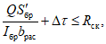

^eu041

где Q - расчетная поперечная сила;

N - расчетная продольная сила;

⟦IMG:sp_64_13330_2017_svod_pravil_derevyannye_konstruktsii_/meganorm_266813.png|24x0⟧ - статический момент брутто сдвигаемой части поперечного сечения элемента относительно нейтральной оси;

$I_{бр}$ - момент инерции брутто поперечного сечения элемента относительно нейтральной оси;

⟦IMG:sp_64_13330_2017_svod_pravil_derevyannye_konstruktsii_/meganorm_865735.png|91x0⟧;

$b_{рас}h_{рас}и$ - расчетные ширина и высота сечения элемента;

e - эксцентриситет передачи усилия N ;

$R_{ск}$ - расчетное сопротивление скалыванию при изгибе древесины или древесины из однонаправленного шпона.

7.19 Криволинейные (гнутые) участки сжато-изгибаемых клееных деревянных конструкций следует рассчитывать по формулам кривых брусьев (см. 7.13): ^c7-19

а) на внутренней кромке

*(в ред. Изменения № 3)*

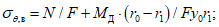

^eu042

*(в ред. Изменения № 3)*

Минстроя России от 23.12.2021 N 988/пр)

б) на наружной кромке

*(в ред. Изменения № 3)*

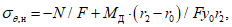

^eu043

*(в ред. Изменения № 3)*

Минстроя России от 23.12.2021 N 988/пр)

где $NM_{Д}и$ - абсолютные значения внутренних усилий.

*(абзац введён Изменением № 2)*

7.20 Расчет на устойчивость плоской формы деформирования сжато-изгибаемых элементов следует выполнять по формуле ^c7-20

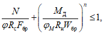

^eu044

где $F_{бр}l_{р}-площадьбруттосмаксимальнымиразмерамисеченияэлементанаучастке$;

⟦IMG:sp_64_13330_2017_svod_pravil_derevyannye_konstruktsii_/meganorm_637555.png|15x0⟧ - коэффициент продольного изгиба, определяемый по формуле (14) для гибкости участка элемента с расчетной длиной $l_{р}$ из плоскости деформирования;

⟦IMG:sp_64_13330_2017_svod_pravil_derevyannye_konstruktsii_/meganorm_648582.png|24x0⟧ - коэффициент, определяемый по формуле (31);

n = 2 - для элементов без закрепления растянутой зоны из плоскости деформирования и n = 1 для элементов, имеющих такие закрепления.

Для древесины из однонаправленного шпона следует принимать соответствующие значения расчетных сопротивлений по 6.3.

При наличии в элементе на участке $l_{р}Mзакрепленийизплоскостидеформированиясосторонырастянутойотмомента$ кромки, коэффициент ⟦IMG:sp_64_13330_2017_svod_pravil_derevyannye_konstruktsii_/meganorm_228725.png|24x0⟧ следует умножать на коэффициент $k_{п}_{M}$, рассчитываемый по формуле (32), а коэффициент ⟦IMG:sp_64_13330_2017_svod_pravil_derevyannye_konstruktsii_/meganorm_843610.png|15x0⟧ - на коэффициент $k_{п}_{N}$ по формуле

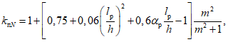

^eu045

где ⟦IMG:sp_64_13330_2017_svod_pravil_derevyannye_konstruktsii_/meganorm_146397.png|20x0⟧, $l_{р}hm,,$ - в соответствии с 7.14.

*(в ред. Изменения № 4)*

При расчете элементов переменного по высоте сечения, не имеющих закреплений из плоскости по растянутой от момента M кромке, или при m < 4 коэффициенты⟦IMG:sp_64_13330_2017_svod_pravil_derevyannye_konstruktsii_/meganorm_350756.png|15x0⟧ и ⟦IMG:sp_64_13330_2017_svod_pravil_derevyannye_konstruktsii_/meganorm_330067.png|24x0⟧, рассчитываемые по формулам (14) и (31), следует дополнительно умножать соответственно на коэффициенты $k_{ж}_{N}k_{ж}_{M}и$, приведенные в таблицах Е.2 и Е.3 приложения Е.

При $mk_{ж}_{N}k_{ж}_{M}>=4=$ = 1.

7.21 В составных сжато-изгибаемых элементах следует проверять устойчивость наиболее напряженной ветви, если ее расчетная длина превышает семикратную толщину ветви, по формуле ^c7-21

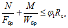

^eu046

где $F_{бр}W_{бр},$ - площадь и момент сопротивления брутто поперечного сечения элемента;

⟦IMG:sp_64_13330_2017_svod_pravil_derevyannye_konstruktsii_/meganorm_518697.png|17x0⟧ - коэффициент продольного изгиба для отдельной ветви, вычисленный по ее расчетной длине $l_{1}$ (см. 7.6).

Устойчивость сжато-изгибаемого составного элемента из плоскости изгиба следует проверять по формуле (12) без учета изгибающего момента.

7.22 Число срезов связей $n_{с}$, равномерно расставленных в каждом шве сжато-изгибаемого составного элемента на участке с однозначной эпюрой поперечных сил, при приложении сжимающей силы по всему сечению следует вычислять по формуле ^c7-22

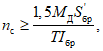

^eu047

*(в ред. Изменения № 2)*

Минстроя России от 30.01.2019 N 62/пр)

где $M_{Д}$ - изгибающий момент, определяемый по 7.17;

⟦IMG:sp_64_13330_2017_svod_pravil_derevyannye_konstruktsii_/meganorm_191517.png|24x0⟧ - статический момент брутто сдвигаемой части поперечного сечения относительно нейтральной оси;

T - расчетная несущая способность одной связи в данном шве;

$I_{бр}$ - момент инерции брутто поперечного сечения элемента.

#### Расчетные длины и предельные гибкости элементов деревянных конструкций

7.23 Для определения расчетной длины прямолинейных элементов, загруженных продольными силами по концам, коэффициент ⟦IMG:sp_64_13330_2017_svod_pravil_derevyannye_konstruktsii_/meganorm_292433.png|20x0⟧ следует принимать равным: ^c7-23

- при шарнирно-закрепленных концах, а также при шарнирном закреплении в промежуточных точках элемента - 1;

- одном шарнирно-закрепленном и другом защемленном конце - 0,8;

- одном защемленном и другом свободном нагруженном конце - 2,2;

- обоих защемленных концах - 0,65.

В случае равномерно распределенной по длине элемента продольной нагрузки коэффициент ⟦IMG:sp_64_13330_2017_svod_pravil_derevyannye_konstruktsii_/meganorm_513686.png|20x0⟧ следует принимать равным:

- при обоих шарнирно-закрепленных концах - 0,73;

- одном защемленном и другом свободном конце - 1,2.

Расчетную длину пересекающихся элементов, соединенных между собой в месте пересечения, следует принимать равной:

- при проверке устойчивости в плоскости конструкций - расстоянию от центра узла до точки пересечения элементов;

- проверке устойчивости из плоскости конструкции в случае пересечения:

а) двух сжатых элементов - полной длине элемента;

б) сжатого элемента с неработающим - величине $l_{1}$, умноженной на коэффициент ⟦IMG:sp_64_13330_2017_svod_pravil_derevyannye_konstruktsii_/meganorm_846951.png|20x0⟧

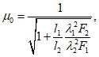

^eu048

где $l_{1}$, ⟦IMG:sp_64_13330_2017_svod_pravil_derevyannye_konstruktsii_/meganorm_277229.png|16x0⟧, $F_{1}$ - полная длина, гибкость и площадь поперечного сечения сжатого элемента;

$l_{2}$, ⟦IMG:sp_64_13330_2017_svod_pravil_derevyannye_konstruktsii_/meganorm_659057.png|19x0⟧, $F_{2}$ - длина, гибкость и площадь поперечного сечения неработающего элемента.

Величину ⟦IMG:sp_64_13330_2017_svod_pravil_derevyannye_konstruktsii_/meganorm_169289.png|20x0⟧ следует принимать не менее 0,5;

в) сжатого элемента с элементом, растянутым равной по величине силой, - наибольшей длине сжатого элемента, измеряемой от центра узла до точки пересечения элементов.

Если пересекающиеся элементы имеют составное сечение, то в формулу (48) следует подставлять соответствующие значения гибкости, рассчитываемые по формуле (17).

7.24 Гибкость элементов и их отдельных ветвей в деревянных конструкциях не должна превышать значений, указанных в таблице 16. ^c7-24

*Таблица* 16 ^t16
<table>
<tr><th scope="col">Наименование элементов конструкций</th><th scope="col">Предельная гибкость ⟦IMG:assets/2d0ec1f914d0.png|0x0⟧</th></tr>
<tr><td>1 Сжатые пояса, опорные раскосы и опорные стойки ферм, колонны</td><td>120</td></tr>
<tr><td>2 Прочие сжатые элементы ферм и других сквозных конструкций</td><td>150</td></tr>
<tr><td>3 Сжатые элементы связей</td><td>200</td></tr>
<tr><td>4 Растянутые пояса ферм в вертикальной плоскости</td><td>150</td></tr>
<tr><td>5 Прочие растянутые элементы ферм и других сквозных конструкций</td><td>200</td></tr>
<tr><td>Для опор воздушных линий электропередачи</td><td></td></tr>
<tr><td>6 Основные элементы (стойки, приставки, опорные раскосы)</td><td>150</td></tr>
<tr><td>7 Прочие элементы</td><td>175</td></tr>
<tr><td>8 Связи</td><td>200</td></tr>
<tr><th colspan="2" scope="row">Примечание - Для сжатых элементов переменного сечения величина предельной гибкости ⟦IMG:assets/2d0ec1f914d0.png|0x0⟧⟦IMG:assets/53b045e7cacc.png|0x0⟧k ж принимается по ж принимается по принимается по таблице Е.2 приложения Е. приложения Е.</th></tr>
</table>

#### Особенности расчета клееных элементов из фанеры с древесиной

7.25 Расчет клееных элементов из фанеры с древесиной следует выполнять по методу приведенного поперечного сечения. ^c7-25

7.26 Прочность растянутой фанерной обшивки плит (рисунок 4) и панелей следует проверять по формуле ^c7-26

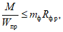

^eu049

где M - расчетный изгибающий момент;

$W_{пр}$ - момент сопротивления поперечного сечения, приведенного к фанере, который следует рассчитывать в соответствии с 7.27;

$m_{ф}m_{ф}m_{ф}m_{ф}-коэффициент,учитывающийснижениерасчетногосопротивлениявстыкахфанернойобшивки,принимаемыйравнымприусовомсоединенииилисдвусторонниминакладками:=0,6дляфанерыобычнойи=0,8дляфанерыбакелизированной;приотсутствиистыков$ = 1;

*(в ред. Изменения № 1)*

$R_{ф.р}$ - расчетное сопротивление фанеры растяжению.

1 - продольные ребра; 2 - обшивка

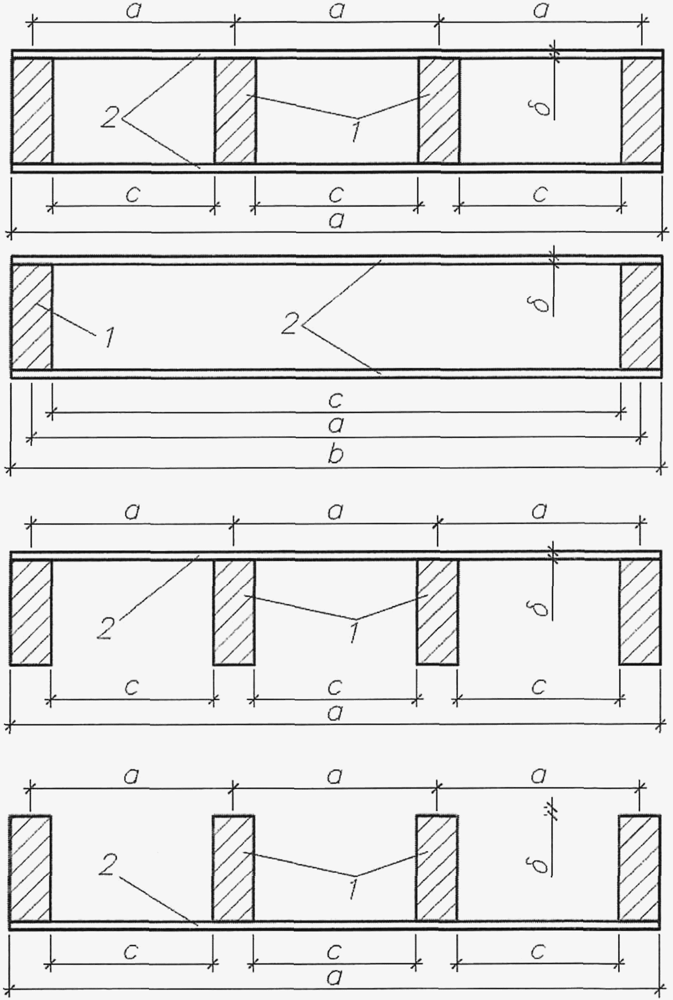

^f4

плит из фанеры и древесины

*(в ред. Изменения № 1)*

Минстроя России от 19.12.2017 N 1684/пр)

7.27 Приведенный момент сопротивления поперечного сечения клееных элементов из фанеры с древесиной следует определять по формулам: ^c7-27

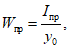

^eu050

где $I_{пр}$ - момент инерции сечения, приведенного к фанере;

$y_{0}$ - расстояние от центра тяжести приведенного сечения до его нижней грани;

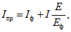

^eu051

где $I_{ф}$ - момент инерции поперечного сечения фанерных обшивок;

I - момент инерции поперечного сечения деревянных ребер каркаса;

$EE_{ф}/$ - отношение модулей упругости древесины и фанеры.

При определении приведенных моментов инерции и приведенных моментов сопротивления расчетную ширину фанерных обшивок следует принимать равной $b_{рас}blab_{рас}blalal=0,9при>=6и=0,15/при<6($ - пролет плиты).

7.28 Устойчивость сжатой обшивки плит и панелей следует рассчитывать по формуле ^c7-28

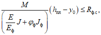

^eu052

где $h_{пл}$ - высота поперечного сечения плиты или панели;

⟦IMG:sp_64_13330_2017_svod_pravil_derevyannye_konstruktsii_/meganorm_777933.png|20x0⟧ - коэффициент продольного изгиба фанеры

⟦IMG:sp_64_13330_2017_svod_pravil_derevyannye_konstruktsii_/meganorm_556668.png|84x0⟧ при ⟦IMG:sp_64_13330_2017_svod_pravil_derevyannye_konstruktsii_/meganorm_245996.png|52x0⟧

⟦IMG:sp_64_13330_2017_svod_pravil_derevyannye_konstruktsii_/meganorm_666924.png|104x0⟧ при ⟦IMG:sp_64_13330_2017_svod_pravil_derevyannye_konstruktsii_/meganorm_954028.png|48x0⟧

(c - расстояние между ребрами в свету;⟦IMG:sp_64_13330_2017_svod_pravil_derevyannye_konstruktsii_/meganorm_928679.png|14x0⟧ - толщина фанеры).

*(в ред. Изменения № 2)*

Верхнюю обшивку плит дополнительно следует проверять на местный изгиб от сосредоточенного груза P = 1 кН (с коэффициентом перегрузки n = 1,2) как заделанную в местах приклеивания к ребрам пластинку.

7.29 Проверку на скалывание ребер каркаса плит и панелей или обшивки по шву в месте ее примыкания к ребрам следует выполнять по формуле ^c7-29

^eu053

где Q - расчетная поперечная сила;

⟦IMG:sp_64_13330_2017_svod_pravil_derevyannye_konstruktsii_/meganorm_245339.png|24x0⟧ - статический момент сдвигаемой части приведенного сечения относительно нейтральной оси;

$R_{ск}$ - расчетное сопротивление скалыванию древесины вдоль волокон или фанеры вдоль волокон наружных слоев;

$b_{рас}$ - расчетная ширина сечения, которую следует принимать равной суммарной ширине ребер каркаса.

7.30 Расчет на прочность поясов изгибаемых элементов двутаврового и коробчатого сечений с фанерными стенками (рисунок 5) следует выполнять по формуле (23), принимая $W_{рас}W_{пр}R_{р}=,приэтомнапряженияврастянутомпоясенедолжныпревышать$, а в сжатом - ⟦IMG:sp_64_13330_2017_svod_pravil_derevyannye_konstruktsii_/meganorm_632303.png|28x0⟧ (⟦IMG:sp_64_13330_2017_svod_pravil_derevyannye_konstruktsii_/meganorm_897897.png|15x0⟧ - коэффициент продольного изгиба из плоскости изгиба). ^c7-30

а - двутаврового сечения; б - коробчатого сечения

Рисунок 5 - Поперечные сечения клееных балок с плоской

фанерной стенкой

7.31 При проверке стенки на срез по нейтральной оси в формуле (53) значение $R_{ск}R_{ф.ср}b_{рас}принимаютравным,арасчетнаяширина$ равна ^c7-31

^eu054

где ⟦IMG:sp_64_13330_2017_svod_pravil_derevyannye_konstruktsii_/meganorm_196501.png|43x0⟧ - суммарная толщина стенок.

При проверке скалывания по швам между поясами и стенкой в формуле (53) значение $R_{ск}R_{ф.ск}принимаютравным$, а расчетную ширину сечения принимают равной

$$b _{рас} = nh _{п}\tag{55}$

^e7-55

где n - число вертикальных швов;

$h_{п}$ - высота поясов.

7.32 Прочность стенки в опасном сечении на действие главных растягивающих напряжений в изгибаемых элементах двутаврового и коробчатого сечений следует проверять по формуле ^c7-32

^eu056

где ⟦IMG:sp_64_13330_2017_svod_pravil_derevyannye_konstruktsii_/meganorm_911718.png|24x0⟧ - нормальное напряжение в стенке от изгиба на уровне внутренней кромки поясов;

⟦IMG:sp_64_13330_2017_svod_pravil_derevyannye_konstruktsii_/meganorm_662186.png|20x0⟧ - касательные напряжения в стенке на уровне внутренней кромки поясов;

⟦IMG:sp_64_13330_2017_svod_pravil_derevyannye_konstruktsii_/meganorm_604541.png|37x0⟧ - расчетное сопротивление фанеры растяжению под углом ⟦IMG:sp_64_13330_2017_svod_pravil_derevyannye_konstruktsii_/meganorm_994179.png|16x0⟧, определяемое по графику рисунка Д.1 приложения Д;

⟦IMG:sp_64_13330_2017_svod_pravil_derevyannye_konstruktsii_/meganorm_786664.png|16x0⟧ - угол, определяемый из зависимости

^eu057

Устойчивость стенки с продольным по отношению к оси элемента расположением волокон наружных слоев следует проверять на действие касательных и нормальных напряжений при условии

^eu058

где $h_{ст}$ - высота стенки между внутренними гранями полок;

⟦IMG:sp_64_13330_2017_svod_pravil_derevyannye_konstruktsii_/meganorm_206886.png|15x0⟧ - толщина стенки.

Расчет следует производить по формуле

^eu059

где $k_{и}$ и ⟦IMG:sp_64_13330_2017_svod_pravil_derevyannye_konstruktsii_/meganorm_405043.png|17x0⟧ - коэффициенты, определяемые по графикам рисунков Д.2 и Д.3 приложения Д;

$h_{рас}h_{ст}ah_{ст}aah_{ст}-расчетнаявысотастенки,которуюследуетприниматьравнойприрасстояниимеждуребрами>=иравнойпри<$.

При поперечном по отношению к оси элемента расположении наружных волокон фанерной стенки проверку устойчивости следует производить по формуле (59) на действие только касательных напряжений в тех случаях, когда

^eu060

### Расчет элементов деревянных конструкций по предельным состояниям 2-й группы

7.33 Деформации деревянных конструкций или их отдельных элементов следует определять с учетом сдвига и податливости соединений. Величину деформаций податливого соединения при полном использовании его несущей способности следует принимать по таблице 17, а при неполном - пропорциональной действующему на соединение усилию. ^c7-33

*Таблица* 17 ^t17
| Вид соединения | Деформация соединения, мм |
|---|---|
| Соединение: |  |
| - на лобовых врубках и торец в торец | 1,5 |
| - в примыканиях поперек волокон | 3 |
| - на нагелях всех видов | 2 |
| - на металлических зубчатых пластинах (МЗП) | 1,5 |
| - на стержнях, вклеенных перпендикулярно плоскости сплачивания | 1,5 |
| - на наклонно вклеенных стержнях | 0,5 |
| - в клеевых соединениях | 0 |

Величину деформаций податливого соединения следует делить на коэффициенты условия работы $m_{в}m_{дл}m_{с.с},и$.

*(в ред. Изменения № 2)*

7.34 Прогибы и перемещения элементов конструкций не должны превышать предельных, установленных в СП 20.13330. ^c7-34

7.35 Прогиб изгибаемых элементов следует определять по моменту инерции поперечного сечения брутто. Для составных сечений момент инерции умножается на коэффициент $k_{ж}$, учитывающий сдвиг податливых соединений и приведенный в таблице 15. ^c7-35

Момент инерции поперечного сечения для ДПК определяют без учета слоев, расположенных перпендикулярно направлению изгиба.

*(абзац введён Изменением № 3)*

Наибольший прогиб шарнирно-опертых и консольных изгибаемых элементов постоянного и переменного сечений f следует определять по формуле

^eu061

где $f_{0}h-прогиббалкипостоянногосечениявысотой$ без учета деформаций сдвига;

k - коэффициент, учитывающий влияние переменности высоты сечения, принимаемый равным 1 для балок постоянного сечения;

c - коэффициент, учитывающий влияние деформаций сдвига от поперечной силы;

h - наибольшая высота сечения;

l - пролет балки.

Значения коэффициентов k и c для основных расчетных схем балок из цельной и клееной древесины и из однонаправленного LVL приведены втаблице Е.4 приложения Е, для плит ДПК - в таблице Е.5.

*(в ред. Изменения № 4)*

7.36 Прогиб клееных элементов из фанеры с древесиной следует определять с учетом приведенных геометрических характеристик и упругих характеристик в соответствии с указаниями 6.10. Расчетная ширина обшивок плит и панелей при определении прогиба принимается в соответствии с указаниями 7.27. ^c7-36

*(в ред. Изменения № 2)*

7.37 Прогиб сжато-изгибаемых шарнирно-опертых симметрично нагруженных элементов и консольных элементов следует определять из расчета по деформированной схеме. Допускается прогиб $f_{д}$ рассчитывать по формуле ^c7-37

*(в ред. Изменения № 2)*

^eu062

*(в ред. Изменения № 2)*

Минстроя России от 30.01.2019 N 62/пр)

где f - прогиб, определяемый поформуле (61);

⟦IMG:sp_64_13330_2017_svod_pravil_derevyannye_konstruktsii_/meganorm_389723.png|13x0⟧ - коэффициент, определяемый по формуле (38).

## 8 Расчет соединений элементов деревянных конструкций

### Общие указания

8.1 Действующее на соединение (связь) усилие не должно превышать расчетной несущей способности соединения (связи) T . ^c8-1

8.2 Расчетную несущую способность соединений, работающих на смятие и скалывание, следует определять по формулам: ^c8-2

а) из условия смятия древесины

^eu063

б) из условия скалывания древесины

^eu064

где $F_{см}$ - расчетная площадь смятия;

$F_{ск}$ - расчетная площадь скалывания;

⟦IMG:sp_64_13330_2017_svod_pravil_derevyannye_konstruktsii_/meganorm_272450.png|32x0⟧ - расчетное сопротивление древесины или LVL смятию под углом ⟦IMG:sp_64_13330_2017_svod_pravil_derevyannye_konstruktsii_/meganorm_356588.png|16x0⟧ к направлению волокон;

⟦IMG:sp_64_13330_2017_svod_pravil_derevyannye_konstruktsii_/meganorm_695039.png|25x0⟧ - расчетное среднее по площадке скалывания сопротивление древесины или LVL скалыванию вдоль волокон, определяемое в 8.3.

8.3 Среднее по площадке скалывания расчетное сопротивление древесины или LVL скалыванию следует определять по формуле ^c8-3

^eu065

где $R_{ск}$ - расчетное сопротивление скалыванию вдоль волокон (при расчете по максимальному напряжению), определяемое по 6.1, 6.2 или 6.3;

⟦IMG:sp_64_13330_2017_svod_pravil_derevyannye_konstruktsii_/meganorm_745762.png|16x0⟧ - коэффициент, принимаемый равным 0,25 при расчете соединений, работающих по схеме, показанной на рисунке 6, г, и ⟦IMG:sp_64_13330_2017_svod_pravil_derevyannye_konstruktsii_/meganorm_267155.png|68x0⟧ при расчете соединений, работающих по схеме согласно рисунку 6, в, если обеспечено обжатие по плоскостям скалывания;

$l_{ск}$ - расчетная длина плоскости скалывания, принимаемая не более 10-кратной глубины врезки в элемент;

e - плечо сил скалывания, принимаемое равным 0,5 h при расчете элементов с несимметричной врезкой в соединениях без зазора между элементами (рисунок 6, а) и 0,25h при расчете симметрично загруженных элементов с симметричными врезками (рисунок 6, б); (h - полная высота поперечного сечения элемента).

*(в ред. Изменения № 4)*

Отношение $l_{ск}e/$ должно быть не менее 3.

а - несимметричная; б - симметричная; в , г - схемы

скалывания в соединениях

^f6

### Клеевые соединения

8.4 При расчете конструкций клеевые соединения следует рассматривать как неподатливые соединения. ^c8-4

8.5 Клеевые соединения следует использовать: ^c8-5

а) для стыкования элементов слоев по длине на зубчатом соединении (рисунок 7, а );

*(в ред. Изменения № 2)*

б) образования сплошного сечения (пакетов) путем сплачивания слоев по высоте и ширине сечения. При этом по ширине пакета швы склеиваемых кромок в соседних слоях следует сдвигать не менее чем на толщину слоя ⟦IMG:sp_64_13330_2017_svod_pravil_derevyannye_konstruktsii_/meganorm_369083.png|15x0⟧ по отношению друг к другу (рисунок 7, б). Для конструкций 1 и 2а классов функционального назначения (приложение А) зубчатые шипы не должны совпадать более чем в 25% слоев в одном сечении пакета, а для изгибаемых, растянуто-изогнутых и сжато-изогнутых элементов не более чем в 25% слоев в растянутой зоне сечения, при этом за одно сечение принимается участок длиной 10 толщин слоя;

*(в ред. Изменения № 2)*

в) соединений на вклеенных стержнях.

а - при стыковании отдельных слоев по длине зубчатым шипом,

выходящим на пласть; б - при образовании пакетов

и сплачивании по пласти и кромке

^f7

8.6 Применение усового соединения допускается для фанеры вдоль волокон наружных слоев. Длину усового соединения следует принимать не менее 10-кратной толщины стыкуемых элементов. ^c8-6

8.7 Толщину склеиваемых слоев в элементах конструкций классов функционального назначения 1а, 1б и 2а (приложение А) следует принимать не более 33 мм. В прямолинейных элементах допускается толщина слоев не более 45 мм при условии устройства в них продольных компенсационных прорезей. Толщину склеиваемых слоев без компенсационных прорезей в элементах конструкций классов функционального назначения 2б и 3 (приложение А) следует принимать не более 45 мм. ^c8-7

*(в ред. Изменения № 2)*

8.8 В клееных элементах из фанеры с древесиной не следует применять деревянные элементы без компенсационных прорезей шириной более 100 мм при их склеивании с фанерой и более 150 мм - в примыканиях элементов под углом от 30° до 45°. ^c8-8

> *Примечание* — Соединения на вклеенных стержнях рассмотрены в 8.34 - 8.55.

^n8-8-1

### Соединения на врубках

8.9 Узловые соединения элементов из брусьев и круглого леса на лобовых врубках следует выполнять с одним зубом (рисунок 8). ^c8-9

^f8

Рабочая плоскость смятия во врубках при соединении элементов, не испытывающих поперечного изгиба, должна быть расположена перпендикулярно оси примыкающего сжатого элемента. Если примыкающий элемент помимо сжатия испытывает поперечный изгиб, рабочую плоскость смятия во врубках следует располагать перпендикулярно равнодействующей осевой и поперечной сил.

Элементы, соединяемые на лобовых врубках, должны быть стянуты болтами.

8.10 Лобовые врубки следует рассчитывать на скалывание согласно указаниям 8.2 и 8.3, принимая расчетное сопротивление скалыванию по пункту 5в таблицы 3. ^c8-10

*(в ред. Изменения № 4)*

8.11 Длину площадки скалывания $l_{ск}hhлобовыхврубокследуетприниматьнеменее1,5,где$ - полная высота сечения скалываемого элемента. ^c8-11

*(в ред. Изменения № 3)*

Глубину врубки следует принимать не более ⟦IMG:sp_64_13330_2017_svod_pravil_derevyannye_konstruktsii_/meganorm_718890.png|35x0⟧ в промежуточных узлах сквозных конструкций и не более ⟦IMG:sp_64_13330_2017_svod_pravil_derevyannye_konstruktsii_/meganorm_630270.png|35x0⟧ в остальных случаях, при этом глубина врубок $h_{1}$ в брусьях должна быть не менее 2 см, а в круглых лесоматериалах - не менее 3 см.

8.12 Расчет на смятие лобовых врубок с одним зубом следует производить по плоскости смятия (рисунок 8). Угол смятия древесины ⟦IMG:sp_64_13330_2017_svod_pravil_derevyannye_konstruktsii_/meganorm_666656.png|16x0⟧ следует принимать равным углу между направлениями сминающего усилия и волокон сминаемого элемента. ^c8-12

Расчетное сопротивление древесины смятию под углом к волокнам для лобовых врубок следует определять по формуле (5), независимо от размеров площади смятия.

### Соединения на цилиндрических нагелях

8.13 Цилиндрическими нагелями называются болты, шпильки, нагели, гвозди, шурупы, глухари, саморезы и т.п. в соединениях, работающих на сдвиг. ^c8-13

Расчетную несущую способность цилиндрического нагеля на один шов сплачивания в соединениях элементов из сосны и ели, в том числе клееных, и древесины из однонаправленного шпона и древесины перекрестноклееной (рисунок 9) при направлении усилий, передаваемых нагелями вдоль волокон, гвоздями под любым углом и стальными нагелями, установленными в торец клееных деревянных элементов, для режима нагружения А, следует определять по таблице 18 с учетом указаний 8.16.

*(в ред. Изменений № 2, № 4)*

а - симметричные; б - несимметричные

^f9

нагелей и соединяемых деревянных элементов

*Таблица* 18 ^t18
<table>
<tr><th rowspan="2" scope="col">Схема соединений</th><th rowspan="2" scope="col">Напряженное состояние соединения</th><th colspan="2" scope="col">Расчетная несущая способность T на один шов сплачивания (условный срез), кН</th></tr>
<tr><td>гвоздя, стального, алюминиевого, стеклопластикового нагеля</td><td>дубового нагеля</td></tr>
<tr><th rowspan="2" scope="row">1 Симметричные соединения (рисунок 9, а), а)</th><td>а) Смятие в средних элементах</td><td>0,75cd</td><td>0,45cd</td></tr>
<tr><td>б) Смятие в крайних элементах</td><td>1,2ad</td><td>0,75ad</td></tr>
<tr><th colspan="4" scope="row">*(в ред. Изменения № 1)*, утв. Приказом Минстроя России от 19.12.2017 N 1684/пр)</th></tr>
<tr><th rowspan="4" scope="row">2 Несимметричные соединения (рисунок 9, б), б)</th><td>а) Смятие во всех элементах равной толщины, а также в более толстых элементах односрезных соединенийа) Смятие во всех элементах равной толщины, а также в более толстых элементах односрезных соединений</td><td>0,55cd</td><td>0,3cd</td></tr>
<tr><td>б) Смятие в более толстых средних элементах двухсрезных соединений при б) Смятие в более толстых средних элементах двухсрезных соединений при a cc</td><td>0,4cd</td><td>0,2cd</td></tr>
<tr><td>в) Смятие в более тонких крайних элементах при a cc</td><td>1,2ad</td><td>0,75ad</td></tr>
<tr><td>г) Смятие в более тонких элементах односрезных соединений и в крайних элементах при c a ca cc</td><td>1,5k н adн adad</td><td>1,5k н adн adad</td></tr>
<tr><th rowspan="6" scope="row">3 Симметричные и несимметричные соединения3 Симметричные и несимметричные соединения</th><td>а) Изгиб гвоздя</td><td>3,1d 2 a 2,2 a 2,a 2,2,но не более 5d 22</td><td>-</td></tr>
<tr><td>б) Изгиб нагеля из стали С235 и арматуры А240 (R = 440 МПа) = 440 МПа)</td><td>2,2d 2 a 2,2 a 2,a 2,2,но не более 3,1d 22</td><td>-</td></tr>
<tr><td>в) Изгиб нагеля из алюминиевого сплава Д16-Т</td><td>2d 2 a 2,2 a 2,a 2,2,но не более 2,2d 22</td><td>-</td></tr>
<tr><td>г) Изгиб нагеля из стеклопластика АГ-4С</td><td>1,8d 2 a 2,2 a 2,a 2,2,но не более 2,2d 22</td><td>-</td></tr>
<tr><td>д) Изгиб нагеля из древесно-слоистого пластика ДСПБ</td><td>d 2 a 2,2 a 2,a 2,2,но не более 1,5d 22</td><td>-</td></tr>
<tr><td>е) Изгиб дубового нагеля</td><td>-</td><td>0,55d 2 a 2,2 a 2,a 2,2,но не более 0,8d 22</td></tr>
<tr><th colspan="4" scope="row">*(в ред. Изменения № 2)*, утв. Приказом Минстроя России от 30.01.2019 N 62/пр)</th></tr>
<tr><td>4 Торцевые соединения с металлической накладкой с жестким креплением нагелей (рисунок 11, , в)</td><td>Изгиб нагеля из стали С235 и арматуры А240 (R = 440 МПа) = 440 МПа)</td><td>2d 22</td><td>-</td></tr>
<tr><th colspan="4" scope="row">*(в ред. Изменения № 2)*, утв. Приказом Минстроя России от 30.01.2019 N 62/пр)</th></tr>
<tr><th colspan="4" scope="row">ИС МЕГАНОРМ: примечание.В официальном тексте документа, видимо, допущена опечатка: пункты 6.18 и 6.22 отсутствуют.</th></tr>
<tr><td></td><td></td><td>ИС МЕГАНОРМ: примечание.В официальном тексте документа, видимо, допущена опечатка: пункты 6.18 и 6.22 отсутствуют.</td><td></td></tr>
<tr><th colspan="4" scope="row">Примечания1 В таблице: c a d - диаметр нагеля; все размеры приведены в сантиметрах.a d - диаметр нагеля; все размеры приведены в сантиметрах.d - диаметр нагеля; все размеры приведены в сантиметрах.2 Расчетную несущую способность нагеля в двухсрезных несимметричных соединениях при неодинаковой толщине элементов следует определять с учетом следующего:2 Расчетную несущую способность нагеля в двухсрезных несимметричных соединениях при неодинаковой толщине элементов следует определять с учетом следующего:а) расчетную несущую способность нагеля из условия смятия в среднем элементе толщиной c a c c следует определять интерполяцией между значениями по a c c следует определять интерполяцией между значениями по c c следует определять интерполяцией между значениями по c следует определять интерполяцией между значениями по пункту 2, а и и 2, б настоящей таблицы; настоящей таблицы;б) при толщине крайних элементов a c расчетную несущую способность нагеля следует определять из условия смятия в крайних элементах по c расчетную несущую способность нагеля следует определять из условия смятия в крайних элементах по пункту 2, а настоящей таблицы с заменой настоящей таблицы с заменой c a;a;в) при определении расчетной несущей способности из условий изгиба нагеля толщину крайнего элемента a в пункте 3 таблицы следует принимать не более 0,6 таблицы следует принимать не более 0,6c.3 Значения коэффициента k и c a c приведены в и c a c приведены в c a c приведены в a c приведены в c приведены в таблице 20..4 Расчетную несущую способность нагеля в рассматриваемом шве следует принимать равной меньшему из всех значений, полученных по формулам данной таблицы.4 Расчетную несущую способность нагеля в рассматриваемом шве следует принимать равной меньшему из всех значений, полученных по формулам данной таблицы.5 Расчет нагельных соединений на скалывание производить не следует, если выполнены условия расстановки нагелей в соответствии с 8.22, , 8.25 и и 8.27..</th></tr>
<tr><th colspan="4" scope="row">*(в ред. Изменения № 2)*, утв. Приказом Минстроя России от 30.01.2019 N 62/пр)</th></tr>
<tr><th colspan="4" scope="row">6 Диаметр нагеля d следует назначать из условия наиболее полного использования его несущей способности по изгибу.7 Число нагелей 7 Число нагелей n н в соединении следует определять по формулен в соединении следует определять по формуле⟦IMG:assets/1e5e32d5cc38.png|0x0⟧где N - расчетное усилие;T - наименьшая расчетная несущая способность, найденная по формулам настоящей таблицы;n ш - число расчетных швов одного нагеля.ш - число расчетных швов одного нагеля.8 В соединениях число нагелей должно быть не менее 2. Исключение составляют нагели, устанавливаемые конструктивно (например, на период сборки и монтажа).8 В соединениях число нагелей должно быть не менее 2. Исключение составляют нагели, устанавливаемые конструктивно (например, на период сборки и монтажа).9 Для гвоздей, установленных в предварительно рассверленные отверстия диаметром, равным диаметру гвоздя, несущая способность по изгибу определяется как для нагеля из стали С235.</th></tr>
</table>

8.14 Расчетную несущую способность цилиндрических нагелей при направлении передаваемого нагелем усилия под углом к волокнам следует определять согласно 8.13 с умножением: ^c8-14

а) на коэффициент ⟦IMG:sp_64_13330_2017_svod_pravil_derevyannye_konstruktsii_/meganorm_607990.png|19x0⟧ (таблица 19) при расчете на смятие древесины в нагельном гнезде и на ⟦IMG:sp_64_13330_2017_svod_pravil_derevyannye_konstruktsii_/meganorm_306230.png|38x0⟧ для LVL (для нагеля, работающего в торце, расчет не выполняют);

*(в ред. Изменения № 4)*

б) величину ⟦IMG:sp_64_13330_2017_svod_pravil_derevyannye_konstruktsii_/meganorm_958011.png|32x0⟧ при расчете нагеля на изгиб в древесине, КДК, ДПК и ⟦IMG:sp_64_13330_2017_svod_pravil_derevyannye_konstruktsii_/meganorm_301343.png|50x0⟧ в LVL; угол ⟦IMG:sp_64_13330_2017_svod_pravil_derevyannye_konstruktsii_/meganorm_359837.png|16x0⟧ следует принимать равным большему из углов смятия нагелем элементов, прилегающих к рассматриваемому шву (кроме нагеля, работающего в торце);

*(в ред. Изменения № 4)*

в) величину ⟦IMG:sp_64_13330_2017_svod_pravil_derevyannye_konstruktsii_/meganorm_394155.png|55x0⟧ при расчете нагеля на изгиб, работающего в торце деревянного элемента.

*Таблица* 19 ^t19
<table>
<tr><th rowspan="3" scope="col">Угол, град</th><th colspan="5" scope="col">Коэффициент ⟦IMG:assets/150a9b89538b.png|0x0⟧</th></tr>
<tr><th colspan="4" scope="row">для стальных, алюминиевых и стеклопластиковых нагелей диаметром, мм</th><th rowspan="2" scope="row">для дубовых нагелей</th></tr>
<tr><td>До 12</td><td>16</td><td>20</td><td>24</td></tr>
<tr><th colspan="6" scope="row">*(в ред. Изменения № 4)*, утв. Приказом Минстроя России от 28.12.2023 N 1014/пр)</th></tr>
<tr><td>30</td><td>0,95</td><td>0,9</td><td>0,9</td><td>0,9</td><td>1</td></tr>
<tr><td>60</td><td>0,75</td><td>0,7</td><td>0,65</td><td>0,6</td><td>0,8</td></tr>
<tr><td>90</td><td>0,7</td><td>0,65</td><td>0,55</td><td>0,5</td><td>0,7</td></tr>
<tr><th colspan="6" scope="row">Примечания1 Значение ⟦IMG:assets/150a9b89538b.png|0x0⟧2 При расчете односрезных соединений для более толстых элементов, работающих на смятие под углом, значение ⟦IMG:assets/150a9b89538b.png|0x0⟧c a c/a >= 1,5.a c/a >= 1,5.c/a >= 1,5.</th></tr>
<tr><th colspan="6" scope="row">*(в ред. Изменения № 2)*, утв. Приказом Минстроя России от 30.01.2019 N 62/пр)</th></tr>
</table>

*Таблица* 20 ^t20
<table>
<tr><th rowspan="2" scope="col">Вид нагеля</th><th colspan="7" scope="col">Значение коэффициента k н a cн a ca cc</th></tr>
<tr><td>0,35</td><td>0,5</td><td>0,6</td><td>0,7</td><td>0,8</td><td>0,9</td><td>1</td></tr>
<tr><td>Гвоздь, стальной, алюминиевый и стеклопластиковый нагель</td><td>0,8</td><td>0,58</td><td>0,48</td><td>0,43</td><td>0,39</td><td>0,37</td><td>0,35</td></tr>
<tr><td>Дубовый нагель</td><td>0,5</td><td>0,5</td><td>0,44</td><td>0,38</td><td>0,32</td><td>0,26</td><td>0,2</td></tr>
</table>

8.15 Для цилиндрических нагелей, при направлении передаваемого нагелем усилия под углом к волокнам, следует учитывать вероятность раскалывания деревянного элемента составляющей усилия, растягивающей древесину поперек волокон ⟦IMG:sp_64_13330_2017_svod_pravil_derevyannye_konstruktsii_/meganorm_678305.png|98x0⟧. ^c8-15

*(в ред. Изменения № 2)*

Силу, растягивающую деревянный элемент поперек волокон (рисунок 10, а), следует учитывать следующим образом:

^eu066

*(в ред. Изменения № 2)*

Минстроя России от 30.01.2019 N 62/пр)

где ⟦IMG:sp_64_13330_2017_svod_pravil_derevyannye_konstruktsii_/meganorm_386786.png|104x0⟧,

*(в ред. Изменения № 2)*

$N_{р,1}N_{р,2}и$ - сдвигающие усилия с каждой стороны от соединения;

*(в ред. Изменения № 2)*

⟦IMG:sp_64_13330_2017_svod_pravil_derevyannye_konstruktsii_/meganorm_388005.png|49x0⟧ - расчетная несущая способность древесины раскалыванию поперек волокон под воздействием нагельного соединения, Н, которую следует вычислять по формуле

*(в ред. Изменения № 2)*

^eu067

*(в ред. Изменения № 2)*

Минстроя России от 30.01.2019 N 62/пр)

где ⟦IMG:sp_64_13330_2017_svod_pravil_derevyannye_konstruktsii_/meganorm_161251.png|49x0⟧ - нормативная прочности материала, определенная с обеспеченностью 0,95, Н;

*(в ред. Изменения № 2)*

$m_{дл}$ - коэффициент длительной прочности, соответствующий режиму длительности загружения (таблица 4);

Пm - произведение коэффициентов условий работы(6.9);

⟦IMG:sp_64_13330_2017_svod_pravil_derevyannye_konstruktsii_/meganorm_509375.png|20x0⟧ - коэффициент надежности по материалу, определяемый из условия перехода от обеспеченности 0,95 для ⟦IMG:sp_64_13330_2017_svod_pravil_derevyannye_konstruktsii_/meganorm_140958.png|49x0⟧ обеспеченности 0,99 для ⟦IMG:sp_64_13330_2017_svod_pravil_derevyannye_konstruktsii_/meganorm_485458.png|49x0⟧ по формуле (3).

*(в ред. Изменения № 2)*

Нормативную несущую способность древесины раскалыванию поперек волокон под воздействием нагельного соединения следует вычислять по формуле

^eu068

*(в ред. Изменения № 2)*

Минстроя России от 30.01.2019 N 62/пр)

где ⟦IMG:sp_64_13330_2017_svod_pravil_derevyannye_konstruktsii_/meganorm_235245.png|38x0⟧ - нормативная несущая способность древесины раскалыванию поперек волокон под воздействием нагельного соединения в середине пролета, для торцевых соединений и на краю консольной балки следует принимать с коэффициентом 0,5, Н;

*(в ред. Изменения № 2)*

w - коэффициент, который следует принимать равным:

а) для соединений со стальными накладками с жестким креплением нагелей - 1,4;

б) для остальных нагельных соединений - 1;

b - ширина деревянного элемента, мм;

h - расстояние от центра наиболее удаленного от края деревянного элемента нагеля до кромки деревянного элемента, мм;

h - высота деревянного элемента, мм.

При h >= 0,7 h растягивающее усилие учитывать не требуется, прочность соединения определена несущей способностью нагелей.

Для торцевых соединений следует выполнять дополнительную проверку на раскалывание, принимая $h_{e}h_{e}_{,1}=$ (рисунок 10, б).

а - с направлением передаваемого нагелем усилия под углом

к волокнам; б - торцевое

^f10

на раскалывание

8.16 Расчетную несущую способность нагелей в соединениях элементов конструкций из древесины других пород, в различных условиях эксплуатации, в условиях повышенной температуры, при действии только постоянных и длительных временных нагрузок следует определять согласно 8.13 и 8.14 с учетом 6.9: ^c8-16

*(в ред. Изменения № 2)*

а) при расчете нагельного соединения из условия смятия древесины в нагельном гнезде и раскалывания умножением на коэффициенты $m_{в}m_{т}m_{а}m_{с.с}m_{д.л},,,и$;

*(в ред. Изменения № 1)*

б) при расчете нагельного соединения из условия изгиба нагеля умножением на квадратные корни из этих коэффициентов и на коэффициент $m_{и}$ (8.17).

8.17 Расчетную несущую способность цилиндрических нагелей из сталей с временным сопротивлением растяжению R > 370 МПа при расчете на изгиб следует умножать на коэффициент] ^c8-17

*(в ред. Изменения № 2)*

^eu069

*(в ред. Изменения № 2)*

Минстроя России от 30.01.2019 N 62/пр,

Изменения N 4, утв. Приказом

Минстроя России от 28.12.2023 N 1014/пр)

где R - расчетное сопротивление стали растяжению по временному сопротивлению, МПа.

*(в ред. Изменений № 2, № 4)*

8.18 Нагельное соединение со стальными накладками и прокладками на болтах или глухих цилиндрических нагелях (рисунки 11, 12) допускается применять в тех случаях, когда обеспечена необходимая плотность постановки нагелей. ^c8-18

а - на болтах и шпильках; б - на глухих цилиндрических

нагелях; в - на глухих цилиндрических нагелях, установленных

в торец клееного элемента

^f11

а - на нагелях; б - на нагелях и шпильках

^f12

Глухие стальные цилиндрические нагели должны иметь заглубление в древесину не менее 5 диаметров нагеля и не менее 12,5 диаметров нагеля при установке в торец. В последнем случае диаметр отверстия должен быть на 0,5 мм менее диаметра нагеля. Резьбовая часть нагеля на участке стальной пластины не допускается.

*(в ред. Изменения № 4)*

Нагельные соединения со стальными накладками и прокладками следует рассчитывать согласно указаниям 8.13 - 8.15, причем в расчете из условия изгиба (пункт 3 таблицы 18) следует принимать наибольшее значение несущей способности нагеля. Для глухих цилиндрических нагелей в виде винтов с резьбой по всей длине при определении несущей способности в расчет следует принимать внутренний диаметр резьбовой части.

*(в ред. Изменения № 4)*

Стальные накладки и прокладки следует проверять на растяжение по ослабленному сечению и на смятие под нагелем в соответствии с указаниями СП 16.13330.

8.19 Несущую способность соединения на цилиндрических нагелях из одного материала, но разных диаметров следует определять как сумму несущих способностей всех нагелей, за исключением растянутых стыков, для которых вводят снижающий коэффициент 0,9. ^c8-19

8.20 Расстояние между осями цилиндрических нагелей вдоль волокон древесины $S_{1}S_{2}S_{3},поперекволокониоткромкиэлемента$ (рисунок 13) следует принимать не менее: ^c8-20

- для стальных нагелей $S_{1}dS_{2}dS_{3}d=7;=3,5;=3$;

- алюминиевых и стеклопластиковых нагелей $S_{1}dS_{2}dS_{3}d=6;=3,5;=3$;

- дубовых нагелей $S_{1}dS_{2}dS_{3}d=5;=3;=2,5$.

а - прямая; б - в шахматном порядке; в - установленных

в торец без армирования; г - то же, с усилением армированием

^f13

При толщине пакета b менее 10 d(рисунок 12) и для клееных элементов, включая LVL, с расположением нагелей перпендикулярно клеевым швам следует принимать:

- для стальных, алюминиевых и стеклопластиковых нагелей $S_{1}dS_{2}dSd=6;=3;3=2,5$;

- дубовых нагелей $S_{1}dS_{2}S_{3}d=4;==2,5$.

8.21 Для стальных нагелей, установленных в торец, расстановку следует принимать по рисункам 13, в для нагелей, установленных в торец без армирования, и 13, г для нагелей с усилением армированием. ^c8-21

8.22 Нагели в растянутых стыках конструкций из цельной древесины следует располагать в 2 или 4 продольных ряда; в конструкциях из круглых лесоматериалов допускается шахматное расположение нагелей в 2 ряда с расстоянием между осями нагелей вдоль волокон 2$S_{1}S_{2}d,апоперекволокон-=2,5$. ^c8-22

8.23 Торцевые нагельные соединения в зданиях и сооружениях 1 и 2а класса функционального назначения (приложение Б) следует применять с усилением армированием вклеенными стержнями или винтами с резьбой по всей длине, как показано на рисунке 13, г. ^c8-23

8.24 При определении расчетной длины защемления конца гвоздя не следует учитывать заостренную часть гвоздя длиной 1,5d ; кроме того, из длины гвоздя следует вычитать по 2 мм на каждый шов между соединяемыми элементами. ^c8-24

Если расчетная длина защемления конца гвоздя получается менее 4d , его работу в примыкающем к нему шве учитывать не следует.

При свободном выходе гвоздя из пакета расчетную толщину последнего элемента следует уменьшать на 1,5d (рисунок 14).

Рисунок 14 - Определение расчетной длины защемления

конца гвоздя

Диаметр гвоздей следует принимать не более 0,25 толщины пробиваемых элементов.

8.25 Расстояние между осями гвоздей вдоль волокон древесины следует принимать не менее: ^c8-25

- $S_{1}dcd=15-притолщинепробиваемогоэлемента>=10$;

- $S_{1}dcd=25-притолщинепробиваемогоэлемента=4$.

Для промежуточных значений толщины c наименьшее расстояние следует определять по интерполяции.

Для элементов, не пробиваемых гвоздями насквозь, независимо от их толщины, расстояние между осями гвоздей следует принимать равным $S_{1}d>=15$.

Расстояние вдоль волокон древесины от гвоздя до загруженного торца элемента следует принимать не менее $S_{1}dS_{1}d=15,длянезагруженного-неменее=10$.

*(в ред. Изменения № 1)*

Расстояние между осями гвоздей поперек волокон древесины при прямой расстановке гвоздей следует принимать не менее $S_{2}d=4$; при шахматной расстановке или расстановке их косыми рядами под углом ⟦IMG:sp_64_13330_2017_svod_pravil_derevyannye_konstruktsii_/meganorm_717562.png|54x0⟧ (рисунок 15) расстояние может быть уменьшено до 3d .

Рисунок 15 - Расстановка гвоздей косыми рядами

> *Примечания*

^n8-25-1

1 Расстояние между гвоздями вдоль волокон древесины в элементах из осины, ольхи и тополя следует увеличивать на 50% по сравнению с указанными выше.

2 Если при встречной забивке гвоздей их концы входят в средний элемент с каждой стороны на глубину не более 2/3 толщины элемента, то расстояние между гвоздями с одной стороны назначают без учета расположения гвоздей с другой стороны.

(примечания введены Изменением N 2, утв. Приказом Минстроя России от 30.01.2019 N 62/пр)

8.26 Гвозди диаметром более 6 мм, гвозди, устанавливаемые в древесину лиственницы и промороженную древесину, а также при толщине деревянного элемента менее 7d забивают в предварительно рассверленные отверстия диаметром 0,9 d . ^c8-26

*(в ред. Изменения № 1)*

Гвозди, забитые в предварительно рассверленные отверстия диаметром, равным диаметру гвоздя, рассчитывают как нагели; минимальные расстояния между осями гвоздей принимаются как для нагелей.

8.27 При использовании шурупов, саморезов и глухарей в качестве нагелей, работающих на сдвиг, расстояния между их осями следует принимать по указаниям 8.20 как для стальных цилиндрических нагелей. ^c8-27

*(в ред. Изменения № 4)*

### Соединения на гвоздях и шурупах, работающих на выдергивание

8.28 Сопротивление гладких гвоздей выдергиванию допускается учитывать во второстепенных элементах (настилы, подшивка потолков и т.д.) или в тех конструкциях, в которых выдергивание гвоздей сопровождается их одновременной работой как нагелей. ^c8-28

*(в ред. Изменения № 1)*

Не допускается учитывать работу на выдергивание гвоздей, забитых в заранее просверленные отверстия, забитых в торец (вдоль волокон), а также при динамических воздействиях на конструкцию.

8.29 Расчетную несущую способность на выдергивание одного гладкого гвоздя $T_{в.г}$, МН, забитого в древесину, в том числе в древесину из однонаправленного шпона, поперек волокон, следует определять по формуле ^c8-29

*(в ред. Изменения № 1)*

^eu070

*(в ред. Изменения № 1)*

Минстроя России от 19.12.2017 N 1684/пр,

Изменения N 2, утв. Приказом

Минстроя России от 30.01.2019 N 62/пр)

где ⟦IMG:sp_64_13330_2017_svod_pravil_derevyannye_konstruktsii_/meganorm_404497.png|25x0⟧ - расчетное сопротивление выдергиванию на единицу поверхности контакта гвоздя с древесиной для режима нагружения А, которое следует принимать для воздушно-сухой древесины равным 0,45 МПа, а для сырой, высыхающей в конструкции, - 0,15 МПа;

*(в ред. Изменения № 2)*

d - диаметр гвоздя, м;

$l_{1}$ - расчетная длина защемленной, сопротивляющейся выдергиванию части гвоздя, м, определяемая согласно 8.24.

*(в ред. Изменения № 1)*

абзац исключен с 20 июня 2018 года. - Изменение N 1, утв. Приказом Минстроя России от 19.12.2017 N 1684/пр.

Расстояние $S_{3}dоткрайнегорядагвоздейдопродольнойкромкиэлементаследуетприниматьнеменее4$.

> *Примечания*

^n8-29-1

1 Исключено с 31.07.2019. - Изменение N 2, утв. Приказом Минстроя России от 30.01.2019 N 62/пр.

2 В условиях повышенной влажности или температуры, а также при расчете на действие кратковременной или постоянной и длительной временной нагрузок расчетное сопротивление выдергиванию для воздушно-сухой древесины следует умножать на коэффициенты, приведенные в таблице 9.

3 При диаметре гвоздей более 5 мм в расчет вводят диаметр, равный 5 мм.

8.30 Длина защемленной части гвоздя должна быть не менее 10d . ^c8-30

Расстановку гвоздей, работающих на выдергивание, следует производить по правилам расстановки гвоздей, работающих на сдвиг (8.25). При наклонной забивке расстояние до нагруженной кромки должно быть не менее 10d (рисунок 16).

Рисунок 16 - Наклонная забивка гвоздей

8.31 Расчетную несущую способность на выдергивание одного шурупа или глухаря $T_{в.ш}$, МН, параметры которого приведены в приложении П, завинченного в древесину, в том числе из однонаправленного шпона и перекрестноклееную, под углом не менее 20° к направлению волокон, следует определять по формуле ^c8-31

*(в ред. Изменения № 4)*

^eu071

где $R_{в.ш}$ - расчетное сопротивление выдергиванию шурупа или глухаря на единицу поверхности соприкасания нарезной части шурупа с древесиной, которое следует принимать для воздушно-сухой древесины равным 1,5 МПа; расчетное сопротивление выдергиванию следует умножать в соответствующих случаях на коэффициенты, приведенные в 6.9 и таблице 4;

*(в ред. Изменения № 1)*

d - наружный диаметр нарезной части шурупа, м;

$l_{1}$ - длина нарезной части шурупа, сопротивляющаяся выдергиванию, м (см);

*(в ред. Изменения № 2)*

$m_{дл}m_{i}иП$ - в соответствии с 6.1.

*(в ред. Изменения № 2)*

Расстояние между осями шурупов должно быть не менее: $S_{1}dS_{2}S_{3}d=5;==4$ (рисунок 13).

*(абзац введён Изменением № 2)*

### Соединения на пластинчатых нагелях

8.32 Применение дубовых или березовых пластинчатых нагелей (пластинок) допускается для сплачивания брусьев в составных элементах со строительным подъемом, работающих на изгиб и на сжатие с изгибом. Размеры пластинок и гнезд для них, а также их расстановку в сплачиваемых элементах следует принимать по рисунку 17. Направление волокон в пластинках должно быть перпендикулярно плоскости сплачивания элементов. ^c8-32

а - со сквозными пластинками; б - с глухими пластинками

Рисунок 17 - Соединение на пластинчатых нагелях

Сплачивание по высоте сечения более трех элементов, а также применение элементов, срощенных по длине, не допускается.

8.33 Расчетную несущую способность T , кН, дубового или березового пластинчатого нагеля размерами в соответствии срисунком 18 в соединениях элементов из сосны и ели следует определять по формуле ^c8-33

$$T = 1,15 b _{пл} m _{дл} \Pi m _{i}\tag{73}$

^e8-72

где $b_{пл}b_{пл}bb_{пл}b-ширинапластинчатогонагеля,см,которуюследуетприниматьравнойширинесплачиваемыхэлементов=присквозныхпластинкахи=0,5$ при глухих;

$m_{дл}m_{i}иП$ - в соответствии с 6.1.

В случаях применения для сплачивания элементов из других древесных пород следует вводить поправочный коэффициент по таблице 3 (для скалывающих напряжений).

Для конструкций в условиях повышенной влажности или температуры, рассчитываемых на действие кратковременных или постоянной и длительной временной нагрузок, расчетную несущую способность пластинчатого нагеля следует умножать на поправочные коэффициенты по перечислениям а), б), д) и и) 6.9.

*(в ред. Изменения № 4)*

### Соединения на вклеенных стержнях

Общие требования к соединениям на вклеенных стержнях

8.34 Соединения на вклеенных стержнях являются универсальным видом соединений. Вклеенные стержни используют: ^c8-34

- для устройства узловых сопряжений элементов плоских и пространственных конструкций (опорных узлов, поясов и решетки в фермах, ключевых шарниров в арках, рамах и т.п.);

- устройства жестких равнопрочных стыков сборных изгибаемых, растянутых, сжато-изгибаемых, растянуто-изгибаемых элементов (балок, арок, ферм, рам, защемленных стоек, жестких нитей, куполов, сводов и т.п.);

- анкеровки закладных деталей, воспринимающих усилия разных направлений;

- восприятия нормальных сжимающих усилий поперек и под углом к волокнам в опорных зонах и местах приложения сосредоточенных нагрузок;

- узловых соединений, воспринимающих сдвиг;

- локализации главных растягивающих напряжений в приопорных зонах клееных деревянных конструкций и в окрестностях больших сосредоточенных нагрузок;

- увеличения несущей способности участков конструкций, в которых действуют нормальные растягивающие напряжения поперек волокон и касательные напряжения (в приопорных зонах высоких балок, в зонах глубоких подрезок или ослаблений врезками, в изгибаемых элементах с криволинейной осью и др.);

- сплачивания КДК, поперечное сечение которых состоит из 2 и более элементов;

- в виде наклонно вклеенных стержней в качестве связей сдвига составных ДК, в том числе для комбинированных конструкций с деревянными балками в виде ребер и монолитной железобетонной плитой;

- для поперечного и наклонного армирования КДК с целью повышения их сдвиговой прочности и надежности, в том числе при переменном температурно-влажностном режиме эксплуатации;

- наклонного армирования с целью повышения сдвиговой выносливости.

Принципиальные конструктивные схемы соединений в узлах и стыках элементов для различных напряженно-деформированных состояний приведены на рисунке 18.

A - опорная реакция от расчетной нагрузки; а - в виде связей

составных элементов; б - для повышения сдвиговой прочности

клееной балки; в - для анкеровки закладных деталей;

г , д - в опорных и других узлах конструкций; е - схема

симметричного универсального жесткого стыка элементов

сечением < 500 и > 600; ж - для растянутых элементов;

з - для сжатых стыков с полимербетоном;

и - для полигональных элементов, несимметричная схема

(карниз рамы); к - для узла защемления стоек

^f18

вклеенных стержнях

Стержни, вклеенные под углом к волокну менее чем 20°, рассматривают как вклеенные вдоль волокон, под углом 20° и более - как вклеенные под углом к волокнам. Вклеенные поперек волокон стержни являются частным случаем стержней, вклеенных под углом к волокнам.

8.35 Влажность древесины при вклеивании стержней должна быть в интервале от 8% до 14% (в зависимости от условий эксплуатации конструкций см. приложение А). Не допускается использование вклеенных стержней для клееных пакетов с компенсационными прорезями (8.7). ^c8-35

8.36 Для вклеивания следует использовать эпоксидные клеи. При температуре окружающего воздуха выше 35 °C или необходимости обеспечения повышенной огнестойкости соединения следует применять эпоксидные клеи специального состава с температурой стеклования 60 °C и выше. ^c8-36

*(в ред. Изменения № 2)*

Возможность использования других марок клея и видов наполнителя для вклеивания стержней должна быть обоснована соответствующими испытаниями с определением физико-механических характеристик и технологичности.

Абзац исключен с 24.01.2022. - Изменение N 3, утв. Приказом Минстроя России от 23.12.2021 N 988/пр.

8.37 Диаметр отверстия в древесине должен превышать диаметр вклеиваемого стержня на 4 - 6 мм для арматуры классов А300 - А600 и винтовой арматуры и на 2 мм для арматуры класса А240, круглой стали и стеклопластиковых стержней. ^c8-37

*(в ред. Изменения № 3)*

Соединения на стержнях, вклеенных вдоль волокон

8.38 В соединениях стержни, вклеенные вдоль волокон древесины, работают на растяжение (выдергивание) или сжатие (продавливание). Стержни вклеиваются в круглые отверстия или прямоугольные пазы на боковых гранях, заглубленных на 2 и более диаметра стержня d , но не менее чем на 25 мм (рисунок 19). ^c8-38

*(в ред. Изменения № 4)*

а - в цилиндрические отверстия; б - в профрезерованные пазы

Рисунок 19 - Соединения на стержнях из арматуры

периодического профиля, вклеенных вдоль волокон

8.39 Расчетную несущую способность, T , МН, вклеиваемого стержня на выдергивание или продавливание вдоль волокон в растянутых и сжатых стыках элементов деревянных конструкций из сосны и ели следует определять по формуле ^c8-39

^eu073

*(в ред. Изменения № 1)*

Минстроя России от 19.12.2017 N 1684/пр)

где $R^{A}_{ск}$ - расчетное сопротивление древесины скалыванию, МПа, определяемое по пункту 5, г таблицы 3;

*(в ред. Изменения № 1)*

$d_{1}$ - диаметр отверстия, м;

l - длина заделываемой части стержня, м, которую следует принимать по расчету, но не менее 10 d и не более 30 d ;

*(в ред. Изменения № 1)*

$k_{с}$ - коэффициент, учитывающий неравномерность распределения напряжений сдвига в зависимости от длины заделываемой части стержня, который следует определять по формуле

^eu074

здесь a = 1,2;

b = 0,02;

$m_{дл}m_{i}иП$ - в соответствии с 6.1.

*(в ред. Изменения № 1)*

8.40 Расстояние между осями вклеенных стержней, работающих на выдергивание или продавливание вдоль волокон, следует принимать не менее $S_{2}dS_{3}d=3,адонаружныхграней-неменее=2$. ^c8-40

Соединения на стержнях, вклеенных под углом к волокнам

8.41 Расчетную несущую способность T , МН, вклеиваемого под углом к волокнам стержня на выдергивание или продавливание в стыках КДК следует определять по формуле ^c8-41

^eu075

где R - расчетное сопротивление древесины выдергиванию или продавливанию вклеенного стержня, МПа, принимаемое равным 6,8 МПа;

$d_{1}$ - диаметр отверстия, м;

$l_{р}$ - расчетная длина стержня, м

$$l _{р} = l - l _{о} <= 30 d ;\tag{77}$

^e8-76

l - длина заделываемой части, м;

$l_{о}dl_{о}=3-глубинавозможногосниженияпрочностиклеевойпрослойкиприсварке;длястержнейбезсварки$ = 0;

d - диаметр вклеиваемого стержня, м;

$k_{с}$ - коэффициент, учитывающий неравномерность распределения напряжений сдвига в зависимости от длины заделываемой части стержня, который следует определять по формуле

^eu077

где a = 1,2;

b = 0,02;

⟦IMG:sp_64_13330_2017_svod_pravil_derevyannye_konstruktsii_/meganorm_851073.png|17x0⟧ - коэффициент, зависящий от знака нормальных напряжений вдоль волокон в зоне установки стержней;

k - коэффициент, учитывающий зависимость расчетного сопротивления от диаметра стержня

$$k _{d} = a _{d} - b _{d} d ;\tag{79}$

^e8-78

где a = 1,12;

b = 10;

*(в ред. Изменения № 3)*

$F_{a}^{2}-площадьсечениястержня,м$;

R - расчетное сопротивление материала стержня, МПа.

Для стержней, работающих на выдергивание в зоне растягивающих напряжений, действующих вдоль волокон древесины элемента конструкции, значения коэффициента ⟦IMG:sp_64_13330_2017_svod_pravil_derevyannye_konstruktsii_/meganorm_327794.png|17x0⟧ следует определять по формуле

^eu079

где ⟦IMG:sp_64_13330_2017_svod_pravil_derevyannye_konstruktsii_/meganorm_390047.png|13x0⟧ - максимальные растягивающие напряжения, МПа;

⟦IMG:sp_64_13330_2017_svod_pravil_derevyannye_konstruktsii_/meganorm_447871.png|71x0⟧.

При работе в сжатой зоне, а также для стержней, работающих на продавливание, ⟦IMG:sp_64_13330_2017_svod_pravil_derevyannye_konstruktsii_/meganorm_734313.png|40x0⟧.

*(в ред. Изменения № 1)*

8.42 Минимальное расстояние от боковых граней пакета до оси стержня принимается не менее 2d и не менее 30 мм; между осями стержней по ширине пакета расстояние должно быть не менее 2 d ; от торца пакета вдоль волокон до оси стержня - не менее 100 мм; между стержнями вдоль волокон при угле наклона стержней⟦IMG:sp_64_13330_2017_svod_pravil_derevyannye_konstruktsii_/meganorm_632650.png|16x0⟧ к направлению волокон менее 30° не менее 14d , при⟦IMG:sp_64_13330_2017_svod_pravil_derevyannye_konstruktsii_/meganorm_804071.png|16x0⟧ от 30° до 60° - 10d , при⟦IMG:sp_64_13330_2017_svod_pravil_derevyannye_konstruktsii_/meganorm_325166.png|16x0⟧ более 60° - 7,5d . ^c8-42

*(в ред. Изменения № 1)*

8.43 При устройстве жестких стыков в конструкциях используют два типа соединений на наклонно вклеенных стержнях: ^c8-43

- стержни, наклонно вклеенные в одном направлении;

- анкеры V-образной формы, которые представляют собой комбинацию как минимум из двух стержней, вклеенных наклонно по отношению к направлению волокон древесины и образующих между собой внутренний угол.

Конструирование и расчет жестких стыков на вклеенных стержнях приведены в СП 382.1325800.

*(в ред. Изменения № 4)*

8.44 Расчетную несущую способность V -образного анкера следует определять исходя из расчетной несущей способности вклеенных стержней анкера, определенной поформуле (74). Усилия в каждой ветви анкера следует определять путем разложения усилий от внешней нагрузки по направлениям ветвей. Внутренний угол между ветвями анкера принимается от 45° до 120°. ^c8-44

*(в ред. Изменения № 2)*

8.45 Проверку на прочность анкеров, сварных швов, соединительных пластин и других стальных элементов выполняют по нормам проектирования металлоконструкций. ^c8-45

8.46 В соединении, работающем на сдвиг при наличии плотного контакта между соединяемыми частями, несущую способность наклонно вклеенной связи $T_{с}$, кроме случая, указанного в 8.41, следует вычислять по формуле ^c8-46

*(в ред. Изменения № 2)*

^eu080

где T - несущая способность стержня, работающего на выдергивание(8.38);

⟦IMG:sp_64_13330_2017_svod_pravil_derevyannye_konstruktsii_/meganorm_314547.png|16x0⟧ - угол наклона вклеенной связи к плоскости сдвига.

*(в ред. Изменения № 1)*

При отсутствии плотного контакта между соединяемыми частями несущую способность проверяют по формуле (82).

*(абзац введён Изменением № 1)*

8.47 В соединении, работающем на сдвиг, несущую способность наклонно вклеенной связи, работающей на продавливание (сжатие), при отсутствии рядом вклеенной связи, работающей на выдергивание (растяжение), а также при работающей на выдергивание (растяжение), когда между сдвигаемыми элементами отсутствует прижим, следует проверять по эмпирической формуле ^c8-47

*(в ред. Изменения № 2)*

^eu081

*(в ред. Изменения № 4)*

Минстроя России от 28.12.2023 N 1014/пр)

где ⟦IMG:sp_64_13330_2017_svod_pravil_derevyannye_konstruktsii_/meganorm_244790.png|96x0⟧ - составляющая расчетного усилия ⟦IMG:sp_64_13330_2017_svod_pravil_derevyannye_konstruktsii_/meganorm_258664.png|27x0⟧, МН на один стержень; вызывающая в наклонном стержне напряжение растяжения или сжатия;

*(в ред. Изменения № 4)*

T = F R - расчетная несущая способность одного стержня по условию прочности на растяжение, МН;

$F_{a}^{2}-площадьсечениястержня,м$;

R - расчетное сопротивление растяжению арматурной стали для А300 R = 285 МПа и для А400 R = 375 МПа;

⟦IMG:sp_64_13330_2017_svod_pravil_derevyannye_konstruktsii_/meganorm_682166.png|87x0⟧ - составляющая того же усилия ⟦IMG:sp_64_13330_2017_svod_pravil_derevyannye_konstruktsii_/meganorm_962202.png|27x0⟧, вызывающая в наклонном стержне напряжения изгиба;

$T_{н}$ - расчетная несущая способность стержня на один шов из условия его работы на изгиб, МН, принимается:

а) при жестком (сварном) соединении вклеенного стержня со стальной накладкой или анкерной полосой:

- ⟦IMG:sp_64_13330_2017_svod_pravil_derevyannye_konstruktsii_/meganorm_556288.png|151x0⟧ - для арматуры А300;

- ⟦IMG:sp_64_13330_2017_svod_pravil_derevyannye_konstruktsii_/meganorm_757506.png|151x0⟧ - для арматуры А400;

б) при нежестком болтовом соединении вклеенного стержня со стальной накладкой:

- ⟦IMG:sp_64_13330_2017_svod_pravil_derevyannye_konstruktsii_/meganorm_924747.png|151x0⟧ - для арматуры А300;

- ⟦IMG:sp_64_13330_2017_svod_pravil_derevyannye_konstruktsii_/meganorm_814207.png|151x0⟧ - для арматуры А400;

- d - номинальный диаметр стержня, м.

*(в ред. Изменения № 1)*

8.48 При определении числа вклеенных стержней или анкеров необходимо учитывать коэффициент их совместной работы $k_{с.р}$: ^c8-48

- при 1 анкере или 1 наклонном стержне с одной стороны стыка и на одной грани $k_{с.р}$ = 1;

- 2 анкерах или 2 наклонных стержнях $k_{с.р}$ = 0,9;

- большем количестве анкеров или стержней $k_{с.р}$ = 0,75.

8.49 При проектировании стыков или узлов конструкций необходимо учитывать особенности конструктивной схемы. Принципиально различаются конструктивные варианты сжатой и растянутой зон стыков сжато-изгибаемых элементов ломаного очертания, например, в карнизных узлах рам и т.д. ^c8-49

*(в ред. Изменения № 2)*

8.50 Наклонно вклеенные стержни следует располагать в соединениях таким образом, чтобы в них возникали (в основном) растягивающие усилия. Возникающие при этом (от разложения сил) сжимающие усилия должны передаваться на древесину соединительными жесткими пластинами или специально вклеенными стержнями с соответствующей проверкой расчетом. ^c8-50

*(в ред. Изменения № 1)*

8.51 Податливость соединений на наклонно вклеенных стержнях следует принимать 0,001 мм/кН. ^c8-51

*(в ред. Изменения № 2)*

8.52 Стыки и узлы сжато-, растянуто-изгибаемых, изгибаемых и растянутых элементов сборных конструкций следует проверять расчетом и обеспечивать восприятие перерезывающих сил, а также усилий, возникающих при сборке, кантовке, перевозке, складировании и монтаже. Для сжатых стыков большепролетных конструкций, выполненных с заполнением полимербетоном, следует предусматривать специальные конструктивные решения стыков на наклонно вклеенных стержнях, способных воспринимать упомянутые монтажные нагрузки и перерезывающие силы. ^c8-52

*(в ред. Изменения № 2)*

Соединения на вклеенных стальных нагелях

8.53 Расчетную несущую способность на сдвиг $T_{н}$, кН, вклеенного в древесину цилиндрического нагеля из стальной арматуры периодического профиля (рисунок 20) на 1 шов соединения элементов из сосны и ели при глубине заделки $l_{н}d>=6$ в направлении усилий вдоль волокон для режима нагружения А (таблица 4) следует определять по таблице 21 с учетом 8.16. Максимальным значениям $T_{н}l_{н}ddlсоответствует>=8,гденоминальныйдиаметрстержняиглубиназаделки$, см. ^c8-53

*(в ред. Изменения № 2)*

а - шахматная расстановка; б - двухрядная расстановка

^f20

*Таблица* 21 ^t21
<table>
<tr><th scope="col">Схема соединений</th><th scope="col">Напряженное состояние соединения</th><th scope="col">Расчетная несущая способность T на 1 шов сплачивания (условный срез), кН</th></tr>
<tr><th rowspan="2" scope="row">1 Симметричные соединения</th><td>а) Смятие в средних элементах</td><td>0,75cd оо</td></tr>
<tr><td>б) Смятие в крайних элементах</td><td>1,2ad оо</td></tr>
<tr><th rowspan="2" scope="row">2 Несимметричные соединения</th><td>а) Смятие во всех элементах равной толщины, а также в более толстых элементах односрезных соединений</td><td>0,53cd оо</td></tr>
<tr><td>б) Смятие в более толстых средних элементах двухсрезных соединений при a cc</td><td>0,38cd оо</td></tr>
<tr><th rowspan="2" scope="row"></th><td>в) Смятие в более тонких крайних элементах при a cc</td><td>0,8ad оо</td></tr>
<tr><td>г) Смятие в более тонких элементах односрезных соединений и в крайних элементах при c a ca cc</td><td>1,5k н ad он ad оad оо</td></tr>
<tr><th colspan="3" scope="row">*(в ред. Изменения № 4)*, утв. Приказом Минстроя России от 28.12.2023 N 1014/пр)</th></tr>
<tr><th rowspan="2" scope="row">3 Симметричные и несимметричные соединения</th><td>а) Изгиб нагеля из арматуры А300</td><td>⟦IMG:assets/c4588c924253.png|0x0⟧d 22</td></tr>
<tr><td>б) Изгиб нагеля из арматуры А400</td><td>⟦IMG:assets/8dc35be193fa.png|0x0⟧d 22</td></tr>
<tr><th colspan="3" scope="row">Примечания1 В таблице приведены следующие обозначения: c a d d о - диаметр отверстия; все размеры выражены в сантиметрах.a d d о - диаметр отверстия; все размеры выражены в сантиметрах.d d о - диаметр отверстия; все размеры выражены в сантиметрах.d о - диаметр отверстия; все размеры выражены в сантиметрах.о - диаметр отверстия; все размеры выражены в сантиметрах.2 См. примечания 2 - - 4, , 7 и и 8 к таблице 18..3 Расчет нагельных соединений на скалывание производить не следует, если выполнены условия расстановки нагелей в соответствии с 8.55..</th></tr>
</table>

8.54 В соединениях элементов под углом к волокнам древесины несущую способность вклеенных нагелей $T_{н}$ следует вычислять в соответствии с 8.14. ^c8-54

*(в ред. Изменения № 2)*

8.55 Расстояния между осями вклеенных нагелей при их расстановке следует принимать вдоль волокон древесины $S_{1}d_{о}S_{2}d_{о}S_{3}d_{о}S_{2}S_{3}d_{о}неменее8,поперекволоконнеменее3иоткромкиэлементанеменее3.Пришахматнойрасстановкенагелейминимальныерасстояния=>=3$. ^c8-55

## 9 Указания по проектированию деревянных конструкций

### Общие указания

9.1 При проектировании деревянных конструкций следует: ^c9-1

а) учитывать производственные возможности предприятий - изготовителей деревянных конструкций;

б) учитывать возможности транспортных и монтажных средств и требования дорожных служб;

в) использовать древесину с наименьшими отходами и потерями;

г) предусматривать меры по обеспечению пространственной жесткости, устойчивости и неизменяемости отдельных конструкций и всего здания или сооружения в целом в процессе монтажа и эксплуатации;

д) предусматривать мероприятия по обеспечению долговечности и требуемых показателей огнестойкости и пожарной опасности (раздел 10).

9.2 Напряжения и деформации в деревянных конструкциях от изменения температуры древесины, а также от усушки или разбухания древесины вдоль волокон учитывать не следует. ^c9-2

9.3 При пролетах деревянных безраспорных конструкций более 30 м одна из опор должна быть подвижной. ^c9-3

9.4 Действие сил трения при расчете деревянных конструкций следует учитывать: ^c9-4

а) если равновесие системы обеспечивается только трением при условии постоянного прижатия элемента и отсутствии динамической нагрузки; при этом коэффициент трения дерева по дереву следует принимать равным:

- торца по боковой поверхности - 0,3;

- боковых поверхностей - 0,2;

б) если трение ухудшает условия работы конструкций и соединений, то коэффициент трения следует принимать равным 0,6.

9.4а При проектировании срубных конструкций из бруса и бревен следует руководствоваться требованиями СП 516.1325800, из клееного бруса - СП 515.1325800. ^c9-4a

(п. 9.4а введен Изменением N 4, утв. Приказом Минстроя России от 28.12.2023 N 1014/пр)

9.5 Расчет элементов из круглых лесоматериалов на устойчивость следует производить по сечению, расположенному в середине расчетной длины элемента, а на прочность - по сечению с максимальным изгибающим моментом. ^c9-5

9.6 Пространственную жесткость и устойчивость деревянных конструкций следует обеспечивать постановкой горизонтальных и вертикальных связей. Расстояние между связевыми блоками следует назначать не более 30 м включительно. Расстояние более 30 м должно быть обосновано расчетом. ^c9-6

По длине здания поперечные связи следует располагать в плоскости верхнего пояса сквозных или в верхней зоне сплошных несущих конструкций.

*(в ред. Изменения № 2)*

В качестве поясов связевых ферм следует использовать верхние пояса или все сечение несущих конструкций.

Использование профнастила или листовых материалов, уложенных непосредственно по верху несущих конструкций, в качестве распорок и связей допускается при обосновании расчетом. В зданиях с химически агрессивной средой использование профнастила в качестве распорок и связей не допускается.

*(в ред. Изменения № 2)*

При использовании косого дощатого настила непосредственно по расположенным в одном уровне конструкциям и прогонам, двойного перекрестного дощатого настила, настила из фанерных плит, LVL или ДПК постановка связей жесткости в плоскости покрытия не требуется.

*(в ред. Изменений № 3, № 4)*

9.7 Размер опорной части плит покрытий должен быть не менее 5,5 см. Плиты покрытий следует прикреплять к несущей конструкции с каждой стороны соединениями, воспринимающими усилия сдвига и отрыва. ^c9-7

9.8 Стыки деревянных растянутых элементов следует осуществлять совмещенными в одном сечении, перекрывая их накладками на стальных цилиндрических нагелях или иных соединениях. ^c9-8

Конструкция стыков растянутых элементов должна обеспечивать осевую передачу растягивающего усилия.

9.9 Не следует применять узлы и стыки с соединениями на связях различной податливости, а также стыки, в которых часть деревянных элементов соединена непосредственно, а часть - через промежуточные элементы и соединения. ^c9-9

9.10 Элементы деревянных конструкций следует центрировать в узлах, стыках и на опорах, за исключением тех случаев, когда эксцентричное соединение элементов уменьшает действующий в расчетном сечении изгибающий момент. При наличии эксцентриситета последний должен учитываться расчетом. ^c9-10

9.11 Элементы конструкций должны быть стянуты болтами или шпильками в узлах и стыках, а составные элементы на податливых соединениях - стянуты и между узлами или соединены с помощью вклеенных стержней или винтов. Число болтов или шпилек определяется расчетом, но должно быть не менее двух в узле или стыке. ^c9-11

В соединениях на цилиндрических нагелях должно быть поставлено не менее 3 стяжных болтов с каждой стороны стыка.

Диаметр стяжных болтов $d_{б}d_{б}d_{б}следуетприниматьпорасчету,нонеменее12мм.Шайбыстяжныхболтовдолжныиметьразмерсторонилидиаметрнеменее3итолщинунеменее0,25$.

9.12 Площадь поперечного сечения нетто деревянных элементов сквозных несущих конструкций должна быть не менее 50 см2 , а также не менее 0,5 полной площади сечения брутто при симметричном ослаблении. ^c9-12

9.13 Расчет деревянных конструкций на сейсмические нагрузки следует производить в соответствии с СП 14.13330. ^c9-13

В каркасах одноэтажных большепролетных зданий (при пролетах более 24 м) следует использовать статически определимые конструкции.

*(в ред. Изменения № 4)*

В шарнирных узлах необходимо обеспечивать возможность их поворота без появления дополнительных внутренних усилий.

При проектировании КДК следует предусматривать мероприятия, предотвращающие скалывание древесины (например, армирование древесины вклеенными стержнями).

9.14 Для клееных конструкций переменного сечения на скошенных кромках под углом ⟦IMG:sp_64_13330_2017_svod_pravil_derevyannye_konstruktsii_/meganorm_158383.png|16x0⟧ к направлению волокон следует учитывать дополнительные напряжения на площадках, параллельных волокнам древесины: ^c9-14

^eu082

^eu083

где ⟦IMG:sp_64_13330_2017_svod_pravil_derevyannye_konstruktsii_/meganorm_142238.png|20x0⟧ - напряжения, действующие вдоль волокон древесины;

⟦IMG:sp_64_13330_2017_svod_pravil_derevyannye_konstruktsii_/meganorm_951307.png|16x0⟧ - угол между линией скоса и направлением волокон древесины.

### Прогоны, обрешетки и настилы

9.15 Прогоны, обрешетки, настилы и другие изгибаемые элементы следует рассчитывать по двум предельным состояниям на прочность и прогиб. Значения максимальных прогибов, а для междуэтажных перекрытий и предельных физиологических прогибов, должны быть не выше указанных в СП 20.13330. ^c9-15

*(в ред. Изменения № 2)*

9.16 Настилы и обрешетки под кровлю следует рассчитывать на следующие сочетания нагрузок: ^c9-16

а) постоянная и временная от снега (расчет на прочность и прогиб);

б) постоянная и временная от сосредоточенного груза 1 кН с умножением последнего на коэффициент перегрузки n = 1,2.

*(в ред. Изменения № 2)*

При сплошном настиле или при разреженном настиле с расстоянием между осями досок или брусков не более 150 мм нагрузку от сосредоточенного груза следует передавать на 2 доски или 2 бруска, а при расстоянии более 150 мм - на 1 доску или брусок. При двойном настиле (рабочем и защитном, направленном под углом к рабочему) или сплошном листовом настиле (из фанеры, ОСП, LVL) сосредоточенный груз следует распределять на ширину 500 мм рабочего настила.

*(в ред. Изменения № 2)*

### Балки из цельной и клееной древесины

9.17 Балки следует рассчитывать по двум группам предельных состояний на прочность, устойчивость плоской формы деформирования и прогиб. ^c9-17

*(в ред. Изменения № 2)*

9.18 Подрезка на опоре в растянутой зоне деревянных изгибаемых элементов глубиной a <= 0,25 h допускается при условии ^c9-18

^eu084

где A - опорная реакция от расчетной нагрузки;

b и h - ширина и высота поперечного сечения элемента без подрезки.

Длина опорной площадки подрезки $chc_{1}aдолжнабытьнебольшевысотысечения,адлинаскошеннойчастиподрезки-неменеедвухглубин$ (рисунок 21).

Рисунок 21 - Скошенная подрезка конца балки

В том случае, если невозможно выполнить скошенную подрезку или ее глубина превышает 0,25h , необходимо усиление зоны подрезки. Усиление производят вклеиванием поперечных (перпендикулярно волокнам) и наклонных (под углом 45° к волокнам) стержней (рисунок 22).

Рисунок 22 - Усиление подрезки на конце балки

Длина поперечных стержней должна удовлетворять условию

$$2 a _{р} <= l _{a} >= 0,7 h\tag{86}$

^e9-85

где l - расчетная длина стержня;

$a_{р}a=$ - 30 мм (глубина подрезки минус 30 мм на непроклей).

Расчет стержней производят с учетом того, что все растягивающее усилие воспринимается поперечно вклеенными стержнями. Наклонные стержни воспринимают сдвигающие усилия в зоне трещины и снижают касательные напряжения на приопорном участке.

Расстояние от торца подрезки до вклеенных стержней должно быть 80 - 120 мм (120 мм для конструкций, эксплуатируемых в переменных температурно-влажностных условиях, в том числе на открытом воздухе).

Для двух поперечно вклеенных стержней должно выполняться условие

$$T >= 0,7 Aa / h\tag{87}$

^e9-86

где T - несущая способность поперечно вклеенного стержня, определенная по8.41 при $l_{р}a_{р}=$;

*(в ред. Изменения № 2)*

A - опорная реакция;

a - глубина подрезки;

h - высота сечения без учета подрезки.

*(в ред. Изменения № 1)*

Для наклонно вклеенного стержня должно быть выполнено условие

$$T >= 25 Aa ^{2} ( h - a )/ h ^{4}\tag{88}$

^e9-87

где T - несущая способность вклеенного стержня, определенная по8.41, условно принимая уровень площадки опирания за местоположение шва сплачивания.

*(в ред. Изменения № 2)*

9.19 Клееным балкам с шарнирным опиранием и прямолинейной нижней гранью следует придавать строительный подъем, равный ⟦IMG:sp_64_13330_2017_svod_pravil_derevyannye_konstruktsii_/meganorm_312266.png|40x0⟧ пролета. В клееных балках допускается сочетать древесину 2 сортов, используя в крайних зонах на 0,17 высоты поперечного сечения более высокий сорт, по которому назначают расчетные сопротивления $R_{н}$. ^c9-19

9.20 Гнутоклееные балки с постоянной или переменной высотой поперечного сечения проектируют как двускатными, так и с верхней гранью положительной и отрицательной кривизны от 10% до 20%. ^c9-20

*(в ред. Изменения № 4)*

Одна из опор в таких балках, независимо от пролета, должна быть подвижной во избежание возникновения распора.

При расчете гнутоклееных балок на прочность, кроме проверки краевых тангенциальных нормальных напряжений, необходима проверка максимальных радиальных растягивающих напряжений ⟦IMG:sp_64_13330_2017_svod_pravil_derevyannye_konstruktsii_/meganorm_881479.png|37x0⟧, действующих поперек волокон древесины, в соответствии с требованиями 7.13.

9.21 Двускатные гнутоклееные балки рекомендуются к применению при уклонах не более 20%. В односкатных и двускатных балках переменного сечения следует учитывать влияние ската на напряжения изгиба параллельно поверхности. ^c9-21

В том случае, когда волокна древесины параллельны одной из поверхностей балки и угол ската ⟦IMG:sp_64_13330_2017_svod_pravil_derevyannye_konstruktsii_/meganorm_812829.png|52x0⟧ (рисунок 23), напряжения изгиба в крайних волокнах, параллельных поверхности, следует рассчитывать по формуле

^eu088

*(в ред. Изменения № 2)*

Минстроя России от 30.01.2019 N 62/пр)

на скатной поверхности - по формуле

^eu089

*(в ред. Изменения № 2)*

Минстроя России от 30.01.2019 N 62/пр)

где ⟦IMG:sp_64_13330_2017_svod_pravil_derevyannye_konstruktsii_/meganorm_122721.png|28x0⟧ - расчетное сопротивление древесины сжатию под углом ⟦IMG:sp_64_13330_2017_svod_pravil_derevyannye_konstruktsii_/meganorm_662915.png|16x0⟧ к направлению волокон, определяемое по формуле (5).

^f23

9.22 Пояса клееных балок с плоской фанерной стенкой следует выполнять из вертикально поставленных слоев (досок). В поясах балок коробчатого сечения допускается применять горизонтальное расположение слоев. Если высота поясов превышает 100 мм, в них следует предусматривать горизонтальные пропилы со стороны стенок. ^c9-22

Для стенок балок должны применять водостойкую фанеру или LVL толщиной не менее 8 мм.

### Составные балки

9.23 Составным балкам на податливых связях следует придавать строительный подъем путем выгиба элементов до постановки связей. Величину строительного подъема (без учета последующего распрямления балки) следует принимать увеличенной в полтора раза по сравнению с прогибом составной балки под расчетной нагрузкой. ^c9-23

9.24 Брусчатые и клееные деревянные составные балки следует сплачивать не более чем из 3 брусьев с помощью пластинчатых нагелей, МЗП, наклонно вклеенных стержней или наклонных винтов. ^c9-24

Составные балки из досок следует сплачивать с помощью гвоздей, шурупов, МЗП и др.

9.25 Расчет на прочность составных балок следует выполнять, руководствуясь положениями 7.9 и 7.11. ^c9-25

Конструирование и расчет составных балок (ребристых плит) композитного сечения, в которых железобетонная плита объединена с деревянными ребрами наклонно вклеенными анкерами, следует выполнять, руководствуясь положениями СП 382.1325800.

*(в ред. Изменения № 4)*

9.26 Прогиб составных балок как со строительным подъемом, так и без него следует определять по правилам строительной механики как для цельных балок такого же сечения, но с введением коэффициента $k_{ж}$ к моменту инерции поперечного сечения балки, учитывающего податливость того или иного вида соединения (таблица 15). ^c9-26

9.27 В составных балках на наклонно вклеенных стержнях, последние следует устанавливать таким образом, чтобы в них возникали растягивающие усилия. Стержни следует вклеивать под углом от 25° до 50° к плоскости сплачивания. ^c9-27

Несущую способность наклонно вклеенного стержня, как связи сдвига $T_{с.с}$, определяют по формуле

^eu090

где T - несущая способность стержня, определенная в соответствии с8.41.

*(в ред. Изменения № 2)*

Расстояние (шаг) между вклеенными стержнями $s_{с.с}$ должно удовлетворять условию

^eu091

где ⟦IMG:sp_64_13330_2017_svod_pravil_derevyannye_konstruktsii_/meganorm_827668.png|35x0⟧ - расчетная разница изгибающих моментов в начале и в конце участка $s_{с.с}$ между вклеенными связями;

$I_{бр}$ - момент инерции брутто поперечного сечения элемента относительно нейтральной оси;

⟦IMG:sp_64_13330_2017_svod_pravil_derevyannye_konstruktsii_/meganorm_434492.png|24x0⟧ - статический момент брутто ветви составного элемента относительно нейтральной оси.

Коэффициент $k_{ж}$ к моменту инерции поперечного сечения балки, учитывающий податливость наклонно вклеенных стержней, следует принимать равным 0,9.

9.28 Балки композитного сечения являются составными и включают деревянные ребра, монолитную железобетонную плиту и анкера, объединяющие их в единую конструкцию. Положения по проектированию балок композитного сечения с анкерами на вклеенных стержнях приведены в СП 382.1325800. ^c9-28

*(в ред. Изменения № 2)*

### Фермы

9.29 Расчет ферм с разрезными и неразрезными поясами следует производить по деформированной схеме с учетом податливости узловых соединений. ^c9-29

*(в ред. Изменения № 2)*

Фермы следует проектировать со строительным подъемом не менее ⟦IMG:sp_64_13330_2017_svod_pravil_derevyannye_konstruktsii_/meganorm_915318.png|40x0⟧ пролета, осуществляемым в клееных конструкциях путем выгиба по верхнему и нижнему поясам.

9.30 Расчетную длину сжатых элементов ферм при их расчете на устойчивость в плоскости фермы следует принимать равной расстоянию между центрами узлов, а из плоскости - для поясов между точками их закрепления из плоскости, для решетки - расстоянию между центрами узлов. ^c9-30

*(в ред. Изменения № 2)*

9.31 Элементы решетки ферм следует центрировать в узлах. В случае нецентрированных узлов ферм следует учитывать возникающие в элементах изгибающие моменты. Стыки сжатых поясов ферм следует располагать в узлах или вблизи узлов, закрепленных от выхода из плоскости ферм. ^c9-31

9.32 Фермы проектируют сборными из ДК или металлодеревянными. В металлодеревянных фермах растянутый нижний пояс выполняют из стали. Детали решетки выполняют из стали или (и) древесины. ^c9-32

*(в ред. Изменения № 4)*

9.33 Фермы линзообразного очертания имеют гнутоклееные пояса или пояс (рисунок 24). Особенности проектирования линзообразных ферм с узлами на вклеенных стержнях изложены в СП 382.1325800. ^c9-33

*(в ред. Изменения № 2)*

Рисунок 24 - Схемы линзообразных ферм

9.34 Расчет фермы необходимо осуществлять с учетом следующих особенностей: ^c9-34

а) усилия в поясах следует определять из условия их неразрезности; следует учитывать изгибающие моменты, возникающие в опорных узлах, выполненных на наклонно вклеенных связях;

б) усилия в решетке допускается определять из условия шарнирных узлов сопряжения ее элементов с поясами.

9.35 В зданиях 2 и 3 классов функционального назначения (приложение А) применяют дощатые фермы с соединениями в узлах на МЗП. Фермы изготавливают из древесины хвойных пород шириной от 100 до 200 мм, толщиной от 40 до 70 мм. ^c9-35

*(в ред. Изменения № 2)*

Особенности расчета и проектирования дощатых ферм с соединениями в узлах на МЗП изложены в приложении К.

### Арки и своды

9.36 Арки и своды следует рассчитывать на прочность в соответствии с указаниями 7.17 и на устойчивость в плоскости кривизны по формуле (12) с учетом 7.17, причем расчетную длину элементов $l_{0}$ следует принимать при расчете: ^c9-36

*(в ред. Изменения № 2)*

а) на прочность по деформированной схеме:

- для двухшарнирных арок и сводов при симметричной нагрузке $l_{0}S=0,35$;

- трехшарнирных арок и сводов при симметричной нагрузке $l_{0}S=0,58$;

- двух- и трехшарнирных арок и сводов при кососимметричной нагрузке - по формуле

^eu092

*(в ред. Изменения № 2)*

Минстроя России от 30.01.2019 N 62/пр)

где S - полная длина дуги арки или свода;

⟦IMG:sp_64_13330_2017_svod_pravil_derevyannye_konstruktsii_/meganorm_159074.png|16x0⟧ - центральный угол полуарки, рад.

Для трехшарнирных стрельчатых арок с углом перелома в ключе более 10° при всех видах нагрузки $l_{0}S=0,5$.

При расчете трехшарнирных арок на несимметричную нагрузку расчетную длину $l_{0}Sдопускаетсяприниматьравной0,58$;

б) на устойчивость в плоскости кривизны для двух- и трехшарнирных арок и сводов $l_{0}S=0,58$.

Расчет трехшарнирных арок на устойчивость плоской формы деформирования следует производить по 7.20.

9.37 При расчете арок на прочность по деформированной схеме и на устойчивость плоской формы деформирования величины $NM_{д}и$ следует принимать в сечении с максимальным моментом (для проверяемого случая нагружения), а коэффициенты ⟦IMG:sp_64_13330_2017_svod_pravil_derevyannye_konstruktsii_/meganorm_538625.png|13x0⟧ или ⟦IMG:sp_64_13330_2017_svod_pravil_derevyannye_konstruktsii_/meganorm_191856.png|17x0⟧ и ⟦IMG:sp_64_13330_2017_svod_pravil_derevyannye_konstruktsii_/meganorm_451360.png|17x0⟧ - определять по формуле (38) с подстановкой в нее значения сжимающей силы $N_{о}$ в ключевом сечении арки; расчет арок на устойчивость в плоскости кривизны - производить по формуле (12) на ту же сжимающую силу $N_{о}$. ^c9-37

*(в ред. Изменения № 2)*

### Рамы

9.38 Расчет на прочность элементов трехшарнирных рам в их плоскости допускается выполнять по правилам расчета сжато-изгибаемых элементов с расчетной длиной, равной длине полурамы по осевой линии. ^c9-38

9.39 Устойчивость плоской формы деформирования трехшарнирных рам, закрепленных по внешнему контуру, допускается проверять по 7.20. При этом для рам из прямолинейных элементов, если угол между осями ригеля и стойки более 130°, и для гнутоклееных рам расчетную длину элемента следует принимать равной длине осевой линии полурамы. При угле между стойкой и ригелем меньше 130° расчетную длину ригеля и стойки следует принимать равной длинам их внешних подкрепленных кромок. ^c9-39

### Крупнопанельное домостроение

(подраздел введен Изменением N 4, утв. Приказом Минстроя России от 28.12.2023 N 1014/пр)

9.39а Для крупнопанельного домостроения в качестве несущих и ограждающих конструкций (плит перекрытий и покрытий, панелей стен и перегородок и др.) и элементов обеспечения пространственной жесткости зданий и сооружений используют ДПК, клееные элементы крупноблочного деревянного домостроения (КБДД), каркасные панели. ^c9-39a

9.39б Следует изготавливать ДПК в соответствии с ГОСТ Р 56706. ^c9-39b

9.39в Следует изготавливать КБДД в соответствии с ГОСТ 20850. При изготовлении использовать древесину 3-го сорта с толщиной слоев не более 45 мм. ^c9-39v

9.39г При сплачивании блоков из ДПК и КБДД с помощью V-образных вклеенных и клеевинтовых анкеров конструирование и расчет следует выполнять в соответствии с положениями СП 382.1325800. ^c9-39g

9.39д Расчет клееных блоков перекрытий проводят как для изгибаемых элементов согласно требованиям 7.9 и по формуле (23). ^c9-39d

9.39е При использовании ДПК в качестве плит перекрытий и покрытий, рассчитываемых с учетом опирания по трем или четырем сторонам, следует принимать плиты с пятью слоями и более. ^c9-39e

9.39ж При опирании плит по четырем сторонам наружные слои следует назначать в направлении меньшего пролета. ^c9-39zh

Для инженерных расчетов для квадратных плит перекрытия при равномерно распределенной нагрузке изгибающий момент в направлении наружных слоев допускается определять без учета изгиба в перпендикулярном направлении с введением понижающего коэффициента к пл.4 , равного 0,85 для пятислойных и 0,75 для семислойных плит.

Плиты с соотношением сторон 1:2 независимо от количества сторон опирания следует рассчитывать как плиты, опертые по двум сторонам.

9.39и Толщина самонесущих блоков стен определяется конструктивными требованиями размещения закладных деталей, условий опирания и технологическими возможностями оборудования и должна быть не менее 90 мм. ^c9-39i

9.39к При назначении толщины несущих блоков стен необходимо учитывать условия опирания и крепления перекрытий с проверкой на несущую способность и устойчивость по формулам 7.17. ^c9-39k

9.39л Клееные блоки в заводских условиях должны быть защищены биовлагозащитными составами в соответствии с проектом. ^c9-39l

9.39м Расчет каркасных стеновых панелей с обшивками из ОСП, воспринимающих сдвиговые усилия и выполняющих функцию диафрагм жесткости в зданиях, включая многоэтажные, и сооружениях, и конструктивные требования, предъявляемые к указанным элементам, следует выполнять в соответствии с требованиями СП 352.1325800. ^c9-39m

### Опоры воздушных линий электропередачи

9.40 Для элементов деревянных опор воздушных линий электропередачи допускается применять круглый лес, пиломатериалы и ДК. ^c9-40

9.41 Для основных элементов опор (стоек, приставок, траверс) диаметр бревна в верхнем отрубе должен быть не менее 18 см для ЛЭП напряжением 110 кВ и выше и не менее 16 см для ЛЭП напряжением 35 кВ и ниже. ^c9-41

Диаметр приставок (пасынков, свай) опор ЛЭП напряжением 35 кВ и выше должен быть не менее 18 см. Для вспомогательных элементов опор диаметр бревен в верхнем отрубе должен быть не менее 14 см.

9.42 Сопряжение элементов опор ЛЭП следует выполнять без врубок. ^c9-42

9.43 Диаметр болтов должен быть не менее 16 мм и не более 27 мм. ^c9-43

### Конструкционные требования по обеспечению надежности деревянных конструкций

9.44 Принятие конструкционных мер, обеспечивающих просыхание элементов деревянных конструкций и их защиту от увлажнения, обязательно независимо от срока службы здания или сооружения, а также от того, производят химическую защиту древесины или нет. ^c9-44

В тех случаях, когда древесина имеет повышенную начальную влажность и ее быстрое просыхание в конструкции затруднено, а также когда конструкционными мерами нельзя устранить постоянное или периодическое увлажнение древесины, следует применять химические меры защиты (консервирование, антисептирование, гидрофобизацию, нанесение влагозащитных покрытий и др.). Сказанное относится также к конструкциям из фанеры, LVL и других древесно-плитных материалов.

9.45 Конструкционные меры должны предусматривать: ^c9-45

а) предохранение древесины конструкций от непосредственного увлажнения атмосферными осадками, грунтовыми и талыми водами (за исключением опор воздушных линий электропередачи), эксплуатационными и производственными водами;

б) систематическую просушку древесины конструкций путем создания осушающего температурно-влажностного режима (естественная и принудительная вентиляция помещения, устройство в конструкциях и частях зданий осушающих продухов, аэраторов).

9.46 Несущие деревянные конструкции (фермы, арки, балки и др.) должны быть открытыми, хорошо проветриваемыми, по возможности доступными во всех частях для осмотра, а также проведения профилактического ремонта, включающего работы по химической защите элементов конструкций. ^c9-46

9.47 В отапливаемых зданиях и сооружениях, при расположении несущих КДК (балок, рам, арок и др.) частично внутри отапливаемого помещения, а частично снаружи, конструкции должны иметь прямоугольное сплошное сечение и усиленную защиту в местах пересечений ограждающих конструкций (стен, перекрытий, покрытий) от увлажнения и биоразрушения (рисунки Н.1 и Н.2 приложения Н). ^c9-47

При возможности, несущие конструкции следует располагать таким образом, чтобы они целиком находились либо в пределах отапливаемого помещения, либо вне его.

9.48 Для зданий классов функционального назначения 1а, 1б и 2а не допускается заделка поясов, опорных и промежуточных узлов, концов элементов решетки ферм в толщу стен, совмещенных покрытий или чердачных перекрытий. ^c9-48

*(в ред. Изменения № 2)*

Опорные части несущих конструкций (ферм, арок, балок и др.) при их размещении в гнездах каменных стен должны быть открыты. Запрещается заделывать наглухо зазоры между стенками гнезд и опорными частями конструкций кирпичом, раствором, герметизирующими материалами и т.п.

В наружных каменных стенах отапливаемых зданий и сооружений, а также во внутренних стенах, разделяющих отапливаемые и неотапливаемые помещения, стенки гнезд следует утеплять во избежание их промерзания в соответствии с теплотехническим расчетом.

9.49 В отапливаемых зданиях и сооружениях несущие конструкции (фермы, арки и др.), имеющие на опорах металлические башмаки, следует располагать на железобетонных опорах (колоннах), пилястрах стен и других опорах, выступающих внутрь помещения, а также на наружные каменные стены с выделкой гнезд (при условиях, исключающих выпадение конденсата на металле). ^c9-49

9.50 В местах опирания несущих конструкций на фундамент, каменные стены, пилястры, железобетонные колонны между древесиной конструкций и более теплопроводным материалом опоры следует вводить гидроизоляционные прокладки. ^c9-50

В том случае, если опорную часть несущих конструкций устанавливают на деревянные подкладки (подушки), последние также следует отделять от более теплопроводного материала опоры гидроизоляционными прокладками. Подкладки (подушки) следует изготавливать из древесины твердых лиственных пород и консервировать невымываемыми или трудновымываемыми биозащитными составами.

9.51 При эксплуатации конструкций в условиях, где возможно выпадение конденсата на металлических поверхностях, следует принимать меры по предохранению древесины от увлажнения в местах контакта с металлическими крепежными элементами (накладки, уголки, шайбы под болты и пр.). Для этого между древесиной и металлическим элементом следует вводить гидроизоляционный слой (мастичные или самоклеящиеся ленточные герметики, эластичные прокладки или уплотнительные ленты). ^c9-51

9.52 При расположении деревянных рам, арок и стоек (колонн) внутри помещений обрез опоры следует устраивать на такой высоте от уровня пола, чтобы в процессе эксплуатации исключалась возможность увлажнения опорного узла. ^c9-52

В том случае, если опорная часть несущей конструкции находится на открытом воздухе, обрез фундамента должен быть устроен таким образом, чтобы обеспечивался быстрый отвод воды, попадающей на него в виде атмосферных осадков, и исключалось затопление опорного узла дождевыми и талыми водами.

9.53 При организации внутреннего водоотвода водоприемные воронки следует располагать таким образом, чтобы в случае протечек вода не попадала на несущие конструкции. ^c9-53

9.54 В зданиях и сооружениях с повышенной относительной влажностью воздуха (более 85%), а также с сильной и средней химически агрессивной средой несущие деревянные конструкции должны иметь сплошное сечение и минимальное число металлических элементов. ^c9-54

В зданиях с химически агрессивной средой следует также ограничивать применение сквозных несущих конструкций из-за наличия большого числа промежуточных узлов и открытых горизонтальных и наклонных граней у деревянных элементов решетки, на которых скапливается химически агрессивная пыль.

9.55 Несущие конструкции, эксплуатируемые на открытом воздухе, должны иметь сплошное массивное сечение и изготавливаться из брусьев, круглого леса, ДК или LVL. Конструкции из брусьев или круглого леса следует проектировать с зазорами между элементами вне зон соединений, которые способствуют более быстрому высыханию древесины в процессе эксплуатации. ^c9-55

В открытых сооружениях необходимо использовать средства, предохраняющие деревянные элементы конструкций от прямого попадания на них атмосферной влаги.

Для защиты от атмосферных осадков открытые горизонтальные и наклонные грани ответственных несущих конструкций следует защищать обшивками, консервирующими биозащитными составами, козырьками из атмосферо- и коррозиестойкого материала.

9.56 Опорные части и узловые соединения несущих конструкций, эксплуатируемые на открытом воздухе или в зданиях с повышенной относительной влажностью воздуха, следует проектировать таким образом, чтобы концы элементов были проветриваемыми и имели минимальную площадь контакта с металлом. Не допускается использование глухих металлических башмаков при опирании несущих конструкций на фундамент в опорных узлах арок, рам и др. ^c9-56

9.57 В тех зданиях, где возможно образование конденсата на потолочных поверхностях, верхние грани несущих конструкций (ферм, рам, арок и др.), на которые опираются плиты покрытий, следует защищать досками толщиной не менее 30 мм, консервированными невымываемыми или трудно вымываемыми биозащитными составами, с последующей укладкой поверху самоклеящейся герметизирующей ленты или подплавляемого рулонного гидроизоляционного материала. ^c9-57

Абзац исключен с 31.07.2019. - Изменение N 2, утв. Приказом Минстроя России от 30.01.2019 N 62/пр.

9.58 В ограждающих конструкциях отапливаемых зданий и сооружений должно быть исключено влагонакопление в процессе эксплуатации. ^c9-58

В панелях стен и плитах покрытий в случаях, предусмотренных теплотехническим расчетом, следует предусматривать использование пароизоляционного слоя.

При использовании для наружной обшивки стеновых панелей отапливаемых зданий паронепроницаемых материалов между обшивкой и утеплителем следует предусматривать вентиляционный продух.

9.59 Пароизоляцию ограждающих конструкций следует предусматривать из рулонных и пленочных материалов. При этом пароизоляционный слой должен быть сплошным и непрерывным (рулонные полотнища склеивают, пленки сваривают или склеивают) и укладываться между каркасом и внутренней обшивкой. ^c9-59

9.60 Вентилирование плит покрытия под рулонную кровлю следует осуществлять через продухи, специально устраиваемые между наружной обшивкой и утеплителем. ^c9-60

В плитах покрытия под кровлю из волнистых листов, профилированного металлического настила такие продухи не устраивают. Карнизный узел должен быть спроектирован таким образом, чтобы наружный воздух имел свободный доступ под кровельные листы. Не допускается закрывать снаружи подкровельное пространство от задувания снега с помощью гребенок без оставления продухов для вентиляции.

9.61 Не допускается устанавливать панели на фундамент (цокольную стеновую панель) без прокладки гидроизоляционного слоя, герметизации и утепления швов между ними. ^c9-61

9.62 В целях предохранения наружных стен от намокания расстояние от отмостки до низа панелей должно быть не менее 40 см, а вынос карниза (свес кровли) при неорганизованном водоотводе - не менее 50 см. ^c9-62

9.63 Ограждающие конструкции с применением древесины должны удовлетворять требованиям по теплоизоляции и шумоизоляции в соответствии с СП 50.13330 и СП 51.13330. ^c9-63

(п. 9.63 введен Изменением N 4, утв. Приказом Минстроя России от 28.12.2023 N 1014/пр)

9.64 Для снижения теплопотерь каркасно-панельных зданий через узлы стыковки наружных стеновых панелей с деревянным каркасом допускается устройство теплоизоляционных рассечек, выполненных из эффективных теплоизоляционных материалов в узлах стыковки торцевых ребер наружных панелей, установленных в заранее устроенные вертикальные пазы. ^c9-64

(п. 9.64 введен Изменением N 4, утв. Приказом Минстроя России от 28.12.2023 N 1014/пр)

9.65 Расчет срока службы деревянных конструкций следует выполнять, руководствуясь положениями приложения С. ^c9-65

(п. 9.65 введен Изменением N 4, утв. Приказом Минстроя России от 28.12.2023 N 1014/пр)

## 10 Пожарно-технические требования к конструкциям из древесины

10.1 В случаях, предусмотренных противопожарными требованиями действующих нормативных документов, деревянные конструкции должны быть запроектированы и выполнены с пределом огнестойкости и показателем пожарной опасности, регламентируемыми этими требованиями. ^c10-1

*(в ред. Изменений № 3, № 4)*

### Предел огнестойкости

10.2 Предел огнестойкости следует определять по методам, установленным ГОСТ 30247.0 и ГОСТ 30247.1. ^c10-2

*(в ред. Изменения № 2)*

10.3 Допускается предел огнестойкости деревянных элементов конструкций устанавливать расчетным путем на основе закономерностей обугливания и прогрева их сечений в условиях стандартного теплового воздействия, регламентируемого ГОСТ 30247.0, и с учетом предельных состояний по огнестойкости, регламентируемых ГОСТ 30247.1 ^c10-3

10.4 Основными закономерностями, используемыми при расчете пределов огнестойкости деревянных конструкций, являются: ^c10-4

- температура начала обугливания древесины, которая составляет 270 °C;

- время достижения этой температуры на поверхности древесины после начала стандартного теплового воздействия пожара;

- условная скорость обугливания (скорость перемещения фронта обугливания), включающая влияние угловых закруглений;

- снижение температуры древесины по гиперболическому закону за фронтом обугливания.

Время достижения температуры обугливания на поверхности:

- для незащищенной древесины и древесных материалов (за исключением древесины клееной из шпона) - 4 мин;

*(в ред. Изменения № 4)*

- для древесины клееной из шпона - 3 мин;

(введено Изменением N 4, утв. Приказом Минстроя России от 28.12.2023 N 1014/пр)

- для древесины и древесных материалов, защищенных огнезащитными покрытиями, огнезащитными и строительными материалами, обеспечивающими класс пожарной опасности К0(15), К0(30) или К0(45), - 15, 30 и 45 мин соответственно;

- для древесины, защищенной пропиточными антипиренами, - 4 мин.

Условную скорость обугливания следует принимать постоянной:

- для древесины хвойных пород - 0,7 мм/мин;

- для древесины перекрестноклееной трехслойной на всех клеях и пяти- и более слойной на теплостойких клеях - 0,8 мм/мин;

- для древесины перекрестноклееной пяти- и более слойной на клеях пониженной теплостойкости - по результатам испытаний;

*(в ред. Изменений № 3, № 4)*

- для LVL - по таблице 22;

(введено Изменением N 4, утв. Приказом Минстроя России от 28.12.2023 N 1014/пр)

- для срубов из оцилиндрованных бревен (без учета перерубов) - 1 мм/мин;

(введено Изменением N 4, утв. Приказом Минстроя России от 28.12.2023 N 1014/пр)

- для соединений венцов срубов из оцилиндрованных бревен (без учета перерубов) - по СП 516.1325800.

(введено Изменением N 4, утв. Приказом Минстроя России от 28.12.2023 N 1014/пр)

(таблица 22 введена Изменением N 4, утв. Приказом

Минстроя России от 28.12.2023 N 1014/пр)

*Таблица* 22 ^t22
<table>
<tr><th rowspan="2" scope="col">Тип LVL</th><th colspan="3" scope="col">Условная скорость обугливания древесины клееной из шпона, мм/мин, за временной отрезок</th></tr>
<tr><td>до 15 мин</td><td>от 15 до 45 мин</td><td>45 мин и более</td></tr>
<tr><td>I(с параллельным расположением слоев)</td><td>0,9</td><td>0,8</td><td>0,8</td></tr>
<tr><td>II(с перпендикулярным расположением слоев)</td><td>1,2</td><td>0,85</td><td>0,75</td></tr>
</table>

10.5 Расчет на огнестойкость следует выполнять на особое сочетание нагрузок с коэффициентом сочетаний для всех кратковременных нагрузок 0,8 и коэффициентом надежности по нагрузке ⟦IMG:sp_64_13330_2017_svod_pravil_derevyannye_konstruktsii_/meganorm_465227.png|20x0⟧ равным 0,5. ^c10-5

*(в ред. Изменения № 2)*

10.6 Вследствие неравномерного распределения температур по сечению древесины за фронтом обугливания при определении геометрических размеров сечения в любой момент времени огневого воздействия следует исключить слой древесины, перегретой выше 100 °C. ^c10-6

*(в ред. Изменения № 1)*

Толщина слоя перегретой древесины, с учетом угловых закруглений, для незащищенной древесины и древесины, защищенной вспучивающимися составами, равна 7 мм.

*(абзац введён Изменением № 1)*

10.7 Расчетное сопротивление древесины в условиях пожара $R_{п}$ вычисляют по формуле ^c10-7

^eu093

где $m_{дл}$ = 0,8 - с учетом длительности пожара от 15 до 120 мин (режим нагружения К по таблице 4);

Пm - произведение коэффициентов условий работы(6.9);

⟦IMG:sp_64_13330_2017_svod_pravil_derevyannye_konstruktsii_/meganorm_550515.png|20x0⟧ - коэффициент надежности по материалу, определяемый из условия перехода от обеспеченности 0,95 для $R^{н}$ к обеспеченности 0,8 для нормативного сопротивления в условиях пожара ⟦IMG:sp_64_13330_2017_svod_pravil_derevyannye_konstruktsii_/meganorm_650453.png|22x0⟧ по формуле

^eu094

⟦IMG:sp_64_13330_2017_svod_pravil_derevyannye_konstruktsii_/meganorm_656448.png|62x0⟧ - квантиль в предполагаемой статистической функции распределения с обеспеченностью 0,95;

⟦IMG:sp_64_13330_2017_svod_pravil_derevyannye_konstruktsii_/meganorm_463427.png|62x0⟧ - квантиль в предполагаемой статистической функции распределения с обеспеченностью 0,8;

⟦IMG:sp_64_13330_2017_svod_pravil_derevyannye_konstruktsii_/meganorm_917253.png|14x0⟧ - коэффициент вариации (таблица 6).

*(в ред. Изменения № 2)*

10.8 Расчет на прочность в условиях пожара выполняют по методу эффективного сечения, уменьшенного с учетом обугливания, включая влияние угловых закруглений, и перегретого слоя древесины (10.6). ^c10-8

10.9 Предел огнестойкости узлов соединения элементов и опорных узлов деревянных конструкций, в том числе с применением металлических и неметаллических деталей и элементов, должен быть не ниже требуемого предела огнестойкости конструкции в целом. ^c10-9

Повышение предела огнестойкости деревянных элементов конструкции и узлов их соединения достигается путем увеличения размеров их сечения, применения средств огнезащиты или теплоизолирующих материалов и облицовок, в том числе из пиломатериалов.

10.10 Обеспечение требуемой огнестойкости металлических элементов конструкции и узлов соединения элементов конструкции, выполненных с применением металлических закладных деталей, может быть достигнуто средствами, аналогичными указанным в 10.9. При этом температура металла в местах соприкосновения с древесиной, во избежание ее возгорания к моменту времени, соответствующему требуемому пределу огнестойкости, не должна превышать 270 °C. ^c10-10

10.11 При определении огнестойкости соединений на вклеенных стержнях, вследствие неравномерного распределения температур, расстояние от границы обугливания до клеевого шва между древесиной и вклеенным стержнем в зоне расчетной глубины вклеивания к моменту времени, соответствующему требуемому пределу огнестойкости, должно быть не менее 20 мм. ^c10-11

10.12 В конструкциях составного или коробчатого сечения открытые (незамкнутые) зазоры между цельными элементами сечения не должны превышать 7 мм, а зазоры более 7 мм должны быть замкнуты продольными диафрагмами толщиной, обеспечивающей нераспространение огня в зазор в течение времени требуемого предела огнестойкости. ^c10-12

### Пожарная опасность конструкций

10.13 Показателем пожарной опасности конструкций является класс их пожарной опасности, который следует определять по ГОСТ 30403. ^c10-13

10.14 Древесина является горючим материалом. Незащищенная древесина относится к классу пожарной опасности элементов конструкции К3, независимо от времени воздействия огня и требуемого предела их огнестойкости. ^c10-14

10.15 Снижение пожарной опасности (повышение класса пожарной опасности до К0, К1, или К2) элементов конструкции из древесины достигается применением средств огнезащиты. Некоторые из средств огнезащиты, особенно конструкционные, увеличивают предел огнестойкости конструкций. ^c10-15

10.16 В качестве огнезащиты для древесины следует применять огнезащитные составы (далее - ОС) I и II групп огнезащитной эффективности, которую определяют путем маломасштабных лабораторных испытаний, а также сертифицированные составы, обеспечивающие требуемый класс пожарной опасности защищаемых конструкций, подтвержденный путем проведения огневых испытаний на пожарную опасность. ^c10-16

10.17 Данные для определения показателей пожарной опасности конструкций при использовании конкретных средств огнезащиты должны предоставлять поставщики средств огнезащиты. ^c10-17

10.18 Применение КДК во многих случаях связано с высокими требованиями к их внешнему виду, поэтому огнезащитные составы в этих случаях должны сохранять естественную текстуру древесины. ^c10-18

10.19 При выборе ОС следует учитывать данные о необходимости их периодической замены или восстановления и о недопустимости их применения в местах, исключающих выполнение этих операций, а также требования об их соответствии нормам применения отделочных материалов. ^c10-19

### Огнезащитные составы

10.20 В зависимости от состава и свойств ОС подразделяют на следующие виды: ^c10-20

- лаки огнезащитные, образующие на защищаемой поверхности тонкую прозрачную пленку;

- краски огнезащитные, образующие на защищаемой поверхности тонкую непрозрачную пленку;

- пасты, обмазки огнезащитные, образующие на защищаемой поверхности слой покрытия большей толщины, чем лаки и краски;

- составы пропиточные, в том числе огнебиозащитные;

- составы комбинированные огнезащитные, представляющие собой комплекс из 2 или более видов ОС, нанесение каждого из которых на защищаемую поверхность осуществляют последовательно.

10.21 В зависимости от условий эксплуатации ОС по предназначению подразделяют на следующие: ^c10-21

- на открытом воздухе или под навесом;

- в закрытом неотапливаемом помещении;

- закрытом отапливаемом помещении;

- иных специально оговоренных условиях.

10.22 ОС, в зависимости от устойчивости к воздействию агрессивных факторов, подразделяют на стойкие и нестойкие к агрессивной среде. ^c10-22

10.23 Пропиточные ОС подразделяют на составы, предназначенные для поверхностной и глубокой пропитки. ^c10-23

10.24 К применению допускаются ОС, которые прошли в установленном порядке сертификацию и полностью соответствуют требованиям технической документации. ^c10-24

10.25 Нанесение ОС осуществляют на подготовленную поверхность объектов огнезащиты с соблюдением указанной технологии и условий нанесения. Нанесение ОС на поверхности, ранее обработанные пропиточными, лакокрасочными и другими составами, в том числе ОС других марок, допускается при положительных результатах исследований на их совместимость. ^c10-25

10.26 ОС допускается применять с материалами (дополнительными покрытиями), обеспечивающими придание декоративного вида или атмосфероустойчивости огнезащитному слою. В этом случае огнезащитные характеристики должны быть определены для системы (огнезащитный слой плюс поверхностный слой), а рекомендуемый поверхностный материал указан в технической документации на средство огнезащиты. ^c10-26

10.27 ОС, срок службы огнезащитной обработки которыми установлен более 1 года, должны выдерживать испытания на устойчивость к старению. Контроль качества выполненных работ включает проверку состояния огнезащищенной поверхности (наличие дефектов и повреждений), соблюдения технологии нанесения, качественную оценку огнезащитной обработки. ^c10-27

## Приложение А

### КЛАССИФИКАЦИЯ ДЕРЕВЯННЫХ КОНСТРУКЦИЙ

*(в ред. Изменения № 1)*

Минстроя России от 19.12.2017 N 1684/пр)

А.1 ДК подразделяют (классифицируют) по следующим основным признакам:

- функциональное назначение;

- условия эксплуатации;

- срок службы.

А.2 По функциональному назначению ДК подразделяют на классы с учетом уровня ответственности зданий и сооружений согласно ГОСТ 27751 и вида и пролета конструкций.

Характеристики классов функционального назначения приведены в таблице А.1.

*(в ред. Изменения № 3)*

Минстроя России от 23.12.2021 N 988/пр)

*Таблица* А.1 ^tА1
<table>
<tr><th colspan="2" scope="col">Обозначение класса функционального назначения</th><th scope="col">Общая характеристика класса</th></tr>
<tr><th rowspan="2" scope="row">1</th><td>1а</td><td>Несущие конструкции с пролетами более 100 м; мачты, башни и многоэтажные здания высотой более 60 м</td></tr>
<tr><td>1б</td><td>Несущие конструкции для зданий музеев, спортивно-зрелищных объектов и торговых предприятий с массовым пребыванием людей, а также сооружений с пролетами более 60 м для конструкций из КДК и 40 м - из цельной древесины и древесных материалов; мачт и башен высотой более 40 м и многоэтажные здания высотой более 28 м</td></tr>
<tr><th rowspan="3" scope="row">2</th><td>2а</td><td>Несущие конструкции любых форм, не вошедшие в другие классы</td></tr>
<tr><td>2б</td><td>Конструкции стен зданий и сооружений различного назначения, не вошедшие в другие классыКонструкции покрытий и перекрытий пролетами не более 7,5 мКонструкции зданий из ДПК и КБДД до трех этажей включительно</td></tr>
<tr><td>2в</td><td>Конструкции стен зданий и сооружений различного назначения из клееного стенового бруса до трех этажей включительно</td></tr>
<tr><th colspan="3" scope="row">*(в ред. Изменения № 4)*, утв. Приказом Минстроя России от 28.12.2023 N 1014/пр)</th></tr>
<tr><th colspan="2" scope="row">3</th><td>Конструкции теплиц, парников, мобильных зданий (сборно-разборные и контейнерного типа); складов временного содержания; бытовок вахтового персонала и других подобных сооружений с ограниченными сроками службы и пребывания в них людей</td></tr>
<tr><th colspan="3" scope="row">Примечания1 Объекты с высоким уровнем ответственности, при проектировании и строительстве которых используют принципиально новые конструктивные решения, не прошедшие проверку в практике строительства и эксплуатации, должны быть отнесены к классу функционального назначения 1а.2 Для сооружений 1-го класса, при проектировании которых использованы неапробированные ранее или неосвоенные производством конструктивные решения или для которых не существует надежных методов расчета, необходимо использовать данные экспериментальных исследований на моделях или натурных конструкциях.</th></tr>
</table>

Для различных элементов зданий применяют различные классы функционального назначения.

А.3 В зависимости от условий эксплуатации конструкции относят к классам эксплуатации, учитывающим эксплуатационные параметры относительной влажности, температуры воздуха в зоне расположения конструкций, характерные условия эксплуатации (в закрытых или открытых условиях).

Определяющим параметром является эксплуатационная влажность древесины (таблица 1), которую условно можно принять равной равновесной влажности древесины (рисунок А.1).

^fА-1

Учет классов условий эксплуатации осуществляют для назначения коэффициентов условия работы к расчетным сопротивлениям древесины, выбора типа клеев и защитных материалов при проектировании конструкций, а также для выбора системы контроля качества при изготовлении конструкций.

А.4 Примеры учета классов условий эксплуатации при проектировании и изготовлении конструкций приведены в таблице А.2.

*(в ред. Изменения № 2)*

Минстроя России от 30.01.2019 N 62/пр)

*Таблица* А.2 ^tА2
<table>
<tr><th colspan="3" scope="col">Класс условий эксплуатации</th><th rowspan="2" scope="col">Дополнительная характеристика условий эксплуатации конструкций</th><th rowspan="2" scope="col">Особенность учета классов при расчете конструкций</th><th rowspan="2" scope="col">Примечания</th></tr>
<tr><th colspan="2" scope="row">Основной класс</th><td>Подкласс</td><td></td><td></td><td></td></tr>
<tr><th rowspan="2" scope="row">1</th><td>1а</td><td>-</td><td>При сухом режиме помещений с относительной влажностью воздуха в отопительный сезон менее 40%</td><th rowspan="4" scope="row">Эксплуатационная влажность древесины не превышает 12% m в = 1в = 1</th><td>Применение КДК не допускается</td></tr>
<tr><td>1б</td><td>-</td><td>При сухом режиме помещений - относительная влажность воздуха в отопительный сезон от 40% до 50%</td><th rowspan="10" scope="row"></th></tr>
<tr><th rowspan="2" colspan="2" scope="row">2</th><td>2.1</td><td>При нормальном режиме помещений</td></tr>
<tr><td>2.2</td><td>В неотапливаемых помещениях, под навесом и на открытом воздухе в сухой зоне влажности</td></tr>
<tr><th rowspan="2" colspan="2" scope="row">3</th><td>3.1</td><td>При влажном режиме отапливаемых помещений</td><th rowspan="2" scope="row">Эксплуатационная влажность древесины не превышает 15% m в = 0,9в = 0,9</th></tr>
<tr><td>3.2</td><td>В неотапливаемых помещениях, под навесом и на открытом воздухе в нормальной зоне влажности</td></tr>
<tr><th rowspan="5" scope="row">4</th><th rowspan="3" scope="row">4а</th><td>4а.1</td><td>При мокром режиме эксплуатации помещений</td><th rowspan="3" scope="row">Эксплуатационная влажность древесины не превышает 20% m в = 0,85в = 0,85</th></tr>
<tr><td>4а.2</td><td>При искусственных тепловыделениях в неотапливаемых помещениях</td></tr>
<tr><td>4а.3</td><td>В неотапливаемых помещениях, под навесом и на открытом воздухе во влажной зоне влажности</td></tr>
<tr><th rowspan="2" scope="row">4б</th><td>4б.1</td><td>При контакте с грунтом</td><th rowspan="2" scope="row">Эксплуатационная влажность древесины может превышать 20% m в = 0,75в = 0,75= 0,75</th></tr>
<tr><td>4б.2</td><td>В воде</td><td></td><td></td><td></td></tr>
</table>

А.5 Исключен с 29.01.2024. - Изменение N 4, утв. Приказом Минстроя России от 28.12.2023 N 1014/пр.

*Таблица* А.3 ^tА3
| Наименования объектов | Примерный срок службы, лет |
|---|---|
| Временные здания и сооружения (бытовки строительных рабочих и вахтового персонала, склады временные, летние павильоны и т.п.) | Не более 10 |
| Сооружения, эксплуатируемые в условиях сильноагрессивных сред (сосуды и резервуары, трубопроводы предприятий нефтеперерабатывающей, газовой и химической промышленности, сооружения в условиях морской среды и т.п.) | Не менее 25 |
| Здания и сооружения массового строительства в обычных условиях эксплуатации (здания жилищно-гражданского и производственного строительства) | Не менее 50 |
| Уникальные здания и сооружения (здания основных музеев, хранилищ национальных и культурных ценностей, произведения монументального искусства, стадионы, театры, здания высотой более 75 м, большепролетные сооружения и т.п.) | 100 и более |

## Приложение Б

### ДОПОЛНИТЕЛЬНЫЕ ТРЕБОВАНИЯ К КАЧЕСТВУ ДРЕВЕСИНЫ

Б.1 К древесине цельнодеревянных элементов и слоям клееных конструкций кроме требований ГОСТ 8486 на пиломатериалы хвойных пород и ГОСТ 9463 на круглые лесоматериалы следует предъявлять дополнительные требования:

а) ширина годичных слоев пиломатериалов и заготовок слоев клееных элементов 1-го и 2-го сортов должна быть не более 5 мм, а содержание в них поздней древесины - не менее 20%;

*(в ред. Изменения № 4)*

б) в слоях клееных изгибаемых и растянуто-изогнутых элементов 1-го и 2-го сорта или классов прочности не ниже С24 для крайней растянутой зоны (на 0,15 высоты сечения) и в цельнодеревянных элементах толщиной 60 мм и менее, работающих на ребро при изгибе или на растяжение, не допускается сердцевина.

Б.2 В КДК с использованием вклеенных стержней в слоях не допустимы компенсационные прорези.

*(в ред. Изменения № 4)*

## Приложение В

### ФИЗИКО-МЕХАНИЧЕСКИЕ ХАРАКТЕРИСТИКИ ЦЕЛЬНЫХ И КЛЕЕНЫХ

ЭЛЕМЕНТОВ ИЗ ДРЕВЕСИНЫ СОСНЫ ИЛИ ЕЛИ И ДРЕВЕСИНЫ

МНОГОСЛОЙНОЙ КЛЕЕНОЙ ИЗ ОДНОНАПРАВЛЕННОГО ШПОНА

*(в ред. Изменения № 4)*

Минстроя России от 28.12.2023 N 1014/пр)

В.1 Величину нормативного сопротивления материалов $R^{н}$, МПа, определяют из условия

⟦IMG:sp_64_13330_2017_svod_pravil_derevyannye_konstruktsii_/meganorm_493219.png|128x0⟧ (В.1)

где $R^{вр}$ - величина временной прочности материала (среднее значение распределения), МПа;

⟦IMG:sp_64_13330_2017_svod_pravil_derevyannye_konstruktsii_/meganorm_703751.png|14x0⟧ - коэффициент вариации показателей прочности по данным испытаний;

1,65 - квантиль в предполагаемой статистической функции распределения с обеспеченностью 0,95, для которой определяется нормативное сопротивление.

Временные и нормативные сопротивления устанавливают испытаниями при режиме нагружения A (таблица 4) при влажности древесины 12%.

В.2 Для древесины сосны и ели, отсортированной по сортам:

- временные и нормативные сопротивления приведены в таблице В.1, а для LVL из однонаправленного шпона - в таблице В.2;

*(в ред. Изменения № 4)*

- среднее значение модуля упругости вдоль волокон $E_{0,ср}E_{0,н}=10ГПа,нормативноезначение-$ = 7 ГПа;

- среднее значение модуля упругости поперек волокон $E_{90,ср}E_{90,н}=0,4ГПа,нормативное-$ = 0,28 ГПа;

- среднее значение модуля сдвига $G_{ср}G^{н}=0,5ГПа,нормативное-$ = 0,35 ГПа.

*(в ред. Изменений № 1, № 4)*

*Таблица* В.1 ^tВ1
<table>
<tr><th rowspan="2" scope="col">Вид напряженного состояния</th><th colspan="3" scope="col">⟦IMG:assets/ecbd26e1c7e9.png|0x0⟧</th><th rowspan="2" scope="col">⟦IMG:assets/b553530a181d.png|0x0⟧</th></tr>
<tr><td>1</td><td>2</td><td>3</td><td></td></tr>
<tr><td>1 Изгиб:</td><td></td><td></td><td></td><td></td></tr>
<tr><td>а) при нагружении кромки</td><td>26----36</td><td>24----33</td><td>16----22</td><td>-</td></tr>
<tr><td>б) при нагружении пластиб) при нагружении пласти</td><td>30----42</td><td>27------37,5</td><td>20----28</td><td>57----80</td></tr>
<tr><td>2 Сжатие вдоль волокон</td><td>25----33</td><td>23----31</td><td>15----20</td><td>33----44</td></tr>
<tr><td>3 Растяжение вдоль волокон</td><td>20----34</td><td>15----25</td><td>-</td><td>60-----100</td></tr>
<tr><td>4 Скалывание вдоль волокон</td><td>3,6-----6</td><td>3,2-----5</td><td>3,2-----5</td><td>4,56------7</td></tr>
<tr><th colspan="5" scope="row">Примечания1 Размеры поперечных сечений испытуемых образцов пиломатериалов принимают в соответствии с их толщиной по сортаменту.2 Временные сопротивления следует определять по результатам испытаний согласно действующим нормам.3 Прочность древесины брусьев и круглых лесоматериалов допускается оценивать визуально по сортообразующим признакам и дополнительным требованиям приложения Г..4 Прочность слоев клееных конструкций и элементов цельнодеревянных конструкций, срощенных по длине на зубчатый шип, при испытаниях на изгиб и нагружении по пласти должна быть не ниже значений, указанных в пункте 1б для соответствующего класса (сорта). для соответствующего класса (сорта).</th></tr>
</table>

*(в ред. Изменения № 4)*

В.3 Для бруса многослойного клееного из однонаправленного шпона LVL временные и нормативные сопротивления приведены в таблице В.2, средние значения упругих характеристик в таблице В.2а.

*(в ред. Изменения № 2)*

*Таблица* В.2 ^tВ2
<table>
<tr><th rowspan="2" scope="col">N п.п.</th><th rowspan="2" scope="col">Напряженное состояние</th><th colspan="3" scope="col">R н R вр, МПа, для сортов классов прочности LVLн R вр, МПа, для сортов классов прочности LVLR вр, МПа, для сортов классов прочности LVLвр, МПа, для сортов классов прочности LVL</th></tr>
<tr><td>1/К45</td><td>2/К40</td><td>3/К35</td></tr>
<tr><td>1</td><td>Изгиб</td><td>45/61</td><td>40/53</td><td>35/47</td></tr>
<tr><td>2</td><td>Сжатие в плоскости листа вдоль волокон</td><td>37/49</td><td>35/47</td><td>32/42</td></tr>
<tr><td>3</td><td>Сжатие в плоскости листа поперек волокон</td><td>6,0/8,8</td><td>5,8/8,5</td><td>5,6/8,2</td></tr>
<tr><td>4</td><td>Сжатие из плоскости листа поперек волокон</td><td>3,0/4,4</td><td>2,8/4,1</td><td>2,8/4,1</td></tr>
<tr><td>5</td><td>Растяжение вдоль волокон</td><td>38/51</td><td>36/49</td><td>34/46</td></tr>
<tr><td>6</td><td>Растяжение поперек волокон в плоскости листа</td><td>0,9/1,4</td><td>0,9/1,4</td><td>0,9/1,4</td></tr>
<tr><td>7</td><td>Скалывание вдоль волокон поперек плоскости листа</td><td>4,9/7,0</td><td>4,7/6,8</td><td>4,7/6,8</td></tr>
<tr><td>8</td><td>Скалывание вдоль волокон в плоскости листа</td><td>3,8/5,3</td><td>3,6/5,0</td><td>3,4/4,7</td></tr>
</table>

*(в ред. Изменения № 4)*

Минстроя России от 28.12.2023 N 1014/пр)

*Таблица* В.2а ^tВ2а
<table>
<tr><th rowspan="2" scope="col">Упругая характеристика</th><th rowspan="2" scope="col">Обозначение</th><th colspan="3" scope="col">Значения для сортов/классов прочности однонаправленного LVL</th></tr>
<tr><td>1/К45</td><td>2/К40</td><td>3/К35</td></tr>
<tr><td>1 Модуль упругости вдоль волокон, ГПа</td><td>E 00</td><td>12</td><td>11</td><td>10</td></tr>
<tr><td>2 Модуль упругости поперек волокон в плоскости листа вдоль волокон, ГПа</td><td>E 9090</td><td>0,5</td><td>0,45</td><td>0,4</td></tr>
<tr><td>3 Модуль сдвига в плоскости листа, ГПа</td><td>G</td><td>0,7</td><td>0,60</td><td>0,5</td></tr>
<tr><td>4 Коэффициент Пуассона поперек волокон при напряжениях, направленных вдоль волокон</td><td>⟦IMG:assets/6d7cec1e2143.png|0x0⟧</td><td>0,45</td><td>0,45</td><td>0,45</td></tr>
<tr><td>5 Коэффициент Пуассона вдоль волокон при напряжениях, направленных поперек волокон</td><td>⟦IMG:assets/207b9ab72584.png|0x0⟧</td><td>0,018</td><td>0,018</td><td>0,018</td></tr>
<tr><th colspan="5" scope="row">Примечание - Для LVL с частью слоев шпона в перпендикулярном направлении упругие характеристики определяются по результатам испытаний или по данным производителя.</th></tr>
</table>

В.4 Физико-механические характеристики конструкционных пиломатериалов, установленные для классов прочности С14, С16, С18, С20, С22, С24, С27, С30, С35, С40, С45 и С50, приведены в таблице В.3.

*Таблица* В.3 ^tВ3
<table>
<tr><th rowspan="2" scope="col">Наименование свойств</th><th rowspan="2" scope="col">Обозначение свойств</th><th colspan="12" scope="col">Значение свойств для классов прочности</th></tr>
<tr><td>С14</td><td>С16</td><td>С18</td><td>С20</td><td>С22</td><td>С24</td><td>С27</td><td>С30</td><td>С35</td><td>С40</td><td>С45</td><td>С50</td></tr>
<tr><th colspan="14" scope="row">Прочность, МПа</th></tr>
<tr><td>Нормативное значение при изгибе, 5%-ный квантиль</td><td>R и,ни,н</td><td>14</td><td>16</td><td>18</td><td>20</td><td>22</td><td>24</td><td>27</td><td>30</td><td>35</td><td>40</td><td>45</td><td>50</td></tr>
<tr><th colspan="14" scope="row">Модуль упругости, ГПа</th></tr>
<tr><td>Среднее значение модуля упругости при изгибе</td><td>E 0 ср0 срср</td><td>7</td><td>8</td><td>9</td><td>9,5</td><td>10</td><td>11</td><td>11,5</td><td>12</td><td>13</td><td>14</td><td>15</td><td>16</td></tr>
<tr><td>Нормативное значение модуля упругости, 5%-ный квантиль</td><td>E 0,и0,и</td><td>4,7</td><td>5,4</td><td>6,0</td><td>6,4</td><td>6,7</td><td>7,4</td><td>8,0</td><td>8,4</td><td>8,7</td><td>9,4</td><td>10,0</td><td>10,7</td></tr>
<tr><th colspan="14" scope="row">Плотность, кг/м3</th></tr>
<tr><td>Нормативное значение плотности, 5%-ный квантиль</td><td>⟦IMG:assets/e9ba3f2efaca.png|0x0⟧</td><td>290</td><td>310</td><td>320</td><td>330</td><td>340</td><td>350</td><td>370</td><td>380</td><td>400</td><td>420</td><td>440</td><td>460</td></tr>
<tr><th colspan="14" scope="row">*(в ред. Изменения № 4)*, утв. Приказом Минстроя России от 28.12.2023 N 1014/пр)</th></tr>
<tr><td>Среднее значение плотности</td><td>⟦IMG:assets/08b5e1a8e018.png|0x0⟧</td><td>350</td><td>370</td><td>380</td><td>390</td><td>410</td><td>420</td><td>450</td><td>460</td><td>480</td><td>500</td><td>440</td><td>460</td></tr>
<tr><th colspan="14" scope="row">*(в ред. Изменения № 4)*, утв. Приказом Минстроя России от 28.12.2023 N 1014/пр)</th></tr>
<tr><th colspan="14" scope="row">Прочность, МПа</th></tr>
<tr><td>Растяжение вдоль волокон древесины</td><td>R р,ир,и</td><td>8</td><td>10</td><td>11</td><td>12</td><td>13</td><td>14</td><td>16</td><td>18</td><td>21</td><td>24</td><td>27</td><td>30</td></tr>
<tr><td>Растяжение поперек волокон</td><td>R р90,ир90,и</td><td>0,4</td><td>0,5</td><td>0,5</td><td>0,5</td><td>0,5</td><td>0,5</td><td>0,6</td><td>0,6</td><td>0,6</td><td>0,6</td><td>0,6</td><td>0,6</td></tr>
<tr><td>Сжатие вдоль волокон</td><td>R с,ис,и</td><td>16</td><td>17</td><td>18</td><td>19</td><td>20</td><td>21</td><td>22</td><td>23</td><td>25</td><td>26</td><td>27</td><td>29</td></tr>
<tr><td>Сжатие поперек волокон</td><td>R с90,ис90,и</td><td>2,0</td><td>2,2</td><td>2,2</td><td>2,3</td><td>2,4</td><td>2,5</td><td>2,6</td><td>2,7</td><td>2,8</td><td>2,9</td><td>3,1</td><td>3,2</td></tr>
<tr><th colspan="14" scope="row">*(в ред. Изменения № 4)*, утв. Приказом Минстроя России от 28.12.2023 N 1014/пр)</th></tr>
<tr><td>Скалывание вдоль волокон</td><td>R ск,нск,н</td><td>1,7</td><td>1,8</td><td>2,0</td><td>2,2</td><td>2,4</td><td>2,5</td><td>2,8</td><td>3,0</td><td>3,4</td><td>3,8</td><td>3,8</td><td>3,8</td></tr>
<tr><th colspan="14" scope="row">Жесткость, ГПа</th></tr>
<tr><td>Среднее значение модуля упругости поперек волокон</td><td>E 90,ср90,ср</td><td>0,23</td><td>0,27</td><td>0,30</td><td>0,32</td><td>0,33</td><td>0,37</td><td>0,38</td><td>0,40</td><td>0,43</td><td>0,47</td><td>0,50</td><td>0,53</td></tr>
<tr><td>Среднее значение модуля сдвига</td><td>G срср</td><td>0,44</td><td>0,50</td><td>0,56</td><td>0,59</td><td>0,63</td><td>0,69</td><td>0,72</td><td>0,75</td><td>0,81</td><td>0,88</td><td>0,94</td><td>1,00</td></tr>
</table>

В.5 Физико-механические характеристики КДК, установленные для классов прочности К20, К24, К28, К32 и К36, приведены в таблице В.4.

*(в ред. Изменения № 4)*

*(в ред. Изменения № 2)*

Минстроя России от 30.01.2019 N 62/пр)

*Таблица* В.4 ^tВ4
<table>
<tr><th rowspan="2" scope="col">Наименование свойств</th><th rowspan="2" scope="col">Обозначение</th><th colspan="5" scope="col">Значение свойств для классов прочности</th></tr>
<tr><td>К20</td><td>К24</td><td>К28</td><td>К32</td><td>К36</td></tr>
<tr><th colspan="7" scope="row">Прочность, МПа</th></tr>
<tr><td>Нормативное значение при изгибе, 5%-ный квантиль</td><td>R и,ни,н</td><td>20</td><td>24</td><td>28</td><td>32</td><td>36</td></tr>
<tr><th colspan="7" scope="row">Модуль упругости, ГПа</th></tr>
<tr><td>Среднее значение модуля упругости при изгибе</td><td>E 0,ср0,ср</td><td>9,0</td><td>11,5</td><td>12,6</td><td>13,7</td><td>14,7</td></tr>
<tr><td>Нормативное значение модуля упругости, 5%-ный квантиль</td><td>E 0,н0,н</td><td>7,0</td><td>9,4</td><td>10,2</td><td>11,1</td><td>11,9</td></tr>
<tr><th colspan="7" scope="row">Плотность, кг/м3</th></tr>
<tr><td>Нормативная плотность, 5%-ный квантиль</td><td>⟦IMG:assets/e9ba3f2efaca.png|0x0⟧</td><td>335</td><td>380</td><td>410</td><td>430</td><td>450</td></tr>
<tr><th colspan="7" scope="row">Прочность, МПа</th></tr>
<tr><td>Растяжение вдоль волокон</td><td>R р,нр,н</td><td>16,0</td><td>19,2</td><td>22,3</td><td>25,6</td><td>28,0</td></tr>
<tr><td>Растяжение поперек волокон</td><td>R р90,нр90,н</td><th colspan="5" scope="row">0,50</th></tr>
<tr><td>Сжатие вдоль волокон</td><td>R с,нс,н</td><td>20</td><td>24</td><td>28</td><td>32</td><td>36</td></tr>
<tr><td>Сжатие поперек волокон</td><td>R с90,нс90,н</td><th colspan="5" scope="row">2,5</th></tr>
<tr><td>Скалывание вдоль волокон</td><td>R ск,нск,н</td><th colspan="5" scope="row">3,5</th></tr>
<tr><th colspan="7" scope="row">Модуль упругости, ГПа</th></tr>
<tr><td>Среднее значение модуля упругости поперек волокон</td><td>E 90,ср90,ср</td><th colspan="5" scope="row">0,30</th></tr>
<tr><td>Среднее значение модуля сдвига</td><td>G срср</td><th colspan="5" scope="row">0,65</th></tr>
</table>

В.6 Средние величины модулей упругости и сдвига строительной фанеры в плоскости листа $E_{ф}G_{ф}и$ и коэффициенты Пуассона ⟦IMG:sp_64_13330_2017_svod_pravil_derevyannye_konstruktsii_/meganorm_615516.png|18x0⟧ следует принимать по таблице В.5.

*Таблица* В.5 ^tВ5
<table>
<tr><th scope="col">Вид фанеры</th><th scope="col">Модуль упругости E ф, ГПаф, ГПа</th><th scope="col">Модуль сдвига G ф, ГПаф, ГПа</th><th scope="col">Коэффициент Пуассона ⟦IMG:assets/d558b0b498e2.png|0x0⟧</th></tr>
<tr><td>1 Фанера клееная березовая марки ФСФ сортов В/ВВ, В/С, ВВ/С семислойная и пятислойная:</td><td></td><td></td><td></td></tr>
<tr><td>вдоль волокон наружных слоев</td><td>9</td><td>0,75</td><td>0,085</td></tr>
<tr><td>поперек волокон наружных слоев</td><td>6</td><td>0,75</td><td>0,065</td></tr>
<tr><td>под углом 45° к волокнам</td><td>2,5</td><td>3</td><td>0,6</td></tr>
<tr><td>2 Фанера клееная из древесины лиственницы марки ФСФ сортов В/ВВ и ВВ/С семислойная:</td><td></td><td></td><td></td></tr>
<tr><td>вдоль волокон наружных слоев</td><td>7</td><td>0,8</td><td>0,07</td></tr>
<tr><td>поперек волокон наружных слоев</td><td>5,5</td><td>0,8</td><td>0,06</td></tr>
<tr><td>под углом 45° к волокнам</td><td>2</td><td>2,2</td><td>0,6</td></tr>
<tr><td>3 Фанера бакелизированная марки ФБС:</td><td></td><td></td><td></td></tr>
<tr><td>вдоль волокон наружных слоев</td><td>12</td><td>1</td><td>0,085</td></tr>
<tr><td>поперек волокон наружных слоев</td><td>8,5</td><td>1</td><td>0,065</td></tr>
<tr><td>под углом 45° к волокнам</td><td>3,5</td><td>4</td><td>0,7</td></tr>
<tr><th colspan="4" scope="row">Примечание - Коэффициент Пуассона ⟦IMG:assets/d558b0b498e2.png|0x0⟧E ф.ф.</th></tr>
</table>

(п. В.6 введен Изменением N 2, утв. Приказом Минстроя России от 30.01.2019 N 62/пр)

В.7 Прочностные и упругие характеристики строительных древесных плит с ориентированной стружкой ОСП-3 плотностью 600 кг/м3 следует принимать по таблицам В.6 иВ.7.

*Таблица* В.6 ^tВ6
<table>
<tr><th scope="col">Напряженное состояние</th><th scope="col">Обозначение</th><th scope="col">Расчетное сопротивление ⟦IMG:assets/356a81eec84a.png|0x0⟧</th></tr>
<tr><td>1 Изгиб из плоскости плиты:</td><td></td><td></td></tr>
<tr><td>- вдоль главной оси</td><td>⟦IMG:assets/3d11b0af9519.png|0x0⟧</td><td>23</td></tr>
<tr><td>- вдоль второстепенной оси</td><td>⟦IMG:assets/e23e06f464b3.png|0x0⟧</td><td>10</td></tr>
<tr><td>2 Сжатие в плоскости плиты:</td><td></td><td></td></tr>
<tr><td>- вдоль главной оси</td><td>⟦IMG:assets/ca043a92cf01.png|0x0⟧</td><td>10</td></tr>
<tr><td>- вдоль второстепенной оси</td><td>⟦IMG:assets/810ea4207da0.png|0x0⟧</td><td>7</td></tr>
<tr><td>3 Растяжение в плоскости плиты:</td><td></td><td></td></tr>
<tr><td>- вдоль главной оси</td><td>⟦IMG:assets/6196fbc8d0a0.png|0x0⟧</td><td>9</td></tr>
<tr><td>- вдоль второстепенной оси</td><td>⟦IMG:assets/c0653ea073dc.png|0x0⟧</td><td>4</td></tr>
<tr><td>4 Сдвиг в плоскости плиты</td><td>⟦IMG:assets/fb63acfaa450.png|0x0⟧</td><td>4,4</td></tr>
<tr><th colspan="3" scope="row">Примечание - Значения при средней плотности ОСП 600 кг/м3.</th></tr>
</table>

*Таблица* В.7 ^tВ7
<table>
<tr><th scope="col">Наименование свойств</th><th scope="col">Обозначение</th><th scope="col">Среднее</th><th scope="col">Нормативное</th></tr>
<tr><td>1 Модуль упругости при изгибе из плоскости плиты, ГПа:</td><td></td><td></td><td></td></tr>
<tr><td>- вдоль главной оси</td><td>E ОСП и.0ОСП и.0 и.0и.0</td><td>3,6</td><td>-</td></tr>
<tr><td>- вдоль второстепенной оси</td><td>E ОСП и.90ОСП и.90 и.90и.90</td><td>1,4</td><td>-</td></tr>
<tr><td>2 Модуль упругости при растяжении/сжатии в плоскости плиты, ГПа:</td><td></td><td></td><td></td></tr>
<tr><td>- вдоль главной оси</td><td>E ОСП.р.0 E ОСП.с.0ОСП.р.0 E ОСП.с.0E ОСП.с.0ОСП.с.0</td><td>2,9</td><td>-</td></tr>
<tr><td>- вдоль второстепенной оси</td><td>E ОСП.р.90 E ОСП.с.90ОСП.р.90 E ОСП.с.90E ОСП.с.90ОСП.с.90</td><td>1,5</td><td>-</td></tr>
<tr><td>3 Модуль сдвига в плоскости плиты, ГПа</td><td>G ОСПОСП</td><td>-</td><td>1,1</td></tr>
<tr><th colspan="4" scope="row">Примечание - Значения при средней плотности ОСП 600 кг/м3.</th></tr>
</table>

(п. В.7 введен Изменением N 4, утв. Приказом Минстроя России от 28.12.2023 N 1014/пр)

## Приложение Г

### ПЛОТНОСТЬ ДРЕВЕСИНЫ И ДРЕВЕСНЫХ МАТЕРИАЛОВ

Г.1 Для определения собственного веса конструкций плотность древесины различных пород следует принимать по таблице Г.1.

*Таблица* Г.1 ^tГ1
<table>
<tr><th rowspan="2" scope="col">Порода древесины</th><th colspan="2" scope="col">Плотность древесины, кг/м3, в конструкциях для условий эксплуатации по таблице 1</th></tr>
<tr><td>1 и 2</td><td>3 и 4</td></tr>
<tr><td>Хвойные:</td><td></td><td></td></tr>
<tr><td>лиственница</td><td>650</td><td>800</td></tr>
<tr><td>сосна, ель, кедр, пихта</td><td>500</td><td>600</td></tr>
<tr><td>Твердые лиственные:</td><td></td><td></td></tr>
<tr><td>дуб, береза, бук, ясень, клен, граб, акация, вяз и ильм</td><td>700</td><td>800</td></tr>
<tr><td>Мягкие лиственные:</td><td></td><td></td></tr>
<tr><td>осина, тополь, ольха, липа</td><td>500</td><td>600</td></tr>
</table>

*(в ред. Изменения № 2)*

Г.2 Плотность свежесрубленной древесины хвойных и мягких лиственных пород следует принимать равной 850 кг/м3 , твердых лиственных пород - 1000 кг/м 3 .

Г.3 Плотность клееной древесины и ДПК следует принимать как неклееной.

*(в ред. Изменения № 3)*

Г.4 Плотность обычной фанеры следует принимать равной плотности древесины шпонов, а бакелизированной - 1000 кг/м3 .

Г.5 Плотность древесины многослойной клееной из шпона сосны и ели для классов условий эксплуатации 1 и 2 принимают 550 кг/м3 , 3 и 4 - 650 кг/м 3 , из шпона березы - 750 кг/м 3 и 850 кг/м 3 соответственно.

*(в ред. Изменения № 4)*

## Приложение Д

ГРАФИКИ ДЛЯ РАСЧЕТА ФАНЕРНЫХ СТЕНОК БАЛОК И ПЛИТ

При проверке прочности и устойчивости стенок двутавровых и коробчатых балок расчетное сопротивление фанеры растяжению под углом ⟦IMG:sp_64_13330_2017_svod_pravil_derevyannye_konstruktsii_/meganorm_263727.png|16x0⟧ ⟦IMG:sp_64_13330_2017_svod_pravil_derevyannye_konstruktsii_/meganorm_677856.png|37x0⟧ следует принимать по графику на рисунке Д.1, коэффициенты $k_{и}$ и ⟦IMG:sp_64_13330_2017_svod_pravil_derevyannye_konstruktsii_/meganorm_388378.png|17x0⟧ - по графикам рисунков Д.2 и Д.3.

а - семислойной; б - пятислойной

^fД-1

сопротивлений при растяжении под углом к волокнам наружных

слоев березовой фанеры марки ФСФ

1 - для бакелизированной фанеры марок ФБС и ФБСВ толщиной

7 мм и более; 2 - для березовой фанеры марки ФСБ толщиной

8 мм и более. В выражении ⟦IMG:sp_64_13330_2017_svod_pravil_derevyannye_konstruktsii_/meganorm_700238.png|64x0⟧ a - расстояние между ребрами

жесткости балки; $h_{ст}$ - высота стенки между внутренними

гранями полок

^fД-2

при расположении волокон в наружных слоях фанеры

вдоль пролета

1-А - для бакелизированной фанеры марок ФБС и ФБСВ толщиной

7 мм и более при направлении волокон наружных слоев

параллельно малой стороне панели; 1-Б - для бакелизированной

фанеры марок ФБС и ФБСВ толщиной 7 мм и более

при направлении волокон наружных слоев перпендикулярно малой

стороне панели; 2-А , 2-Б - то же, для березовой фанеры марки

ФСФ толщиной 8 мм и более

^fД-3

## Приложение Е

ДАННЫЕ ДЛЯ РАСЧЕТА СЖАТЫХ, ИЗГИБАЕМЫХ

И СЖАТО-ИЗГИБАЕМЫХ ЭЛЕМЕНТОВ

Е.1 Значение коэффициента $k_{ф}$, учитывающего переменность высоты сечения, для расчетов на устойчивость плоской формы деформирования изгибаемых элементов принимается по таблице Е.1.

*Таблица* Е.1 ^tЕ1
<table>
<tr><th rowspan="2" scope="col">Форма эпюры моментов</th><th colspan="2" scope="col">Коэффициент k фф</th></tr>
<tr><td>при закреплении только по концам участка l рр</td><td>при закреплении по концам и по растянутой от момента M кромки</td></tr>
<tr><td>⟦IMG:assets/4a148f2ac068.png|0x0⟧</td><td>1</td><td>1</td></tr>
<tr><td>⟦IMG:assets/ed05eb1d04ff.png|0x0⟧</td><td>⟦IMG:assets/31245c5b2c0c.png|0x0⟧⟦IMG:assets/4dbe2ab8c942.png|0x0⟧</td><td>⟦IMG:assets/31245c5b2c0c.png|0x0⟧⟦IMG:assets/4dbe2ab8c942.png|0x0⟧</td></tr>
<tr><td>⟦IMG:assets/0510c7f8b760.png|0x0⟧</td><td>⟦IMG:assets/08b7527e4ef1.png|0x0⟧⟦IMG:assets/782f22afd889.png|0x0⟧</td><td>⟦IMG:assets/08b7527e4ef1.png|0x0⟧⟦IMG:assets/782f22afd889.png|0x0⟧</td></tr>
<tr><td>⟦IMG:assets/10784f351eea.png|0x0⟧</td><td>⟦IMG:assets/481e9e870f60.png|0x0⟧⟦IMG:assets/4dbe2ab8c942.png|0x0⟧</td><td>⟦IMG:assets/481e9e870f60.png|0x0⟧⟦IMG:assets/4dbe2ab8c942.png|0x0⟧</td></tr>
<tr><td>⟦IMG:assets/b188772143d6.png|0x0⟧</td><td>⟦IMG:assets/481e9e870f60.png|0x0⟧⟦IMG:assets/fc988c42999f.png|0x0⟧</td><td>⟦IMG:assets/45045efeac4f.png|0x0⟧⟦IMG:assets/fc988c42999f.png|0x0⟧</td></tr>
<tr><td>⟦IMG:assets/8bc0e8b3fd3d.png|0x0⟧</td><td>1,35 + 1,45(c/l р 2р 22</td><td>1,35 + 0,3(c/l р)р)</td></tr>
<tr><td>⟦IMG:assets/dc7634556454.png|0x0⟧</td><td>⟦IMG:assets/2ce6600458a4.png|0x0⟧⟦IMG:assets/4dbe2ab8c942.png|0x0⟧</td><td>⟦IMG:assets/be44c1cae727.png|0x0⟧⟦IMG:assets/4dbe2ab8c942.png|0x0⟧</td></tr>
<tr><td>⟦IMG:assets/8e74038cc76b.png|0x0⟧</td><td>⟦IMG:assets/2ce6600458a4.png|0x0⟧⟦IMG:assets/fc988c42999f.png|0x0⟧</td><td>⟦IMG:assets/be44c1cae727.png|0x0⟧⟦IMG:assets/a9ac51a04cc0.png|0x0⟧</td></tr>
<tr><td>⟦IMG:assets/1296e2b2e07e.png|0x0⟧</td><td>2,54</td><td>2,32</td></tr>
<tr><td>⟦IMG:assets/8512ed75bf83.png|0x0⟧</td><td>⟦IMG:assets/bf8de0571b30.png|0x0⟧⟦IMG:assets/fc988c42999f.png|0x0⟧</td><td>⟦IMG:assets/c42d8eccb554.png|0x0⟧⟦IMG:assets/fc988c42999f.png|0x0⟧</td></tr>
</table>

Е.2 Значение коэффициента $k_{ж}_{N}$ для расчета сжатых и сжато-изгибаемых элементов с переменной высотой и постоянной шириной сечения принимается по таблице Е.2.

*Таблица* Е.2 ^tЕ2
<table>
<tr><th rowspan="3" scope="col">Условия опирания элементов</th><th colspan="4" scope="col">k ж при проверкеж при проверке при проверке</th></tr>
<tr><th colspan="2" scope="row">элементов прямоугольного сечения⟦IMG:assets/0cc5e1171de1.png|0x0⟧</th><th colspan="2" scope="row">элементов двутаврового и коробчатого сечений с постоянной высотой поясов⟦IMG:assets/19812172bf15.png|0x0⟧</th></tr>
<tr><td>в плоскости yz</td><td>в плоскости xz</td><td>в плоскости yz</td><td>в плоскости xz</td></tr>
<tr><td>⟦IMG:assets/ade1a425a770.png|0x0⟧</td><td>⟦IMG:assets/a1944da02c52.png|0x0⟧</td><td>⟦IMG:assets/2e1e6fd5e39e.png|0x0⟧</td><td>⟦IMG:assets/bb6fa9d3ffcc.png|0x0⟧</td><td>1</td></tr>
<tr><td>⟦IMG:assets/c1f2d007b0c4.png|0x0⟧</td><td>⟦IMG:assets/0be2f6449aa5.png|0x0⟧</td><td>⟦IMG:assets/c699fbee9375.png|0x0⟧</td><td>⟦IMG:assets/5f5d3c50d2d7.png|0x0⟧</td><td>1</td></tr>
</table>

Е.3 Значение коэффициентов $k_{ж}_{M}$ для расчетов на устойчивость плоской формы деформирования сжато-изгибаемых элементов с переменной высотой и постоянной шириной сечения принимается по таблице Е.3.

*Таблица* Е.3 ^tЕ3
<table>
<tr><th rowspan="2" scope="col">Формы эпюры моментов</th><th colspan="2" scope="col">k ж ж</th></tr>
<tr><td>⟦IMG:assets/a1dff15fd33e.png|0x0⟧</td><td>⟦IMG:assets/50604d7d9df0.png|0x0⟧</td></tr>
<tr><td>⟦IMG:assets/c094e79040b7.png|0x0⟧</td><td>⟦IMG:assets/3a2abb4985d6.png|0x0⟧</td><td>⟦IMG:assets/3a2abb4985d6.png|0x0⟧</td></tr>
<tr><td>⟦IMG:assets/6966448dfa35.png|0x0⟧</td><td>⟦IMG:assets/14cb7f2785b4.png|0x0⟧</td><td>⟦IMG:assets/3a2abb4985d6.png|0x0⟧</td></tr>
<tr><td>⟦IMG:assets/1a4c95b09979.png|0x0⟧</td><td>⟦IMG:assets/14cb7f2785b4.png|0x0⟧</td><td>⟦IMG:assets/3a2abb4985d6.png|0x0⟧</td></tr>
<tr><td>⟦IMG:assets/23d7ec8751e9.png|0x0⟧</td><td>⟦IMG:assets/ddf3ca81a061.png|0x0⟧</td><td>⟦IMG:assets/3f4a00b234e7.png|0x0⟧</td></tr>
<tr><td>⟦IMG:assets/7d3759d5db9b.png|0x0⟧</td><td>⟦IMG:assets/3a2abb4985d6.png|0x0⟧</td><td>⟦IMG:assets/1f8b37b6285d.png|0x0⟧</td></tr>
<tr><td>⟦IMG:assets/93906872c0c0.png|0x0⟧</td><td>⟦IMG:assets/ba16c61f8dc4.png|0x0⟧</td><td>⟦IMG:assets/3a2abb4985d6.png|0x0⟧</td></tr>
</table>

Е.4 Значения коэффициентов k и c для вычисления прогибов балок с учетом переменности сечения и деформаций сдвига принимать по таблице Е.4.

*Таблица* Е.4 ^tЕ4
<table>
<tr><th scope="col">Поперечное сечение балки</th><th scope="col">Расчетная схема</th><th scope="col">k</th><th scope="col">c</th></tr>
<tr><td>Прямоугольное</td><td>⟦IMG:assets/741ce2bf9db0.png|0x0⟧</td><td>⟦IMG:assets/bb6fa9d3ffcc.png|0x0⟧</td><td>0</td></tr>
<tr><td>То же</td><td>⟦IMG:assets/325d1e5cd11c.png|0x0⟧</td><td>⟦IMG:assets/5ee0d363a37c.png|0x0⟧</td><td>⟦IMG:assets/a0b5ce2657c0.png|0x0⟧</td></tr>
<tr><td>"</td><td>⟦IMG:assets/e25af59ca7d7.png|0x0⟧</td><td>⟦IMG:assets/135b144d3bf1.png|0x0⟧</td><td>⟦IMG:assets/e101818daf1f.png|0x0⟧</td></tr>
<tr><td>"</td><td>⟦IMG:assets/644928afd39f.png|0x0⟧</td><td>⟦IMG:assets/755418d05858.png|0x0⟧</td><td>⟦IMG:assets/8e8956b2dd54.png|0x0⟧</td></tr>
<tr><td>Двутавровое</td><td>⟦IMG:assets/2cf3b426c59c.png|0x0⟧</td><td>⟦IMG:assets/2e1e6fd5e39e.png|0x0⟧</td><td>⟦IMG:assets/3ddd8a50e6b9.png|0x0⟧</td></tr>
<tr><td>Прямоугольное</td><td>⟦IMG:assets/cde778160f3f.png|0x0⟧</td><td>⟦IMG:assets/5c877548a5e8.png|0x0⟧</td><td>⟦IMG:assets/88b110baaf37.png|0x0⟧</td></tr>
<tr><td>То же</td><td>⟦IMG:assets/8521a013951d.png|0x0⟧</td><td>⟦IMG:assets/5f5d3c50d2d7.png|0x0⟧</td><td>⟦IMG:assets/2cd21ef8a736.png|0x0⟧</td></tr>
<tr><th colspan="4" scope="row">Примечание - ⟦IMG:assets/143f1fb4c893.png|0x0⟧</th></tr>
</table>

## Приложение Ж

ВКЛЕИВАНИЕ СТЕРЖНЕЙ

Приложение Ж исключено с 31.07.2019. - Изменение N 2, утв. Приказом Минстроя России от 30.01.2019 N 62/пр.

## Приложение И

РАСЧЕТ НА ПРОЧНОСТЬ ПО ГЛАВНЫМ ПЛОЩАДКАМ ПРИОПОРНЫХ УЧАСТКОВ

КЛЕЕНЫХ ДЕРЕВЯННЫХ БАЛОК

И.1 Приопорные участки клееных деревянных балок с соотношением h / b >= 4, а также участки в местах действия сосредоточенных сил, кроме требованийразделов 6 и 7, должны быть рассчитаны на прочность по главным площадкам с учетом всех компонент плоского напряженного состояния по формуле

⟦IMG:sp_64_13330_2017_svod_pravil_derevyannye_konstruktsii_/meganorm_124226.png|303x0⟧ (И.1)

где ⟦IMG:sp_64_13330_2017_svod_pravil_derevyannye_konstruktsii_/meganorm_160399.png|19x0⟧ - значение главного растягивающего напряжения;

⟦IMG:sp_64_13330_2017_svod_pravil_derevyannye_konstruktsii_/meganorm_116018.png|20x0⟧, ⟦IMG:sp_64_13330_2017_svod_pravil_derevyannye_konstruktsii_/meganorm_577858.png|21x0⟧ и ⟦IMG:sp_64_13330_2017_svod_pravil_derevyannye_konstruktsii_/meganorm_820172.png|21x0⟧ - компоненты плоского напряженного состояния;

⟦IMG:sp_64_13330_2017_svod_pravil_derevyannye_konstruktsii_/meganorm_565351.png|27x0⟧ - расчетное значение сопротивления древесины при растяжении под углом⟦IMG:sp_64_13330_2017_svod_pravil_derevyannye_konstruktsii_/meganorm_886932.png|16x0⟧ к направлению волокон, определяемое по 6.6.

*(в ред. Изменения № 2)*

Формула (И.2) исключена с 31.07.2019. - Изменение N 2, утв. Приказом Минстроя России от 30.01.2019 N 62/пр.

И.2 Угол наклона ⟦IMG:sp_64_13330_2017_svod_pravil_derevyannye_konstruktsii_/meganorm_829957.png|16x0⟧ направления главного растягивающего напряжения ⟦IMG:sp_64_13330_2017_svod_pravil_derevyannye_konstruktsii_/meganorm_484819.png|19x0⟧ к волокнам древесины следует вычислять по формулам:

⟦IMG:sp_64_13330_2017_svod_pravil_derevyannye_konstruktsii_/meganorm_536610.png|386x0⟧. (И.3)

*(в ред. Изменения № 2)*

Минстроя России от 30.01.2019 N 62/пр)

И.3 Величину наибольших нормальных растягивающих поперек волокон древесины напряжений ⟦IMG:sp_64_13330_2017_svod_pravil_derevyannye_konstruktsii_/meganorm_117666.png|21x0⟧ в приопорных зонах и в окрестностях действия сосредоточенных поперечных сил P следует определять численным методом либо рассчитывают по формуле

⟦IMG:sp_64_13330_2017_svod_pravil_derevyannye_konstruktsii_/meganorm_444755.png|143x0⟧ (И.4)

где P - сосредоточенная сила (опорная реакция балки, давление от подвесного оборудования, усилие сжатия в стойке фермы и т.д.);

⟦IMG:sp_64_13330_2017_svod_pravil_derevyannye_konstruktsii_/meganorm_848988.png|16x0⟧ - ордината положительной части кривой распределения нормальных напряжений ⟦IMG:sp_64_13330_2017_svod_pravil_derevyannye_konstruktsii_/meganorm_438201.png|21x0⟧ от единичной сосредоточенной силы (рисунок И.1);

b - ширина поперечного сечения элемента;

h - высота поперечного сечения элемента.

Рисунок И.1 - Схема распределения напряжений ⟦IMG:sp_64_13330_2017_svod_pravil_derevyannye_konstruktsii_/meganorm_755959.png|21x0⟧ в приопорной

зоне балки

Ординату ⟦IMG:sp_64_13330_2017_svod_pravil_derevyannye_konstruktsii_/meganorm_554410.png|16x0⟧ в интервале -0,25$h_{оп}yh_{оп}<=<=+0,25$ рассчитывают по формуле

⟦IMG:sp_64_13330_2017_svod_pravil_derevyannye_konstruktsii_/meganorm_818312.png|210x0⟧ (И.5)

где y - расстояние до нейтрального слоя.

*(абзац введён Изменением № 2)*

И.4 При передаче поперечной силы не по кромке элемента, а по части высоты торца нормальное напряжение ⟦IMG:sp_64_13330_2017_svod_pravil_derevyannye_konstruktsii_/meganorm_273112.png|21x0⟧, растягивающее древесину, умножают на коэффициент 1,4.

И.5 В том случае, когда условие (И.1) не выполняется, необходима установка вклеенных или ввинченных стержней под углом ⟦IMG:sp_64_13330_2017_svod_pravil_derevyannye_konstruktsii_/meganorm_156510.png|99x0⟧ к волокнам древесины. Величину главного растягивающего усилия, воспринимаемого наклонными стержнями, рассчитывают по формуле

⟦IMG:sp_64_13330_2017_svod_pravil_derevyannye_konstruktsii_/meganorm_781965.png|156x0⟧ (И.6)

Вклеенные или ввинченные стержни должны устанавливать с одинаковым шагом на длине опасной зоны, равной 0,7$h_{оп}h_{оп}xh_{оп}h_{оп},отстоящейотосиопорынарасстоянии,равном.Первыйнаклонныйстерженьдолженбытьустановленнарасстоянии=+0,1$ от оси опоры. Длина анкеровки стержней не должна быть менее ⟦IMG:sp_64_13330_2017_svod_pravil_derevyannye_konstruktsii_/meganorm_976221.png|89x0⟧.

## Приложение К

### ОСОБЕННОСТИ ПРОЕКТИРОВАНИЯ ДОЩАТЫХ ФЕРМ С СОЕДИНЕНИЯМИ

В УЗЛАХ НА МЕТАЛЛИЧЕСКИХ ЗУБЧАТЫХ ПЛАСТИНАХ

К.1 Расчетная схема дощатых ферм с соединениями в узлах на МЗП предполагает шарнирное закрепление элементов решетки к неразрезным поясам. Стыкование досок поясов по длине - шарнирное, вне зоны узлов крепления решетки.

К.2 Расчет ферм высотой менее 1/5 пролета необходимо выполнять с учетом линейной податливости стержней в узлах. При этом в расчете следует учитывать, что при усилиях, соответствующих расчетной несущей способности соединений, деформации стержней в узлах составляют 1,5 мм.

*(в ред. Изменения № 4)*

К.3 Пояса ферм рассчитывают как сжато-изгибаемые и растянуто-изгибаемые элементы. Элементы решетки допускается рассматривать как центрально-сжатые и центрально-растянутые. Ослабление сечения гнездами от зубьев МЗП не учитывают.

К.4 Расчетная несущая способность соединений на МЗП на сдвиг зависит от типа пластин с заданной геометрией зубьев. Высота зубьев должна быть не более 12-кратной толщины пластины. Толщина стальной пластины составляет от 1 до 2 мм. Расчетную несущую способность соединений $R^{2}насдвигопределяютпорезультатамиспытанийобразцовсконкретнымитипамиМЗПна1мм$ поверхности пластины, в зависимости от угла наклона оси пластины к действующему усилию ⟦IMG:sp_64_13330_2017_svod_pravil_derevyannye_konstruktsii_/meganorm_899166.png|13x0⟧ и от угла наклона оси пластины к направлению волокон древесины ⟦IMG:sp_64_13330_2017_svod_pravil_derevyannye_konstruktsii_/meganorm_546806.png|13x0⟧.

*(в ред. Изменений № 1, № 4)*

Вследствие различной перфорации пластин при выштамповке зубьев разной формы расчетные характеристики МЗП при растяжении $R_{р}R_{ср}исрезе$ при различном направлении усилия к оси пластин ⟦IMG:sp_64_13330_2017_svod_pravil_derevyannye_konstruktsii_/meganorm_342865.png|16x0⟧ определяют по результатам испытаний образцов.

К.5 Условие прочности соединений при растяжении

*(в ред. Изменения № 3)*

N < 2 RF , (К.1)

где N - нормальное усилие в стержне;

$R^{2}-расчетнаянесущаяспособностьсоединенияна1мм$;

*(в ред. Изменения № 1)*

F - расчетная площадь поверхности МЗП с одной стороны стыка, определяемая за вычетом площадей участков пластин в виде полос шириной 10 мм, примыкающих к линиям сопряжения элементов фермы.

К.6 Условие прочности МЗП при растяжении

$N_{р}R_{р}b=2$, (К.2)

где $R_{р}$ - расчетная несущая способность 1 мм пластины на растяжение;

*(в ред. Изменения № 1)*

b - размер пластины в направлении, перпендикулярном направлению усилия, без учета перфорации.

К.7 Условие прочности МЗП при срезе

$QR_{ср}l_{ср}=2$, (К.3)

где Q - сдвигающее усилие в узле;

$R_{ср}$ - расчетная несущая способность 1 мм пластины на срез;

*(в ред. Изменения № 1)*

$l_{ср}$ - длина среза сечения пластины без учета перфорации.

К.8 При совместном действии на пластину усилий среза и растяжения должно быть выполнено условие

⟦IMG:sp_64_13330_2017_svod_pravil_derevyannye_konstruktsii_/meganorm_583032.png|168x0⟧ (К.4)

## Приложение Л

РАСЧЕТ БАЛОК КОМПОЗИТНОГО СЕЧЕНИЯ НА НАКЛОННО

ВКЛЕЕННЫХ АНКЕРАХ

Приложение Л исключено с 31.07.2019. - Изменение N 2, утв. Приказом Минстроя России от 30.01.2019 N 62/пр.

## Приложение М

ОСОБЕННОСТИ ПРОЕКТИРОВАНИЯ ЛИНЗООБРАЗНЫХ ФЕРМ

НА ВКЛЕЕННЫХ СВЯЗЯХ

Приложение М исключено с 31.07.2019. - Изменение N 2, утв. Приказом Минстроя России от 30.01.2019 N 62/пр.

## Приложение Н

КОНСТРУКЦИОННЫЕ МЕРЫ ЗАЩИТЫ ДЕРЕВЯННЫХ КОНСТРУКЦИЙ

Н.1 Пример защиты КДК от увлажнения и биоразрушения в местах пересечений ограждающих конструкций (стен, перекрытий, покрытий) представлен на рисунках Н.1, Н.2.

а - с утеплением зазоров плитным утеплителем; б - то же,

заливочным пенополиуретаном (ППУ);

в - с вентилируемым зазором

1 - наружная стена; 2 - несущая КДК; 3 - влагоизоляционный

бандаж; 4 - поверхность, обработанная антисептиком;

5 - спаренная несущая КДК; 6 - вклеенный металлический

стержень; 7 - деревянный брусок сечением 40 x 40 мм;

8 - монтажная пена; 9 - плитный утеплитель; 10 - заливочный

ППУ; 11 - самоклеящаяся герметизирующая лента;

12 - нащельник

^fН-1

отапливаемого здания

1 - наружная стена; 2 - спаренная несущая КДК; 3 - вставка;

4 - вклеенный металлический стержень; 5 - поверхность,

обработанная антисептиком; 6 - влагоизоляционный бандаж;

7 - монтажная пена; 8 - плитный утеплитель; 9 - нащельник

^fН-2

спаренного сечения наружной стены отапливаемого здания

с вентилируемым зазором

## Приложение П

### ПАРАМЕТРЫ ШУРУПОВ И ГЛУХАРЕЙ

П.1 В настоящем приложении приведены конструкция и размеры шурупов, в том числе глухарей - шурупов с шестигранной головкой (рисунок П.1).

а - глухарь(ГОСТ 11473); б , в , г - шурупы

с полукруглой (ГОСТ 1144), потайной (ГОСТ 1145)

и полупотайной (ГОСТ 1146) головками

*(в ред. Изменения № 4)*

Минстроя России от 28.12.2023 N 1014/пр)

^fП-1

равным наружному диаметру резьбы

*(в ред. Изменения № 4)*

Минстроя России от 28.12.2023 N 1014/пр)

П.2 Резьбовую часть шурупов изготовляют цилиндрической или конической, которая должна иметь на конце заостренную часть (буравчик). Для шурупов наружный диаметр резьбы, а с конической резьбовой частью наибольший наружный диаметр резьбы должен быть равен номинальному диаметру шурупа.

П.3 Конструктивные параметры винтов приведены в таблице П.1.

*Таблица* П.1 ^tП1
| Наружный диаметр резьбы, мм | 3,5 | 4 | 5 | 6 | 8 | 10 | 12 | 16 | 20 |
|---|---|---|---|---|---|---|---|---|---|
| Внутренний диаметр резьбы, мм | 2,4 | 2,8 | 3,5 | 4,2 | 5,6 | 7,0 | 9,0 | 12,0 | 15,0 |
| Шаг резьбы, мм | 1,5 | 1,75 | 2,0 | 2,5 | 3,5 | 4,5 | 5,0 | 6,0 | 7,0 |

## Приложение Р

ОСНОВНЫЕ БУКВЕННЫЕ ОБОЗНАЧЕНИЯ

*(в ред. Изменения № 4)*

Минстроя России от 28.12.2023 N 1014/пр)

*Таблица* Р.1 ^tР1
<table>
<tr><th scope="col">Обозначение</th><th scope="col">Наименование</th></tr>
<tr><th colspan="2" scope="row">Усилия от внешних нагрузок и воздействий в поперечном сечении элемента</th></tr>
<tr><td>M</td><td>Изгибающий момент</td></tr>
<tr><td>N</td><td>Продольная сила</td></tr>
<tr><td>Q</td><td>Поперечная сила</td></tr>
<tr><th colspan="2" scope="row">Характеристики материалов</th></tr>
<tr><td>R</td><td>Расчетное сопротивление</td></tr>
<tr><td>R АА</td><td>Расчетное сопротивление древесины влажностью 12% для режима нагружения А "Линейно возрастающая нагрузка при стандартных машинных испытаниях"</td></tr>
<tr><td>R нн</td><td>Нормативное сопротивление</td></tr>
<tr><td>R ии</td><td>Расчетное сопротивление изгибу; расчетное сопротивление древесины изгибу вдоль волокон</td></tr>
<tr><td>R сс</td><td>Расчетное сопротивление сжатию; расчетное сопротивление древесины сжатию вдоль волокон</td></tr>
<tr><td>R рр</td><td>Расчетное сопротивление растяжению, расчетное сопротивление древесины растяжению вдоль волокон</td></tr>
<tr><td>R смсм</td><td>Расчетное сопротивление смятию, расчетное сопротивление древесины смятию вдоль волокон</td></tr>
<tr><td>R скск</td><td>Расчетное сопротивление сдвигу; расчетное сопротивление древесины сдвигу вдоль волокон</td></tr>
<tr><td>R с90с90</td><td>Расчетное сопротивление древесины сжатию поперек волокон</td></tr>
<tr><td>R р90р90</td><td>Расчетное сопротивление древесины растяжению поперек волокон</td></tr>
<tr><td>R см90см90</td><td>Расчетное сопротивление древесины смятию поперек волокон</td></tr>
<tr><td>⟦IMG:assets/edf492da22da.png|0x0⟧</td><td>Расчетное сопротивление древесины скалыванию вдоль волокон</td></tr>
<tr><td>R ск90ск90</td><td>Расчетное сопротивление древесины сдвигу поперек волокон</td></tr>
<tr><td>⟦IMG:assets/9024810f23d4.png|0x0⟧</td><td>Расчетное сопротивление древесины смятию под углом к волокнам</td></tr>
<tr><td>⟦IMG:assets/86aedabf09c6.png|0x0⟧</td><td>Расчетное сопротивление древесины сдвигу под углом к волокнам</td></tr>
<tr><td>R ф.рф.р</td><td>Расчетное сопротивление фанеры растяжению в плоскости листа</td></tr>
<tr><td>R ф.сф.с</td><td>Расчетное сопротивление фанеры сжатию в плоскости листа</td></tr>
<tr><td>R ф.иф.и</td><td>Расчетное сопротивление фанеры изгибу из плоскости листа</td></tr>
<tr><td>R ф.скф.ск</td><td>Расчетное сопротивление фанеры скалыванию в плоскости листа</td></tr>
<tr><td>R ф.срф.ср</td><td>Расчетное сопротивление фанеры срезу перпендикулярно плоскости листа</td></tr>
<tr><td>R ф.с90ф.с90</td><td>Расчетное сопротивление фанеры сжатию перпендикулярно плоскости листа</td></tr>
<tr><td>R ф.см90ф.см90</td><td>Расчетное сопротивление фанеры смятию перпендикулярно плоскости листа</td></tr>
<tr><td>R ш.иш.и</td><td>Расчетное сопротивление древесины однонаправленного шпона изгибу вдоль волокон</td></tr>
<tr><td>R ш.сш.с</td><td>Расчетное сопротивление древесины однонаправленного шпона сжатию вдоль волокон</td></tr>
<tr><td>R ш.рш.р</td><td>Расчетное сопротивление древесины однонаправленного шпона растяжению вдоль волокон</td></tr>
<tr><td>R ш.смш.см</td><td>Расчетное сопротивление древесины однонаправленного шпона смятию вдоль волокон</td></tr>
<tr><td>R ш.скш.ск</td><td>Расчетное сопротивление древесины однонаправленного шпона сдвигу вдоль волокон</td></tr>
<tr><td>R ОСПОСП</td><td>Расчетное сопротивление плит древесных строительных с ориентированной стружкой ОСП</td></tr>
<tr><td>E 0 E0 EE</td><td>Модуль упругости древесины и фанеры вдоль волокон</td></tr>
<tr><td>E 9090</td><td>Модуль упругости древесины и фанеры поперек волокон</td></tr>
<tr><td>E ФФ</td><td>Модуль упругости фанеры</td></tr>
<tr><td>E</td><td>Модуль упругости древесины в расчетах несущих конструкций (кроме опор ЛЭП) на устойчивость и по деформированной схеме</td></tr>
<tr><td>⟦IMG:assets/834f6acd9619.png|0x0⟧</td><td>Модуль упругости фанеры в расчетах несущих конструкций (кроме опор ЛЭП) на устойчивость и по деформированной схеме</td></tr>
<tr><td>G 0,90 G0,90 GG</td><td>Модуль сдвига древесины относительно осей, направленных вдоль и поперек волокон</td></tr>
<tr><td>G ФФ</td><td>Модуль сдвига фанеры</td></tr>
<tr><td>⟦IMG:assets/b99ec75a7e7c.png|0x0⟧</td><td>Модуль сдвига фанеры в расчетах несущих конструкций (кроме опор ЛЭП) на устойчивость и по деформированной схеме</td></tr>
<tr><td>⟦IMG:assets/6d7cec1e2143.png|0x0⟧</td><td>Коэффициент Пуассона древесины поперек волокон при напряжениях, направленных вдоль волокон</td></tr>
<tr><td>⟦IMG:assets/207b9ab72584.png|0x0⟧</td><td>Коэффициент Пуассона древесины вдоль волокон при напряжениях, направленных поперек волокон</td></tr>
<tr><td>⟦IMG:assets/d558b0b498e2.png|0x0⟧</td><td>Коэффициент Пуассона фанеры</td></tr>
<tr><td>m</td><td>Коэффициент приведения к древесине</td></tr>
<tr><td>m аа</td><td>Коэффициент, учитывающий влияние пропитки антипиренами</td></tr>
<tr><td>m бб</td><td>Коэффициент, учитывающий высоту сечения</td></tr>
<tr><td>m вв</td><td>Коэффициент условий эксплуатации конструкций</td></tr>
<tr><td>m гнгн</td><td>Коэффициент, учитывающий радиус кривизны</td></tr>
<tr><td>m длдл</td><td>Коэффициент, учитывающий длительную нагрузку</td></tr>
<tr><td>m оо</td><td>Коэффициент, учитывающий ослабления сечения растянутых и изгибаемых элементов</td></tr>
<tr><td>m пп</td><td>Коэффициент перехода для расчетных сопротивлений сосны к соответствующим величинам других пород древесины</td></tr>
<tr><td>m слсл</td><td>Коэффициент, учитывающий толщину слоя</td></tr>
<tr><td>m с.сс.с</td><td>Коэффициент, учитывающий срок службы</td></tr>
<tr><td>m тт</td><td>Коэффициент температурных условий</td></tr>
<tr><td>T</td><td>Расчетная несущая способность связи</td></tr>
<tr><th colspan="2" scope="row">Геометрические характеристики</th></tr>
<tr><td>F</td><td>Площадь поперечного сечения элемента</td></tr>
<tr><td>F расчрасч</td><td>Расчетная площадь поперечного сечения элемента</td></tr>
<tr><td>F нтнт</td><td>Площадь поперечного сечения элемента нетто</td></tr>
<tr><td>F брбр</td><td>Площадь поперечного сечения элемента брутто</td></tr>
<tr><td>F смсм</td><td>Расчетная площадь смятия</td></tr>
<tr><td>F скск</td><td>Расчетная площадь скалывания</td></tr>
<tr><td>b</td><td>Ширина поперечного сечения</td></tr>
<tr><td>d</td><td>Номинальный диаметр стержней арматурной стали, анкеров, болтов, гвоздей, шурупов и др.</td></tr>
<tr><td>h</td><td>Высота поперечного сечения</td></tr>
<tr><td>I</td><td>Момент инерции поперечного сечения элемента</td></tr>
<tr><td>I нтнт</td><td>Момент инерции поперечного сечения элемента нетто</td></tr>
<tr><td>I брбр</td><td>Момент инерции поперечного сечения элемента брутто</td></tr>
<tr><td>I прпр</td><td>Приведенный момент инерции поперечного сечения элемента</td></tr>
<tr><td>l</td><td>Пролет, длина элемента</td></tr>
<tr><td>l 00</td><td>Расчетная длина элемента</td></tr>
<tr><td>l смсм</td><td>Длина площадки смятия</td></tr>
<tr><td>r</td><td>Радиус инерции сечения</td></tr>
<tr><td>S</td><td>Статический момент поперечного сечения элемента</td></tr>
<tr><td>⟦IMG:assets/240ab45958da.png|0x0⟧</td><td>Статический момент брутто сдвигаемой части поперечного сечения элемента</td></tr>
<tr><td>W</td><td>Момент сопротивления поперечного сечения элемента</td></tr>
<tr><td>W расчрасч</td><td>Расчетный момент сопротивления поперечного сечения элемента</td></tr>
<tr><td>W прпр</td><td>Приведенный момент сопротивления поперечного сечения элемента</td></tr>
<tr><th colspan="2" scope="row">Прочие основные характеристики</th></tr>
<tr><td>⟦IMG:assets/d27472415218.png|0x0⟧</td><td>Коэффициент, учитывающий дополнительный момент от продольной силы вследствие прогиба элемента</td></tr>
<tr><td>⟦IMG:assets/9bf052f5cab5.png|0x0⟧</td><td>Коэффициент продольного изгиба</td></tr>
<tr><td>⟦IMG:assets/acee2cd176ef.png|0x0⟧</td><td>Гибкость элемента</td></tr>
<tr><td>f</td><td>Прогиб элемента</td></tr>
<tr><td>n шш</td><td>Расчетное число швов в элементе</td></tr>
<tr><td>k сс</td><td>Коэффициент податливости соединений</td></tr>
</table>

## Приложение С

### РАСЧЕТ СРОКА СЛУЖБЫ ДЕРЕВЯННЫХ КОНСТРУКЦИЙ

(приложение С введено Изменением N 4, утв. Приказом

Минстроя России от 28.12.2023 N 1014/пр)

С.1 Расчет срока службы деревянных конструкций проводят методами:

а) гамма-процентного ресурса - для конструкций, находящихся в эксплуатации;

б) определения вероятности безотказной работы - при проектировании вновь возводимых зданий и сооружений.

С.2 Срок службы деревянных конструкций, находящихся в эксплуатации, определяют до наступления ограниченно-работоспособного или аварийного технического состояния по формуле

$t_{сс}t_{ГПР}t_{ф,}=-$ (С.1)

где $t_{сс}$ - расчетный срок службы конструкции, лет;

$t_{ГПР}$ - гамма-процентный ресурс до наступления ограниченно-работоспособного или аварийного технического состояния, лет;

$t_{ф}$ - фактическое время эксплуатации, лет.

С.3 Гамма-процентный ресурс до наступления ограниченно-работоспособного или аварийного технического состояния определяют по формуле

⟦IMG:sp_64_13330_2017_svod_pravil_derevyannye_konstruktsii_/meganorm_260399.png|92x0⟧ (С.2)

где $y_{min}$ - минимальное значение относительной надежности;

⟦IMG:sp_64_13330_2017_svod_pravil_derevyannye_konstruktsii_/meganorm_606399.png|14x0⟧ - постоянная износа, определяемая по формуле

⟦IMG:sp_64_13330_2017_svod_pravil_derevyannye_konstruktsii_/meganorm_507725.png|72x0⟧ (С.3)

где y - относительная надежность.

С.4 Относительная надежность деревянных конструкций, находящихся в эксплуатации, следует определять по формуле

$yp^{3}p^{2}p=1,0714-1,3929+0,0357$ + 0,99, (С.4)

где p - величина физического износа, определяемая по результатам обследования технического состояния конструкции, доли ед.

С.5 Минимальные значения относительной надежности принимают равными для категорий технического состояния конструкции:

а) ограниченно-работоспособное - $y_{min}$ = 0,85;

б) аварийное $-y_{min}$ = 0,80.

С.6 Срок службы деревянных конструкций при проектировании вновь возводимых зданий и сооружений определяют по вероятности безотказной работы с учетом параметров долговечности итерационным методом по формуле

⟦IMG:sp_64_13330_2017_svod_pravil_derevyannye_konstruktsii_/meganorm_349579.png|162x0⟧ (С.5)

где $P_{a}_{,min}$ - минимальная вероятность безотказной работы;

$P_{a}t_{сс}-вероятностьбезотказнойработывтечениерасчетногосрокаслужбыконструкции$;

⟦IMG:sp_64_13330_2017_svod_pravil_derevyannye_konstruktsii_/meganorm_478714.png|42x0⟧ - интегральная функция Лапласа;

⟦IMG:sp_64_13330_2017_svod_pravil_derevyannye_konstruktsii_/meganorm_713204.png|16x0⟧ - аргумент функции Лапласа, определяемый по формуле

⟦IMG:sp_64_13330_2017_svod_pravil_derevyannye_konstruktsii_/meganorm_133803.png|116x0⟧ (С.6)

здесь ⟦IMG:sp_64_13330_2017_svod_pravil_derevyannye_konstruktsii_/meganorm_504447.png|14x0⟧ - коэффициент вариации, принимаемый по таблице 6 в зависимости от напряженного состояния элемента конструкции;

$xx_{ср},$ - переменные, определяемые термофлуктуационными константами, рассчитываемые по формулам:

⟦IMG:sp_64_13330_2017_svod_pravil_derevyannye_konstruktsii_/meganorm_209084.png|98x0⟧ (С.7)

где $U_{0}$ - энергия активации процесса разрушения материала конструкции, Дж/моль;

⟦IMG:sp_64_13330_2017_svod_pravil_derevyannye_konstruktsii_/meganorm_535685.png|14x0⟧ - структурный коэффициент, Дж/(моль·Па);

⟦IMG:sp_64_13330_2017_svod_pravil_derevyannye_konstruktsii_/meganorm_424439.png|16x0⟧ - расчетное напряжение, Па;

R - универсальная газовая постоянная, равная R = 8,314, Дж/(моль·К);

T - температура эксплуатации конструкции, К;

⟦IMG:sp_64_13330_2017_svod_pravil_derevyannye_konstruktsii_/meganorm_746847.png|78x0⟧ (С.8)

где $t_{сс,пр}$ - срок службы, определяемый приведенным временем неизменного действия расчетного напряжения ⟦IMG:sp_64_13330_2017_svod_pravil_derevyannye_konstruktsii_/meganorm_879409.png|16x0⟧ с учетом режимов нагружения по таблице 4, с;

⟦IMG:sp_64_13330_2017_svod_pravil_derevyannye_konstruktsii_/meganorm_417364.png|16x0⟧ - период тепловых колебаний атомов, ⟦IMG:sp_64_13330_2017_svod_pravil_derevyannye_konstruktsii_/meganorm_780900.png|76x0⟧.

С.7 Допускается определять энергию активации процесса разрушения материала конструкции $U_{0}$ и структурный коэффициент ⟦IMG:sp_64_13330_2017_svod_pravil_derevyannye_konstruktsii_/meganorm_655232.png|13x0⟧ по результатам испытаний.

С.8 Для расчета срока службы деревянных конструкций при проектировании вновь возводимых зданий и сооружений следует принимать минимальную вероятность безотказной работы, соответствующую категории технического состояния, до достижения которой ведут расчет:

а) работоспособное - $P_{a}_{,min}$ = 0,99865;

б) ограниченно-работоспособное - $P_{a}_{,min}$ = 0,95450;

в) аварийное - $P_{a}_{,min}$ = 0,68269.

## Приложение Т

ОСОБЕННОСТИ ПРОЕКТИРОВАНИЯ СТЕН И ПЕРЕКРЫТИЙ ИЗ КБДД

(приложение Т введено Изменением N 4, утв. Приказом

Минстроя России от 28.12.2023 N 1014/пр)

Т.1 В каркасных и бескаркасных зданиях стены и перекрытия допускается выполнять из клееных блоков, оснащенных закладными деталями по торцам и кромкам.

Т.2 Для клееных блоков стен и перекрытий следует использовать пиломатериалы хвойных пород 3-го сорта влажностью до 12% толщиной до 45 мм.

Т.3 Клееные блоки стен и перекрытий следует изготавливать на предприятиях, имеющих опыт изготовления несущих клееных деревянных конструкций.

Т.4 Для сплачивания блоков следует использовать V-образные анкеры (СП 382.1325800).

Т.5 При использовании других способов объединения клееных блоков в жесткий диск, например вклеенных винтов или пластинчатых нагелей из лиственницы, композитов или металлических профилей для статических или циклических воздействий, необходимо их несущую способность и жесткость определять по результатам расчетов и (или) испытаний в соответствии с ГОСТ 33082.

Т.6 Расчет клееных блоков перекрытий проводят как для изгибаемых элементов по требованиям 7.9 и формуле (23).

Т.7 Толщина самонесущих блоков стен определяется конструктивными требованиями размещения закладных деталей, условий опирания и технологическими возможностями оборудования и должна быть не менее 90 мм.

Т.8 Для несущих блоков стен, при назначении толщины, необходимо учитывать условия опирания и крепления перекрытий с проверкой на несущую способность и устойчивость по формулам 7.17.

Т.9 Клееные блоки в заводских условиях должны быть защищены от атмосферных воздействий и загрязнения в соответствии с проектом.

## Библиография

[1] Федеральный закон от 22 июня 2008 г. N 123-ФЗ "Технический регламент о требованиях пожарной безопасности"
