Утвержден

Приказом Министерства строительства

и жилищно-коммунального хозяйства

Российской Федерации

от 16 декабря 2016 г. N 970/пр

**СВОД ПРАВИЛ**

**ОСНОВАНИЯ ЗДАНИЙ И СООРУЖЕНИЙ**

**АКТУАЛИЗИРОВАННАЯ РЕДАКЦИЯ**

[[СП 22.13330|СНиП 2.02.01-83]]

Soil bases of buildings and structures

**СП 22.13330.2016**

Список изменяющих документов (в ред. Изменения N 1, утв. Приказом Минстроя России от 20.11.2018 N 736/пр, Изменения N 2, утв. Приказом Минстроя России от 24.01.2019 N 43/пр, Изменения N 3, утв. Приказом Минстроя России от 22.11.2019 N 722/пр, Изменения N 4, утв. Приказом Минстроя России от 27.12.2021 N 1022/пр, Изменения N 5, утв. Приказом Минстроя России от 07.12.2023 N 884/пр)

# Предисловие

**Сведения о своде правил**

1 ИСПОЛНИТЕЛИ - Научно-исследовательский, проектно-изыскательский и конструкторско-технологический институт оснований и подземных сооружений им. Н.М. Герсеванова (НИИОСП им. Н.М. Герсеванова) - институт АО "НИЦ "Строительство" ^fm-c1

2 ВНЕСЕН Техническим комитетом по стандартизации ТК 465 "Строительство" ^fm-c2

3 ПОДГОТОВЛЕН к утверждению Департаментом градостроительной деятельности и архитектуры Министерства строительства и жилищно-коммунального хозяйства Российской Федерации (Минстрой России) ^fm-c3

4 УТВЕРЖДЕН приказом Министерства строительства и жилищно-коммунального хозяйства Российской Федерации от 16 декабря 2016 г. N 970/пр и введен в действие с 17 июня 2017 г. ^fm-c4

5 ЗАРЕГИСТРИРОВАН Федеральным агентством по техническому регулированию и метрологии (Росстандарт). Пересмотр СП 22.13330.2011 ^fm-c5

В случае пересмотра (замены) или отмены настоящего свода правил соответствующее уведомление будет опубликовано в установленном порядке. Соответствующая информация, уведомление и тексты размещаются также в информационной системе общего пользования - на официальном сайте разработчика (Минстрой России) в сети Интернет

# Введение

Настоящий документ содержит указания по проектированию оснований зданий и сооружений, в том числе подземных, возводимых в различных природных условиях, для различных видов строительства.

Разработаны НИИОСП им. *Н.М. Герсеванова* - институтом ОАО "НИЦ "Строительство" (д-р техн. наук *В.П. Петрухин*, д-р техн. наук *Е.А. Сорочан*, канд. техн. наук *И.В. Колыбин* - руководители темы; д-р техн. наук *Б.В. Бахолдин*, д-р техн. наук *А.А. Григорян*, д-р техн. наук *П.А. Коновалов*, д-р техн. наук *В.И. Крутов*, д-р техн. наук Н.С. Никифорова, д-р техн. наук *Л.Р. Ставницер*, д-р техн. наук *В.И. Шейнин*; канд. техн. наук *А.Г. Алексеев*, канд. техн. наук *Г.И. Бондаренко*, канд. техн. наук *В.Г. Буданов*, канд. техн. наук *А.М. Дзагов*, канд. техн. наук *Ф.Ф. Зехниев*, канд. техн. наук *М.Н. Ибрагимов*, канд. техн. наук *О.И. Игнатова*, канд. техн. наук *О.Н. Исаев*, канд. техн. наук *В.А. Ковалев*, канд. техн. наук *В.К. Когай*, канд. техн. наук *М.М. Кузнецов*, канд. техн. наук *И.Г. Ладыженский*, канд. техн. наук *В.В. Михеев*, канд. техн. наук *Д.Е. Разводовский*, канд. техн. наук *В.В. Семкин*, канд. техн. наук *А.Н. Труфанов*, канд. техн. наук *В.Г. Федоровский*, канд. техн. наук *М.Л. Холмянский*, канд. техн. наук *А.В. Шапошников*, канд. техн. наук *Р.Ф. Шарафутдинов*, канд. техн. наук *О.А. Шулятьев*; инж. *Д.А. Внуков*, инж. *А.Б. Мещанский*, инж. *О.А. Мозгачева*, инж. *А.Б. Патрикеев*, инж. *А.И. Харичкин*).

Изменение N 1 к СП 22.13330.2016 разработано АО "НИЦ "Строительство" - НИИОСП им. Н.М. Герсеванова (руководитель темы - канд. техн. наук *И.В. Колыбин;* исполнители - канд. техн. наук *Буданов,* канд. техн. наук *В.А. Ковалев,* канд. техн. наук *И.Г. Ладыженский,* канд. техн. наук *Д.Е. Разводовский,* канд. техн. наук *А.Н. Труфанов,* канд. техн. наук *О.А. Шулятьев,* канд. техн. наук *С.О. Шулятьев;* инж. *А.Б. Патрикеев).*

*(абзац введён Изменением N 1, утв. Приказом Минстроя России от 20.11.2018 N 736/пр)*

Изменение N 2 разработано авторским коллективом АО "НИЦ "Строительство" - НИИОСП им. Н.М. Герсеванова (канд. техн. наук *И.В. Колыбин*, канд. техн. наук *Д.Е. Разводовский* - руководители разработки; канд. техн. наук *А.Г. Алексеев*, канд. техн. наук *В.А. Ковалев*, канд. техн. наук *В.В. Семкин*, канд. техн. наук *А.Н. Труфанов*, канд. техн. наук *А.В. Шапошников*, инж. *А.Б. Патрикеев*).

*(абзац введён Изменением N 2, утв. Приказом Минстроя России от 24.01.2019 N 43/пр)*

Изменение N 3 разработано авторским коллективом АО "НИЦ "Строительство" - НИИОСП им. Н.М. Герсеванова (канд. техн. наук *И*.*В. Колыбин*, канд. техн. наук *Д.Е. Разводовский* - руководители разработки; канд. техн. наук *В.А. Ковалев*, канд. техн. наук *М.Л. Холмянский*, канд. техн. наук *Р.Ф. Шарафутдинов*, *А.Б. Патрикеев).*

*(абзац введён Изменением N 3, утв. Приказом Минстроя России от 22.11.2019 N 722/пр)*

Изменение N 4 разработано авторским коллективом АО "НИЦ "Строительство" - НИИОСП им. Н.М. Герсеванова (канд. техн. наук *И.В. Колыбин*, канд. техн. наук *Д.Е. Разводовский* - руководители разработки; д-р техн. наук *В.И. Шейнин*; канд. техн. наук *В.А. Ковалев*, канд. техн. наук *А.Г. Алексеев*, канд. техн. наук *О.Н. Исаев*, канд. техн. наук *И.К. Попсуенко*, канд. техн. наук *А.В. Скориков*, канд. техн. *наук А.Н. Труфанов*, канд. техн. наук *О.А. Шулятьев*, канд. техн. наук *С.О. Шулятьев*, *А.Б. Патрикеев*, *В.С. Поспехов*).

*(абзац введён Изменением N 4, утв. Приказом Минстроя России от 27.12.2021 N 1022/пр)*

Изменение N 5 разработано авторским коллективом АО "НИЦ "Строительство" - НИИОСП им. Н.М. Герсеванова (канд. техн. наук *Р.Ф. Шарафутдинов*, канд. техн. наук *И.В. Колыбин*, канд. техн. наук *Д.Е. Разводовский* - руководители разработки; д-р техн. наук *В.И. Шейнин*; канд. техн. наук *В.А. Ковалев*, канд. техн. наук *А.Г. Алексеев*, канд. техн. наук *О.Н. Исаев*, канд. техн. наук *А.Н.* *Труфанов*, канд. техн. наук *А.В. Ростовцев*, канд. техн. наук *А.В. Шапошников*, канд. техн. наук *С.О. Шулятьев*, *А.Б. Патрикеев*, *А.Н. Пушилин*).

*(абзац введён Изменением N 5, утв. Приказом Минстроя России от 07.12.2023 N 884/пр)*

# 1 Область применения

(раздел 1 в ред. Изменения N 4, утв. Приказом Минстроя России от 27.12.2021 N 1022/пр)

Настоящий свод правил распространяется на проектирование оснований вновь строящихся и реконструируемых зданий и сооружений в котлованах, траншеях и открытых выработках, а также на подземные сооружения, возводимые закрытым способом, в части оценки их влияния на окружающую застройку.

> **Примечание** — Далее вместо термина "здания и сооружения" используется термин "сооружения", в число которых входят также подземные сооружения, в том числе устраиваемые закрытым способом.

Настоящий свод правил не распространяется на проектирование оснований гидротехнических сооружений, дорог, аэродромных покрытий, сооружений, возводимых на вечномерзлых грунтах, а также оснований глубоких опор и фундаментов машин с динамическими нагрузками.

# 2 Нормативные ссылки

В настоящем своде правил приведены ссылки на следующие документы:

[[ГОСТ 5180]] Грунты. Методы лабораторного определения физических характеристик

Ссылка исключена с 28.01.2022. - Изменение N 4, утв. Приказом Минстроя России от 27.12.2021 N 1022/пр.

[[ГОСТ 12248.1]] Грунты. Определение характеристик прочности методом одноплоскостного среза

(ссылка введена Изменением N 4, утв. Приказом Минстроя России от 27.12.2021 N 1022/пр)

[[ГОСТ 12248.2]] Грунты. Определение характеристик прочности методом одноосного сжатия

(ссылка введена Изменением N 4, утв. Приказом Минстроя России от 27.12.2021 N 1022/пр)

[[ГОСТ 12248.3]] Грунты. Определение характеристик прочности и деформируемости методом трехосного сжатия

(ссылка введена Изменением N 4, утв. Приказом Минстроя России от 27.12.2021 N 1022/пр)

[[ГОСТ 12248.4]] Грунты. Определение характеристик деформируемости методом компрессионного сжатия

(ссылка введена Изменением N 4, утв. Приказом Минстроя России от 27.12.2021 N 1022/пр)

[[ГОСТ 12536]] Грунты. Методы лабораторного определения гранулометрического (зернового) и микроагрегатного состава

[[ГОСТ 17177-94]] Материалы и изделия строительные теплоизоляционные. Методы испытаний

(ссылка введена Изменением N 4, утв. Приказом Минстроя России от 27.12.2021 N 1022/пр)

[[ГОСТ 19912]] Грунты. Методы полевых испытаний статическим и динамическим зондированием

Ссылка исключена с 28.01.2022. - Изменение N 4, утв. Приказом Минстроя России от 27.12.2021 N 1022/пр.

[[ГОСТ 20276.1]] Грунты. Методы испытания штампом

(ссылка введена Изменением N 4, утв. Приказом Минстроя России от 27.12.2021 N 1022/пр)

[[ГОСТ 20276.2]] Грунты. Метод испытания радиальным прессиометром

(ссылка введена Изменением N 4, утв. Приказом Минстроя России от 27.12.2021 N 1022/пр)

[[ГОСТ 20276.4]] Грунты. Метод среза целиков грунта

(ссылка введена Изменением N 4, утв. Приказом Минстроя России от 27.12.2021 N 1022/пр)

[[ГОСТ 20276.5]] Грунты. Метод вращательного среза

(ссылка введена Изменением N 4, утв. Приказом Минстроя России от 27.12.2021 N 1022/пр)

[[ГОСТ 20276.6]] Грунты. Метод испытания лопастным прессиометром

(ссылка введена Изменением N 4, утв. Приказом Минстроя России от 27.12.2021 N 1022/пр)

[[ГОСТ 20276.7]] Грунты. Метод испытания прессиометром с секторным приложением нагрузки

(ссылка введена Изменением N 4, утв. Приказом Минстроя России от 27.12.2021 N 1022/пр)

[[ГОСТ 20522]] Грунты. Методы статистической обработки результатов испытаний

[[ГОСТ 21153.2]] Породы горные. Методы определения предела прочности при одноосном сжатии

[[ГОСТ 23278]] Грунты. Методы полевых испытаний проницаемости

[[ГОСТ 23740]] Грунты. Методы определения содержания органических веществ

*(в ред. Изменения N 3, утв. Приказом Минстроя России от 22.11.2019 N 722/пр)*

[[ГОСТ 24846]] Грунты. Методы измерения деформаций оснований зданий и сооружений

*(в ред. Изменения N 4, утв. Приказом Минстроя России от 27.12.2021 N 1022/пр)*

[[ГОСТ 24847]] Грунты. Методы определения глубины сезонного промерзания

*(в ред. Изменения N 3, утв. Приказом Минстроя России от 22.11.2019 N 722/пр)*

[[ГОСТ 25100]] Грунты. Классификация

*(в ред. Изменения N 4, утв. Приказом Минстроя России от 27.12.2021 N 1022/пр)*

[[ГОСТ 25584]] Грунты. Методы лабораторного определения коэффициента фильтрации

*(в ред. Изменения N 3, утв. Приказом Минстроя России от 22.11.2019 N 722/пр)*

[[ГОСТ 27751]] Надежность строительных конструкций и оснований. Основные положения

[[ГОСТ 30416]] Грунты. Лабораторные испытания. Общие положения

*(в ред. Изменения N 4, утв. Приказом Минстроя России от 27.12.2021 N 1022/пр)*

[[ГОСТ 30672]] Грунты. Полевые испытания. Общие положения

*(в ред. Изменения N 4, утв. Приказом Минстроя России от 27.12.2021 N 1022/пр)*

[[ГОСТ Р 58326]] Грунты. Метод лабораторного определения параметров переуплотнения

(ссылка введена Изменением N 5, утв. Приказом Минстроя России от 07.12.2023 N 884/пр)

[[ГОСТ Р 58270]] Грунты. Метод испытаний расклинивающим дилатометром

(ссылка введена Изменением N 5, утв. Приказом Минстроя России от 07.12.2023 N 884/пр)

[[ГОСТ Р 59538]] Растворы инъекционные для закрепления грунтов на основе цемента. Технические условия

(ссылка введена Изменением N 5, утв. Приказом Минстроя России от 07.12.2023 N 884/пр)

[[ГОСТ Р 59594]] Грунты. Метод полевых испытаний электрокаротажным статическим зондированием

(ссылка введена Изменением N 5, утв. Приказом Минстроя России от 07.12.2023 N 884/пр)

[[ГОСТ Р 59595]] Грунты. Метод полевых испытаний сейсмокаротажным статическим зондированием

(ссылка введена Изменением N 5, утв. Приказом Минстроя России от 07.12.2023 N 884/пр)

[[ГОСТ Р 59704]] Растворы тампонажные для цементации закарстованных пород. Технические условия

(ссылка введена Изменением N 5, утв. Приказом Минстроя России от 07.12.2023 N 884/пр)

[[ГОСТ Р 59705]] Растворы инъекционные для закрепления грунтов на основе силиката натрия. Технические условия

(ссылка введена Изменением N 5, утв. Приказом Минстроя России от 07.12.2023 N 884/пр)

[[ГОСТ Р 59706]] Грунты химически закрепленные. Технические условия

(ссылка введена Изменением N 5, утв. Приказом Минстроя России от 07.12.2023 N 884/пр)

[[ГОСТ Р 70308]] Растворы инъекционные для закрепления грунтов на основе тонкодисперсного вяжущего. Технические условия

(ссылка введена Изменением N 5, утв. Приказом Минстроя России от 07.12.2023 N 884/пр)

[[ГОСТ Р 70695]] Грунты химически закрепленные. Методы испытаний

(ссылка введена Изменением N 5, утв. Приказом Минстроя России от 07.12.2023 N 884/пр)

ГОСТ EN 826-2011 Изделия теплоизоляционные, применяемые в строительстве. Методы определения характеристик сжатия

(ссылка введена Изменением N 4, утв. Приказом Минстроя России от 27.12.2021 N 1022/пр)

ГОСТ EN 12087-2011 Изделия теплоизоляционные, применяемые в строительстве. Методы определения водопоглощения при длительном погружении

(ссылка введена Изменением N 4, утв. Приказом Минстроя России от 27.12.2021 N 1022/пр)

[[СП 14.13330]] "СНиП II-7-81* Строительство в сейсмических районах" (с изменениями N 2, N 3)

*(в ред. Изменения N 5, утв. Приказом Минстроя России от 07.12.2023 N 884/пр)*

[[СП 15.13330]] "СНиП II-22-81* Каменные и армокаменные конструкции"

*(в ред. Изменения N 3, утв. Приказом Минстроя России от 22.11.2019 N 722/пр, Изменения N 4, утв. Приказом Минстроя России от 27.12.2021 N 1022/пр)*

[[СП 16.13330]] "СНиП II-23-81* Стальные конструкции" (с изменениями N 1, N 2, N 3, N 4, N 5)

*(в ред. Изменения N 5, утв. Приказом Минстроя России от 07.12.2023 N 884/пр)*

[[СП 20.13330]] "[[СП 20.13330|СНиП 2.01.07-85]] Нагрузки и воздействия" (с изменениями N 1, N 2, N 3, N 4)

*(в ред. Изменения N 5, утв. Приказом Минстроя России от 07.12.2023 N 884/пр)*

[[СП 21.13330]] "[[СНиП 2.01.09]] Здания и сооружения на подрабатываемых территориях и просадочных грунтах" (с изменением N 1)

*(в ред. Изменения N 3, утв. Приказом Минстроя России от 22.11.2019 N 722/пр)*

[[СП 24.13330]] "[[СНиП 2.02.03]] Свайные фундаменты" (с изменением N 1)

*(в ред. Изменения N 5, утв. Приказом Минстроя России от 07.12.2023 N 884/пр)*

[[СП 25.13330]] "[[СНиП 2.02.04]] Основания и фундаменты на вечномерзлых грунтах" (с изменением N 1)

*(в ред. Изменения N 5, утв. Приказом Минстроя России от 07.12.2023 N 884/пр)*

[[СП 26.13330]] "[[СНиП 2.02.05]] Фундаменты машин с динамическими нагрузками" (с изменением N 1)

(ссылка введена Изменением N 3, утв. Приказом Минстроя России от 22.11.2019 N 722/пр)

[[СП 28.13330]] "[[СНиП 2.03.11]] Защита строительных конструкций от коррозии" (с изменениями N 1, N 2, N 3)

*(в ред. Изменения N 5, утв. Приказом Минстроя России от 07.12.2023 N 884/пр)*

[[СП 31.13330]] "[[СНиП 2.04.02]] Водоснабжение. Наружные сети и сооружения"

*(в ред. Изменения N 5, утв. Приказом Минстроя России от 07.12.2023 N 884/пр)*

[[СП 32.13330]] "[[СНиП 2.04.03]] Канализация. Наружные сети и сооружения" (с изменениями N 1, N 2)

*(в ред. Изменения N 5, утв. Приказом Минстроя России от 07.12.2023 N 884/пр)*

[[СП 35.13330]] "[[СНиП 2.05.03]] Мосты и трубы" (с изменениями N 1, N 2, N 3)

*(в ред. Изменения N 3, утв. Приказом Минстроя России от 22.11.2019 N 722/пр, Изменения N 4, утв. Приказом Минстроя России от 27.12.2021 N 1022/пр)*

[[СП 45.13330]] "[[СНиП 3.02.01]] Земляные сооружения, основания и фундаменты" (с изменениями N 1, N 2, N 3)

*(в ред. Изменения N 5, утв. Приказом Минстроя России от 07.12.2023 N 884/пр)*

[[СП 47.13330]] "[[СНиП 11-02-96]] Инженерные изыскания для строительства. Основные положения" (с изменением N 1)

*(в ред. Изменения N 3, утв. Приказом Минстроя России от 22.11.2019 N 722/пр, Изменения N 4, утв. Приказом Минстроя России от 27.12.2021 N 1022/пр)*

[[СП 48.13330]] "[[СНиП 12-01]] Организация строительства" (с изменением N 1)

*(в ред. Изменения N 5, утв. Приказом Минстроя России от 07.12.2023 N 884/пр)*

[[СП 50.13330]] "[[СНиП 23-02]] Тепловая защита зданий" (с изменениями N 1, N 2)

(ссылка введена Изменением N 5, утв. Приказом Минстроя России от 07.12.2023 N 884/пр)

[[СП 63.13330]] "[[СНиП 52-01]] Бетонные и железобетонные конструкции. Основные положения" (с изменениями N 1, N 2)

*(в ред. Изменения N 5, утв. Приказом Минстроя России от 07.12.2023 N 884/пр)*

[[СП 70.13330]] "[[СНиП 3.03.01]] Несущие и ограждающие конструкции" (с изменениями N 1, N 3, N 4)

*(в ред. Изменения N 3, утв. Приказом Минстроя России от 22.11.2019 N 722/пр, Изменения N 4, утв. Приказом Минстроя России от 27.12.2021 N 1022/пр)*

[[СП 71.13330]] "[[СНиП 3.04.01]] Изоляционные и отделочные покрытия" (с изменениями N 1, N 2)

*(в ред. Изменения N 5, утв. Приказом Минстроя России от 07.12.2023 N 884/пр)*

[[СП 100.13330]] "[[СНиП 2.06.03]] Мелиоративные системы и сооружения" (с изменением N 1)

*(в ред. Изменения N 3, утв. Приказом Минстроя России от 22.11.2019 N 722/пр)*

[[СП 103.13330]] "[[СНиП 2.06.14]] Защита горных выработок от подземных и поверхностных вод"

[[СП 116.13330]] "[[СНиП 22-02]] Инженерная защита территорий, зданий и сооружений от опасных геологических процессов. Основные положения" (с изменениями N 1, N 2)

*(в ред. Изменения N 5, утв. Приказом Минстроя России от 07.12.2023 N 884/пр)*

[[СП 118.13330]] "[[СНиП 31-06]] Общественные здания и сооружения" (с изменениями N 1, N 2, N 3)

*(в ред. Изменения N 5, утв. Приказом Минстроя России от 07.12.2023 N 884/пр)*

[[СП 126.13330]] "[[СНиП 3.01.03]] Геодезические работы в строительстве" (с изменением N 1)

*(в ред. Изменения N 5, утв. Приказом Минстроя России от 07.12.2023 N 884/пр)*

[[СП 131.13330]] "[[СНиП 23-01-99]] Строительная климатология" (с изменениями N 1, N 2)

*(в ред. Изменения N 5, утв. Приказом Минстроя России от 07.12.2023 N 884/пр)*

Ссылка исключена с 28.01.2022. - Изменение N 4, утв. Приказом Минстроя России от 27.12.2021 N 1022/пр.

Ссылка исключена с 28.01.2022. - Изменение N 4, утв. Приказом Минстроя России от 27.12.2021 N 1022/пр.

[[СП 248.1325800]] Сооружения подземные. Правила проектирования

(ссылка введена Изменением N 4, утв. Приказом Минстроя России от 27.12.2021 N 1022/пр)

[[СП 267.1325800]] Здания и комплексы высотные. Правила проектирования (с изменением N 1)

(ссылка введена Изменением N 5, утв. Приказом Минстроя России от 07.12.2023 N 884/пр)

[[СП 291.1325800]] Конструкции грунтоцементные армированные. Правила проектирования (с изменением N 1)

*(в ред. Изменения N 5, утв. Приказом Минстроя России от 07.12.2023 N 884/пр)*

[[СП 317.1325800]] Инженерно-геодезические изыскания для строительства. Общие правила производства работ (с изменением N 1)

(ссылка введена Изменением N 5, утв. Приказом Минстроя России от 07.12.2023 N 884/пр)

[[СП 361.1325800]] Здания и сооружения. Защитные мероприятия в зоне влияния строительства подземных объектов

(ссылка введена Изменением N 5, утв. Приказом Минстроя России от 07.12.2023 N 884/пр)

[[СП 381.1325800]] Сооружения подпорные. Правила проектирования

(ссылка введена Изменением N 4, утв. Приказом Минстроя России от 27.12.2021 N 1022/пр)

[[СП 399.1325800]] Системы водоснабжения и канализации наружные из полимерных материалов. Правила проектирования и монтажа (с изменением N 1)

*(в ред. Изменения N 5, утв. Приказом Минстроя России от 07.12.2023 N 884/пр)*

[[СП 446.1325800]] Инженерно-геологические изыскания для строительства. Общие правила производства работ (с изменением N 1)

(ссылка введена Изменением N 5, утв. Приказом Минстроя России от 07.12.2023 N 884/пр)

[[СП 473.1325800]] Здания, сооружения и комплексы подземные. Правила градостроительного проектирования

(ссылка введена Изменением N 5, утв. Приказом Минстроя России от 07.12.2023 N 884/пр)

[[СП 499.1325800]] Инженерная защита территорий, зданий и сооружений от карстово-суффозионных процессов. Правила проектирования

(ссылка введена Изменением N 4, утв. Приказом Минстроя России от 27.12.2021 N 1022/пр)

[[СП 502.1325800]] Инженерно-экологические изыскания для строительства. Общие правила производства работ

(ссылка введена Изменением N 5, утв. Приказом Минстроя России от 07.12.2023 N 884/пр)

[[СанПиН 2.1.3684]] Санитарно-эпидемиологические требования к содержанию территорий городских и сельских поселений, к водным объектам, питьевой воде и питьевому водоснабжению, атмосферному воздуху, почвам, жилым помещениям, эксплуатации производственных, общественных помещений, организации и проведению санитарно-противоэпидемических (профилактических) мероприятий

(ссылка введена Изменением N 4, утв. Приказом Минстроя России от 27.12.2021 N 1022/пр)

[[СанПиН 1.2.3685]] Гигиенические нормативы и требования к обеспечению безопасности и (или) безвредности для человека факторов среды обитания

(ссылка введена Изменением N 4, утв. Приказом Минстроя России от 27.12.2021 N 1022/пр)

> **Примечание** — При пользовании настоящим сводом правил целесообразно проверить действие ссылочных документов в информационной системе общего пользования - на официальном сайте федерального органа исполнительной власти в сфере стандартизации в сети Интернет, на официальном сайте федерального органа исполнительной власти, разработавшего и утвердившего настоящий свод правил, или по ежегодному информационному указателю "Национальные стандарты", который опубликован по состоянию на 1 января текущего года, и по выпускам ежемесячного информационного указателя "Национальные стандарты" за текущий год. Если заменен ссылочный документ, на который дана недатированная ссылка, то рекомендуется использовать действующую версию этого документа с учетом всех внесенных в данную версию изменений. Если заменен ссылочный документ, на который дана датированная ссылка, то рекомендуется использовать версию этого документа с указанным выше годом утверждения (принятия). Если после утверждения настоящего свода правил в ссылочный документ, на который дана датированная ссылка, внесено изменение, затрагивающее положение, на которое дана ссылка, то это положение рекомендуется применять без учета данного изменения. Если ссылочный документ отменен без замены, то положение, в котором дана ссылка на него, рекомендуется применять в части, не затрагивающей эту ссылку. Сведения о действии сводов правил целесообразно проверить в Федеральном информационном фонде стандартов.

(примечание в ред. Изменения N 5, утв. Приказом Минстроя России от 07.12.2023 N 884/пр)

# 3 Термины и определения

В настоящем своде правил применены следующие термины с соответствующими определениями:

> **3.1** **армированный грунт**: Композитный материал, состоящий из насыпного грунта и армирующих его более прочных элементов. ^c3-1

> **3.2** **армированный массив грунта**: Естественный грунтовый массив, усиленный армирующими элементами. ^c3-2

> **3.3** **барражный эффект**: Эффект, возникающий вследствие полного или частичного перекрытия водоносного горизонта подземным сооружением или его частью, проявляется в подъеме уровня подземных вод перед преградой фильтрационному потоку и его снижении за ней. ^c3-3

> **3.4** **верификация**: Проверка, подтверждение правильности каких-либо положений, расчетных алгоритмов, программ и процедур путем их сопоставления с опытными (эталонными или эмпирическими) данными, алгоритмами и результатами. ^c3-4

3.4а **верхняя оценка**: Решение, соответствующее наиболее высокому значению несущей способности (прочности или устойчивости), полученное аналитически или численно на основании применения кинематически допустимого поля скоростей в грунтовом основании.

(п. 3.4а введен Изменением N 1, утв. Приказом Минстроя России от 20.11.2018 N 736/пр)

> **3.5** **водоупор (водоупорный слой грунта)**: Слабопроницаемый слой грунта, фильтрацией воды через который можно пренебречь. ^c3-5

> **3.6** **выравнивание сооружения**: Подъем (с помощью домкратов или других приспособлений) или опускание (путем выбуривания грунта и т.п.) сооружения или отдельных его частей при неравномерных деформациях, превышающих предельные. ^c3-6

> **3.7** **высотные здания**: Здания высотой более 75 м. ^c3-7

> **Примечание** — Исключено с 08.01.2024. - Изменение N 5, утв. Приказом Минстроя России от 07.12.2023 N 884/пр.

> **3.8** **геотехническая категория**: Категория сложности объекта строительства с точки зрения проектирования оснований и фундаментов, определяемая в зависимости от уровня ответственности и сложности инженерно-геологических условий площадки строительства. ^c3-8

3.8а **геомеханические модели с упрочнением:** Модели механического поведения грунта, в которых вводятся поверхности нагружения при уплотнении, при сдвиге или при сдвиге и уплотнении, а также зависимость, описывающая поведения грунта при деформациях формоизменения.

(п. 3.8а в ред. Изменения N 4, утв. Приказом Минстроя России от 27.12.2021 N 1022/пр)

3.8б **геомеханические модели с ползучестью:** Модели механического поведения грунта, в которых описываются закономерности развития деформаций во времени с учетом реологических свойств.

(п. 3.8б введен Изменением N 5, утв. Приказом Минстроя России от 07.12.2023 N 884/пр)

> **3.9** **геотехнический прогноз**: Комплекс работ аналитического и расчетного характера, целью которых является качественная и количественная оценка поведения оснований, фундаментов и конструкций проектируемого сооружения и окружающей застройки в процессе строительства и эксплуатации. ^c3-9

> **3.10** **геотехнический экран**: Сплошная или прерывистая линейная конструкция, которая устраивается в грунтах из различных материалов и по различным технологиям, позволяющая снизить негативное влияние на окружающую застройку за счет отделения или ограничения области грунтового массива, в котором возникают изменения, его напряженно-деформированного состояния от строительства новых заглубленных или подземных сооружений, от области грунтового массива, вмещающего конструкции фундаментов окружающей застройки (в т.ч. подземные коммуникации). ^c3-10

> **3.11** **гидрогеологический прогноз**: Комплекс работ расчетного характера, целью которых является качественная и количественная оценка изменений гидрогеологических условий, вызванных строительством. ^c3-11

> **3.12** **глубина котлована**: Максимальная глубина выработки грунтового массива, определяемая наибольшей разностью высотных отметок по контуру котлована в уровне поверхности рельефа и в уровне его дна, включая глубину подготовительного (пионерного) котлована. ^c3-12

> **3.13** **горизонтальные перемещения**: Горизонтальные составляющие деформаций основания, связанные с действием горизонтальных нагрузок на основание (фундаменты распорных систем, подпорные стены и т.д.) или со значительными вертикальными перемещениями поверхности при оседаниях, просадках грунтов от собственного веса и т.п. ^c3-13

> **3.14** **грунтоцементный элемент**: Объем грунта, закрепленного цементным вяжущим по струйной или буросмесительной технологии с приданием ему повышенной прочности и пониженной водопроницаемости. ^c3-14

> **3.15** **защитные мероприятия**: Комплекс организационно-технических мероприятий по защите окружающей застройки от сверхнормативных деформаций и прочих недопустимых воздействий, оказываемых негативным влиянием строительства или реконструкции. ^c3-15

> **3.16** **зона влияния нового строительства или реконструкции**: Расстояние, за пределами которого негативное воздействие на окружающую застройку пренебрежимо мало. ^c3-16

> **3.17** **инженерная цифровая модель местности (ИЦММ)**: Совокупность взаимосвязанных инженерно-геодезических, инженерно-геологических, инженерно-гидрометеорологических, инженерно-экологических данных, инженерно-геотехнических данных и данных о территории объекта капитального строительства, представленных в цифровом виде для автоматизированного решения задач управления процессами на жизненном цикле объектов капитального строительства. ^c3-17

[[[СП 333.1325800]], пункт 3.1.5]

(п. 3.17 в ред. Изменения N 5, утв. Приказом Минстроя России от 07.12.2023 N 884/пр)

> **3.18** **компенсационные мероприятия**: Мероприятия, направленные на сохранение или восстановление напряженно-деформированного состояния оснований реконструируемых сооружений или сооружений окружающей застройки и гидрогеологического режима. ^c3-18

3.18а исключен с 08.01.2024. - Изменение N 5, утв. Приказом Минстроя России от 07.12.2023 N 884/пр.

> **3.19** **малозаглубленный фундамент**: Фундамент с глубиной заложения подошвы выше расчетной глубины сезонного промерзания грунта. ^c3-19

> **3.20** **малоэтажные здания**: Жилые и общественные здания высотой, не превышающей три этажа. ^c3-20

> **3.21** **наблюдательный метод**: Метод проектирования, изначально предполагающий возможность корректировать проект на основании результатов геотехнического мониторинга. ^c3-21

3.21а исключен с 08.01.2024. - Изменение N 5, утв. Приказом Минстроя России от 07.12.2023 N 884/пр.

> **3.22** **научно-техническое сопровождение**: Комплекс работ научно-аналитического, методического, информационного, экспертно-контрольного и организационного характера, осуществляемых в процессе изысканий, проектирования и строительства в целях обеспечения надежности сооружений с учетом применения нестандартных расчетных методов, конструктивных и технологических решений. ^c3-22

> **3.23** **окружающая застройка**: Существующие здания и сооружения, инженерные и транспортные коммуникации, расположенные вблизи объектов нового строительства или реконструкции. ^c3-23

3.23а **нижняя оценка**: Решение, соответствующее наиболее низкому значению несущей способности (прочности или устойчивости), полученное аналитически или численно на основании применения статически допустимого поля напряжений в грунтовом основании.

(п. 3.23а введен Изменением N 1, утв. Приказом Минстроя России от 20.11.2018 N 736/пр)

3.23б **обобщенный нагрузочный эффект:** Нагрузка на основание от сооружения.

(п. 3.23б введен Изменением N 2, утв. Приказом Минстроя России от 24.01.2019 N 43/пр)

> **3.24** **осадки**: Вертикальные составляющие деформаций основания, происходящие в результате внешних воздействий и в отдельных случаях от собственного веса грунта, не сопровождающееся изменением его структуры. ^c3-24

> **3.25** **оседания**: Деформации земной поверхности, вызываемые подработкой, изменением гидрогеологических условий, карстово-суффозионными процессами и т.п. ^c3-25

> **3.26** **основание сооружения**: Массив грунта, взаимодействующий с сооружением. ^c3-26

3.27 особые условия: Условия, характеризующиеся наличием: ^c3-27

- неблагоприятных геологических и инженерно-геологических процессов (карст, суффозия, горные подработки, оползни и т.д.);

- сейсмических, динамических и других воздействий;

- специфических и многолетнемерзлых грунтов (просадочные, набухающие, засоленные и др.).

*(в ред. Изменения N 5, утв. Приказом Минстроя России от 07.12.2023 N 884/пр)*

> **3.28** **подземное сооружение или подземная часть сооружения**: Сооружение или часть сооружения, расположенные ниже уровня поверхности земли (планировки). ^c3-28

> **3.29** **подъемы и осадки**: Вертикальные составляющие деформаций основания, связанные с изменением объема грунтов при изменении их влажности или воздействием химических веществ (набухание и усадка) и при замерзании воды и оттаивании льда в порах грунта (морозное пучение и оттаивание грунта). ^c3-29

> **3.30** **поровое давление**: Напряжения в основании, передающиеся через поровую жидкость. ^c3-30

> **3.31** **провалы**: Деформации земной поверхности с нарушением сплошности грунтов, образующиеся вследствие обрушения толщи грунтов над карстовыми полостями, горными выработками или зонами суффозионного выноса грунта. ^c3-31

> **3.32** **просадки**: Вертикальные составляющие деформаций основания, происходящие в результате уплотнения грунта и коренного изменения структуры грунта под воздействием как внешних нагрузок и собственного веса грунта, так и дополнительных факторов, таких, например, как замачивание просадочного грунта, оттаивание ледовых прослоек в замерзшем грунте и т.п. ^c3-32

> **3.33** **проектная ситуация**: Учитываемый при проектировании и расчете сооружения комплекс наиболее неблагоприятных условий, возникающих при его возведении и эксплуатации. ^c3-33

*(в ред. Изменения N 5, утв. Приказом Минстроя России от 07.12.2023 N 884/пр)*

3.33а **проектные параметры:** Параметры, отражающие состояние системы "основание-сооружение", задаваемые в проекте и контролируемые при строительстве и эксплуатации.

(п. 3.33а введен Изменением N 2, утв. Приказом Минстроя России от 24.01.2019 N 43/пр)

> **3.34** **проектный сценарий**: Учитываемый при проектировании и расчете сооружения комплекс наиболее неблагоприятных последовательностей изменения взаимосвязанных проектных ситуаций, возникающих при его возведении и эксплуатации. ^c3-34

*(в ред. Изменения N 5, утв. Приказом Минстроя России от 07.12.2023 N 884/пр)*

> **3.35** **прочность грунтоцемента**: Сопротивление одноосному сжатию статической нагрузкой до физического разрушения. ^c3-35

3.35а **саморасширяющиеся растворы:** Растворы, способные к увеличению объема (включая двух- и более компонентные синтетические материалы, увеличивающиеся в объеме при смешивании компонентов).

(п. 3.35а введен Изменением N 4, утв. Приказом Минстроя России от 27.12.2021 N 1022/пр)

> **3.36** **силы отрицательного (негативного) трения**: Силы, возникающие на боковой поверхности фундаментов и подземных частей сооружений, при перемещении грунтов вниз относительно них. ^c3-36

> **3.37** **сопоставимый геотехнический опыт**: Ранее полученная документированная либо иная четко установленная информация, включающая свойства грунтов, конструкций, нагрузок и технологий строительства, аналогичные используемым в проекте. ^c3-37

> **3.38** **специализированные организации**: Организации, основным направлением деятельности которых является выполнение комплексных инженерных изысканий и проектирование оснований, фундаментов и подземных частей сооружений, располагающие квалифицированным и опытным персоналом, в т.ч. с обязательным привлечением научных кадров, соответствующим сертифицированным оборудованием и программным обеспечением. ^c3-38

> **3.39** **срок эксплуатации сооружения**: Проектный срок эксплуатации сооружения, принимаемый в соответствии с [[ГОСТ 27751]]. ^c3-39

3.39а **стена цокольного этажа:** Часть наружной стены здания высотой не менее 1 м относительно планировочной отметки уровня земли.

(п. 3.39а введен Изменением N 5, утв. Приказом Минстроя России от 07.12.2023 N 884/пр)

> **3.40** **струйная цементация ("jet grouting")**: Закрепление грунта технологиями, позволяющими разрушать грунт струей цементного раствора (jet1) или струей цементного раствора, усиленной воздушным потоком (jet2), или струей воды с последующей подачей цементного раствора (jet3) для смешения его с грунтом и создания элемента из закрепленного грунта, обладающего заданными прочностными свойствами. ^c3-40

3.40а **технологические деформации:** Деформации (включая осадки) оснований, фундаментов и конструкций зданий от воздействий технологического характера в процессе строительства.

(п. 3.40а введен Изменением N 5, утв. Приказом Минстроя России от 07.12.2023 N 884/пр)

> **3.41** **трансверсально-изотропная среда**: Среда, свойства которой одинаковы в определенной плоскости и отличны в нормальном к этой плоскости направлении. ^c3-41

3.41а **угловой эффект ограждающей конструкции котлована:** Эффект уменьшения перемещений ограждающей конструкции и грунта основания в угловых зонах котлована.

(п. 3.41а введен Изменением N 4, утв. Приказом Минстроя России от 27.12.2021 N 1022/пр)

> **3.42** **уникальные сооружения**: Сооружения, определяемые в соответствии с [8](#^biblio-8). ^c3-42

> **3.43** **фундамент сооружения**: Часть сооружения, которая служит для передачи нагрузки от сооружения на основание. ^c3-43

> **3.44** **элемент закрепленного грунта**: Объем грунта, закрепленного каким-либо технологическим способом, характеризуемый геометрическими параметрами и физико-механическими свойствами, назначенными при проектировании и подтвержденными опытными работами. ^c3-44

> **3.45** **эффективные напряжения**: Напряжения в основании, передающиеся через скелет грунта. ^c3-45

# 4 Общие положения

4.1 Настоящий свод правил основан на приведенных ниже допущениях и предусматривает следующее: ^c4-1

- исходные данные для проектирования должны собирать в необходимом и достаточном объеме, регистрировать и интерпретировать специалисты, обладающие соответствующими квалификацией и опытом;

- проектирование должны выполнять специалисты, имеющие соответствующие квалификацию и опыт;

- должны быть обеспечены координация и связь между специалистами по инженерным изысканиям, проектированию и строительству;

- при производстве строительных изделий и выполнении работ на строительной площадке должен быть обеспечен соответствующий контроль качества;

- строительные работы должен выполнять квалифицированный и опытный персонал;

- используемые материалы и изделия должны удовлетворять требованиям проекта и технических условий;

- техническое обслуживание сооружения и связанных с ним инженерных систем должно обеспечивать его безопасность и рабочее состояние на весь срок эксплуатации;

- сооружение следует использовать по его назначению в соответствии с проектом.

4.2 Основания и фундаменты сооружений следует проектировать на основе и с учетом: ^c4-2

а) результатов инженерных изысканий для строительства;б) инженерной цифровой модели местности (ИЦММ) с отображением подземных и надземных сооружений и коммуникаций;в) данных, характеризующих назначение, конструктивные и технологические особенности сооружения и условия его эксплуатации;г) нагрузок, действующих на фундаменты;д) результатов технического обследования зданий и сооружений окружающей застройки и прогноза влияния на них вновь строящихся и реконструируемых сооружений;е) проектов строящихся зданий и сооружений в зоне влияния строительства;ж) экологических и санитарно-эпидемиологических требований;и) технических условий, выданных всеми уполномоченными заинтересованными организациями.

4.3 Исходные данные для разработки проектов (включая ИЦММ, результаты инженерных изысканий и обследований) должны быть актуальны на момент выполнения проектирования. Необходимость актуализации исходных данных следует проверять до начала проектирования. ^c4-3

Результаты инженерных изысканий и обследований, а также ИЦММ допускается использовать без актуализации при сроках давности их выполнения, не превышающих установленных нормативными требованиями.

4.4 При проектировании оснований и фундаментов должны быть предусмотрены решения, обеспечивающие надежность, долговечность и экономичность на всех стадиях строительства и эксплуатации сооружений. Необходимо проводить технико-экономическое сравнение возможных вариантов проектных решений для выбора наиболее экономичного и надежного проектного решения, обеспечивающего наиболее полное использование прочностных и деформационных характеристик грунтов и физико-механических свойств материалов фундаментов и других подземных конструкций. ^c4-4

Технико-экономическое сравнение возможных вариантов проектных решений следует проводить с использованием критериев конструктивной и экономической эффективности в соответствии с приложением Р.

*(абзац введён Изменением N 2, утв. Приказом Минстроя России от 24.01.2019 N 43/пр)*

При разработке проектов производства работ и организации строительства следует выполнять требования по обеспечению надежности конструкций на всех стадиях их возведения.

4.5 Работы по проектированию следует вести в соответствии с техническим заданием на проектирование и необходимыми исходными данными (см. [309?]). ^c4-5

4.6 Требования, предъявляемые к инженерным изысканиям, расчетам и проектированию оснований и фундаментов сооружений, зависят от уровня их ответственности и их геотехнической категории. ^c4-6

Уровень ответственности сооружения следует устанавливать в соответствии с [1], [2] и требованиями [[ГОСТ 27751]].

Геотехническая категория объекта строительства представляет собой категорию его сложности с точки зрения геотехнического проектирования, которую определяют в зависимости от уровня ответственности объекта и сложности инженерно-геологических условий площадки строительства.

Категорию сложности инженерно-геологических условий площадки (участка) строительства следует определять в соответствии с [[СП 47.13330]].

*(в ред. Изменения N 3, утв. Приказом Минстроя России от 22.11.2019 N 722/пр)*

Для назначения требований к инженерным изысканиям и проектированию оснований и фундаментов должна быть установлена геотехническая категория сооружения. Геотехнические категории подразделяются на: 1 (простая), 2 (средняя), 3 (сложная).

Геотехническую категорию сооружения следует устанавливать в соответствии с таблицей 4.1.

Таблица 4.1

^t1

<table>
<tr><td rowspan="2">Категория сложности инженерно-геологических условий (в соответствии с [[СП 47.13330]])</td><td colspan="3">Уровень ответственности сооружений (в соответствии с [[ГОСТ 27751]])</td></tr>
<tr><td>КС-3 (повышенный)</td><td>КС-2 (нормальный)</td><td>КС-1 (пониженный)</td></tr>
<tr><td>I (простая)</td><td>3</td><td>2</td><td>1</td></tr>
<tr><td>II (средняя)</td><td>3</td><td>2</td><td>1</td></tr>
<tr><td>III (сложная)</td><td>3</td><td>3</td><td>2</td></tr>
</table>

Геотехническую категорию сооружения следует устанавливать до начала изысканий на основе анализа материалов изысканий прошлых лет и уровня ответственности сооружения. Эта категория может быть уточнена на стадии инженерных изысканий, либо на стадии проектирования.

> **Примечание** — Для отдельных участков линейных сооружений, проектируемых в котлованах и открытых выработках, следует назначать геотехническую категорию раздельно.

4.7 Инженерные изыскания для строительства, проектирование оснований и фундаментов и их устройство должны выполнять организации, имеющие соответствующие допуски на эти виды работ. ^c4-7

4.8 Требования к инженерным изысканиям для строительства приведены в [[СП 47.13330]], [[СП 317.1325800]], [[СП 446.1325800]], [[СП 502.1325800]], [2](#^biblio-2), [3](#^biblio-3), [4](#^biblio-4), национальных стандартах и других нормативных документах по инженерным изысканиям и исследованиям грунтов для строительства. ^c4-8

*(в ред. Изменения N 5, утв. Приказом Минстроя России от 07.12.2023 N 884/пр)*

Задание на изыскания должно разрабатываться с учетом геотехнической категории объекта строительства.

*(в ред. Изменения N 3, утв. Приказом Минстроя России от 22.11.2019 N 722/пр)*

Наименование грунтов оснований в отчетной документации по результатам инженерных изысканий и в проектной документации следует принимать по [[ГОСТ 25100]].

4.9 Результаты инженерных изысканий должны содержать данные, необходимые и достаточные для выбора типа основания, фундаментов, способов возведения и типов конструкций подземных сооружений и проведения их расчетов по предельным состояниям с учетом прогноза возможных изменений (в процессе строительства и эксплуатации) инженерно-геологических условий площадки строительства и свойств грунтов, а также вида и объема инженерных мероприятий, необходимых для ее освоения. ^c4-9

Проектирование без соответствующих результатов инженерных изысканий или при их недостаточности не допускается.

> **Примечание** — При строительстве в условиях окружающей застройки инженерные изыскания следует предусматривать не только для вновь строящихся или реконструируемых сооружений, но и для территории окружающей застройки, расположенной в зоне их влияния. Объем и состав изысканий для окружающей застройки определяют в задании на проведение изысканий.

*(в ред. Изменения N 5, утв. Приказом Минстроя России от 07.12.2023 N 884/пр)*

Для территорий окружающей застройки допускается использовать архивные данные при обосновании в программе работ.

*(абзац введён Изменением N 4, утв. Приказом Минстроя России от 27.12.2021 N 1022/пр)*

4.10 Инженерные изыскания следует планировать на основании задания на изыскания, в соответствии с которым разрабатывается программа изысканий. ^c4-10

*(в ред. Изменения N 5, утв. Приказом Минстроя России от 07.12.2023 N 884/пр)*

К составлению задания на изыскания и согласованию программы инженерно-геологических и инженерно-геотехнических изысканий для проектирования сооружений геотехнической категории 3 необходимо привлекать специализированные организации.

*(в ред. Изменения N 5, утв. Приказом Минстроя России от 07.12.2023 N 884/пр)*

4.11 Для проектирования сооружений геотехнических категорий 2 и 3 характеристики грунтов следует устанавливать на основании непосредственных испытаний грунтов в полевых и лабораторных условиях. ^c4-11

Для проектирования сооружений геотехнических категорий 2 и 3 дополнительно к требованиям непосредственных испытаний грунтов должны быть определены состав и свойства специфических грунтов, проведены все необходимые исследования, связанные с развитием опасных геологических и инженерно-геологических процессов.

Для проектирования сооружений геотехнической категории 3 должны также выполнять опытно-фильтрационные работы, геофизические исследования, стационарные наблюдения и другие специальные работы и исследования в соответствии с заданием на изыскания и программой изысканий.

*(в ред. Изменения N 5, утв. Приказом Минстроя России от 07.12.2023 N 884/пр)*

4.12 Для выбора типа основания и фундаментов, назначения расчетной схемы взаимодействия конструкций сооружения с основанием, уточнения требований к предельным деформациям основания фундаментов проектируемого сооружения, геотехнического прогноза его влияния на окружающую застройку и т.д. необходимо учитывать конструктивные решения проектируемого сооружения, способы и последовательность его возведения, а также условия последующей эксплуатации. ^c4-12

4.13 При проектировании необходимо учитывать местные условия строительства, а также имеющийся опыт проектирования, строительства и эксплуатации сооружений в аналогичных природных условиях и указания нормативных и методических документов. Для этого необходимо иметь данные об инженерно-геологических, инженерно-гидрометеорологических и инженерно-экологических условиях этого района и характерных особенностях окружающей застройки, о применяемых конструкциях возводимых сооружений, нагрузках, типах и размерах фундаментов, давлениях на грунты основания и о наблюдавшихся деформациях оснований сооружений. Следует также учитывать данные о производственных возможностях строительных организаций и парке оборудования, ожидаемых климатических условиях на весь период строительства. ^c4-13

*(в ред. Изменения N 5, утв. Приказом Минстроя России от 07.12.2023 N 884/пр)*

Данные о климатических условиях района строительства следует принимать в соответствии с [[СП 131.13330]].

4.14 При проектировании оснований и фундаментов сооружений необходимо соблюдать требования нормативных документов по организации строительства ([[СП 48.13330]]), земляным работам ([[СП 45.13330]]), геодезическим работам ([[СП 126.13330]]), технике безопасности [7](#^biblio-7) и т.п. ^c4-14

4.15 При возведении нового объекта или реконструкции существующего сооружения на застроенной территории необходимо учитывать его воздействие на окружающую застройку с целью предотвращения недопустимых дополнительных деформаций. ^c4-15

Зону влияния проектируемого объекта нового строительства или реконструируемого сооружения и прогнозируемые дополнительные деформации оснований и фундаментов сооружений окружающей застройки определяют расчетом в соответствии с требованиями раздела 9.

4.16 В проектах оснований и фундаментов вновь возводимых или реконструируемых сооружений геотехнических категорий 2 и 3, в т.ч., при наличии окружающей застройки в зоне их влияния, необходимо предусматривать проведение геотехнического мониторинга. Состав, объемы и методы геотехнического мониторинга в зависимости от геотехнической категории и других факторов установлены в [5159?]. ^c4-16

Геотехнический мониторинг должен также предусматриваться в случае применения новых, или недостаточно изученных конструкций сооружений или их фундаментов, а также если в задании на проектирование имеются специальные требования по проведению натурных наблюдений.

4.17 При проектировании оснований и фундаментов сооружений повышенного уровня ответственности и особо опасных или их реконструкции, а также сооружений геотехнической категории 3, в т.ч., реконструируемых, при наличии окружающей застройки в зоне их влияния, следует предусматривать научно-техническое сопровождение. Для выполнения научно-технического сопровождения необходимо привлекать специализированные организации. ^c4-17

*(в ред. Изменения N 5, утв. Приказом Минстроя России от 07.12.2023 N 884/пр)*

> [!WARNING] Пункт 4.18 исключён с 08.01.2024 (изменение N 5)
>
> Исключен с 08.01.2024. - Изменение N 5, утв. Приказом Минстроя России от 07.12.2023 N 884/пр. ^c4-18

4.19 Программа и результаты инженерных изысканий, проектная документация на основания, фундаменты и конструкции подземных частей вновь возводимых (реконструируемых) сооружений, включая ограждения котлованов, а также результаты геотехнического прогноза, проекты защитных мероприятий и программа геотехнического мониторинга подлежат геотехнической экспертизе для следующих сооружений: ^c4-19

- особо опасных и уникальных;

- повышенного уровня ответственности;

- геотехнической категории 3;

- с подземной частью глубиной заложения более 5 м;

- в зоне влияния которых расположены сооружения окружающей застройки;

- размещаемых на территориях с возможным развитием опасных геологических и инженерно-геологических процессов.

*(в ред. Изменения N 5, утв. Приказом Минстроя России от 07.12.2023 N 884/пр)*

> **Примечание** — Геотехническая экспертиза выполняется в рамках научно-технического сопровождения ([[ГОСТ 27751]], пункт 2.1.21) специализированной научно-исследовательской организацией ([[ГОСТ 27751]], пункт 2.1.22).

(примечание в ред. Изменения N 5, утв. Приказом Минстроя России от 07.12.2023 N 884/пр)

4.20 При проектировании фундаментов и конструкций подземных сооружений из монолитного, сборного бетона или железобетона, каменной или кирпичной кладки следует руководствоваться [[СП 63.13330]], [[СП 15.13330]], [[СП 28.13330]], [[СП 70.13330]], [[СП 71.13330]]. ^c4-20

4.21 Применяемые при строительстве материалы, изделия и конструкции должны удовлетворять требованиям проекта, соответствующих стандартов и технических условий. Замена предусмотренных проектом материалов, изделий и конструкций допускается только по согласованию с проектной организацией и заказчиком. ^c4-21

4.22 Применение изделий металлопроката, бывших в употреблении (эксплуатации), в постоянных конструкциях, воспринимающих эксплуатационные нагрузки и воздействия, не допускается. Возможность применения изделий металлопроката, бывших в употреблении (эксплуатации), для временных конструкций и в качестве монтажных элементов следует устанавливать проектом. В качестве элементов ограждений котлованов и их креплений допускается применение изделий из металлопроката, бывших в употреблении (эксплуатации), при расчетном обосновании и приемочном контроле, предусмотренным проектом. ^c4-22

*(в ред. Изменения N 5, утв. Приказом Минстроя России от 07.12.2023 N 884/пр)*

4.23 При проектировании оснований должна быть предусмотрена срезка плодородного слоя почвы для последующего использования в целях восстановления (рекультивации) нарушенных или малопродуктивных сельскохозяйственных земель, озеленения района застройки и т.п. ^c4-23

4.24 На участках, где по данным инженерно-экологических изысканий имеются выделения газов (радона, метана и др.), должны быть предусмотрены мероприятия по изоляции соприкасающихся с грунтом конструкций или способствующие снижению концентрации газов в соответствии с требованиями [[СанПиН 2.1.3684]]. ^c4-24

*(в ред. Изменения N 4, утв. Приказом Минстроя России от 27.12.2021 N 1022/пр)*

4.25 При возведении монолитных фундаментов в любых подстилающих грунтах (кроме скальных) следует предусматривать устройство бетонной подготовки, предотвращающей утечки раствора из бетонной смеси бетонируемого фундамента, снижающей расход бетонной смеси, обеспечивающей установку арматуры фундаментов. Допускается применение щебеночной или песчаной подготовки с цементной стяжкой, а также геомембран. ^c4-25

> **Примечания**

1 Толщину бетонной подготовки, класс прочности бетона на сжатие, а также необходимость ее армирования следует назначать в зависимости от передаваемых монтажных и эксплуатационных нагрузок. Применяются бетонные подготовки толщиной не менее 100 мм из бетона класса прочности на сжатие не менее B7,5. ^ic1

*(в ред. Изменения N 5, утв. Приказом Минстроя России от 07.12.2023 N 884/пр)*

2 Допускается бетонирование фундаментов без подготовки, в этом случае толщину защитного слоя арматуры принимают не менее 70 мм. ^ic2

*(в ред. Изменения N 5, утв. Приказом Минстроя России от 07.12.2023 N 884/пр)*

3 При применении геомембран подготовка может являться частью гидроизоляционного контура. ^ic3

(п. 4.25 введен Изменением N 3, утв. Приказом Минстроя России от 22.11.2019 N 722/пр; в ред. Изменения N 5, утв. Приказом Минстроя России от 07.12.2023 N 884/пр)

# 5 Проектирование оснований

## 5.1 Общие указания

5.1.1 Проектные решения оснований и фундаментов должны удовлетворять требованиям безопасности, устанавливаемым [1](#^biblio-1). ^c5-1-1

Требования к долговечности оснований и фундаментов следует определять техническим заданием на проектирование сооружения в целом в соответствии с [[ГОСТ 27751]].

5.1.2 При проектировании оснований и фундаментов сооружений должны быть рассмотрены все проектные ситуации и их сценарии как для стадии строительства сооружения, так и для стадии его эксплуатации. ^c5-1-2

Для каждой проектной ситуации и их сценария следует проверить, что невозможно достижение ни одного из предельных состояний в соответствии с требованиями [[ГОСТ 27751]], настоящего свода правил.

5.1.3 Проектирование оснований и фундаментов должно включать обоснованный выбор следующих проектных параметров и характеристик: ^c5-1-3

- типа основания (естественное или искусственное);

- типа, конструкции, материала и размеров фундаментов (мелкого или глубокого заложения; ленточные, столбчатые, плитные, комбинированные и др.; железобетонные, бетонные, из каменной или кирпичной кладки и др.);

- мероприятий, указанных в 5.9, применяемых при необходимости снижения влияния деформаций оснований на эксплуатационную надежность сооружений;

- мероприятий, применяемых для снижения деформаций окружающей застройки;

- мероприятий, применяемых для снижения неблагоприятного влияния на окружающую среду.

5.1.4 Соответствие проектных параметров и характеристик оснований и фундаментов сооружения требованиям безопасности, а также проектируемые мероприятия по обеспечению их безопасности должны быть обоснованы: ^c5-1-4

- ссылками на требования [2], стандартов и сводов правил, включенных в перечни, указанные в частях 1 и 7 статьи 6 [2];

- расчетами и (или) испытаниями;

- результатами исследований, в том числе экспериментальных;

- моделированием сценариев возникновения опасных природных процессов и явлений и (или) техногенных воздействий;

- оценкой риска возникновения опасных природных процессов и явлений и (или) техногенных воздействий.

5.1.4а При проектировании оснований и фундаментов должна выполняться оценка эффективности принимаемых проектных решений. Для оценки эффективности принимаемых проектных решений, в дополнение к основным проектным параметрам (осадка, относительная разность осадок, крен и т.д.), следует определять критерии конструктивной и экономической эффективности. Определение критериев эффективности следует выполнять с учетом указаний приложения Р.

(п. 5.1.4а введен Изменением N 2, утв. Приказом Минстроя России от 24.01.2019 N 43/пр)

5.1.5 При проектировании основания и фундаменты следует проверять по двум группам предельных состояний. ^c5-1-5

К первой группе предельных состояний относятся состояния, приводящие сооружение и основание к полной непригодности к эксплуатации (потеря устойчивости формы и положения; хрупкое, вязкое или иного характера разрушение; резонансные колебания; чрезмерные деформации основания и т.п.).

Ко второй группе предельных состояний относятся состояния, затрудняющие нормальную эксплуатацию сооружения, снижающие его долговечность вследствие недопустимых перемещений (осадок, подъемов, прогибов, кренов, углов поворота, колебаний, трещин и т.п.).

5.1.6 Проектные решения оснований и фундаментов должны обеспечивать невозможность наступления какого-либо предельного состояния. ^c5-1-6

Для этого при выполнении расчетов, испытаний и проверок следует использовать частные коэффициенты надежности, учитывающие возможные неблагоприятные отклонения тех или иных параметров, условий строительства и эксплуатации, а также необходимость повышения надежности для отдельных видов строительных объектов. Коэффициенты надежности следует принимать в соответствии с [[ГОСТ 27751]], [[СП 20.13330]], настоящим сводом правил.

5.1.7 Целью расчета или проверки оснований по предельным состояниям является выбор технического решения фундаментов, обеспечивающего невозможность достижения основанием предельных состояний, указанных в [7](#^biblio-7). При этом следует учитывать не только нагрузки от проектируемого сооружения, но также возможное неблагоприятное влияние внешней среды, приводящее к изменению физико-механических свойств грунтов (например, под влиянием поверхностных или подземных вод, климатических факторов, различного вида тепловых источников, техногенных воздействий и т.д.). К изменению влажности особенно чувствительны просадочные, набухающие и засоленные грунты, к изменению температурного режима - набухающие и пучинистые грунты. ^c5-1-7

5.1.8 Основания следует проверять по деформациям во всех случаях, за исключением указанных в [1879?] для сооружений геотехнических категорий 1 и 2. ^c5-1-8

5.1.9 Проверку оснований по несущей способности следует проводить в случаях, если: ^c5-1-9

а) на основание передаются значительные горизонтальные нагрузки (подпорные стены, фундаменты распорных конструкций, углубление подвалов реконструируемых сооружений и т.п.), в том числе сейсмические;б) сооружение расположено на откосе или вблизи откоса;в) сооружение расположено вблизи котлована или подземной выработки;г) основание сложено дисперсными грунтами, указанными в 5.7.5;д) основание сложено скальными грунтами;е) сооружение относится к геотехнической категории 3;ж) увеличивается нагрузка на основание при реконструкции сооружений.

Проверку оснований по несущей способности в случаях, приведенных в перечислениях а, б и в, следует проводить с учетом конструктивных мероприятий, предусмотренных для предотвращения смещения проектируемого фундамента.

Если проектом предусматривается возможность возведения сооружения непосредственно после устройства фундаментов до обратной засыпки грунтом пазух котлованов, следует проводить проверку несущей способности основания, учитывая нагрузки, действующие в процессе строительства.

5.1.10 Проектирование оснований и фундаментов с использованием расчетов является основным способом обеспечения требований надежности и может выполняться для объектов любой геотехнической категории. ^c5-1-10

Расчетные модели (расчетные схемы) должны учитывать инженерно-геологические условия, конструктивные особенности и особенности технологии возведения подземной части сооружения, возможность изменения свойств грунтов в процессе строительства и эксплуатации сооружения, действующие нагрузки и воздействия, влияние на объект внешней среды, а также, при необходимости, возможные геометрические и физические несовершенства.

Сооружение и его основание следует рассматривать в единстве, т.е. учитывать их взаимодействие. Для совместного расчета сооружения и основания используются аналитические, численные и другие методы (в т.ч. метод конечных элементов, метод конечных разностей, метод граничных элементов и др.).

*(в ред. Изменения N 5, утв. Приказом Минстроя России от 07.12.2023 N 884/пр)*

5.1.11 Расчетную схему системы "сооружение-основание" или "фундамент-основание" следует выбирать с учетом наиболее существенных факторов, определяющих напряженное состояние и деформации основания и конструкций сооружения. Следует учитывать пространственную работу конструкций, геометрическую и физическую нелинейность, анизотропию, пластические и реологические свойства материалов и грунтов. При выполнении совместных расчетов следует учитывать полную пространственную работу конструкций, последовательность строительства, геометрическую и физическую нелинейность, анизотропию, пластические и реологические свойства материалов и грунтов. При выполнении предварительных расчетов сооружений геотехнических категорий 3 и 2, при выполнении расчетов по оценке влияния и окончательных расчетов зданий геотехнической категории 1 совместные расчеты допускается выполнять с применением упрощенных расчетных схем сооружения с эквивалентной жесткостью этажа, определенной в соответствии с [1](#^biblio-1). ^c5-1-11

*(в ред. Изменения N 1, утв. Приказом Минстроя России от 20.11.2018 N 736/пр)*

Допускается использовать вероятностные методы расчета, учитывающие статистическую неоднородность оснований, случайную природу нагрузок, воздействий и свойств материалов конструкций.

5.1.11а При выполнении расчетов фундаментов допускается применение методики коэффициентов жесткости с одним (вертикальным) коэффициентом постели. Применение других контактных моделей допускается при обосновании их применимости в данных условиях.

*(в ред. Изменения N 4, утв. Приказом Минстроя России от 27.12.2021 N 1022/пр)*

> **Примечание** — Применение моделей с увеличивающимся модулем деформации по глубине должно быть обосновано результатами инженерно-геологических изысканий.

(п. 5.1.11а введен Изменением N 1, утв. Приказом Минстроя России от 20.11.2018 N 736/пр)

5.1.12 Расчетные модели, используемые для проектирования оснований и фундаментов, должны быть верифицированы. ^c5-1-12

Основным критерием верификации расчетных моделей должно являться наличие сопоставимого геотехнического опыта. Аналитическая или полуэмпирическая расчетная модель может считаться верифицированной для определенных условий, если результаты расчета демонстрируют хорошее соответствие экспериментальным результатам в сходных условиях.

> **Примечание** — Аналитические и полуэмпирические модели и методы расчета, регламентированные нормативными документами, не требуют дополнительной верификации.

5.1.12а При использовании геомеханических моделей с упрочнением и других нелинейных моделей следует учитывать их область применения в зависимости от вида грунта и типа воздействия. Выбор конкретной нелинейной модели должен выполняться проектной организацией и указываться в задании на инженерные изыскания.

При использовании нелинейных геомеханических моделей и программных средств для расчетов оснований зданий и сооружений повышенного уровня ответственности (по [[ГОСТ 27751]]) проводят сопоставление результатов моделирования с результатами испытаний в соответствии с приложением С. По результатам может быть проведена корректировка расчетных параметров модели грунта относительно исходного набора, полученного в ходе инженерно-геологических изысканий.

(п. 5.1.12а введен Изменением N 3, утв. Приказом Минстроя России от 22.11.2019 N 722/пр; в ред. Изменения N 5, утв. Приказом Минстроя России от 07.12.2023 N 884/пр)

5.1.13 Для верификации численных моделей следует выполнять: ^c5-1-13

- верификацию программного обеспечения, с помощью которого создается модель;

- проверку самой численной модели.

Верификацию программного обеспечения следует выполнять с помощью расчетов тестовых моделей, для которых известны аналитические решения и/или имеются сопоставимые экспериментальные результаты.

Верификация расчетной модели должна включать:

- проверку исходных данных на формальное соответствие условиям задачи;

- проверку правильности граничных условий;

- проверку общего равновесия системы для всех сочетаний нагрузок и воздействий;

- проверку локального равновесия для всех подсистем модели;

- проверку имеющихся условий симметрии;

- анализ соответствия характера полученных перемещений и деформаций граничным условиям и заданным связям;

- анализ соответствия характера распределения внутренних усилий в конструкциях сооружения характеру деформаций;

- оценку соответствия результатов расчета порядку ожидаемых величин в допустимом диапазоне.

Для верификации сложных численных моделей, используемых в расчетах уникальных сооружений и сооружений повышенного уровня ответственности, следует выполнять независимые сопоставительные расчеты с использованием различных программных средств.

5.1.13а Численные модели, применяемые для проверки оснований по несущей способности в случаях, предусмотренных 5.1.9, допускается верифицировать путем сопоставления результатов расчета с верхней и нижней оценками несущей способности (прочности или устойчивости). Расчетная модель может считаться верифицированной, если полученное решение находится в диапазоне между верхней и нижней оценками несущей способности. При этом разность значений верхней и нижней оценок должна быть не более 10% полученного расчетного значения несущей способности.

(п. 5.1.13а введен Изменением N 1, утв. Приказом Минстроя России от 20.11.2018 N 736/пр; в ред. Изменения N 5, утв. Приказом Минстроя России от 07.12.2023 N 884/пр)

5.1.13б При проведении геотехнических расчетов по второму предельному состоянию допустимо применение моделей механического поведения грунта с двойным упрочнением.

(п. 5.1.13б введен Изменением N 3, утв. Приказом Минстроя России от 22.11.2019 N 722/пр)

5.1.14 В том случае, когда расчетные методы или модели отсутствуют, либо недостаточно достоверны при проектировании следует использовать результаты экспериментальных исследований - модельных или натурных испытаний. ^c5-1-14

Выполнение испытаний следует проводить на основании технического задания и программы работ. В программе работ должны быть установлены требования к количеству и порядку проведения испытаний, метрологическому обеспечению, оформлению результатов работ. Количество испытаний следует назначать в соответствии с требованиями нормативных документов, указанных в разделе 2.

Подготовку и проведение испытаний следует осуществлять таким образом, чтобы модель и проектируемая конструкция во взаимодействии с грунтовым основанием при заданном уровне нагрузок и прочих внешних условиях были подобны.

При проектировании на основании экспериментальных исследований следует выполнять оценку достоверности результатов испытаний, учитывая при этом следующие факторы:

- возможное различие грунтовых условий при испытаниях и на строительной площадке проектируемого объекта;

- временные эффекты, особенно в тех случаях, когда продолжительность испытаний намного меньше, чем продолжительность нагружения реальных конструкций;

- масштабные эффекты, особенно в случае использования малых моделей.

5.1.15 Проектные решения оснований и фундаментов должны основываться на результатах инженерно-геологических и инженерно-геотехнических изысканий. ^c5-1-15

Результаты инженерно-геологических и инженерно-геотехнических изысканий должны содержать сведения:

- о местоположении территории предполагаемого строительства, ее рельефе, климатических и сейсмических условиях и ранее выполненных инженерных изысканиях;

- инженерно-геологическом строении площадки строительства с описанием в стратиграфической последовательности напластований грунтов, формы залегания грунтовых образований, их размеров в плане и по глубине, возраста, происхождения и классификационных наименований грунтов и с указанием выделенных инженерно-геологических элементов;

- гидрогеологических условиях площадки с указанием наличия, толщины и расположения водоносных горизонтов и режима подземных вод, отметок появившихся и установившихся уровней подземных вод, амплитуды их сезонных и многолетних колебаний, расходов воды, сведений о фильтрационных характеристиках грунтов, а также сведений о химическом составе подземных вод и их агрессивности по отношению к материалам подземных конструкций;

- наличии специфических грунтов (см. раздел 6);

- наблюдаемых неблагоприятных геологических и инженерно-геологических процессах (карст, оползни, подтопление, суффозия, горные подработки, температурные аномалии и др.);

- физико-механических характеристиках грунтов;

- возможном изменении гидрогеологических условий и физико-механических свойств грунтов в процессе строительства и эксплуатации сооружения.

5.1.16 В состав физико-механических характеристик грунтов, которые следует учитывать при проектировании, входят: ^c5-1-16

- плотность грунта и его частиц, влажность ([[ГОСТ 5180]] и [[ГОСТ 30416]]);

- коэффициент пористости;

- гранулометрический состав для дисперсных грунтов ([[ГОСТ 12536]]);

- содержание органических веществ ([[ГОСТ 23740]]);

- влажность на границах раскатывания и текучести, число раскатывания и показатель текучести для глинистых грунтов ([[ГОСТ 5180]]);

*(в ред. Изменения N 5, утв. Приказом Минстроя России от 07.12.2023 N 884/пр)*

- коэффициент фильтрации ([[ГОСТ 23278]]; [[ГОСТ 25584]]);

- угол внутреннего трения, удельное сцепление (для водонасыщенных глинистых, органоминеральных и органических грунтов - сопротивление недренированному сдвигу), модуль деформации и коэффициент поперечной деформации грунтов ([[ГОСТ 12248.1]], [[ГОСТ 12248.2]], [[ГОСТ 12248.3]], [[ГОСТ 12248.4]], [[ГОСТ 20276.1]], [[ГОСТ 20276.2]], [[ГОСТ 20276.4]], [[ГОСТ 20276.5]], [[ГОСТ 20276.6]], [[ГОСТ 20276.7]], [[ГОСТ 30416]] и [[ГОСТ 30672]]);

*(в ред. Изменения N 4, утв. Приказом Минстроя России от 27.12.2021 N 1022/пр)*

- предел прочности на одноосное сжатие скальных грунтов, показатели размягчаемости, растворимости и выветрелости для скальных грунтов ([[ГОСТ 21153.2]] и [[ГОСТ 25100]]).

*(в ред. Изменения N 4, утв. Приказом Минстроя России от 27.12.2021 N 1022/пр)*

Для специфических грунтов, особенности проектирования оснований которых изложены в разделе 6 и при проектировании оснований подземных частей сооружений (см. раздел 9) и оснований высотных сооружений (см. раздел 10) дополнительно должны быть определены характеристики, указанные в этих разделах. По специальному заданию дополнительно определяются и другие характеристики грунтов, необходимые для расчетов.

*(в ред. Изменения N 5, утв. Приказом Минстроя России от 07.12.2023 N 884/пр)*

В отчете об инженерно-геологических изысканиях необходимо указывать применяемые методы лабораторных и полевых определений характеристик грунтов и методы обработки результатов исследований.

> **5.1.17** К отчету об инженерно-геологических изысканиях следует прилагать: колонки грунтовых выработок и инженерно-геологические разрезы с указанием на них мест отбора проб грунтов и пунктов полевых испытаний, а также уровней подземных вод; таблицы и ведомости показателей физико-механических характеристик грунтов, их нормативных и расчетных значений; графики полевых и лабораторных испытаний грунтов; ведомости химических анализов подземных вод и их агрессивности к бетону и металлам. ^c5-1-17

5.1.18 В качестве параметров моделей нелинейного механического поведения грунта используют как стандартные параметры в соответствии с [[ГОСТ 12248.1]], [[ГОСТ 12248.2]], [[ГОСТ 12248.3]], [[ГОСТ 12248.4]], [[ГОСТ Р 58326]], так и нестандартные параметры, описывающие механическое поведение грунта, которые должны определяться в процессе инженерных изысканий. ^c5-1-18

Определение нестандартных параметров следует выполнять по программе испытаний, разработанной под конкретную модель грунта с учетом инженерно-геологических условий и конструктивных особенностей проектируемого объекта.

При определении параметров геомеханических моделей с упрочнением должен быть определен весь комплекс механических характеристик грунтов (прочности, деформируемости, степени переуплотнения), используемых в качестве исходных параметров. Фильтрационные и реологические параметры моделей грунтов определяются по заданию на изыскания (при необходимости выполнения соответствующих расчетов).

(п. 5.1.18 в ред. Изменения N 5, утв. Приказом Минстроя России от 07.12.2023 N 884/пр)

## 5.2 Нагрузки и воздействия, учитываемые в расчетах оснований

5.2.1 Нагрузки и воздействия на основания, передаваемые фундаментами сооружений, следует устанавливать расчетом исходя из рассмотрения совместной работы сооружения и основания, с учетом их возможного изменения на различных стадиях возведения и эксплуатации сооружения. ^c5-2-1

Учитываемые при этом нагрузки и воздействия на основание, сооружение или отдельные конструктивные элементы, коэффициенты надежности по нагрузке, а также возможные сочетания нагрузок должны приниматься согласно требованиям [[СП 20.13330]], за исключением оговоренных в настоящем своде правил.

Нагрузки на основание допускается определять без учета их перераспределения над фундаментной конструкцией при расчете:

а) оснований сооружений геотехнической категории 1;б) общей устойчивости массива грунта основания совместно с сооружением;в) средних значений осадок основания фундаментов;г) деформаций основания при привязке типового проекта к местным грунтовым условиям.

5.2.2 Все расчеты оснований следует проводить на расчетные значения нагрузок и воздействий, которые определяют как произведение нормативных нагрузок или воздействий на коэффициент надежности по нагрузке $\gamma_f$, устанавливаемый с учетом группы предельного состояния. ^c5-2-2

Коэффициент надежности по нагрузке $\gamma_f$ принимают при расчете оснований:

- по первой группе предельных состояний (по несущей способности) - по [[СП 20.13330]], за исключением оговоренных в настоящем своде правил;

- по второй группе предельных состояний (по деформациям) - равным единице.

5.2.3 Следует учитывать в расчетах, что одни и те же нагрузки и воздействия в зависимости от проектного сценария оказывают, как неблагоприятное, так и благоприятное влияние при анализе тех или иных предельных состояний. В тех случаях, когда нагрузки и воздействия оказывают благоприятное влияние, коэффициент надежности по нагрузке следует принимать меньшим единицы. ^c5-2-3

*(в ред. Изменения N 5, утв. Приказом Минстроя России от 07.12.2023 N 884/пр)*

> **Примечание** — Примером может служить собственный вес конструкций или вес грунта обратной засыпки при расчете сооружения на всплытие.

5.2.4 При проектировании оснований и фундаментов следует учитывать длительность передаваемых на них нагрузок и воздействий. ^c5-2-4

Длительность нагрузок и воздействий на основание должна рассматриваться с учетом изменений свойств грунтов и порового давления во времени, особенно для глинистых грунтов, склонных к длительным деформациям.

Динамические и циклические воздействия на основание должны рассматриваться с учетом возможности длительных деформаций, разжижения, изменения прочностных и деформационных характеристик грунтов.

5.2.5 Расчет оснований по деформациям следует проводить на основное сочетание нагрузок; по несущей способности - на основное сочетание, а при наличии особых нагрузок и воздействий - на основное и особое сочетания. ^c5-2-5

При этом нагрузки на перекрытия, и снеговые нагрузки, которые согласно [[СП 20.13330]] относятся как к длительным, так и к кратковременным; при расчете оснований по несущей способности считают кратковременными, а при расчете по деформациям - длительными. Нагрузки от подвижного подъемно-транспортного оборудования в обоих случаях считают кратковременными.

*(в ред. Изменения N 5, утв. Приказом Минстроя России от 07.12.2023 N 884/пр)*

5.2.6 В расчетах оснований необходимо учитывать нагрузки от складируемого материала и оборудования, размещаемых вблизи фундаментов или конструкций подземных сооружений. ^c5-2-6

5.2.7 Усилия в конструкциях, вызываемые климатическими температурными воздействиями, при расчете оснований по деформациям допускается не учитывать, если расстояние между температурно-осадочными швами не превышает значений, указанных в строительных нормах и правилах по проектированию соответствующих конструкций. ^c5-2-7

5.2.8 Нагрузки, воздействия, их сочетания и коэффициенты надежности по нагрузке при расчете опор мостов и труб под насыпями следует принимать в соответствии с требованиями [[СП 35.13330]]. ^c5-2-8

## 5.3 Нормативные и расчетные значения характеристик грунтов

5.3.1 При проектировании оснований и фундаментов сооружений с помощью расчетов следует использовать физико-механические характеристики грунтов, определяемые на основании данных инженерных изысканий участка строительства с учетом сопоставимого геотехнического опыта, для которых устанавливаются их нормативные и расчетные значения. ^c5-3-1

Физико-механические характеристики грунтов:

- обладают значительной статистической изменчивостью;

- зависят от напряженно-деформированного состояния в массиве и его изменений;

- зависят от скорости приложения нагрузок и воздействий, в том числе техногенных и природных;

- зависят от способа определения характеристики (способа испытаний);

- зависеть от масштабного фактора, в том числе размеров испытуемых образцов грунта;

- зависят от изменения фазового состава грунтов в результате пробоотбора;

- изменяются во времени;

- изменяются в зависимости от температурно-климатических факторов.

*(в ред. Изменения N 5, утв. Приказом Минстроя России от 07.12.2023 N 884/пр)*

5.3.2 В расчетах следует использовать расчетные значения характеристик грунтов и скальных массивов, полученные в полевых или лабораторных условиях методом, наиболее соответствующим используемой расчетной модели. ^c5-3-2

5.3.3 Основными параметрами механических свойств грунтов, определяющими несущую способность оснований и их деформации, являются прочностные и деформационные характеристики грунтов (угол внутреннего трения $\varphi$, удельное сцепление c, предел прочности на одноосное сжатие скальных грунтов R c, модуль деформации E и коэффициент поперечной деформации $\nu$ грунтов, а также другие характеристики грунтов, определяемые по отдельным программам для нестандартных, в том числе, нелинейных методов расчета оснований). Допускается применять другие параметры, характеризующие взаимодействие фундаментов с грунтом основания и установленные опытным путем (удельные силы пучения при промерзании, коэффициенты жесткости основания и пр.). ^c5-3-3

> **Примечание** — Далее, за исключением специально оговоренных случаев, под термином "характеристики грунтов" понимают не только механические, но и физические характеристики грунтов, а также упомянутые в настоящем пункте параметры.

5.3.4 Характеристики грунтов природного сложения, а также искусственного происхождения следует определять для сооружений геотехнической категории 2 и 3 на основе их непосредственных испытаний в полевых и лабораторных условиях с учетом возможного изменения влажности грунтов в процессе строительства и эксплуатации сооружений. ^c5-3-4

Для определения прочностных характеристик грунтов $\varphi$ и *c*, в которых прогнозируется повышение влажности, образцы грунтов предварительно насыщают водой до значений влажности, соответствующих прогнозу.

При определении модуля деформации в полевых условиях допускается проводить испытания грунта при природной влажности, при этом необходима последующая корректировка полученного значения модуля деформации на основе компрессионных испытаний, проведенных при естественной влажности и влажности, соответствующей прогнозу. В отчетных материалах следует приводить совместный анализ результатов выполненных полевых и лабораторных исследований.

5.3.5 Наиболее достоверными методами определения деформационных характеристик дисперсных грунтов являются полевые испытания статическими нагрузками в шурфах, дудках или котлованах с помощью штампов площадью 2500 - 5000 см 2, а также в скважинах или в массиве с помощью плоского штампа или винтовой лопасти-штампа площадью 600 см 2 или прессиометров ([[ГОСТ 20276.1]], [[ГОСТ 20276.2]], [[ГОСТ 20276.6]], [[ГОСТ 20276.7]]). ^c5-3-5

*(в ред. Изменения N 4, утв. Приказом Минстроя России от 27.12.2021 N 1022/пр)*

5.3.6 Значения модуля деформации E песков и глинистых грунтов определяются полевыми методами испытаний штампами ([[ГОСТ 20276.1]]), прессиометрами ([[ГОСТ 20276.2]], [[ГОСТ 20276.6]], [[ГОСТ 20276.7]]), статическим, сейсмостатическим и динамическим зондированием ([[ГОСТ 19912]], [[ГОСТ Р 59595]]), дилатометром ([[ГОСТ Р 58270]]), а также лабораторными методами испытаний в условиях трехосного ([[ГОСТ 12248.3]]) и компрессионного сжатия ([[ГОСТ 12248.4]]). Иные деформационные характеристики, используемые в расчетах, должны определяться на основании задания на изыскания. ^c5-3-6

(п. 5.3.6 в ред. Изменения N 5, утв. Приказом Минстроя России от 07.12.2023 N 884/пр)

5.3.7 Для расчета оснований по деформациям в соответствии с [2](#^biblio-2) принимаются значения модуля деформации E песчаных и глинистых грунтов сжимаемой толщи, полученные следующими методами. ^c5-3-7

Для зданий и сооружений повышенного уровня ответственности при нагрузках на основание более 0,25 МПа значения модуля общей деформации *E* грунтов сжимаемой толщи, определенные по данным полевых испытаний статическим, сейсмостатическим и динамическим зондированием ([[ГОСТ 19912]], [[ГОСТ Р 59595]]), дилатометром ([[ГОСТ Р 58270]]), трехосных ([[ГОСТ 12248.3]]) и компрессионных испытаний ([[ГОСТ 12248.4]]), следует корректировать на основе их сопоставления с результатами параллельно проводимых штамповых ([[ГОСТ 20276.1]]) или прессиометрических испытаний ([[ГОСТ 20276.2]], [[ГОСТ 20276.6]], [[ГОСТ 20276.7]]) (см. 5.3.5).

Для зданий и сооружений повышенного уровня ответственности при нагрузках на основание менее 0,25 МПа и сооружений нормального уровня ответственности значения модуля общей деформации *E* грунтов сжимаемой толщи, определенные по данным полевых испытаний статическим, сейсмостатическим и динамическим зондированием ([[ГОСТ 19912]], [[ГОСТ Р 59595]]), дилатометром ([[ГОСТ Р 58270]]) и компрессионных испытаний ([[ГОСТ 12248.4]]), следует корректировать на основе их сопоставления с результатами параллельно проводимых штамповых ([[ГОСТ 20276.1]]), прессиометрических ([[ГОСТ 20276.2]], [[ГОСТ 20276.6]], [[ГОСТ 20276.7]]) или трехосных испытаний ([[ГОСТ 12248.3]]). При наличии статистически обоснованных данных, для данной категории зданий и сооружений допускается принимать значения модуля деформации только по результатам статического и динамического зондирования, испытаний дилатометром.

Для окончательных расчетов оснований сооружений пониженного уровня ответственности и предварительных расчетов оснований сооружений повышенного и нормального уровня ответственности, значение *E* допускается определять по результатам компрессионных испытаний в соответствии с приложением П.

Для окончательных расчетов оснований сооружений пониженного уровня ответственности допускается определять значения *E* грунтов сжимаемой толщи по результатам компрессионных испытаний на основе зависимости

*E* = *m*$m_{oed}$*E*$E_{oed}$,

где *E*$E_{oed}$ - значение одометрического модуля деформации, определяемое в соответствии с [[ГОСТ 12248.4]] в интервале давлений 0,1 - 0,2 МПа;

*m*$m_{oed}$ - повышающий коэффициент, принимаемый для четвертичных глинистых грунтов с показателем текучести 0 < *I*$I_L$ <= 1 по таблице 5.1.

> **Примечание** — Значения E допускается определять по результатам компрессионных испытаний для объектов нормального уровня ответственности при наличии статистически обоснованных региональных данных по поправочным коэффициентам.

Таблица 5.1

^t2

<table>
<tr><th rowspan="2">Грунты</th><th colspan="6">Значения *m**oed* при коэффициенте пористости *e*, равном</th></tr>
<tr><td>0,45 - 0,55</td><td>0,65</td><td>0,75</td><td>0,85</td><td>0,95</td><td>1,05</td></tr>
<tr><td>Супеси</td><td>2,8</td><td>2,5</td><td>2,1</td><td>1,4</td><td>-</td><td>-</td></tr>
<tr><td>Суглинки</td><td>3</td><td>2,7</td><td>2,4</td><td>2,0</td><td>1,5</td><td>1,0</td></tr>
<tr><td>Глины</td><td>-</td><td>2,4</td><td>2,3</td><td>2,2</td><td>2</td><td>1,8</td></tr>
<tr><td colspan="7">Примечание - Для промежуточных значений *e* коэффициент *m**oed* определяется интерполяцией.</td></tr>
</table>

Для зданий и сооружений, для которых расчет оснований по деформациям в соответствии с 5.6 не проводят или для которых используют иные расчетные методы, необходимые характеристики и способы их получения устанавливаются в задании на изыскания.

(п. 5.3.7 в ред. Изменения N 5, утв. Приказом Минстроя России от 07.12.2023 N 884/пр)

5.3.8 При строительстве зданий и сооружений геотехнической категории 3 при проведении испытаний необходимо предусматривать разгрузку и повторное нагружение грунта и вычислять модуль деформации по первичной E и вторичной E в ветвям нагружения. ^c5-3-8

5.3.9 Прочностные характеристики дисперсных грунтов $\varphi$ и c допускается получать путем испытаний грунтов лабораторными методами на срез или трехосное сжатие ([[ГОСТ 12248.1]] и [[ГОСТ 12248.3]]). ^c5-3-9

*(в ред. Изменения N 4, утв. Приказом Минстроя России от 27.12.2021 N 1022/пр, Изменения N 5, утв. Приказом Минстроя России от 07.12.2023 N 884/пр)*

В полевых условиях значения $\varphi$ и *c* допускается получать испытаниями на срез целиков грунта в шурфах или котлованах ([[ГОСТ 20276.4]]).

*(в ред. Изменения N 4, утв. Приказом Минстроя России от 27.12.2021 N 1022/пр, Изменения N 5, утв. Приказом Минстроя России от 07.12.2023 N 884/пр)*

5.3.10 Для расчета по несущей способности оснований из медленно уплотняющихся водонасыщенных глинистых, органоминеральных и органических грунтов, в которых возможно формирование избыточных поровых давлений, необходимо определять сопротивление грунта недренированному сдвигу c u. ^c5-3-10

В полевых условиях значение *c*$c_u$ может быть определено методом вращательного среза (крыльчаткой) в массиве грунта ([[ГОСТ 20276.5]]).

В лабораторных условиях сопротивление недренированному сдвигу *c*$c_u$ определяют по результатам неконсолидированно-недренированных трехосных испытаний ([[ГОСТ 12248.3]]).

Для сооружений геотехнических категорий 1 и 2 значение *c*$c_u$ также допускается определять по результатам одноосного сжатия ([[ГОСТ 12248.2]]).

(п. 5.3.10 в ред. Изменения N 5, утв. Приказом Минстроя России от 07.12.2023 N 884/пр)

5.3.11 Значения $\varphi$ и c песков и глинистых грунтов следует определять методом статического зондирования, а песков (кроме пылеватых водонасыщенных) - методом динамического зондирования ([[ГОСТ 19912]]), используя таблицы, указанные в [4](#^biblio-4). ^c5-3-11

Для сооружений геотехнических категорий 2 и 3 полученные зондированием значения $\varphi$ и *c* следует корректировать на основе их сопоставления с результатами параллельно проводимых испытаний того же грунта методами, указанными в 5.3.9.

> **Примечание** — При наличии статистически обоснованных региональных данных, приведенных в нормативных и методических документах, значения $\varphi$ и c назначаются по данным зондирования для сооружений геотехнической категории 2.

(примечание в ред. Изменения N 5, утв. Приказом Минстроя России от 07.12.2023 N 884/пр)

5.3.12 Указанные в [4](#^biblio-4), [6](#^biblio-6) методы определения модуля деформации и в [3](#^biblio-3) методы определения прочностных характеристик допускается применять без параллельного проведения испытаний методами, указанными в [2](#^biblio-2) и [4](#^biblio-4), для сооружений геотехнической категории 2, приведенных в [4](#^biblio-4). ^c5-3-12

*(в ред. Изменения N 5, утв. Приказом Минстроя России от 07.12.2023 N 884/пр)*

5.3.13 Для линейных сооружений геотехнической категории 2 значения прочностных и деформационных характеристик грунтов допускается определять только по результатам трехосных испытаний. ^c5-3-13

5.3.14 Предел прочности на одноосное сжатие скальных грунтов R сж следует определять в соответствии с [[ГОСТ 21153.2]]. ^c5-3-14

(п. 5.3.14 в ред. Изменения N 4, утв. Приказом Минстроя России от 27.12.2021 N 1022/пр)

5.3.15 Нормативные и расчетные значения характеристик грунтов следует устанавливать на основе статистической обработки результатов испытаний по методике, изложенной в [[ГОСТ 20522]]. ^c5-3-15

Нормативные значения характеристик грунта или параметров, определяющих свойства грунтового массива, следует принимать равными их математическим ожиданиям, полученным на основании обработки результатов испытаний, если не оговорены иные условия, определяющие их значения.

Расчетные значения характеристик грунта определяют с учетом их возможных отклонений в неблагоприятную сторону от их нормативных значений. Учет таких отклонений следует выполнять с помощью использования частных коэффициентов надежности по грунту $\gamma_g$.

*(в ред. Изменения N 5, утв. Приказом Минстроя России от 07.12.2023 N 884/пр)*

5.3.16 Все расчеты оснований следует выполнять с использованием расчетных значений характеристик грунтов X, вычисляемых по формуле ^c5-3-16

$$X=X_n/\gamma_g\tag{5.1}$$

где *X*$X_n$ - нормативное значение данной характеристики;

$\gamma_g$ - коэффициент надежности по грунту.

Коэффициент надежности по грунту при вычислении расчетных значений прочностных характеристик $\varphi$, *c* и *c*$c_u$ дисперсных грунтов и *R*$R_c$ скальных грунтов, а также плотности грунта $\rho$ устанавливают в зависимости от изменчивости этих характеристик, числа определений и значения доверительной вероятности $\alpha$ ([[ГОСТ 20522]]).

Для прочих характеристик грунта допускается принимать $\gamma_g$ равным 1.

> **Примечание** — Расчетное значение удельного веса грунта $\gamma$ определяют умножением расчетного значения плотности грунта $\rho$ на ускорение свободного падения g.

5.3.17 Доверительную вероятность расчетных значений характеристик грунтов $\alpha$ принимают равной при расчетах оснований по первой группе предельных состояний 0,95, по второй группе - 0,85. ^c5-3-17

> **Примечания**

1 Расчетные значения характеристик грунтов, соответствующие различным значениям доверительной вероятности (для расчетов по первой и второй группам предельных состояний), следует приводить в отчетах по инженерно-геологическим изысканиям. ^ic1-2

2 Расчетные значения характеристик грунтов $\varphi$, c и c u и $\rho$ для расчетов по несущей способности обозначают $\varphi_1$, c I и c u I и $\rho_1$, а по деформациям - $\varphi_{11}$, c II и c u II и $\rho_{11}$. ^ic2-2

5.3.18 Следует учитывать, что снижение расчетных значений характеристик грунтов по отношению к их нормативным значениям может как повышать, так и понижать надежность проектных решений. В ряде случаев расчетные значения характеристик грунта должны быть определены с двусторонней доверительной вероятностью, а в качестве расчетных приняты те значения, которые повышают надежность проектного решения. ^c5-3-18

*(в ред. Изменения N 5, утв. Приказом Минстроя России от 07.12.2023 N 884/пр)*

> **Примечание** — Например, вес грунта (определяемый по расчетному значению плотности) является благоприятным фактором при расчете сооружения на всплытие, несущей способности фундамента или пассивного давления грунта и неблагоприятным при определении активного давления грунта.

5.3.19 Число определений характеристик грунтов, необходимое для вычисления их нормативных и расчетных значений, следует устанавливать в зависимости от степени неоднородности грунтов основания, требуемой точности вычисления характеристики, геотехнической категории и размеров сооружения и указывать в программе изысканий. Следует учитывать, что увеличение числа определений характеристик грунтов приводит к сближению их расчетных значений с математическим ожиданием и, следовательно, к более экономичным проектным решениям. ^c5-3-19

Число одноименных частных определений для каждого выделенного на площадке инженерно-геологического или расчетного грунтового элемента должно быть не менее десяти для физических характеристик и не менее шести - для механических характеристик. При определении модуля деформации по результатам испытаний грунтов в полевых условиях штампом допускается ограничиваться результатами трех испытаний (или двух, если они отклоняются от среднего не более чем на 25%).

5.3.20 Для предварительных расчетов оснований сооружений геотехнической категории 2, а также для окончательных расчетов оснований сооружений геотехнической категории 1 и опор воздушных линий электропередачи независимо от их геотехнической категории допускается определять нормативные и расчетные значения прочностных и деформационных характеристик грунтов по таблицам [5](#^biblio-5) в зависимости от их физических характеристик. Допускается использовать данные таблиц [5](#^biblio-5) для окончательных расчетов сооружений геотехнической категории 2, приведенных в [4](#^biblio-4). ^c5-3-20

*(в ред. Изменения N 5, утв. Приказом Минстроя России от 07.12.2023 N 884/пр)*

> **Примечания**

1 При определении значений угла внутреннего трения $\varphi_n$, удельного сцепления c n и модуля деформации E по таблицам [5](#^biblio-5) расчетные значения характеристик требуется принимать при следующих значениях коэффициента надежности по грунту: ^ic1-3

- в расчетах оснований по деформациям...................... $\gamma_g=1$;

- в расчетах оснований по несущей способности:

- для удельного сцепления.................................. $\gamma_{g(c)}=1{,}5$;

- для угла внутреннего трения песчаных грунтов............. $\gamma_{c(\varphi)}=1{,}1$;

- то же, глинистых грунтов................................. $\gamma_{g(\varphi)}=1{,}15$.

2 Для отдельных районов допускается вместо таблиц [5](#^biblio-5) пользоваться региональными таблицами характеристик грунтов, специфических для этих районов, приведенными в нормативных и методических документах. ^ic2-3

*(в ред. Изменения N 5, утв. Приказом Минстроя России от 07.12.2023 N 884/пр)*

5.3.21 Если в процессе строительства и (или) эксплуатации сооружения допускается промерзание грунта с его последующим оттаиванием, расчетные значения прочностных и деформационных характеристик грунтов, полученных экспериментально или определяемых по нормативным значениям таблиц [5](#^biblio-5), следует принимать с понижающим коэффициентом условий работы $\gamma_c$: 0,9 - для угла внутреннего трения $\varphi$ и сцепления c; 0,8 - для модуля деформации E. ^c5-3-21

(п. 5.3.21 введен Изменением N 5, утв. Приказом Минстроя России от 07.12.2023 N 884/пр)

## 5.4 Подземные воды

5.4.1 При проектировании оснований, фундаментов и подземных сооружений в условиях нового строительства или реконструкции необходимо учитывать гидрогеологические условия площадки и возможность их изменения в процессе строительства и эксплуатации сооружения, а именно: ^c5-4-1

- естественные сезонные и многолетние колебания уровней подземных вод;

- техногенные изменения уровней подземных вод и возможность образования "верховодки";

- высоту зоны капиллярного подъема над уровнем подземных вод в пылеватых песках и глинистых грунтах;

- степень агрессивности подземных вод по отношению к материалам подземных конструкций и коррозионную агрессивность грунтов по результатам инженерно-геологических изысканий с учетом технологических особенностей производства.

5.4.2 Для оценки степени воздействия сооружения на режим подземных вод застраиваемой и прилегающей к ней территорий необходимо выполнить прогноз изменения гидрогеологических условий для стадий строительства и эксплуатации. ^c5-4-2

5.4.3 Прогноз изменения гидрогеологических условий следует выполнять для сооружений геотехнических категорий 2 и 3 с учетом изменений факторов, оказывающих влияние на формирование многолетнего режима подземных вод, методами математического моделирования, аналитическими и др. Прогноз следует выполнять с учетом требований [4](#^biblio-4). ^c5-4-3

> **Примечание** — Для выполнения прогноза изменения гидрогеологических условий необходимо привлекать специализированные организации.

5.4.4 При выполнении прогноза изменений гидрогеологических условий должны быть выявлены режимообразующие факторы, которые следует подразделять на региональные и локальные. ^c5-4-4

Региональные факторы включают: подпор подземных вод от рек, каналов и других водоемов, от утечек предприятий, полей фильтрации при станциях аэрации; образование воронок депрессии как следствие работы водозаборов подземных вод, дренажей, систем защиты сооружений метрополитена от подземных вод, карьеров и пр.

Локальные факторы включают: подпор подземных вод от барражного эффекта, созданного подземными сооружениями (в том числе свайными полями), от инфильтрации за счет утечек из водонесущих коммуникаций окружающей застройки; образование депрессионных воронок от действия различных видов дренажей при строительстве и эксплуатации сооружений.

5.4.5 Для получения достоверных прогнозных оценок изменений гидрогеологических условий при проектировании сооружений геотехнических категорий 2 и 3 следует использовать результаты режимных наблюдений за подземными водами (на застраиваемой и прилегающей территориях), а также выполнить комплекс опытно-фильтрационных работ по определению фильтрационных параметров водоносных горизонтов, влияющих на изменения гидрогеологической обстановки в районе нового строительства. ^c5-4-5

> **Примечание** — При отсутствии данных режимных наблюдений на застраиваемой территории необходимо расширить состав изысканий до объема достаточного для проведения прогноза гидрогеологических условий.

5.4.6 Оценку возможных естественных сезонных и многолетних колебаний уровня подземных вод проводят на основе данных многолетних режимных наблюдений по государственной стационарной сети с использованием результатов краткосрочных наблюдений, в том числе разовых замеров уровня подземных вод, выполняемых при инженерных изысканиях на площадке строительства. ^c5-4-6

> **Примечание** — Уровень первого от земной поверхности безнапорного горизонта подземных вод в песках допускается определять электростатическим зондированием ([[ГОСТ Р 59594]]).

(примечание введено Изменением N 5, утв. Приказом Минстроя России от 07.12.2023 N 884/пр)

5.4.7 Для разработки проектов сооружений и производства земляных работ необходимы данные о среднем многолетнем положении уровня подземных вод и их максимальном и минимальном уровнях за период наблюдений, а также о продолжительности стояния паводковых (весенних и летне-осенних) уровней подземных вод. ^c5-4-7

5.4.8 По характеру подтопления следует выделять естественно или техногенно подтопленные территории (с глубинами залегания уровня подземных вод менее 3 м) и неподтопленные. ^c5-4-8

Основными факторами подтопления являются: при строительстве - изменение условий поверхностного стока при вертикальной планировке территории, длительный разрыв между выполнением земляных и строительных работ; при эксплуатации - инфильтрация утечек, уменьшение испарения под зданиями и покрытиями и т.д.

5.4.9 По характеру техногенного воздействия неподтопленные застраиваемые территории подразделяют на неподтопляемые, потенциально подтопляемые и осушаемые. ^c5-4-9

Неподтопляемые территории - территории, на которых вследствие благоприятных природных условий (наличие проницаемых грунтов большой толщины, глубокое положение уровня подземных вод, дренированность территории) и благоприятных техногенных условий (отсутствие или незначительные утечки из коммуникаций, незначительный барражный эффект) не происходит заметного увеличения влажности грунтов основания и повышения уровня подземных вод.

Потенциально подтопляемые территории - территории, на которых вследствие неблагоприятных природных и техногенных условий в результате их строительного освоения или в период эксплуатации возможно повышение уровня подземных вод, вызывающее нарушение условий нормальной эксплуатации сооружений, что требует проведения защитных мероприятий или устройства дренажей.

Осушаемые территории - территории, на которых отмечается понижение уровня подземных вод в результате действия водоотлива в период строительства и действия дренажей в период эксплуатации сооружения, что вызывает оседание земной поверхности и может явиться причиной деформаций сооружений.

5.4.10 Оценку потенциальной подтопляемости территории выполняют на основе прогноза изменения гидрогеологических условий с учетом инженерно-геологических условий площадки строительства и прилегающих территорий, конструктивных и технологических особенностей проектируемых (реконструируемых) сооружений и окружающей застройки. ^c5-4-10

5.4.11 Для сооружений геотехнических категорий 2 и 3 следует выполнить количественный прогноз изменения уровня подземных вод с учетом техногенных факторов на основе специальных комплексных исследований, включающих не менее годового цикла стационарных наблюдений за режимом подземных вод. ^c5-4-11

> **Примечание** — При отсутствии данных режимных наблюдений на застраиваемой территории необходимо расширить состав изысканий до объема достаточного для проведения прогноза гидрогеологических условий.

5.4.12 При подъеме уровня подземных вод следует учитывать возможность развития дополнительных осадок основания вследствие ухудшения деформационных и прочностных характеристик грунтов при их водонасыщении и изменения напряженного состояния сжимаемой толщи в результате гидростатического и гидродинамического взвешивания. ^c5-4-12

5.4.13 Техногенное изменение уровня подземных вод на застраиваемой территории зависит от функционального назначения территории: промышленные зоны, селитебные территории с плотной, смешанной и низкоплотной застройкой, территории, занятые парками и лесами, и т.п. и характеризуется величиной инфильтрационного питания грунтовой толщи W, мм/год, которую вычисляют по формуле ^c5-4-13

*W* = (1 - *m*)*W*$W_{nat}$ + *W*$W_{tec}$, (5.2)

где *m* - степень закрытости территории непроницаемыми покрытиями (асфальт, крыши и т.д.);

*W*$W_{nat}$ - инфильтрационное питание, обусловленное естественным фоном инфильтрации, мм/год;

*W*$W_{tec}$ - инфильтрационное питание, обусловленное техногенными факторами, мм/год.

Инфильтрационное питание *W*$W_{tec}$ зависит от предполагаемого водопотребления на застраиваемой территории.

Потери водопотребления, участвующие в формировании питания подземных вод, на территории селитебных районов составляют в среднем 3,6% суммарного водопотребления. Для промышленных зон эти потери зависят от характера водопотребления производства и продолжительности его эксплуатации и составляют от 4% до 6% расхода воды.

5.4.14 Для сооружений геотехнических категорий 2 и 3 количественный прогноз изменений гидрогеологических условий территории проводят для: ^c5-4-14

- расчета водопритоков в котлован;

- оценки устойчивости основания и откосов котлована, а также возможности проявления суффозионных процессов;

- обоснования необходимости устройства противофильтрационной завесы и ее глубины;

- оценки влияния дренажа на прилегающие территории с определением размеров депрессионной воронки;

- оценки барражного эффекта;

- расчета давления подземных вод на заглубленную часть сооружения;

- расчет оседания земной поверхности;

- расчета водопритоков к дренажу и определения зоны его влияния;

- оценки высоты зоны капиллярного подъема.

5.4.15 Если при прогнозируемом уровне подземных вод возможно ухудшение физико-механических свойств грунтов основания, развитие неблагоприятных геологических и инженерно-геологических процессов, нарушение условий нормальной эксплуатации подземных частей сооружений и т.п., то в проекте следует предусматривать соответствующие защитные мероприятия, в частности: ^c5-4-15

- замкнутая по контуру гидроизоляция подземных сооружений;

*(в ред. Изменения N 4, утв. Приказом Минстроя России от 27.12.2021 N 1022/пр)*

- устройство защиты от механических повреждений гидроизоляционного слоя с применением геосинтетических (профилированные мембраны, геотекстиль и т.п.) или изоляционных материалов (влагостойкий теплоизоляционный материал);

(перечисление введено Изменением N 4, утв. Приказом Минстроя России от 27.12.2021 N 1022/пр)

- мероприятия, ограничивающие подъем уровня подземных вод, снижающие или исключающие утечки из водонесущих коммуникаций и т.п. (дренаж, противофильтрационные завесы, устройство специальных защитных каналов для коммуникаций и т.д.);

- мероприятия, препятствующие механической или химической суффозии грунтов (устройство водонепроницаемого ограждения котлована, закрепление грунтов);

- устройство стационарной сети наблюдательных скважин для контроля над развитием процесса подтопления, своевременное устранение утечек из водонесущих коммуникаций и т.д.

Выбор одного из указанных мероприятий или их комплекса следует проводить на основе технико-экономического анализа с учетом прогнозируемого уровня подземных вод, конструктивных и технологических особенностей проектируемого сооружения, его геотехнической категории и расчетного срока эксплуатации, стоимости и надежности водозащитных мероприятий и т.п.

На стадии строительства и эксплуатации сооружения следует осуществлять мониторинг изменения гидрогеологических условий для контроля над возможным процессом подтопления или осушения, своевременным предотвращением утечек из водонесущих коммуникаций, прекращением или уменьшением объема откачек и т.д.

*(в ред. Изменения N 5, утв. Приказом Минстроя России от 07.12.2023 N 884/пр)*

5.4.16 Если подземные воды или промышленные стоки агрессивны по отношению к материалам заглубленных конструкций или имеют тенденцию к повышению коррозионной агрессивности грунтов, следует предусматривать антикоррозионные мероприятия в соответствии с требованиями [[СП 28.13330]]. ^c5-4-16

*(в ред. Изменения N 5, утв. Приказом Минстроя России от 07.12.2023 N 884/пр)*

## 5.5 Глубина заложения фундаментов

5.5.1 Глубину заложения фундаментов следует принимать с учетом: ^c5-5-1

- назначения и конструктивных особенностей проектируемого сооружения, нагрузок и воздействий на его фундаменты;

- глубины заложения фундаментов примыкающих сооружений, а также глубины прокладки инженерных коммуникаций;

- существующего и проектируемого рельефа застраиваемой территории;

- инженерно-геологических условий площадки строительства (физико-механических свойств грунтов, характера напластований, наличия слоев, склонных к скольжению, карманов выветривания, карстовых полостей и пр.);

- гидрогеологических условий площадки и возможных их изменений в процессе строительства и эксплуатации сооружения;

- возможного размыва грунта у опор сооружений, возводимых в руслах рек (мостов, переходов трубопроводов и т.п.);

- глубины сезонного промерзания грунтов.

Выбор оптимальной глубины заложения фундаментов в зависимости от указанных условий необходимо выполнять на основе технико-экономического сравнения различных вариантов.

5.5.2 Нормативную глубину сезонного промерзания грунта d fn, м, принимают равной средней из ежегодных максимальных глубин сезонного промерзания грунтов (по данным наблюдений за период не менее 10 лет) на открытой, оголенной от снега горизонтальной площадке при уровне подземных вод, расположенном ниже глубины сезонного промерзания грунтов. ^c5-5-2

При использовании результатов наблюдений за фактической глубиной промерзания следует учитывать, что она определяется в соответствии с [[ГОСТ 24847]].

*(в ред. Изменения N 5, утв. Приказом Минстроя России от 07.12.2023 N 884/пр)*

5.5.3 Нормативную глубину сезонного промерзания грунта d fn, м, при отсутствии данных многолетних наблюдений следует определять на основе теплотехнических расчетов. Для районов, где глубина промерзания не превышает 2,5 м, ее нормативное значение следует вычислять по формуле ^c5-5-3

$$d_n=d\sqrt{M_p}\tag{5.3}$$

где *d*$d_0$ - величина, принимаемая равной для суглинков и глин 0,23 м; супесей, песков мелких и пылеватых - 0,28 м; песков гравелистых, крупных и средней крупности - 0,30 м; крупнообломочных грунтов - 0,34 м;

*M*$M_t$ - безразмерный коэффициент, численно равный сумме абсолютных значений среднемесячных отрицательных температур за год в данном районе, принимаемых по [[СП 131.13330]], а при отсутствии в нем данных для конкретного пункта или района строительства - по результатам наблюдений гидрометеорологической станции, находящейся в аналогичных условиях с районом строительства.

Значение *d*$d_0$ для грунтов неоднородного сложения определяют как средневзвешенное в пределах глубины промерзания.

Нормативную глубину промерзания грунта в районах, где *d*$d_{fn}$ > 2,5 м, а также в горных районах (где резко изменяются рельеф местности, инженерно-геологические и климатические условия), следует определять теплотехническим расчетом в соответствии с требованиями [[СП 25.13330]].

5.5.4 Расчетную глубину сезонного промерзания грунта d f, м, вычисляют по формуле ^c5-5-4

*d*$d_f$ = *k*$k_h$*d*$d_{fn}$, (5.4)

где *k*$k_h$ - коэффициент, учитывающий влияние теплового режима сооружения, принимаемый для наружных фундаментов отапливаемых сооружений - по таблице 5.2; для наружных и внутренних фундаментов неотапливаемых сооружений *k*$k_h$ = 1,1, кроме районов с отрицательной среднегодовой температурой;

*d*$d_{fn}$ - нормативная глубина промерзания, м, определяемая по 5.5.2 и 5.5.3.

> **Примечания**

1 В районах с отрицательной среднегодовой температурой расчетную глубину промерзания грунта для неотапливаемых сооружений следует определять теплотехническим расчетом в соответствии с требованиями [[СП 25.13330]]. Расчетную глубину промерзания следует определять теплотехническим расчетом и в случае применения постоянной теплозащиты основания, а также, если тепловой режим проектируемого сооружения может существенно влиять на температуру грунтов (холодильники, котельные и т.п.). ^ic1-4

2 Для зданий с нерегулярным отоплением при определении k h за расчетную температуру воздуха принимают ее среднесуточное значение с учетом длительности отапливаемого и неотапливаемого периодов в течение суток. ^ic2-4

5.5.5 Глубину заложения фундаментов отапливаемых сооружений по условиям недопущения морозного пучения грунтов основания следует назначать: ^c5-5-5

- для наружных фундаментов (от уровня планировки) по таблице 5.3;

- для внутренних фундаментов - независимо от расчетной глубины промерзания грунтов.

Глубину заложения наружных фундаментов допускается назначать независимо от расчетной глубины промерзания, если:

- специальными исследованиями на данной площадке установлено, что грунты не имеют пучинистых свойств;

- специальными исследованиями и расчетами установлено, что деформации грунтов основания при их промерзании и оттаивании не нарушают эксплуатационную надежность сооружения и не превышают предельно допустимых деформаций (см. 5.6);

- предусмотрены специальные теплотехнические мероприятия, исключающие промерзание грунтов;

- выполнена замена грунта непучинистым материалом на глубину промерзания.

5.5.6 Глубину заложения наружных и внутренних фундаментов отапливаемых сооружений с холодными подвалами и техническими подпольями (имеющими отрицательную температуру в зимний период) следует принимать по [1](#^biblio-1), считая от пола подвала или технического подполья. ^c5-5-6

Таблица 5.2

^t3

<table>
<tr><td rowspan="2">Особенности сооружения</td><td colspan="5">Коэффициент *k**h* при расчетной среднесуточной температуре воздуха в помещении, примыкающем к наружным фундаментам, °C</td></tr>
<tr><td>0</td><td>5</td><td>10</td><td>15</td><td>20 и более</td></tr>
<tr><td>Без подвала с полами, устраиваемыми:</td><td></td><td></td><td></td><td></td><td></td></tr>
<tr><td>по грунту</td><td>0,9</td><td>0,8</td><td>0,7</td><td>0,6</td><td>0,5</td></tr>
<tr><td>на лагах по грунту</td><td>1,0</td><td>0,9</td><td>0,8</td><td>0,7</td><td>0,6</td></tr>
<tr><td>по утепленному цокольному перекрытию</td><td>1,0</td><td>1,0</td><td>0,9</td><td>0,8</td><td>0,7</td></tr>
<tr><td>С подвалом или техническим подпольем</td><td>0,8</td><td>0,7</td><td>0,6</td><td>0,5</td><td>0,4</td></tr>
<tr><td colspan="6">Примечания 1 Приведенные в таблице значения коэффициента *k**h* относятся к фундаментам, у которых расстояние от внешней грани стены до края фундамента *a**f* &lt; 0,5 м, если *a**f* &gt;= 1,5 м, значения коэффициента *k**h* повышают на 0,1, но не более чем до значения *k**h* = 1; при промежуточном значении *a**f* значения коэффициента *k**h* определяют интерполяцией. 2 К помещениям, примыкающим к наружным фундаментам, относятся подвалы и технические подполья, а при их отсутствии - помещения первого этажа. 3 При промежуточных значениях температуры воздуха коэффициент *k**h* принимают с округлением до ближайшего меньшего значения, указанного в таблице.</td></tr>
</table>

Таблица 5.3

^t4

<table>
<tr><td rowspan="2">Грунты под подошвой фундамента</td><td colspan="2">Глубина заложения фундаментов в зависимости от глубины расположения уровня подземных вод *d**w*, м, при</td></tr>
<tr><td>*d**w* &lt;= *d**f* + 2</td><td>*d**w* &gt; *d**f* + 2</td></tr>
<tr><td>Скальные, крупнообломочные с песчаным заполнителем, пески гравелистые, крупные и средней крупности</td><td>Не зависит от *d**f*</td><td>Не зависит от *d**f*</td></tr>
<tr><td>Пески мелкие и пылеватые</td><td>Не менее *d**f*</td><td>То же</td></tr>
<tr><td>Супеси с показателем текучести *I**L* &lt; 0</td><td>То же</td><td>&quot;</td></tr>
<tr><td>То же, при *I**L* &gt;= 0</td><td>&quot;</td><td>Не менее *d**f*</td></tr>
<tr><td>Суглинки, глины, а также крупнообломочные грунты с глинистым заполнителем при показателе текучести грунта или заполнителя *I**L* &gt;= 0,25</td><td>&quot;</td><td>То же</td></tr>
<tr><td>То же, при *I**L* &lt; 0,25</td><td>&quot;</td><td>Не менее 0,5 *d**f*</td></tr>
<tr><td colspan="3">Примечания 1 Если глубина заложения фундаментов не зависит от расчетной глубины промерзания *d**f*, соответствующие грунты, указанные в настоящей таблице, должны залегать до глубины не менее нормативной глубины промерзания *d**fn**.*</td></tr>
<tr><td colspan="3">*(в ред. Изменения N 5, утв. Приказом Минстроя России от 07.12.2023 N 884/пр)*</td></tr>
<tr><td colspan="3">2 Положение уровня подземных вод следует принимать с учетом положений 5.4.</td></tr>
</table>

При наличии в холодном подвале (техническом подполье) отапливаемого сооружения отрицательной среднезимней температуры глубину заложения внутренних фундаментов принимают по таблице 5.3 в зависимости от расчетной глубины промерзания грунта, вычисляемой по формуле (5.4) при коэффициенте *k*$k_h$ = 1. При этом нормативную глубину промерзания, считая от пола подвала, определяют расчетом по 5.5.3 с учетом среднезимней температуры воздуха в подвале.

Глубину заложения наружных фундаментов отапливаемых сооружений с холодным подвалом (техническим подпольем) принимают наибольшей из значений глубины заложения внутренних фундаментов и расчетной глубины промерзания грунта с коэффициентом *k*$k_h$ = 1, считая от уровня планировки.

5.5.7 Глубина заложения наружных и внутренних фундаментов неотапливаемых сооружений должна назначаться по [1](#^biblio-1), при этом глубина исчисляется: при отсутствии подвала или технического подполья - от уровня планировки, а при их наличии - от пола подвала или технического подполья. ^c5-5-7

5.5.8 В проекте оснований и фундаментов следует предусматривать мероприятия, не допускающие увлажнения грунтов основания, а также промораживания их в период строительства. ^c5-5-8

5.5.9 При проектировании сооружений уровень подземных вод должен приниматься с учетом его прогнозирования на период эксплуатации сооружения по [2](#^biblio-2) и влияния на него водопонижающих мероприятий, если они предусмотрены проектом [7](#^biblio-7). ^c5-5-9

5.5.10 Фундаменты сооружения или его отсека должны закладываться на одном уровне. При необходимости заложения соседних фундаментов без специальных защитных мероприятий на разных отметках их допустимую разность $\Delta h$, м, определяют исходя из условия ^c5-5-10

$$M_\varphi(d)\tag{5.5}$$

где *a* - расстояние между фундаментами в свету, м;

$\varphi_1$, *c*$c_I$ - расчетные значения угла внутреннего трения, град. и удельного сцепления, кПа;

*p* - среднее давление под подошвой вышерасположенного фундамента от расчетных нагрузок (для расчета основания по несущей способности), кПа.

## 5.6 Расчет оснований по деформациям

5.6.1 Целью расчета оснований по деформациям является ограничение абсолютных или относительных перемещений такими пределами, при которых гарантируется нормальная эксплуатация сооружения и не снижается его долговечность (вследствие появления недопустимых общих и неравномерных осадок, подъемов, кренов, изменений проектных уровней и положений конструкций, расстройств их соединений и т.п.). При этом имеется в виду, что прочность и трещиностойкость фундаментов и надфундаментных конструкций проверены расчетом, учитывающим усилия, которые возникают при взаимодействии сооружения с основанием. ^c5-6-1

> **Примечание** — При проектировании сооружений, расположенных вблизи окружающей застройки, необходимо учитывать дополнительные деформации оснований сооружений окружающей застройки от воздействия проектируемых или реконструируемых сооружений (см. [2](#^biblio-2)).

5.6.2 Деформации основания в зависимости от причин возникновения подразделяют на два вида: ^c5-6-2

первый - деформации от внешней нагрузки на основание (осадки, просадки, горизонтальные перемещения);

второй - деформации, не связанные с внешней нагрузкой на основание и проявляющиеся в виде вертикальных и горизонтальных перемещений поверхности основания (оседания, просадки грунтов от собственного веса, подъемы и т.п.).

5.6.3 Расчет оснований по деформациям следует проводить исходя из условия совместной работы сооружения и основания. ^c5-6-3

Деформации основания фундаментов допускается определять без учета совместной работы сооружения и основания в случаях, оговоренных в 5.2.1.

5.6.4 Совместная деформация основания и сооружения может характеризоваться: ^c5-6-4

- осадкой (подъемом) основания фундамента *s*;

- средней осадкой основания фундамента $\bar{s}$;

- относительной разностью осадок (подъемов) основания двух фундаментов $\Delta s/L$ (*L* - расстояние между фундаментами);

- креном фундамента (сооружения) *i*;

- относительным прогибом или выгибом *f/L* (*L* - длина однозначно изгибаемого участка сооружения);

- кривизной изгибаемого участка сооружения;

- относительным углом закручивания сооружения;

- горизонтальным перемещением фундамента (сооружения) *u*$u_h$.

5.6.5 Расчет оснований по деформациям проводят исходя из условия ^c5-6-5

*s* <= *s*$s_u$, (5.6)

где *s* - осадка основания фундамента (совместная деформация основания и сооружения);

*s*$s_u$ - предельное значение осадки основания фундамента (совместной деформации основания и сооружения), устанавливаемое в соответствии с требованиями 5.6.46 - 5.6.50.

> **Примечания**

> 1 Для определения совместной деформации основания и сооружения s применяются методы, приведенные в [8](#^biblio-8).

*(в ред. Изменения N 1, утв. Приказом Минстроя России от 20.11.2018 N 736/пр, Изменения N 5, утв. Приказом Минстроя России от 07.12.2023 N 884/пр)*

2 При расчете оснований по деформациям [2](#^biblio-2) следует выполнять в т.ч. для параметров, указанных в [1](#^biblio-1). ^ic2-5

3 В случаях оценки напряженно-деформированного состояния конструкций сооружений и основания, сложенного глинистыми грунтами, во времени, прогноз деформаций следует выполнять с учетом первичной (фильтрационной) консолидации и ползучести (вторичной консолидации). Для расчетов сжимаемости основания с учетом ползучести допустимо применять геомеханические модели с упрочнением и ползучестью. ^ic3-2

(примечание 3 в ред. Изменения N 5, утв. Приказом Минстроя России от 07.12.2023 N 884/пр)

4 Осадки основания фундаментов, происходящие в процессе строительства (например, осадки от веса насыпей до устройства фундаментов, осадки до омоноличивания стыков строительных конструкций), допускается не учитывать, если они не влияют на эксплуатационную надежность сооружений. ^ic4

5 При расчете оснований по деформациям необходимо учитывать возможность изменения как расчетных, так и предельных значений деформаций основания за счет применения мероприятий, указанных в [7](#^biblio-7). ^ic5

5.6.6 Расчетная схема основания, применяемая для определения совместной деформации основания и сооружения, должна выбираться в соответствии с [440?] и [1](#^biblio-1). ^c5-6-6

*(в ред. Изменения N 1, утв. Приказом Минстроя России от 20.11.2018 N 736/пр)*

Расчет деформаций основания фундамента при среднем давлении под подошвой фундамента *p*, не превышающем расчетное сопротивление грунта *R* (см. 5.6.7), следует выполнять, применяя расчетную схему в виде линейно деформируемого полупространства (см. 5.6.31) с условным ограничением глубины сжимаемой толщи *H*$H_c$ (см. 5.6.41).

Для предварительных расчетов деформаций основания фундаментов сооружений геотехнической категории 2 и окончательных расчетов для сооружений геотехнической категории 1 при среднем давлении под подошвой фундамента *p*, не превышающем расчетное сопротивление грунта *R* (см. 5.6.7), допускается применять расчетную схему в виде линейно деформируемого слоя (приложение В), при соблюдении следующих условий:

- ширина (диаметр) фундамента *b* >= 10 м;

- среднее давление под подошвой фундамента *p* изменяется в пределах от 150 до 350 кПа;

- глубина заложения фундамента от уровня планировки *d* <= 5 м;

- в основании фундамента залегают грунты с модулем деформации *E* >= 10 МПа.

> **Примечание** — Деформации основания следует определять с учетом изменения свойств грунтов в результате природных и техногенных воздействий на грунты в открытом котловане.

***Определение расчетного сопротивления грунта основания***

5.6.7 При расчете деформаций основания фундаментов с использованием расчетных схем, указанных в [5](#^biblio-5), среднее давление под подошвой фундамента p не должно превышать расчетного сопротивления грунта основания R, вычисляемого по формуле ^c5-6-7

$$K_{\varphi}^{h}\tag{5.7}$$

где $\gamma_{c1}$ и $\gamma_{c2}$ - коэффициенты условий работы, принимаемые по таблице 5.4;

*k* - коэффициент, принимаемый равным единице, если прочностные характеристики грунта ($\varphi_{11}$ и *c*$c_{II}$) определены непосредственными испытаниями, и *k* = 1,1, если они приняты по таблицам приложения А;

$M_\gamma$, *M*$M_q$, *M*$M_c$ - коэффициенты, принимаемые по таблице 5.5;

*k*$k_z$ - коэффициент, принимаемый равным единице при *b* < 10 м; *k*$k_z$ = *z*$z_0$/*b* + 0,2 при *b* >= 10 м (здесь *z*$z_0$ = 8 м);

*b* - ширина подошвы фундамента, м (при бетонной или щебеночной подготовке толщиной *h*$h_n$ допускается увеличивать *b* на 2*h*$h_n$);

$\gamma_{11}$ - осредненное (см. 5.6.10) расчетное значение удельного веса грунтов, залегающих ниже подошвы фундамента (при наличии подземных вод определяется с учетом взвешивающего действия воды), кН/м³;

$\gamma_{11}$ - то же, для грунтов, залегающих выше подошвы фундамента, кН/м³;

*c*$c_{II}$ - расчетное значение удельного сцепления грунта, залегающего непосредственно под подошвой фундамента (см. 5.6.10), кПа;

*d*$d_I$ - глубина заложения фундаментов, м, бесподвальных сооружений от уровня планировки или приведенная глубина заложения наружных и внутренних фундаментов от пола подвала, вычисляемая по формуле (5.8). При плитных фундаментах за *d*$d_I$ принимают наименьшую глубину от подошвы плиты до уровня планировки;

$$d_h=(h_1+h_2)/k\tag{5.8}$$

здесь *h*$h_s$ - толщина слоя грунта выше подошвы фундамента со стороны подвала, м,

*h*$h_{cf}$ - толщина конструкции пола подвала, м,

$\gamma_{cf}$ - расчетное значение удельного веса конструкции пола подвала, кН/м³,

*d*$d_b$ - глубина подвала, расстояние от уровня планировки до пола подвала, м (для сооружений с подвалом глубиной свыше 2 м принимают равным 2 м).

При бетонной или щебеночной подготовке толщиной *h*$h_n$ допускается увеличивать *d*$d_I$ на *h*$h_n$.

> **Примечания**

1 [919?] допускается применять при любой форме фундаментов в плане. Если подошва фундамента имеет форму круга или правильного многоугольника площадью A, значение b принимают равным $\sqrt{A}$. ^ic1-5

2 Расчетные значения удельного веса грунтов и материала пола подвала, входящие в [919?], допускается принимать равными их нормативным значениям. ^ic2-6

3 Расчетное сопротивление грунта может быть увеличено, если конструкция фундамента улучшает условия его совместной работы с основанием, например, фундаменты прерывистые, щелевые, с промежуточной подготовкой и др. ^ic3-3

*(в ред. Изменения N 5, утв. Приказом Минстроя России от 07.12.2023 N 884/пр)*

4 Для фундаментных плит с угловыми вырезами расчетное сопротивление грунта основания допускается увеличивать, применяя коэффициент k d по [6](#^biblio-6). ^ic4-2

5 Если d I > d (d - глубина заложения фундамента от уровня планировки), в [919?] принимают d I = d и d b = 0. ^ic5-2

6 Значения расчетного сопротивления грунтов основания R 0, приведенные в [3](#^biblio-3) - [3](#^biblio-3) приложения Б, указаны для предварительного определения размеров фундамента, их использование вместо расчетного сопротивления R, полученного по [919?], не допускается, за исключением случаев, оговоренных в [5](#^biblio-5). ^ic6

Таблица 5.4

^t5

<table>
<tr><td rowspan="2">Грунты</td><td rowspan="2">Коэффициент $\gamma_{c1}$</td><td colspan="2">Коэффициент $\gamma_{c2}$ для сооружений с жесткой конструктивной схемой при отношении длины сооружения или его отсека к высоте *L/H*, равном</td></tr>
<tr><td>4 и более</td><td>1,5 и менее</td></tr>
<tr><td>Крупнообломочные с песчаным заполнителем и пески, кроме мелких и пылеватых</td><td>1,4</td><td>1,2</td><td>1,4</td></tr>
<tr><td>Пески мелкие</td><td>1,3</td><td>1,1</td><td>1,3</td></tr>
<tr><td>Пески пылеватые: маловлажные и влажные, насыщенные водой</td><td>1,25 1,1</td><td>1,0 1,0</td><td>1,2 1,2</td></tr>
<tr><td>Глинистые, а также крупнообломочные с глинистым заполнителем с показателем текучести грунта или заполнителя *I**L* &lt;= 0,25</td><td>1,25</td><td>1,0</td><td>1,1</td></tr>
<tr><td>То же, при 0,25 &lt; *I**L* &lt;= 0,5</td><td>1,2</td><td>1,0</td><td>1,1</td></tr>
<tr><td>То же, при *I**L* &gt; 0,5</td><td>1,1</td><td>1,0</td><td>1,0</td></tr>
<tr><td colspan="4">Примечания 1 К сооружениям с жесткой конструктивной схемой относят сооружения, конструкции которых специально приспособлены к восприятию усилий от деформации оснований, в том числе за счет мероприятий, указанных в 5.9. 2 Для зданий с гибкой конструктивной схемой значение коэффициента $\gamma_{c2}$ принимают равным единице. 3 При промежуточных значениях *L/H* коэффициент $\gamma_{c2}$ определяют интерполяцией. 4 Для рыхлых песков $\gamma_{c1}$ и $\gamma_{c2}$ принимают равными единице.</td></tr>
</table>

Таблица 5.5

^t6

<table>
<tr><td rowspan="2">Угол внутреннего трения $\varphi_{11}$, град</td><td colspan="3">Коэффициенты</td></tr>
<tr><td>$M_\gamma$</td><td>*M**q*</td><td>*M**c*</td></tr>
<tr><td>0</td><td>0</td><td>1,00</td><td>3,14</td></tr>
<tr><td>1</td><td>0,01</td><td>1,06</td><td>3,23</td></tr>
<tr><td>2</td><td>0,03</td><td>1,12</td><td>3,32</td></tr>
<tr><td>3</td><td>0,04</td><td>1,18</td><td>3,41</td></tr>
<tr><td>4</td><td>0,06</td><td>1,25</td><td>3,51</td></tr>
<tr><td>5</td><td>0,08</td><td>1,32</td><td>3,61</td></tr>
<tr><td>6</td><td>0,10</td><td>1,39</td><td>3,71</td></tr>
<tr><td>7</td><td>0,12</td><td>1,47</td><td>3,82</td></tr>
<tr><td>8</td><td>0,14</td><td>1,55</td><td>3,93</td></tr>
<tr><td>9</td><td>0,16</td><td>1,64</td><td>4,05</td></tr>
<tr><td>10</td><td>0,18</td><td>1,73</td><td>4,17</td></tr>
<tr><td>11</td><td>0,21</td><td>1,83</td><td>4,29</td></tr>
<tr><td>12</td><td>0,23</td><td>1,94</td><td>4,42</td></tr>
<tr><td>13</td><td>0,26</td><td>2,05</td><td>4,55</td></tr>
<tr><td>14</td><td>0,29</td><td>2,17</td><td>4,69</td></tr>
<tr><td>15</td><td>0,32</td><td>2,30</td><td>4,84</td></tr>
<tr><td>16</td><td>0,36</td><td>2,43</td><td>4,99</td></tr>
<tr><td>17</td><td>0,39</td><td>2,57</td><td>5,15</td></tr>
<tr><td>18</td><td>0,43</td><td>2,73</td><td>5,31</td></tr>
<tr><td>19</td><td>0,47</td><td>2,89</td><td>5,48</td></tr>
<tr><td>20</td><td>0,51</td><td>3,06</td><td>5,66</td></tr>
<tr><td>21</td><td>0,56</td><td>3,24</td><td>5,84</td></tr>
<tr><td>22</td><td>0,61</td><td>3,44</td><td>6,04</td></tr>
<tr><td>23</td><td>0,66</td><td>3,65</td><td>6,24</td></tr>
<tr><td>24</td><td>0,72</td><td>3,87</td><td>6,45</td></tr>
<tr><td>25</td><td>0,78</td><td>4,11</td><td>6,67</td></tr>
<tr><td>26</td><td>0,84</td><td>4,37</td><td>6,90</td></tr>
<tr><td>27</td><td>0,91</td><td>4,64</td><td>7,14</td></tr>
<tr><td>28</td><td>0,98</td><td>4,93</td><td>7,40</td></tr>
<tr><td>29</td><td>1,06</td><td>5,25</td><td>7,67</td></tr>
<tr><td>30</td><td>1,15</td><td>5,59</td><td>7,95</td></tr>
<tr><td>31</td><td>1,24</td><td>5,95</td><td>8,24</td></tr>
<tr><td>32</td><td>1,34</td><td>6,34</td><td>8,55</td></tr>
<tr><td>33</td><td>1,44</td><td>6,76</td><td>8,88</td></tr>
<tr><td>34</td><td>1,55</td><td>7,22</td><td>9,22</td></tr>
<tr><td>35</td><td>1,68</td><td>7,71</td><td>9,58</td></tr>
<tr><td>36</td><td>1,81</td><td>8,24</td><td>9,97</td></tr>
<tr><td>37</td><td>1,95</td><td>8,81</td><td>10,37</td></tr>
<tr><td>38</td><td>2,11</td><td>9,44</td><td>10,80</td></tr>
<tr><td>39</td><td>2,28</td><td>10,11</td><td>11,25</td></tr>
<tr><td>40</td><td>2,46</td><td>10,85</td><td>11,73</td></tr>
<tr><td>41</td><td>2,66</td><td>11,64</td><td>12,24</td></tr>
<tr><td>42</td><td>2,88</td><td>12,51</td><td>12,79</td></tr>
<tr><td>43</td><td>3,12</td><td>13,46</td><td>13,37</td></tr>
<tr><td>44</td><td>3,38</td><td>14,50</td><td>13,98</td></tr>
<tr><td>45</td><td>3,66</td><td>15,64</td><td>14,64</td></tr>
</table>

5.6.8 Определение расчетного сопротивления оснований R, сложенных рыхлыми песками, следует выполнять на основе специальных исследований. Значение R, найденное для рыхлых песков по [919?] при $\gamma_{cl}=1$ и $\gamma_{c2}=1$ или по требованиям [7](#^biblio-7), следует уточнять по результатам испытаний штампа (не менее трех). Размеры и форма штампа должны быть близкими к форме и размерам проектируемого фундамента, но не менее 0,5 м 2. ^c5-6-8

5.6.9 Значение R вычисляют на глубине заложения фундамента, определяемой от уровня планировки срезкой или подсыпкой; в последнем случае в проекте должно быть оговорено требование об устройстве насыпи до приложения полной нагрузки на фундаменты. ^c5-6-9

Допускается принимать глубину заложения фундамента от пола подвала менее 0,5 м, если удовлетворяется расчет по несущей способности.

5.6.10 Расчетные значения $\varphi_{11}$, c II и $\gamma_{11}$ определяют при доверительной вероятности $\alpha$, принимаемой для расчетов по предельному состоянию II равной 0,85. Указанные характеристики находят для слоя грунта толщиной z ниже подошвы фундамента: z = b /2 при b < 10 м и z = z 1 + 0,1 b при b >= 10 м (здесь z 1 = 4 м). ^c5-6-10

Если толща грунтов, расположенных ниже подошвы фундаментов или выше ее, неоднородна по глубине, то принимают средневзвешенные значения ее характеристик.

5.6.11 При назначении коэффициента условий работы $\gamma_{c2}$ в [919?] следует иметь в виду, что к числу зданий и сооружений с жесткой конструктивной схемой относятся: ^c5-6-11

- здания панельные, блочные и кирпичные, в которых междуэтажные перекрытия опираются по всему контуру на поперечные и продольные стены или только на поперечные несущие стены при малом их шаге;

- сооружения типа башен, силосных корпусов, дымовых труб, домен и др.

5.6.12 Предварительные размеры фундаментов назначают по конструктивным соображениям или исходя из значений расчетного сопротивления грунтов основания R 0 в соответствии с [3](#^biblio-3) - [8](#^biblio-8) приложения Б. Значения R 0 допускается также использовать для окончательного назначения размеров фундаментов сооружений геотехнической категории 1, если основание сложено горизонтальными (уклон не более 0,1), выдержанными по толщине слоями грунта, сжимаемость которых не изменяется в пределах глубины, равной двойной ширине наибольшего фундамента, считая от его подошвы. ^c5-6-12

5.6.13 Расчетное сопротивление R основания, сложенного крупнообломочными грунтами, вычисляют по [919?] на основе результатов непосредственных определений прочностных характеристик грунтов. ^c5-6-13

Если содержание заполнителя превышает 40%, значение *R* для крупнообломочных грунтов допускается определять по характеристикам заполнителя.

5.6.14 Расчетное сопротивление грунтов основания R в случае их уплотнения или устройства грунтовых подушек следует определять исходя из задаваемых проектом расчетных значений физико-механических характеристик уплотненных грунтов. ^c5-6-14

5.6.15 Для ленточных фундаментов, когда ширина типовых сборных железобетонных плит совпадает с шириной, полученной по расчету, допускается применение плит с угловыми вырезами. ^c5-6-15

*(в ред. Изменения N 5, утв. Приказом Минстроя России от 07.12.2023 N 884/пр)*

5.6.16 Ленточные фундаменты допускается проектировать с прерывистой укладкой плит (прерывистые фундаменты). ^c5-6-16

Расчетное сопротивление грунтов основания *R* для прерывистых фундаментов определяют как для ленточных фундаментов по 5.6.7 - 5.6.10 с повышением значения *R* коэффициентом *k*$k_d$, принимаемым по таблице 5.6.

Таблица 5.6

^t7

<table>
<tr><th rowspan="5">Вид фундаментных плит</th><th colspan="3">Коэффициент *k**d* для грунтов</th></tr>
<tr><td colspan="3">пески (кроме рыхлых) при коэффициенте пористости *e*</td></tr>
<tr><td>*e* &lt;= 0,5</td><td>*e* = 0,6</td><td>*e* &gt;= 0,7</td></tr>
<tr><td colspan="3">глинистые при показателе текучести *I**L*</td></tr>
<tr><td>*I**L* &lt;= 0</td><td>*I**L* = 0,25</td><td>*I**L* &gt;= 0,5</td></tr>
<tr><td>Прямоугольные</td><td>1,3</td><td>1,15</td><td>1,0</td></tr>
<tr><td>С угловыми вырезами</td><td>1,3</td><td>1,15</td><td>1,15</td></tr>
<tr><td colspan="4">Примечания 1 При промежуточных значениях *e* и *I**L* коэффициент *k**d* определяют интерполяцией. 2 Для плит с угловыми вырезами коэффициент *k**d* учитывает повышение *R* в соответствии с примечанием 4 к 5.6.7.</td></tr>
</table>

5.6.17 Прерывистые фундаменты с повышением расчетного сопротивления основания не рекомендуются: ^c5-6-17

- в грунтовых условиях типа I по просадочности при отсутствии поверхностного уплотнения грунта в пределах деформируемой зоны;

- при сейсмичности 7 баллов и более.

5.6.18 При устройстве прерывистых фундаментов допускается применение плит с угловыми вырезами за исключением следующих случаев: ^c5-6-18

*(в ред. Изменения N 5, утв. Приказом Минстроя России от 07.12.2023 N 884/пр)*

- при залегании под подошвой фундаментов рыхлых песков;

- сейсмичности района 7 баллов и более (в этом случае можно применять плиты с угловыми вырезами, укладывая их в виде непрерывной ленты);

- неравномерном напластовании грунтов в пределах сооружения;

- залегании ниже подошвы фундаментов глинистых грунтов с показателем текучести *I*$I_L$ > 0,5.

5.6.19 При совпадении ширины типовой сборной железобетонной плиты с шириной фундамента, полученной по расчету, плиты прямоугольной формы и с угловыми вырезами укладывают в виде непрерывной ленты. В этом случае расчетное сопротивление грунта основания R, вычисленное по [919?], может быть повышено в соответствии с рекомендациями [4](#^biblio-4). ^c5-6-19

При несовпадении ширины фундамента, полученной по расчету, с шириной типовой сборной плиты, проектируют прерывистые фундаменты. Для прерывистых фундаментов, проектируемых с повышением расчетного сопротивления основания, вычисленного по Формулу (5.7), коэффициент повышения не должен быть больше значений, приведенных в таблице 5.7, а для плит прямоугольной формы, кроме того, не должен быть больше коэффициента *k*$k_d$, приведенного в таблице 5.6.

Таблица 5.7

^t8

<table>
<tr><th>Расчетная ширина ленточного фундамента *b*, м</th><th>Ширина прерывистого фундамента *b**b*, м</th><th>*k'**d*</th></tr>
<tr><td>1,3</td><td>1,4</td><td>1,07</td></tr>
<tr><td>1,5</td><td>1,6</td><td>1,11</td></tr>
<tr><td>1,7</td><td>2</td><td>1,18</td></tr>
<tr><td>1,8</td><td>2</td><td>1,17</td></tr>
<tr><td>1,9</td><td>2</td><td>1,09</td></tr>
<tr><td>2,1</td><td>2,4</td><td>1,18</td></tr>
<tr><td>2,2</td><td>2,4</td><td>1,13</td></tr>
<tr><td>2,3</td><td>2,4</td><td>1,1</td></tr>
<tr><td>2,5</td><td>2,8</td><td>1,17</td></tr>
<tr><td>2,6</td><td>2,8</td><td>1,15</td></tr>
<tr><td>2,7</td><td>2,8</td><td>1,12</td></tr>
<tr><td>2,9</td><td>3,2</td><td>1,13</td></tr>
<tr><td>3</td><td>3,2</td><td>1,11</td></tr>
<tr><td>3,1</td><td>3,2</td><td>1,09</td></tr>
</table>

5.6.20 Для фундаментов с промежуточной подготовкой переменной жесткости расчетное сопротивление грунта основания под бетонной частью вычисляют по [919?]. При этом расчетное сопротивление грунта основания под бетонной частью фундамента принимают не менее 2 R. ^c5-6-20

5.6.21 Расчет осадки ленточных с угловыми вырезами и прерывистых фундаментов проводят как расчет сплошного ленточного фундамента на среднее давление, отнесенное к общей площади фундамента, включая промежутки между плитами и угловые вырезы. ^c5-6-21

5.6.22 Расчетное сопротивление грунта основания R двухщелевого (многощелевого) фундамента следует определять для каждого из его элементов отдельно по [919?]. Допускается повышать в 1,3 раза расчетное сопротивление грунта основания R под подошвами стенок многощелевого фундамента при толщине стенок t <= 0,4 м и осадке основания фундамента s <= 0,7 s u (см. [890?]). ^c5-6-22

5.6.23 При увеличении нагрузок на основание существующих сооружений (например, при реконструкции) расчетное сопротивление грунтов основания следует принимать в соответствии с данными об их физико-механических свойствах с учетом типа и состояния фундаментов и надфундаментных конструкций сооружения, продолжительностью его эксплуатации, ожидаемых дополнительных осадок при увеличении нагрузок на фундаменты и их влияния на примыкающие сооружения (см. [7](#^biblio-7)). ^c5-6-23

5.6.24 Расчетное сопротивление грунта основания R, вычисленное по [919?], может быть повышено в зависимости от соотношения расчетной осадки основания фундамента s, полученной при среднем давлении по подошве фундамента p = R по [4](#^biblio-4), и предельной осадки s u (см. [1860?] - [7](#^biblio-7)). При этом увеличенное значение давления по подошве фундамента не должно превышать рекомендуемых значений повышенного расчетного сопротивления R П при: ^c5-6-24

а) *s* <= 0,4*s*$s_u$ - *R*$R_П$ = 1,2*R*;б) *s* >= 0,7*s*$s_u$ - *R*$R_П$ = *R*;в) 0,7*s*$s_u$ > *s* > 0,4*s*$s_u$ - *R*$R_П$ определяют интерполяцией.

Допускается при *s* <= 0,4*s*$s_u$ принимать *R*$R_П$ = 1,3*R.*

*(в ред. Изменения N 5, утв. Приказом Минстроя России от 07.12.2023 N 884/пр)*

Увеличенное значение среднего давления по подошве фундамента, ограниченного величиной повышенного расчетного сопротивления *R*$R_П$, не должно вызывать деформации основания фундамента более 80% предельных значений и превышать величину давления из условия расчета основания по несущей способности в соответствии с требованиями 5.7.

5.6.25 При наличии в пределах сжимаемой толщи основания на глубине z от подошвы фундамента слоя грунта меньшей прочности, чем прочность грунта вышележащих слоев, размеры фундамента должны назначаться такими, чтобы для суммарного напряжения $\sigma_z$ обеспечивалось условие ^c5-6-25

$$\Sigma\sigma_\gamma\tag{5.9}$$

где $\sigma_{zp}$, $\sigma_{z\gamma}$ и $\sigma_{zg}$ - вертикальные напряжения в грунте на глубине *z* от подошвы фундамента (см. 5.6.31), кПа;

*R*$R_z$ - расчетное сопротивление грунта пониженной прочности, кПа, на глубине *z*, вычисленное по формулу (5.7) для условного фундамента шириной *b*$b_z$, м, равной:

$$b=\sqrt{a^2+a}-a\tag{5.10}$$

где $A=N/\sigma_p$;

*a* = (*l* - *b*)/2,

здесь *N* - вертикальная нагрузка на основание от фундамента,

*l* и *b* - соответственно длина и ширина фундамента.

5.6.26 Давление на грунт у края подошвы внецентренно нагруженного фундамента (вычисленное в предположении линейного распределения давления под подошвой фундамента при нагрузках, принимаемых для расчета оснований по деформациям), следует определять с учетом заглубления фундамента в грунт и жесткости надфундаментных конструкций. Краевое давление при действии изгибающего момента вдоль каждой оси фундамента не должно превышать 1,2 R и в угловой точке - 1,5 R (здесь R - расчетное сопротивление грунта основания, определяемое в соответствии с требованиями [7](#^biblio-7) - [1](#^biblio-1)). ^c5-6-26

5.6.27 При расчете внецентренно нагруженных фундаментов эпюры давлений допускается принимать трапециевидными и треугольными, в том числе укороченной длины, обозначающие краевой отрыв подошвы фундамента от грунта при относительном эксцентриситете равнодействующей e более l /6 [7](#^biblio-7). ^c5-6-27

*(в ред. Изменения N 5, утв. Приказом Минстроя России от 07.12.2023 N 884/пр)*

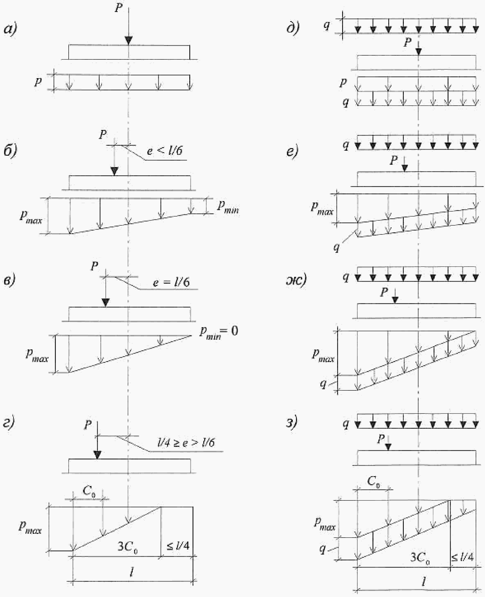

*а - г* - при отсутствии нагрузок на полы;

*д - з* - при сплошной равномерно распределенной нагрузке

интенсивностью *q*; *а* и *д* - при центральной нагрузке;

*б* и *е* - при эксцентриситете нагрузки *e* < *l*/6;

*в* и *ж* - при *e* = *l*/6; *г* и *з* - при *e* > *l*/6

(с частичным отрывом фундамента от грунта)

<!-- figure-caption-deferred -->

**при центральной и внецентренной нагрузках**

Для фундаментов колонн зданий, оборудованных мостовыми кранами грузоподъемностью 75 т и выше, а также для фундаментов колонн открытых крановых эстакад при кранах грузоподъемностью свыше 15 т, для сооружений башенного типа (труб, домен и других), а также для всех видов сооружений при расчетном сопротивлении грунта основания *R* < 150 кПа размеры фундаментов необходимо назначать такими, чтобы эпюра давлений была трапециевидной, с отношением краевых давлений *p*$p_{min}$/*p*$p_{max}$ >= 0,25.

В остальных случаях для фундаментов зданий с мостовыми кранами допускается треугольная эпюра с относительным эксцентриситетом равнодействующей *e*, равным *l*/6.

Для фундаментов бескрановых зданий с подвесным транспортным оборудованием допускается треугольная эпюра давлений с нулевой ординатой на расстоянии не более 1/4 длины подошвы фундамента, что соответствует относительному эксцентриситету равнодействующей *e* не более *l*/4.

Требования, ограничивающие допустимый эксцентриситет, относятся к любым основным сочетаниям нагрузок.

> **Примечание** — При значительных моментных нагрузках с целью уменьшения краевых давлений необходимы дополнительные технические решения, например, применение фундаментов с анкерами.

(примечание в ред. Изменения N 5, утв. Приказом Минстроя России от 07.12.2023 N 884/пр)

При проектировании столбчатых фундаментов опор канатных дорог размеры фундаментов необходимо определять исходя из следующих условий:

- для основных сочетаний нагрузок - трапециевидная эпюра с отношением краевых давлений *p*$p_{min}$/*p*$p_{max}$ >= 0,25;

- для особых сочетаний нагрузок, включающих сейсмические воздействия, допускается треугольная эпюра с нулевой ординатой по краю фундамента.

*(абзац введён Изменением N 4, утв. Приказом Минстроя России от 27.12.2021 N 1022/пр)*

Допускается проектировать фундаменты опор канатных дорог с трапециевидной эпюрой для основных сочетаний нагрузок с отношением краевых давлений 0,1 < *p*$p_{min}$/*p*$p_{max}$ < 0,25 в том случае, если проектом предусматривается ведение постоянных автоматических наблюдений в рамках геотехнического мониторинга согласно требований разделе 12 и приложения Л.

*(абзац введён Изменением N 4, утв. Приказом Минстроя России от 27.12.2021 N 1022/пр)*

В случае невозможности обеспечения требуемого отношения краевых давлений, необходима разработка компенсирующих мероприятий, к которым относятся:

- устройство специальных оттяжек для уравновешивания давлений в краевых частях фундамента опор и приведения их к требуемым нормативным значениям;

- изменение конструкции фундамента опор путем увеличения площади его опирания на грунты основания и снижения неравномерности давления.

*(абзац введён Изменением N 4, утв. Приказом Минстроя России от 27.12.2021 N 1022/пр)*

Указанные компенсирующие мероприятия разрабатываются на основании численных расчетов или математического моделирования взаимодействия проектируемых фундаментов опор с грунтами основания при всех возможных сочетаниях нагрузок и воздействий. Применяемые при расчетном обосновании методики и программные продукты должны быть апробированы.

*(абзац введён Изменением N 4, утв. Приказом Минстроя России от 27.12.2021 N 1022/пр)*

5.6.28 Краевые давления p, кПа, вычисляют по формулам: ^c5-6-28

- при относительном эксцентриситете *e*/*l* <= 1/6

$$p_m=N/A\tag{5.11}$$

- при относительном эксцентриситете *e*/*l* > 1/6

$$P_m=N/A_0\tag{5.12}$$

где *N* - сумма вертикальных нагрузок, действующих на основание, кроме веса фундамента и грунта на его обрезах, и определяемых для случая расчета основания по деформациям, кН;

*A* - площадь подошвы фундамента, м²;

$\gamma_{mt}$ - средневзвешенное значение удельных весов тела фундамента, грунта и пола, расположенных над подошвой фундамента; принимают равным 20 кН/м³;

*d* - толщина фундамента, м;

*M* - момент от равнодействующей всех нагрузок, действующих по подошве фундамента, найденных с учетом заглубления фундамента в грунте и перераспределяющего влияния верхних конструкций или без этого учета, кН·м;

*W* - момент сопротивления площади подошвы фундамента, м³;

*C*$C_0$ - расстояние от точки приложения равнодействующей до края фундамента по его оси, м, вычисляемое по формуле

$$\sigma_p'=N/(h)\tag{5.13}$$

*e* - эксцентриситет нагрузки по подошве фундамента, м, вычисляемый по формуле

$$e=N/(h)\tag{5.14}$$

5.6.29 При наличии моментов M x и M y, действующих в двух направлениях, параллельных осям x и y прямоугольного фундамента, наибольшее давление в угловой точке P max, кПа, вычисляют по формуле ^c5-6-29

$$P_m=N/(A_0)\tag{5.15}$$

где *N*, *A*, $\gamma_{mt}$, *W* - то же, что и в формуле (5.11).

5.6.30 При наличии на полах сплошной равномерно распределенной нагрузки интенсивностью q краевые и средние эпюры давления по подошве следует увеличивать на нагрузку q (см. [7](#^biblio-7)). ^c5-6-30

Нагрузку на полы промышленных зданий *q* допускается принимать равной 20 кПа, если в технологическом задании на проектирование не указывается большее значение этой нагрузки.

*Определение осадки основания фундаментов*

5.6.31 Осадку основания фундамента s, см, с использованием расчетной схемы в виде линейно деформируемого полупространства (см. [5](#^biblio-5)) вычисляют методом послойного суммирования по формуле ^c5-6-31

$$s_d=(q_a-q_b)\cdot a q_h/(E_a F_e+a q_h)\tag{5.16}$$

где $\beta$ - безразмерный коэффициент, равный 0,8;

$\sigma_{zp,i}$ - среднее значение вертикального нормального напряжения (далее - вертикальное напряжение) от внешней нагрузки в *i*-м слое грунта по вертикали, проходящей через центр подошвы фундамента (см. 5.6.32), кПа;

*h*$h_i$ - толщина *i*-го слоя грунта, см, принимаемая не более 0,4 ширины фундамента;

*E*$E_i$ - модуль деформации *i*-го слоя грунта по ветви первичного нагружения, кПа;

$\sigma_{\gamma,i}$ - среднее значение вертикального напряжения в *i*-м слое грунта по вертикали, проходящей через центр подошвы фундамента, от собственного веса выбранного при отрывке котлована грунта (см. 5.6.33), кПа;

*E*$E_{e,i}$ - модуль деформации *i*-го слоя грунта по ветви вторичного нагружения, кПа;

*n* - число слоев, на которые разбита сжимаемая толща основания.

При этом распределение вертикальных напряжений по глубине основания принимают в соответствии со схемой, приведенной на рисунке 5.2.

> **Примечания**

> 1 При отсутствии опытных определений модуля деформации E e,i для сооружений геотехнических категорий 1 и 2 допускается принимать E e,i = 5 E i.

2 Средние значения напряжений $\sigma_{zp,i}$ и $\sigma_{\gamma,i}$ в i -м слое грунта допускается вычислять как полусумму соответствующих напряжений на верхней z i -1 и нижней z i границах слоя. ^ic2-7

3 При возведении сооружения в отрываемом котловане следует различать три следующих значения вертикальных напряжений: $\sigma_{zg}$ - от собственного веса грунта до начала строительства; $\sigma_{zu}$ - после отрывки котлована; $\sigma_z$ - после возведения сооружения. ^ic3-4

4 При определении средней осадки основания фундамента $\bar{s}$ все используемые в [4](#^biblio-4) величины допускается определять для вертикали, проходящей не через центр фундамента, а через точку, лежащую посередине между центром и углом (для прямоугольных фундаментов) или на расстоянии r c = (r 1 + r 2)/2 от центра, где r 1 - внутренний, а r 2 - внешний радиус круглого или кольцевого фундамента (для круглого фундамента r 1 = 0). ^ic4-3

5 Расчет осадок свайных фундаментов выполняется с учетом требований [[СП 24.13330]]. ^ic5-3

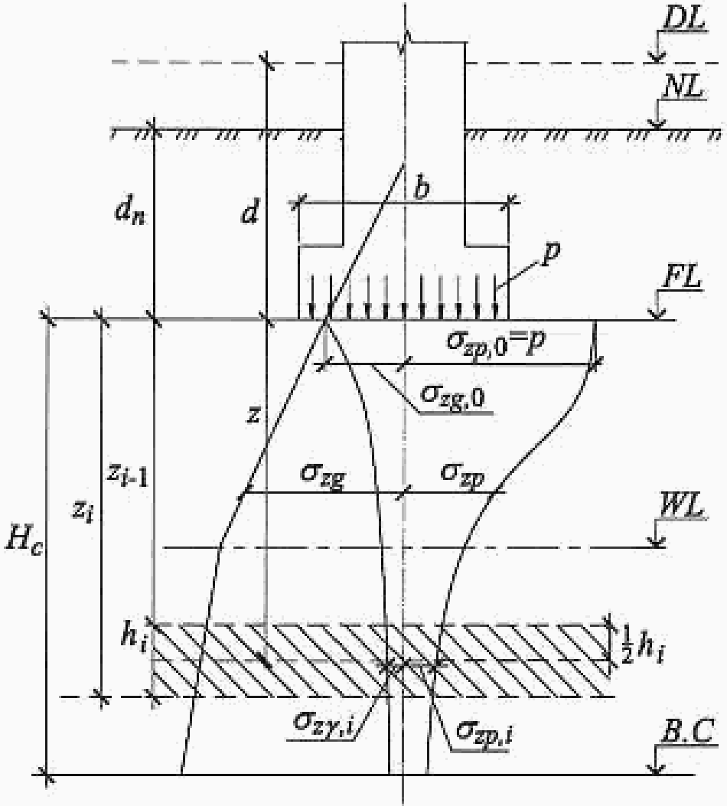

*DL* - отметка планировки; *NL* - отметка поверхности

природного рельефа; *FL* - отметка подошвы фундамента;

*WL* - уровень подземных вод; *B.C* - нижняя граница сжимаемой

толщи; *d* и *d*$d_n$ - глубина заложения фундамента соответственно

от уровня планировки и поверхности природного рельефа;

*b* - ширина фундамента; *p* - среднее давление под подошвой

фундамента; $\sigma_{zg}$ и $\sigma_{zg,0}$ - вертикальное напряжение

от собственного веса грунта на глубине *z* от подошвы

фундамента и на уровне подошвы; $\sigma_{zp}$ и $\sigma_{zp,0}$ - вертикальное

напряжение от внешней нагрузки на глубине *z* от подошвы

фундамента и на уровне подошвы; $\sigma_{\gamma,i}$ - вертикальное

напряжение от собственного веса вынутого в котловане

грунта в середине *i*-го слоя на глубине *z* от подошвы

фундамента; *H*$H_c$ - глубина сжимаемой толщи

(в ред. Изменения N 4, утв. Приказом

Минстроя России от 27.12.2021 N 1022/пр)

<!-- figure-caption-deferred -->

**в линейно-деформируемом полупространстве**

5.6.32 Вертикальные напряжения от внешней нагрузки $\sigma_p'=\sigma'-\sigma_u$ зависят от размеров, формы и глубины заложения фундамента, распределения давления на грунт по его подошве и свойств грунтов основания. Для прямоугольных, круглых и ленточных фундаментов значения $\sigma_{zp}$, кПа, на глубине z от подошвы фундамента по вертикали, проходящей через центр подошвы, вычисляют по формуле ^c5-6-32

$$\sigma_{p}=\sigma p\tag{5.17}$$

где $\alpha$ - коэффициент, принимаемый по таблице 5.8 в зависимости от относительной глубины $\xi$, равной 2*z*/*b*;

*p* - среднее давление под подошвой фундамента, кПа.

5.6.33 Вертикальное напряжение от собственного веса грунта, выбранного при отрывке котлована, на отметке подошвы фундамента $\sigma_\gamma=\sigma_g-\sigma_{au}$, кПа, на глубине z от подошвы прямоугольных, круглых и ленточных фундаментов определяют по формуле ^c5-6-33

*(в ред. Изменения N 2, утв. Приказом Минстроя России от 24.01.2019 N 43/пр)*

$\sigma_\gamma'=\sigma'_g\sigma_p$' (5.18)

где $\alpha$ - то же, что и в 5.6.32;

$\sigma_{zg,0}$ - вертикальное напряжение от собственного веса грунта на отметке подошвы фундамента, кПа (при планировке срезкой $\sigma_{\gamma0}=\gamma'd$, при отсутствии планировки и планировке подсыпкой $\sigma_{\gamma0}=\gamma'd_n$, где $\gamma'$ - удельный вес грунта, кН/м³, расположенного выше подошвы; *d* и *d*$d_n$, м - см. рисунок 5.2).

При этом в расчете $\sigma_{z\gamma}$ используются размеры в плане не фундамента, а котлована.

5.6.34 При расчете осадки фундаментов, возводимых в котлованах глубиной менее 5 м, допускается в [4](#^biblio-4) не учитывать второе слагаемое. ^c5-6-34

5.6.35 Если среднее давление под подошвой фундамента $p\le\sigma'_{z\gamma,0}$, осадку основания фундамента s вычисляют по формуле ^c5-6-35

$$s=\beta\sum_{i=1}^{n}\sigma_{z\gamma,i}h_i/E_{c,i}\tag{5.19}$$

где $\beta$, $\sigma_{zp,i}$, *h*$h_i$, *E*$E_{e,i}$ и *n* - то же, что и в формуле (5.16).

5.6.36 Вертикальные напряжения от внешней нагрузки на глубине z от подошвы фундамента $\sigma_{zp,c}$, кПа, по вертикали, проходящей через угловую точку прямоугольного фундамента, вычисляют по формуле ^c5-6-36

$$\sigma_{qc}=\sigma'p/4\tag{5.20}$$

где $\alpha$ - коэффициент, принимаемый по таблице 5.8 в зависимости от значения $\xi=z/b$;

*p* - то же, что и в формуле (5.17).

5.6.37 Вертикальные напряжения $\sigma_{zp,a}$, кПа, на глубине z от подошвы фундамента по вертикали, проходящей через произвольную точку A (в пределах или за пределами рассматриваемого фундамента с давлением по подошве, равным p), вычисляют алгебраическим суммированием напряжений $\sigma_{zp,cj}$, кПа, в угловых точках четырех фиктивных фундаментов [7](#^biblio-7) по формуле ^c5-6-37

$$\sigma_{qn}=\sum_{j=1}^{4}\sigma_{qnj}\tag{5.21}$$

Таблица 5.8

^t9

<table>
<tr><td rowspan="3">$\xi$</td><td colspan="8">Коэффициент $\alpha$ для фундаментов</td></tr>
<tr><td rowspan="2">круглых</td><td colspan="6">прямоугольных с соотношением сторон $\eta=l/b$, равным</td><td rowspan="2">ленточных $(\eta\ge10)$</td></tr>
<tr><td>1,0</td><td>1,4</td><td>1,8</td><td>2,4</td><td>3,2</td><td>5</td></tr>
<tr><td>0</td><td>1,000</td><td>1,000</td><td>1,000</td><td>1,000</td><td>1,000</td><td>1,000</td><td>1,000</td><td>1,000</td></tr>
<tr><td>0,4</td><td>0,949</td><td>0,960</td><td>0,972</td><td>0,975</td><td>0,976</td><td>0,977</td><td>0,977</td><td>0,977</td></tr>
<tr><td>0,8</td><td>0,756</td><td>0,800</td><td>0,848</td><td>0,866</td><td>0,876</td><td>0,879</td><td>0,881</td><td>0,881</td></tr>
<tr><td>1,2</td><td>0,547</td><td>0,606</td><td>0,682</td><td>0,717</td><td>0,739</td><td>0,749</td><td>0,754</td><td>0,755</td></tr>
<tr><td>1,6</td><td>0,390</td><td>0,449</td><td>0,532</td><td>0,578</td><td>0,612</td><td>0,629</td><td>0,639</td><td>0,642</td></tr>
<tr><td>2,0</td><td>0,285</td><td>0,336</td><td>0,414</td><td>0,463</td><td>0,505</td><td>0,530</td><td>0,545</td><td>0,550</td></tr>
<tr><td>2,4</td><td>0,214</td><td>0,257</td><td>0,325</td><td>0,374</td><td>0,419</td><td>0,449</td><td>0,470</td><td>0,477</td></tr>
<tr><td>2,8</td><td>0,165</td><td>0,201</td><td>0,260</td><td>0,304</td><td>0,349</td><td>0,383</td><td>0,410</td><td>0,420</td></tr>
<tr><td>3,2</td><td>0,130</td><td>0,160</td><td>0,210</td><td>0,251</td><td>0,294</td><td>0,329</td><td>0,360</td><td>0,374</td></tr>
<tr><td>3,6</td><td>0,106</td><td>0,131</td><td>0,173</td><td>0,209</td><td>0,250</td><td>0,285</td><td>0,319</td><td>0,337</td></tr>
<tr><td>4,0</td><td>0,087</td><td>0,108</td><td>0,145</td><td>0,176</td><td>0,214</td><td>0,248</td><td>0,285</td><td>0,306</td></tr>
<tr><td>4,4</td><td>0,073</td><td>0,091</td><td>0,123</td><td>0,150</td><td>0,185</td><td>0,218</td><td>0,255</td><td>0,280</td></tr>
<tr><td>4,8</td><td>0,062</td><td>0,077</td><td>0,105</td><td>0,130</td><td>0,161</td><td>0,192</td><td>0,230</td><td>0,258</td></tr>
<tr><td>5,2</td><td>0,053</td><td>0,067</td><td>0,091</td><td>0,113</td><td>0,141</td><td>0,170</td><td>0,208</td><td>0,239</td></tr>
<tr><td>5,6</td><td>0,046</td><td>0,058</td><td>0,079</td><td>0,099</td><td>0,124</td><td>0,152</td><td>0,189</td><td>0,223</td></tr>
<tr><td>6,0</td><td>0,040</td><td>0,051</td><td>0,070</td><td>0,087</td><td>0,110</td><td>0,136</td><td>0,173</td><td>0,208</td></tr>
<tr><td>6,4</td><td>0,036</td><td>0,045</td><td>0,062</td><td>0,077</td><td>0,099</td><td>0,122</td><td>0,158</td><td>0,196</td></tr>
<tr><td>6,8</td><td>0,031</td><td>0,040</td><td>0,055</td><td>0,069</td><td>0,088</td><td>0,110</td><td>0,145</td><td>0,185</td></tr>
<tr><td>7,2</td><td>0,028</td><td>0,036</td><td>0,049</td><td>0,062</td><td>0,080</td><td>0,100</td><td>0,133</td><td>0,175</td></tr>
<tr><td>7,6</td><td>0,024</td><td>0,032</td><td>0,044</td><td>0,056</td><td>0,072</td><td>0,091</td><td>0,123</td><td>0,166</td></tr>
<tr><td>8,0</td><td>0,022</td><td>0,029</td><td>0,040</td><td>0,051</td><td>0,066</td><td>0,084</td><td>0,113</td><td>0,158</td></tr>
<tr><td>8,4</td><td>0,021</td><td>0,026</td><td>0,037</td><td>0,046</td><td>0,060</td><td>0,077</td><td>0,105</td><td>0,150</td></tr>
<tr><td>8,8</td><td>0,019</td><td>0,024</td><td>0,033</td><td>0,042</td><td>0,055</td><td>0,071</td><td>0,098</td><td>0,143</td></tr>
<tr><td>9,2</td><td>0,017</td><td>0,022</td><td>0,031</td><td>0,039</td><td>0,051</td><td>0,065</td><td>0,091</td><td>0,137</td></tr>
<tr><td>9,6</td><td>0,016</td><td>0,020</td><td>0,028</td><td>0,036</td><td>0,047</td><td>0,060</td><td>0,085</td><td>0,132</td></tr>
<tr><td>10,0</td><td>0,015</td><td>0,019</td><td>0,026</td><td>0,033</td><td>0,043</td><td>0,056</td><td>0,079</td><td>0,126</td></tr>
<tr><td>10,4</td><td>0,014</td><td>0,017</td><td>0,024</td><td>0,031</td><td>0,040</td><td>0,052</td><td>0,074</td><td>0,122</td></tr>
<tr><td>10,8</td><td>0,013</td><td>0,016</td><td>0,022</td><td>0,029</td><td>0,037</td><td>0,049</td><td>0,069</td><td>0,117</td></tr>
<tr><td>11,2</td><td>0,012</td><td>0,015</td><td>0,021</td><td>0,027</td><td>0,035</td><td>0,045</td><td>0,065</td><td>0,113</td></tr>
<tr><td>11,6</td><td>0,011</td><td>0,014</td><td>0,020</td><td>0,025</td><td>0,033</td><td>0,042</td><td>0,061</td><td>0,109</td></tr>
<tr><td>12,0</td><td>0,010</td><td>0,013</td><td>0,018</td><td>0,023</td><td>0,031</td><td>0,040</td><td>0,058</td><td>0,106</td></tr>
<tr><td colspan="9">Примечания 1 В таблице обозначено: *b* - ширина или диаметр фундамента, *l* - длина фундамента. 2 Для фундаментов, имеющих подошву в форме правильного многоугольника с площадью *A,* значения $\alpha$ принимают как для круглых фундаментов радиусом $r'=\sqrt{A/\pi}$. 3 Для промежуточных значений $\xi$ и $\eta$ коэффициенты $\alpha$ определяют интерполяцией.</td></tr>
</table>

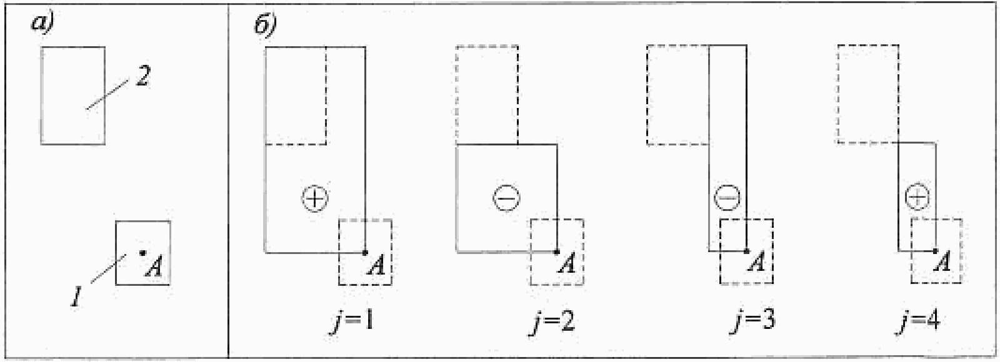

*а* - схема расположения рассчитываемого *1* и влияющего

фундамента *2*; *б* - схема расположения фиктивных

фундаментов с указанием знака напряжений $\sigma_{zp,cj}$

в формуле (5.21) под углом *j*-го фундамента

<!-- figure-caption-deferred -->

**в основании рассчитываемого фундамента с учетом влияния**

**соседнего фундамента методом угловых точек**

5.6.38 Вертикальные напряжения $\sigma_{zp,nf}$, кПа, на глубине z от подошвы фундамента по вертикали, проходящей через центр рассчитываемого фундамента, с учетом влияния соседних фундаментов или нагрузок на прилегающие площади (включая вес обратной засыпки) вычисляют по формуле ^c5-6-38

$$\sigma_{qn}=\sigma'+\sum_{i=1}^{k}\sigma_{qni}\tag{5.22}$$

где $\sigma_{zp}$ - то же, что и в формуле (5.17), кПа;

$\sigma_{zp,0i}$ - вертикальные напряжения от соседнего фундамента или нагрузок;

*k* - число влияющих фундаментов или нагрузок.

5.6.39 При сплошной равномерно распределенной нагрузке на поверхности земли интенсивностью q, кПа (например, от веса планировочной насыпи), значение $\sigma_{zp,nf}$ по [3](#^biblio-3) для любой глубины z вычисляют по формуле $\sigma_p'=\sigma'_p+q$. ^c5-6-39

5.6.40 Вертикальное эффективное напряжение от собственного веса грунта до начала строительства $\sigma_{zg}$, кПа, в точке основания на глубине z от поверхности определяется по формуле ^c5-6-40

$$\sigma_g=\sum h+\theta\tag{5.23}$$

где *n* - номер слоя грунта, в котором расположена рассматриваемая точка;

$\gamma_i$ и *h*$h_i$ - удельный вес, кН/м³, и толщина *i*-го слоя грунта, м, соответственно над рассматриваемой точкой;

*u*(*z*) - природное поровое давление в рассматриваемой точке до начала строительства на глубине *z*, м от поверхности, кПа.

> **Примечание** — Природное поровое давление определяют по результатам полевых измерений и/или методом интерполяции.

(п. 5.6.40 в ред. Изменения N 4, утв. Приказом Минстроя России от 27.12.2021 N 1022/пр)

5.6.41 Нижнюю границу сжимаемой толщи основания принимают на глубине z = H c, где выполняется условие $\sigma_p'=0{,}5\sigma'_{zg}$. При этом глубина сжимаемой толщи должна быть не меньше H min, равной b /2 при b <= 10 м, (4 + 0,1 b) при 10 < b <= 60 м и 10 м при b > 60 м. ^c5-6-41

Если в пределах глубины *H*$H_c$*,* найденной по указанным выше условиям, залегает слой грунта с модулем деформации *E* > 100 МПа, сжимаемую толщу допускается принимать до кровли грунта при его толщине *h* в пределах габаритов здания или сооружения

$|a|+|b|=\sqrt{E_i}$ (5.23а)

где *E*$E_2$ *-* модуль деформации грунта, подстилающего слой грунта с модулем деформации *E*$E_1$*.*

Если найденная по указанным выше условиям нижняя граница сжимаемой толщи находится в слое грунта с модулем деформации *E* <= 7 МПа или такой слой залегает непосредственно ниже глубины *z* = *H*$H_c$*,* то этот слой включают в сжимаемую толщу, а за *H*$H_c$ принимают минимальное из значений, соответствующих подошве слоя или глубине, где выполняется условие $\sigma_p'=0{,}2\sigma'_{zg}$.

(п. 5.6.41 в ред. Изменения N 1, утв. Приказом Минстроя России от 20.11.2018 N 736/пр)

5.6.42 При возведении нового объекта или реконструкции на застроенной территории, в том числе подземных сооружений, возводимых закрытым способом, дополнительные деформации оснований сооружений окружающей застройки от воздействия нового (реконструируемого) сооружения необходимо определять в соответствии с требованиями [6](#^biblio-6). ^c5-6-42

*(в ред. Изменения N 4, утв. Приказом Минстроя России от 27.12.2021 N 1022/пр)*

*Определение крена фундамента*

5.6.43 Крен отдельных фундаментов или сооружений в целом следует вычислять с учетом момента в уровне подошвы фундамента, влияния соседних фундаментов, нагрузок на прилегающие площади и неравномерности сжимаемости основания. ^c5-6-43

При определении кренов фундаментов, кроме того необходимо учитывать заглубление фундамента, жесткость надфундаментной конструкции, а также возможность увеличения эксцентриситета нагрузки из-за наклона фундамента (сооружения).

5.6.44 Крен фундамента i при действии внецентренной нагрузки вычисляют по формуле ^c5-6-44

$$i=D_k\cdot N_e/(a/2)^3\tag{5.24}$$

где

$$D=(1-v^2)/E\tag{5.25}$$

*k*$k_e$ - коэффициент, принимаемый по таблице 5.9;

*E* и $\nu$ - соответственно модуль деформации, кПа, и коэффициент поперечной деформации грунта основания (значение $\nu$ принимают для сооружений геотехнической категории 3 по результатам трехосных испытаний, геотехнических категорий 1 и 2 - по таблице 5.10); в случае неоднородного основания значение *D* принимают средним в пределах сжимаемой толщи в соответствии с требованиями 5.6.45;

*N* - вертикальная составляющая равнодействующей всех нагрузок на фундамент в уровне его подошвы, кН;

*e* - эксцентриситет, м;

*a* - диаметр круглого или сторона прямоугольного фундамента, м, в направлении которой действует момент; для фундамента с подошвой в форме правильного многоугольника площадью *A* принимают $a=2\sqrt{A/\pi}$.

> **Примечание** — Крен фундамента, возникающий в результате неравномерности сжимаемости основания, следует определять численными методами.

Таблица 5.9

^t10

<table>
<tr><td rowspan="2">Форма фундамента и направление действия момента</td><td colspan="7">Коэффициент *k**e* при $\eta=l/b$, равном</td></tr>
<tr><td>1</td><td>1,2</td><td>1,5</td><td>2</td><td>3</td><td>5</td><td>10</td></tr>
<tr><td>Прямоугольный с моментом вдоль большей стороны</td><td>0,50</td><td>0,57</td><td>0,68</td><td>0,82</td><td>1,17</td><td>1,42</td><td>2,00</td></tr>
<tr><td>Прямоугольный с моментом вдоль меньшей стороны</td><td>0,50</td><td>0,43</td><td>0,36</td><td>0,28</td><td>0,20</td><td>0,12</td><td>0,07</td></tr>
<tr><td>Круглый</td><td colspan="7">0,75</td></tr>
</table>

Таблица 5.10

^t11

<table>
<tr><td>Грунты</td><td>Коэффициент поперечной деформации $\nu$</td></tr>
<tr><td>Крупнообломочные грунты</td><td>0,27</td></tr>
<tr><td>Пески и супеси</td><td>0,30 - 0,35</td></tr>
<tr><td>Суглинки</td><td>0,35 - 0,37</td></tr>
<tr><td>Глины при показателе текучести *I**L*:</td><td></td></tr>
<tr><td>*I**L* &lt;= 0</td><td>0,20 - 0,30</td></tr>
<tr><td>0 &lt; *I**L* &lt;= 0,25</td><td>0,30 - 0,38</td></tr>
<tr><td>0,25 &lt; *I**L* &lt;= 1</td><td>0,38 - 0,45</td></tr>
<tr><td colspan="2">Примечание - Меньшие значения $\nu$ применяют при большей плотности грунта.</td></tr>
</table>

5.6.45 Средние (в пределах сжимаемой толщи H c) значения D, кПа -1, вычисляют по формуле ^c5-6-45

$$D=\sum((1-v_i^2)/E_i)\Sigma h\tag{5.26}$$

где *A*$A_i$ - площадь эпюры вертикальных напряжений от единичного давления под подошвой фундамента в пределах *i*-го слоя грунта. Допускается принимать $A=\sigma_p'\cdot h_i$ (см. 5.6.31);

*E*$E_i$, $v_i$, *h*$h_i$ - соответственно модуль деформации, кПа, коэффициент поперечной деформации и толщина *i*-го слоя грунта, м;

*H*$H_c$ - сжимаемая толща, определяемая по 5.6.41, м;

*n* - число слоев, отличающихся значениями *E* и $\nu$ в пределах сжимаемой толщи *H*$H_c$.

*Предельные деформации основания фундаментов*

5.6.46 Предельные значения совместной деформации основания и сооружения s u,s и s u,f устанавливают исходя из необходимости соблюдения: ^c5-6-46

а) технологических или архитектурных требований к деформации сооружения (изменение проектных уровней и положений сооружения в целом, отдельных его элементов и оборудования, включая требования к нормальной работе лифтов, кранового оборудования, подъемных устройств элеваторов и т.п.), *s*$s_{u,s}$;б) требований к прочности, устойчивости и трещиностойкости конструкций, включая общую устойчивость сооружения, *s*$s_{u,f}$.

5.6.47 Предельные значения совместной деформации основания и сооружения по технологическим или архитектурным требованиям s u,s следует устанавливать соответствующими нормами проектирования сооружений, правилами технической эксплуатации оборудования или заданием на проектирование с учетом возможности рихтовки оборудования в процессе эксплуатации. ^c5-6-47

*(в ред. Изменения N 5, утв. Приказом Минстроя России от 07.12.2023 N 884/пр)*

Проверку соблюдения условия *s* <= *s*$s_{u,s}$ проводят при разработке типовых и индивидуальных проектов в составе расчетов сооружения во взаимодействии с основанием после соответствующих расчетов конструкций сооружения по прочности, устойчивости и трещиностойкости.

5.6.48 Предельные значения совместной деформации основания и сооружения по условиям прочности, устойчивости и трещиностойкости конструкций s u,f следует устанавливать при проектировании на основе расчета сооружения во взаимодействии с основанием. ^c5-6-48

Значение *s*$s_{u,f}$ допускается не устанавливать для сооружений, в конструкциях которых не возникают усилия от неравномерных осадок основания (например, различного рода шарнирных систем), а также для сооружений значительной жесткости и прочности (например, зданий башенного типа, домен).

*(в ред. Изменения N 5, утв. Приказом Минстроя России от 07.12.2023 N 884/пр)*

5.6.49 При разработке типовых проектов сооружений на основе значений s u,s и s u,f следует устанавливать следующие критерии допустимости применения этих проектов, упрощающие расчет оснований по деформациям при их привязке к местным грунтовым условиям: ^c5-6-49

а) предельные значения степени изменчивости сжимаемости грунтов $\alpha_E$ основания, соответствующие различным значениям среднего модуля деформации грунтов в пределах плана сооружения $\bar{E}$ или средней осадки основания $\bar{s}$;б) предельную неравномерность деформаций основания $\Delta s_u^0$, соответствующую нулевой жесткости сооружения;в) перечень грунтов с указанием их простейших характеристик свойств, а также характера напластований, при наличии которых не требуется выполнять расчет оснований по деформациям.

> **Примечания**

1 Степень изменчивости сжимаемости основания $\alpha_E$ определяют отношением наибольшего значения приведенного по глубине модуля деформации грунтов основания в пределах плана сооружения к наименьшему значению. ^ic1-6

2 Среднее значение модуля деформации грунтов основания $\bar{E}$ в пределах плана сооружения определяют как средневзвешенное с учетом изменения сжимаемости грунтов по глубине и в плане сооружения. ^ic2-8

5.6.50 Предельные значения деформаций оснований допускается принимать согласно [1](#^biblio-1), если конструкции сооружения не рассчитаны на усилия, возникающие в них при взаимодействии с основанием и в задании на проектирование не установлены значения s u,s (см. [1860?], [3](#^biblio-3)). ^c5-6-50

5.6.51 В проектах сооружений, расчетная осадка которых превышает 10 см, следует предусматривать соответствующий строительный подъем сооружения, а также мероприятия, не допускающие изменений проектных уклонов вводов и выпусков инженерных коммуникаций и обеспечивающие сохранность коммуникаций в местах их пересечения со стенами сооружения. ^c5-6-51

5.6.52 Расчет деформаций основания допускается не выполнять для сооружений геотехнических категорий 1 и 2, если среднее давление под фундаментами проектируемого сооружения не превышает расчетное сопротивление грунтов основания (см. [7](#^biblio-7) - [1](#^biblio-1)) и выполняется одно из следующих условий: ^c5-6-52

а) степень изменчивости сжимаемости основания меньше предельной (по 5.6.49, а);б) инженерно-геологические условия площадки строительства соответствуют области применения типового проекта (по 5.6.49, в);в) грунтовые условия площадки строительства сооружений, перечисленных в таблице 5.11, относятся к одному из вариантов, указанных в этой таблице.

Таблица 5.11

^t12

<table>
<tr><th>Сооружения</th><th>Варианты грунтовых условий</th></tr>
<tr><td>**1 Производственные здания** Одноэтажные с несущими конструкциями, малочувствительными к неравномерным осадкам (например, стальной или железобетонный каркас на отдельных фундаментах при шарнирном опирании ферм, ригелей), и с мостовыми кранами грузоподъемностью до 50 т включительно. Многоэтажные до шести этажей включительно с сеткой колонн не более 6 x 9 м. **2 Жилые и общественные здания** Прямоугольной формы в плане без перепадов по высоте с полным каркасом и бескаркасные с несущими стенами из кирпича, крупных блоков или панелей: а) протяженные многосекционные высотой до 9 этажей включительно; б) несблокированные башенного типа высотой до 14 этажей включительно</td><td>1 Крупнообломочные грунты при содержании заполнителя менее 40%. 2 Пески любой крупности, кроме пылеватых, плотные и средней плотности. 3 Пески любой крупности, только плотные. 4 Пески пылеватые при коэффициенте пористости *e* &lt;= 0,65. 5 Супеси при *e* &lt;= 0,65, суглинки при *e* &lt;= 0,85 и глины при *e* &lt;= 0,95, если диапазон изменения коэффициента пористости этих грунтов на площадке не превышает 0,2, а *I**L* &lt;= 0,5. 6 Пески, кроме пылеватых при *e* &lt;= 0,7 в сочетании с глинистыми грунтами при *e* &lt; 0,5 и *I**L* &lt; 0,5 независимо от порядка их залегания</td></tr>
<tr><td colspan="2">Примечания 1 Таблицей допускается пользоваться для сооружений, в которых площади отдельных фундаментов под несущие конструкции отличаются не более чем в два раза, а также для сооружений иного назначения при аналогичных конструкциях и нагрузках. 2 Таблица не распространяется на производственные здания с нагрузками на полы свыше 20 кПа. 3 Таблица не распространяется на здания, возводимые на подрабатываемых и карстоопасных территориях.</td></tr>
<tr><td colspan="2">(примечание 3 введено Изменением N 5, утв. Приказом Минстроя России от 07.12.2023 N 884/пр)</td></tr>
</table>

## 5.7 Расчет оснований по несущей способности

5.7.1 Целью расчета оснований по несущей способности является обеспечение прочности и устойчивости оснований, а также недопущение сдвига фундамента по подошве и его опрокидывания. Принимаемая в расчете схема разрушения основания (при достижении им предельного состояния) должна быть статически и кинематически возможна для данного воздействия и конструкции фундамента или сооружения. ^c5-7-1

5.7.2 Расчет оснований по несущей способности проводят исходя из условия ^c5-7-2

$$F\le\gamma_cF_n/\gamma_n\tag{5.27}$$

где *F* - расчетная нагрузка на основание, кН, определяемая в соответствии с требованиями 5.2;

*F*$F_u$ - сила предельного сопротивления основания, кН;

$\gamma_c$ - коэффициент условий работы, принимаемый:

для песков, кроме пылеватых............................. 1,0

для песков пылеватых, а также глинистых грунтов

в стабилизированном состоянии........................... 0,9

для глинистых грунтов в нестабилизированном состоянии... 0,85

для скальных грунтов:

невыветрелых и слабовыветрелых.......................... 1,0

выветрелых.............................................. 0,9

сильновыветрелых........................................ 0,8;

$\gamma_n$ - коэффициент надежности по ответственности, принимаемый равным 1,2; 1,15 и 1,10 соответственно для сооружений геотехнических категорий 3, 2 и 1.

> **Примечание** — В случае неоднородных грунтов средневзвешенное значение $\gamma_c$ принимают в пределах толщины b 1 + 0,1 b (но не более 0,5 b) под подошвой фундамента, где b - сторона фундамента, м, в направлении которой предполагается потеря устойчивости, а b 1 = 4 м.

5.7.3 Вертикальную составляющую силу предельного сопротивления основания N u, кН, сложенного скальными грунтами, независимо от глубины заложения фундамента вычисляют по формуле ^c5-7-3

*N*$N_u$ = *R*$R_c$*b*'*l*', (5.28)

где *R*$R_c$ - расчетное значение предела прочности на одноосное сжатие скального грунта, кПа;

*b*' и *l*' - соответственно приведенные ширина и длина фундамента, м, вычисляемые по формулам:

*b'* = *b* - 2*e*$e_b$, *l'* = *l* - 2*e*$e_l$, (5.29)

здесь *e*$e_b$ и *e*$e_l$ - соответственно эксцентриситеты приложения равнодействующей нагрузок в направлении поперечной и продольной осей фундамента, м.

5.7.4 Силу предельного сопротивления основания, сложенного дисперсными грунтами в стабилизированном состоянии, следует определять исходя из условия, что соотношение между нормальными $\sigma$ и касательными $\tau$ напряжениями по всем поверхностям скольжения, соответствующее предельному состоянию основания, подчиняется зависимости ^c5-7-4

$$t=\sigma_g'+\sigma_p'\tag{5.30}$$

где $\varphi_1$ и *c*$c_I$ - соответственно расчетные значения угла внутреннего трения и удельного сцепления грунта (см. 5.3).

5.7.5 Силу предельного сопротивления основания, сложенного медленно уплотняющимися водонасыщенными глинистыми, органоминеральными и органическими грунтами (при коэффициенте водонасыщения S r >= 0,85 и коэффициенте консолидации $c\le0{,}2\gamma'$), следует определять с учетом возможного нестабилизированного состояния грунтов основания за счет избыточного давления в поровой воде u. При этом соотношение между нормальными $\sigma$ и касательными $\tau$ напряжениями принимают по зависимости ^c5-7-5

$$t=\sigma_g'\varphi_c\tag{5.31}$$

где $\sigma_l$ и *u* - значения полного нормального напряжения и порового давления, соответственно;

$\varphi_1$ и *c*$c_I$ - соответствуют стабилизированному состоянию грунтов основания и определяются по результатам консолидированного среза или трехосного сжатия.

Избыточное давление в поровой воде допускается определять методами фильтрационной консолидации грунтов с учетом скорости приложения нагрузки на основание.

Контроль стабилизации грунтов основания, сложенного медленно уплотняющимися грунтами, допускается определять статическим зондированием с использованием зонда с датчиком порового давления по данным зондирования со стабилизацией зонда с одновременным проведением диссипационных испытаний.

*(абзац введён Изменением N 4, утв. Приказом Минстроя России от 27.12.2021 N 1022/пр)*

5.7.6 При проверке несущей способности основания фундамента следует учитывать, что потеря устойчивости может происходить по следующим возможным вариантам (в зависимости от соотношения вертикальной и горизонтальной составляющих равнодействующей, а также значения эксцентриситета): ^c5-7-6

- плоский сдвиг по подошве;

- глубинный сдвиг;

- смешанный сдвиг (плоский сдвиг по части подошвы и глубинный сдвиг по поверхности, охватывающей оставшуюся часть подошвы).

Необходимо учитывать форму фундамента и характер его подошвы, наличие связей фундамента с другими элементами сооружения, напластование и свойства грунтов основания.

Проверку устойчивости основания отдельного фундамента следует проводить с учетом работы основания всего сооружения в целом.

5.7.7 Расчет оснований по несущей способности в общем случае следует выполнять методами теории предельного равновесия, основанными на поиске наиболее опасной поверхности скольжения и обеспечивающими равенство сдвигающих и удерживающих сил. Возможные поверхности скольжения, отделяющие сдвигаемый массив грунта от неподвижного, принимаются круглоцилиндрическими, ломаными, в виде логарифмической спирали и другой формы. ^c5-7-7

*(в ред. Изменения N 5, утв. Приказом Минстроя России от 07.12.2023 N 884/пр)*

5.7.8 При выборе поверхностей скольжения следует учитывать возможность их совпадения с выраженными ослабленными поверхностями в грунтовом массиве (полностью или частично), или их пересечение слоев слабых грунтов; при их выборе необходимо учитывать ограничения на перемещения грунта, исходя из конструктивных особенностей сооружения. При расчете следует учитывать различные сочетания нагрузок, отвечающие как периоду строительства, так и периоду эксплуатации сооружения. ^c5-7-8

*(в ред. Изменения N 5, утв. Приказом Минстроя России от 07.12.2023 N 884/пр)*

5.7.9 Для каждой возможной поверхности скольжения вычисляют предельную нагрузку. При этом используют соотношения между вертикальными, горизонтальными и моментными компонентами нагрузки, которые ожидаются в момент потери устойчивости, и описывают нагрузку одним параметром. Этот параметр определяется из условия равновесия сил (в проекции на заданную ось) или моментов (относительно заданной оси). В качестве предельной нагрузки принимают минимальное значение. ^c5-7-9

5.7.10 В число рассматриваемых при определении равновесия сил включают вертикальные, горизонтальные и моментные нагрузки от сооружения, вес грунта, фильтрационные силы, силы трения и сцепления по выбранной поверхности скольжения, активное и (или) пассивное давление грунта на сдвигаемую часть грунтового массива вне поверхности скольжения. ^c5-7-10

5.7.11 Вертикальную составляющую силы предельного сопротивления N u, кН, основания, сложенного дисперсными грунтами в стабилизированном состоянии, допускается вычислять по формуле (5.32), если фундамент имеет плоскую подошву и грунты основания ниже подошвы однородны до глубины не менее ее ширины, а в случае различной вертикальной пригрузки с разных сторон фундамента интенсивность большей из них не превышает 0,5 R (R - расчетное сопротивление грунта основания, определяемое в соответствии с [7](#^biblio-7) - [1](#^biblio-1)) ^c5-7-11

$$N_\gamma^{h}\tag{5.32}$$

где *b*' и *l*' - то же, что и в формуле (5.29), при этом буквой *b* обозначена сторона фундамента, в направлении которой предполагается потеря устойчивости основания;

$N_\gamma$, *N*$N_q$, *N*$N_c$ - безразмерные коэффициенты несущей способности, определяемые по таблице 5.12 в зависимости от расчетного значения угла внутреннего трения грунта $\varphi_l$ и угла наклона к вертикали $\delta$ равнодействующей внешней нагрузки на основание *F* в уровне подошвы фундамента;

$\gamma_1$ и $\gamma'$ - расчетные значения удельного веса грунтов, кН/м³, находящихся в пределах возможной призмы выпирания соответственно ниже и выше подошвы фундамента (при наличии подземных вод определяют с учетом взвешивающего действия воды для грунтов, находящихся выше водоупора);

*c*$c_I$ - расчетное значение удельного сцепления грунта, кПа;

*d* - глубина заложения фундамента, м (в случае неодинаковой вертикальной пригрузки с разных сторон фундамента принимают значение *d*, соответствующее наименьшей пригрузке, например, со стороны подвала);

$\xi_\gamma$, $\xi_q$, $\xi_c$ _ коэффициенты формы фундамента, вычисляемые по формулам:

$\sigma_p'=\sigma'_g\sigma_p$' (5.33)

здесь $\eta=l/b$;

*l* и *b* - соответственно длина и ширина подошвы фундамента, м, принимаемые в случае внецентренного приложения равнодействующей нагрузки равными приведенным значениям *l*' и *b*', определяемым по формуле (5.29).

Если $\eta=l/b<1$, в формулах (5.33) следует принимать $\eta=1$.

Таблица 5.12

^t13

<table>
<tr><td rowspan="2">Угол внутреннего трения грунта $\varphi_l$, град.</td><td rowspan="2">Обозначение коэффициентов</td><td colspan="26">Коэффициенты несущей способности $N_\gamma$, *N**q* и *N**c* при углах наклона к вертикали равнодействующей внешней нагрузки $\delta$, град, равных</td></tr>
<tr><td>0</td><td colspan="3">5</td><td colspan="3">10</td><td colspan="3">15</td><td colspan="3">20</td><td colspan="3">25</td><td colspan="3">30</td><td colspan="3">35</td><td colspan="3">40</td><td>45</td></tr>
<tr><td rowspan="3">0</td><td>$N_\gamma$</td><td>0</td><td colspan="3" rowspan="3">-</td><td colspan="3" rowspan="3">-</td><td colspan="3" rowspan="3">-</td><td colspan="3" rowspan="3">-</td><td colspan="3" rowspan="3">-</td><td colspan="3" rowspan="3">-</td><td colspan="3" rowspan="3">-</td><td colspan="3" rowspan="3">-</td><td rowspan="3">-</td></tr>
<tr><td>*N**q*</td><td>1,00</td></tr>
<tr><td>*N**c*</td><td>5,14</td></tr>
<tr><td rowspan="3">5</td><td>$N_\gamma$</td><td>0,20</td><td rowspan="3">$\\left\\{ $</td><td>0,05</td><td rowspan="3">$\\} $</td><td colspan="3" rowspan="3">$\delta=4{,}9$</td><td colspan="3" rowspan="3">-</td><td colspan="3" rowspan="3">-</td><td colspan="3" rowspan="3">-</td><td colspan="3" rowspan="3">-</td><td colspan="3" rowspan="3">-</td><td colspan="3" rowspan="3">-</td><td rowspan="3">-</td></tr>
<tr><td>*N**q*</td><td>1,57</td><td>0,26</td></tr>
<tr><td>*N**c*</td><td>6,49</td><td>2,93</td></tr>
<tr><td rowspan="3">10</td><td>$N_\gamma$</td><td>0,60</td><td colspan="3">0,42</td><td rowspan="3">$\\left\\{ $</td><td>0,12</td><td rowspan="3">$\\} $</td><td colspan="3" rowspan="3">$\delta=9{,}8$</td><td colspan="3" rowspan="3">-</td><td colspan="3" rowspan="3">-</td><td colspan="3" rowspan="3">-</td><td colspan="3" rowspan="3">-</td><td colspan="3" rowspan="3">-</td><td rowspan="3">-</td></tr>
<tr><td>*N**q*</td><td>2,47</td><td colspan="3">2,16</td><td>1,60</td></tr>
<tr><td>*N**c*</td><td>8,34</td><td colspan="3">6,57</td><td>3,38</td></tr>
<tr><td rowspan="3">15</td><td>$N_\gamma$</td><td>1,35</td><td colspan="3">1,02</td><td colspan="3">0,61</td><td rowspan="3">$\\left\\{ $</td><td>0,21</td><td rowspan="3">$\\} $</td><td colspan="3" rowspan="3">$\delta=14{,}5$</td><td colspan="3" rowspan="3">-</td><td colspan="3" rowspan="3">-</td><td colspan="3" rowspan="3">-</td><td colspan="3" rowspan="3">-</td><td rowspan="3">-</td></tr>
<tr><td>*N**q*</td><td>3,94</td><td colspan="3">3,45</td><td colspan="3">2,84</td><td>2,06</td></tr>
<tr><td>*N**c*</td><td>10,98</td><td colspan="3">9,13</td><td colspan="3">6,88</td><td>3,94</td></tr>
<tr><td rowspan="3">20</td><td>$N_\gamma$</td><td>2,88</td><td colspan="3">2,18</td><td colspan="3">1,47</td><td colspan="3">0,82</td><td rowspan="3">$\\left\\{ $</td><td>0,36</td><td rowspan="3">$\\} $</td><td colspan="3" rowspan="3">$\delta=18{,}9$</td><td colspan="3" rowspan="3">-</td><td colspan="3" rowspan="3">-</td><td colspan="3" rowspan="3">-</td><td rowspan="3">-</td></tr>
<tr><td>*N**q*</td><td>6,40</td><td colspan="3">5,56</td><td colspan="3">4,64</td><td colspan="3">3,64</td><td>2,69</td></tr>
<tr><td>*N**c*</td><td>14,84</td><td colspan="3">12,53</td><td colspan="3">10,02</td><td colspan="3">7,26</td><td>4,65</td></tr>
<tr><td rowspan="3">25</td><td>$N_\gamma$</td><td>5,87</td><td colspan="3">4,50</td><td colspan="3">3,18</td><td colspan="3">2,00</td><td colspan="3">1,05</td><td rowspan="3">$\\left\\{ $</td><td>0,58</td><td rowspan="3">$\\} $</td><td colspan="3" rowspan="3">$\delta=22{,}9$</td><td colspan="3" rowspan="3">-</td><td colspan="3" rowspan="3">-</td><td rowspan="3">-</td></tr>
<tr><td>*N**q*</td><td>10,66</td><td colspan="3">9,17</td><td colspan="3">7,65</td><td colspan="3">6,13</td><td colspan="3">4,58</td><td>3,60</td></tr>
<tr><td>*N**c*</td><td>20,72</td><td colspan="3">17,53</td><td colspan="3">14,26</td><td colspan="3">10,99</td><td colspan="3">7,68</td><td>5,58</td></tr>
<tr><td rowspan="3">30</td><td>$N_\gamma$</td><td>12,39</td><td colspan="3">9,43</td><td colspan="3">6,72</td><td colspan="3">4,44</td><td colspan="3">2,63</td><td colspan="3">1,29</td><td rowspan="3">$\\left\\{ $</td><td>0,95</td><td rowspan="3">$\\} $</td><td colspan="3" rowspan="3">$\delta=26{,}5$</td><td colspan="3" rowspan="3">-</td><td rowspan="3">-</td></tr>
<tr><td>*N**q*</td><td>18,40</td><td colspan="3">15,63</td><td colspan="3">12,94</td><td colspan="3">10,37</td><td colspan="3">7,96</td><td colspan="3">5,67</td><td>4,95</td></tr>
<tr><td>*N**c*</td><td>30,14</td><td colspan="3">25,34</td><td colspan="3">20,68</td><td colspan="3">16,23</td><td colspan="3">12,05</td><td colspan="3">8,09</td><td>6,85</td></tr>
<tr><td rowspan="3">35</td><td>$N_\gamma$</td><td>27,50</td><td colspan="3">20,58</td><td colspan="3">14,63</td><td colspan="3">9,79</td><td colspan="3">6,08</td><td colspan="3">3,38</td><td rowspan="3">$\\left\\{ $</td><td>1,60</td><td rowspan="3">$\\} $</td><td colspan="3" rowspan="3">$\delta=29{,}8$</td><td colspan="3" rowspan="3">-</td><td rowspan="3">-</td></tr>
<tr><td>*N**q*</td><td>33,30</td><td colspan="3">27,86</td><td colspan="3">22,77</td><td colspan="3">18,12</td><td colspan="3">13,94</td><td colspan="3">10,24</td><td>7,04</td></tr>
<tr><td>*N**c*</td><td>46,12</td><td colspan="3">38,36</td><td colspan="3">31,09</td><td colspan="3">24,45</td><td colspan="3">18,48</td><td colspan="3">13,19</td><td>8,63</td></tr>
<tr><td rowspan="3">40</td><td>$N_\gamma$</td><td>66,01</td><td colspan="3">48,30</td><td colspan="3">33,84</td><td colspan="3">22,56</td><td colspan="3">14,18</td><td colspan="3">8,26</td><td colspan="3">4,30</td><td rowspan="3">$\\left\\{ $</td><td>2,79</td><td rowspan="3">$\\} $</td><td colspan="3" rowspan="3">$\delta=32{,}7$</td><td rowspan="3">-</td></tr>
<tr><td>*N**q*</td><td>64,19</td><td colspan="3">52,71</td><td colspan="3">42,37</td><td colspan="3">33,26</td><td colspan="3">25,39</td><td colspan="3">18,70</td><td colspan="3">13,11</td><td>10,46</td></tr>
<tr><td>*N**c*</td><td>75,31</td><td colspan="3">61,63</td><td colspan="3">49,31</td><td colspan="3">38,45</td><td colspan="3">29,07</td><td colspan="3">21,10</td><td colspan="3">14,43</td><td>11,27</td></tr>
<tr><td rowspan="3">45</td><td>$N_\gamma$</td><td>177,61</td><td colspan="3">126,09</td><td colspan="3">86,20</td><td colspan="3">56,50</td><td colspan="3">32,26</td><td colspan="3">20,73</td><td colspan="3">11,26</td><td colspan="3">5,45</td><td rowspan="3">$\\left\\{ $</td><td>5,22</td><td rowspan="3">$\\} $</td><td rowspan="3">$\delta=35{,}2$</td></tr>
<tr><td>*N**q*</td><td>134,87</td><td colspan="3">108,24</td><td colspan="3">85,16</td><td colspan="3">65,58</td><td colspan="3">49,26</td><td colspan="3">35,93</td><td colspan="3">25,24</td><td colspan="3">16,82</td><td>16,42</td></tr>
<tr><td>*N**c*</td><td>133,87</td><td colspan="3">107,23</td><td colspan="3">84,16</td><td colspan="3">64,58</td><td colspan="3">48,26</td><td colspan="3">34,93</td><td colspan="3">24,24</td><td colspan="3">15,82</td><td>15,82</td></tr>
<tr><td colspan="28">Примечания 1 При промежуточных значениях $\varphi_l$ и $\delta$ коэффициенты $N_\gamma$, *N**q* и *N**c* допускается определять интерполяцией. 2 В фигурных скобках приведены значения коэффициентов несущей способности, соответствующие предельному значению угла наклона нагрузки $\delta'$, исходя из условия (5.35).</td></tr>
</table>

Угол наклона к вертикали равнодействующей внешней нагрузки на основание определяют из условия

$$tgS=F_h/F_v\tag{5.34}$$

где *F*$F_h$ и $F_v$ - соответственно горизонтальная и вертикальная составляющие внешней нагрузки *F* на основание в уровне подошвы фундамента, кН.

Расчет по формуле (5.32) следует выполнять, если соблюдается условие

$$tgS=\sin\varphi\tag{5.35}$$

> **Примечания**

> 1 При использовании [5](#^biblio-5) в случае неодинаковой пригрузки с разных сторон фундамента в составе горизонтальных нагрузок следует учитывать активное давление грунта.

> 2 Если [2270?] не выполняется, следует проводить расчет фундамента на сдвиг по подошве [7](#^biblio-7).

3 При соотношении сторон фундамента $\eta>5$ фундамент рассматривается как ленточный и коэффициенты $\Sigma(\sigma_c+\Sigma\gamma)h$, $\xi_q$ и $\xi_c$ принимают равными единице. ^ic3-5

5.7.12 Расчет фундамента на сдвиг по подошве проводят исходя из условия ^c5-7-12

$$\\frac{\\Sigma(\\sigma_c+\\Sigma\\gamma)h}{h_n}\tag{5.36}$$

где $\Sigma F_{s,a}$ и $\Sigma F_{s,r}$ - суммы проекций на плоскость скольжения соответственно расчетных сдвигающих и удерживающих сил, кН, определяемых с учетом активного и пассивного давлений грунта на боковые грани фундамента, коэффициента трения подошвы фундамента по грунту, а также силы гидростатического противодавления (при уровне подземных вод выше подошвы фундамента);

$\gamma_c$ и $\gamma_n$ - то же, что и в формуле (5.27).

5.7.13 Расчет на плоский сдвиг по подошве проводят при наличии горизонтальной составляющей нагрузки на фундамент в случаях: ^c5-7-13

- нарушения условие (5.35) применимости формулы (5.32);

- наличия слоя грунта с низкими значениями прочностных характеристик непосредственно под подошвой фундамента;

- в случаях, указанных в 5.7.14.

5.7.14 Предельное сопротивление основания (однородного ниже подошвы фундамента до глубины не менее 0,75 b), сложенного медленно уплотняющимися водонасыщенными грунтами [2](#^biblio-2), допускается вычислять следующим образом: ^c5-7-14

а) вертикальную составляющую силы предельного сопротивления основания ленточного фундамента *n*$n_u$, кН/м, по формуле

$$n_d=A/(1-v^2)\tag{5.37}$$

где *b*' - то же, что и в формуле (5.28);

*q* - пригрузка с той стороны фундамента, в направлении которой действует горизонтальная составляющая нагрузки, кПа;

*c*$c_I$ = *c*$c_u$ - то же, что и в (5.7.5);

$\pi=3{,}14$;

$\alpha$ - угол, рад, вычисляемый по формуле

$$a=\sigma_{sl}(l/a)\tag{5.38}$$

здесь *f*$f_h$ - горизонтальная составляющая расчетной нагрузки на 1 м длины фундамента с учетом активного давления грунта, кН/м.

Формулу (5.37) допускается использовать, если выполняется условие

*f*$f_h$ <= *b*'*c*$c_I$; (5.39)

б) силу предельного сопротивления основания прямоугольного (*l* <= 3*b*) фундамента при действии на него вертикальной нагрузки допускается вычислять по формулы (5.32), полагая $\varphi_l=0$, $\xi'=1+0{,}1/\eta$, *c*$c_I$ = *c*$c_u$.

Во всех случаях, если на фундамент действуют горизонтальные нагрузки и основание сложено грунтами в нестабилизированном состоянии, следует проводить расчет фундамента на сдвиг по подошве (5.7.12).

## 5.8 Особенности проектирования оснований при реконструкции сооружений

5.8.1 Техническое задание на проектирование оснований и фундаментов реконструируемых сооружений должно включать в себя сведения о целях реконструкции (надстройка существующего сооружения, пристройка к нему новой части, устройство подземной части, встройка - при поднятии вышерасположенных этажей и устройстве в них промежуточных помещений и т.п.), характеристику здания, уровень ответственности, нагрузки и другие данные, необходимые для проектирования. ^c5-8-1

5.8.2 Исходные данные также должны содержать результаты инженерно-геологических изысканий площадки строительства на момент реконструкции, включающие определение деформационно-прочностных характеристик грунтов, в том числе полученных по испытаниям образцов, отобранных из-под подошвы фундаментов, и данные технического обследования фундаментов и конструкций сооружения. При выполнении технического обследования особое внимание должно уделяться прочностным характеристикам материалов строительных конструкций, наличию в них признаков деформаций, трещин, повреждений и т.п. ^c5-8-2

5.8.3 По полученным данным (см. [2309?]) проверяют фактические и предполагаемые (в зависимости от целей реконструкции) давления на грунты основания под подошвой существующих фундаментов и устанавливают необходимость усиления основания. При выбранных способах усиления основание и конструкции фундаментов должны быть рассчитаны на нагрузки и воздействия, возникающие в период реконструкции сооружения и в процессе его дальнейшей эксплуатации. ^c5-8-3

5.8.4 При проектировании усиления оснований и фундаментов необходимо учитывать состояние конструкций подземной и наземной частей, а также особенности и последовательность производства работ по усилению оснований, фундаментов, подземной и наземной частей сооружения. ^c5-8-4

В проектах реконструируемых сооружений должны приниматься такие решения по устройству или усилению оснований и фундаментов, при которых наиболее полно используются несущая способность существующих конструкций фундаментов и деформационно-прочностные характеристики грунтов.

5.8.5 Проектирование оснований фундаментов реконструируемых сооружений выполняют в соответствии с требованиями [8](#^biblio-8) - [7](#^biblio-7). ^c5-8-5

5.8.6 Расчетное сопротивление грунта основания R реконструируемого сооружения, в т.ч. при его предполагаемой надстройке, вычисляют по [919?] с учетом требований [3](#^biblio-3). При усилении конструкции фундаментов монолитной железобетонной обоймой толщиной до 10 см площадь ее подошвы при расчете основания не учитывают. При толщине обоймы более 10 см ее площадь учитывается в расчете при условии, если она устраивается по предварительно втрамбованной в основание песчано-гравийной смеси. ^c5-8-6

5.8.7 Расчет оснований фундаментов по деформациям для реконструируемых сооружений проводят исходя из условия ^c5-8-7

*s*$s_{ad}$ <= *s*$s_{ad,u}$, (5.40)

где *s*$s_{ad}$ - дополнительная осадка основания фундамента (совместная дополнительная деформация основания и сооружения), определяемая в соответствии с требованиями 5.6 с учетом совокупности техногенных воздействий, связанных с увеличением (снижением) нагрузки на основание, технологии и последовательности строительных работ;

*s*$s_{ad,u}$ - предельное значение дополнительной осадки основания фундамента (предельное значение совместной дополнительной деформации основания и сооружения), устанавливаемое при проектировании реконструкции в соответствии с категорией технического состояния сооружения (приложение Д) и с учетом требований 5.6.46 - 5.6.48.

> **Примечания**

1 Для определения совместной деформации основания и реконструируемого сооружения s ad допускается использовать методы, указанные в [4](#^biblio-4). Дополнительная осадка при реконструкции определяется как разность осадок от нагрузки до реконструкции и с учетом дополнительных нагрузок после реконструкции. При изменении размеров или типа фундаментов при реконструкции (уширение фундаментов, усиления фундаментов сваями и т.п.) дополнительная осадка определяется с использованием численных методов и с применением моделей, удовлетворяющих требованиям [6](#^biblio-6) - [3](#^biblio-3). ^ic1-7

*(в ред. Изменения N 4, утв. Приказом Минстроя России от 27.12.2021 N 1022/пр)*

2 При расчете оснований реконструируемых сооружений по деформациям [7](#^biblio-7) следует выполнять в т.ч. для параметров, указанных в [1](#^biblio-1). ^ic2-9

5.8.8 Предельные значения дополнительных деформаций основания реконструируемого сооружения следует принимать в зависимости от конструктивной схемы и категории технического состояния [1](#^biblio-1) согласно [7260?], если его конструкции не рассчитаны на усилия (в т.ч. с учетом мероприятий по усилению оснований, фундаментов и надземных конструкций), возникающие в них при взаимодействии с основанием при выполнении реконструкции и дальнейшей эксплуатации. ^c5-8-8

5.8.9 При устройстве в реконструируемых сооружениях подземных сооружений (подвалов, тоннелей и т.п.) следует учитывать: дополнительное активное горизонтальное давление, снижение несущей способности основания фундаментов и пр. ^c5-8-9

Если реконструкция вызывает увеличение нагрузок, необходимо оценивать несущую способность основания, особенно при наличии фундаментов с глубиной заложения менее 0,5 м.

5.8.10 При устройстве нового фундамента ниже существующего без дополнительных защитных мероприятий допустимую разность $\Delta h$ отметок заложения соседних одиночных или ленточных фундаментов следует вычислять по [7](#^biblio-7). ^c5-8-10

5.8.11 Проектирование оснований и фундаментов при реконструкции должно вестись с учетом динамических воздействий от оборудования, установленного в зданиях, наземного и подземного транспорта, производства строительных работ и других источников на основе данных инструментальных измерений вибраций (см. [4399?]). ^c5-8-11

5.8.12 При расположении реконструируемого сооружения на застроенной территории следует проводить оценку влияния реконструкции на окружающую застройку в соответствии с требованиями [2](#^biblio-2). ^c5-8-12

5.8.13 В проекте оснований и фундаментов необходимо предусмотреть проведение работ по геотехническому мониторингу реконструируемого сооружения и окружающей застройки, при расположении объекта реконструкции на застроенной территории, в соответствии с требованиями [5159?]. ^c5-8-13

5.8.14 При проектировании усиления оснований и фундаментов при реконструкции, капитальном ремонте, в период эксплуатации или выполнении мероприятий по защите от природных и техногенных воздействий следует выполнять оценку возможных вариантов по критериям конструктивной и экономической эффективности. ^c5-8-14

(п. 5.8.14 введен Изменением N 2, утв. Приказом Минстроя России от 24.01.2019 N 43/пр)

5.8.15 Строительные материалы, используемые при реконструкции, должны соответствовать требованиям по надежности и долговечности строительных конструкций и оснований ([[ГОСТ 27751]]). ^c5-8-15

(п. 5.8.15 введен Изменением N 2, утв. Приказом Минстроя России от 24.01.2019 N 43/пр)

## 5.9 Мероприятия по уменьшению деформаций оснований и влияния их на сооружения

5.9.1 Для выполнения требований расчета оснований по предельным состояниям, кроме возможности изменения размеров фундаментов в плане или глубины их заложения (включая прорезку грунтов со специфическими свойствами), введения дополнительных связей, ограничивающих перемещения фундаментов, применения других типов фундаментов (например, свайных), изменения нагрузок на основание и т.д., следует рассмотреть необходимость применения: ^c5-9-1

*(в ред. Изменения N 5, утв. Приказом Минстроя России от 07.12.2023 N 884/пр)*

а) мероприятий по предохранению грунтов основания от ухудшения их свойств (5.9.2);б) мероприятий, направленных на преобразование строительных свойств грунтов (5.9.3);в) конструктивных мероприятий, уменьшающих чувствительность сооружений к деформациям основания (5.9.4);г) выравнивания сооружений или отдельных их частей: стационарным, а также временным специальным оборудованием; выбуриванием грунта из-под подошвы фундаментов; регулируемым замачиванием;д) фундаментов эффективных форм и конструкций (буробетонных, с промежуточной подготовкой, с уплотнением грунтов основания ступенчато возрастающей нагрузкой, с анкерами, щелевых, в вытрамбованных котлованах, из забивных блоков и т.п.).

*(в ред. Изменения N 1, утв. Приказом Минстроя России от 20.11.2018 N 736/пр)*

При проектировании следует также учитывать возможность регулирования усилий в конструкциях сооружения, возникающих при его взаимодействии с основанием (5.9.5), а также регулирования напряженно-деформированного состояния грунта основания (5.9.7).

Выбор одного или комплекса мероприятий следует проводить с учетом требований 4.2.

5.9.2 К мероприятиям, предохраняющим грунты основания от ухудшения их строительных свойств, относятся: ^c5-9-2

а) водозащитные мероприятия на площадках, сложенных грунтами, чувствительными к изменению влажности (соответствующая компоновка генеральных планов, вертикальная планировка территории, обеспечивающая сток поверхностных вод, устройство дренажей, противофильтрационных завес и экранов, прокладка водопроводов в специальных каналах или размещение их на безопасных расстояниях от сооружений, контроль за возможными утечками воды и т.п.);б) защита грунтов основания от химически активных жидкостей, способных привести к просадкам, набуханию, активизации карстовых явлений, повышению агрессивности подземных вод и т.п.;в) ограничение источников внешних воздействий (например, вибраций);г) предохранительные мероприятия, осуществляемые в процессе строительства сооружений (сохранение природной структуры и влажности грунтов, соблюдение технологии устройства оснований, фундаментов, подземных и наземных конструкций, не допускающей изменения принятой в проекте схемы и скорости передачи нагрузки на основание, особенно при наличии в основании медленно консолидирующихся грунтов и т.п.).д) теплотехнические мероприятия (в том числе с применением эффективной влаго- и биостойкой теплоизоляции). Предел прочности при сжатии вертикальной теплоизоляции со стороны грунта должен составлять не менее 200 кПа при глубине заложения до 3,5 м, не менее 250 кПа при глубине заложения более 3,5 мив горизонтальной части, для цокольной части не менее 100 кПа.

Коэффициент водопоглощения для теплоизоляционных материалов, используемых в конструкции фундаментов, сооружений, при испытании согласно [[ГОСТ 12087]] (метод 2), должен составлять не более 0,7%, в конструкции цокольной части стены не более 1,5%.

Необходимая толщина теплоизоляции определяется согласно [[СП 50.13330]].

*(в ред. Изменения N 5, утв. Приказом Минстроя России от 07.12.2023 N 884/пр)*

5.9.3 Преобразование строительных свойств грунтов основания (устройство искусственных оснований) достигается: ^c5-9-3

а) уплотнением грунтов (трамбованием тяжелыми трамбовками, устройством грунтовых свай, вытрамбовыванием котлованов под фундаменты, предварительным замачиванием грунтов, применением энергии взрыва, глубинным гидровиброуплотнением, вибрационными машинами, катками, уплотнением грунтов основания ступенчато возрастающей нагрузкой сваевдавливающими установками и т.п.);

*(в ред. Изменения N 1, утв. Приказом Минстроя России от 20.11.2018 N 736/пр)*

б) полной или частичной заменой в основании (в плане и по глубине) грунтов с неудовлетворительными свойствами подушками из песка, гравия, щебня, плитами из экструдированного пенополистирола и т.п.;

*(в ред. Изменения N 2, утв. Приказом Минстроя России от 24.01.2019 N 43/пр)*

в) устройством насыпей (отсыпкой или гидронамывом);г) закреплением грунтов (инъекционным, электрохимическим, буросмесительным, термическим и другими способами);д) введением в грунт специальных добавок (например, засолением грунта или пропиткой его нефтепродуктами для ликвидации пучинистых свойств);е) армированием грунта (введением специальных пленок, сеток и т.п.) согласно требованиям 6.10.

5.9.4 Конструктивные мероприятия, уменьшающие чувствительность сооружений к деформациям основания, включают в себя: ^c5-9-4

а) рациональную компоновку сооружения в плане и по высоте;б) повышение прочности и пространственной жесткости сооружений, достигаемое усилением конструкций, особенно конструкций фундаментно-подвальной части, в соответствии с результатами расчета сооружения во взаимодействии с основанием (введение дополнительных связей в каркасных конструкциях, устройство железобетонных или армокаменных поясов, разрезка сооружений на отсеки и т.п.);в) увеличение податливости сооружений (если это позволяют технологические требования) за счет применения гибких или разрезных конструкций;г) устройство приспособлений для выравнивания конструкций сооружения и рихтовки технологического оборудования.

> **Примечания**

1 Габариты приближения к строительным конструкциям подвижного технологического оборудования (мостовых кранов, лифтов и т.п.) должны обеспечивать их нормальную эксплуатацию с учетом возможных деформаций основания. ^ic1-8

2 Для обеспечения нормальной эксплуатации лифтов многоэтажных зданий лифтовые шахты необходимо проектировать с учетом крена сооружения. ^ic2-10

5.9.5 К мероприятиям, позволяющим уменьшить усилия в конструкциях сооружения при взаимодействии его с основанием, относятся: ^c5-9-5

- размещение сооружения на площади застройки с учетом ее инженерно-геологического строения и возможных источников вредных влияний (линз слабых грунтов, старых горных выработок, карстовых полостей, внешних водоводов и т.п.);

- применение соответствующих конструкций фундаментов (фундаментов с малой боковой поверхностью на подрабатываемых территориях, при наличии в основании пучинистых грунтов и др.);

- засыпка пазух и устройство подушек под фундаментами из материалов, обладающих малым сцеплением и трением, применение специальных антифрикционных покрытий, отрывка временных компенсационных траншей для уменьшения усилий от горизонтальных деформаций оснований (например, в районах горных выработок);

- регулирование сроков замоноличивания стыков сборных и сборно-монолитных конструкций;

- обоснованная скорость и последовательность возведения отдельных частей сооружения;

- устройство разделительных стенок между существующими и возводимым сооружением.

5.9.6 Если строительными мерами защиты и инженерной подготовки грунтов основания не исключаются деформации и крены сооружений, превышающие допустимые значения, основания следует проектировать с учетом мероприятий, снижающих осадки и крены, в том числе с применением выравнивания сооружения. ^c5-9-6

*(в ред. Изменения N 5, утв. Приказом Минстроя России от 07.12.2023 N 884/пр)*

При проектировании сооружений с учетом возможности их выравнивания с помощью домкратов, инъекции в грунт расширяющихся растворов, а также при выравнивании эксплуатируемых сооружений следует выполнять расчет конструкций на воздействие неравномерных деформаций основания в стадии выравнивания. Расчетом на выравнивание домкратами необходимо проверить несущую способность и устойчивость конструкций фундаментов подвальной части зданий, воспринимающих сосредоточенную нагрузку от выравнивающих устройств, и глубину заложения фундаментов, включая проверку на устойчивость основания при передаче на него давления от выравнивающих устройств. При выравнивании фундаментов зданий путем инъекции в их основания расширяющихся растворов необходимо проверить несущую способность и устойчивость оснований фундаментов зданий, воспринимающих нагрузку от выравнивающих расширяющихся массивов, и глубину заложения фундаментов, включая проверку на устойчивость основания при передаче на него давления от расширяющихся массивов.

*(в ред. Изменения N 4, утв. Приказом Минстроя России от 27.12.2021 N 1022/пр)*

5.9.7 Регулирование напряженно-деформированного состояния грунта основания с целью уменьшения его деформируемости или повышения несущей способности может быть выполнено созданием принудительной деформации грунтов или приложением постоянно действующего давления в грунте следующими способами: ^c5-9-7

- нагнетанием в ограниченный объем грунта твердеющего, в том числе расширяющегося, раствора (компенсационное нагнетание);

*(в ред. Изменения N 4, утв. Приказом Минстроя России от 27.12.2021 N 1022/пр)*

- путем устройства в грунте пневматических конструкций, способных расширяться в грунте;

- обжатием грунта ступенчато возрастающей нагрузкой сваевдавливающими установками СВУ;

*(абзац введён Изменением N 1, утв. Приказом Минстроя России от 20.11.2018 N 736/пр)*

- обжатием грунта атмосферным давлением (вакуумирование) и др.;

- обжатием грунтов домкратами при выравнивании сооружений.

# 6 Особенности проектирования оснований сооружений, возводимых на специфических грунтах и в особых условиях

## 6.1 Просадочные грунты

6.1.1 Основания, сложенные просадочными грунтами, следует проектировать с учетом их особенности, заключающейся в том, что при повышении влажности выше определенного уровня происходит потеря прочности грунта и они дают дополнительные деформации - просадки - от внешней нагрузки и (или) собственного веса грунта с учетом: ^c6-1-1

специфических характеристик просадочных грунтов;

грунтовых условий; возможных источников повышения влажности (замачивания) грунтов;

видов просадочных деформаций;

дополнительных нагрузок от сил нагружающего (отрицательного) трения на заглубленные части сооружений;

дополнительных деформаций подстилающих непросадочных грунтов.

> **6.1.2** Основными специфическими характеристиками просадочных грунтов являются: ^c6-1-2

относительная деформация просадочности $\varepsilon_{sl}$, т.е. относительное сжатие грунта при повышении его влажности, определяемой по 6.1.17;

начальное просадочное давление *p*$p_{sl}$, представляющее минимальное давление от внешней нагрузки (фундамента, земляного сооружения и т.п.) и собственного веса грунта, при котором начинает возникать просадка грунта в условиях полного водонасыщения (6.1.19);

начальная просадочная влажность *w*$w_{sl}$ - влажность просадочного грунта, при которой с учетом напряженного состояния от внешней нагрузки и его собственного веса начинает проявляться просадка грунта.

6.1.3 Основными характеристиками грунтовых условий площадок, сложенных просадочными грунтами, являются: ^c6-1-3

расчетная или экспериментально полученная величина просадки грунта от собственного веса *s*$s_{sl,g}$ (6.1.22);

просадочная толща *H*$H_{sl}$ (6.1.8);

тип грунтовых условий по просадочности (6.1.9).

6.1.4 При проектировании оснований, сложенных просадочными грунтами, следует учитывать возможность повышения их влажности за счет: ^c6-1-4

а) замачивания грунтов - сверху из внешних источников и (или) снизу при подъеме уровня подземных вод;б) накопления влаги в грунте вследствие инфильтрации поверхностных вод и экранирования поверхности.

6.1.5 При проектировании оснований, сложенных просадочными грунтами, следует учитывать [2444?]: ^c6-1-5

а) просадки от внешней нагрузки *s*$s_{sl,p}$, происходящие в пределах верхней зоны *h*$h_{sl,p}$, измеряемой от подошвы фундамента до глубины, где суммарные вертикальные напряжения от внешней нагрузки и собственного веса грунта равны начальному просадочному давлению или сумма указанных напряжений минимальна (6.1.19);б) просадки от собственного веса грунта *s*$s_{sl,g}$, происходящие в нижней зоне *h*$h_{sl,g}$, начиная с глубины, где суммарные вертикальные напряжения превышают начальное просадочное давление *p*$p_{sl}$ или сумма вертикальных напряжений от собственного веса грунта и внешней нагрузки минимальна, и до нижней границы просадочной толщи;в) неравномерность просадки грунтов $\Delta s_{sl}$;г) горизонтальные перемещения основания *u*$u_{sl}$ в пределах криволинейной части просадочной воронки при просадке грунтов от собственного веса;д) дополнительные осадки подстилающего просадочную толщу грунтов, происходящие за счет повышения напряженного состояния грунтового массива, снижения модуля деформации грунтов при повышении их влажности (6.1.12).

> **Примечание** — Просадку грунтов учитывают при относительной просадочности $\varepsilon_{sl}\ge0{,}01$.

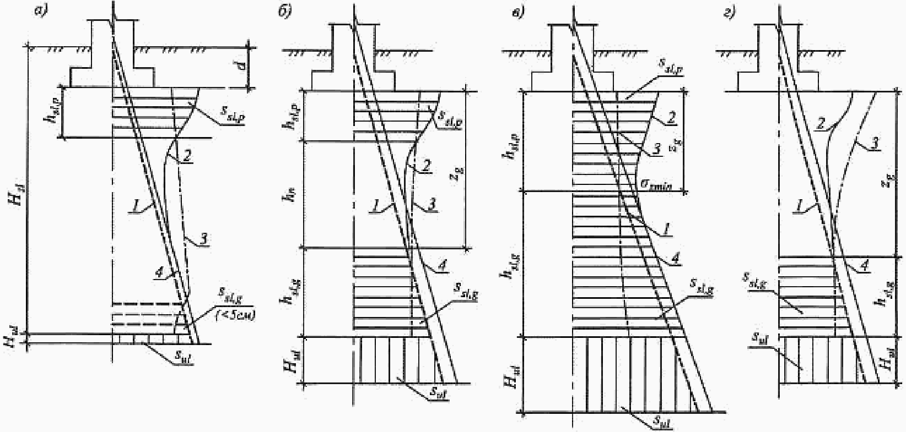

*а* - просадка от собственного веса *s*$s_{sl,g}$ отсутствует

(не превышает 5 см), возможна только просадка от внешней

нагрузки *s*$s_{sl,p}$ в верхней зоне просадки *h*$h_{sl,p}$ (I тип

грунтовых условий); *б*, *в*, *г* - возможна просадка

от собственного веса *s*$s_{sl,g}$ в нижней зоне просадки *h*$h_{sl,g}$,

начиная с глубины *z*$z_g$ (тип грунтовых условий II);

*б* - верхняя и нижняя зоны не сливаются, имеется нейтральная

зона *h*$h_n$; *в* - верхняя и нижняя зоны просадки сливаются;

*г* - просадка от внешней нагрузки отсутствует;

1 - напряжения от собственного веса грунта $\sigma_{zg}$; ^ic1-9

2 - суммарные вертикальные напряжения от внешней нагрузки и ^ic2-11

собственного веса грунта $\sigma_z=\sigma'_p+\sigma'_{zg}$; *3* - изменение с глубиной

начального просадочного давления *p*$p_{sl}$; *4* - дополнительные

вертикальные напряжения $\sigma_{z,wl}$, возникающие за счет повышения

влажности просадочного грунта, уплотнения и т.п.

(в ред. Изменения N 5, утв. Приказом

Минстроя России от 07.12.2023 N 884/пр)

<!-- figure-caption-deferred -->

**грунта в основании фундамента**

6.1.6 Просадки грунтов оснований от собственного веса характеризуются [2471?]: ^c6-1-6

- максимальной, средней просадкой (см. 6.1.12);

- относительной разностью просадок $\Delta s_{sl}/L$ (*L* - расстояние между точками по длине участка или между фундаментами);

- наклоном поверхности основания или креном фундаментов (сооружения) *i*;

- кривизной изгибаемого участка основания и сооружения или выгибом основания *f/L* (*f* - прогиб, *L* - длина однозначного изгибаемого участка основания или сооружения).

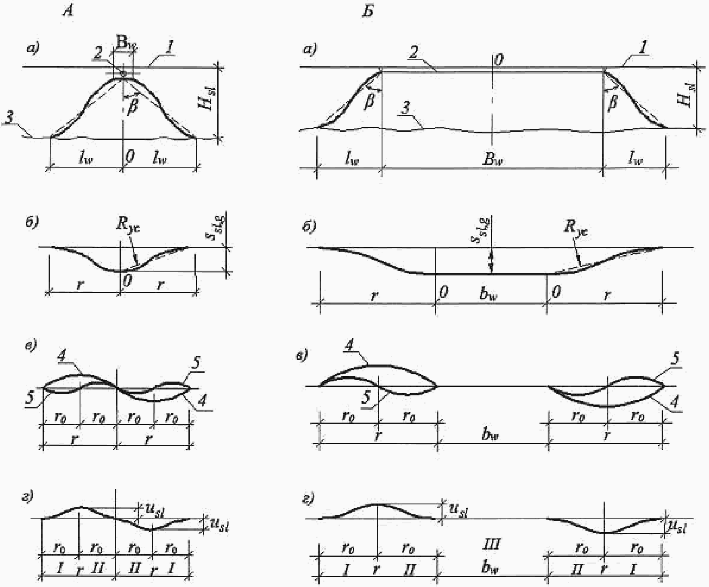

*А* - линейный источник замачивания; *Б* - площадной источник

замачивания; *а* - поперечный разрез зоны увлажнения;

*б* - кривая просадки поверхности грунта; *в* - кривые наклонов

(*4*) и кривизны (*5*) поверхности; *г* - кривые горизонтальных

перемещений поверхности грунта; *1* - положение земной

поверхности; *2* - площадь-источник замачивания; *3* - нижняя

граница растекания воды; *B*$B_w$ - ширина замачиваемой площади;

*b*$b_w$ - ширина горизонтального участка просадки; $\beta$ - угол

растекания воды в стороны; *H*$H_{sl}$ - просадочная толщина;

*r* - расчетная длина криволинейного участка просадки

от собственного веса грунта; *l*$l_w$ - ширина зоны растекания

воды; *u*$u_{sl}$ - горизонтальные перемещения земной поверхности;

*I* и *II* - зоны соответственно разуплотнения и уплотнения

грунта; *r*$r_0$ - ширина зон соответственно

уплотнения и разуплотнения грунта

<!-- figure-caption-deferred -->

**деформаций на поверхности от собственного веса грунта**

6.1.7 Горизонтальные перемещения проявляются в пределах верхней части просадочной толщи на глубину 0,5 H sl и характеризуются развитием двух зон: ^c6-1-7

I - зона горизонтального разуплотнения (растяжения) грунта с возникновением в нем клинообразных просадочных трещин, располагающейся на периферийных частях участков неравномерной просадки грунтов от собственного веса, в пределах которой горизонтальные перемещения направлены в стороны от источников залегания;

II - зона горизонтального уплотнения (сжатия) грунта возникает вблизи и под источником замачивания, в которой горизонтальные перемещения направлены также в сторону источника замачивания.

6.1.8 При определении просадок грунтов s sl,g и s sl,p и их неравномерности следует учитывать: ^c6-1-8

- характер планировки территории (наличие выемок и срезки или насыпей и подсыпок, которые оказывают влияние на напряженное состояние грунтов основания, величину просадочной толщи *h*$h_{sl}$, а также на характер и величину просадок);

- возможные виды, размеры и места расположения источников замачивания грунтов; конструктивные особенности сооружения, в частности наличие тоннелей, подвалов под частью сооружения и т.п.;

- дополнительные нагрузки на глубокие фундаменты, уплотненные и закрепленные массивы от сил негативного трения, возникающих при просадках грунтов от собственного веса.

При замачивании сверху больших площадей (ширина замачиваемой площади *B*$B_w$ равна или превышает просадочную толщу *H*$H_{sl}$) и замачивании снизу за счет подъема уровня подземных вод полностью проявляется просадка от собственного веса *s*$s_{sl,g}$ (6.1.16), а при замачивании сверху малых площадей (*B*$B_w$ < *H*$H_{sl}$) проявляется только ее часть *s'*$s'_{sl,g}$ (6.1.22).

> **Примечание** — При определении неравномерности просадок грунтов следует учитывать возможные наиболее неблагоприятные виды и места расположения источников замачивания по отношению к рассчитываемому фундаменту или сооружению в целом.

6.1.9 Грунтовые условия площадок, сложенных просадочными грунтами, в зависимости от возможности проявления просадки грунтов от собственного веса подразделяют на два типа: ^c6-1-9

тип I - грунтовые условия, в которых возможна в основном просадка грунтов от внешней нагрузки, а просадка грунтов от собственного веса отсутствует или не превышает 5 см;

тип II - грунтовые условия, в которых помимо просадки грунтов от внешней нагрузки возможна их просадка от собственного веса и ее величина превышает 5 см.

6.1.10 При проектировании оснований и сооружений на просадочных грунтах с типом II грунтовых условий необходимо учитывать дополнительные нагрузки P n от сил нагружающего (негативного) трения f n, возникающие при просадках грунтов от собственного веса по боковым поверхностям подземных (заглубленных) частей сооружений и отдельных фундаментов, а также глубоких фундаментов. ^c6-1-10

6.1.11 Дополнительные нагрузки P n от сил нагружающего трения f n по боковой поверхности следует определять: ^c6-1-11

а) для подземных частей сооружений и отдельных фундаментов мелкого заложения по формуле

$$p_n'=N/(h_f)\tag{6.1}$$

где $\gamma_c$ - коэффициент условий работы боковых поверхностей с грунтом, принимаемый равным 0,6;

*h* и *u* - соответственно высота и периметр заглубленной подземной части сооружения или фундамента, м;

*f*$f_n$ - расчетное сопротивление грунта по площади боковой поверхности сооружения или фундамента, принимаемое по [[СП 24.13330]] (со знаком минус) на глубине 0,5*h.*

б) для свайных фундаментов по [[СП 24.13330]].

6.1.12 Расчет деформаций оснований, сложенных просадочными грунтами, проводят в соответствии с требованиями [6](#^biblio-6). ^c6-1-12

Деформации основания определяют суммированием по формулам:

*s* = *s*$s_p$ + *s*$s_{sl,p}$ + *s*$s_{sl,g}$ + *s*$s_{ul}$, (6.2)

$\sigma_p'=\sigma'_g\sigma_p$' (6.3)

где *s*$s_p$ и $\Delta s_p$ - осадки и разность осадок основания от нагрузки фундамента, определяемые без учета просадочных свойств грунтов исходя из деформационных характеристик грунтов при установившейся влажности *w*, принимаемой равной природной влажности если *w* > *w*$w_p$ и влажности на границе раскатывания (пластичности) *w*$w_p$, если *w* < *w*$w_p$;

*s*$s_{sl,p}$ и $\Delta s_{sl,p}$ - просадка и разность просадок основания фундаментов от его нагрузки в верхней зоне *h*$h_{sl,p}$ (см. (рисунок 6.1)), определяемые по формулам (6.4) и (6.5);

*s*$s_{sl,g}$ и $\Delta s_{sl,g}$ - просадка и разность просадок основания от собственного веса грунта в нижней зоне просадки *h*$h_{sl,g}$ (см. рисунок 6.1), вычисляемые по формуле (6.4);

*s*$s_{ul}$ и $\Delta s_{ul}$ - дополнительная осадка и разность осадок подстилающих просадочную толщу грунтов в зоне дополнительного их сжатия *H*$H_{ul}$ (см. рисунок 6.1) определяемые по 6.1.

> **Примечание** — Крен, наклон, прогиб, кривизна и радиус кривизны основания допускается определять по формулам, аналогичным [2500?].

6.1.13 Расчетное сопротивление грунта основания R при возможном замачивании просадочных грунтов [2](#^biblio-2) принимают равным: ^c6-1-13

а) начальному просадочному давлению *p*$p_{sl}$ при устранении возможности просадки грунтов от внешней нагрузки путем снижения давления по подошве фундамента;б) значению, вычисленному по формуле (5.7) с использованием расчетных значений прочностных характеристик ($\varphi_{11}$ и *c*$c_{II}$) в водонасыщенном состоянии.

При невозможности замачивания просадочных грунтов расчетное сопротивление грунта основания *R* вычисляют по формуле (5.7) с использованием прочностных характеристик этих грунтов при установившейся влажности (6.1.25).

При определении расчетного сопротивления грунта основания при возможности его замачивания до полного водонасыщения коэффициенты условий работы $\gamma_{c1}$ и $\gamma_{c2}$ принимают по таблице 5.4 как для глинистых грунтов с показателем текучести *I*$I_L$, соответствующим водонасыщенному состоянию грунта, но не менее 0,5.

6.1.14 Предварительные размеры фундаментов сооружений геотехнических категорий 2 и 3, возводимых на просадочных грунтах, назначают исходя из расчетных сопротивлений основания R 0, принимаемых по [6459?] приложения Б. ^c6-1-14

Указанными значениями *R*$R_0$ допускается пользоваться также для назначения окончательных размеров фундаментов сооружений пониженного уровня ответственности, в которых отсутствует мокрый процесс.

6.1.15 При устранении просадочных свойств грунтов уплотнением или закреплением для сооружений геотехнических категорий 2 и 3 необходимо обеспечить, чтобы полное давление на кровлю подстилающего неуплотненного или незакрепленного слоя не превышало начальное просадочное давление p sl. ^c6-1-15

6.1.16 Просадку грунтов основания s sl,p и s sl,g, см, при увеличении их влажности вследствие замачивания сверху больших площадей, а также замачивания снизу при подъеме уровня подземных вод вычисляют по формуле ^c6-1-16

$$s_{qn(d)}=\sum h_i/k_{ij}\tag{6.4}$$

где $\varepsilon_{sl,i}$ - относительная просадочность *i*-го слоя грунта, определяемая в соответствии с 6.1.6;

*h*$h_i$ - толщина *i*-го слоя, см;

*k*$k_{sl,i}$ - коэффициент, определяемый в соответствии с 6.1.18;

*n* - число слоев, на которое разбита зона просадки *h*$h_{sl}$, принимаемое в соответствии с 6.1.20.

6.1.17 Относительную просадочность грунта $\varepsilon_{sl}$ вычисляют на основе испытаний грунта в лабораторных условиях по формуле ^c6-1-17

$$\varepsilon_{qi}=(h_p-h_{kp})/h_g\tag{6.5}$$

где *h*$h_{n,p}$ и *h*$h_{sat,p}$ - высота образца, см, соответственно природной влажности и после его полного водонасыщения (*w* = *w*$w_{sat}$) при давлении *p*, кПа, равном вертикальному напряжению на рассматриваемой глубине от внешней нагрузки и собственного веса грунта $p=\sigma'_p+\sigma'_{zg}$ при определении просадки грунта в верхней зоне *h*$h_{sl,p}$ просадки; при определении просадки грунта в нижней зоне *h*$h_{sl,g}$ просадки грунта от собственного веса (см. рисунок 6.1);

*h*$h_{n,g}$ - высота, см, того же образца природной влажности при $p=\sigma'_{zg}$.

Значение $\varepsilon_{sl}$ может быть определено также в полевых условиях путем замачивания опытных котлованов и по испытаниям грунта штампом с замачиванием.

6.1.18 Коэффициент k sl,i, входящий в [2520?], при ширине фундамента b >= 12 м принимают равным единице для всех слоев грунта в пределах зоны просадки; при b <= 3 м h sl,p вычисляют по формуле ^c6-1-18
> [!note] Формула — по официальному тексту документа

*k*$k_{sl,i}$ = 0,5 + 1,5(*p* - *p*$p_{sl,i}$)/*p*$p_0$, (6.6)

где *p* - среднее давление под подошвой фундамента, кПа;

*p*$p_{sl,i}$ - начальное просадочное давление грунта *i*-го слоя, кПа, определяемое в соответствии с 6.1.17;

*p*$p_0$ - давление, равное 100 кПа.

При 3 м < *b* < 12 м *k*$k_{sl,i}$ определяют интерполяцией.

При определении просадки грунта от собственного веса следует принимать *k*$k_{sl}$ = 1 при *H*$H_{sl}$ <= 15 м и *k*$k_{sl}$ = 1,25 при *H*$H_{sl}$ >= 20 м, при промежуточных значениях *H*$H_{sl}$ коэффициент *k*$k_{sl}$ определяют интерполяцией.

6.1.19 За начальное просадочное давление p sl принимают давление, соответствующее: ^c6-1-19

- при лабораторных испытаниях грунтов в компрессионном приборе - давлению, при котором относительная просадочность $\varepsilon_{sl}$ равна 0,01;

- при полевых испытаниях штампами предварительно замоченных грунтов - давлению, равному точке перегиба на графике "нагрузка-осадка";

- при замачивании грунтов в опытных котлованах - вертикальному напряжению от собственного веса грунта на глубине, начиная с которой происходит просадка грунта от собственного веса.

6.1.20 Толщину зоны просадки грунта h sl принимают равной [2444?]: ^c6-1-20

- толщине верхней зоны просадочной толщи *h*$h_{sl,p}$ при определении просадки грунта от внешней нагрузки *s*$s_{sl,p}$ (6.1.5), при этом нижняя граница указанной зоны соответствует глубине, где $\sigma'_p+\sigma'_{zg}-0$ (рисунок 6.1 а, б) или глубине, где значение $\sigma_z$ минимально, если $\sigma_{z,min}>p_{sl}$ ((рисунок 6.1), в);

- толщине нижней зоны просадочной толщи *h*$h_{sl,g}$ при определении просадки грунта от собственного веса *s*$s_{sl,g}$, (6.1.5), т.е. начиная с глубины *z*$z_g$, где $\sigma_z=p_{sl}$, или значение $\sigma_z$ минимально, если $\sigma_{z,min}>p_{sl}$, и до нижней границы просадочной толщи.

6.1.21 При отсутствии опытных определений начального просадочного давления суммирование по [8](#^biblio-8) проводят до глубины, на которой относительная просадочность $\varepsilon_{sl}$ от давления p l равна 0,01. ^c6-1-21

6.1.22 Для расчета просадок грунта от нагрузки фундамента s sl,p и в нижней зоне от собственного веса грунта s sl,g просадочную толщу разбивают на отдельные слои толщиной h i в соответствии с литологическим разрезом и горизонтами определения $\varepsilon_{sl,i}$. При этом толщина слоев должна быть не более 2 м, а изменение суммарного напряжения в пределах каждого слоя не должно превышать 200 кПа. ^c6-1-22

При расчете просадок *s*$s_{sl,p}$ и *s*$s_{sl,q}$ по формуле (6.3) учитывают только слои грунта, относительная просадочность которых при фактическом напряжении от $\sigma_z=\sigma'_p+\sigma'_{zg}$ или только от $\sigma_{zq}$ (см. рисунок 6.1) $\varepsilon_{sl}\ge0{,}01$. Слои, в которых $\varepsilon_{sl}<0{,}01$, исключают из рассмотрения.

Возможную просадку грунта от собственного веса *s'*$s'_{sl,g}$, см, при замачивании из точечных или линейных источников (см. 6.1.8) сверху малых площадей (ширина замачиваемой площади *B*$B_w$ меньше размера просадочной толщи *H*$H_{sl}$) вычисляют по формуле

$$s'=\Sigma(W+W')h\tag{6.7}$$

где *s*$s_{sl,g}$ - максимальное значение просадки грунта от собственного веса, см, определяемое в соответствии с 6.1.15.

6.1.23 Дополнительная осадка s ul подстилающих просадочную толщу в пределах зоны дополнительного сжатия H ul вычисляют по формуле ^c6-1-23

$$\Sigma((q_i+\sigma_i)/E_i)h\tag{6.8}$$

где $\sigma_{z\gamma,i}$ и $\sigma'_{z\gamma,i}$ - средние значения вертикальных напряжений в *i*-м слое грунта от его собственного веса соответственно при природной влажности и полном водонасыщении, зона дополнительного сжатия *H*$H_{ul}$ подстилающих грунтов;

*h*$h_{ul,i}$ - толщина *i*-го слоя грунта, на которые разделена зона *H*$H_{ul}$;

$\sigma'_{ul,zy,i}$ - среднее значение дополнительного вертикального напряжения в *i*-м слое подстилающего грунта при полном водонасыщении при суммарных давлениях от собственного веса грунта, веса планировочной насыпи; веса сооружения с учетом нагрузок на полы по грунту; технологического оборудования и т.п., а также увеличение собственного веса просадочного грунта при уплотнении, закреплении, повышении его влажности до полного водонасыщения и влияния других факторов;

*E*$E_0$*,i* и $E_{\omega,i}$ - модули деформаций *i*-го слоя подстилающего грунта при полном водонасыщении и природной влажности.

6.1.24 Нижнюю границу зоны дополнительного сжатия H ul подстилающих просадочную толщу грунтов принимают на глубине z = H ul, где выполняется одно из следующих условий: ^c6-1-24

- модуль деформации подстилающих водонасыщенных грунтов *E* >= 30 МПа, или влажных *E* >= 25 МПа при условии снижения его при полном водонасыщении не менее *E*$E_w$ = 20 МПа;

- дополнительные вертикальные напряжения $\sigma'_{qa}=0{,}1\sigma'_q$, где $\sigma_{zq}$ вычисляют по формуле (5.23).

6.1.25 При проектировании оснований, сложенных просадочными грунтами, в случае их возможного замачивания [3](#^biblio-3) следует предусматривать мероприятия, исключающие или снижающие до допустимых пределов просадки оснований и (или) уменьшающие их влияние на эксплуатационную надежность сооружений в соответствии с [1](#^biblio-1) и [7](#^biblio-7). ^c6-1-25

6.1.26 При возможности замачивания грунтов основания [2](#^biblio-2) следует предусматривать одно из следующих мероприятий: ^c6-1-26

а) устранение просадочных свойств грунтов в пределах всей просадочной толщи или только в ее верхней части 6.1.27;б) прорезку просадочной толщи фундаментами, в том числе свайными и массивами из закрепленного грунта (6.1.27);в) комплекс мероприятий, включающий частичное устранение просадочных свойств грунтов, водозащитные и конструктивные мероприятия 5.9.

В грунтовых условиях типа II наряду с устранением просадочных свойств грунтов или прорезкой просадочной толщи фундаментами глубокого заложения следует предусматривать водозащитные мероприятия, а также соответствующие компоновку генплана и вертикальную планировку застраиваемого участка.

Выбор мероприятий следует проводить с учетом типа грунтовых условий, вида возможного замачивания, расчетной просадки, взаимосвязи проектируемых сооружений с сооружениями окружающей застройки в соответствии с требованиями разделов 4 и раздел 9.

6.1.27 Устранение просадочных свойств грунтов достигается: ^c6-1-27

а) в пределах верхней зоны просадки или ее части - уплотнением тяжелыми трамбовками, устройством грунтовых подушек, вытрамбовыванием котлованов, в том числе с устройством уширения из жесткого материала (бетона, щебня, песчано-гравийной смеси), уплотнением ступенчато возрастающей нагрузкой сваевдавливающими установками СВУ, химическим или термическим закреплением;

*(в ред. Изменения N 1, утв. Приказом Минстроя России от 20.11.2018 N 736/пр)*

б) в пределах всей просадочной толщи - глубинным уплотнением, пробивкой скважин с заполнением их уплотненным глинистым грунтом с предварительным замачиванием грунтов основания, в том числе с глубинными взрывами, уплотнением ступенчато возрастающей нагрузкой сваевдавливающими установками после предварительного замачивания грунтов основания, химическим или термическим закреплением, а также разгрузкой грунтового массива путем частичной срезки грунта при выполнении вертикальной планировки или устройства под сооружения глубоких подвалов, подземных этажей.

*(в ред. Изменения N 1, утв. Приказом Минстроя России от 20.11.2018 N 736/пр)*

6.1.28 При проектировании заглубленных фундаментов следует учитывать: ^c6-1-28

- в грунтовых условиях типа I - сопротивление грунта по боковой поверхности фундаментов при выполнении их в вытрамбованных котлованах из забивных блоков, в глубоких щелях, буровых скважинах, а также для фундаментов в опалубке, в случаях выполнения обратной засыпки котлованов по требованиям [[СП 45.13330]];

- грунтовых условиях типа II - нагружающее (негативное) трение грунта по боковой поверхности фундаментов, возникающее при просадке грунтов от собственного веса.

Снижение нагружающего (негативного) трения по боковой поверхности фундаментов достигается путем устройства швов скольжения из эластичных материалов, совмещая их с гидроизоляцией, либо глубоких прорезей, заполненных глинистым грунтом (типа пасты) с числом пластичности *I*$I_p$ > 0,17.

6.1.29 Проектирование конструкций сооружений необходимо выполнять с учетом совместного расчета их с основанием по [[СП 21.13330]]. ^c6-1-29

## 6.2 Набухающие грунты

6.2.1 Основания, сложенные набухающими грунтами, следует проектировать с учетом способности таких грунтов при повышении влажности увеличиваться в объеме - набухать. При последующем понижении влажности у набухающих грунтов происходит обратный процесс - усадка. ^c6-2-1

Необходимо учитывать, что способностью набухать при увеличении влажности обладают некоторые виды шлаков (например, шлаки электроплавильных производств), а также обычные глинистые грунты (не набухающие при увеличении влажности), если они замачиваются химическими отходами производств (например, растворами серной кислоты).

Возможность набухания шлаков при их увлажнении и глинистых грунтов при замачивании химическими отходами производств устанавливают опытным путем в лабораторных или полевых условиях.

6.2.2 Набухающие грунты характеризуются относительным набуханием при заданном давлении $\varepsilon_{sw}$, давлением набухания p sw, влажностью набухания w sw и относительной усадкой при высыхании $\varepsilon_{sh}$. ^c6-2-2

Указанные характеристики определяют в соответствии с 6.2.7, 6.2.10 и 6.2.16.

6.2.3 При проектировании оснований, сложенных набухающими грунтами, следует учитывать возможность: ^c6-2-3

- набухания грунтов за счет подъема уровня подземных вод или инфильтрации - увлажнения грунтов производственными или поверхностными водами;

- набухания грунтов за счет накопления влаги под сооружениями в ограниченной по глубине зоне вследствие нарушения природных условий испарения при застройке и асфальтировании территории (экранирование поверхности);

- набухания и усадки грунта в верхней части зоны аэрации - за счет изменения водно-теплового режима (сезонных климатических факторов);

- усадки за счет высыхания от воздействия тепловых источников.

> **Примечание** — При проектировании заглубленных частей сооружений необходимо учитывать горизонтальное давление, возникающее при набухании и усадке грунтов.

6.2.4 Горизонтальное давление p h, кПа, вычисляют по формуле ^c6-2-4

$$p_h=kp\tag{6.9}$$

где $\gamma_c$ - коэффициент условий работы, равный 0,85;

*k*$k_{sw}$ - коэффициент, зависящий от интенсивности набухания и принимаемый по таблице 6.1;

*p*$p_{max,h}$ - максимальное горизонтальное давление, определяемое в лабораторных условиях, кПа.

Таблица 6.1

^t14

<table>
<tr><th>Интенсивность набухания за 1 сут, %</th><th>0,1</th><th>0,2</th><th>0,3</th><th>0,4</th><th>0,5</th><th>0,6</th><th>0,7</th></tr>
<tr><td>*k**sw*</td><td>1,40</td><td>1,25</td><td>1,12</td><td>1,05</td><td>1,02</td><td>1,01</td><td>1,00</td></tr>
</table>

6.2.5 Основания, сложенные набухающими грунтами, следует рассчитывать в соответствии с требованиями [6](#^biblio-6). ^c6-2-5

Деформации основания в результате набухания или усадки грунта следует определять путем суммирования деформаций отдельных слоев основания согласно 6.2.9 и 6.2.15.

При определении деформаций основания осадка его от внешней нагрузки и возможная осадка от уменьшения влажности набухающего грунта должны суммироваться. Подъем основания в результате набухания грунта определяют в предположении, что осадки основания от внешней нагрузки стабилизировались.

Предельные значения деформаций основания фундаментов, вызываемых набуханием (усадкой) грунтов, допускается принимать в соответствии с требованиями приложению Г с учетом требований 5.6.50.

6.2.6 При расчете оснований из набухающих грунтов следует применять характеристики грунтов при их природной плотности и влажности. При расчете оснований из набухающих грунтов после их предварительного замачивания используют характеристики грунта в замоченном состоянии. ^c6-2-6

Расчетное сопротивление грунтов оснований, сложенных набухающими грунтами, вычисляют по формуле (5.7). При этом необходимо учитывать допустимость его повышения согласно требованиям 5.6.24, что будет способствовать уменьшению подъема фундамента при набухании грунта.

6.2.7 Относительное набухание $\varepsilon_{sw}$, давление набухания p sw и относительную усадку $\varepsilon_{sh}$ определяют по результатам лабораторных испытаний с учетом указанных в [3](#^biblio-3) причин набухания или усадки. Эти характеристики получают также по данным полевых испытаний грунтов штампом. ^c6-2-7

*(в ред. Изменения N 5, утв. Приказом Минстроя России от 07.12.2023 N 884/пр)*

6.2.8 Нормативные значения характеристик $\varepsilon_{sw}$ и $\varepsilon_{sh}$ набухающих грунтов вычисляют как средние значения результатов их определений. Расчетные значения этих характеристик допускается принимать равными нормативным $(\gamma_g=1)$. ^c6-2-8

6.2.9 Подъем основания при набухании грунта h sw, см, вычисляют по формуле ^c6-2-9

$$h_n=\sum_{i=1}^{n}h_{\omega i}/k_{\omega i}\tag{6.10}$$

где $\varepsilon_{sw,i}$ - относительное набухание грунта *i*-го слоя, определяемое в соответствии с 6.2.10;

*h*$h_i$ - толщина *i*-го слоя грунта, см;

*k*$k_{sw,i}$ - коэффициент, определяемый в соответствии с 6.2.12;

*n* - число слоев, на которое разбита зона набухания грунта.

6.2.10 Относительное набухание грунта при инфильтрации влаги вычисляют по формуле ^c6-2-10

$\\varepsilon_{sw}=(h_{st}-h_n)/h_n$

где *h*$h_n$ - высота образца, см, природной влажности и плотности, обжатого без возможности бокового расширения давлением *p*, равным суммарному вертикальному напряжению на рассматриваемой глубине (значение определяют в соответствии с 6.2.13);

*h*$h_{sat}$ - высота того же образца, см, после замачивания до полного водонасыщения и обжатого в тех же условиях.

По результатам испытаний образцов грунта при различном давлении строят зависимости $\varepsilon_{sw}=f(p)$ и *w*$w_{sw}$ = *f*(*p*) и определяют давление набухания *p*$p_{sw}$ соответствующее $\varepsilon_{sw}=0$.

При экранировании поверхности и изменении водно-теплового режима относительное набухание $\varepsilon_{sw}$ вычисляют по формуле

$$s'=\Sigma(W+W')h\tag{6.11}$$

где *k* - коэффициент, определяемый опытным путем (при отсутствии опытных данных принимают равным 2);

*w*$w_{eq}$ - конечная (установившаяся) влажность грунта, доли единицы, определяемая по 6.2.11;

*w*$w_0$ и *e*$e_0$ - соответственно начальные значения влажности и коэффициента пористости грунта, доли единицы.

6.2.11 Значение w eq i -го слоя при экранировании поверхности определяют по экспериментальной зависимости влажности набухания от нагрузки w sw = f (p) при давлении p i, кПа, вычисляемом по формуле ^c6-2-11

$$p_h'=N/(A_0)\tag{6.12}$$

где $\gamma_w$ - удельный вес воды, кН/м³;

*z* - расстояние от экранируемой поверхности до уровня подземных вод;

*z*$z_i$ - глубина залегания рассматриваемого слоя, м;

$\sigma_{tot,i}$ - суммарное напряжение в рассматриваемом *i*-м слое, кПа;

*(в ред. Изменения N 4, утв. Приказом Минстроя России от 27.12.2021 N 1022/пр)*

$\gamma_i$ - удельный вес грунта *i*-го слоя, кН/м³.

Значение (*w*$w_{eq}$ - *w*$w_0$) в формуле (6.11) при изменении водно-теплового режима определяют как разность между наибольшим (в период максимального увлажнения) и наименьшим (в период максимального подсыхания) значениями влажности грунта. Коэффициент пористости в этом случае принимают для влажности грунта, отвечающей периоду максимального подсыхания. Профиль влажности массива для случая максимального увлажнения и подсыхания определяют экспериментальным путем в полевых условиях.

6.2.12 Коэффициент k sw, входящий в [2](#^biblio-2), в зависимости от суммарного вертикального напряжения $\sigma_{z,tot}$ на рассматриваемой глубине принимают равным 0,8 при $\sigma_{qi}=0{,}1A$ и k sw = 0,6 при $\sigma_{qi}=0{,}1A$, а при промежуточных значениях определяют интерполяцией. ^c6-2-12

6.2.13 Суммарное вертикальное напряжение $\sigma_{z,tot}$, кПа, на глубине z от подошвы фундамента (см. [5](#^biblio-5)) вычисляют по формуле ^c6-2-13

$$\\sigma'_{ad}=\\sigma'_p+\\sigma'_{zg}\tag{6.13}$$

где $\sigma_{zp}$, $\sigma_{zg}$ - вертикальные напряжения соответственно от нагрузки фундамента и от собственного веса грунта, кПа;

$\sigma_{z,ad}$ - дополнительное вертикальное давление, кПа, вызванное влиянием веса неувлажненной части массива грунта за пределами площади замачивания, вычисляемое по формуле

$$\sigma'_{ad}=k(dz)\tag{6.14}$$

здесь *k*$k_g$ - коэффициент, принимаемый по таблице 6.2;

$\gamma$ - удельный вес грунта, кН/м³;

(*d* + *z*) - см. рисунок 6.3.

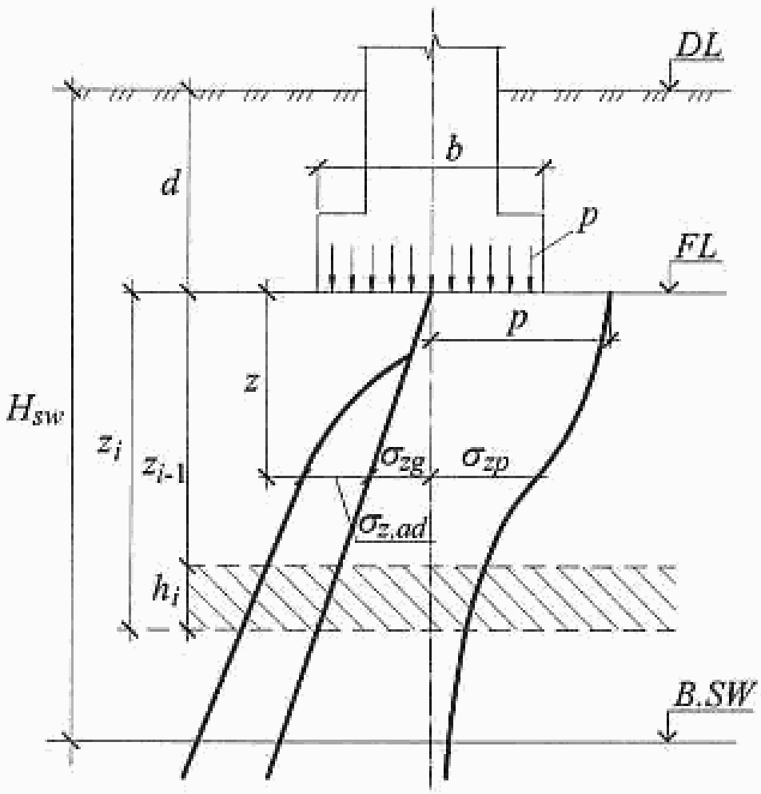

<!-- figure-caption-deferred -->

**основания при набухании грунта**

Таблица 6.2

^t15

<table>
<tr><td rowspan="2">(*d* + *z*)/*B**w*</td><td colspan="5">Коэффициент *k**g* при отношении длины к ширине замачиваемой площади *L**w*/*B**w*, равном</td></tr>
<tr><td>1</td><td>2</td><td>3</td><td>4</td><td>5</td></tr>
<tr><td>0,5</td><td>0</td><td>0</td><td>0</td><td>0</td><td>0</td></tr>
<tr><td>1</td><td>0,58</td><td>0,50</td><td>0,43</td><td>0,36</td><td>0,29</td></tr>
<tr><td>2</td><td>0,81</td><td>0,70</td><td>0,61</td><td>0,50</td><td>0,40</td></tr>
<tr><td>3</td><td>0,94</td><td>0,82</td><td>0,71</td><td>0,59</td><td>0,47</td></tr>
<tr><td>4</td><td>1,02</td><td>0,89</td><td>0,77</td><td>0,64</td><td>0,53</td></tr>
<tr><td>5</td><td>1,07</td><td>0,94</td><td>0,82</td><td>0,69</td><td>0,77</td></tr>
</table>

6.2.14 Нижнюю границу зоны набухания H sw, см [2685?]: ^c6-2-14

а) при инфильтрации влаги принимают на глубине, где суммарное вертикальное напряжение $\sigma_{z,tot}$ (6.2.13) равно давлению набухания *p*$p_{sw}$;б) при экранировании поверхности и изменении водно-теплового режима определяют опытным путем (при отсутствии опытных данных принимают равной 5 м).

При наличии подземных вод нижнюю границу зоны набухания принимают на 3 м выше начального уровня подземных вод, но не ниже установленного в перечислении а).

6.2.15 Осадку основания в результате высыхания, набухшего грунта s sh, см, вычисляют по формуле ^c6-2-15

$$s_h=\sum_{i=1}^{n}h_i/k_{hi}\tag{6.15}$$

где $\varepsilon_{sh,i}$ - относительная линейная усадка грунта *i*-го слоя, определяемая в соответствии с 6.2.16;

*h*$h_i$ - толщина *i*-го слоя грунта, см;

*k*$k_{sh}$ - коэффициент, принимаемый равным 1,3;

*n* - число слоев, на которое разбита зона усадки грунта, принимаемая в соответствии с 6.2.17.

Допускается принимать $\varepsilon_{sh,i}$, определяемую без нагрузки, при этом *k*$k_{sh}$ = 1,2.

6.2.16 Относительную линейную усадку грунта при его высыхании $\varepsilon_{sh}$ вычисляют по формуле ^c6-2-16

$$\varepsilon'_{sh}=(h_1-h)/h\tag{6.16}$$

где *h*$h_n$ - высота образца грунта, см, после его максимального набухания при обжатии его суммарным вертикальным напряжением без возможности бокового расширения;

*h*$h_d$ - высота образца, см, в тех же условиях после уменьшения влажности в результате высыхания.

6.2.17 Нижнюю границу зоны усадки H sh определяют экспериментальным путем, а при отсутствии опытных данных принимают равной 5 м. ^c6-2-17

При высыхании грунта в результате теплового воздействия технологических установок нижнюю границу зоны усадки *H*$H_{sh}$ определяют опытным путем или соответствующим расчетом.

6.2.18 При расчетных деформациях основания, сложенного набухающими грунтами, больше предельных или недостаточной несущей способности основания следует предусматривать следующие мероприятия в соответствии с [2337?]: ^c6-2-18

- водозащитные мероприятия;

- предварительное замачивание основания в пределах всей или части толщи набухающих грунтов;

- применение компенсирующих песчаных подушек;

- полная или частичная замена слоя набухающего грунта ненабухающим;

- полная или частичная прорезка фундаментами слоя набухающего грунта.

6.2.19 Глубину предварительного замачивания, толщину частично заменяемого слоя набухающего грунта или частичной его прорезки назначают в зависимости от требуемого снижения деформаций от набухания. ^c6-2-19

6.2.20 При возведении фундаментов на предварительно замоченном основании из набухающих грунтов следует предусматривать устройство подушек из песка, щебня или гравия либо упрочнение верхнего слоя грунта связующими материалами. ^c6-2-20

6.2.21 Компенсирующие песчаные подушки устраивают на кровле или в пределах слоя набухающих грунтов при давлении, передаваемом на основание, не менее 0,1 МПа. ^c6-2-21

Для устройства подушек применяют пески любой крупности, за исключением пылеватых, уплотняемые до плотности в сухом состоянии не менее 1,6 т/м³.

Компенсирующие песчаные подушки устраивают только под ленточные фундаменты, когда их ширина не превышает 1,2 м. Размеры подушки назначают по таблице 6.3.

Таблица 6.3

^t16

<table>
<tr><th>Ширина фундамента *b*, м</th><th>Ширина подушки *B*, м</th><th>Высота подушки *h*, м</th></tr>
<tr><td>0,5 &lt; *b* &lt;= 0,7</td><td>2,4*b*</td><td>1,2*b*</td></tr>
<tr><td>0,7 &lt; *b* &lt;= 1,0</td><td>2*b*</td><td>1,15*b*</td></tr>
<tr><td>1,0 &lt; *b* &lt;= 1,2</td><td>1,8*b*</td><td>1,1*b*</td></tr>
</table>

6.2.22 Уменьшение подъема фундамента на естественном основании из набухающих грунтов может обеспечиваться путем анкеровки фундамента с помощью свай, частично или полностью прорезающих набухающий слой. При этом нагрузка, передаваемая сооружением, воспринимается совместно фундаментом и сваями, а предельные деформации (осадки, подъемы) этой конструкции не должны превышать предельных значений. ^c6-2-22

6.2.23 К числу конструктивных мероприятий относят увеличение жесткости и прочности сооружения путем разбивки его на отдельные отсеки осадочными швами. Отсек должен иметь правильную геометрическую форму в плане и одинаковую высоту. Увеличение жесткости и прочности достигается также введением железобетонных непрерывных поясов толщиной не менее 15 см, устраиваемых по высоте в нескольких уровнях. Пояса следует армировать каркасами, располагаемыми на уровне перекрытий или верха проема и полностью перекрывающими наружные стены. Пояса предусматривают при частичной прорезке набухающих грунтов; частичной замене набухающего грунта ненабухающим; устройстве компенсирующих подушек; предварительном замачивании набухающих грунтов. ^c6-2-23

6.2.24 Замену набухающего грунта производят местным ненабухающим грунтом, уплотняемым до заданной плотности. Проектирование оснований сооружений в этом случае следует выполнять как на обычных ненабухающих грунтах. ^c6-2-24

6.2.25 Допускается использовать набухающие грунты для обратной засыпки пазух и траншей при условии, что горизонтальное давление, вызванное их увлажнением, окажется допустимым для данного сооружения, а возможный подъем грунта засыпки не приведет к ухудшению условий эксплуатации. Уплотнение грунтов производят в соответствии с требованиями, принятыми для устройства грунтовых подушек и обратных засыпок из обычных грунтов. ^c6-2-25

## 6.3 Засоленные грунты

6.3.1 Основания, сложенные засоленными грунтами, следует проектировать с учетом их особенностей, связанных: ^c6-3-1

- с образованием при длительной фильтрации воды и выщелачивании солей суффозионной осадки *s*$s_{sf}$;

- изменением в процессе выщелачивания солей физико-механических свойств грунта, сопровождающееся снижением его прочностных характеристик;

- повышенной агрессивностью подземных вод к материалам подземных конструкций за счет растворения солей, содержащихся в грунте.

Следует также иметь в виду, что в засоленных грунтах при их замачивании может проявляться просадка или набухание.

6.3.2 Засоленные грунты характеризуют относительным суффозионным сжатием $\varepsilon_{sf}$ и начальным давлением суффозионного сжатия p sf. ^c6-3-2

Значения $\varepsilon_{sf}$ и *p*$p_{sf}$ определяют лабораторными методами (компрессионно-фильтрационные испытания), а для детального изучения отдельных участков строительной площадки - полевыми испытаниями статической нагрузкой с длительным замачиванием основания. При наличии результатов полевых испытаний и опыта строительства в аналогичных инженерно-геологических условиях указанные характеристики допускается определять только лабораторными методами.

Значения $\varepsilon_{sf}$ и *p*$p_{sf}$ определяют в соответствии с 6.3.14.

6.3.3 Для предварительных расчетов суффозионной осадки основания сооружений 2-й и 3-й геотехнических категорий и для окончательных расчетов сооружений 1-й геотехнической категории следует определять значение относительного суффозионного сжатия $\varepsilon_{sf}$ глинистых загипсованных грунтов по [2800?], если они представлены: ^c6-3-3

суглинками с *w* = 0,02 - 0,04; *I*$I_L$ = 0,08 - 0,12; $\rho_d=12{,}16\cdot10^3$; *e* = 0,75 - 1,1;

супесями с *w* = 0,01 - 0,03; *I*$I_L$ = 0,03 - 0,07; $\rho_d=14{,}15\cdot10^3$; *e* = 0,9 - 1,0.

$$\xi'=k(dz)/\rho_g\tag{6.17}$$

где *k*$k_i$ - коэффициент, зависящий от вида грунта, содержания гипса и давления и принимаемый по таблице 6.4;

*d*$d_0$ - начальное содержание гипса в грунте, доли единицы;

$\rho_d$ - начальная плотность сухого грунта, г/см³;

$\rho_g$ - плотность частиц гипса, г/см³;

$s_{\gamma'}=\sum_{i=1}^{n}\varepsilon_{\gamma'i}\cdot h_i$ - степень выщелачивания, доли единицы;

*n* - коэффициент, принимаемый для суглинков равным 1, для супесей - 1/3.

Таблица 6.4

^t17

<table>
<tr><th rowspan="2">Грунты</th><th rowspan="2">Содержание гипса, доли единицы</th><th colspan="4">Коэффициент *k**i* при давлении, МПа</th></tr>
<tr><td>0,1</td><td>0,2</td><td>0,3</td><td>0,4</td></tr>
<tr><td rowspan="3">Супесь</td><td>0,1</td><td>0,86</td><td>0,70</td><td>0,52</td><td>0,43</td></tr>
<tr><td>0,2</td><td>0,95</td><td>0,90</td><td>0,83</td><td>0,76</td></tr>
<tr><td>0,3</td><td>0,97</td><td>0,95</td><td>0,90</td><td>0,85</td></tr>
<tr><td rowspan="5">Суглинок</td><td>0,1</td><td>0,08</td><td>0,15</td><td>0,30</td><td>0,46</td></tr>
<tr><td>0,2</td><td>0,15</td><td>0,27</td><td>0,50</td><td>0,84</td></tr>
<tr><td>0,3</td><td>0,45</td><td>0,60</td><td>0,80</td><td>1,10</td></tr>
<tr><td>0,4</td><td>0,85</td><td>0,96</td><td>1,07</td><td>1,30</td></tr>
<tr><td>0,5</td><td>1,08</td><td>1,15</td><td>1,22</td><td>1,38</td></tr>
</table>

6.3.4 Нормативные значения характеристик засоленных грунтов $\varepsilon_{sf}$ и p sf вычисляют как средние значения результатов их определений. Расчетные значения допускается принимать равными нормативным $(\gamma_g=1)$. ^c6-3-4

6.3.5 Расчет оснований, сложенных засоленными грунтами, следует проводить в соответствии с требованиями [6](#^biblio-6). Если засоленные грунты являются просадочными или набухающими, следует учитывать соответственно требования [7](#^biblio-7) и [7](#^biblio-7). ^c6-3-5

6.3.6 Расчетное сопротивление R основания, сложенного засоленными грунтами, при возможности длительного замачивания грунтов и выщелачивания солей вычисляют по [919?] с использованием расчетных значений прочностных характеристик ($\varphi_{11}$ и c II), полученных для грунтов в водонасыщенном состоянии после выщелачивания солей. ^c6-3-6

При невозможности длительного замачивания грунтов и выщелачивания солей значение *R* следует вычислять по формуле (5.7) с использованием прочностных характеристик, полученных для засоленных грунтов в водонасыщенном состоянии.

При вычислении *R* для частично или полностью выщелоченных грунтов коэффициент условий работы грунтового основания $\gamma_{c1}$ в формуле (5.7) для загипсованных суглинков с начальным содержанием гипса *d*$d_0$ <= 20% принимают равным 1,1, а для суглинков с *d*$d_0$ > 20% и для всех загипсованных супесей $\gamma_{cl}=1$.

Коэффициент условий работы сооружения $\gamma_{c2}$ во взаимодействии с основанием в формуле (5.7) для всех засоленных грунтов принимают равным единице.

Коэффициент *k* в формуле (5.7) принимают равным единице при определении прочностных характеристик засоленных грунтов в лабораторных условиях в приборах трехосного сжатия и в полевых условиях методом сдвига целика и *k* = 1,1 при определении этих характеристик в лабораторных условиях в приборах одноплоскостного среза и по таблицам приложения Б.

6.3.7 Деформации основания фундаментов определяют суммированием осадки основания при природной влажности от внешней нагрузки (см. [2](#^biblio-2)) и суффозионной осадки, а также просадки, набухания или усадки, если засоленные грунты являются просадочными или набухающими. ^c6-3-7

При невозможности длительного замачивания грунтов и выщелачивания солей деформации основания фундаментов определяют в соответствии с 5.6 исходя из деформационных характеристик засоленных грунтов при полном водонасыщении.

6.3.8 Максимальные и средние суффозионные осадки, разность осадок и крены отдельных фундаментов и сооружения в целом необходимо рассчитывать с учетом неравномерности замачивания основания, схемы фильтрационного потока в пределах отдельного фундамента или контура сооружения, неоднородности распределения солей в грунте по площади и по глубине основания. ^c6-3-8

6.3.9 Расчет суффозионной осадки основания, сложенного глинистыми грунтами с легкорастворимыми солями и загипсованными песками, следует выполнять в пределах зоны, условно ограниченной глубиной сжимаемой толщи H c, определяемой согласно [1769?]. При этом принимают, что в пределах сжимаемой толщи грунты подвергаются полному рассолению, т.е. степень выщелачивания $\beta$ равна единице. ^c6-3-9

6.3.10 При расчете суффозионных осадок оснований, сложенных загипсованными глинистыми грунтами, принимают, что: ^c6-3-10

- длина зоны, в пределах которой возможно выщелачивание гипса (выщелачиваемая зона *H*$H_l$ ограничена условием предельного насыщения гипсом фильтрующей жидкости;

- в процессе фильтрации происходит развитие выщелачиваемой зоны, т.е. увеличивается ее длина и уменьшается содержание гипса в грунте в направлении движения фильтрационного потока;

- суффозионные осадки основания происходят только в пределах выщелачиваемой зоны.

6.3.11 При расчете суффозионных осадок основания, сложенного загипсованными глинистыми грунтами, следует различать две схемы фильтрационного потока в основании фундамента [4](#^biblio-4). ^c6-3-11

При расчете суффозионных осадок основания по схеме 1 сначала следует определить состояние выщелачиваемой зоны *H*$H_l$, т.е. ее длину и распределение в ней гипса в расчетный момент времени (например, через 5, 10 лет и так далее после начала эксплуатации сооружения). Для этого необходимо выделить слои с различным содержанием гипса (рисунок 6.5). При этом начальное распределение гипса в грунте представляется в виде ступенчатой эпюры *d*$d_0$(*z*). Выделенные слои разбивают на более мелкие, толщиной 0,5 м, для которых проводят расчет процесса рассоления.

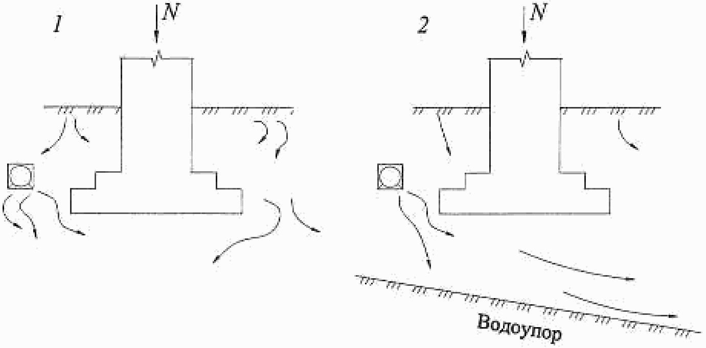

1 - вертикальная фильтрация; 2 - горизонтальная ^ic1-10

фильтрация в слое ограниченной толщины

<!-- figure-caption-deferred -->

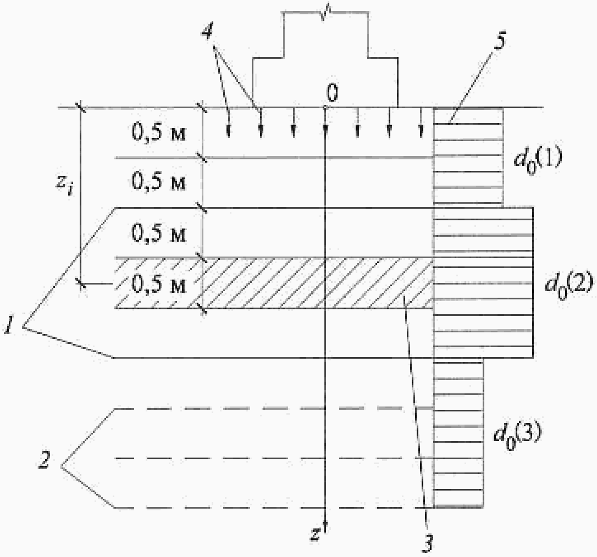

1 - границы слоев с различным содержанием гипса; ^ic1-11

2 - границы расчетных слоев; 3 - расчетный слой; ^ic2-12

4 - направление фильтрации; 5 - начальная эпюра ^ic4-4

относительного содержания гипса *d*$d_0$(*z*)

<!-- figure-caption-deferred -->

**основания при вертикальной фильтрации**

Если основание сложено однородным грунтом, то начальное содержание гипса принимают постоянным в пределах выщелачиваемой зоны *d*$d_0$(*z*) = const, а вся зона разбивается на слои по 0,5 м.

После разбивки основания на слои следует последовательно в каждом слое, начиная с верхнего, определить количество оставшегося в твердой фазе гипса в расчетный момент времени. При этом слой, в котором содержание гипса будет равно начальному, является нижней границей выщелачиваемой зоны *H*$H_l$. Для нижележащих слоев расчет растворения гипса проводить не следует.

6.3.12 При расчете суффозионных деформаций основания, сложенного загипсованными глинистыми грунтами, при фильтрации по схеме 1 (см. [4](#^biblio-4)) зона суффозионной осадки в основании фундамента ограничивается глубиной H c, где суммарные вертикальные напряжения от нагрузки фундамента и собственного веса грунта равны начальному давлению суффозионного сжатия p sf. ^c6-3-12

Если на расчетный момент времени *H*$H_l$ <= *H*$H_c$, расчет суффозионной осадки следует проводить только в пределах выщелачиваемой зоны *H*$H_l$. При *H*$H_l$ > *H*$H_c$ расчет осадки необходимо выполнять в пределах сжимаемой толщи *H*$H_c$. Глубину *H*$H_c$ принимают за границу сжимаемой толщи (рисунок 6.6).

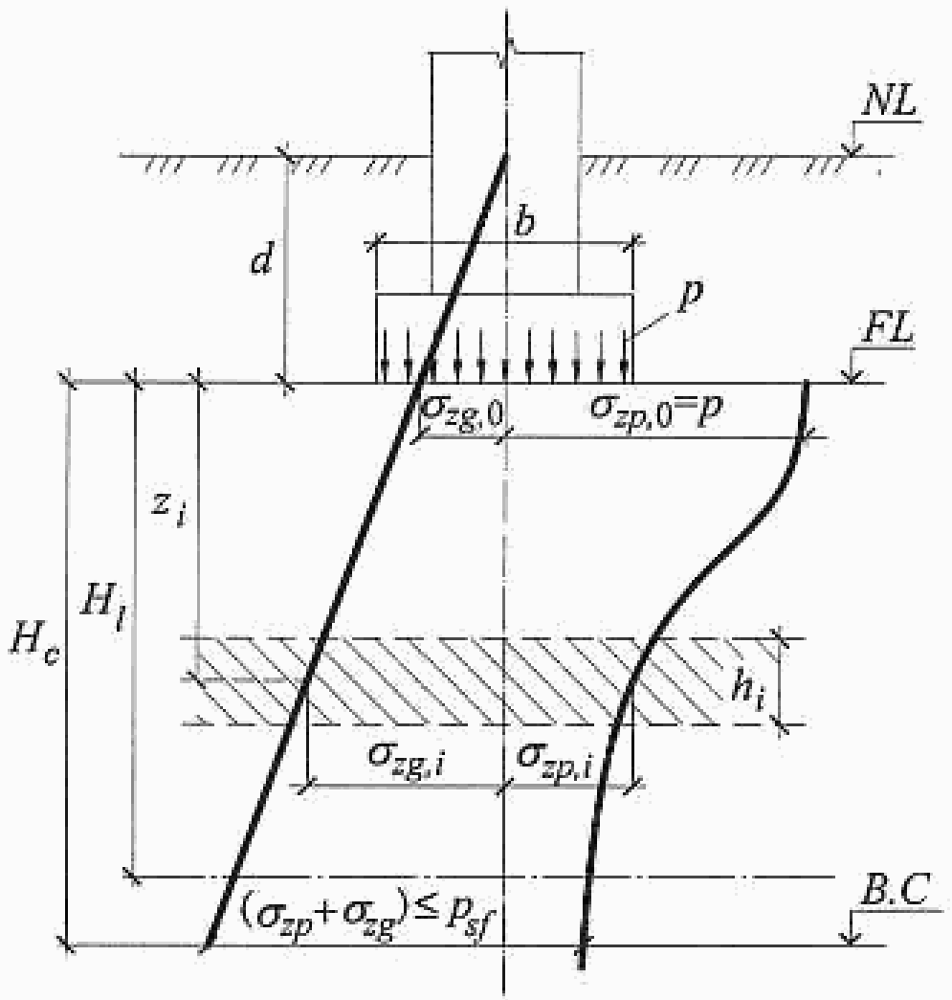

<!-- figure-caption-deferred -->

**засоленного грунта при вертикальной фильтрации**

6.3.13 Суффозионную осадку основания s sf, см, сложенного засоленными грунтами, при вертикальной фильтрации (см. рисунок 6.6) вычисляют по формуле ^c6-3-13

$$s_{sf}=\\sum_{i=1}^{n}\\varepsilon_{sf,i}\\cdot h_i\tag{6.18}$$

где $\varepsilon_{sf,i}$ - относительное суффозионное сжатие грунта *i*-го слоя при давлении *p*, равном суммарному вертикальному напряжению на рассматриваемой глубине от внешней нагрузки $\sigma_{zp}$ и собственного веса грунта $\sigma_{zg}$, определяемое по 6.3.14;

*h*$h_i$ - толщина *i*-го слоя засоленного грунта, см;

*n* - число слоев, на которое разбита зона суффозионной осадки засоленных грунтов.

Значение *s*$s_{sf}$ определяют в пределах зон, устанавливаемых по 6.3.9 и 6.3.12.

6.3.14 Относительное суффозионное сжатие $\varepsilon_{sf}$ при компрессионно-фильтрационных испытаниях вычисляют по формуле ^c6-3-14

$$\varepsilon'_{sh}=(h_1-h)/h\tag{6.19}$$

где *h*$h_{sat,p}$ - высота образца грунта после замачивания (полного водонасыщения) при давлении $p=\sigma'_p+\sigma'_{zg}$;

*h*$h_{sf,p}$ - высота того же образца после длительной фильтрации воды и выщелачивания солей при давлении *p*;

*h*$h_{ng}$ - высота того же образца природной влажности при давлении $p_1=\sigma'_{zg}$.

Начальное давление суффозионного сжатия *p*$p_{sf}$ соответствует давлению, при котором $\varepsilon_{\gamma f}=0{,}01$.

Значения $\varepsilon_{sf}$ и *p*$p_{sf}$ определяют также при полевых испытаниях грунтов штампом с длительным замачиванием грунтов.

*(в ред. Изменения N 5, утв. Приказом Минстроя России от 07.12.2023 N 884/пр)*

6.3.15 Деформации оснований при фильтрации по схеме 2 (см. [4](#^biblio-4)) следует рассчитывать с учетом развития во времени выщелачиваемой зоны в горизонтальном направлении и неоднородности деформационных свойств грунтов основания в пределах площади фундамента или контура сооружения. ^c6-3-15

Как и при фильтрации по схеме 1 (рисунок 6.4) необходимо установить состояние выщелачиваемой зоны в основании фундамента на расчетный момент времени (ее длину и распределение в ней гипса). Для установленного состояния выщелачиваемой зоны следует определить осадку сторон фундамента и его крен.

Начальное содержание гипса в грунте принимают постоянным (*d*$d_0$ = const) как по глубине загипсованной толщи, так и по площади фундамента и в его окрестности (рисунок 6.6), и равным среднему значению загипсованности толщи.

Разбивку основания на вертикальные слои шириной по 0,5 м следует проводить (см. рисунок 6.7) в пределах от *z* = 0 (источник замачивания) до *z* = *l* + 2*L* + 1, где *l* - расстояние до фундамента, а 2*L* - ширина фундамента. Направление формирования и перемещения выщелачиваемой зоны принимают горизонтальным.

6.3.16 Для расчета осадок сторон фундамента при фильтрации по схеме 2 (см. [4](#^biblio-4)) следует применять метод расчета конструкций на основании, характеризующемся переменным коэффициентом постели. Расчетная схема предусматривает наличие двух участков в основании фундамента [4](#^biblio-4), где участок 1 равен длине выщелачиваемой зоны. Коэффициент постели на этом участке изменяется от c min под одной стороной фундамента, ближайшей к источнику замачивания, до c max на границе выщелачиваемой зоны. Участок 2 равен длине невыщелоченной зоны. Коэффициент постели на этом участке постоянен и равен c max. ^c6-3-16

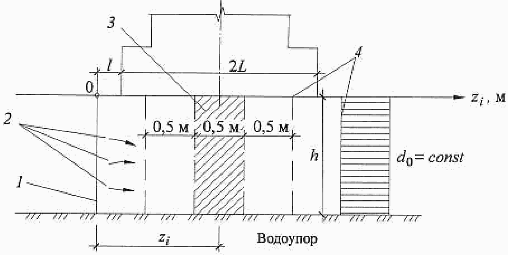

1 - входной участок фильтрационного потока; 2 - направление ^ic1-12

фильтрации; *3* - расчетный слой; *4* - границы расчетных слоев

<!-- figure-caption-deferred -->

**основания при горизонтальной фильтрации**

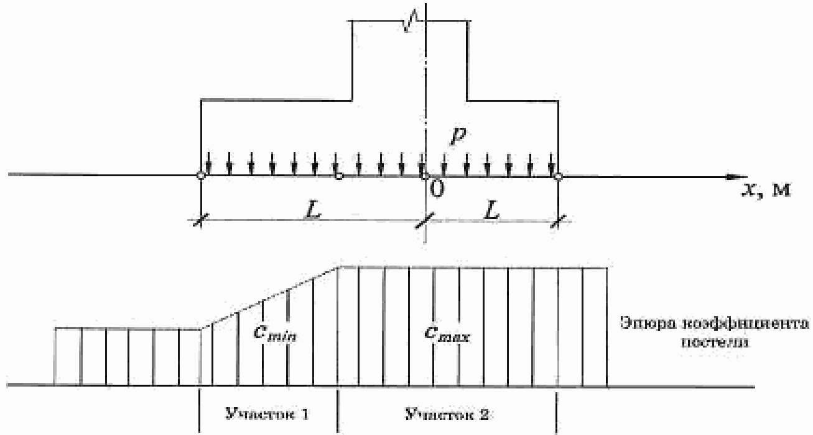

<!-- figure-caption-deferred -->

**засоленного грунта при горизонтальной фильтрации**

6.3.17 При расчетных деформациях основания, сложенного засоленными грунтами, больше предельных или недостаточной несущей способности основания следует предусматривать следующие мероприятия в соответствии с [2337?]: ^c6-3-17

- водозащитные;

- конструктивные;

- частичная или полная срезка засоленных грунтов с устройством подушки из глинистых грунтов;

- прорезка толщи засоленных грунтов фундаментами, в том числе свайными;

- закрепление, уплотнение или нейтрализация (насыщение грунтов растворами, исключающими растворение солей) грунтов;

- предварительное рассоление грунтов;

- комплекс мероприятий, включающий водозащитные и конструктивные мероприятия, а также устройство грунтовой подушки.

При устройстве подушки из глинистых грунтов в основании сооружений предельное содержание солей и степень уплотнения грунта устанавливают по данным специальных исследований и зависят от передаваемых на основание нагрузок, свойств грунта, уровня ответственности и конструктивных особенностей сооружения, возможных условий замачивания основания.

При проектировании фундаментов в засоленных грунтах необходимо применять антикоррозионные мероприятия для защиты тела фундамента от агрессивного воздействия вод и грунтов.

Для сильно- и избыточно засоленных грунтов необходимо применять:

- прекращение или замедление движения фильтрационного потока (устройство водонепроницаемых завес: глинистых, силикатных, битумных, цементных);

- снижение растворяющей способности подземных вод (искусственное водонасыщение фильтрационного потока солями).

## 6.4 Органоминеральные и органические грунты

6.4.1 Основания, сложенные водонасыщенными органоминеральными (илы, сапропели, заторфованные грунты) и органическими грунтами (торфы и сапропели) или включающие эти грунты, следует проектировать с учетом их особенностей: большой сжимаемости, изменчивости и анизотропии прочностных, деформационных и фильтрационных характеристик и изменений их в процессе консолидации основания, длительного развития осадок во времени и возможности возникновения нестабилизированного состояния. ^c6-4-1

Для илов следует учитывать тиксотропию и газовыделение (метан, углекислый газ).

Также следует учитывать, что подземные воды в органоминеральных и органических грунтах агрессивны к материалам подземных конструкций.

6.4.2 По характеру залегания органоминеральные и органические грунты делятся на открытые (залегающие с поверхности), погребенные (залегающие в виде линз или слоев на различной глубине) и искусственно погребенные (перекрытые искусственно сформированными отложениями). ^c6-4-2

6.4.3 В зависимости от расположения слоев или линз органоминерального и органического грунта в плане и по глубине основания выделяют наиболее распространенные типы оснований, приведенные на [4](#^biblio-4). ^c6-4-3

6.4.4 При проведении инженерно-геологических изысканий следует дополнительно устанавливать: ^c6-4-4

- характер залегания органоминеральных и органических грунтов рисунке 6.9 и толщину слоев, прослоек и линз этих грунтов;

- относительное содержание органического вещества *I*$I_r$ для выделения заторфованных грунтов, торфов и сапропелей;

- степень разложения *D*$D_{dp}$;

- коэффициенты фильтрационной и вторичной консолидации - $c_v$ и $c_a$ соответственно.

*(в ред. Изменения N 5, утв. Приказом Минстроя России от 07.12.2023 N 884/пр)*

Расстояние между отдельными скважинами не должно превышать 20 м, и они должны полностью прорезать толщу органоминеральных и органических грунтов с заглублением не менее чем на 2 м в подстилающие минеральные грунты.

Определение характеристик органоминеральных и органических грунтов следует проводить не менее чем через 0,5 м по глубине каждого обнаруженного слоя.

6.4.5 На площадках, в основании которых залегают илы с целью сохранения природной структуры этого грунта следует применять методы испытаний, исключающие динамическое воздействие на грунт. Следует применять штампы, прессиометры, статическое зондирование, приборы вращательного среза, радиоизотопные методы и т.д. ^c6-4-5

6.4.6 Следует выделять пресноводные илы с относительным содержанием органического вещества I r более 0,1 д.е. - сапропели. В зависимости от условий залегания сапропели подразделяют на неуплотненные и уплотненные в природном залегании; по относительному содержанию органического вещества - на высокоминеральные, среднеминеральные и низкоминеральные. ^c6-4-6

*(в ред. Изменения N 5, утв. Приказом Минстроя России от 07.12.2023 N 884/пр)*

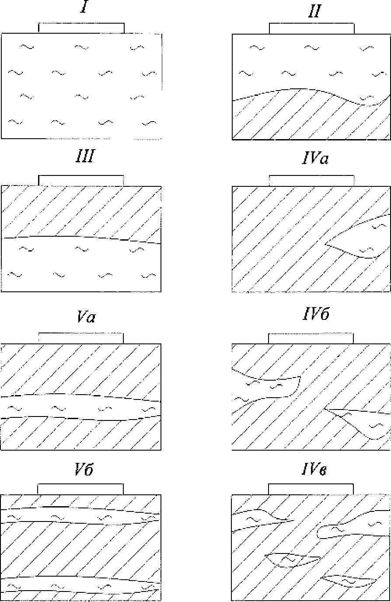

*I* - в пределах всей сжимаемой толщи основания залегают

органоминеральные или органические грунты; *II* - в верхней

части сжимаемой толщи основания залегает слой

органоминерального или органического грунта; *III* - в нижней

части сжимаемой толщи основания залегают органоминеральные

или органические грунты; *IV* - сжимаемая толща в пределах

пятна застройки здания включает односторонне (*IVа*),

двусторонне (*IVб*) вклинившиеся линзы или содержит множество

линз (*IVв*) из органоминеральных или органических грунтов;

*V* - в пределах глубины сжимаемой толщи находится одна (*Vа*)

или несколько прослоек (*Vб*) органоминерального

или органического грунта, границы которых в плане

выходят за пределы пятна застройки здания

<!-- figure-caption-deferred -->

**органоминеральные и органические грунты**

6.4.7 Характеристики органоминеральных и органических грунтов следует определять на основе непосредственных испытаний грунтов в полевых или лабораторных условиях. ^c6-4-7

Ориентировочные значения физико-механических характеристик сапропелей, открытых и погребенных торфов и илов, используемые для предварительной оценки оснований, сложенных указанными грунтами, приведены в приложении Ж.

*(в ред. Изменения N 5, утв. Приказом Минстроя России от 07.12.2023 N 884/пр)*

Для глинистых грунтов с относительным содержанием органического вещества в долях единицы в диапазоне 0,05 <= *I*$I_r$ <= 0,25 нормативные значения характеристик *E*, $\varphi_n$ и *c*$c_n$ для расчетов оснований сооружений, оговоренных в 5.3.18, допускается принимать по таблице А.4 приложения А.

6.4.8 Деформационные, прочностные, консолидационные и фильтрационные характеристики органоминеральных и органических грунтов следует определять в диапазоне давлений, соответствующих напряженному состоянию основания проектируемого сооружения. Указанные характеристики следует устанавливать при испытаниях образцов грунта в вертикальном и горизонтальном направлениях. ^c6-4-8

> **Примечание** — Для сооружений повышенного уровня ответственности определение деформационных, прочностных, консолидационных и фильтрационных характеристик органоминеральных и органических грунтов сжимаемой толщи следует производить с предварительным восстановлением природного фазового состава образцов.

(п. 6.4.8 в ред. Изменения N 5, утв. Приказом Минстроя России от 07.12.2023 N 884/пр)

6.4.9 Для определения прочностных характеристик $\varphi$ и c органоминеральных и органических грунтов следует проводить испытания, применяя методику консолидированных испытаний для определения этих характеристик в стабилизированном состоянии и неконсолидированных испытаний для определения в нестабилизированном состоянии. ^c6-4-9

6.4.10 При определении деформационных характеристик органоминеральных и органических грунтов в компрессионных приборах, учитывая их высокую сжимаемость, испытуемые образцы должны иметь начальную высоту 30 - 50 мм, а их нагружение следует проводить небольшими ступенями. ^c6-4-10

Максимальное давление на образец в компрессионном опыте должно превышать проектное не менее чем на 10% - 20%, но быть не менее 0,1 МПа.

Значения модуля деформации по результатам опыта следует устанавливать для различных интервалов давлений и использовать в расчетах осадки в зависимости от фактических нормальных напряжений по глубине основания в пределах сжимаемой толщи.

> **Примечание** — Для сооружений повышенного уровня ответственности требуется учитывать примечание к [1](#^biblio-1).

(примечание введено Изменением N 5, утв. Приказом Минстроя России от 07.12.2023 N 884/пр)

6.4.11 Коэффициент бокового давления органоминеральных и органических грунтов $\xi$ определяют в приборах трехосного сжатия. Допускается принимать значения $\xi$ по таблицам [6](#^biblio-6). ^c6-4-11

6.4.12 При применении комплекса мероприятий по предварительной подготовке основания, содержащего органоминеральные и органические грунты (временная или постоянная пригрузка, дренирование и т.п.), характеристики этих грунтов следует устанавливать по результатам их испытаний после уплотнения. ^c6-4-12

6.4.13 При расчете оснований следует учитывать анизотропные свойства органоминеральных и органических грунтов. В каждой точке основания следует отбирать не менее двух образцов для определения характеристик в двух направлениях: вертикальном и горизонтальном. Коэффициент фильтрации также следует определять для этих двух направлений. ^c6-4-13

Обозначения характеристик грунта с анизотропными свойствами должны иметь индекс, указывающий диапазоны давлений и их направление при испытании (горизонтальное или вертикальное).

6.4.14 Расчет оснований, сложенных органоминеральными и органическими грунтами, следует проводить в соответствии с требованиями [6](#^biblio-6) с учетом скорости передачи нагрузки на основание, изменения эффективных напряжений в грунте в процессе консолидации основания, анизотропии свойств грунтов, вторичной консолидации. При этом допускается использовать методы теории как линейной, так и нелинейной консолидации грунтов. ^c6-4-14

> **Примечание** — Анизотропию свойств органоминеральных и органических грунтов допускается не учитывать, если значения характеристик для вертикального и горизонтального направлений отличаются не более чем на 40%.

6.4.15 При наличии в основании дренирующих слоев необходимо учитывать фильтрацию поровой воды в их сторону, а при наличии песчаной подушки под фундаментом - также в сторону этой подушки. Действие дренирующего слоя допускается учитывать только в том случае, если он не представляет собой замкнутую линзу, а песчаной подушки под фундаментом - если обратная засыпка пазух произведена также дренирующим грунтом. ^c6-4-15

6.4.16 Основания, сложенные водонасыщенными органоминеральными и органическими грунтами, в соответствии с [4](#^biblio-4) и [2](#^biblio-2) следует рассчитывать по несущей способности. ^c6-4-16

*(в ред. Изменения N 3, утв. Приказом Минстроя России от 22.11.2019 N 722/пр)*

В этих расчетах силу предельного сопротивления основания *N*$N_u$, кН/м, при действии вертикальной нагрузки для ленточного фундамента допускается вычислять по формуле

*N*$N_u$ = *b*'(*q* + 5,14*c*$c_I$), (6.20)

где *b*' - то же, что и в формуле (5.27);

*q* - пригрузка, кПа;

*c*$c_I$ - расчетное значение удельного сцепления грунта, кПа, равное *c*$c_u$.

6.4.17 При намыве на дно водоема, сложенного органоминеральными и органическими грунтами, песчаного слоя его толщину следует определять необходимыми планировочными отметками с расчетом несущей способности основания и с учетом возможности возникновения нестабилизированного состояния. ^c6-4-17

6.4.18 При расчете по деформациям оснований, включающих водонасыщенные органоминеральные и органические грунты, расчетное сопротивление грунта основания R вычисляют по [919?]. При этом коэффициент условий работы грунтового основания $\gamma_{c1}$ принимают по таблице 6.5. ^c6-4-18

Таблица 6.5

^t18

<table>
<tr><td>Наименование грунтов и относительное содержание органического вещества, *I**r*</td><td>Коэффициент условий работы грунтового основания, $\gamma_{c1}$</td></tr>
<tr><td>Пески мелкие водонасыщенные: 0,03 &lt; *I**r* &lt;= 0,25</td><td>0,85</td></tr>
<tr><td>0,25 &lt; *I**r* &lt;= 0,4</td><td>0,80</td></tr>
<tr><td>Пески пылеватые водонасыщенные:</td><td></td></tr>
<tr><td>0,03 &lt; *I**r* &lt;= 0,25</td><td>0,75</td></tr>
<tr><td>0,25 &lt; *I**r* &lt;= 0,4</td><td>0,70</td></tr>
<tr><td>Глинистые грунты водонасыщенные</td><td></td></tr>
<tr><td>0,05 &lt; *I**r* &lt;= 0,25 при показателе текучести:</td><td></td></tr>
<tr><td>*I**L* &lt;= 0,5</td><td>1,05</td></tr>
<tr><td>*I**L* &gt; 0,5</td><td>1,00</td></tr>
<tr><td>Глинистые грунты водонасыщенные</td><td></td></tr>
<tr><td>0,25 &lt; *I**r* &lt; 0,40 при показателе текучести:</td><td></td></tr>
<tr><td>*I**L* &lt;= 0,5</td><td>0,90</td></tr>
<tr><td>*I**L* &gt; 0,5</td><td>0,80</td></tr>
</table>

6.4.19 Для предварительного определения размеров фундаментов сооружений геотехнических категорий 2 и 3 на заторфованных песках и окончательного для сооружений геотехнической категории 1 допускается принимать расчетные сопротивления R 0 по [1](#^biblio-1) приложения Б. ^c6-4-19

6.4.20 Расчетную схему для определения конечных осадок фундаментов на основании, включающем водонасыщенные органоминеральные и органические грунты, принимают по [6](#^biblio-6). ^c6-4-20

Дополнительную осадку основания фундаментов за счет разложения (минерализации) органических включений допускается не учитывать, если в период срока службы сооружения уровень подземных вод не будет понижаться.

Осадку слоя сильнозаторфованного грунта или торфа при намыве или отсыпке на него песчаного слоя определяют по 6.4.29 и 6.4.30.

6.4.21 В расчете по деформациям основания, содержащего органоминеральные и органические грунты, нижнюю границу сжимаемой толщи принимают в соответствии с рекомендациями [1769?]. ^c6-4-21

6.4.22 Опирание фундаментов непосредственно на поверхность органоминеральных и органических грунтов не допускается, если они представлены сильнозаторфованными грунтами и торфами, сапропелями и илами. ^c6-4-22

Если непосредственно под подошвой фундамента залегает слой грунта с модулем деформации *E* < 5 МПа толщиной более ширины фундамента, то осадку основания фундаментов следует вычислять по формуле (5.16) при $\sigma'_{z\gamma,i}=0$.

6.4.23 При расчетных деформациях основания, сложенного органоминеральными и органическими грунтами, больше предельных или недостаточной несущей способности основания следует предусматривать специальные мероприятия. В зависимости от типа основания (см. [4](#^biblio-4)), относительного содержания органического вещества I r, глубины залегания и толщины органоминеральных и органических грунтов, а также конструктивных особенностей проектируемого сооружения и предъявляемых к нему эксплуатационных требований возможны следующие варианты специальных мероприятий: ^c6-4-23

*(в ред. Изменения N 5, утв. Приказом Минстроя России от 07.12.2023 N 884/пр)*

- уплотнение основания временной или постоянной нагрузкой, в том числе с устройством вертикальных дрен и дренажных прорезей - для оснований типов I и II;

- полная или частичная прорезка слоя органоминеральных и органических грунтов фундаментами, в том числе свайными, - для оснований типов II, IV и V;

- выторфовка линз или слоев органоминерального и органического грунта с заменой его минеральным грунтом - для оснований типов II, IV и V;

- устройство фундаментов (столбчатых, ленточных и т.п.) на песчаной, гравийной, щебеночной подушке или на предварительно уплотненной подсыпке из местного материала - для всех типов оснований;

- устройство сооружений на плитных фундаментах, перекрестных монолитных или сборно-монолитных лентах и т.п. с конструктивными мероприятиями по повышению пространственной жесткости сооружения - для всех типов оснований.

6.4.24 В отдельных случаях основание, содержащее органоминеральные и органические грунты, может быть использовано при соблюдении определенной скорости передачи нагрузки или при применении конструктивных мероприятий (введение поясов жесткости, разбивка здания на отдельные секции и т.п.). ^c6-4-24

6.4.25 Песчаные подушки, устраиваемые под фундаментами с целью замены органоминеральных и органических грунтов, уменьшения давления на нижележащие слои, повышения отметки подошвы фундаментов, ускорения процесса консолидации (уплотнения) нижележащих грунтов, устраивают из песков крупных и средней крупности. Допускается применение щебня, гравия, шлака или гравийно-песчаной смеси. Мелкие пески для устройства подушек не допускаются. ^c6-4-25

*(в ред. Изменения N 5, утв. Приказом Минстроя России от 07.12.2023 N 884/пр)*

Плотность сухого грунта в подушках из песка крупного и средней крупности должна составлять не менее 1,65 т/м³.

При назначении прочностных характеристик уплотненного грунта в подушках следует учитывать требования 5.6.14.

6.4.26 Для намыва слоя грунта в качестве основания сооружения применяются супеси и пески любой крупности. Для ускорения консолидации намываемого слоя пылеватых песков или супесей необходимы предварительный намыв или укладка на маловодопроницаемое естественное основание, сложенное органоминеральными и органическими грунтами, дренирующего слоя, например, из песка средней крупности. ^c6-4-26

*(в ред. Изменения N 5, утв. Приказом Минстроя России от 07.12.2023 N 884/пр)*

6.4.27 Проектирование пригрузки следует проводить с учетом требований [3](#^biblio-3). При этом должны быть установлены толщина и размеры в плане пригрузочного слоя и время, необходимые для достижения заданной степени консолидации основания, а также конечная осадка основания под пригрузкой. ^c6-4-27

6.4.28 Конечную осадку и время консолидации слоя органоминерального и органического грунта при намыве или отсыпке на него песчаного слоя определяют без учета осадки подстилающего слоя, если его модуль деформации в 10 раз и более превышает модуль деформации органоминерального и органического грунтов. ^c6-4-28

Для водонасыщенных органических и органоминеральных грунтов расчет протекания осадок во времени проводят на основе теории фильтрационной консолидации.

Нагрузку от намыва или отсыпки и порядок ее учета в расчетах конечной осадки, а также время консолидации слоя органоминерального и органического грунта определяют в соответствии с принятым проектом организации работ.

6.4.29 Конечную осадку слоя органоминерального и органического грунта, залегающего непосредственно под толщей песчаной насыпи, в стабилизированном состоянии s, м, вызванную намытым или отсыпанным слоем песка, вычисляют по формуле ^c6-4-29

*s* = 3*ph*/(3*E* + 4*p*), (6.21)

где *p* - давление от песчаной насыпи на поверхность органоминерального и органического грунтов, кПа;

*h* - толщина слоя органоминерального и органического грунтов, м;

*E* - модуль деформации органоминерального и органического грунтов при полной влагоемкости, кПа.

Формулу (6.21) допускается использовать при размере насыпи в плане не менее 5*h*.

6.4.30 Если основание, содержащее органоминеральные и органические грунты, состоит из нескольких горизонтальных слоев с различными модулями деформации, осадку всей толщи в конце периода стабилизации определяют как сумму осадок отдельных слоев. ^c6-4-30

*(в ред. Изменения N 5, утв. Приказом Минстроя России от 07.12.2023 N 884/пр)*

6.4.31 При толщине слоев органоминеральных и органических грунтов, превышающей 3 м, их следует уплотнять с использованием вертикальных дрен. ^c6-4-31

План расположения дрен, их сечение и шаг устанавливают расчетом из условия 90% консолидации основания или в зависимости от назначаемых сроков уплотнения строительной площадки. В плане дрены располагают по квадратной или гексагональной сетке (из равносторонних треугольников) с шагом: для песчаных дрен 1,5 - 3 м, для дрен заводского изготовления 0,5 - 2 м.

Для сооружений геотехнических категорий 2 и 3 шаг дрен определяют на опытных участках.

6.4.32 При использовании вертикальных дрен, полностью прорезающих уплотняемый слой грунта, и наличии дренирующих слоев на концах дрены консолидация грунта под нагрузкой происходит за счет отжатия поровой воды в дрену и дренирующие слои. Эквивалентный диаметр зоны влияния дрен d e в этом случае следует принимать при расположении дрен по квадратной сетке d e = 1,13 d; по гексагональной сетке - d e = 1,05 d, где d - расстояние между осями дрен (шаг дрен). ^c6-4-32

6.4.33 При проектировании оснований сооружений геотехнических категорий 2 и 3, возводимых на органоминеральных и органических грунтах дополнительно к требованиям [5159?] программой геотехнического мониторинга должны быть предусмотрены наблюдения по следующим контролируемым параметрам: ^c6-4-33

- измерение послойных деформаций грунтов основания фундаментов вновь возводимых сооружений;

- измерение порового давления, возникающего в водонасыщенных органических и органоминеральных грунтах от воздействия дополнительной пригрузки, с контролем уровня подземных вод;

- инклинометрические измерения горизонтальных перемещений грунтового массива по глубине.

## 6.5 Элювиальные грунты

6.5.1 Основания, сложенные элювиальными грунтами - продуктами выветривания скальных и полускальных грунтов, следует проектировать с учетом: ^c6-5-1

*(в ред. Изменения N 5, утв. Приказом Минстроя России от 07.12.2023 N 884/пр)*

- неоднородности состава и свойств по глубине и в плане из-за наличия грунтов разной степени выветрелости с различием прочностных и деформационных характеристик, возрастающих с глубиной;

- снижения прочностных и деформационных характеристик во время их длительного пребывания в открытых котлованах;

- возможности перехода в плывунное состояние элювиальных супесей и пылеватых песков в случае их водонасыщения в период устройства котлованов и фундаментов;

- возможного наличия просадочных свойств у элювиальных пылеватых песков с коэффициентом пористости *e* > 0,6 и коэффициентом водонасыщения *S*$S_r$ < 0,7 и возможности набухания элювиальных глинистых грунтов при замачивании отходами технологических производств.

6.5.2 В зависимости от исходных горных пород, подвергшихся выветриванию, следует выделять элювиальные грунты магматических, метаморфических и осадочных сцементированных скальных грунтов, а по содержанию кварца - подразделять элювиальные грунты на две группы: содержащие кварц и бескварцевые. ^c6-5-2

6.5.3 Профиль коры выветривания в общем случае может быть представлен сверху вниз следующими зонами, различающимися степенью выветрелости: дисперсной, обломочной, глыбовой и трещиноватой. В соответствии с выделенными зонами наблюдается возрастание по глубине плотности элювиальных образований, уменьшение пористости и трещиноватости и увеличение прочности крупных обломков и отдельностей. ^c6-5-3

6.5.4 При проведении инженерно-геологических изысканий на элювиальных грунтах должны быть выявлены: генетический вид и петрографический состав исходной скальной породы; структура и профиль коры выветривания, ее трещиноватость, сланцеватость, слоистость, элементы падения и простирания, поверхности скольжения, наличие "языков" и "карманов" выветривания; размеры, форма и количество крупных включений; изменение по глубине состава и свойств грунтов. ^c6-5-4

6.5.5 Степень снижения прочности элювиальных грунтов основания во время пребывания их открытыми в котловане следует устанавливать опытным путем в полевых условиях. Допускается проводить определение этих параметров в лабораторных условиях на отобранных образцах (монолитах) грунта. ^c6-5-5

Для предварительной оценки возможного снижения прочности элювиальных грунтов допускаются косвенные методы, учитывающие изменение в течение заданного периода времени: плотности скальных грунтов; удельного сопротивления пенетрации глинистых грунтов; содержания частиц размером менее 0,1 мм в песках и менее 2 мм в крупнообломочных грунтах.

6.5.6 Количественную оценку снижения прочности элювиальных грунтов в открытых котлованах проводят по изменению их прочностных и деформационных характеристик в период дополнительного выветривания, а качественную оценку - по изменению значений плотности образцов грунта, их водопоглощающей способности, интенсивности распада (дробления) крупных обломков, глыб и отдельностей. ^c6-5-6

Необходимо устанавливать также толщину верхнего ослабленного дополнительным выветриванием слоя элювиального грунта.

6.5.7 Оценку стойкости элювиальных грунтов к дополнительному (атмосферному) выветриванию, устанавливающую степень снижения их прочности в открытых котлованах за ожидаемый период времени t (годы, месяцы, сутки), проводят путем определения: ^c6-5-7

- скорости снижения выбранного параметра степени выветрелости *A* за период времени *t*: (*A*$A_1$ - *A*$A_2$)/*t*;

- степени снижения выбранного параметра *A*: (*A*$A_1$ - *A*$A_2$)/*A*$A_1$;

- общего количественного снижения параметра *A* за весь период *t:* (*A*$A_1$ - *A*$A_2$).

Ожидаемый период пребывания элювиальных грунтов открытыми в разработанных котлованах, а также интервалы времени $\Delta t$, через которые проводят определения количественных значений параметра *A*, устанавливают исходя из конкретных особенностей района и сроков строительства.

6.5.8 Для элювиальных скальных и крупнообломочных грунтов необходимо устанавливать степень их выветрелости, характеризуемую коэффициентом выветрелости (см. 6.5.9, [1](#^biblio-1)), а для крупнообломочных грунтов также - относительную прочность обломков, характеризуемую коэффициентом истираемости (см. [8](#^biblio-8)). ^c6-5-8

*(в ред. Изменения N 5, утв. Приказом Минстроя России от 07.12.2023 N 884/пр)*

6.5.9 Коэффициент выветрелости K wr элювия скальных грунтов определяют согласно указаниям [[ГОСТ 25100]]. ^c6-5-9

Подразделение элювия скальных грунтов по степени выветрелости приведено в таблице 6.6, а ориентировочные значения предела прочности на одноосное сжатие в водонасыщенном состоянии *R*$R_c$, которые используются для предварительной оценки оснований из этих грунтов, приведены в приложении И.

(п. 6.5.9 в ред. Изменения N 5, утв. Приказом Минстроя России от 07.12.2023 N 884/пр)

Таблица 6.6

^t19

<table>
<tr><th rowspan="2">Разновидность элювия скальных грунтов по степени выветрелости</th><th colspan="2">Коэффициент выветрелости *K**wr* для скальных грунтов</th></tr>
<tr><td>магматических и метаморфических</td><td>осадочных сцементированных</td></tr>
<tr><td>Невыветрелые</td><td>1</td><td>1</td></tr>
<tr><td>Слабовыветрелые</td><td>1 &gt; *K**wr* &gt;= 0,9</td><td>1 &gt; *K**wr* &gt;= 0,95</td></tr>
<tr><td>Выветрелые</td><td>0,9 &gt; *K**wr* &gt;= 0,8</td><td>0,95 &gt; *K**wr* &gt;= 0,85</td></tr>
<tr><td>Сильновыветрелые (рухляки)</td><td>Менее 0,8</td><td>Менее 0,85</td></tr>
</table>

6.5.10 Коэффициент выветрелости элювиальных крупнообломочных грунтов K wr определяют по испытаниям проб грунта на истирание во вращающемся полочном барабане и вычисляют по формуле ^c6-5-10

*K*$K_{wr}$ = (*k*$k_1$ - *k*$k_0$)/*k*$k_1$, (6.23)

где *k*$k_1$ - отношение массы *m*$m_1$ частиц размером менее 2 мм к массе *m*$m_2$ частиц размером более 2 мм после испытания на истирание;

*k*$k_0$ - то же, в природном состоянии (до испытания на истирание).

Подразделение элювиальных крупнообломочных грунтов по степени выветрелости приведено в таблице 6.7.

6.5.11 Коэффициент истираемости K fr крупных обломков (частиц более 2 мм) элювиальных крупнообломочных грунтов определяют по испытаниям на истираемость этих частиц во вращающемся полочном барабане и вычисляют по формуле ^c6-5-11

*K*$K_{fr}$ = *m*$m_1$/*m*$m_0$, (6.24)

где *m*$m_1$ - масса частиц размером менее 2 мм после испытания на истирание;

*m*$m_0$ - начальная масса пробы крупных обломков.

Подразделение крупных обломков по прочности в зависимости от значений *K*$K_{fr}$ приведено в таблице 6.8.

Таблица 6.7

^t20

<table>
<tr><td rowspan="2">Разновидности элювиальных крупнообломочных грунтов по степени выветрелости</td><td colspan="2">Коэффициент выветрелости *K**wr* для крупнообломочных грунтов при исходных образующих породах</td></tr>
<tr><td>магматических и метаморфических</td><td>осадочных сцементированных</td></tr>
<tr><td>Невыветрелые</td><td>0 &lt; *K**wr* &lt;= 0,5</td><td>0 &lt; *K**wr* &lt;= 0,33</td></tr>
<tr><td>Слабовыветрелые</td><td>0,5 &lt; *K**wr* &lt;= 0,75</td><td>0,33 &lt; *K**wr* &lt;= 0,67</td></tr>
<tr><td>Сильновыветрелые</td><td>0,75 &lt; *K**wr* &lt; 1</td><td>0,67 &lt; *K**wr* &lt; 1</td></tr>
</table>

Таблица 6.8

^t21

<table>
<tr><th>Наименование обломков по прочности на истирание</th><th>Коэффициент истираемости обломков *K**fr*</th></tr>
<tr><td>Очень прочные</td><td>*K**fr* &lt;= 0,05</td></tr>
<tr><td>Прочные</td><td>0,05 &lt; *K**fr* &lt;= 0,2</td></tr>
<tr><td>Средней прочности</td><td>0,2 &lt; *K**fr* &lt;= 0,3</td></tr>
<tr><td>Малопрочные</td><td>0,3 &lt; *K**fr* &lt;= 0,4</td></tr>
<tr><td>Непрочные</td><td>*K**fr* &gt; 0,4</td></tr>
</table>

6.5.12 При подразделении элювиальных крупнообломочных грунтов по гранулометрическому составу на разновидности необходимо указывать содержание частиц заполнителя размером менее 0,1 мм, а также выделять щебенисто-дресвяные грунты при содержании частиц менее 0,1 мм до 10%, а частиц крупнее 10 мм - более 25% по массе. ^c6-5-12

Ориентировочные значения модуля деформации для разновидностей элювиальных крупнообломочных грунтов приведены в приложении И.

Прочностные свойства крупнообломочных грунтов допускается определять расчетом по специальным методикам на основании лабораторных определений физических свойств [8].

Для прямого полевого определения деформационных свойств элювиальных крупнообломочных грунтов в дополнение к требованиям 5.3.4 и 5.3.5 используют метод штамповых испытаний с применением быстротвердеющих композитных материалов на контакте штампа с грунтом.

> **Примечание** — При применении быстротвердеющих композитных материалов на контакте штампа с крупнообломочным грунтом толщина контактного слоя должна составлять в диапазоне от 70 до 150 мм в зависимости от размера обломков. Допускается использовать безусадочные быстротвердеющие бетонные смеси наливного типа при сроке твердения не менее 1 сут и быстросхватывающиеся бетонные смеси при сроках их твердения не менее 3 сут.

(п. 6.5.12 в ред. Изменения N 5, утв. Приказом Минстроя России от 07.12.2023 N 884/пр)

6.5.13 В элювиальных песках и глинистых грунтах - продуктах выветривания магматических и метаморфических пород - следует выделять прочноструктурные и слабоструктурные разновидности. ^c6-5-13

К прочноструктурным (сапролитам) относятся пески и глинистые грунты, в которых частично сохранена макроструктура исходных пород и которые при природной влажности характеризуются пределом прочности на одноосное сжатие *R*$R_c$ >= 0,2 МПа.

Элювиальные пески и глинистые грунты, имеющие при природной влажности значение *R*$R_c$ < 0,2 МПа, относятся к слабоструктурным. Нормативные значения *E*, $\varphi$ и *c* этих грунтов для расчетов оснований сооружений, оговоренных в 5.3.20, допускается принимать по таблицам А.5 и А.6 приложения А.

6.5.14 Элювиальные глинистые грунты - продукты выветривания осадочных сцементированных скальных грунтов аргиллито-алевролитового комплекса - представлены в основном суглинками и глинами. Нормативные значения E, $\varphi$ и c этих грунтов для расчетов сооружений, оговоренных в [8](#^biblio-8), допускается принимать по [6220?] приложения А, а для песков осадочных пород - по [5930?] приложения А, так как они близки по свойствам к пескам магматических кварцесодержащих пород. ^c6-5-14

6.5.15 Расчет оснований фундаментов, сложенных элювиальными грунтами, следует проводить в соответствии с требованиями [6](#^biblio-6). Если элювиальные грунты являются просадочными или набухающими, следует учитывать требования [7](#^biblio-7) и [7](#^biblio-7). ^c6-5-15

6.5.16 Расчетные сопротивления R дисперсных элювиальных грунтов при расчетах оснований фундаментов по деформациям определяют согласно требованиям [2](#^biblio-2). ^c6-5-16

Расчетные сопротивления *R*$R_0$ для назначения предварительных размеров фундаментов сооружений геотехнических категорий 2 и 3 и окончательных размеров сооружений геотехнической категории 1 приведены в таблицах Б.6 - Б.8 приложения Б.

6.5.17 При расчетных деформациях основания фундаментов, сложенного элювиальными грунтами, больше предельных или недостаточной несущей способности основания следует предусматривать следующие мероприятия в соответствии с [2337?]: ^c6-5-17

- устройство уплотненных грунтовых распределительных подушек из песка, гравия, щебня или крупнообломочных грунтов с обломками исходных горных пород, в частности при неровной поверхности скальных грунтов;

- удаление из верхней зоны основания включений скальных грунтов, полная или частичная замена рыхлого заполнения "карманов" и "гнезд" выветривания в скальных грунтах щебнем, гравием или песком с уплотнением.

При недостаточности этих мероприятий следует предусматривать конструктивные мероприятия в соответствии с требованиями (5.9), свайные фундаменты или метод выравнивания осадок основания фундаментов.

*(в ред. Изменения N 5, утв. Приказом Минстроя России от 07.12.2023 N 884/пр)*

6.5.18 В проекте оснований и фундаментов должна предусматриваться защита элювиальных грунтов от разрушения атмосферными воздействиями и водой в период устройства котлованов. Для этой цели следует применять водозащитные мероприятия, не допускать перерывы в устройстве оснований и последующем возведении фундаментов; предусматривать недобор грунта в котловане; применять взрывной способ разработки скальных грунтов лишь при условии мелкошпуровой отпалки. ^c6-5-18

## 6.6 Насыпные грунты

6.6.1 Основания, сложенные насыпными грунтами, следует проектировать с учетом их особенностей: состава, сложения, образования; процессов их происхождения; напряженно-деформируемого состояния; взаимодействия насыпных грунтов с глубокими фундаментами, подземными частями сооружения, упрочненными грунтовыми массивами. ^c6-6-1

6.6.2 Насыпные грунты состоят из отдельных видов или смесей: ^c6-6-2

- грунтов природного происхождения, первоначальная структура которых изменена в результате разработки и вторичной укладки;

- отходов производства, представляющих собой искусственные минеральные, органоминеральные, органические материалы;

- отходов потребления, чаще всего называемых бытовыми отходами и отбросами, состоящих из органических и минеральных материалов.

6.6.3 В зависимости от состава сложения и образования выделяются три типа насыпных грунтов: I - планомерно возведенные, II - отвалы и III - свалки. ^c6-6-3

Тип I - планомерно возведенные насыпные грунты обычно состоят из грунтов природного происхождения, минеральных отходов производств, отсыпанных с их уплотнением, имеют практически однородный состав сложения и равномерную сжимаемость. К ним относятся планировочные насыпи, возникшие при хозяйственном освоении пониженных, в том числе шельфовых территорий, земляные сооружения, обратная засыпка котлованов и др.

Тип II - отвалы грунтов природного происхождения, минеральных отходов производств, образовавшиеся в результате плановой отсыпки этих материалов, чаще всего имеют достаточно однородный состав и сложение, низкую и неравномерную плотность и сжимаемость и другие характеристики.

Тип III - свалки грунтов, отходов производств и потребления возникают при неорганизованном их накоплении и характеризуются повышенной разнородностью состава, относительным содержанием органических веществ (*I*$I_r$ > 0,1 - 0,25), а также неравномерными и низкими значениями плотности, деформационных и прочностных характеристик, неустойчивой от разложения структурой.

> **Примечание** — Вместо терминов "грунты природного происхождения" далее используется термин "грунты", а "отходы потребления" - "бытовые отходы".

6.6.4 При проектировании оснований на насыпных грунтах необходимо учитывать наиболее проявляющиеся в них процессы: ^c6-6-4

а) самоуплотнения насыпных грунтов от их собственного веса, в зависимости от этого они подразделяются согласно таблице 6.9 на слежавшиеся, в которых процесс самоуплотнения практически завершился, и неслежавшиеся при этом продолжающемся процессе, а также при дополнительном уплотнении подстилающих природных грунтов как от веса существующих насыпных грунтов, так и особенно вновь отсыпных насыпей;б) самоупрочнение с омоноличиванием глинистых и частично песчано-глинистых грунтов, и подобных им отходам производств, устойчивой структурой с повышением их деформационных и прочностных характеристик, относящихся к типам I и II;в) распад структуры и текстуры грунтов природного образования грунтов. А также искусственных минеральных и особенно органических материалов производств и потребления, относящихся к типам II и III с неустойчивой структурой, сопровождающихся снижением плотности, прочностных и деформационных характеристик и иногда склонностью к просадкам и набуханию при замачивании водой или растворами некоторых производств.

> **6.6.5** Напряженно деформируемое состояние насыпных грунтов определяется: характером планировки застраиваемого участка, внешней нагрузкой от фундаментов p и на полы по грунту p; степенью завершенности самоуплотнения насыпных, а также доуплотнения подстилающих природных грунтов от веса подсыпки и других воздействий и характеризуется приведенными на [6](#^biblio-6) соответствующими вертикальными напряжениями $\sigma$ и зонами сжатия грунтов основания. ^c6-6-5

а)

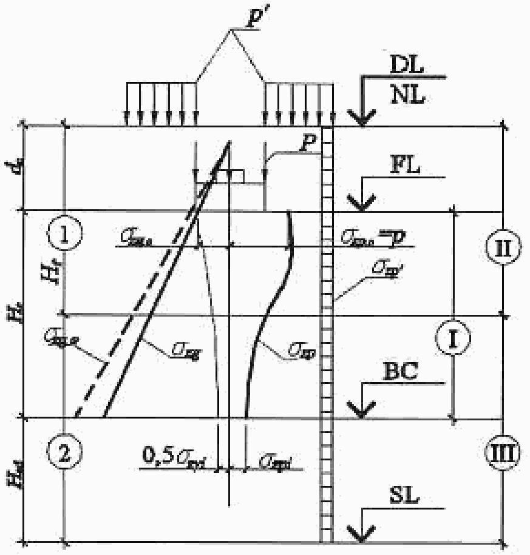

б)

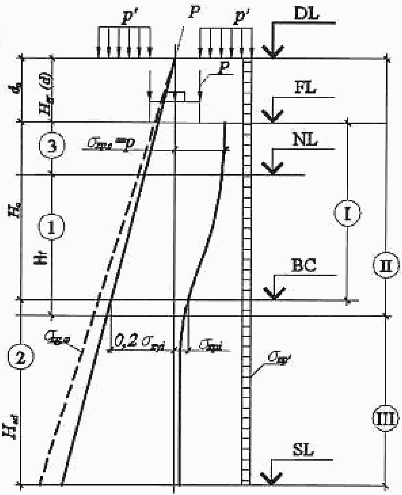

в)

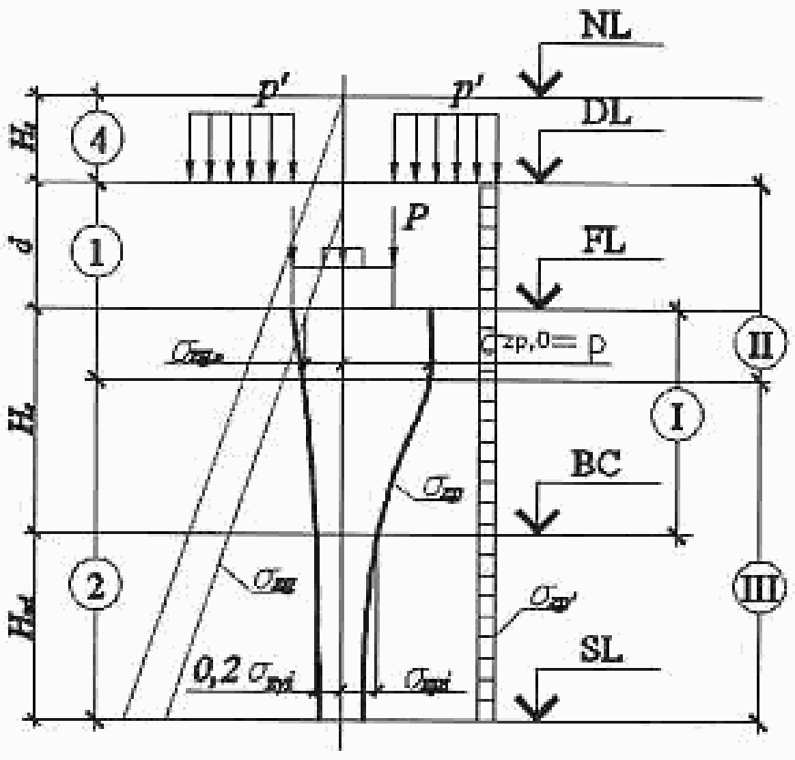

*DL* - отметка планировки; *NL* - отметка поверхности

сложившегося рельефа; *FL* - отметка подошвы фундамента;

*BC* - нижняя граница сжимаемой толщи; *H*$H_f$ - толщина слоя

существующего насыпного грунта; *DC* - нижняя граница

сжимаемого грунта; *SL* - отметка подошвы сжимаемого слоя;

1 - существующий насыпной грунт; 2 - грунт природного ^ic1-13

сложения и происхождения; *3* - планировочная насыпь;

4 - срезаемый насыпной грунт 1 при планировке на глубину ^ic4-5

*H*$H_0$; *d* и *d*$d_n$ - глубина заложения фундамента соответственно

от уровня планировки и поверхности существующего рельефа;

*H*$H_0$ - толщина планировочной насыпи; *H*$H_1$ - глубина срезки

от существующей поверхности насыпного грунта; *b* - ширина

фундамента; *p* - среднее давление по подошве фундамента;

$\sigma_{zg}$ и $\sigma_{zq,o}$ - вертикальные напряжения от собственного

веса на глубине *z* от подошвы фундамента и на уровне

подошвы; $\sigma_{zp}$ и $\sigma_{zp,o}$ - вертикальные напряжения от внешней

нагрузки на глубине *z* от подошвы фундамента и на уровне

подошвы; *H*$H_c$ - толщина сжимаемой зоны при $0{,}5\sigma'_p-\sigma_{qo}$;

*p*' - среднее суммарное давление на грунт от нагрузки

на полы и фундаментов технологического оборудования;

$\sigma'_{zp}$ - вертикальные напряжения на глубине *z* от нагрузки *p*';

$\sigma_{zp,\omega}$ - дополнительные вертикальные напряжения

от собственного веса грунта при возможном повышении

влажности грунта $\omega$, вызванного застройкой участка;

I - зона сжимаемой толщи *H*$H_c$ от нагрузки фундамента;

II - зона дополнительного самоуплотнения насыпных грунтов

от их собственного веса и планировочной насыпи (при наличии

ее); III - зона сжатия грунтов природного сложения

<!-- figure-caption-deferred -->

**состояния оснований на насыпных грунтах при:**
***а)*** **- существующей поверхности застраиваемого**
**участка;** ***б)*** **- выполнении планировочной насыпи;**
***в)*** **- частичной срезке насыпного грунта**
Таблица 6.9

^t22

<table>
<tr><th rowspan="2">Виды насыпных грунтов и отходов производств</th><th colspan="3">Продолжительность самоуплотнения, год</th></tr>
<tr><td>планомерно возведенных насыпей</td><td>отвалов</td><td>свалок</td></tr>
<tr><td>Крупнообломочные</td><td>0,2 - 1</td><td>1 - 3</td><td>2 - 5</td></tr>
<tr><td>Песчаные</td><td>0,5 - 1</td><td>2 - 5</td><td>5 - 10</td></tr>
<tr><td>Глинистые</td><td>2 - 5</td><td>10 - 15</td><td>20 - 30</td></tr>
</table>

6.6.6 В качестве естественных оснований допускается использовать: ^c6-6-6

- планомерно возведенные насыпи из грунтов и отходов производств;

- отвалы грунтов и отходов производств, состоящие из щебенистых и гравийных грунтов, крупных песков и шлаков.

Свалки грунтов и отходов производств допускается использовать для строительства сооружений пониженного уровня ответственности при проведении расчета по деформациям. Использование свалок бытовых отходов в качестве естественных оснований не допускается.

6.6.7 Дополнительные осадки фундаментов за счет разложения органических включений учитывают в пределах слоев, расположенных выше уровня подземных вод, при относительном содержании по массе органических веществ в насыпях из песков, хвостов обогатительных фабрик и шлаков более 0,03, а из глинистых грунтов и золошлаков - более 0,05. ^c6-6-7

6.6.8 Дополнительные осадки, их неравномерность и время развития за счет уплотнения подстилающих грунтов от веса насыпи определяются толщиной слоя насыпных грунтов, а также сжимаемостью и условиями консолидации подстилающих насыпь грунтов. ^c6-6-8

> **Примечание** — Допускается принимать, что уплотнение подстилающих грунтов от веса насыпи практически заканчивается для грунтов: песков - через один год, глинистых, расположенных выше уровня подземных вод, - через два года, а находящихся ниже уровня подземных вод - через пять лет.

6.6.9 Для сооружений 2-й и 3-й геотехнических категорий сжимаемость всех видов насыпных грунтов и отходов производств необходимо определять в полевых условиях статическими нагрузками. ^c6-6-9

Число испытаний штампами в пределах проектируемого сооружения принимают не менее: для планомерно возведенных насыпей 2, для отвалов - 3 при застраиваемой площади участка строительства не более 300 м². При большей площади необходимо пропорционально увеличивать количество испытаний.

6.6.10 При использовании насыпных грунтов и отходов производств для устройства искусственных оснований, насыпей, подсыпок под полы, обратных засыпок котлованов и т.п. для назначения проектной плотности и диапазона изменения влажности необходимо предусматривать проведение испытаний грунтов. ^c6-6-10

6.6.11 Основания, сложенные насыпными грунтами и отходами производств, следует рассчитывать в соответствии с требованиями [6](#^biblio-6). Если насыпные грунты являются просадочными, набухающими или имеют относительное содержание органического вещества I r > 0,1, следует учитывать соответственно требования [7](#^biblio-7), [7](#^biblio-7) и [2960?]. Полную деформацию основания следует определять суммированием осадок основания от внешней нагрузки и дополнительных осадок от самоуплотнения насыпных грунтов и разложения органических включений, а также осадок (просадок) подстилающих грунтов от веса насыпи и нагрузок от фундамента. ^c6-6-11

6.6.12 Для учета самоуплотнения неслежавшихся насыпных грунтов и отходов производств к значениям дополнительного вертикального напряжения от внешней нагрузки $\sigma_{zp}$ по [3](#^biblio-3) в пределах насыпного слоя добавляют вертикальное напряжение от собственного веса грунта, равное произведению $k_{\sigma\sigma zg}$, где k ss = 0,4 - для неслежавшихся насыпей из песков (кроме пылеватых), шлаков и т.п. и k ss = 0,6 - из пылеватых песков, глинистых грунтов, золошлаков и т.п. ^c6-6-12

При расчете осадок основания фундаментов учитывают осадку подстилающих грунтов от веса насыпи путем добавления к значениям $\sigma_{zp}$, ниже кровли подстилающих грунтов вертикального напряжения от веса вышележащих слоев.

> **Примечание** — Допускается не учитывать дополнительную осадку подстилающих грунтов при давности отсыпки насыпей из песков и шлаков более двух лет и из глинистых грунтов, хвостов обогатительных фабрик, зол, золошлаков и шламов более пяти лет.

6.6.13 Расчетное сопротивление основания R, сложенного насыпными грунтами и отходами производств, определяют в соответствии с требованиями [2](#^biblio-2). ^c6-6-13

При определении расчетных сопротивлений грунтов по формуле (5.7) значения коэффициентов $\gamma_{c1}$ и $\gamma_{c2}$ принимают равными для планомерно возведенных насыпей по таблице 5.4; отвалов - $\gamma_{cl}=0{,}8$ и $\gamma_{c2}=0{,}9$; свалок - $\gamma_{cl}=0{,}6$ и $\gamma_{c2}=0{,}7$.

Предварительные размеры фундаментов сооружений геотехнической категории 2 и 3, возводимых на слежавшихся насыпных грунтах, допускается назначать исходя из значений расчетных сопротивлений грунтов основания *R*$R_0$ по таблице Б.9 приложения Б. Эти значения *R*$R_0$ допускается использовать также для назначения окончательных размеров фундаментов сооружений геотехнической категории 1.

6.6.14 При проведении уплотнения, устройстве песчаных, гравийных и т.п. подушек расчетные сопротивления R 0 уточняют из условия, чтобы полное вертикальное напряжение от нагрузки на фундамент и от собственного веса уплотненного грунта на подстилающие насыпные (неуплотненные) или природные грунты не превышало расчетные сопротивления этих грунтов в соответствии с требованиями [1](#^biblio-1). ^c6-6-14

6.6.15 При расчетных деформациях основания, сложенного насыпными грунтами, больше предельных или недостаточной несущей способности основания необходимо предусматривать следующие мероприятия в соответствии с требованиями [2337?]: ^c6-6-15

- поверхностное уплотнение оснований тяжелыми трамбовками, вибрационными машинами, катками, сваевдавливающими установками;

*(в ред. Изменения N 1, утв. Приказом Минстроя России от 20.11.2018 N 736/пр)*

- глубинное уплотнение грунтовыми сваями, гидровиброуплотнение;

- устройство грунтовых подушек;

- прорезка насыпных грунтов фундаментами, в том числе свайными;

- конструктивные мероприятия.

6.6.16 В проекте основания, уплотняемого тяжелыми трамбовками, должны быть указаны: ^c6-6-16

- размеры уплотняемой площади и глубина уплотнения;

- параметры трамбования (масса и диаметр трамбовки, высота сбрасывания, число ударов);

- величина недобора грунта до проектной отметки заложения фундаментов (понижение уплотняемой поверхности);

- плотность уплотненного грунта и оптимальная влажность.

6.6.16а В проекте основания, уплотняемого сваевдавливающими установками, должны быть указаны:

- размеры уплотняемой площади и глубина уплотнения;

- параметры уплотняющей плиты-штампа (размеры, число ступеней уплотнения, давление уплотнения на каждой ступени, время выдержки на каждой ступени);

- значение недобора грунта до проектной отметки заложения фундаментов (понижение уплотняемой поверхности);

- плотность уплотненного грунта и оптимальная влажность.

(п. 6.6.16а введен Изменением N 1, утв. Приказом Минстроя России от 20.11.2018 N 736/пр)

6.6.17 Вибрационные машины и катки используют при уплотнении на глубину до 1,5 м и для уплотнения отдельных слоев при возведении насыпей из грунтов и отходов производств, имеющих коэффициент водонасыщения S r <= 0,7. ^c6-6-17

6.6.18 Гидровиброуплотнение применяют для уплотнения на глубину до 6 м насыпных грунтов и отходов производств (хвостов, формовочной земли, золошлаков) с содержанием по массе глинистых частиц не более 0,05 и коэффициенте водонасыщения S r > 0,7. ^c6-6-18

6.6.19 Грунтовые подушки применяют при замене сильно- и неравномерно сжимаемых насыпных грунтов. Они устраиваются как из природных грунтов (щебеночных, гравийных, песчаных и т.п.), так и из отходов производств (шлаков, золошлаков). ^c6-6-19

*(в ред. Изменения N 5, утв. Приказом Минстроя России от 07.12.2023 N 884/пр)*

Плотность подушек назначают в зависимости от вида применяемых грунтов и отходов производств и уровня ответственности сооружения.

6.6.20 Модули деформации подушек и оснований из насыпных грунтов, уплотненных тяжелыми трамбовками, вибрационными машинами, катками и гидровиброметодом принимают по результатам полевых испытаний статическими нагрузками. ^c6-6-20

6.6.21 Конструктивные мероприятия при строительстве сооружений на насыпных грунтах и отходах производств применяют в соответствии с [7](#^biblio-7). ^c6-6-21

## 6.7 Намывные грунты

6.7.1 Основания, сложенные намывными грунтами, следует проектировать с учетом их неоднородности (многослойности, изменчивости состава и свойств в плане и по глубине), способности изменять физико-механические свойства со временем (в том числе за счет колебаний уровня подземных вод), чувствительности к вибрационным воздействиям, а также возможных осадок подстилающих слоев. ^c6-7-1

Для намыва следует использовать пески различной крупности, а также супеси.

*(в ред. Изменения N 5, утв. Приказом Минстроя России от 07.12.2023 N 884/пр)*

> **Примечание** — Намыв грунта на просадочные (в грунтовых условиях типа I), набухающие и засоленные грунты допускается. Намыв на просадочные грунты типа II не допускается.

*(в ред. Изменения N 5, утв. Приказом Минстроя России от 07.12.2023 N 884/пр)*

6.7.2 Проектирование оснований и фундаментов следует проводить по результатам инженерно-геологических изысканий, выполненных не ранее чем через три месяца после окончания намыва песчаных грунтов. ^c6-7-2

6.7.3 Прочностные и деформационные характеристики намывных грунтов следует устанавливать по результатам полевых и лабораторных исследований грунтов ненарушенного сложения с учетом возраста намывного грунта, т.е. времени, прошедшего от окончания намыва, а также разницы во времени между периодом инженерно-геологических изысканий и началом строительства. ^c6-7-3

6.7.4 Намывные грунты обладают способностью после намыва интенсивно менять свои физико-механические свойства вследствие протекания в них процессов уплотнения и упрочнения. В связи с этим, на расчетные значения характеристик намывных грунтов должна вводиться поправка, учитывающая разницу во времени между периодом инженерно-геологических изысканий и моментом устройства фундаментов. ^c6-7-4

Ориентировочное время самоуплотнения и упрочнения намывных грунтов следует оценивать в зависимости от их состава и вида подстилающих грунтов естественного основания с учетом данных таблицы 6.10.

*(в ред. Изменения N 5, утв. Приказом Минстроя России от 07.12.2023 N 884/пр)*

Таблица 6.10

^t23

<table>
<tr><th rowspan="2">Грунты естественного основания</th><th colspan="4">Ориентировочное время самоуплотнения и упрочнения намывных грунтов, месяцы</th></tr>
<tr><td>Пески крупные и средней крупности</td><td>Пески мелкие</td><td>Пески пылеватые</td><td>Супеси</td></tr>
<tr><td>Песчано-гравийные</td><td>0,5</td><td>1,0</td><td>2,0</td><td>3,0</td></tr>
<tr><td>Песчаные</td><td>1,0</td><td>2,0</td><td>3,0</td><td>6,0</td></tr>
<tr><td>Органоминеральные и органические</td><td>2,0</td><td>3,0</td><td>6,0</td><td>12,0</td></tr>
<tr><td>Глинистые</td><td>3,0</td><td>6,0</td><td>12,0</td><td>24,0</td></tr>
</table>

6.7.5 Для предварительных расчетов оснований сооружений геотехнических категорий 2 и 3, а также окончательных расчетов оснований сооружений геотехнической категории 1 допускается пользоваться значениями прочностных и деформационных характеристик грунтов по [Таблица А.8](СП%2022.13330.2016.md#^t044) приложения А, составленной для намывных грунтов в возрасте не менее четырех лет. ^c6-7-5

6.7.6 Численные значения механических характеристик намывных грунтов для конкретных строительных площадок следует определять по эмпирическим зависимостям. Параметры в этих зависимостях следует находить в результате последовательных двукратных испытаний грунтов на строительной площадке, при этом сроки испытаний намывных грунтов следует выбирать такими, чтобы от завершения гидронамыва и до начала строительства зданий или сооружений обеспечить последовательные двукратные испытания через равные промежутки времени. ^c6-7-6

6.7.7 Нормативное значение модуля деформации $E$ пылеватых, мелких и среднезернистых намывных песков для их возраста $t$, годы, после гидронамыва в пределах от 0,5 до 4,5 следует вычислять по эмпирической формуле ^c6-7-7

$$E=\frac{A\,t\,K}{t+B/K_1}\tag{6.25}$$

где $K$ — коэффициент, равный 1 МПа;
$K_1$ — коэффициент, равный 1/год;
$A$, $B$ — безразмерные параметры, вычисляемые по формулам:

$$A=\frac{E_1\,E_2\,(t_2-t_1)}{K\,(E_1\,t_2-E_2\,t_1)}\tag{6.26}$$

$$B=\frac{t_1\,t_2\,(E_2-E_1)\,K_1}{E_1\,t_2-E_2\,t_1}\tag{6.27}$$

$E_1$, $E_2$ — модули деформации, МПа, полученные в результате последовательных во времени двукратных испытаний намывных грунтов на одной и той же строительной площадке в период времени $t_1$ и $t_2$ (в годах) после гидронамыва.

6.7.8 Нормативное значение удельного сцепления c n пылеватых, мелких и среднезернистых намывных грунтов для их возраста t, годы, после гидронамыва в пределах от 0,5 до 4,5 следует вычислять по эмпирической формуле ^c6-7-8

$$c_n=AK'/(t+B/K')\tag{6.28}$$

где *K*$K_1$, *K*$K_2$ - коэффициенты, то же, что и в формуле (6.25);

*A*$A_1$, *B*$B_1$ - безразмерные параметры, вычисляемые по формулам:

$$A=cc_0(t_0-t)/[K(c_0-c_d)]\tag{6.29}$$

$$B=t_0(c_0-c_d)K'/(c_0-c_d)\tag{6.30}$$

*c*$c_1$, *c*$c_2$ - нормативные удельные сцепления, полученные в результате испытаний намывных грунтов на одной и той же строительной площадке в период времени *t*$t_1$ и *t*$t_2$ (в годах) после гидронамыва.

6.7.9 Нормативный угол внутреннего трения $\varphi_n$ пылеватых, мелких и среднезернистых намывных песков для их возраста t, годы, после гидронамыва в пределах от 0,5 до 4,5 следует вычислять по эмпирической формуле ^c6-7-9

$$\\frac{q(1-q/\\rho_c)}{\\rho_c[1+\\theta(\\rho_c-\\rho_a)]}\tag{6.31}$$

где

$$C=\\frac{t_2-t_1}{\\ln(1-\\frac{q}{\\rho_c})-\\ln(1-\\frac{q}{\\rho_a})}\tag{6.32}$$

$$D=\\frac{t_1\\ln(1-\\frac{q}{\\rho_c})-t_2\\ln(1-\\frac{q}{\\rho_a})}{t_2-t_1}\tag{6.33}$$

$\varphi_\infty$ - стабилизированное значение угла внутреннего трения намывных песков, которое допускается определять как $\varphi_n$ по таблице А.8 приложения А;

$\varphi_1$, $\varphi_2$ - нормативные значения углов внутреннего трения, полученные в результате испытаний намывных грунтов на одной и той же строительной площадке в период времени *t*$t_1$ и *t*$t_2$ после гидронамыва.

6.7.10 Для предварительных расчетов допускается принимать значения параметров A, B, A 1, B 1, C, D, $\varphi_\infty$ по таблице 6.11. ^c6-7-10

Таблица 6.11

^t24

<table>
<tr><th rowspan="3">Пески намывные</th><th rowspan="3">Параметры грунта</th><th colspan="5">Коэффициенты пористости</th></tr>
<tr><td>0,50</td><td>0,55</td><td>0,60</td><td>0,65</td><td>0,70</td></tr>
<tr><td colspan="5">Значения параметров</td></tr>
<tr><td rowspan="7">Средней крупности</td><td>*A*</td><td>48</td><td>43</td><td>36</td><td>28</td><td>27</td></tr>
<tr><td>*B*</td><td>1,2</td><td>1,1</td><td>0,9</td><td>0,9</td><td>0,9</td></tr>
<tr><td>*A*1</td><td>0,007</td><td>0,006</td><td>0,005</td><td>0,004</td><td>0,003</td></tr>
<tr><td>*B*1</td><td>1,3</td><td>1,3</td><td>1,2</td><td>1,2</td><td>1,1</td></tr>
<tr><td>$\varphi_\infty$ (град)</td><td>39</td><td>38</td><td>36,5</td><td>35</td><td>33</td></tr>
<tr><td>*C*</td><td>1,6</td><td>1,6</td><td>1,7</td><td>1,8</td><td>1,9</td></tr>
<tr><td>*D*</td><td>2,1</td><td>2,0</td><td>2,0</td><td>1,9</td><td>1,9</td></tr>
<tr><td rowspan="7">Мелкие</td><td>*A*</td><td>41</td><td>36</td><td>30</td><td>23</td><td>19</td></tr>
<tr><td>*B*</td><td>1,5</td><td>1,3</td><td>1,1</td><td>1,0</td><td>0,9</td></tr>
<tr><td>*A*1</td><td>0,009</td><td>0,007</td><td>0,005</td><td>0,004</td><td>0,003</td></tr>
<tr><td>*B*1</td><td>1,0</td><td>0,8</td><td>0,8</td><td>0,7</td><td>0,6</td></tr>
<tr><td>$\varphi_\infty$ (град)</td><td>36</td><td>34</td><td>32</td><td>30</td><td>28</td></tr>
<tr><td>*C*</td><td>0,8</td><td>0,9</td><td>1,0</td><td>1,1</td><td>1,1</td></tr>
<tr><td>*D*</td><td>2,0</td><td>1,9</td><td>1,9</td><td>1,8</td><td>1,7</td></tr>
</table>

6.7.11 Расчет оснований, сложенных намывными грунтами, следует проводить в соответствии с требованиями [6](#^biblio-6). ^c6-7-11

Если толща намывных грунтов подстилается органоминеральными или органическими грунтами, в расчетах оснований следует дополнительно учитывать требования 6.4. В указанном случае применение столбчатых фундаментов не допускается.

6.7.12 Расчетное сопротивление $R$ намывных грунтов определяется в соответствии с требованиями [5.6](СП%2022.13330.2016.md#5.6%20Расчет%20оснований%20по%20деформациям). При этом значения прочностных характеристик намывного грунта ($\varphi_{II}$ и $c_{II}$) следует принимать соответствующими началу строительства с учетом [6.7.8](СП%2022.13330.2016.md#^c6-7-8) и [6.7.9](СП%2022.13330.2016.md#^c6-7-9). ^c6-7-12

6.7.13 Расчет осадки намывного основания фундамента при толщине верхнего намывного песчаного слоя не менее 4 b (где b - ширина фундамента) и при отношении суммарной площади фундаментов к площади застройки здания или сооружения больше 0,3, следует проводить от нагрузки, распределенной по площади застройки и полученной путем деления веса здания или сооружения на площадь, ограниченную контуром наружных граней фундаментов. При отношении суммарной площади фундаментов к площади застройки здания или сооружения меньше 0,3, расчет осадки основания фундаментов следует проводить в соответствии с требованиями [6](#^biblio-6). ^c6-7-13

6.7.14 При расчетных деформациях основания фундаментов, сложенного намывными грунтами, превышающих предельные, или при недостаточной несущей способности основания в соответствии с требованиями [7](#^biblio-7) следует предусматривать: ^c6-7-14

- уплотнение намывных грунтов (вибрационными машинами и катками, глубинным гидровиброуплотнением, использованием энергии взрыва, трамбованием, избыточным намывом грунта на площади застройки и др.);

- закрепление или армирование намывного грунта;

- конструктивные мероприятия.

6.7.15 Отметку заложения подошвы фундамента принимают независимо от глубины сезонного промерзания грунтов, если в основании здания залегает толща намывных песков гравелистых, крупных и средней крупности, а также мелких, если специальными исследованиями на данной площадке установлено, что они не обладают пучинистыми свойствами. ^c6-7-15

6.7.16 При проектировании намывных работ необходимо так размещать дамбы обвалования, ограждающие карты намыва, чтобы они не служили основанием зданий и сооружений во избежание развития недопустимых неравномерных осадок. ^c6-7-16

## 6.8 Пучинистые грунты

6.8.1 Основания, сложенные пучинистыми грунтами, следует проектировать с учетом способности таких грунтов при сезонном или многолетнем промерзании увеличиваться в объеме, что сопровождается подъемом поверхности грунта и развитием сил морозного пучения, действующих на фундаменты и другие конструкции сооружений. При последующем оттаивании пучинистого грунта происходит его осадка. ^c6-8-1

6.8.2 К пучинистым грунтам относятся глинистые грунты, пески пылеватые и мелкие, а также крупнообломочные грунты с глинистым заполнителем, имеющие к началу промерзания влажность выше определенного уровня. При проектировании фундаментов на основаниях, сложенных пучинистыми грунтами, следует учитывать возможность повышения влажности грунта за счет подъема уровня подземных вод, инфильтрации поверхностных вод и экранирования поверхности. ^c6-8-2

6.8.3 Пучинистые грунты характеризуются: ^c6-8-3

- абсолютной деформацией морозного пучения *h*$h_f$, представляющей подъем ненагруженной поверхности промерзающего грунта;

- относительной деформацией (интенсивностью) морозного пучения $\varepsilon_{fh}$ - отношением *h*$h_f$ к толщине промерзающего слоя *d*$d_f$;

- вертикальным давлением морозного пучения *p*$p_{fh,v}$, действующим нормально к подошве фундамента;

- горизонтальным давлением морозного пучения *p*$p_{fh,h}$, действующим нормально к боковой поверхности фундамента;

- удельным значением касательной силы морозного пучения $\tau_{fh}$, действующей вдоль боковой поверхности фундамента.

Указанные характеристики следует устанавливать на основе опытных данных с учетом возможного изменения гидрогеологических условий. Для сооружений пониженного уровня ответственности допускается определять значения $\varepsilon_{fh}$ в зависимости от параметра *R*$R_f$ (рисунок 6.11), вычисляемого по формуле

$$R=0{,}7[\\cos(\\alpha+\\theta)+\\frac{\\sin^2(\\alpha+\\theta)}{\\cos(\\alpha+\\theta)\\cdot N}]\tag{6.34}$$

где *w*, *w*$w_p$ - влажность в пределах слоя промерзающего грунта соответственно природная и на границе раскатывания, доли единицы;

*w*$w_{cr}$ - критическая влажность, доли единицы, ниже значения которой в промерзающем пучинистом грунте прекращается перераспределение влаги, вызывающей морозное пучение; определяется по графикам (рисунок 6.12);

*w*$w_{sat}$ - полная влагоемкость грунта, доли единицы;

$\rho_d$ - плотность сухого грунта, т/м³;

*M*$M_0$ - безразмерный коэффициент, численно равный абсолютному значению средней многолетней температуры воздуха за зимний период, определяемый в соответствии с [[СП 131.13330]].

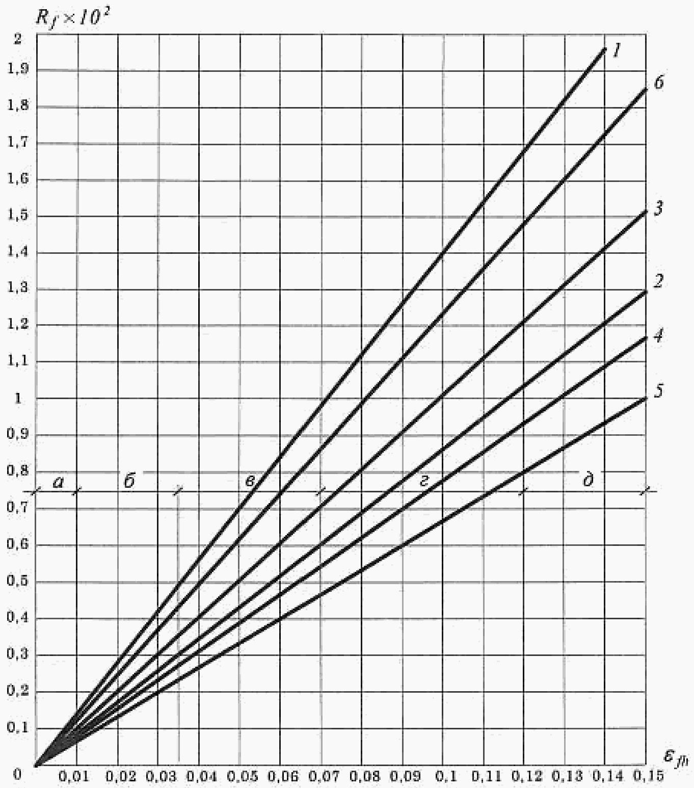

**1**, 2 - супеси; 3 - суглинки; 4 - суглинки ^ic1-14

с 0,07 < *I*$I_p$ <= 0,13; 5 - суглинки с 0,13 < *I*$I_p$ <= 0,17;

6 - глины (в грунтах 2, 4 и 5 содержание пылеватых ^ic6-2

частиц размером 0,05 - 0,005 мм составляет более 50%

по массе); *а* - практически непучинистый;

*б* - слабопучинистый; *в* - среднепучинистый;

*г* - сильнопучинистый; *д* - чрезмернопучинистый

<!-- figure-caption-deferred -->

**и относительной деформации пучения** $\varepsilon_{fh}$

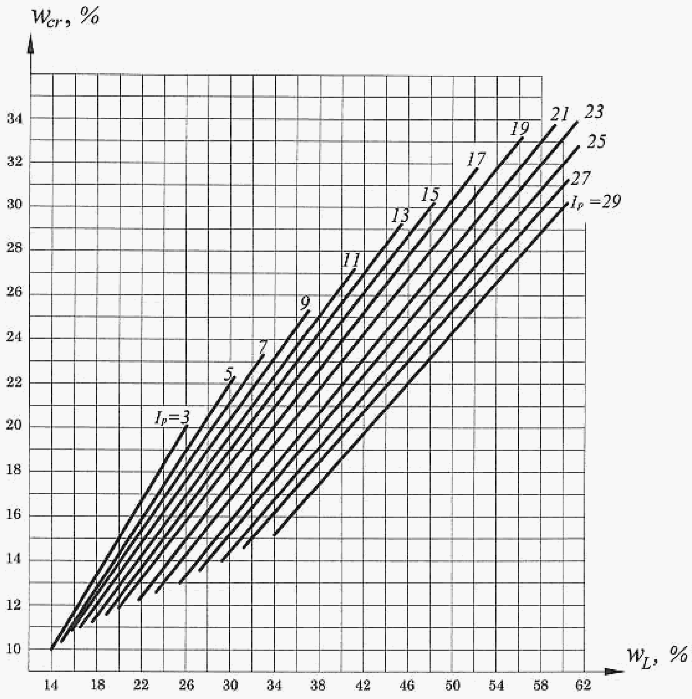

<!-- figure-caption-deferred -->

**от числа пластичности** ***J***$J_p$ **и предела текучести грунта** ***w***$w_L$

6.8.4 По степени пучинистости грунты подразделяют в зависимости от $\varepsilon_{fh}$ на пять групп. Принадлежность глинистого грунта к одной из групп также может быть оценена по параметру R f (см. [7](#^biblio-7)). ^c6-8-4

Для сооружений пониженного уровня ответственности следует характеризовать глинистые минеральные, органоминеральные и органические грунты при влажности больше *W*$W_L$ в соответствии с таблицей 6.11а.

*(абзац введён Изменением N 5, утв. Приказом Минстроя России от 07.12.2023 N 884/пр)*

Таблица 6.11а

^t25

(таблица 6.11а введена Изменением N 5, утв. Приказом

Минстроя России от 07.12.2023 N 884/пр)

<table>
<tr><th>Относительное содержание органического вещества *I**r*, д.е.</th><th>Разновидность грунта по [[ГОСТ 25100]]</th></tr>
<tr><td>0,05 &lt; *I**r* &lt;= 0,1</td><td>Сильнопучинистые</td></tr>
<tr><td>0,1&lt; *I**r* &lt;= 0,75</td><td>Слабопучинистый</td></tr>
<tr><td>0,75 &lt; *I**r* &lt;= 1</td><td>Среднепучинистый</td></tr>
</table>

6.8.5 Расчет оснований, сложенных пучинистыми грунтами, должен выполняться в соответствии с рекомендациями [6](#^biblio-6) и предусматривать проверку устойчивости фундаментов при действии сил морозного пучения. ^c6-8-5

6.8.6 Расчет устойчивости фундаментов на воздействие касательных сил морозного пучения, действующих вдоль боковой поверхности фундаментов, должен выполняться при заложении подошвы фундаментов ниже расчетной глубины промерзания пучинистых грунтов. ^c6-8-6

Устойчивость фундаментов проверяют по формуле

$$\tau_{pn}-F_s\le\Sigma F_n\tag{6.35}$$

где $\tau_{fh}$ - значение расчетной удельной касательной силы пучения, кПа, принимаемое по 6.8.7;

*A*$A_{fh}$ - площадь боковой поверхности фундамента, находящейся в пределах расчетной глубины сезонного промерзания, м²;

*F* - расчетная постоянная нагрузка, кН, при коэффициенте надежности по нагрузке $\gamma_f=0{,}9$;

*F*$F_{rf}$ - расчетное значение силы, кН, удерживающей фундамент от выпучивания вследствие трения его боковой поверхности о талый грунт, лежащий ниже расчетной глубины промерзания;

$\gamma_c$ - коэффициент условий работы, принимаемый равным 1,0;

$\gamma_n$ - коэффициент надежности, принимаемый равным 1,1.

6.8.7 Значение расчетной удельной касательной силы пучения $\tau_{fh}$ следует определять опытным путем в полевых условиях или в лабораторных условиях. При отсутствии опытных данных допускается принимать значения $\tau_{fh}$ по таблице 6.12 в зависимости от вида и характеристик грунта. ^c6-8-7

Таблица 6.12

^t26

<table>
<tr><td rowspan="2">Грунты и их характеристики</td><td colspan="3">Значения расчетной удельной касательной силы пучения $\tau_{fh}$, кПа, при глубине сезонного промерзания-оттаивания *d**th*, м</td></tr>
<tr><td>До 1,5</td><td>2,5</td><td>3 и более</td></tr>
<tr><td>Супеси, суглинки и глины при показателе текучести *I**L* &gt; 0,5, крупнообломочные грунты с глинистым заполнителем, пески мелкие и пылеватые при показателе дисперсности *D* &gt; 5 и коэффициенте водонасыщения *S**r* &gt; 0,95</td><td>110</td><td>90</td><td>70</td></tr>
<tr><td>Супеси, суглинки и глины при 0,25 &lt; *I**L* &lt;= 0,5, крупнообломочные грунты с глинистым заполнителем, пески мелете и пылеватые при *D* &gt; 1 и коэффициенте водонасыщения 0,8 &lt; *S**r* &lt;= 0,95</td><td>90</td><td>70</td><td>55</td></tr>
<tr><td>Супеси, суглинки и глины при *I**L* &lt;= 0,25, крупнообломочные грунты с глинистым заполнителем, пески мелкие и пылеватые при *D* &gt; 1 и коэффициенте водонасыщения 0,6 &lt; *S**r* &lt;= 0,8</td><td>70</td><td>55</td><td>40</td></tr>
<tr><td colspan="4">Примечания 1 Для промежуточных глубин промерзания $\tau_{fh}$ принимается интерполяцией. 2 Показатель дисперсности грунта *D* вычисляют по формуле (6.33). 3 Значения $\tau_{fh}$ для грунтов, используемых при обратной засыпке котлованов, принимается по первой строке таблицы. 4 В зависимости от вида поверхности фундамента приведенные значения $\tau_{fh}$ умножают на коэффициент: при гладкой бетонной необработанной - 1; при шероховатой бетонной с выступами и кавернами до 5 мм - 1,1 - 1,2, до 20 мм - 1,25 - 1,5; при деревянной антисептированной - 0,9; при металлической без специальной обработки - 0,8. 5 Для сооружений геотехнической категории 1 значения $\tau_{fh}$ умножают на коэффициент 0,9.</td></tr>
</table>

6.8.8 Пучинистые свойства крупнообломочных грунтов и песков, содержащих глинистые фракции, в том числе песчаных органоминеральных, а также супесей при I p < 0,02 определяют через показатель дисперсности D. Эти грунты относятся к непучинистым при D < 1, к пучинистым - при D >= 1. Для слабопучинистых грунтов показатель D изменяется в пределах 1 < D < 5. Значение D вычисляют по формуле ^c6-8-8

*(в ред. Изменения N 5, утв. Приказом Минстроя России от 07.12.2023 N 884/пр)*

$$D=k\bar{d}_e\tag{6.36}$$

где *k* - коэффициент, равный 1,85 x 10-4 см³;

*e* - коэффициент пористости;

$\bar{d}$ - средний диаметр частиц грунта, см, вычисляемый по формуле

$$d_h=\\frac{h_1+h_2}{k}\tag{6.37}$$

где *p*$p_1$, *p*$p_2$,..., *p*$p_i$ - - содержание отдельных фракций грунта, доли единицы;

*d*$d_1$, *d*$d_2$,..., *d*$d_i$ - средний диаметр частиц отдельных фракций, см.

6.8.9 Расчетное значение силы F rf, кН, для фундаментов, имеющих вертикальные грани, вычисляют по формуле ^c6-8-9

$$F_n=\sum_{j=1}^{n}R_{A,f}\tag{6.38}$$

где *R*$R_{fj}$ - расчетное сопротивление талых грунтов сдвигу по боковой поверхности фундамента в *j*-м слое, кПа; допускается применять в соответствии с нормативными документами по проектированию свайных фундаментов;

*A*$A_{fj}$ - площадь вертикальной поверхности сдвига в *j*-м слое грунта ниже расчетной глубины промерзания, м²;

*n* - число слоев грунта.

6.8.10 При заложении фундаментов выше расчетной глубины промерзания пучинистых грунтов (малозаглубленные фундаменты) необходимо проводить расчет по деформациям морозного пучения грунтов основания с учетом касательных и нормальных сил морозного пучения. ^c6-8-10

> **Примечание** — Малозаглубленные фундаменты допускается применять для сооружений пониженного уровня ответственности и малоэтажных зданий [5](#^biblio-5) при нормативной глубине промерзания не более 1,7 м.

6.8.11 Расчетные деформации морозного пучения грунтов основания, определяемые с учетом нагрузки от сооружения, не должны превышать предельных значений, которые допускается принимать по аналогии с набухающими грунтами [1](#^biblio-1). ^c6-8-11

6.8.12 Если расчетные деформации морозного пучения основания малозаглубленных фундаментов больше предельных или устойчивость фундаментов на действие сил морозного пучения недостаточна, то кроме возможности изменения глубины заложения фундаментов, следует рассмотреть необходимость применения мероприятий, уменьшающих силы и деформации морозного пучения (устройство подсыпки или замены грунта), а также глубину промерзания (водозащитные, теплозащитные или физико-химические, устройство подсыпки или замены грунта). ^c6-8-12

Если при применении указанных мероприятий деформации морозного пучения не исключены, следует предусматривать конструктивные мероприятия, назначаемые исходя из расчета фундаментов и конструкций сооружения с учетом возможных деформаций морозного пучения.

При проектировании оснований и фундаментов следует предусматривать мероприятия, не допускающие увлажнения пучинистых грунтов основания, а также промораживания их в период строительства.

6.8.13 При незапланированной остановке строительства и при консервации сооружений необходимо до наступления зимнего периода выполнить мероприятия по предотвращению деформаций и разрушений, обусловленных процессами сезонного промерзания-оттаивания пучинистых грунтов основания. ^c6-8-13

6.8.14 Во избежание промерзания грунтов под подошвой фундаментов в подвальных и цокольных этажах недостроенных или построенных зданий без обеспечения теплового контура следует организовать временное отопление этих помещений в зимние месяцы или применение теплоизоляции. ^c6-8-14

6.8.15 Не допускается укладка фундаментов на промороженный грунт основания без проведения специальных исследований замерзшего грунта. Для предотвращения деформаций и разрушения фундаментов необходимо проводить проверку устойчивости фундаментов на действие касательных и нормальных сил морозного пучения. ^c6-8-15

При устройстве фундаментов в зимний период для предохранения грунтов от промерзания следует устраивать временные теплоизоляционные покрытия, параметры которых определяются в соответствии с теплотехническим расчетом.

## 6.9 Закрепленные грунты

6.9.1 Закрепление грунтов производят в целях улучшения их физико-механических свойств для существующих и вновь строящихся зданий и сооружений. ^c6-9-1

Для существующих зданий возможность и способ закрепления грунтов основания следует устанавливать с учетом характера деформаций основания и категории технического состояния сооружений (см. (приложение Д)).

Закрепление грунтов может выполняться отдельными элементами, массивами и сочетаниями элементов и массивов закрепленного грунта различной формы в плане и по глубине.

Основания из закрепленных грунтов используются в качестве искусственных оснований фундаментов, а также временных ограждающих конструкций котлованов, противофильтрационных завес и других заглубленных конструкций.

*(в ред. Изменения N 5, утв. Приказом Минстроя России от 07.12.2023 N 884/пр)*

6.9.2 Для закрепления грунтов в зависимости от цели закрепления и инженерно-геологических условий применяют следующие способы: ^c6-9-2

инъекционный - закрепление грунта нагнетанием в грунт под давлением растворов на основе органических, неорганических полимеров или цементов через инъекторы, манжетные колонны или скважины в одном из следующих режимов: пропитки, пропитки с применением виброцементации, гидроразрыва, заполнительной цементации пустот, полостей, трещин, локальных участков зон разуплотнения в массивах грунта и контактных зонах "конструкции-грунт";

глубинное перемешивание/буросмесительный - формирование элементов закрепленного грунта заданной формы в плане и по глубине буровым инструментом за счет механического разрушения грунта без извлечения его на поверхность и смешивания с раствором вяжущего ("мокрый" способ) или сухим вяжущим ("сухой" способ), используемый для водонасыщенных грунтов;

струйная цементация/гидроструйный - формирование элементов закрепленного грунта заданной формы в плане и по глубине буровым инструментом за счет разрушения грунта без извлечения его на поверхность и смешивания с раствором вяжущего с использованием струи высокого давления (раствора-воздуха-воды), реализуемый одним из следующих способов: однокомпонентный (применение инъекционного раствора), двухкомпонентный (применение струи воздуха и инъекционного раствора), трехкомпонентный (применение струи воздуха, воды и инъекционного раствора);

термический - путем спекания грунта в скважине высокотемпературными газами или с помощью электронагрева грунта;

электрохимический - способ комбинированного применения электрического тока и химических растворов, вводимых в грунт под давлением при одновременном воздействии постоянного электрического тока.

Способ закрепления, рецептура растворов и технологические параметры должны обеспечивать необходимые расчетные физико-механические характеристики закрепленного грунта или массива и удовлетворять требованиям по охране окружающей среды.

(п. 6.9.2 в ред. Изменения N 5, утв. Приказом Минстроя России от 07.12.2023 N 884/пр)

6.9.3 Инъекционные способы закрепления грунтов в режиме пропитки при инъекции через скважины, инъекторы и манжетные колонны (разрыв обоймы выполняется с одномоментным созданием повышенного по отношению к режиму пропитки давлением) следует применять в следующих условиях: ^c6-9-3

силикатизация и смолизация - в песках с коэффициентом фильтрации от 0,5 до 80 м/сут;

силикатизация - в просадочных грунтах при коэффициенте фильтрации не менее 0,2 м/сут и коэффициенте водонасыщения *S*$S_r$ <= 0,7, в песках с учетом положений [[ГОСТ Р 59705]] при коэффициенте фильтрации не менее 0,5 м/сут и не более 80 м/сут;

цементация - в соответствии с положениями [[ГОСТ Р 59538]]: в крупнообломочных грунтах, крупнозернистых и гравелистых песках при коэффициенте фильтрации не менее 80 м/сут, растворами на основе цемента типа "И", в песках разной крупности при коэффициенте фильтрации от 10 до 80 м/сут растворами на основе цемента типа ИТДВ и ИОТДВ;

виброинъекция - в песках с коэффициентом фильтрации от 0,5 до 80 м/сут растворами на основе цемента в соответствии с положениями [[ГОСТ Р 59538]] для цементации (А.1, приложение А) и [[ГОСТ Р 59705]] - для силикатизации.

(п. 6.9.3 в ред. Изменения N 5, утв. Приказом Минстроя России от 07.12.2023 N 884/пр)

6.9.4 Инъекционный способ закрепления грунтов в режиме гидроразрыва при инъекции через инъекторы и манжетные колонны и в режиме заполнительной цементации по [2](#^biblio-2) следует применять в соответствии с положениями [[ГОСТ Р 59538]], [[ГОСТ Р 59704]] и [[ГОСТ Р 59706]] в грунтах любого типа с применением растворов на основе цемента типа И. Применение растворов на основе цементов типа ИТДВ и ИОТДВ должно быть обосновано проектом и подтверждено результатами опытных работ, выполняемых на этапе изысканий, и соответствовать положениям [[ГОСТ Р 59538]], [[ГОСТ Р 59704]], [[ГОСТ Р 59706]], [[СП 45.13330]] и [3680?] в части применения таких растворов. ^c6-9-4

(п. 6.9.4 в ред. Изменения N 5, утв. Приказом Минстроя России от 07.12.2023 N 884/пр)

6.9.5 Буросмесительный способ допускается применять в любых грунтах (глинистых, песчаных, лессовых, илах), за исключением торфов и сапропелей. Возможность применения глубинного способа укрепления заторфованных грунтов с повышенным (более 10%) содержанием органических примесей устанавливается лабораторными исследованиями коррозионной стойкости грунтоцемента. Возможность применения метода в условиях высокой агрессивности грунтовых вод должна быть подтверждена исследованиями в лабораторных условиях с применением специальных устойчивых к агрессии вяжущих. ^c6-9-5

Для буросмесительного закрепления грунтов ("мокрым" и "сухим" способом) следует применять растворы на основе цемента типа И по [[ГОСТ Р 59538]] или сухое вяжущее на основе цемента или извести в соответствии с положениями настоящего раздела и [[ГОСТ Р 59706]].

*(абзац введён Изменением N 5, утв. Приказом Минстроя России от 07.12.2023 N 884/пр)*

6.9.6 Для гидроструйного закрепления грунтов (струйная цементация) следует применять растворы на основе портландцемента или инъекционных растворов типа И по [[ГОСТ Р 59538]], в соответствии с положениями [[ГОСТ Р 59706]] и дополнительными положениями настоящего раздела. ^c6-9-6

(п. 6.9.6 в ред. Изменения N 5, утв. Приказом Минстроя России от 07.12.2023 N 884/пр)

6.9.7 Термический способ следует применять для закрепления лессовых просадочных грунтов с коэффициентом водонасыщения S r <= 0,5. ^c6-9-7

6.9.8 Для закрепления грунтов следует использовать в качестве крепителей водные растворы силиката натрия по [[ГОСТ Р 59705]], растворы на основе цемента по [[ГОСТ Р 59538]], [[ГОСТ Р 59704]], [[ГОСТ Р 70308]]. ^c6-9-8

Закрепление грунтов с использованием крепителей, растворов на основе других органических и неорганических полимеров допускается при условии соблюдения следующих положений:

- соблюдение положений [[ГОСТ Р 59706]] и [[ГОСТ Р 70695]] в части характеристик закрепленного грунта;

- применение материалов, исключающих негативное влияние на окружающую среду и здоровье людей с соблюдением санитарных требований и требований охраны труда как при производстве работ, так и на весь, определенный действующими документами по стандартизации или заданный при проектировании жизненный цикл объекта;

- применение материалов, обеспечивающих определенные действующими документами по стандартизации или проектом противоаварийных, или иных временных работ базовые по [[ГОСТ Р 59706]] (за исключением модуля деформации - если это обосновано проектом) характеристики закрепленных грунтов;

- для проектов противоаварийных мероприятий возможность выполнения при необходимости (обосновывается проектом) работ по обеспечению требований [2] на весь период жизненного цикла сооружения, предусмотренного [[ГОСТ 27751]].

Для регулирования процессов схватывания и гелеобразования или предварительной обработки закрепленного грунта применяют рецептурные добавки.

(п. 6.9.8 в ред. Изменения N 5, утв. Приказом Минстроя России от 07.12.2023 N 884/пр)

6.9.9 Рецептуры растворов для цементации грунтов способами инъекции, буросмесительными и по струйной технологии и физико-механические характеристики закрепленных грунтов следует уточнять по результатам закрепления в лабораторных и полевых условиях. Допускается определение вида и расхода вяжущего на основании имеющихся данных для аналогичных грунтовых условий. ^c6-9-9

6.9.10 Изыскания при проектировании оснований из закрепленных грунтов способом инъекции должны выполняться по специально разработанной дополнительной программе изысканий. Материалы инженерно-геологических изысканий помимо характеристик, указанных в [7](#^biblio-7), должны содержать данные о коэффициенте фильтрации грунта, химическом составе водных вытяжек грунтовых вод. В программу должны быть включены дополнительные требования по проведению в рамках изысканий при необходимости лабораторных исследований (определяется на этапе проектирования в зависимости от уровня ответственности объекта и (или) объектов окружающей застройки) и полевых опытных работ. ^c6-9-10

(п. 6.9.10 в ред. Изменения N 5, утв. Приказом Минстроя России от 07.12.2023 N 884/пр)

6.9.11 Проектирование закрепления грунтов следует выполнять в соответствии с положениями [[ГОСТ Р 59538]], [[ГОСТ Р 59704]], [[ГОСТ Р 59705]], [[ГОСТ Р 59706]], [[ГОСТ Р 70308]], [[ГОСТ Р 70695]], [[СП 45.13330]], [[СП 291.1325800]] и дополнительных положений настоящего раздела. ^c6-9-11

При проектировании закрепления грунтов при новом строительстве способами глубинного перемешивания и струйной цементации для более равномерного распределения нагрузки на закрепленное основание может быть предусмотрено устройство распределяющей подушки по верху элементов закрепленного грунта.

При проектировании для всех способов закрепления следует назначать базовые характеристики закрепленного грунта:

- плотность - $\rho_{stb}$;

- предел прочности на одноосное сжатие - *R*$R_{stb}$;

- условный радиус закрепления - *r*$r_{stb}$;

- глубина закрепления - *h*$h_{stb}$;

*-* условные границы закрепления - *a*$a_{stb}$, *b*$b_{stb}$.

Модуль деформации - *E*$E_{stb}$ как базовый показатель может быть назначен при необходимости для грунтов/массивов из элементов закрепленного грунта, закрепленных растворами на основе цемента для способов: глубинное перемешивание, струйная цементация, инъекция в режиме гидроразрыва, других способов закрепления, если это предусмотрено проектом.

Дополнительные характеристики закрепленного грунта назначаются при проектировании на основании базовых характеристик и определяются:

- для грунтов, закрепленных растворами на основе цемента по технологии пропитки (типы ИТДВ и ИОТДВ), глубинного перемешивания и струйной цементации - по [[СП 291.1325800]] (раздел 5);

- для других технологий закрепления и инъекционных растворов - на основании опытных работ.

(п. 6.9.11 в ред. Изменения N 5, утв. Приказом Минстроя России от 07.12.2023 N 884/пр)

6.9.12 Принятые при проектировании значения расчетных характеристик закрепленного грунта (контролируемые параметры) должны быть подтверждены результатами опытно-производственных и контрольных работ, выполняемых на всем протяжении закрепления. Контролируемые параметры закрепления и объемы опытно-производственных и контрольных работ назначаются при проектировании и должны обеспечивать возможность достоверной оценки соответствия требованиям проекта. ^c6-9-12

(п. 6.9.12 в ред. Изменения N 5, утв. Приказом Минстроя России от 07.12.2023 N 884/пр)

6.9.13 Расчет искусственных оснований из закрепленного грунта должен выполняться по 1-й и 2-й группе предельных состояний для сооружений геотехнических категорий 2 и 3 в обязательном порядке. Для сооружений геотехнической категории 1 выполнение расчета по 1-й группе предельных состояний определяется требованиями, изложенными в [6](#^biblio-6). ^c6-9-13

Численное моделирование элементов закрепленных грунтов, выполненных по различным технологиям, выполняют с использованием расчетных моделей, в основе которых заложены критерии прочности Мора-Кулона или Хока-Брауна.

*(абзац введён Изменением N 4, утв. Приказом Минстроя России от 27.12.2021 N 1022/пр; в ред. Изменения N 5, утв. Приказом Минстроя России от 07.12.2023 N 884/пр)*

6.9.14 При проектировании искусственных оснований из элементов закрепленного грунта для сооружений класса КС-3 следует предусматривать полевые испытания статической нагрузкой как отдельных элементов, так и фрагментов закрепленного массива. Для сооружений класса КС-2 - если это предусмотрено проектом. ^c6-9-14

Размеры штампов следует определять размерами элементов закрепленного грунта.

(п. 6.9.14 в ред. Изменения N 5, утв. Приказом Минстроя России от 07.12.2023 N 884/пр)

6.9.15 Проектом закрепления грунтов должны быть предусмотрены опытно-производственные работы по закреплению. Для объектов пониженного уровня ответственности, класса КС-1 по [[ГОСТ 27751]] при геотехнической категории 1 опытно-производственные работы допускается не предусматривать. Для остальных объектов на этапе проектирования назначаются расчетные технологические параметры. Рабочие технологические параметры уточняются и назначаются по результатам опытно-производственных работ. ^c6-9-15

Проектом закрепления грунтов должны быть предусмотрены контрольные работы, предусматривающие оценку качества закрепления как в процессе работ, так и после их завершения в объемах, предусмотренных [[СП 45.13330]].

(п. 6.9.15 в ред. Изменения N 5, утв. Приказом Минстроя России от 07.12.2023 N 884/пр)

6.9.16 При проектировании для элемента закрепленного грунта следует назначать следующие границы закрепления. ^c6-9-16

Для инъекционных способов закрепления:

расчетный радиус - расстояние от оси скважины/инъектора до границы закрепления, за пределами которой характеристики грунта принимаются равными природным, назначается при проектировании в зависимости от вида и свойств раствора, фильтрационных характеристик грунта и подтверждается по результатам опытных работ;

расчетная глубина - расстояние от верхней до нижней границы закрепления в пределах сечения с расчетным радиусом, за пределами которых характеристики грунта принимаются равными природным, назначается при проектировании по глубине погружения инъекторов и (или) глубине установки манжетных колонн или скважин с учетом пропитки под ними.

Для буросмесительного способа закрепления:

расчетный радиус - расстояние от оси элемента закрепленного грунта до границы закрепления, за пределами которой характеристики грунта принимаются равными природным, назначается при проектировании по размерам бурового инструмента (диаметр буросмесителя);

расчетная глубина - расстояние от верхней до нижней границы закрепления в пределах сечения с расчетным радиусом, за пределами которых характеристики грунта принимаются равными природным, назначается при проектировании по глубине погружения буросмесителя.

Для струйной цементации:

расчетный радиус - расстояние от оси грунтоцементного элемента до границы закрепления, за пределами которой характеристики грунта принимаются равными природным, назначается при проектировании по расчетной границе грунтоцементного элемента в плане на основании положений настоящего раздела и опытным работам, выполненным при изысканиях, если они были предусмотрены проектом;

расчетная глубина - расстояние от верхней до нижней границы закрепления в пределах сечения с расчетным радиусом, за пределами которых характеристики грунта принимаются равными природным, назначается при проектировании по глубине погружения бурового инструмента, формирующего элемент закрепленного грунта с учетом размыва грунта без формирования расчетного радиуса в нижней и верхней точках остановки монитора (до выполнения опытных работ допускается принимать 0,5 м в нижней и от 0,0 до 0,5 м в верхней точке).

До опытных работ допускается назначать значения характеристик по таблице 6.13.

(п. 6.9.16 в ред. Изменения N 5, утв. Приказом Минстроя России от 07.12.2023 N 884/пр)

6.9.17 Расчетное сопротивление одноосному сжатию (R r), закрепленного всеми способами грунта по результатам испытаний образцов, следует определять по формуле ^c6-9-17

$$R=R_s/\gamma_{ss}\tag{6.39}$$

где *R*$R_{stb}$ - нормативное сопротивление закрепленного грунта сжатию, МПа;

$\gamma_{ss}$ - коэффициент надежности по материалу, принимаемый по результатам работ при расчете по первому предельному состоянию и контролю по образцам, отобранным из элемента закрепленного грунта, равным 1,5 для элементов закрепленного грунта, выполненных по технологиям инъекции и глубинного перемешивания, равным 1,75 - для элементов закрепленного грунта, выполненных по методу струйной цементации и (или) при контроле по грунтоцементной пульпе. При контроле по образцам, изготовленным в лаборатории для всех способов и режимов закрепления в зависимости от коэффициента вариации прочности по методике [[ГОСТ 20522]]. При расчете по второму предельному состоянию $\gamma_{ss}$ следует принимать равным 1.

Значение нормативного сопротивления закрепленного грунта сжатию принимается равным среднему значению прочности на одноосное сжатие образцов, отобранных из элемента закрепленного грунта в одной горизонтальной плоскости не менее чем в 3-х точках от оси элемента до точки, соответствующей 5/6 радиуса и определенному по методике [[ГОСТ 20522]].

(п. 6.9.17 в ред. Изменения N 5, утв. Приказом Минстроя России от 07.12.2023 N 884/пр)

Таблица 6.13

^t27

<table>
<tr><td colspan="5">Параметры песчаных и лессовых грунтов, закрепленных инъекцией химических и цементных растворов</td></tr>
<tr><td>Способ закрепления</td><td>Грунт</td><td>Коэффициент фильтрации, м/сут</td><td>Радиус закрепления грунта, м</td><td>Нормативное сопротивление сжатию *R*, МПа</td></tr>
<tr><td rowspan="3">Силикатизация двухрастворная на основе силиката натрия и хлористого кальция</td><td rowspan="3">Песок</td><td>10 - 20</td><td>0,2 - 0,3</td><td>1 - 1,5</td></tr>
<tr><td>20 - 50</td><td>0,3 - 0,6</td><td>1,5 - 2,5</td></tr>
<tr><td>50 - 80</td><td>0,6 - 1,0</td><td>2,5 - 8,0</td></tr>
<tr><td rowspan="2">Силикатизация однорастворная с H2SiF6</td><td rowspan="2">Песок</td><td>1,0 - 10</td><td>0,3 - 0,5</td><td>1 - 2</td></tr>
<tr><td>10 - 50</td><td>0,5 - 0,8</td><td>2 - 5</td></tr>
<tr><td rowspan="2">Силикатизация однорастворная двухкомпонентная с отвердителем: алюминат натрия или ортофосфорная кислота</td><td rowspan="2">Песок</td><td>0,5 - 1,0</td><td>0,3 - 0,5</td><td rowspan="2">0,1 - 0,5</td></tr>
<tr><td>1,0 - 5,0</td><td>0,5 - 0,8</td></tr>
<tr><td rowspan="2">Силикатизация газовая на основе силиката натрия и газа CO2</td><td rowspan="2">Песок</td><td>0,5 - 5,0</td><td>0,3 - 0,5</td><td>1 - 2</td></tr>
<tr><td>5 - 20</td><td>0,5 - 0,8</td><td>2,0 - 3,5</td></tr>
<tr><td rowspan="2">Силикатизация однорастворная однокомпонентная</td><td rowspan="2">Лесс</td><td>0,2 - 0,5</td><td>0,3 - 0,5</td><td>0,5 - 2,0</td></tr>
<tr><td>0,5 - 2</td><td>0,5 - 0,8</td><td>2,0 - 3,5</td></tr>
<tr><td rowspan="2">Силикатизация газовая на основе силиката натрия и газа CO2</td><td rowspan="2">Лесс</td><td>0,1 - 0,5</td><td>0,4 - 0,6</td><td>0,5 - 2,0</td></tr>
<tr><td>0,5 - 2</td><td>0,6 - 1,0</td><td>2,0 - 3,5</td></tr>
<tr><td rowspan="3">Смолизация однорастворная двухкомпонентная на основе карбамидной смолы и кислого отвердителя</td><td rowspan="3">Песок</td><td>0,5 - 5</td><td>0,3 - 0,5</td><td>0,5 - 1,5</td></tr>
<tr><td>5 - 20</td><td>0,5 - 0,65</td><td>1,5 - 3,0</td></tr>
<tr><td>20 - 50</td><td>0,65 - 0,85</td><td>3,0 - 4,5</td></tr>
<tr><td>Цементация растворами типа ИТДВ и ИОТДВ по [[ГОСТ Р 59538]]</td><td>Песок</td><td>1 - 80</td><td>0,1 - 0,5</td><td>0,5 - 3,0</td></tr>
<tr><td colspan="5">*(в ред. Изменения N 5, утв. Приказом Минстроя России от 07.12.2023 N 884/пр)*</td></tr>
</table>

6.9.18 Расположение элементов закрепленного грунта в плане искусственных оснований может производиться по схемам, приведенным на [5](#^biblio-5). ^c6-9-18

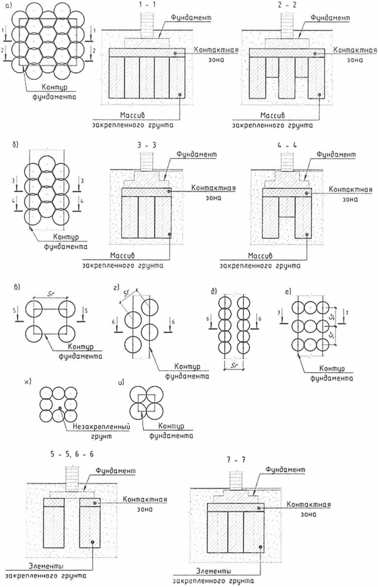

*а*, *б* - сплошное из рядом расположенных элементов;

*в*, *г* - отдельно стоящих элементов; *д*, *е*, *ж* - отдельно

расположенных рядов сплошных элементов

<!-- figure-caption-deferred -->

**элементов закрепленного грунта в плане**

(рисунок 6.13 в ред. Изменения N 5, утв. Приказом

Минстроя России от 07.12.2023 N 884/пр)

6.9.19 Геометрические параметры элементов (радиус закрепления) должны подтверждаться результатами опытно-производственных работ. Глубина закрепления назначается предварительно на основании данных инженерно-геологических изысканий, выбранного способа закрепления конструкций проектируемых фундаментов, проектных нагрузок и требований норм по предельно допустимым деформациям и уточняется по результатам расчетов. ^c6-9-19

6.9.20 Расчет основания по предельным состояниям проводят в соответствии с требованиями [6](#^biblio-6) и [5](#^biblio-5). По результатам расчета и работ на опытном участке, при необходимости, проводят корректировку геометрических параметров массива и отдельных элементов закрепленного грунта. ^c6-9-20

6.9.21 В проекте закрепления должна быть определена последовательность устройства элементов в плане и по глубине массива и технологические параметры (скорость проходки буросмесителя/форсунки, интенсивность подачи раствора, режимы инъекции, давление), позволяющие обеспечить требуемую форму, размеры и прочность закрепляемого элемента. ^c6-9-21

6.9.22 По результатам опытно-производственных работ уточняют технологические параметры и назначают прочностные и деформационные характеристики. При необходимости выполняют корректировку проекта с уточнением фактических параметров закрепленного грунта. ^c6-9-22

(п. 6.9.22 в ред. Изменения N 1, утв. Приказом Минстроя России от 20.11.2018 N 736/пр)

6.9.23 Технология производства работ по созданию закрепленного массива грунта должна обеспечивать минимизацию негативного воздействия на основание фундаментов возводимого или существующего сооружения. ^c6-9-23

(п. 6.9.23 в ред. Изменения N 5, утв. Приказом Минстроя России от 07.12.2023 N 884/пр)

6.9.24 Выбор метода закрепления грунтов следует выполнять с учетом оценки конструктивной и экономической эффективности. Оценку допускается выполнять в соответствии с [4](#^biblio-4), при этом обязательным условием оценки вариантов технических решений по закреплению грунтов следует считать обеспечение конструктивной безопасности объекта/основания. ^c6-9-24

(п. 6.9.24 в ред. Изменения N 5, утв. Приказом Минстроя России от 07.12.2023 N 884/пр)

6.9.25 Критерии конструктивной эффективности должны обеспечивать выбор оптимального решения, исходя из обеспечения безопасной эксплуатации объекта в соответствии с требованиями допустимых показателей по несущей способности и деформируемости отдельных элементов или объекта в целом. Критерии экономической эффективности должны обеспечивать минимизацию затрат для принятого варианта усиления в сравнении с другими вариантами при условии обеспечения требований конструктивной безопасности. ^c6-9-25

(п. 6.9.25 в ред. Изменения N 5, утв. Приказом Минстроя России от 07.12.2023 N 884/пр)

6.9.26 В качестве расчетных показателей критериев конструктивной эффективности следует принимать значения E, R (модуль деформации и прочность на одноосное сжатие растворов, применяемых для закрепления), E s, R s (модуль деформации и прочность на одноосное сжатие элемента закрепленного грунта или массива из отдельных элементов закрепленного грунта). ^c6-9-26

(п. 6.9.26 в ред. Изменения N 5, утв. Приказом Минстроя России от 07.12.2023 N 884/пр)

## 6.10 Армированные грунты

6.10.1 Армирование грунта является методом преобразования его свойств путем введения в него специальных элементов, обеспечивающих улучшение деформационных и прочностных характеристик. ^c6-10-1

6.10.2 Армирование грунта подразделяется по характеру расположения армирующих элементов, по материалу элементов, по способу производства работ. ^c6-10-2

По характеру расположения армирующих элементов армирование грунта подразделяется:

- на вертикальное (рисунок 6.14 а, б);

- горизонтальное (рисунок 6.14 в, г, д);

- наклонное в одном или нескольких направлениях (рисунок 6.14 е, ж, з);

- ячеистыми структурами (рисунок 6.14 и, к);

- объемно-дисперсное.

По материалу армирующих элементов армирование грунта подразделяется на выполняемое:

- из железобетонных элементов;

- закрепленного грунта, в том числе по струйной или буросмесительной технологии (см. 6.9);

- металлических элементов;

- геотекстиля, полимерных пленок, волокон, нитей, кордовой ткани.

В проекте может предусматриваться армирование как естественного массива грунта, так и грунта искусственного основания. По способу производства работ армирование грунта (массива грунта) подразделяется на армирование:

- с использованием погружения инвентарных элементов;

- бетонированием или инъекцией;

- расстилкой и раскладкой армирующих элементов и последующей засыпкой или замывом.

6.10.3 Вертикальное армирование следует применять для улучшения свойств естественных или устройства искусственных оснований, повышения устойчивости склонов и откосов, снижения деформаций возводимых сооружений и окружающей застройки при проведении строительных работ в непосредственной близости от них. ^c6-10-3

*(в ред. Изменения N 5, утв. Приказом Минстроя России от 07.12.2023 N 884/пр)*

В качестве армирующих элементов допускается использовать железобетонные, бетонные, цементогрунтовые (устраиваемые путем цементации, струйной технологии или буросмесительным способом), металлические элементы, а также столбы из песчаных грунтов или щебня.

6.10.4 Горизонтальное армирование следует предусматривать: ^c6-10-4

- для исключения выпора слабых грунтов из-под сооружения или искусственной насыпи;

- повышения устойчивости склонов и откосов;

- снижения активного и повышения пассивного давления грунта на подпорные стены и сооружения.

Горизонтальное армирование следует выполнять с применением металлических нагелей, геотекстиля, полимерных пленок и волокон, кордовой ткани.

6.10.5 Наклонное армирование в одном или нескольких направлениях следует предусматривать для повышения устойчивости склонов и откосов; повышения несущей способности и деформационных характеристик основания, как при новом строительстве, так и при усилении оснований существующих сооружений; снижения активного и повышения пассивного давления грунта на подпорные стены и сооружения. ^c6-10-5

Наклонное армирование может выполняться путем устройства элементов с применением свай, струйной и буросмесительной технологии или путем устройства грунтовых нагелей.

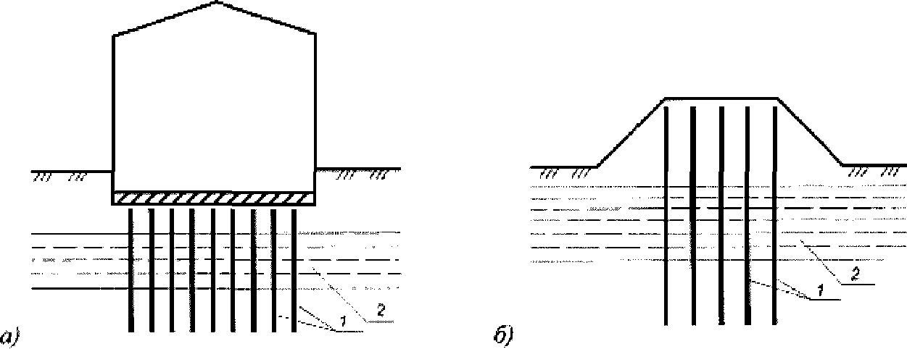

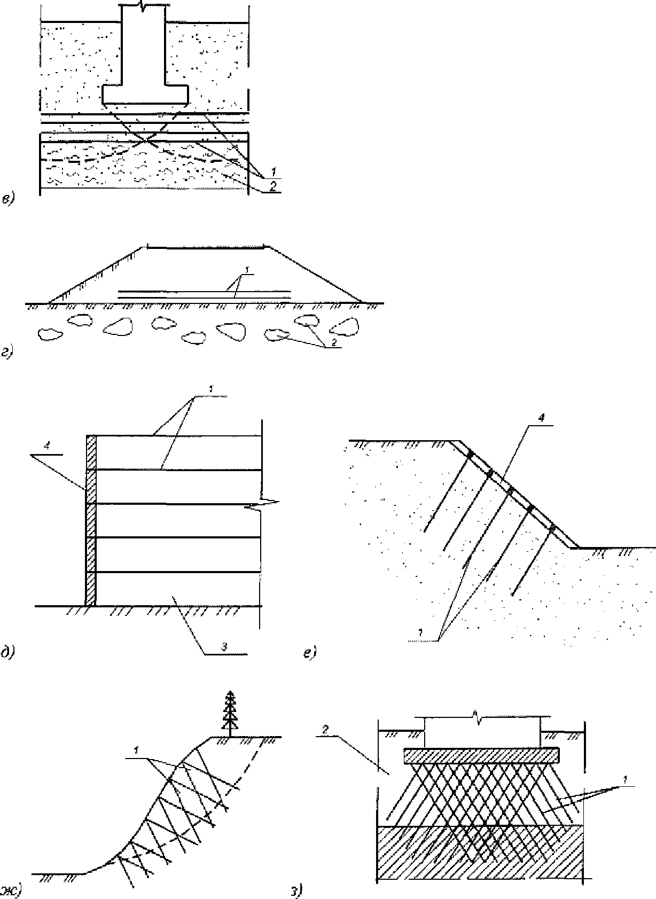

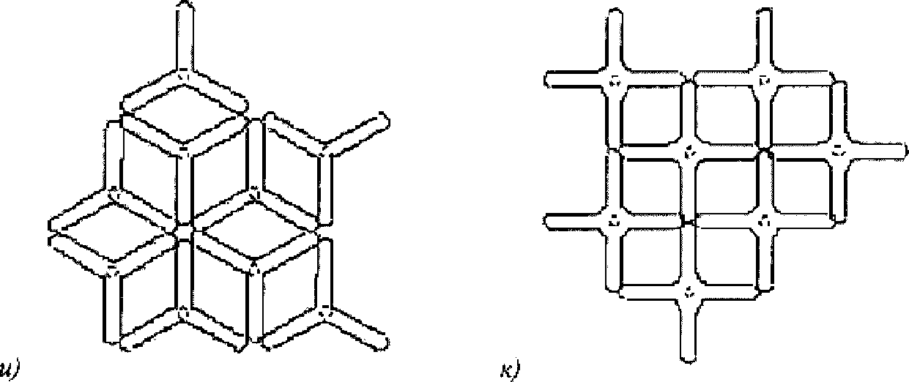

1 - армирующие элементы; 2 - слабый грунт; ^ic1-15

3 - насыпной грунт; 4 - облицовка ^ic3-6

<!-- figure-caption-deferred -->

**основания армирующими элементами**

6.10.6 В проектной документации на устройство армированных оснований должны быть определены и указаны: ^c6-10-6

- тип применяемых армирующих элементов, их номенклатура или размеры, их прочностные и деформационные характеристики;

- размещение армирующих элементов в плане и по высоте;

- прочностные и деформационные характеристики насыпного грунта (при наличии), требования к степени его уплотнения;

- прочностные и деформационные характеристики армированного грунта в целом (при необходимости).

6.10.7 В случае применения армирования грунтовых массивов при наличии в основании агрессивных грунтов или подземных вод следует предусматривать разработку мероприятий по защите армирующих элементов от коррозии в соответствии с требованиями [[СП 28.13330]]. ^c6-10-7

6.10.8 Проектирование оснований с применением упрочнения грунтов посредством их армирования горизонтальными, наклонными или вертикальными элементами в ненарушенных массивах природного сложения или в насыпных толщах при их послойном возведении следует предусматривать следующие этапы: ^c6-10-8

- выявление зоны, в которой требуется выполнить армирование грунта;

- оценка свойств массива или насыпи с учетом наличия в них армирующих элементов;

- предварительное распределение армирующих элементов в выбранной зоне с назначением расстояний между ними по глубине и в плане, длин и иных геометрических характеристик армирующих элементов;

- вычисление расчетных нагрузок и воздействий, определение напряжений в зонах армированного грунта;

- в случае проектирования фундаментов, подбор требуемых размеров фундаментов в плане, проверка основания и фундаментов по двум группам предельных состояний с учетом анизотропии прочностных и деформационных характеристик армированного грунтового массива;

- в случае проектирования откосов и подпорных конструкций, а также усиления склонов, проверка грунтового массива и подпорных конструкций по первой группе предельных состояний с учетом анизотропии характеристик армированного грунта или массива;

- выбор конструкций и материалов для сжимаемых, растягиваемых или срезаемых армирующих элементов, уточнение их длин и наклона к горизонту в пределах соответствующих участков по высоте и в плане, назначение поперечных сечений элементов на основе проверки их прочности, сопротивления выдергиванию и вдавливанию, исходя из условия восприятия передаваемых на каждый из элементов усилий, и оптимизация проектных решений;

*(в ред. Изменения N 5, утв. Приказом Минстроя России от 07.12.2023 N 884/пр)*

- разработка мер по дренированию грунтового массива или насыпи и защите от коррозии армирующих элементов;

- уточнение принятых параметров армирующих элементов на основе испытаний на моделях или в реальных условиях.

6.10.9 Армирование грунтовых массивов и насыпей может осуществляться как с использованием одного армирующего материала, так и путем комбинации различных материалов и видов армирующих элементов. ^c6-10-9

6.10.10 Армирующие материалы должны обладать необходимой прочностью, низкой ползучестью, долговечностью, высокими значениями коэффициента трения между армирующим материалом и грунтом. ^c6-10-10

6.10.11 Армирующие элементы из стали должны удовлетворять требованиям [[СП 16.13330]], а железобетонные и бетонные элементы - требованиям [[СП 63.13330]]. ^c6-10-11

Армирующие элементы из геосинтетических материалов должны соответствовать требованиям действующих нормативных документов, иметь сопроводительную документацию, подтверждающую их соответствие нормативным требованиям, включая паспорта качества, и подвергаться входному контролю.

Армирующие элементы из закрепленного грунта должны удовлетворять требованиям 6.9.

Элементы из армированного грунтоцемента должны удовлетворять требованиям [[СП 291.1325800]].

*(абзац введён Изменением N 5, утв. Приказом Минстроя России от 07.12.2023 N 884/пр)*

6.10.12 Расчет или проверка армированных оснований и армирующих их элементов должны быть выполнены по двум группам предельных состояний: ^c6-10-12

Первая группа:

- по несущей способности (предельному сопротивлению) грунта основания;

- общей устойчивости оснований, если на них передаются значительные горизонтальные нагрузки, сооружение устраивается на откосе или вблизи него или армированное основание подстилается крутопадающими слоями грунта;

- сопротивлению выдергиванию и вдавливанию армирующих элементов;

- прочности материала армирующих элементов и облицовок.

Вторая группа:

- по деформациям;

- по образованию или чрезмерному раскрытию трещин в железобетонных и бетонных армирующих элементах, если это требуется для защиты от коррозии (см. 6.10.7).

6.10.13 При проведении расчетов по предельным состояниям армированные в одном направлении основания допускается рассматривать как трансверсально-изотропную среду. Свойства такой среды допускается определять расчетом, натурными испытаниями либо численным моделированием в соответствии с требованиями [8](#^biblio-8). ^c6-10-13

Основания, армированные в двух и более направлениях, а также ячеистыми структурами, допускается при проектировании рассматривать как анизотропную либо изотропную среду в зависимости от взаимного расположения разнонаправленных армирующих элементов. Свойства таких оснований следует определять численным моделированием или натурными испытаниями.

Искусственные основания, устраиваемые с применением объемно-дисперсного армирования, следует рассматривать как изотропную среду. Свойства таких оснований следует определять на приготовленных образцах лабораторными или на опытных фрагментах натурными испытаниями.

6.10.14 При применении геосинтетических материалов в качестве армирующих элементов коэффициенты трения между материалом и грунтом, а также прочность на разрыв их соединений следует определять на основании испытаний. ^c6-10-14

6.10.15 При проектировании армированных массивов и насыпей следует проверить невозможность наступления предельных состояний первой группы, при которых происходит сдвиг или опрокидывание армированной области в целом, либо потеря несущей способности или сдвиг подстилающего неармированного грунта (см. [1](#^biblio-1)). ^c6-10-15

При выполнении проверки общей устойчивости и несущей способности основания в таких случаях армированный массив допускается считать недеформируемым жестким телом, а расчет следует выполнять в соответствии с требованиями 5.7.1, 5.7.6 - 5.7.10.

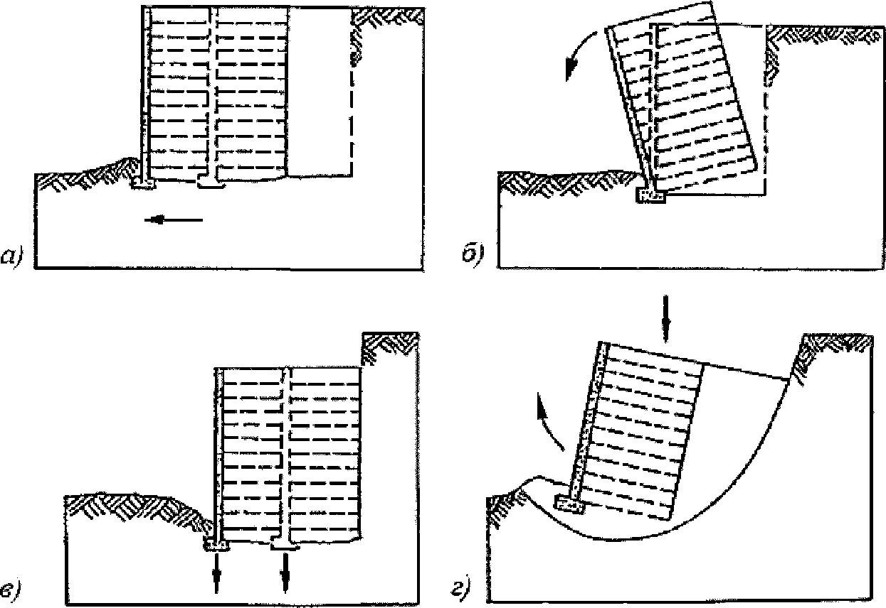

*а* - сдвиг по подошве; *б* - опрокидывание;

*в* - потеря несущей способности подстилающего

массива грунта; *г* - глубинный сдвиг

<!-- figure-caption-deferred -->

**устойчивости и несущей способности оснований**

**армированных массивов и грунтов**

6.10.16 Расчетные величины усилий в армирующих элементах допускается определять методами предельного равновесия или с помощью моделирования изменения напряженно-деформированного состояния армированного массива численными методами. ^c6-10-16

6.10.17 Армирующие элементы, в которых возникают растягивающие усилия, должны быть проверены расчетом по прочности их материала и по сопротивлению выдергиванию из грунтового массива или насыпного грунта. ^c6-10-17

Проверку прочности по материалу растянутого армирующего элемента следует выполнять исходя из условия

$$\\gamma'_n\\cdot N_d\\le R/\\gamma_c\tag{6.40}$$

где $\gamma_n$ - коэффициент надежности по ответственности сооружения;

*N*$N_d$ - расчетное значение продольного усилия (нагрузочного эффекта) в анкерном элементе (кН или кН/м), определенное по первой группе предельных состояний;

*R*$R_{r,d}$ - расчетное значение прочности армирующего элемента или его стыка на разрыв (кН или кН/м);

$\gamma_c$ - коэффициент надежности по ответственности сооружения, принимаемый в соответствии с [[ГОСТ 27751]].

Проверку по сопротивлению выдергиванию из грунтового массива или насыпного грунта армирующего элемента следует выполнять исходя из условия

$$\\gamma'_n\\cdot N_{EF}/\\gamma_{cg}\tag{6.41}$$

где *F*$F_{r,d}$ - расчетное значение предельного сопротивления анкерной части армирующего элемента выдергиванию из грунта (кН или кН/м), определенное для расчетов по первой группе предельных состояний;

$\gamma_{c,g}$ - коэффициент условий работы, принимаемый равным:

1,2 - если расчетное значение предельного сопротивления выдергиванию определено по результатам полевых испытаний;

1,4 - если расчетное значение предельного сопротивления выдергиванию определено расчетом.

6.10.18 Армирующие элементы, в которых возникают сжимающие усилия, должны быть проверены расчетом по прочности их материала и по сопротивлению вдавливанию в грунтовый массив (несущей способности по грунту). ^c6-10-18

Проверку прочности по материалу сжатого армирующего элемента следует выполнять исходя из условия

$$\\gamma'_n\\cdot N_d\\le R/\\gamma_c\tag{6.42}$$

где *N*$N_d$ и $\gamma_n$ - то же, что в 6.10.17;

*R*$R_d$ - расчетное значение прочности армирующего элемента на сжатие (кН или кН/м);

$\gamma_c$ - коэффициент условий работы по материалу элемента, принимаемый равным 1,0.

Проверку несущей способности армирующего элемента по грунту следует выполнять исходя из условия

$$\gamma'_{n}\cdot N_EF/\gamma_{cg}\tag{6.43}$$

где *F*$F_d$ - расчетное значение предельного сопротивления армирующего элемента вдавливанию (кН или кН/м), определенное по первой группе предельных состояний;

*(в ред. Изменения N 1, утв. Приказом Минстроя России от 20.11.2018 N 736/пр)*

$\gamma_{c,g}$ - коэффициент условий работы по грунту, принимаемый равным:

1,2 - если расчетное значение предельного сопротивления вдавливанию определено по результатам полевых испытаний статической нагрузкой;

1,4 - если расчетное значение предельного сопротивления выдергиванию определено расчетом.

Во всех случаях должно также выполняться условие $F_{\gamma cg}<F_{\gamma c}/\gamma_c$.

6.10.19 Для расчетов оснований из армированных грунтов и армированных массивов по второй группе предельных состояний их деформационные характеристики следует определять на основании численного моделирования с учетом деформационных характеристик армирующих элементов или путем экспериментального загружения фрагмента грунтового массива, включающего армирующий элемент или группу таких элементов. ^c6-10-19

> **Примечание** — При выполнении численного моделирования основания, армированного вертикальными элементами переменной длины, следует использовать геомеханические модели с упрочнением, для которых вертикальный размер расчетной области незначительно влияет на прогнозируемые величины осадок.

(примечание введено Изменением N 5, утв. Приказом Минстроя России от 07.12.2023 N 884/пр)

6.10.20 Для проведения предварительных расчетов оснований по деформациям расчетные значения эффективного (интегрального) модуля общей деформации армированного грунта или массива в перпендикулярных направлениях как для трансверсально-изотропной среды допускается определять по формулам ^c6-10-20

- в направлении, параллельном направлению армирования

$$E=E'_p(1+\\theta E_p)\tag{6.44}$$

где $\alpha=V_{ap}/V_{np}$ - коэффициент, характеризующий объемную долю армирующих элементов в массиве грунта;

*V*$V_{гр}$ - объем усиливаемого армированием грунта;

*V*$V_{ар}$ - объем армирующих элементов;

*E*$E_{ар}$, *E*$E_{гр}$ - расчетные значения модуля упругости армирующих элементов и модуля деформации грунта.

Коэффициент $\alpha$, используемый в формуле (6.44), должен удовлетворять условию совместности деформаций армирующих элементов и грунта:

$\alpha\le\beta E_n/(\beta E_n+1-\beta_fE_n)$ (6.44а)

где $\beta=nF_d/F$*;*

*n* - число армирующих элементов в основании проектируемого фундамента;

*F -* расчетная нагрузка на проектируемый фундамент, кН;

*F*$F_d$ - то же, что в (6.43);

- в направлениях, перпендикулярных к направлению армирования

$E=E'_p(1+\\theta E_p)$ (6.45).

(п. 6.10.20 в ред. Изменения N 1, утв. Приказом Минстроя России от 20.11.2018 N 736/пр)

6.10.21 Предварительные расчеты осадок оснований, армированных вертикальными элементами, допускается выполнять в соответствии с требованиями [2](#^biblio-2), используя в расчетах [8](#^biblio-8), в том случае, если выполняется условие: ^c6-10-21

*(в ред. Изменения N 3, утв. Приказом Минстроя России от 22.11.2019 N 722/пр)*

$$N(R+0{,}5R')/\gamma_n\ge p\tag{6.46}$$

где *R*$R_1$ - расчетное сопротивление нормированного грунта под подошвой фундамента, определяемое в соответствии с 5.6.7, кПа;

*R*$R_2$ - расчетное сопротивление материала элементов усиления при условии замены естественного грунта армированным, кПа;

*p* - расчетное значение по второй группе предельных состояний среднего давления под подошвой фундамента, кПа 5.6.7;

$\gamma_0$ - коэффициент условий работы, учитывающий однородность грунтовых условий и принимаемый равным:

1,0 - при шаге армирующих элементов менее 3*d*,

0,9 - при шаге от 3*d* до 5*d*,

0,8 - при шаге более 5*d,*

где *d* - средний размер поперечного сечения армирующего элемента;

$\gamma_n$ - коэффициент надежности по ответственности сооружения, принимаемый равным 1,2; 1,1 и 1,0 соответственно для сооружений повышенного, нормального и пониженного уровня ответственности в соответствии с [[ГОСТ 27751]].

6.10.22 При проектировании оснований из армированных грунтов и массивов следует предусматривать проведение геотехнического мониторинга в соответствии с требованиями [5159?]. ^c6-10-22

6.10.23 При проектировании оснований, армированных вертикальными элементами, выполненными по струйной технологии, следует проводить оптимизацию проектных решений по армированию. ^c6-10-23

Оптимизация проектных решений оснований, армированных отдельными элементами, должна состоять в выборе геометрических параметров армирующих элементов, например, их минимальной длины и максимального шага, определяемых из условия обеспечения заданных величин допустимых деформаций основания. Критерием оптимальности может служить минимизация расхода материалов на устройство армирующих элементов или сокращение сроков строительства.

Оптимизацию следует проводить с учетом 6.10.19 и положений приложения Р путем варьирования шага и длины элементов на отдельных заранее выбранных характерных участках с проведением многовариантного численного моделирования.

(п. 6.10.23 введен Изменением N 5, утв. Приказом Минстроя России от 07.12.2023 N 884/пр)

## 6.11 Особенности проектирования оснований сооружений, возводимых на подрабатываемых территориях

6.11.1 Основания сооружений следует проектировать с учетом неравномерных вертикальных и горизонтальных перемещений грунтового массива в результате подработки, т.е. устройства закрытых подземных выработок с целью выемки полезных ископаемых или строительства подземных сооружений. ^c6-11-1

Следует выделять две категории условий "подработки", с разными подходами к определению вызываемых подработкой деформаций грунтового массива и учету влияния этих деформаций на напряженно-деформированное состояние взаимодействующих с ним фундаментов и подземных конструкций.

А) Устройство подземных выработок, устойчивость которых должна обеспечиваться в течение не только срока их эксплуатации, но и в течение срока эксплуатации всех сооружений на данной подрабатываемой территории (транспортные тоннели, сооружения подземного пространства городов и т.п.).

Б) Устройство подземных выработок, обрушение которых планируется по технологии подземных работ или допускается по истечении ограниченного срока, меньшего, чем требуемый срок обеспечения безопасности сооружений на данной подрабатываемой территории (временные выработки при подземном строительстве, очистные пространства и отработанные лавы при разработке полезных ископаемых и т.п.).

Зону влияния строительства и эксплуатации подземных выработок различного назначения в условиях существующей застройки следует считать подрабатываемой территорией. Границы зоны влияния подземных выработок определяются расчетом с учетом данных маркшейдерских измерений и в соответствии с требованиями 9.34.

Деформации массива основания над подземной выработкой, в том числе обобщенные параметры деформаций поверхности (вертикальные и горизонтальные перемещения поверхности, ее кривизна и наклоны, а также вертикальные уступы) следует определять в соответствии с требованиями [[СП 21.13330]].

(п. 6.11.1 в ред. Изменения N 5, утв. Приказом Минстроя России от 07.12.2023 N 884/пр)

6.11.2 Результаты инженерно-геологических изысканий с учетом горно-геологического обоснования строительной площадки должны включать в себя: ^c6-11-2

- оценку изменений геоморфологических и гидрогеологических условий участка застройки вследствие местного оседания земной поверхности (возможность образования провалов, активизации процесса сдвижения вследствие геологических нарушений, активизации оползневых процессов, изменения уровня подземных вод с учетом сезонных и многолетних перепадов, заболачивания территории и т.п.);

- оценку возможных изменений физико-механических свойств грунтов вследствие изменения геологических и гидрогеологических условий площадки;

- деформационные и прочностные характеристики грунтов, используемые при расчетах воздействий сдвигающегося грунта на заглубленные конструкции сооружений.

6.11.3 Расчетные значения прочностных и деформационных характеристик грунта для определения усилий, действующих на фундаменты в результате деформаций земной поверхности, следует принимать равными нормативным $\gamma_{cg}>1$. ^c6-11-3

Значение модуля деформации грунта в горизонтальном направлении допускается принимать равным 0,5*E* для глинистых грунтов и 0,65*E* - для песков, где *E* - модуль деформации грунта в вертикальном направлении.

6.11.4 Расчетные сопротивления грунтов основания R следует определять в соответствии с [2](#^biblio-2). При этом коэффициент условий работы $\gamma_{c2}$ в [919?] для сооружений жесткой конструктивной схемы, имеющих поэтажные и фундаментные пояса с замкнутым контуром, следует принимать по таблице 6.14; в остальных случаях $N'_{cd}\cdot N/\gamma_c$. ^c6-11-4

Таблица 6.14

^t28

<table>
<tr><td rowspan="2">Грунты</td><td colspan="4">Коэффициент $\gamma_{c2}$ для сооружений с жесткой конструктивной схемой при отношении длины сооружения или отсека к его высоте *L/H*</td></tr>
<tr><td>*L/H* &gt;= 4</td><td>4 &gt; *L/H* &gt; 2,5</td><td>2,5 &gt;= *L/H* &gt; 1,5</td><td>*L/H* &lt;= 1,5</td></tr>
<tr><td>Крупнообломочные с песчаным заполнителем и пески, кроме мелких и пылеватых</td><td>1,4</td><td>1,7</td><td>2,1</td><td>2,5</td></tr>
<tr><td>Пески мелкие</td><td>1,3</td><td>1,6</td><td>1,9</td><td>2,2</td></tr>
<tr><td>Пески пылеватые</td><td>1,1</td><td>1,3</td><td>1,7</td><td>2,0</td></tr>
<tr><td>Крупнообломочные с глинистым заполнителем</td><td>1,0</td><td>1,0</td><td>1,1</td><td>1,2</td></tr>
<tr><td>Глинистые с показателем текучести *I**L* &lt;= 0,5</td><td>1,0</td><td>1,0</td><td>1,1</td><td>1,2</td></tr>
<tr><td>То же, с показателем текучести *I**L* &gt; 0,5</td><td>1,0</td><td>1,0</td><td>1,0</td><td>1,0</td></tr>
</table>

6.11.5 Значения коэффициента $\\gamma_{c2}>1$ по [2](#^biblio-2) относят к сооружениям, в которых помимо поэтажных поясов предусмотрен также фундаментный пояс. ^c6-11-5

*(в ред. Изменения N 3, утв. Приказом Минстроя России от 22.11.2019 N 722/пр)*

Таблица 6.15 исключена с 23.05.2020. - Изменение N 3, утв. Приказом Минстроя России от 22.11.2019 N 722/пр;

^t29

6.11.6 Для сооружений жесткой конструктивной схемы, для которых расчетные давления на основание приняты с коэффициентом $\\gamma_{c2}>1$, ширина подошвы бетонных и железобетонных монолитных и сборных фундаментов должна быть не менее 0,4 м. ^c6-11-6

6.11.7 Краевое давление на грунт под подошвой фундаментов, в том числе плитных, следует определять с учетом дополнительных моментов, вызываемых деформацией земной поверхности при подработке. ^c6-11-7

Краевое давление не должно превышать 1,4*R*, в угловой точке - 1,5*R*.

6.11.8 Краевые давления на грунты основания плитных фундаментов сооружений башенного типа следует проверять с учетом наклона земной поверхности, ветровых нагрузок и возможного крена сооружений вследствие естественной неоднородности грунта основания. ^c6-11-8

6.11.9 На площадках, сложенных специфическими грунтами, конструкции сооружений следует проектировать с учетом возможного совместного воздействия на них деформаций от подработок и проявления специфических свойств указанных грунтов. ^c6-11-9

(п. 6.11.9 в ред. Изменения N 5, утв. Приказом Минстроя России от 07.12.2023 N 884/пр)

6.11.10 Для сооружений, возводимых на подрабатываемых территориях, следует применять фундаменты следующих конструктивных схем: ^c6-11-10

- жесткой (плитные, ленточные с железобетонными монолитными поясами, столбчатые со связями-распорками между ними и т.п.);

- податливой (фундаменты с горизонтальными швами скольжения между отдельными элементами - первый тип податливости; фундаменты с вертикальными элементами, имеющими возможность наклоняться при горизонтальных перемещениях грунта - второй тип податливости);

- комбинированной (жесткие фундаменты, имеющие шов скольжения ниже уровня планировки или пола подвала).

Конструктивную схему фундамента следует принимать в зависимости от расчетных деформаций земной поверхности, жесткости надфундаментных конструкций, сжимаемости грунтов оснований и пр.

> **Примечание** — Для зданий высотой более семи этажей и башенного типа применение наклоняющихся фундаментов не допускается.

6.11.11 Фундаменты следует рассчитывать на нагрузки от воздействия относительных горизонтальных деформаций земной поверхности (растяжения и сжатия), вызывающих горизонтальные перемещения грунта в направлении как продольной, так и поперечной осей сооружений. ^c6-11-11

Для восприятия усилий от воздействия горизонтальных перемещений грунта должны устраиваться: в ленточных фундаментах - железобетонные монолитные пояса (в податливых фундаментах - над швом скольжения); в столбчатых - связи-распорки; в плитных и свайных фундаментах должно предусматриваться соответствующее усиление армирования плиты и ростверка.

*(в ред. Изменения N 5, утв. Приказом Минстроя России от 07.12.2023 N 884/пр)*

6.11.12 Фундаменты жесткой конструктивной схемы при воздействии горизонтальных деформаций грунта следует рассчитывать на усилия, вызываемые следующими нагрузками: ^c6-11-12

- силами трения (сдвигающими силами) по подошве фундаментов продольных и примыкающих стен, а также по боковым поверхностям фундаментов от перемещения грунта;

- давлением перемещающегося грунта, действующего нормально к боковой поверхности фундаментов.

Усилия от сил трения (сдвигающих сил) по подошве фундаментов примыкающих стен, боковое давление грунта на фундаменты и заглубленные части стен этих фундаментов должны передаваться на конструкции фундаментов, расположенных параллельно направлению рассматриваемого горизонтального перемещения грунта.

6.11.13 Фундаменты податливой конструктивной схемы при воздействии горизонтальных деформаций грунта следует рассчитывать на нагрузки и усилия в зависимости от типа податливости. ^c6-11-13

При первом типе податливости, когда фундаменты имеют возможность смещаться по шву скольжения, их следует рассчитывать на силы трения, возникающие в шве скольжения от сдвига фундаментов.

При втором типе податливости, когда фундаменты имеют возможность наклоняться, их следует рассчитывать на наклоны и возникающее нормальное давление грунта.

Возможна работа податливых фундаментов второго типа, наклоняющихся из плоскости стены, в плоскости стены как податливых фундаментов первого типа.

*(в ред. Изменения N 5, утв. Приказом Минстроя России от 07.12.2023 N 884/пр)*

Усилия от сил трения по шву скольжения и бокового давления фундаментов примыкающих стен должны передаваться на конструкции фундаментов, расположенных параллельно направлению рассматриваемого горизонтального перемещения.

При перемещении наклоняющихся фундаментов следует предусматривать меры по обеспечению местной устойчивости элементов фундаментов и общей устойчивости сооружения в целом.

6.11.14 При шарнирном сопряжении колонн каркаса с фундаментами и ригелем и отсутствии связей-распорок между фундаментами конструкции при воздействии горизонтальных деформаций работают по второму типу податливости. ^c6-11-14

Нагрузки на фундаменты с жесткой заделкой колонн при отсутствии связей-распорок между фундаментами определяют в зависимости от перемещения основания, заглубления фундаментов, жесткости колонн, прочности и деформационных характеристик основания и грунта засыпки.

6.11.15 На площадках, сложенных грунтами с модулем деформации E < 10 МПа, а также при возможности резкого ухудшения деформационно-прочностных характеристик грунтов основания вследствие изменения гидрогеологических условий площадки при подработке, следует принимать свайные или плитные фундаменты. ^c6-11-15

Если в верхней зоне основания залегают слои ограниченной толщины насыпных, просадочных и других специфических грунтов, следует предусматривать прорезку этих слоев фундаментами.

6.11.16 К основным мероприятиям, снижающим неблагоприятное воздействие деформаций земной поверхности на фундаменты и конструкции сооружений, относятся: ^c6-11-16

а) уменьшение боковой поверхности фундаментов, имеющей контакт с грунтом;б) заложение фундаментного пояса на одном уровне в пределах отсека сооружения;в) устройство грунтовых подушек на основаниях, сложенных практически несжимаемыми грунтами;г) размещение подвалов и технических подполий под всей площадью отсека сооружения;д) засыпка грунтом пазух котлованов и выполнение грунтовых подушек из материалов, обладающих малым сцеплением и трением на контакте с поверхностью фундаментов;е) отрывка перед подработкой временных компенсационных траншей по периметру сооружения;ж) разрезка зданий на отсеки.

6.11.17 Основным конструктивным мероприятием, снижающим неблагоприятное воздействие деформаций земной поверхности на фундаменты и конструкции зданий и сооружений, является разрезка зданий на отсеки, благодаря которой снижаются значения перемещений. ^c6-11-17

6.11.18 При строительстве сооружений на территориях при возможности образования при подработке уступов выбор типа фундаментов и метода защиты сооружений должен зависеть от размеров уступов: ^c6-11-18

- при уступах до 2 - 3 см фундаменты принимаются, как и для условий строительства на площадках с плавными деформациями земной поверхности, т.е. по жесткой или податливой (первого типа податливости) конструктивной схеме;

*(в ред. Изменения N 5, утв. Приказом Минстроя России от 07.12.2023 N 884/пр)*

- ожидаемых уступах более 3 см должна предусматриваться возможность выравнивания сооружения поддомкрачиванием или с помощью клиньев.

6.11.19 При расчете деформаций, вызванных строительством подземных линейных сооружений (тоннелей, коллекторов, трубопроводов и т.п.) различного назначения в условиях существующей застройки, допускается учитывать интенсивность воздействия интегральными характеристиками (перебор грунта и др.). ^c6-11-19

6.11.20 Расчеты по оценке влияния подработок категории А (см. [7](#^biblio-7)) на сооружения, расположенные в пределах подрабатываемой территории, выполняют на этапе расчетного обоснования в рамках разработки установленных разделов проектной документации, в том числе с применением инженерно-геотехнических программных комплексов, по процедурам, включающим численные расчеты с использованием моделей механики сплошных сред. ^c6-11-20

Расчеты по оценке влияния подработок категории Б (см. 6.11.1) на сооружения, расположенные на подрабатываемой территории, должны выполняться в рамках геотехнического обоснования.

(п. 6.11.20 введен Изменением N 5, утв. Приказом Минстроя России от 07.12.2023 N 884/пр)

## 6.12 Особенности проектирования оснований сооружений, возводимых на закарстованных территориях

6.12.1 К закарстованным относятся территории, в пределах которых распространены водорастворимые горные породы (известняки, доломиты, гипсы, мел и т.д.). Основания и фундаменты сооружений, возводимых на закарстованных территориях, следует проектировать с учетом развития карстовых процессов под поверхностью в массиве водорастворимых пород (полости, каверны и т.п.), в залегающей над ними грунтовой толще (зоны разуплотнения и т.п.) и возможности образования карстовых деформаций - провалов и оседаний (с выходом на поверхность). ^c6-12-1

6.12.2 При проектировании сооружений на закарстованных территориях необходимо обеспечить их прочность и устойчивость с учетом образования карстовых деформаций непосредственно под фундаментами сооружения и на прилегающей к нему территории, ограниченной расстоянием, за пределами которого негативное влияние на проектируемое сооружение исключено. ^c6-12-2

> **Примечание** — Требования настоящего раздела распространяются на все виды строительства, включая реконструкцию.

6.12.3 Для обеспечения требования [7](#^biblio-7) следует установить категорию опасности площадки строительства в карстово-суффозионном отношении с учетом [2](#^biblio-2), определить необходимость проведения противокарстовых мероприятий согласно требованиям [5](#^biblio-5), [6](#^biblio-6), определить расчетные параметры карстовых деформаций согласно требованиям [2](#^biblio-2), [5](#^biblio-5) и запроектировать противокарстовые мероприятия в соответствии с требованиями [2](#^biblio-2), [2](#^biblio-2). ^c6-12-3

6.12.4 По степени опасности в карстово-суффозионном отношении участки строительства подразделяются на три категории: неопасная, потенциально опасная, опасная. ^c6-12-4

6.12.5 Категория опасности участка строительства в карстово-суффозионном отношении определяется на основании результатов инженерно-геологических изысканий с учетом требований [6](#^biblio-6). ^c6-12-5

6.12.6 До выполнения инженерно-геологических изысканий необходимо провести предварительный анализ закарстованности участка строительства на основании имеющихся архивных данных, карт районирования, опыта изысканий и проектирования для рассматриваемой территории. С учетом результатов предварительного районирования и региональных особенностей территории назначается объем изысканий, определяемый в соответствии с требованиями [[СП 47.13330]], а также с учетом дополнительных требований, которые предусмотрены программой изысканий. ^c6-12-6

*(в ред. Изменения N 5, утв. Приказом Минстроя России от 07.12.2023 N 884/пр)*

> **Примечание** — В составе инженерно-геологических изысканий необходимо предусматривать выполнение не менее двух скважин, прорезающих толщу закарстованных грунтов, с заглублением не менее чем на 5 м в незакарстованные грунты. Исключением следует считать случаи развития мощной выдержанной толщи закарстованных грунтов (при этом достаточным является заглубление в закарстованные грунты на глубину не менее 15 м от их кровли).

(п. 6.12.6 в ред. Изменения N 4, утв. Приказом Минстроя России от 27.12.2021 N 1022/пр)

6.12.7 Материалы инженерно-геологических изысканий должны содержать (как на момент проведения изысканий, так и с учетом имеющихся архивных данных): ^c6-12-7

- данные о поверхностных проявлениях карстовых деформаций (воронки, оседания земной поверхности, карры, поноры и т.п.), с указанием их геометрических параметров;

- данные о подземных проявлениях карстовых процессов (полостях, кавернах, наличия в них заполнителя и его материале), в т.ч. сведения о зафиксированных в ходе бурения провалах бурового инструмента в водорастворимых горных породах;

- количественную оценку скорости растворения средне- и легкорастворимых горных пород (таблица 6.15а) (при необходимости);

*(в ред. Изменения N 4, утв. Приказом Минстроя России от 27.12.2021 N 1022/пр)*

- результаты геофизических исследований;

- данные о гидрогеологической обстановке (агрессивность подземных вод, температура, гидравлические градиенты, напоры и скорости потоков подземных вод).

> **Примечание** — Для сопоставления показателей количественной оценки скорости растворения водорастворимых горных пород, установленных в результате инженерно-геологических изысканий, необходимо учитывать данные таблицы 6.15а.

*(в ред. Изменения N 3, утв. Приказом Минстроя России от 22.11.2019 N 722/пр)*

Таблица 6.15а

^t30

(таблица 6.15а в ред. Изменения N 4, утв. Приказом

Минстроя России от 27.12.2021 N 1022/пр)

<table>
<tr><td colspan="4">Характеристики скорости растворения горных пород</td></tr>
<tr><td>Разновидность скальных грунтов по растворимости</td><td>Преобладающий минерал <1></td><td>Степень растворимости *q**sr*, г/л</td><td>Скорость растворения <1>, <2>, см/год</td></tr>
<tr><td>Труднорастворимый</td><td>Кальцит, доломит, ангидрит</td><td>&lt; 1</td><td>0,01 - 1</td></tr>
<tr><td>Среднерастворимый</td><td>Гипс</td><td>1 - 10</td><td>1 - 10</td></tr>
<tr><td>Легкорастворимый</td><td>Галит, сильвин</td><td>&gt; 10</td><td>&gt; 10</td></tr>
<tr><td colspan="4">&lt;1&gt; В зависимости от условий конкретной площадки допускается отнесение к другим разновидностям по растворимости.</td></tr>
<tr><td colspan="4">*(в ред. Изменения N 5, утв. Приказом Минстроя России от 07.12.2023 N 884/пр)*</td></tr>
<tr><td colspan="4">&lt;2&gt; Для природных условий характерны скорости растворения, близкие к минимальным значениям. Максимальные значения скорости растворения характерны для лабораторных условий при проведении эксперимента с применением сильноагрессивных жидких сред. Примечание - Скорость растворения горных пород можно определить в лабораторных и полевых условиях путем проведения экспериментальных исследований. Условия испытаний должны соответствовать условиям, определяющим течение гидро- и геохимических процессов, характерных для рассматриваемой площадки. Для территорий, на которых многолетними исследованиями установлено отсутствие условий для возможности растворения карбонатных грунтов, оценку скорости растворения не проводят. В обратной ситуации (при отсутствии результатов наблюдений) проведение оценки скорости растворения необходимо.</td></tr>
</table>

6.12.8 Признаки категорий опасности в карстово-суффозионном отношении указаны в [2](#^biblio-2). Для установления категории необходимо соответствие обоих признаков в пределах каждой (одной) категории согласно требованиям [2](#^biblio-2). ^c6-12-8

Если параметров таблице 6.16 недостаточно для отнесения участка строительства к одной из категорий опасности в карстово-суффозионном отношении, то для установления категории необходимо привлекать специализированные организации. В этом случае категория опасности участка должна быть установлена по результатам инженерно-геологических изысканий с использованием дополнительных признаков (мощность водоупорного слоя, градиент вертикальной фильтрации, мощность рыхлых грунтов и др.), учитывающих региональные особенности развития карста, а также с учетом дополнительных специальных геотехнических исследований.

*(в ред. Изменения N 5, утв. Приказом Минстроя России от 07.12.2023 N 884/пр)*

> **Примечание** — Отнесение участка к неопасной категории по [2](#^biblio-2) допускается только для зданий и сооружений геотехнической категории 1.

(п. 6.12.8 в ред. Изменения N 4, утв. Приказом Минстроя России от 27.12.2021 N 1022/пр)

Таблица 6.16

^t31

(таблица 6.16 в ред. Изменения N 4, утв. Приказом

Минстроя России от 27.12.2021 N 1022/пр)

<table>
<tr><td colspan="4">Категории опасности участка строительства в карстово-суффозионном отношении</td></tr>
<tr><td>Признаки</td><td>Неопасная</td><td>Потенциально опасная</td><td>Опасная</td></tr>
<tr><td>Поверхностные проявления карстовых деформаций</td><td>Отсутствуют в радиусе *i*, м</td><td>Отсутствуют в радиусе *i*, м</td><td>Присутствуют в радиусе *i*, м</td></tr>
<tr><td>Подземные проявления карстовых процессов</td><td>Отсутствуют</td><td>Средней интенсивности</td><td>Высокой интенсивности</td></tr>
<tr><td colspan="4">Примечания 1 Радиус зоны исследования *i* ограничивается выделенными при районировании участками, выполненными с учетом указаний 6.12.8а, но не должен превышать: - для городских агломераций и участков, по которым имеются архивные данные и результаты многолетних наблюдений за поверхностными проявлениями карстовых деформаций, - 500 м; - для незастроенных участков и участков, по которым отсутствуют архивные данные и результаты многолетних наблюдений за поверхностными карстовыми деформациями, - 1 км. 2 Средняя интенсивность подземных проявлений карстовых процессов принимается при наличии полостей суммарной высотой (по одной скважине) до 1 м и/или при наличии зон дробления и разуплотнения, мощность которых составляет до 5 м и/или по результатам геофизических исследований выделяются единичные аномалии. 3 Высокая интенсивность подземных проявлений карстовых процессов принимается при наличии полостей суммарной высотой (по одной скважине) более 1 м и/или при наличии зон дробления и разуплотнения, мощность которых превышает 5 м и/или по результатам геофизических исследований выделяются многочисленные аномалии.</td></tr>
</table>

6.12.8а Поверхностными проявлениями карстовых деформаций следует считать карстовые воронки и замкнутые понижения рельефа, образовавшиеся вследствие оседаний земной поверхности, непосредственно связанные с карстовым процессом.

Поверхностные проявления карстовых деформаций выявляются в ходе выполнения инженерно-геологических изысканий в пределах площадки строительства и прилегающей территории. При инженерно-геологическом районировании территории выделяются участки, характеризующиеся общностью геоморфологических, структурно-тектонических, геологических и гидрогеологических условий, в границах которых следует определить наличие поверхностных проявлений карстовых деформаций. В пределах городских агломераций поверхностные проявления карстовых деформаций следует устанавливать с использованием архивных материалов с учетом регионального опыта и особенностей развития карста. В пределах территорий, свободных от застройки, поверхностные проявления карстовых деформаций выявляются с использованием архивных материалов, дешифрирования аэро- и космоснимков, с учетом полевых рекогносцировочных маршрутных обследований в пределах выделенных при районировании участков. Происхождение выявленных оседаний земной поверхности вследствие карстовых процессов должно быть выборочно подтверждено результатами бурения.

(п. 6.12.8а введен Изменением N 4, утв. Приказом Минстроя России от 27.12.2021 N 1022/пр)

6.12.8б Подземными проявлениями карстовых процессов следует считать:

а) незаполненные (провалы бурового инструмента) и заполненные полости в толще водорастворимых горных пород и в перекрывающих грунтах;б) зоны дробления и разуплотнения, обнаруженные в ходе бурения водорастворимых горных пород;в) аномалии геофизических полей, фиксируемые на глубинах развития водорастворимых горных пород.

(п. 6.12.8б введен Изменением N 4, утв. Приказом Минстроя России от 27.12.2021 N 1022/пр)

6.12.9 При проектировании сооружений на участках неопасной категории в карстово-суффозионном отношении определение расчетных параметров карстовых деформаций и проведение противокарстовых мероприятий или иных мероприятий, обусловленных карстово-суффозионными процессами, не требуется. ^c6-12-9

6.12.10 Для сооружений проектируемых на участках, отнесенных к потенциально опасным и опасным категориям в карстово-суффозионном отношении требуется определение типа и расчетных параметров карстовых деформаций, а также проведение противокарстовых мероприятий, в т.ч. специальных, при реализации которых достигается обеспечение прочности и устойчивости сооружения с учетом образования карстовых деформаций. ^c6-12-10

> **Примечания**

1 Необходимость проведения специальных противокарстовых мероприятий для участков строительства с установленной потенциально опасной категорией в карстово-суффозионном отношении уточняется на основании дополнительных требований [5](#^biblio-5). ^ic1-16

2 Требования настоящего пункта на сооружения окружающей застройки не распространяются (в т.ч. при определении категории технического состояния сооружений окружающей застройки), за исключением случаев, когда вновь возводимое или реконструируемое сооружение оказывает негативное влияние, связанное с возможной активизацией карстово-суффозионных процессов в основании сооружений окружающей застройки при их размещении на территориях, опасных в карстово-суффозионном отношении. В этом случае необходимо учитывать [6](#^biblio-6) при определении категории состояния сооружений окружающей застройки и проведении противокарстовых мероприятий. ^ic2-13

*(в ред. Изменения N 1, утв. Приказом Минстроя России от 20.11.2018 N 736/пр)*

6.12.11 Карстовые деформации характеризуются расчетными параметрами провалов и оседаний, включающих в себя: ^c6-12-11

- диаметр - для провала;

- диаметр, глубину и кривизну поверхности - для оседания.

6.12.12 Для определения типа (провал или оседание) карстовых деформаций и их расчетных параметров необходимо определить расчетом геометрические параметры карстовой полости в водорастворимой горной породе, при образовании которой возникают карстовые деформации. Размер и положение карстовой полости в водорастворимой горной породе следует определять согласно указаниям [[СП 499.1325800]]. ^c6-12-12

*(в ред. Изменения N 4, утв. Приказом Минстроя России от 27.12.2021 N 1022/пр)*

> **Примечания**

1 Для расчета прочности свода толщи, перекрывающей карстующиеся породы, и прогноза деформаций грунтового массива над карстовой полостью следует использовать численные и аналитические методы, учитывающие прочностные и деформационные характеристики грунтов. ^ic1-17

Аналитические методы необходимо использовать для оценки возможности провалообразования на участке строительства с учетом развития полости в карстующихся породах за время эксплуатации сооружения. Образование провала над карстовой полостью считается возможным, если прогнозируемое за время эксплуатации сооружения значение диаметра полости оказывается больше "критического" значения этого диаметра, устанавливаемого, согласно указаниям [[СП 499.1325800]], расчетом устойчивости цилиндрического объема толщи, перекрывающей карстующиеся породы.

*(в ред. Изменения N 5, утв. Приказом Минстроя России от 07.12.2023 N 884/пр)*

При использовании численных методов выбор типа расчетной модели (плоская, осесимметричная, трехмерная) следует выполнять в зависимости от параметров карстовой полости и геотехнических условий объекта (конфигурация проектируемого сооружения и нагрузок на его фундаменты, инженерно-геологическое строение массива основания).

*(в ред. Изменения N 4, утв. Приказом Минстроя России от 27.12.2021 N 1022/пр)*

2 Если основание сооружения до кровли водорастворимых горных пород сложено, в основном, несвязными грунтами, расчетные параметры карстовых деформаций допускается определять с использованием схемы "мульды сдвижения" по [[СП 21.13330]] или иных аналитических методов, эффективность и достоверность которых может быть подтверждена верификационными расчетами, моделирующими зафиксированные случаи проявления карста. ^ic2-14

*(в ред. Изменения N 4, утв. Приказом Минстроя России от 27.12.2021 N 1022/пр, Изменения N 5, утв. Приказом Минстроя России от 07.12.2023 N 884/пр)*

3 Допускается применение вероятностных методов на ранних стадиях проектирования (при наличии достаточного количества статистического материала и обоснованных вероятностных методик) и для назначения объема дополнительных изысканий. Использование вероятностных методов расчета для определения окончательных расчетных параметров карстовых деформаций не допускается. ^ic3-7

*(в ред. Изменения N 4, утв. Приказом Минстроя России от 27.12.2021 N 1022/пр)*

4 Тип и расчетные параметры карстовых деформаций следует определять с учетом параметров проектируемого (реконструируемого) сооружения (глубина котлована, типа сооружения и фундаментов, нагрузок, передаваемых на основание и т.п.). Если проектируемое сооружение имеет заглубленные несущие элементы (сваи, заглубленный плитный фундамент и т.п.), то параметры карстовых деформаций должны определяться для глубин, на которых осуществляется передача нагрузки на основание. ^ic4-6

*(в ред. Изменения N 5, утв. Приказом Минстроя России от 07.12.2023 N 884/пр)*

5 Определение расчетных параметров карстовых полостей, типа и параметров карстовых деформаций допускается проводить только с привлечением специализированных организаций на этапе проектирования. ^ic5-4

*(в ред. Изменения N 4, утв. Приказом Минстроя России от 27.12.2021 N 1022/пр)*

6.12.13 При проектировании сооружений на участках, отнесенных к категориям потенциально опасных или опасных в карстово-суффозионном отношении, следует предусматривать противокарстовые мероприятия, снижающие неблагоприятное воздействие карстово-суффозионных процессов на сооружения и исключающие возможность аварийных воздействий, связанных с потерей прочности и устойчивости сооружений при образовании карстовых деформаций. К таким мероприятиям относятся: ^c6-12-13

- специальные (конструктивные и геотехнические мероприятия);

- водозащитные;

- технологические;

- эксплуатационные (геотехнический мониторинг).

> **Примечание** — Типы, способы реализации и требования к противокарстовым мероприятиям приведены в таблице 6.17.

Таблица 6.17

^t32

<table>
<tr><td colspan="3">Противокарстовые мероприятия</td></tr>
<tr><td>Тип мероприятий</td><td>Способ</td><td>Требования</td></tr>
<tr><td rowspan="3">Специальные (конструктивные)</td><td>Применение неразрезных конструкций фундаментов из монолитного железобетона (плитные, ленточные, коробчатые и т.п.)</td><td rowspan="3">Обеспечение прочности и устойчивости сооружения с учетом расчетных параметров карстовых деформаций</td></tr>
<tr><td>Применение неразрезных конструкций в надфундаментной части сооружения из монолитного железобетона (неразрезные стены, пояса и т.п.)</td></tr>
<tr><td>Применение дополнительных связей в каркасных зданиях и иных мероприятий, повышающих жесткость сооружения</td></tr>
<tr><td rowspan="3">Специальные (геотехнические)</td><td>Тампонирование поверхностных карстовых деформаций на земной поверхности, в котлованах</td><td rowspan="3">Изменение физико-механических характеристик основания сооружения, исключающих образования карстовых деформаций или обеспечивающих прочность и устойчивости сооружения с учетом расчетных параметров карстовых деформаций</td></tr>
<tr><td>Закрепление закарстованных пород или вышележащих грунтов инъекцией цементационных растворов или другими способами</td></tr>
<tr><td>Опирание фундаментов на незакарстованные грунты (в т.ч. прорезка закарстованных пород свайными фундаментами)</td></tr>
<tr><td rowspan="3">Водозащитные</td><td>Вертикальная планировка и надежная ливневая канализация с отводом вод с участка строительства</td><td rowspan="3">Предотвращение активизации карстово-суффозионных процессов за счет изменения гидрогеологических условий</td></tr>
<tr><td>Мероприятия по борьбе с утечками промышленных и хозяйственно-бытовых вод, особенно, агрессивных</td></tr>
<tr><td>Оперативный отвод поверхностных вод из котлованов, повышенный контроль за устройством гидроизоляции и укладке водонесущих коммуникаций, обратной засыпке котлованов в период строительства</td></tr>
<tr><td>Технологические</td><td>Повышение надежности технологического оборудования и инженерных коммуникаций, их дублирование, контроль над утечками, обеспечение своевременного отключения</td><td>Обеспечение отсутствия активизации карстово-суффозионных процессов за счет исключения протечек в основание сооружения</td></tr>
<tr><td>Эксплуатационные</td><td>Геотехнический мониторинг</td><td>Контроль над возможной активизацией карстово-суффозионных процессов</td></tr>
<tr><td colspan="3">Примечания 1 Выбор способа проведения специальных противокарстовых мероприятий (конструктивные, геотехнические или их комбинация) определяется проектировщиком и зависимости от инженерно-геологических условий площадки строительства, конструкции проектируемого сооружения, расчетных параметров карстовых деформаций и т.п. 2 При необходимости выполнения специальных противокарстовых мероприятий следует применять конструктивные - для нового строительства, геотехнические - для реконструируемых сооружений. Выбор способа выполнения обеспечения надежной и безопасной эксплуатации здания должен быть экономически обоснован. 3 При разработке проекта специальных противокарстовых мероприятий следует учитывать размещение в плане карстовых деформаций (с учетом их типа и расчетных параметров) на наиболее неблагоприятных участках с точки зрения обеспечения надежной работы сооружения. При этом обязательным является положение карстовых деформаций под колоннами, пересечением стен, углами сооружения, в середине большей и меньшей сторон, а также прилегающей к сооружению зоне, расположение карстовых деформаций в которой, способно оказать негативное влияние на прочность и устойчивость сооружений. 4 Применение противокарстовых мероприятий в дополнение к указанным требованиям должно также исключать при своей реализации негативное влияние на окружающую застройку и не должно способствовать активизации карстово-суффозионных процессов в основании сооружений окружающей застройки.</td></tr>
</table>

6.12.14 Для определения достаточности и надежности проектных решений, связанных с применением специальных противокарстовых мероприятий, необходимо обеспечить условие прочности и устойчивости сооружения при расчете по предельным состояниям первой группы на особое сочетание нагрузок с учетом расчетных параметров карстовых деформаций, определенных согласно требованиям [5](#^biblio-5). ^c6-12-14

> **Примечание** — Использование альтернативных решений, связанных с подменой требований обеспечения прочности и устойчивости сооружения (например, устройство гильз в фундаментной плите для выполнения тампонажа, в случае образования карстовых деформаций для их последующей ликвидации, вместо указанных в [2](#^biblio-2)) не допускается.

6.12.15 Необходимость проведения специальных (конструктивных и геотехнических) противокарстовых мероприятий для сооружений, возводимых (реконструируемых) на участках потенциально опасной категории в карстово-суффозионном отношении, определяется расчетом с учетом возникновения и развития карстовой полости в водорастворимой горной породе в период эксплуатации сооружения. Основные показатели, учитываемые в расчете, - начальный размер карстовой полости, оцениваемый в ходе изысканий, и скорость растворения горной породы с учетом гидрогеологической обстановки и взаимодействия сооружения с основанием на этапах строительства и эксплуатации. ^c6-12-15

*(в ред. Изменения N 3, утв. Приказом Минстроя России от 22.11.2019 N 722/пр)*

Если размер карстовой полости в водорастворимой горной породе (при ее размещении на разрезе и по глубине в наиболее неблагоприятном участке с точки зрения провалообразования) с учетом скорости растворения горной породы вызовет по результатам расчета карстовые деформации в период сопоставимый с расчетным сроком службы (эксплуатации) сооружения, то определение расчетных параметров карстовых деформаций выполняется согласно требованиям 6.12.12, а проведение специальных противокарстовых мероприятий выполняется для данного участка согласно требованиям 6.12.13, 6.12.14.

*(в ред. Изменения N 5, утв. Приказом Минстроя России от 07.12.2023 N 884/пр)*

Если размер карстовой полости с учетом скорости растворения горной породы по результатам расчета не приводит к карстовым деформациям в период расчетного срока службы (эксплуатации) сооружения, то специальные противокарстовые мероприятия не проводят.

> **Примечания**

> 1 Установление необходимости проведения специальных противокарстовых мероприятий для потенциально опасных участков допускается проводить только с привлечением специализированных организаций.

2 Начальный размер карстовой полости (до ее увеличения с учетом скорости растворения) следует принимать не менее наибольшего по глубине (из зафиксированных при изысканиях) провала бурового инструмента или глубины распространения заполнителя в карстующейся породе (древний карст). ^ic2-15

3 Расчетный срок службы (эксплуатации) сооружений должен назначаться генпроектировщиком по согласованию с заказчиком, но не менее чем в соответствии с [[ГОСТ 27751]]. ^ic3-8

4 Требования, предъявляемые к методам расчетов, указанным в данном пункте, должны соответствовать требованиям, указанным в [5](#^biblio-5). ^ic4-7

6.12.16 Если по результатам изысканий или в ходе дополнительных специальных геотехнических исследований участок строительства отнесен к опасной категории в карстово-суффозионном отношении, то для сооружений нормального и повышенного уровня ответственности следует проводить оценку экономической целесообразности строительства с учетом необходимости проведения специальных противокарстовых мероприятий и при соответствующей возможности применять планировочные мероприятия, связанные с изменением размещения сооружения в плане на менее опасных участках. Необходимость строительства на участке опасной категории в карстово-суффозионном отношении должна иметь соответствующее технико-экономическое обоснование, а проектирование и строительство должно осуществляться с обязательным научно-техническим сопровождением специализированных организаций. ^c6-12-16

*(в ред. Изменения N 5, утв. Приказом Минстроя России от 07.12.2023 N 884/пр)*

6.12.17 Для сооружений, возводимых на участках потенциально опасной или опасной категории в карстово-суффозионном отношении, необходимо разработать программу и обеспечить проведение геотехнического мониторинга. Дополнительные требования по проведению геотехнического мониторинга на закарстованных территориях приведены в [5159?]. ^c6-12-17

## 6.13 Особенности проектирования оснований сооружений, возводимых в сейсмических районах

6.13.1 В районах сейсмичностью менее 7 баллов основания следует проектировать без учета сейсмических воздействий. ^c6-13-1

Основания сооружений, возводимых на площадках сейсмичностью 7, 8 и 9 баллов, следует проектировать с учетом [[СП 14.13330]].

> **Примечание** — При проектировании в сейсмических районах в дополнение к материалам инженерно-геологических изысканий необходимо использовать данные сейсмического микрорайонирования площадки строительства.

6.13.2 Проектирование оснований ленточных и столбчатых фундаментов с учетом сейсмических воздействий следует выполнять на основе расчета по несущей способности на особое сочетание нагрузок, определяемых в соответствии с требованиями [[СП 20.13330]] и [[СП 14.13330]]. ^c6-13-2

Предварительно тип и размеры фундаментов допускается определять расчетом оснований на основное сочетание нагрузок (без учета сейсмических воздействий), согласно требованиям раздела 5, а затем следует уточнять расчетом на особое сочетание нагрузок с учетом сейсмических воздействий.

Глубину заложения фундаментов в грунтах, относимых по их сейсмическим свойствам согласно [[СП 14.13330]] к категориям I и II, принимают такой же, как и для фундаментов в несейсмических районах.

При выборе глубины заложения фундаментов в грунтах, относимых по их сейсмическим свойствам к категориям III, следует рассматривать прорезку данных грунтов проектируемыми фундаментами. Для сооружений нормального и повышенного уровня ответственности в рассматриваемом случае применяются свайные фундаменты или мероприятия по улучшению строительных свойств грунтов основания до начала строительства. Для сооружений пониженного уровня ответственности дополнительных мероприятий не требуется.

На площадках, сложенных грунтами категории IV по сейсмическим свойствам, для зданий и сооружений повышенного и нормального уровня ответственности необходимо предусматривать мероприятия по улучшению строительных свойств грунтов основания до начала строительства. Требования к основаниям для зданий и сооружений пониженного уровня ответственности на таких площадках должны быть предусмотрены проектом в зависимости от планируемого срока их эксплуатации.

Не допускается использовать в качестве оснований сейсмостойких сооружений водонасыщенные грунты, способные к динамическому разжижению, без проведения предварительных мероприятий по улучшению строительных свойств грунтов (уплотнение, закрепление, замена грунтов в основании по 5.9.3).

(п. 6.13.2 в ред. Изменения N 5, утв. Приказом Минстроя России от 07.12.2023 N 884/пр)

6.13.3 Расчет оснований по несущей способности для ленточных и столбчатых фундаментов следует выполнять на действие вертикальной составляющей внецентренной нагрузки, передаваемой фундаментом на грунт [2](#^biblio-2), исходя из условия ^c6-13-3

$$N_d\\le\\gamma_{cg}\\cdot N/\\gamma_n\tag{6.47}$$

где *N*$N_a$ - вертикальная составляющая расчетной внецентренной нагрузки в особом сочетании, кН;

$\gamma_{c,eq}$ - сейсмический коэффициент условий работы, принимаемый равным 1,0; 0,8; 0,6 соответственно для грунтов категорий I, II и III по сейсмическим свойствам, которые определяют в соответствии с классификацией [[СП 14.13330]];

*N*$N_{u,eq}$ - вертикальная составляющая силы предельного сопротивления основания при одностороннем выпоре грунта вследствие сейсмического воздействия, кН;

$\gamma_n$ - коэффициент надежности по ответственности, принимаемый в соответствии с требованиями 5.7.2.

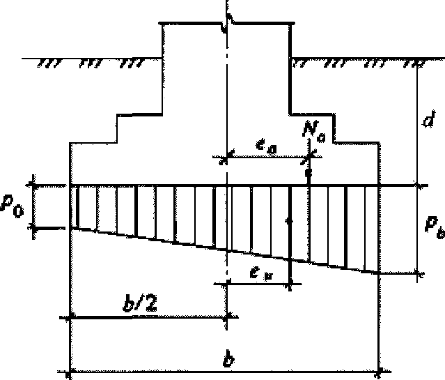

<!-- figure-caption-deferred -->

**под подошвой столбчатого или ленточного**

**фундамента при сейсмическом воздействии**

При наличии в особом сочетании нагрузок горизонтальной составляющей, передаваемой фундаментом на грунт, следует выполнять проверку несущей способности основания на сдвиг в соответствии с требованиями 5.7.6, (5.7.12). При этом для определения сил предельного сопротивления сдвигу, а также величин активного и пассивного давления в водонасыщенных глинистых грунтах следует учитывать снижение расчетных значений угла внутреннего трения в зависимости от расчетной сейсмичности.

Расчетные значения угла внутреннего трения в расчетах без учета сейсмических инерционных объемных сил на особое сочетание нагрузок, включающее сейсмическое воздействие, следует принимать из условия

$$\varphi=\varphi'-\Delta\varphi\tag{6.48}$$

где $\varphi_l$ - расчетные значения угла внутреннего трения без учета сейсмики;

$\Delta\varphi$ - принимают в зависимости от расчетной сейсмичности: 7 баллов - $\Delta\varphi=2^\circ$, 8 баллов - $\Delta\varphi=4^\circ$, 9 баллов - $\Delta\varphi=7^\circ$.

При расчете несущей способности оснований, испытывающих сейсмические воздействия, с учетом сейсмических инерционных объемных сил в качестве расчетного значения угла внутреннего трения следует принимать $\varphi_l$ (см. 6.13.4).

6.13.4 При расчете несущей способности оснований, испытывающих сейсмические воздействия, ординаты эпюры предельного давления p 0 и p b, кПа, по краям подошвы ленточного или столбчатого фундамента (см. [7](#^biblio-7)) вычисляют по формулам: ^c6-13-4

$$p=\\frac{F_h+F_v}{\\gamma_{ad}}\tag{6.49}$$

$$p=\\frac{F_h+F_v}{\\gamma_{ad}}\tag{6.50}$$

где $\xi_q$, $\xi_c$, $\xi_\gamma$ - коэффициенты формы, определяемые по формуле (5.33), но без уменьшения длины *l* и ширины *b* подошвы фундамента на значения эксцентриситета нагрузок;

*F*$F_1$, *F*$F_2$ и *F*$F_3$ - коэффициенты, определяемые по графикам рисунка 6.17 в зависимости от расчетного значения угла внутреннего трения $\varphi_l$;

$\gamma'$ и $\gamma_l$ - соответственно расчетные значения удельного веса грунта, кН/м³, находящегося выше и ниже подошвы фундамента (с учетом взвешивающего действия подземных вод для грунтов, находящихся выше водоупора);

*d* - глубина заложения фундамента, м (в случае неодинаковой вертикальной пригрузки с разных сторон фундамента принимают значение, соответствующее наименьшей пригрузке, например, со стороны подвала);

*k*$k_{eg}$ - коэффициент, принимаемый равным 0,1; 0,2 и 0,4 при сейсмичности площадок строительства 7, 8 и 9 баллов, определяемой в соответствии с требованиями [[СП 14.13330]].

> **Примечание** — В [8](#^biblio-8) при F 2 < k eg F 3 следует принимать p b, равное p 0.

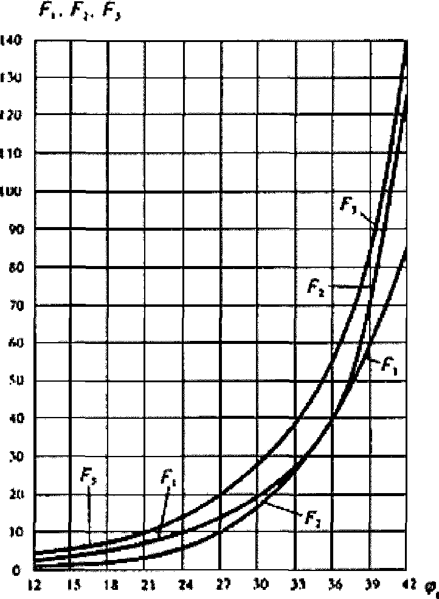

<!-- figure-caption-deferred -->

***F***$F_1$**,** ***F***$F_2$ **и** ***F***$F_3$ **для расчета несущей способности оснований**

**в условиях сейсмических воздействий**

Эксцентриситеты расчетной нагрузки *e*$e_a$, м, и эпюры предельного давления *e*$e_u$, м, вычисляют по формулам:

*e*$e_a$ = *M*$M_a$/*N*$N_a$; (6.51)

*e*$e_u$ = *b*(*p*$p_b$ - *p*$p_0$)/[6(*p*$p_b$ + *p*$p_0$)], (6.52)

где *N*$N_a$ и *M*$M_a$ - вертикальная составляющая расчетной нагрузки, кН, и момент, кН·м, приведенные к подошве фундамента при особом сочетании нагрузок;

*p*$p_0$ и *p*$p_b$ - то же, что и в формулах (6.49) и формуле (6.50).

*(в ред. Изменения N 4, утв. Приказом Минстроя России от 27.12.2021 N 1022/пр)*

В зависимости от соотношения между значениями *e*$e_a$ и *e*$e_u$ вертикальную составляющую силы предельного сопротивления основания *N*$N_{u,eq}$, кН, принимают:

при *e*$e_a$ <= *e*$e_u$ *N*$N_{u,eq}$ = 0,5*bl*(*p*$p_b$ + *p*$p_0$); (6.53)

при *e*$e_a$ > *e*$e_u$ *N*$N_{u,eq}$ = *blp*$blp_b$/(1 + 6*e*$e_a$/*b*). (6.54)

6.13.5 При действии моментов от нагрузок особого сочетания в двух направлениях расчет сейсмостойкости основания по несущей способности должен выполняться раздельно на действие сил и моментов в каждом направлении независимо друг от друга. ^c6-13-5

6.13.6 При расчете оснований и фундаментов на особое сочетание нагрузок с учетом сейсмических воздействий допускается частичный отрыв подошвы ленточного или столбчатого фундамента от грунта при выполнении следующих условий: ^c6-13-6

- эксцентриситет *e*$e_a$ расчетной нагрузки не превышает одной трети ширины фундамента *b* в плоскости действия опрокидывающего момента;

- силу предельного сопротивления основания определяют для условного фундамента, размер подошвы которого в направлении действия момента равен размеру сжатой зоны *b*$b_c$ = 1,5(*b* - 2*e*$e_a$);

- максимальное краевое давление под подошвой фундамента, вычисленное с учетом его неполного контакта с грунтом, не превышает краевой ординаты эпюры предельного сопротивления основания.

Максимальное расчетное давление по подошве фундамента вычисляют по формуле

*p*$p_{max}$ = 2*N*$N_a$/[3*l*(*b*/2 - *e*$e_a$)] <= *p*$p_b$, (6.55)

где *N*$N_a$ и *e*$e_a$ - то же, что и в формуле (6.51), причем *e*$e_a$ > b/6.

*(в ред. Изменения N 4, утв. Приказом Минстроя России от 27.12.2021 N 1022/пр)*

Значение *p*$p_b$ вычисляют по (6.50), но для фундамента, имеющего условную ширину *b*$b_c$.

*(в ред. Изменения N 4, утв. Приказом Минстроя России от 27.12.2021 N 1022/пр)*

При *e*$e_a$ > b/6 формула (6.53) приобретает вид

*N*$N_{u,eq}$ = 0,5*b*$b_c$*lp*$lp_b$. (6.56)

6.13.7 При невозможности заглубления фундаментов здания или его отсека на одном уровне в дисперсных грунтах допустимую разность отметок $\Delta h$ подошвы соседних фундаментов следует определять исходя из условия [7](#^biblio-7), в котором расчетное значение угла внутреннего трения грунта должно быть уменьшено на величину $\Delta\varphi$, имеющую те же значения, что и в [4339?]. ^c6-13-7

*(в ред. Изменения N 4, утв. Приказом Минстроя России от 27.12.2021 N 1022/пр)*

Ленточные фундаменты примыкающих частей отсеков здания должны иметь одинаковое заглубление на протяжении не менее 1 м от осадочного шва. Столбчатые фундаменты, разделенные осадочным швом, должны располагаться на одном уровне.

6.13.8 При строительстве на склонах в сейсмических районах следует выполнять требования [[СП 116.13330]], а устойчивость оснований проверять с учетом наклона поверхности грунта. ^c6-13-8

## 6.14 Особенности проектирования оснований сооружений, возводимых вблизи источников динамических воздействий

6.14.1 Проектирование оснований сооружений должно осуществляться с учетом возможных динамических воздействий: ^c6-14-1

а) стационарного оборудования с динамическими нагрузками, установленного в существующих и проектируемых сооружениях;б) автомобильного и железнодорожного транспорта и метрополитена;в) строительного оборудования;г) прочих источников (взрывные работы и т.д.).

Проектирование оснований при динамических воздействиях проводят на основе инструментальных измерений или расчетного прогноза колебаний грунта.

6.14.2 Расчет оснований по несущей способности выполняют в тех же случаях, которые предусмотрены в [3](#^biblio-3), с учетом объемных сил инерции и динамических нагрузок от сооружения, для которых принимают наиболее невыгодное направление. ^c6-14-2

6.14.3 Среднее давление от статических нагрузок под подошвой фундамента p, кПа, в пределах зоны, где скорость колебаний поверхности грунта более 15 мм/с (от импульсных источников динамических воздействий) или 2 мм/с (от прочих источников), должно удовлетворять условию ^c6-14-3

$$p\le\gamma_{ad}R_s\tag{6.57}$$

где $\gamma_{cd}$ - коэффициент условий работы грунтов основания при динамических воздействиях, принимаемый для мелких и пылеватых водонасыщенных песков и глинистых грунтов текучей консистенции $\gamma_{ad}=0{,}7$; для всех остальных видов и состояний грунтов $\gamma_{cd}=1$;

*R* - расчетное сопротивление грунта основания, кПа, определяемое в соответствии с требованиями раздела 5.

6.14.3а Скорость колебаний поверхности грунта определяется на основе натурных измерений, а при невозможности выполнения измерений - на основе расчета (согласно указаниям [[СП 26.13330]]). За скорость принимают:

- для импульсных и периодических источников динамических воздействий - пиковое значение модуля вектора скорости;

- для случайных источников - среднеквадратическое значение скорости.

В условиях городской среды при динамических воздействиях от множественных источников колебания следует рассматривать как случайные.

(п. 6.14.3а введен Изменением N 3, утв. Приказом Минстроя России от 22.11.2019 N 722/пр)

6.14.4 Для мелких и пылеватых водонасыщенных песков и глинистых грунтов текучей консистенции в пределах зон, указанных в [7](#^biblio-7), необходимо проводить расчет длительных осадок от совместного действия статических и динамических нагрузок (виброползучесть). Для определения осадок виброползучести допускается использовать лабораторные и полевые испытания грунтов. ^c6-14-4

Лабораторные испытания грунтов следует проводить с воспроизведением статических и динамических напряжений, соответствующих глубине залегания испытываемого грунта, с последующим суммированием полученных относительных линейных деформаций виброползучести $\varepsilon_d$.

Требования к проведению полевых штамповых испытаний грунтов по определению модуля общей деформации (уменьшенного значения модуля деформации грунтов) приведены в [7]. Дальнейший расчет полных осадок, включающих статическую и динамическую составляющие, допускается проводить в соответствии с 5.6, принимая при этом уменьшенное значение модуля деформации грунтов.

6.14.5 При расчете колебаний сооружений с учетом взаимодействия с основанием для оценки прочности несущих конструкций сооружений и выполнения санитарных норм допускается принимать, что основание обладает линейно-упругими свойствами. ^c6-14-5

6.14.6 Для выполнения требований расчета оснований по несущей способности и по деформациям следует снижать параметры динамических воздействий в их источнике (замена технологического процесса, перемещение источника, регулирование в источнике, активная виброизоляция и др.) или на путях распространения колебаний от источника (устройство экранов в виде стенок или траншей, изменение массы фундамента - приемника колебаний или жесткости его основания и др.). В дополнение к указанным мероприятиям или в качестве самостоятельной меры возможно увеличение заглубления фундамента, размеров его подошвы и т.д. ^c6-14-6

6.14.7 Для существующих сооружений при появлении вблизи них источников динамических воздействий, указанных в [4400?], необходимо проводить расчеты, указанные в [7](#^biblio-7) - [1](#^biblio-1). ^c6-14-7

# 7 Особенности проектирования оснований опор воздушных линий электропередачи

7.1 Требования настоящего раздела должны соблюдаться при проектировании оснований опор воздушных линий электропередачи и опор открытых распределительных подстанций напряжением от 1 кВ и выше. ^c7-1

По характеру нагружения опоры подразделяют на промежуточные, анкерные, угловые и специальные, применяемые на больших переходах.

## 7.2 Расчетные характеристики грунтов следует устанавливать в соответствии с требованиями [3](#^biblio-3).

При расчете оснований по деформациям значение коэффициента надежности по грунту $\gamma_g$ допускается принимать равным единице. Для массовых опор пониженного уровня ответственности нормативные значения характеристик допускается принимать по таблицам приложения А, причем значения $\varphi_n$, *c*$c_n$ и *E* глинистых грунтов с показателем текучести 0,75 < *I*$I_L$ <= 1,0 следует принимать по результатам испытаний грунтов.

Если нормативные значения характеристик грунтов принимаются по таблицам приложения А, расчет оснований по несущей способности следует выполнять при значениях коэффициентов надежности по грунту $\gamma_g$ для: плотности $\rho-\gamma_g=1$; угла внутреннего трения $\varphi-\gamma_g=1{,}1$; удельного сцепления $c_l-\gamma_c=2$ в песках, $\gamma_g=2{,}4$ в супесях при *I*$I_L$ <= 0,25, суглинках и глинах при *I*$I_L$ <= 0,5; $\gamma_g=3{,}3$ в остальных глинистых грунтах.

*(в ред. Изменения N 5, утв. Приказом Минстроя России от 07.12.2023 N 884/пр)*

7.3 Расчет оснований по деформациям и несущей способности следует проводить для всех режимов работы опор. Динамическое воздействие порывов ветра на конструкцию опоры учитывают лишь при расчете оснований по несущей способности. ^c7-3

7.4 Расчет оснований, сложенных пучинистыми грунтами, по несущей способности должен выполняться с учетом одновременного действия сил морозного пучения, постоянных и длительных временных нагрузок. Расчет оснований опор на одновременное действие сил морозного пучения и кратковременных нагрузок (ветровых и от обрыва проводов) не требуется. ^c7-4

7.5 Деформации основания фундаментов опор, кроме свободностоящих стоечных, должны ограничиваться предельными значениями относительной разности осадок отдельных фундаментов или креном общего фундамента, приведенными в [1](#^biblio-1). ^c7-5

Деформация основания свободностоящих стоечных опор ограничивается предельным значением угла $\delta=0{,}2p$ отклонения стойки от вертикали на уровне поверхности грунта от воздействия опрокидывающих нагрузок, которое составляет 0,01 рад.

В песках плотных и средней плотности, а также глинистых грунтах при *I*$I_L$ <= 0,5 в случае установки в основание перед стойкой не менее одного ригеля допускается $\\delta\\le0{,}2p$ с обязательной проверкой прочности стойки.

Опрокидывающий момент следует определять с учетом как горизонтальных сил, так и вертикальных сил, возникающих при отклонении стоек от вертикали.

7.6 Расчет оснований выдергиваемых фундаментов и анкерных плит по деформациям может не выполняться, если выдергивающая сила центральна по отношению к подошве фундамента (анкерной плите) и соблюдается условие ^c7-6

$$F_n\\le R_A/\\gamma_c\tag{7.1}$$

где *F*$F_n$ - нормативное значение выдергивающей силы, кН;

*G*$G_n$ - нормативное значение веса фундамента или плиты, кН;

$\beta$ - угол наклона выдергивающей силы к вертикали, град.;

$\gamma_c$ - коэффициент условий работы, определяемый в соответствии с 7.7;

*R'*$R'_0$ - расчетное сопротивление грунта обратной засыпки, кПа, принимаемое по Б.10 приложения Б;

*A*$A_0$ - площадь проекции верхней поверхности фундамента на плоскость, перпендикулярную к линии действия выдергивающей силы, м².

7.7 Коэффициент условий работы $\gamma_c$ в [1](#^biblio-1) принимают равным: $\\gamma_c=1/2/3/4$, где $\gamma_l=1{,}2$; 1,0 и 0,8 - для опор с базой B (расстояние между осями отдельных фундаментов), равной 5, 2,5 и 1,5 м; при промежуточных значениях B, значение $\gamma_l$ определяют интерполяцией; $\gamma_2=1{,}0$ для нормального и $\gamma_2=1{,}2$ - для аварийного и монтажного режимов работы; $\gamma_3=1{,}0$; 0,8 и 0,7 - для опор соответственно; промежуточных прямых; промежуточных угловых, анкерных и анкерно-угловых, концевых, порталов распределительных устройств; специальных; $\gamma_4=1{,}0$ и 1,15 - соответственно для грибовидных фундаментов и анкерных плит опор с оттяжками, стойки которых защемлены в грунте; анкерных плит опор, стойки которых шарнирно оперты на фундаменты. ^c7-7

7.8 Расчетное сопротивление грунта основания R под подошвой сжато-опрокидываемых фундаментов вычисляют по [919?] при коэффициенте $\gamma_{c2}=1$. ^c7-8

Наибольшее давление на грунт под краем подошвы фундамента при действии вертикальной сжимающей и горизонтальных нагрузок в одном или в двух направлениях не должно превышать 1,2*R*.

7.9 Расчет оснований по несущей способности при действии на фундамент (анкерную плиту) выдергивающей нагрузки проводят исходя из условия ^c7-9

$$F_n\\le R_A/\\gamma_c\tag{7.2}$$

где *F* - расчетное значение выдергивающей силы, кН;

$\gamma_f$ - коэффициент надежности по нагрузке, принимаемый равным 0,9;

*G*$G_n$ - нормативное значение веса фундамента (плиты), кН;

$\beta$ - угол наклона выдергивающей силы к вертикали, град.;

$\gamma_c$ - коэффициент условий работы, принимаемый равным единице;

*F*$F_{u,a}$ - сила предельного сопротивления основания выдергиваемого фундамента, кН, определяемая по 7.11;

$\gamma_n$ - коэффициент надежности по ответственности, принимаемый равным для опор: промежуточных прямых - 1,0; анкерных прямых без разности тяжений - 1,2; угловых (промежуточных и анкерных), анкерных (прямых и концевых) с разностью тяжений, порталов открытых распределительных устройств - 1,3; специальных - 1,7.

7.10 Силу предельного сопротивления основания выдергиваемого фундамента F u,a, кН, вычисляют по формуле ^c7-10

$$H\\le h_0+H_c\tag{7.3}$$

где $\gamma_{bf}$ - расчетное значение удельного веса грунта обратной засыпки, кН/м³;

*V*$V_{bf}$ - объем тела выпирания в форме усеченной пирамиды, м³, образуемой плоскостями, проходящими через кромки верхней поверхности фундамента (плиты) и наклоненными к вертикали под углами $g_i$, равными:

у нижней кромки $g_i$;

у верхней кромки $\xi=\varphi+\beta 2$;

у боковых кромок $\xi=\varphi=\varphi$;

*V*$V_f$ - объем части фундамента, находящейся в пределах тела выпирания, м³, для анкерных плит принимают равным нулю;

*A*$A_1$, *A*$A_2$, *A*$A_3$ - площади граней тела выпирания, м², имеющих в основании соответственно нижнюю, верхнюю и боковые кромки верхней поверхности фундамента (плиты);

*c*$c_0$ и $\varphi_0$ - расчетные значения удельного сцепления, кПа, и угла внутреннего трения грунта обратной засыпки, град., принимаемые равными:

$c_0=\pi c$; $\varphi_0=\pi\varphi$; (7.4)

здесь *c*$c_1$, $\varphi_1$ - расчетные значения соответственно удельного сцепления и угла внутреннего трения грунта природного сложения, определяемые в соответствии с 7.2;

$\eta$ - коэффициент, принимаемый по таблице 7.1.

Таблица 7.1

^t33

<table>
<tr><td rowspan="2">Грунты обратной засыпки</td><td colspan="2">Коэффициент $\eta$ при плотности грунта засыпки, т/м3</td></tr>
<tr><td>1,55</td><td>1,7</td></tr>
<tr><td>Пески, кроме пылеватых влажных и насыщенных водой</td><td>0,5</td><td>0,8</td></tr>
<tr><td>Глинистые грунты при показателе текучести *I**L* &lt;= 0,5</td><td>0,4</td><td>0:6</td></tr>
<tr><td colspan="3">Примечание - Значение коэффициента $\eta$ для пылеватых песков влажных и насыщенных водой, глин и суглинков при показателе текучести 0,5 &lt; *I**L* &lt;= 0,75 и супесей при 0,5 &lt; *I**L* &lt;= 1 должно быть понижено на 15%.</td></tr>
</table>

При близком расположении выдергиваемых фундаментов следует учитывать уменьшение объемов тел выпирания для каждого фундамента.

7.11 Несущая способность (устойчивость) основания стоечной опоры считается обеспеченной при соблюдении условия ^c7-11

$$F_h\le F'/\gamma_c\tag{7.5}$$

где *F*$F_h$ - расчетная горизонтальная сила, на отметке поверхности грунта, кН;

$\gamma_{c2}$ - коэффициент условий работы закрепления, принимаемый по таблице 7.2;

*F*$F_{hu}$ - предельная горизонтальная сила на отметке поверхности грунта, кН;

$\gamma_n$ - коэффициент надежности по ответственности, принимаемый по 7.9.

Расчет устойчивости основания фундамента стоечной опоры выполняется на воздействие расчетных значений горизонтальной нагрузки *F*$F_h$, момента *M* от горизонтальных и вертикальных нагрузок, приложенных на уровне поверхности грунта и вертикальной нагрузки *F*$F_V$, приложенной на отметке подошвы фундамента.

Усилия *F*$F_h$, *M*, *F*$F_V$ получают в результате статического расчета опоры. Для расчета устойчивости основания высота *H*, на которой на стойку действует горизонтальная сила *F*$F_h$, определяется из условий *H* = *M*/*F*$F_h$.

Таблица 7.2

^t34

<table>
<tr><td rowspan="2">Грунты</td><td colspan="2">Значение коэффициента условий работы закрепления $\gamma_{c2}$ в грунтах со структурой</td></tr>
<tr><td>нарушенной</td><td>ненарушенной</td></tr>
<tr><td>Пески:</td><td></td><td></td></tr>
<tr><td>крупные</td><td>1,05</td><td>1</td></tr>
<tr><td>средней крупности</td><td>1,1</td><td>1</td></tr>
<tr><td>мелкие</td><td>1,1</td><td>1</td></tr>
<tr><td>пылеватые</td><td>1,15</td><td>1,05</td></tr>
<tr><td>Супеси:</td><td></td><td></td></tr>
<tr><td>*I**L* &lt;= 0,25</td><td>1,3</td><td>1,2</td></tr>
<tr><td>*I**L* &gt; 0,25</td><td>1,4</td><td>1,3</td></tr>
<tr><td>Суглинки:</td><td></td><td></td></tr>
<tr><td>*I**L* &lt;= 0,25</td><td>1,25</td><td>1,15</td></tr>
<tr><td>0,25 &lt; *I**L* &lt;= 0,5</td><td>1,4</td><td>1,25</td></tr>
<tr><td>*I**L* &gt; 0,5</td><td>1,4</td><td>1,25</td></tr>
<tr><td>Глины:</td><td></td><td></td></tr>
<tr><td>*I**L* &lt;= 0,25</td><td>1,5</td><td>1,3</td></tr>
<tr><td>0,25 &lt; *I**L* &lt;= 0,5</td><td>1,5</td><td>1,3</td></tr>
<tr><td>*I**L* &gt; 0,5</td><td>1,5</td><td>1,4</td></tr>
</table>

7.12 Расчет оснований стоечных опор с оттяжками и стоек порталов с внутренними связями на вдавливание выполняют по несущей способности по формуле ^c7-12

$$F_c\le R'd/\gamma_g\tag{7.6}$$

где *F*$F_c$ - расчетная сжимающая нагрузка на отметке подошвы стойки, кН; для промежуточных опор расчетную нагрузку из сочетаний с кратковременными нагрузками принимают с коэффициентом 0,6 для сверленых котлованов; в остальных случаях принимают полное значение;

$\gamma_c$ - коэффициент условий работы, равный 1;

*R* - расчетное сопротивление грунта основания под подошвой стоечной опоры, принимаемое по таблице 7.3, кПа;

*A* - площадь подошвы фундамента, м², принимают равной площади подошвы стойки при установке стойки в сверленый котлован и заделке пазух гравийно-песчаной смесью или крупным песком, а также в копаные котлованы без опорной плиты; при установке стойки в сверленый котлован и заполнении пазух бетонированием площадь *A* принимают равной площади котлована;

$\gamma_g$ - коэффициент надежности по грунту, равный 1,3.

Таблица 7.3

^t35

<table>
<tr><th colspan="3">Грунты</th><th>Расчетное сопротивление грунта *R*, кПа</th></tr>
<tr><td colspan="3">Пески:</td><td></td></tr>
<tr><td colspan="3">гравелистые</td><td>6500</td></tr>
<tr><td colspan="3">крупные</td><td>5200</td></tr>
<tr><td colspan="3">средней крупности</td><td>3900</td></tr>
<tr><td colspan="3">мелкие</td><td>2050</td></tr>
<tr><td colspan="3">пылеватые</td><td>1300</td></tr>
<tr><td colspan="3">Супеси:</td><td></td></tr>
<tr><td colspan="3">*I**L* &lt;= 0</td><td>2050</td></tr>
<tr><td colspan="3">0 &lt; *I**L* &lt;= 1</td><td>800</td></tr>
<tr><td colspan="3">Суглинки и глины</td><td></td></tr>
<tr><td rowspan="8">при *I**L*, равном</td><td rowspan="8">$\\xi$</td><td>0</td><td>5850</td></tr>
<tr><td>0,10</td><td>4700</td></tr>
<tr><td>0,20</td><td>3600</td></tr>
<tr><td>0,30</td><td>2300</td></tr>
<tr><td>0,40</td><td>1600</td></tr>
<tr><td>0,50</td><td>1300</td></tr>
<tr><td>0,60</td><td>800</td></tr>
<tr><td>0,75</td><td>400</td></tr>
</table>

# 8 Особенности проектирования оснований и фундаментов малоэтажных зданий

8.1 Положения раздела распространяются на малоэтажные жилые и общественные здания, производственные сельскохозяйственные здания, гаражи и другие малоэтажные здания и сооружения. ^c8-1

Эти здания возводятся на малозаглубленных, устраиваемых в слое сезоннопромерзающего грунта, и незаглубленных фундаментах.

*(в ред. Изменения N 5, утв. Приказом Минстроя России от 07.12.2023 N 884/пр)*

> **8.2** **Следует применять следующие типы фундаментов**: ^c8-2

*(в ред. Изменения N 5, утв. Приказом Минстроя России от 07.12.2023 N 884/пр)*

а) фундаменты на естественном основании (ленточные, столбчатые, плитные, щелевые и др.);б) фундаменты на локально уплотненных основаниях (в вытрамбованных или выштампованных котлованах, забивные блоки и др.);в) короткие сваи.

8.3 В зданиях с несущими стенами следует применять фундаменты на естественном основании (ленточные, столбчатые, щелевые и др.). В сложных инженерно-геологических условиях (специфические грунты, высокий уровень подземных вод и др.) допускается использовать типы фундаментов, указанные в [3](#^biblio-3) и [4](#^biblio-4). ^c8-3

(п. 8.3 в ред. Изменения N 5, утв. Приказом Минстроя России от 07.12.2023 N 884/пр)

8.4 В зданиях стоечно-балочной схемы и при безростверковом опирании стен следует применять столбчатые фундаменты (на естественном или локально уплотненном основании) или короткие сваи. ^c8-4

8.5 Для зданий без подвалов следует применять малозаглубленные фундаменты. Тип, конструкция малозаглубленного фундамента и способ подготовки его основания зависят от свойств грунтов основания и степени их пучинистости. ^c8-5

*(в ред. Изменения N 5, утв. Приказом Минстроя России от 07.12.2023 N 884/пр)*

8.6 При проектировании малозаглубленных фундаментов на пучинистых грунтах, в том числе локально уплотненных, обязательным является расчет их оснований по деформациям пучения [8](#^biblio-8). ^c8-6

Деформации морозного пучения минимизируют за счет применения теплозащитного экранирования на основании специальных теплотехнических расчетов.

*(абзац введён Изменением N 4, утв. Приказом Минстроя России от 27.12.2021 N 1022/пр; в ред. Изменения N 5, утв. Приказом Минстроя России от 07.12.2023 N 884/пр)*

8.7 При строительстве на непучинистых грунтах несущие элементы малозаглубленных и незаглубленных фундаментов укладывают на выравнивающую подсыпку из песка, на пучинистых грунтах - на подушку из непучинистого материала (песок гравелистый, крупный или средней крупности, мелкий щебень, котельный шлак, плиты из влаго- биостойкой теплоизоляции и др.). Для увеличения расчетного сопротивления грунта основания следует предусматривать устройство песчано-щебеночной (песчано-гравийной) подушки (смесь песка крупного или средней крупности - 40%, щебня или гравия - 60%). ^c8-7

*(в ред. Изменения N 2, утв. Приказом Минстроя России от 24.01.2019 N 43/пр, Изменения N 5, утв. Приказом Минстроя России от 07.12.2023 N 884/пр)*

8.8 В зависимости от степени пучинистости грунта ([[ГОСТ 25100]]) основания ленточных малозаглубленных фундаментов следует устраивать: ^c8-8

а) на непучинистых и слабопучинистых грунтах - из сборных бетонных блоков, укладываемых без соединения между собой;б) на средне- и сильнопучинистых грунтах - из сборных железобетонных блоков, содержащих выпуски арматуры (выпуски соседних блоков соединяют, стыки замоноличивают бетоном), либо из монолитного железобетона.

(п. 8.8 в ред. Изменения N 5, утв. Приказом Минстроя России от 07.12.2023 N 884/пр)

8.9 Сборно-монолитные, монолитные фундаменты и ростверки щелевых фундаментов и коротких свай всех стен должны быть жестко связаны между собой и объединены в систему перекрестных лент. ^c8-9

8.10 При строительстве на сильнопучинистых грунтах следует производить усиление стен армированными или железобетонными поясами, устраиваемыми в уровне перекрытий и над проемами верхнего этажа. ^c8-10

*(в ред. Изменения N 5, утв. Приказом Минстроя России от 07.12.2023 N 884/пр)*

8.11 Малозаглубленные столбчатые фундаменты на средне-, сильнопучинистых грунтах должны быть связаны фундаментными балками, объединенными в единую систему. ^c8-11

*(в ред. Изменения N 5, утв. Приказом Минстроя России от 07.12.2023 N 884/пр)*

8.12 При устройстве столбчатых фундаментов на пучинистых грунтах необходимо предусматривать зазор между нижней гранью фундаментных балок и планировочной поверхностью грунта, величина которого должна быть не менее расчетной деформации пучения (подъема) ненагруженного основания. ^c8-12

8.13 При наличии сильнопучинистых грунтов и значительной чувствительности зданий к неравномерным деформациям следует строить их на малозаглубленных и незаглубленных монолитных железобетонных плитных фундаментах, под которыми устраивают подушки из непучинистых материалов. ^c8-13

*(в ред. Изменения N 5, утв. Приказом Минстроя России от 07.12.2023 N 884/пр)*

8.14 При вытрамбовывании (выштамповывании) котлованов и забивке блоков следует использовать фундаменты в форме усеченной пирамиды с углом наклона боковых граней к вертикали 5° - 10°. Фундаменты указанной конструкции допускается закладывать в сезоннопромерзающем слое грунта. ^c8-14

*(в ред. Изменения N 5, утв. Приказом Минстроя России от 07.12.2023 N 884/пр)*

8.15 Для зданий с несущими стенами следует применять однорядное расположение забивных блоков и пирамидальных свай с напрягаемой арматурой, а также короткие сваи различных типов и способов изготовления. ^c8-15

*(в ред. Изменения N 5, утв. Приказом Минстроя России от 07.12.2023 N 884/пр)*

# 9 Особенности проектирования оснований подземных частей сооружений и геотехнический прогноз

9.1 Требования раздела распространяются на вновь возводимые и реконструируемые сооружения, располагаемые на застроенной территории и/или с подземной частью, устраиваемой открытым или полузакрытым способом в котловане, а также на подземные сооружения, возводимые закрытым способом, в части оценки их влияния на окружающую застройку. ^c9-1

(п. 9.1 в ред. Изменения N 4, утв. Приказом Минстроя России от 27.12.2021 N 1022/пр)

9.2 Проектирование оснований подземных частей сооружений включает помимо требований [3](#^biblio-3) обоснованный выбор: ^c9-2

- глубины заложения подземных конструкций;

- способа устройства подземных конструкций (в открытом котловане, полузакрытый "сверху-вниз", опускной колодец, в насыпи и др.);

- заложения откосов неподкрепленных котлованов;

- типа, конструкции, материала ограждений котлованов и их креплений;

- мероприятий, применяемых для снижения влияния строительства на деформации оснований, фундаментов и надземных конструкций сооружений и инженерных коммуникаций окружающей застройки;

- мероприятий, применяемых для минимизации изменений гидрогеологических условий или предотвращения вызванных этим возможных негативных последствий, в т.ч. для окружающей застройки и экологической среды.

9.3 Программа инженерно-геологических изысканий для проектирования оснований подземных частей сооружений геотехнической категории 3 может подлежать геотехнической экспертизе в соответствии с требованиями [389?]. ^c9-3

9.4 При проектировании подземных частей сооружений, подкрепленных ограждающими конструкциями, глубину и размещение геологических разведочных скважин следует принимать в задании на изыскания в соответствии с [[СП 446.1325800]] (пункт 7.2.10). ^c9-4

При проектировании подземных частей сооружений в неподкрепленных котлованах глубина разведочных скважин должна составлять не менее 1,5*H*$H_к$ + 5 м, где *H*$H_к$ - глубина котлована.

(п. 9.4 в ред. Изменения N 5, утв. Приказом Минстроя России от 07.12.2023 N 884/пр)

9.5 Инженерно-геологические изыскания следует выполнять также вне границ площадок строительства в случаях: ^c9-5

- необходимости анализа возможности проявления на примыкающей к зоне строительства территории опасных инженерно-геологических процессов;

- определения возможности устройства грунтовых анкеров вне границ площадки строительства, а также последующего выполнения расчетов анкерных конструкций и оценки влияния их устройства на окружающую застройку;

*(в ред. Изменения N 5, утв. Приказом Минстроя России от 07.12.2023 N 884/пр)*

- решения вопроса о необходимости закрепления грунтов оснований и усиления фундаментов сооружений окружающей застройки, попадающих в зону влияния нового строительства;

- необходимости получения данных для расчета изменения гидрогеологических условий на территории, примыкающей к строительной площадке.

9.6 В процессе инженерных изысканий должны быть выявлены и изучены: ^c9-6

- тектонические и закарстованные структуры, разрывные и складчатые нарушения;

- фильтрационные свойства грунтов, необходимые для расчета ожидаемых водопритоков в котлованы и подземные выработки, величина напора в горизонтах подземных вод, наличие и толщина водоупоров и их устойчивость против прорыва напорных вод;

- наличие и распространение грунтов, обладающих плывунными, тиксотропными и суффозионными свойствами и виброползучестью;

- наличие и местоположение подземных сооружений, подвалов, тоннелей, инженерных коммуникаций, колодцев, подземных выработок, буровых скважин и пр.;

- динамические воздействия от существующих стационарных и временных источников и от транспорта.

9.7 При проектировании оснований подземных частей сооружений геотехнических категорий 2 и 3 при глубине котлована более 5 м дополнительно к предусмотренным в [7](#^biblio-7) следует определять полевыми и лабораторными методами следующие физико-механические характеристики дисперсных и скальных грунтов: ^c9-7

- модуль деформации *E* для первичной ветви нагружения и ветви повторного нагружения *E*$E_e$ (см. 5.3.8), которые следует определять для характерных диапазонов изменения напряжений в основании;

*(в ред. Изменения N 5, утв. Приказом Минстроя России от 07.12.2023 N 884/пр)*

- коэффициент поперечной деформации $\nu$. Для подземных сооружений геотехнической категории 2 расчетные значения коэффициента $\nu$ допускается принимать в соответствии с 5.6.44;

- прочностные характеристики: угол внутреннего трения $\varphi$ и удельное сцепление *c*, определяемые для условий, соответствующих всем этапам строительства и эксплуатации подземного сооружения;

- предел прочности на одноосное сжатие *R*$R_c$ и модуль деформации *E* для скальных, искусственно закрепленных и замороженных грунтов;

- удельные нормальные и касательные силы морозного пучения $\sigma_{fh,h}$ и $\tau_{fh}$;

- коэффициент фильтрации грунтов;

- характеристики трещиноватости массивов скальных грунтов: модуль трещиноватости *M*$M_j$, показатель качества породы *RQD*, коэффициент выветрелости *K*$K_{wr}$.

По специальному заданию (например, специализированной организации, ведущей научно-техническое сопровождение проектирования и строительства согласно 4.17) изысканиями определяются и другие физико-механические и классификационные характеристики грунтов и массивов, в т.ч.:

*(в ред. Изменения N 5, утв. Приказом Минстроя России от 07.12.2023 N 884/пр)*

- сопротивление грунта недренированному сдвигу *c*$c_u$ (5.3.10);

- коэффициент переуплотнения грунта *OCR*;

- параметры ползучести глинистых грунтов;

- предел прочности на одноосное растяжение *R*$R_t$ для скальных и искусственно закрепленных грунтов;

- классификационные характеристики скальных массивов *RMR*, *Q*, *GSI*;

- параметры релаксации напряжений в грунтах *K*$K_r$, $\sigma_r$.

> **Примечание** — Применение геомеханических моделей с упрочнением, не учитывающих изменение поверхности нагружения при сдвиге и уплотнении, для задач с преобладающими сдвиговыми деформациями (например, экскавация котлована) не допускается.

(примечание введено Изменением N 5, утв. Приказом Минстроя России от 07.12.2023 N 884/пр)

9.8 При проектировании оснований подземных частей сооружений геотехнической категории 3 на основании технического задания следует выполнять измерения напряжений в массивах скальных и нескальных грунтов; опытные полевые работы по водопонижению, закреплению и замораживанию грунтов, устройству противофильтрационных завес и "стен в грунте", а также геофизические и прочие исследования. ^c9-8

*(в ред. Изменения N 5, утв. Приказом Минстроя России от 07.12.2023 N 884/пр)*

9.9 При проектировании оснований подземных частей сооружений, размещаемых вблизи окружающей застройки, расчеты и проверки следует выполнять как для обеспечения прочности, надежности и долговечности самого проектируемого сооружения на всех стадиях строительства и эксплуатации, так и для обеспечения прочности, надежности и долговечности существующих сооружений и инженерных коммуникаций, а также сохранения окружающей среды. ^c9-9

9.10 При проектировании оснований подземных частей сооружений следует учитывать их уровень ответственности, а также уровень ответственности сооружений, на которые может оказывать влияние подземное строительство ([[ГОСТ 27751]]). ^c9-10

Если в зону влияния проектируемой подземной части сооружения (см. 9.34) попадает сооружение окружающей застройки более высокого уровня ответственности, геотехническая категория проектируемого сооружения должна быть повышена с учетом уровня ответственности сооружения, которое подвергается влиянию проектируемого.

*(в ред. Изменения N 5, утв. Приказом Минстроя России от 07.12.2023 N 884/пр)*

9.11 Нагрузки и воздействия на основания и конструкции подземных частей сооружений следует устанавливать расчетом, исходя из анализа совместной работы конструкций сооружения и основания, с учетом возможного их изменения на различных стадиях возведения и эксплуатации сооружения. ^c9-11

Специфические нагрузки и воздействия на конструкции подземных частей сооружений, а также их длительность следует устанавливать в соответствии с требованиями [[СП 14.13330]], [[СП 20.13330]], [[СП 21.13330]], [[СП 35.13330]], [[СП 116.13330]], [[СП 131.13330]].

9.12 Расчеты и проверки оснований подземных частей сооружений по первой и второй группам предельных состояний должны выполняться в соответствии с требованиями [6](#^biblio-6) и включать определения: ^c9-12

- несущей способности основания, устойчивости сооружения и его отдельных элементов;

- местной прочности скального основания;

- устойчивости склонов, примыкающих к сооружению, откосов и ограждающих конструкций котлованов;

- нагрузок, передающихся на ограждающие конструкции котлованов и наружные стены подземных частей сооружений;

- усилий в конструкциях ограждения котлованов от температурно-климатических воздействий;

(перечисление введено Изменением N 1, утв. Приказом Минстроя России от 20.11.2018 N 736/пр)

- несущей способности по грунту анкерных конструкций (грунтовых анкеров, анкерных свай и др.);

- фильтрационной прочности основания, давления подземных вод на конструкции подземных частей сооружения, устойчивости против всплытия;

- фильтрационного расхода при водопонижении;

- изменения гидрогеологических условий, вызванных строительством и эксплуатацией сооружения;

- деформаций системы "подземная часть сооружения - основание";

- деформаций оснований окружающей застройки.

При проектировании оснований ограждений котлованов следует выполнять оценку возможных дополнительных деформаций основания сооружений в зоне влияния строительства и реконструкции от технологических воздействий, связанных с их устройством. Оценку технологических осадок допускается проводить по сопоставимому геотехническому опыту.

*(в ред. Изменения N 1, утв. Приказом Минстроя России от 20.11.2018 N 736/пр)*

При проектировании оснований подпорных стен, устраиваемых из отдельно стоящих элементов, следует выполнять расчет прочности основания на продавливание грунта между элементами.

При выполнении расчетов следует учитывать возможные изменения уровней горизонтов подземных вод и пьезометрических напоров, а также физико-механических свойств грунтов с учетом технологических воздействий, промерзания и оттаивания, явлений просадок, пучения, набухания и т.п.

Для предварительной оценки усилий в распорной системе с учетом температурных воздействий допускается назначать значения, полученные по расчету без учета податливости распорных креплений, увеличенные на 30%. Окончательное определение усилий в распорных конструкциях от температурных воздействий допускается выполнять в соответствии с приложением К [[СП 381.1325800]].

*(в ред. Изменения N 4, утв. Приказом Минстроя России от 27.12.2021 N 1022/пр)*

При выполнении расчетов оснований подземных частей сооружений следует учитывать конструктивную нелинейность, связанную с изменением расчетной схемы в процессе строительства, технологические особенности возведения и последовательность строительных операций.

При выполнении предварительных расчетов конструкций ограждения для котлованов глубиной до 15 м их перемещения в угловых зонах допускается определять с применением упрощенных расчетных схем распределения перемещений, основанных на результатах плоских расчетов.

*(абзац введён Изменением N 4, утв. Приказом Минстроя России от 27.12.2021 N 1022/пр)*

Предварительное определение деформаций оснований окружающей застройки в районе угловых зон проектируемых котлованов выполняют с применением упрощенных расчетных схем распределения перемещений, основанных на результатах решения задач в плоской постановке. Окончательные расчеты деформаций окружающей застройки в угловых зонах котлованов выполняют с использованием пространственных 3D моделей или в соответствии с [[СП 248.1325800]] (приложение Г).

*(абзац введён Изменением N 4, утв. Приказом Минстроя России от 27.12.2021 N 1022/пр; в ред. Изменения N 5, утв. Приказом Минстроя России от 07.12.2023 N 884/пр)*

При проектировании вновь возводимых сооружений повышенного уровня ответственности (геотехнической категории 3) в котлованах под защитой "стены в грунте" траншейного типа следует учитывать изменение напряженно-деформированного состояния грунтового массива в результате устройства "стены в грунте" для расчета следующих конструкций: "стены в грунте", распорных конструкций котлована, плитных фундаментов. При этом расчет влияния устройства "стены в грунте" на изменение напряженно-деформированного состояния окружающего массива грунта следует выполнять численным методом в пространственной постановке задачи.

*(абзац введён Изменением N 4, утв. Приказом Минстроя России от 27.12.2021 N 1022/пр; в ред. Изменения N 5, утв. Приказом Минстроя России от 07.12.2023 N 884/пр)*

> **Примечание** — При проектировании ограждающих конструкций котлованов сооружений геотехнической категории 3 следует учитывать аварийные воздействия. Виды учитываемых аварийных воздействий определяются проектом.

(примечание введено Изменением N 4, утв. Приказом Минстроя России от 27.12.2021 N 1022/пр; в ред. Изменения N 5, утв. Приказом Минстроя России от 07.12.2023 N 884/пр)

9.13 При выполнении расчетов оснований подземных частей сооружений допускается использование аналитических, численных и других методов. ^c9-13

Выбор метода расчета - в соответствии с требованиями 5.1.11.

При использовании численных методов расчетная модель, идеализирующая напряженно-деформированное состояние основания и сооружения, должна отражать основные свойства прототипа, конструктивные особенности сооружения, характер работы основания и схему их взаимодействия. Численные модели следует верифицировать в соответствии с требованиями 5.1.12, 5.1.13.

9.14 При проектировании оснований подземных частей сооружений, устраиваемых с обратной засыпкой грунта, расчетные значения характеристик грунтов обратной засыпки ($\gamma'$, $\varphi'$, c ' I), уплотненных не менее чем до k com = 0,95 их плотности в природном состоянии, допускается устанавливать по расчетным характеристикам тех же грунтов в природном состоянии ($\gamma_l$, $\varphi_1$, c I), принимая $\chi'=0{,}95\chi_l$; $\varphi'=0{,}9\varphi$; c ' I = 0,5 c I, при этом следует принимать c' I не более 7 кПа. ^c9-14

9.15 При выполнении расчетов оснований подземных частей сооружений следует определять нормальные и касательные напряжения на контакте "конструкция - грунтовый массив". Величины контактных напряжений требуется определять, рассматривая совместную работу сооружения с основанием. ^c9-15

При определении величин напряжений на контакте следует учитывать историю формирования и существующее напряженно-деформированное состояние грунтового массива, конструктивные особенности сооружения, прочностные и деформационные характеристики грунтов основания и элементов сооружения, технологию и последовательность возведения сооружения.

Следует учитывать возможность несовместных деформаций основания и конструкций на их контакте. В расчетах необходимо учитывать возможность отлипания или сдвига на контакте "конструкция - грунт".

*(в ред. Изменения N 5, утв. Приказом Минстроя России от 07.12.2023 N 884/пр)*

9.16 Для проверки возможности сдвига на контакте конструкций с грунтом должны быть определены силы предельного сопротивления сдвигу, которые зависят от характеристик трения и сцепления на контакте. ^c9-16

Силы трения и сцепления на контакте "конструкция - грунтовый массив" следует определять в зависимости от значений прочностных характеристик грунта, гидрогеологических условий площадки, материала конструкции, технологии ее устройства.

Для дисперсных грунтов допускается принимать следующие расчетные значения прочностных характеристик на контакте "конструкция - грунтовый массив":

- удельное сцепление *c*$c_к$ = 0;

- угол трения грунта по материалу конструкции $\delta=\gamma_K\varphi$, где $\varphi$ - угол внутреннего трения грунта, $\gamma_k$ - коэффициент условий работы, принимаемый по таблице 9.1.

Таблица 9.1

^t36

<table>
<tr><td>Материал конструкции</td><td>Технология устройства и особые условия</td><td>$\gamma_k$</td></tr>
<tr><td rowspan="3">Бетон, железобетон</td><td>Монолитные гравитационные и гибкие подпорные стены, бетонируемые насухо. Монолитные фундаменты</td><td>0,67</td></tr>
<tr><td>Монолитные гибкие подпорные стены, бетонируемые под глинистым раствором в грунтах естественной влажности. Сборные гравитационные стены и фундаменты</td><td>0,50</td></tr>
<tr><td>Монолитные гибкие стены, бетонируемые под глинистым раствором в водонасыщенных грунтах. Сборные гибкие стены, устраиваемые под глинистым раствором в любых грунтах</td><td>0,33</td></tr>
<tr><td rowspan="2">Металл, дерево</td><td>В мелких и пылеватых водонасыщенных песках</td><td>0</td></tr>
<tr><td>В прочих грунтах</td><td>0,33</td></tr>
<tr><td>Любой</td><td>При наличии вибрационных нагрузок на основание (вибропогружение или забивка свай или шпунта на расстоянии менее 30 м, движение тяжелой техники на расстоянии менее 20 м, другие воздействия, приводящие к колебаниям с ускорениями более 0,15 м/с2)</td><td>0</td></tr>
<tr><td colspan="3">*(в ред. Изменения N 4, утв. Приказом Минстроя России от 27.12.2021 N 1022/пр)*</td></tr>
</table>

9.17 Давление грунта на подпорные стены, ограждения котлованов и наружные стены подземных частей сооружения следует определять в зависимости от величин перемещений и деформаций, реализуемых в результате совместной работы конструкций с грунтовым массивом. ^c9-17

9.18 При определении давления грунта на подпорные стены, ограждения котлованов и стены подземных частей сооружений следует учитывать: ^c9-18

- внешние нагрузки и воздействия на грунтовый массив (нагрузки от складируемых материалов, строительных механизмов, транспортные нагрузки на проезжей части, нагрузки, передаваемые фундаментами сооружений окружающей застройки) и пр.;

- наличие существующих подземных и заглубленных сооружений;

- наклон граней стены к вертикали;

- наклон поверхности грунта, неровности рельефа и отклонение границ инженерно-геологических элементов от горизонтали;

- возможность устройства берм и откосов в котловане в процессе производства работ;

- прочностные характеристики на контакте "конструкция - грунтовый массив";

- вертикальные и горизонтальные перемещения конструкции и их направление относительно основания;

- деформационные характеристики подпорной конструкции, анкерных и распорных элементов;

- последовательность производства работ;

- возможность перебора грунта в процессе экскавации;

- фильтрационные силы в массиве грунта;

- дополнительные давления на подпорные конструкции, вызванные морозным пучением и набуханием грунтов, а также проведением работ по нагнетанию в грунт растворов, тампонажу и пр.;

- температурные воздействия;

- динамические воздействия и их влияние на статическое давление грунта.

9.19 При определении величин бокового давления грунта на ограждения котлованов и конструкции подземных частей сооружений для выполнения расчетов по первой группе предельных состояний следует использовать значения прочностных характеристик грунтов $\varphi_1$, c I (либо c u, I), а для выполнения расчетов по второй группе предельных состояний - $\varphi_{11}$, c II (либо c u, II). В обоих случаях коэффициент надежности по нагрузке для удельного веса грунта должен приниматься $\gamma_f(\xi)=1{,}0$. ^c9-19

9.20 При горизонтальных перемещениях подпорного сооружения или стены подвала менее 0,0005 h, где h - глубина котлована или высота конструкции, давление грунта вычисляется при давлении покоя. При определении напряженного состояния основания в покое следует учитывать историю его формирования. ^c9-20

Горизонтальную составляющую эффективного давления грунта в покое на глубине *z* вычисляют по формуле

$$\\xi=\\frac{z}{b}\tag{9.1}$$

где *K*$K_0$ - коэффициент бокового давления грунта в покое;

$\sigma'_{zy}(z)$ - вертикальное эффективное напряжение от собственного веса грунта на глубине *z*;

$\sigma'_{zp}(z)$ - вертикальное эффективное напряжение на глубине *z* от поверхностной нагрузки.

Коэффициент бокового давления грунта в покое следует определять в процессе инженерно-геологических изысканий полевыми методами.

При горизонтальной поверхности грунта коэффициент давления грунта в покое *K*$K_0$ для нормально уплотненных грунтов допускается вычислять по формуле

$$K_\delta=\sqrt{1-\delta}\tag{9.2}$$

где $\nu$ - коэффициент поперечной деформации.

Для переуплотненных грунтов допустимо *K*$K_0$ вычислять по формуле

$$K=A\\sin\\varphi\\sqrt{CR}\tag{9.3}$$

где *OCR* - коэффициент переуплотнения грунта.

> **Примечания**

> 1 Коэффициент OCR определяется отношением давления, при котором грунт был ранее переуплотнен (например, ледником), к давлению, действующему в настоящее время.

> 2 В [5](#^biblio-5) не допускается использовать значения OCR > 2,0.

Если поверхность основания наклонена по отношению к горизонтали под углом $\beta\le\varphi$ вверх по направлению от ограждения котлована или стены сооружения, то горизонтальную составляющую эффективного давления грунта $\sigma'_{h,0}(z)$ следует вычислять по формуле 9.1, в которой *K*$K_0$ заменяется коэффициентом $K_{0,\beta}$, вычисляемым по формуле

$$K_\delta=\sqrt{1-\delta}\tag{9.4}$$

При этом направление равнодействующей силы бокового давления принимается параллельным поверхности грунта.

9.21 При горизонтальных перемещениях u подпорного сооружения или стены подвала более 0,0005 h зависимость величин бокового давления грунта допускается определять в соответствии с кусочно-линейной диаграммой на [2](#^biblio-2). Знак перемещений считается положительным при перемещении конструкции в направлении грунтового массива. ^c9-21

Предельные величины бокового давления грунта соответствуют активному давлению $\sigma'_{ha}(z)$ при перемещении конструкции в направлении от грунтового массива и пассивному давлению $\sigma'_{hp}(z)$ при перемещении в направлении грунтового массива.

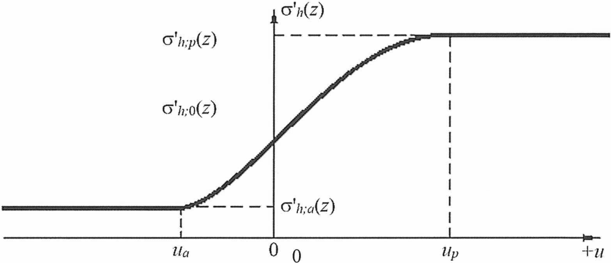

<!-- figure-caption-deferred -->

$\sigma'_h(z)$ **от горизонтальных перемещений конструкции** ***u*****,**

**где** ***u***$u_a$ ***=*** **0,001*****h*****,** ***u***$u_p$ **= (0,01 - 0,02)*****h***

> (рисунок 9.1 в ред. Изменения N 4, утв. Приказом Минстроя России от 27.12.2021 N 1022/пр)

9.22 Величины бокового давления грунта следует принимать равными $\sigma'_{ha}(z)$, если величина горизонтального перемещения конструкции в направлении от грунта превышает 0,001 h. ^c9-22

Величину эффективного активного давления грунта на конструкцию, вызванного его объемным весом $\gamma$, при наличии вертикальной равномерно распределенной нагрузки *q*, приложенной к поверхности, следует вычислять по формулам:

нормальная составляющая на глубине *z*:

$$\\xi=\\frac{z}{b}\tag{9.5}$$

где $\gamma$ - удельный вес грунта, принимаемый во взвешенном состоянии для водонасыщенных грунтов;

*c* - удельное сцепление грунта;

*K*$K_a$ - коэффициент нормальной составляющей активного давления;

касательная составляющая на глубине *z* (положительна при перемещении грунта вниз относительно конструкции):

$$\\xi=\\frac{z}{b}\tag{9.6}$$

где $\delta$ - угол трения грунта по материалу конструкции, определяемый в соответствии с 9.16;

*a* - адгезия между грунтом и поверхностью стены, определяемая на основании экспериментальных исследований, кПа.

Величины $\sigma'_{ha}(z)$ принимаются во всех случаях равными не менее 0.

Для негоризонтальной поверхности грунта и наклона граней конструкции к вертикали (рисунок 9.2,*а*) коэффициент нормальной составляющей активного давления грунта следует вычислять по формуле

$$K_s=\\frac{\\cos\\delta s\\cdot\\varphi\\theta}{\\cos\\delta s\\cdot\\delta\\varphi\\cdot[1-\\frac{\\sin\\delta\\sin\\varphi\\beta}{\\cos\\delta s\\cdot\\delta\\varphi\\beta}]^2}\tag{9.7}$$

где $\beta$ - угол наклона поверхности грунта к горизонту;

$\theta$ - угол отклонения грани конструкции от вертикали;

$\varphi$ - угол внутреннего трения грунта.

При горизонтальной поверхности грунта, вертикальной абсолютно гладкой грани конструкции коэффициент активного давления грунта допускается вычислять по формуле

$$K_a=\\xi'_{45}+\\varphi_2\tag{9.8}$$

(п. 9.22 в ред. Изменения N 5, утв. Приказом Минстроя России от 07.12.2023 N 884/пр)

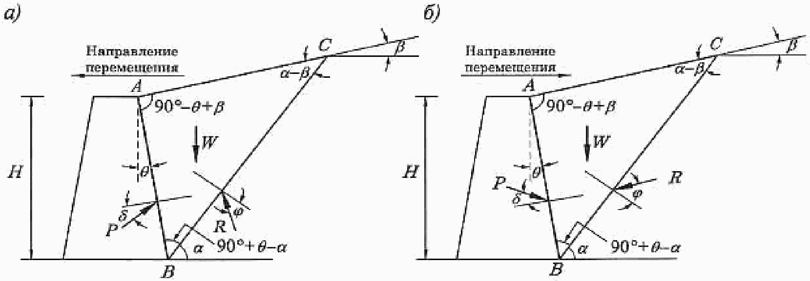

<!-- figure-caption-deferred -->
***б)*** **пассивного давлении грунта при негоризонтальной**
**поверхности грунта и наклоне граней**

**конструкции к вертикали**

9.23 Величины бокового давления грунта допускается принимать равными $\sigma'_{h,p}(z)$, если величина горизонтального перемещения конструкции в направлении на грунт превышает 0,01 h для влажных грунтов и 0,02 h для водонасыщенных грунтов. ^c9-23

Величину эффективного пассивного давления грунта на конструкцию допускается вычислять по формулам:

нормальная составляющая на глубине *z*:

$$\\xi=\\frac{z}{b}\tag{9.9}$$

где *K*$K_p$ - коэффициент нормальной составляющей пассивного давления;

касательная составляющая на глубине *z* (положительна при перемещении грунта вверх относительно конструкции):

$$\\xi=\\frac{z}{b}\tag{9.10}$$

где *a* - см. формулу (9.6).

Для негоризонтальной поверхности грунта и наклона граней конструкции к вертикали (см. рисунок 9.2,*б*) коэффициент нормальной составляющей пассивного давления грунта допускается вычислять по формуле

$$K_s=\\frac{\\cos\\delta s\\cdot\\varphi\\theta}{[\\cos\\delta s\\cdot\\delta\\varphi\\beta]^2}\tag{9.11}$$

При горизонтальной поверхности грунта, вертикальной абсолютно гладкой грани конструкции коэффициент пассивного давления грунта допускается вычислять по формуле

$$K_p=\\xi'_{45}+\\varphi_2\tag{9.12}$$

Следует учитывать, что формула (9.11) завышает величины пассивного давления для высоких значений угла внутреннего трения грунта. В связи с этим, при $\varphi$, превышающем 20°, в формуле (9.11) во всех случаях следует принимать $\delta=0$.

(п. 9.23 в ред. Изменения N 5, утв. Приказом Минстроя России от 07.12.2023 N 884/пр)

9.24 При необходимости учета других факторов, помимо указанных в [4789?] - [5](#^biblio-5), для определения величин активного и пассивного давления, а также при расчете промежуточных значений бокового давления грунта следует использовать численные методы и указания [[СП 381.1325800]]. ^c9-24

При построении эпюр активного давления на гибкие подпорные конструкции с распорным или анкерным креплением в несвязных грунтах следует учитывать перераспределение активного давления по высоте согласно [[СП 381.1325800]].

(п. 9.24 в ред. Изменения N 5, утв. Приказом Минстроя России от 07.12.2023 N 884/пр)

9.25 При вычислении эффективных величин бокового давления проницаемых грунтов на ограждения котлованов следует учитывать фильтрационные силы в том случае, если ограждение является несовершенной противофильтрационной завесой (ПФЗ) и в котловане выполняется строительное водопонижение (см. [2](#^biblio-2)). ^c9-25

Эффективные величины бокового давления водонасыщенных проницаемых грунтов в этом случае вычисляют по формуле

$$\\xi=\\frac{z}{b}\tag{9.13}$$

где *K* - коэффициент бокового давления грунта, может соответствовать активному, пассивному или промежуточному значению;

$\gamma'$ - удельный вес грунта во взвешенном состоянии;

$\gamma_w$ - удельный вес воды;

*I* - градиент гидравлического напора на отрезке вертикали, равном 1 м, 1/м.

Знак "+" в формуле (9.13) соответствует области нисходящей фильтрации, знак "-" - области восходящей фильтрации.

9.26 При выполнении расчетов оснований, сложенных водонасыщенными грунтами в нестабилизированном состоянии [2](#^biblio-2), допускается определять величины бокового давления на ограждения котлованов и конструкции подземных частей сооружений, выраженные в полных напряжениях. ^c9-26

В этом случае нормальную составляющую величины активного давления грунта на конструкцию на глубине *z* допускается вычислять по формуле

$$\\xi=\\frac{z}{b}\tag{9.14}$$

где *c*$c_u$ - сопротивление грунта недренированному сдвигу.

Нормальную составляющую величины пассивного давления грунта допускается вычислять по формуле

$$\\xi=\\frac{z}{b}\tag{9.15}$$

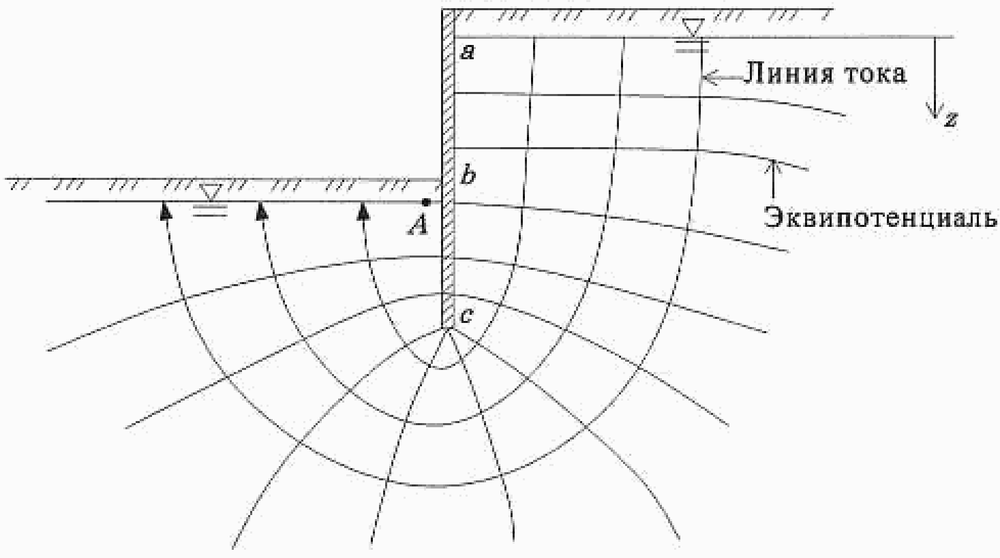

<!-- figure-caption-deferred -->

9.27 При проектировании подземных частей сооружений геотехнических категорий 2 и 3, перекрывающих полностью или частично естественные фильтрационные потоки в грунтовом или скальном массиве, а также изменяющих условия и пути фильтрации подземных вод, следует выполнять прогноз изменений гидрогеологического режима площадки строительства. ^c9-27

Следует учитывать возможность возникновения барражного эффекта, который проявляется в подъеме уровня подземных вод на пути фильтрационного потока перед преградой. При проектировании сооружений должна быть выполнена количественная оценка барражного эффекта, и при необходимости разработаны защитные мероприятия для проектируемого сооружения и окружающей застройки.

Прогноз изменений гидрогеологического режима следует выполнять путем математического моделирования фильтрационных процессов численными или аналитическими методами. В качестве исходной информации для разработки геофильтрационной модели следует использовать данные инженерно-геологических изысканий о положении уровня подземных вод на территории, прилегающей к площадке строительства, гидравлических напорах в горизонтах, фильтрационной проницаемости грунтов. Для выполнения указанных исследований необходимо привлекать специализированные организации.

9.28 При проектировании фундаментов и подземных частей сооружений, расположенных ниже пьезометрического уровня подземных вод, необходимо рассчитывать их давление и предусматривать мероприятия, предупреждающие их протечки в котлован, вспучивание дна котлована, всплытие сооружения и т.п. ^c9-28

При заложении фундаментов, а также подземных частей сооружений ниже пьезометрического уровня подземных вод следует учитывать возможные случаи заглубления:

- в водоупорный грунт, подстилаемый водоносным слоем с напорными водами, когда возможен прорыв подземных вод в котлован, выпор грунтов основания, подъем полов и т.п.; в этом случае следует предусматривать мероприятия, снижающие напор (например, откачку воды из скважин), или увеличение пригрузки на залегающий в основании грунт;

- грунт водоносного слоя, когда возможно гидравлическое разрушение, сопровождаемое суффозионным выносом частиц грунта, размывы, коррозия и другие повреждения фундаментов; в этом случае кроме снижения градиента напора может предусматриваться также закрепление грунтов.

9.29 Для исключения возможности прорыва напорными водами вышележащего водоупорного глинистого слоя грунта, подстилаемого слоем грунта с напорными водами, следует выполнять условие ^c9-29

$$H\le h_0+H_c\tag{9.16}$$

где $\gamma_f$ - коэффициент надежности по нагрузке, равный 1,2;

$\gamma_w$ - удельный вес воды, кН/м³;

*H*$H_0$ - расчетная высота напора воды, отсчитываемая от подошвы проверяемого водоупорного слоя до максимального уровня подземных вод, м;

$\gamma_l$ - средневзвешенное расчетное значение удельного веса грунта проверяемого и вышележащих слоев, кН/м³;

*h*$h_0$ - расстояние от дна котлована до подошвы проверяемого слоя грунта, м.

Если условие формулы (9.16) не удовлетворяется, необходимо предусмотреть в проекте искусственное понижение напора водоносного слоя (принудительная откачка или устройство самоизливающихся скважин). Искусственное снижение напора подземных вод должно быть предусмотрено на срок, в течение которого сооружение приобретет достаточный вес и прочность, обеспечивающие восприятие сил, создаваемых напором подземных вод, но не ранее окончания работ по устройству нулевого цикла и выполнению обратной засыпки грунта в пазухи котлована.

9.30 Для исключения возможности гидравлического разрушения водонасыщенного грунта, сопровождаемого суффозией, при восходящей фильтрации в котловане (см. [2](#^biblio-2)) следует выполнять условие ^c9-30

$$\gamma_r I\le1\tag{9.17}$$

где $\gamma_f$ - коэффициент надежности по нагрузке, равный 1,2;

*I* - градиент гидравлического напора в восходящем фильтрационном потоке на выходе в котлован в точке A, расположенной вблизи ПФЗ.

9.31 При размещении подземной части сооружения ниже уровня подземных вод в водонасыщенных грунтах должна быть обеспечена устойчивость сооружения против всплытия. ^c9-31

Устойчивость против всплытия обеспечена, если выполняется следующее условие

$$K=\\frac{A}{1+\\theta E_p}\tag{9.18}$$

где $\gamma_w$ - удельный вес воды, кН/м³;

*H*$H_0$ - расчетная высота напора воды, отсчитываемая от подошвы подземной части сооружения до максимального уровня подземных вод, м;

*A* - площадь подземной части сооружения, м²;

$\Sigma G_{stb,c}$ - сумма нормативных значений постоянных вертикальных удерживающих нагрузок, включая собственный вес несущих конструкций сооружения, кН;

$\Sigma G_{stb,l}$ - сумма нормативных значений временных длительных удерживающих вертикальных нагрузок, включая вес полов и перегородок сооружения, грунта обратной засыпки над обрезами фундаментов и подземной частью сооружения, кН;

$\Sigma R_{stb}$ - сумма нормативных значений удерживающих вертикальных составляющих сил сопротивления всплытию в основании, включая силы трения, сопротивления свай выдергиванию, натяжения анкеров и др., кН;

$\gamma_{f1}=0{,}9$, $\gamma_{f2}=0{,}85$, $\gamma_{f3}=0{,}65$ - коэффициенты надежности по нагрузке.

Если условие (9.18) не удовлетворяется, то чтобы не допустить разрушение от всплытия сооружения, необходимо применять следующие мероприятия:

- увеличение собственного веса сооружения или его пригрузка;

- уменьшение поровых давлений под сооружением с помощью устройства дренажа;

- закрепление сооружения в нижележащих слоях грунта с помощью анкеров или свай.

9.32 Инъекционные преднапряженные грунтовые анкеры применяются для крепления ограждений котлованов или защиты сооружений от всплытия и устраиваться в любых грунтах, за исключением слабых глинистых, просадочных, набухающих, органоминеральных и органических. ^c9-32

*(в ред. Изменения N 5, утв. Приказом Минстроя России от 07.12.2023 N 884/пр)*

Проектирование анкеров должно основываться на результатах статических расчетов системы "конструкция - грунтовый массив", в которых должна быть определена расчетная осевая нагрузка на анкер с учетом требуемого числа ярусов анкеров, их расположения, углов наклона анкеров к горизонту и углов отклонения анкеров в плане от нормали к конструкции.

При проектировании анкеров определяют:

- число анкеров в ярусе и их шаг;

- свободную длину анкерных тяг, обеспечивающую размещение заделки анкеров за пределами границы призмы обрушения;

- предварительную длину заделки анкеров, требуемую для восприятия проектных усилий;

- места для устройства опытных анкеров; число пробных испытаний анкеров и порядок их выполнения.

Несущая способность преднапряженных анкеров по грунту и материалу должна предварительно определяться расчетом и проверяться испытаниями.

При проектировании анкеров следует оценить и учесть влияние их устройства и натяжения на осадки фундаментов зданий и сооружений, в том числе подземных инженерных коммуникаций, расположенных в зоне влияния строительства.

Применение для изготовления анкерных тяг и каркасов арматурных изделий (либо других изделий металлопроката) бывших в употреблении (эксплуатации) не допускается.

9.32а При проектировании постоянных грунтовых анкеров в сейсмических районах несущую способность анкера следует проверять с учетом сейсмических воздействий. Расчетная сейсмичность принимается с учетом ответственности сооружения и срока службы анкера. Несущая способность анкера в условиях расчетной сейсмичности определяется с учетом указаний пункта 12.3 [[СП 24.13330]].

(п. 9.32а введен Изменением N 4, утв. Приказом Минстроя России от 27.12.2021 N 1022/пр)

9.33 При проектировании оснований, фундаментов и подземных частей вновь возводимых или реконструируемых сооружений, в том числе подземных сооружений, возводимых закрытым способом, располагаемых на застроенной территории, необходимо выполнять геотехнический прогноз (оценку) влияния строительства на изменение напряженно-деформированного состояния окружающего грунтового массива, в т.ч. оснований сооружений окружающей застройки. Геотехнический прогноз влияния должен учитывать также дополнительные технологические деформации, включая осадки, фундаментов сооружений окружающей застройки от устройства "стены в грунте", грунтовых инъекционных анкеров, буроинъекционных свай и пр. ^c9-33

*(в ред. Изменения N 4, утв. Приказом Минстроя России от 27.12.2021 N 1022/пр, Изменения N 5, утв. Приказом Минстроя России от 07.12.2023 N 884/пр)*

> **Примечания**

> 1 Геотехнический прогноз влияния также необходимо выполнять при проектировании подземных инженерных и транспортных коммуникаций, которые размещаются на застроенных территориях.

> 2 Требования [6](#^biblio-6) - [5039?] распространяются на проектирование подземных инженерных и транспортных коммуникаций так же как на строящиеся или реконструируемые сооружения.

Геотехнический прогноз следует выполнять с учетом горизонтальных перемещений ограждающей конструкции котлована и разгрузки основания от выемки грунта в котловане, нагрузок от вновь возводимого сооружения или дополнительных нагрузок от реконструируемого сооружения, изменения уровня подземных вод, технологических и динамических воздействий строительных работ и других факторов с учетом последовательности устройства подземной части сооружения, используя аналитические и численные методы расчета. Для расчета дополнительных деформаций оснований и фундаментов сооружений окружающей застройки, вызванных вертикальными нагрузками от вновь возводимого сооружения, допускается использовать расчетную схему в виде линейно-деформируемого полупространства (см. 5.6.37).

> **Примечания**

1 Величину дополнительной технологической осадки в процессе устройства "стены в грунте" для окружающей застройки (при расстоянии от котлована до сооружений окружающей застройки менее 5 м) следует определять по расчету методом численного моделирования, учитывающим следующие параметры: расстояние между фундаментом здания и "стеной в грунте", длину захватки "стены в грунте", давление по подошве фундамента и плотность бентонитового раствора. Величину технологической осадки также допускается определять методом аналогий, на основании результатов геотехнического мониторинга, выполненного на аналогичных площадках со схожими грунтовыми условиями. ^ic1-18

2 Величину дополнительных технологических осадок от устройства грунтовых анкеров следует определять по расчету методом численного моделирования в плоской или трехмерной постановке, рассматривая скважины для устройства анкеров как выемки круглого сечения с заданным процентом перебора грунта. Величину перебора грунта допускается назначать методом аналогий, на основании результатов геотехнического мониторинга и обратных расчетов на аналогичных площадках со схожими грунтовыми условиями, либо по результатам выполнения работ на опытной площадке. ^ic2-16

3 Величину дополнительной технологической осадки окружающей застройки, вызванную другими технологическими процессами, следует определять на основании сопоставимого геотехнического опыта. ^ic3-9

9.34 В результате геотехнического прогноза должны быть определены: ^c9-34

- характерные размеры или радиус зоны влияния *r*$r_{зв}$, м;

- величины дополнительных деформаций оснований и фундаментов сооружений окружающей застройки и подземных коммуникаций;

- необходимость и состав защитных мероприятий для обеспечения сохранности окружающей застройки от влияния строительства.

> **Примечания**

> 1 Для линейных сооружений следует определять характерный размер зоны влияния строительства, а для компактных - радиус.

2 Радиус зоны влияния нового строительства или реконструкции допускается ограничивать расстоянием, при котором расчетное значение дополнительной осадки грунтового массива или основания существующего сооружения окружающей застройки не превышает 1 мм, за исключением расположения на границе зоны влияния сооружений окружающей застройки, категория технического состояния которых аварийная - IV [1](#^biblio-1). ^ic2-17

3 В пределах зоны влияния следует выделять размеры зоны интенсивных деформаций в массиве грунта, в которой перемещения в массиве превышают 10 мм. Допустимо принимать плановые размеры зоны интенсивных деформаций, соответствующим размерам области, в которой осадки земной поверхности, вызванные строительством, превышают 10 мм. ^ic3-10

4 При определении размеров зоны влияния нового строительства и реконструкции на территориях, осложненных распространением специфических грунтов, необходимо учитывать местный опыт проектирования, условия строительства и особенности эксплуатации сооружений, а также требования [5](#^biblio-5). ^ic4-8

5 Радиус или размер зоны влияния по результатам геотехнического прогноза может изменяться вдоль трассы ограждающей конструкции его котлована в зависимости от различных факторов, в т.ч. глубины котлована, инженерно-геологических условий и пр. ^ic5-5

6 Радиус или размер зоны влияния r зв измеряется от границ проектируемого котлована. ^ic6-3

9.35 Геотехнический прогноз необходимо выполнять для сооружений окружающей застройки, расположенных в пределах предварительно назначаемой зоны влияния строящегося или реконструируемого сооружения, которая определяется согласно требованиям [1](#^biblio-1) или на основании предварительного моделирования влияния строительства подземного сооружения с учетом нагрузок, передаваемых на основание зданиями и сооружениями окружающей застройки. Жесткость конструкций окружающей застройки в предварительных расчетах допускается не учитывать. ^c9-35

Перед выполнением геотехнического прогноза необходимо провести техническое обследование состояния конструкций сооружений окружающей застройки, расположенных в предварительно назначаемой зоне влияния нового строительства или реконструкции (см. 9.36). По результатам технического обследования следует определить категорию технического состояния сооружений окружающей застройки согласно приложение Д.

> **Примечания**

1 Если по результатам геотехнического прогноза (см. [8](#^biblio-8)) в зоне влияния нового строительства или реконструкции располагаются существующие сооружения окружающей застройки, не учтенные при предварительном назначении зоны влияния согласно требованиям [4990?], [1](#^biblio-1), то для этих сооружений необходимо также провести техническое обследование, установить категорию технического состояния [1](#^biblio-1) и включить в перечень сооружений, для которых выполняется геотехнический прогноз. ^ic1-19

2 При обследовании зданий, находящихся в зоне интенсивных деформаций (см. [8](#^biblio-8)), следует предусмотреть вскрытие их фундаментов не менее чем в двух шурфах, установить конструктивную схему здания, а также выявить дефекты и повреждения конструкций и другие необходимые параметры здания, которые следует учитывать при проведении математического моделирования. ^ic2-18

3 Допускается не проводить геотехнический прогноз и не назначать зону влияния строительства от проектируемых подземных коммуникаций, прокладка которых предусматривается в котловане или траншее глубиной не более 3 м и на расстоянии более 2 H к от существующих зданий или сооружений при уровне подземных вод ниже 3 м от поверхности. При проектировании прокладки подземных инженерных коммуникаций с учетом данного условия, обследование зданий и сооружений допускается не проводить. ^ic3-11

4 При выполнении геотехнического прогноза следует учитывать температурные деформации распорных конструкций ограждения котлована, связанные с сезонным понижением температуры. ^ic4-9

(примечание 4 введено Изменением N 1, утв. Приказом Минстроя России от 20.11.2018 N 736/пр)

5 При наличии исходных данных, предоставленных эксплуатирующими организациями, достаточных для выполнения расчетов инженерных коммуникаций по предельным состояниям в объеме, необходимом для подтверждения возможности дальнейшей эксплуатации инженерных коммуникаций, обследование инженерных коммуникаций окружающей застройки допускается не выполнять. ^ic5-6

(примечание 5 введено Изменением N 2, утв. Приказом Минстроя России от 24.01.2019 N 43/пр)

9.36 Для предварительного назначения зоны влияния вновь возводимого (реконструируемого) сооружения, расположенного на застроенной территории, ориентировочный радиус (характерный размер) зоны влияния r зв, м, допускается принимать в зависимости от глубины котлована H к, м, метода его крепления и конструкции ограждения котлована равным: ^c9-36

5 H к - при использовании ограждения котлована с креплением анкерными конструкциями, но не более 2 L, где L - суммарная длина горизонтальной проекции тела анкера и его тяги, м; ^ic5-7

4 H к - при использовании ограждения из стальных элементов (труб, двутавров и т.п.) с консольным креплением либо креплением стальными распорками или подкосами, а также при устройстве котлована в естественных откосах (от нижней границы откоса); ^ic4-10

3 H к - при использовании монолитной или сборно-монолитной железобетонной конструкции ограждения котлована (по технологии "стена в грунте", буронабивных секущихся свай и т.п.) с консольным креплением либо креплением стальными распорками или подкосами, а также при использовании ограждения из стальных элементов (труб, двутавров и т.п.) и экскавации грунта в котловане под защитой монолитных железобетонных перекрытий; ^ic3-12

2 H к - при использовании монолитной или сборно-монолитной железобетонной конструкции ограждения котлована (по технологии "стена в грунте", буронабивных секущихся свай и т.п.) и экскавации грунта в котловане под защитой монолитных железобетонных перекрытий. ^ic2-19

> **Примечания**

> 1 Величина предварительно назначаемой зоны влияния может корректироваться на основании местного опыта проектирования с учетом специфических грунтовых условий и других факторов.

2 В условиях реконструкции зона влияния предварительно назначается, как две глубины заложения фундаментов от существующего рельефа (или заглубления подвала в процессе реконструкции) без надстройки реконструируемого здания и как три глубины при его надстройке. ^ic2-20

9.37 Расчет оснований по деформациям для сооружений окружающей застройки, расположенных в зоне влияния нового строительства или реконструкции, проводят из условия ^c9-37

*s*$s_{ad}$ <= *s*$s_{ad,u}$, (9.19)

где *s*$s_{ad}$ - дополнительная осадка основания фундамента (совместная дополнительная деформация основания и сооружения), определяемая в соответствии с требованиями 9.33 с учетом совокупности воздействий, связанных с новым строительством или реконструкцией;

*s*$s_{ad,u}$ - предельное значение дополнительной осадки основания фундаментов (предельное значение совместной дополнительной деформации основания и сооружения), устанавливаемое в соответствии с требованиями приложения К с учетом категории технического состояния сооружения окружающей застройки (см. (приложение Д)).

> **Примечания**

1 Для определения совместной дополнительной деформации основания и сооружения окружающей застройки s ad используются методы, указанные в [4](#^biblio-4), с учетом значений дополнительных деформаций основания, полученных по результатам геотехнического прогноза. ^ic1-20

*(в ред. Изменения N 5, утв. Приказом Минстроя России от 07.12.2023 N 884/пр)*

2 При расчете оснований сооружений окружающей застройки по деформациям, [2](#^biblio-2) следует выполнять в т.ч. для параметров, указанных в [1](#^biblio-1). ^ic2-21

9.38 При проектировании вновь возводимых или реконструируемых сооружений на застроенной территории необходимо предусмотреть мероприятия, обеспечивающие эксплуатационную надежность сооружений окружающей застройки на период строительства и дальнейшей эксплуатации. Если по результатам геотехнического прогноза условие [2](#^biblio-2) не выполняется, необходимо предусматривать следующие мероприятия: ^c9-38

- изменение конструкции ограждения строительного котлована, методов ее крепления, глубины подземной части, ее планового расположения и др.;

- снижающие деформации основания сооружений окружающей застройки (устройство разделительных стен, геотехнических и компенсационных экранов, закрепление грунтов основания, подъем и рихтовку фундаментов и др.);

*(в ред. Изменения N 4, утв. Приказом Минстроя России от 27.12.2021 N 1022/пр)*

- снижающие дополнительные осадки и (или) их неравномерность или повышающие пространственную жесткость сооружений окружающей застройки (усиление фундаментов, устройство монолитных и стальных поясов в подземной и надземной частях сооружений и др.);

- комбинацию вышеперечисленных мероприятий.

> **Примечание** — Для обеспечения эксплуатационной надежности сооружений окружающей застройки приоритетным является изменение проектных характеристик вновь возводимого или реконструируемого сооружения.

Состав назначаемых защитных мероприятий следует определять с учетом:

- характерных особенностей сооружений окружающей застройки (уровень ответственности, значения прогнозируемых деформаций основания, расстояние до проектируемой подземной части, конструктивная схема, категория технического состояния и физико-механические свойства грунтов основания сооружений окружающей застройки и пр.);

- особенностей проектируемого или реконструируемого сооружения (глубина котлована, тип ограждающей конструкции котлована и метод ее крепления, инженерно-геологические и гидрогеологические условия, включая прогноз их изменений, давление на основание и пр.).

> **Примечания**

1 При распространении специфических грунтов или возможности развития опасных геологических процессов в основании площадки строительства и (или) сооружений окружающей застройки, необходимо дополнительно учитывать соответствующие требования [5](#^biblio-5). ^ic1-21

2 Защитные мероприятия для сооружений окружающей застройки также допускается разрабатывать при отсутствии возможности учета расчетными методами динамических и других дополнительных воздействий, в т.ч. технологических особенностей строительства. ^ic2-22

Проект защитных мероприятий следует выполнять в соответствии с требованиями [[СП 361.1325800]].

*(абзац введён Изменением N 5, утв. Приказом Минстроя России от 07.12.2023 N 884/пр)*

После разработки проекта защитных мероприятий по обеспечению эксплуатационной пригодности сооружений окружающей застройки, расположенных в зоне влияния нового строительства или реконструкции, геотехнический прогноз необходимо повторить с учетом этих мероприятий для подтверждения выполнения условие (9.19).

9.39 При проектировании подземных частей сооружений (нового строительства и реконструкции) необходимо предусматривать проведение геотехнического мониторинга в соответствии с требованиями [5159?], в т.ч. для сооружений окружающей застройки. ^c9-39

9.40 Для снижения технологических деформаций сооружений окружающей застройки следует выбирать щадящие технологии подземного строительства в соответствии с [[СП 473.1325800]] (приложение К), а также выполнять интерактивную корректировку контролируемых параметров геотехнологий на основе применения наблюдательного метода. ^c9-40

(п. 9.40 введен Изменением N 5, утв. Приказом Минстроя России от 07.12.2023 N 884/пр)

# 10 Особенности проектирования оснований высотных зданий

10.1 Требования настоящего раздела распространяются на проектирование оснований любых зданий и сооружений высотой более 75 м, в том числе высотных частей зданий в составе разноэтажных комплексов, общественных зданий выше 50 м, а также многофункциональных зданий, в которых помещения общественного назначения располагаются на высоте более 50 м в соответствии с [[СП 267.1325800]]. ^c10-1

(п. 10.1 в ред. Изменения N 5, утв. Приказом Минстроя России от 07.12.2023 N 884/пр)

10.2 При проектировании оснований, фундаментов и конструкций подземной части высотного здания следует учитывать требования [2](#^biblio-2). ^c10-2

> **10.3** До начала строительства высотного здания должны быть выполнены следующие этапы: подготовительный, градостроительное обоснование и проектно-изыскательские работы. ^c10-3

10.4 На подготовительном этапе строительства объекта следует осуществлять экспертную оценку геотехнической сложности площадки строительства и его потенциальную опасность для окружающей застройки. ^c10-4

10.5 Градостроительное обоснование следует выполнять в соответствии с [8](#^biblio-8) для утверждения объекта строительства, включая его месторасположение. ^c10-5

10.6 Проектно-изыскательские работы для высотных зданий следует выполнять в следующей последовательности: ^c10-6

- анализ архивных материалов инженерно-геологических изысканий, выполнение разведочных скважин;

*(в ред. Изменения N 5, утв. Приказом Минстроя России от 07.12.2023 N 884/пр)*

- разработка концептуальных предложений;

- разработка заданий на изыскания и программ инженерно- геологических и инженерно-геотехнических изысканий;

*(в ред. Изменения N 5, утв. Приказом Минстроя России от 07.12.2023 N 884/пр)*

- проведение инженерно-геологических и инженерно-геотехнических изысканий;

- выполнение геотехнического обоснования проектных решений;

- выполнение расчетного обоснования проектных решений;

- создание геомеханической модели и оценка влияния строительства на окружающую застройку и подземные коммуникации;

- создание гидрогеологической модели и выполнение прогноза изменения гидрогеологической ситуации на площадке строительства;

- разработка программы мониторинга;

- разработка проекта фундаментов на стадии "Проектная документация";

- разработка проекта фундаментов на стадии "Рабочая документация".

> **Примечания**

1 В процессе геотехнического обоснования проектных решений должен быть сделан аргументированный выбор расчетной программы, модели и параметров грунта для выполнения геотехнических расчетов, выполнена их верификация в соответствии с требованиями настоящего свода правил, рассмотрены возможные варианты, и обосновано принятое проектное решение. ^ic1-22

2 В процессе расчетного обоснования выполняются совместные расчеты в объемной постановке системы "основание - фундамент - сооружение" в объеме, достаточном для разработки проектного решения по устройству фундамента. ^ic2-23

10.7 Начиная с разработки заданий на изыскания и программ инженерно-геологических и инженерно-геотехнических изысканий, следует осуществлять геотехническую экспертизу разрабатываемой документации по объекту. ^c10-7

*(в ред. Изменения N 5, утв. Приказом Минстроя России от 07.12.2023 N 884/пр)*

10.8 Изыскания, проектирование и строительство высотных зданий следует выполнять при научно-техническом сопровождении (НТС) со стороны специализированных организаций. ^c10-8

10.9 Инженерные изыскания следует проводить в соответствии с требованиями [[СП 47.13330]], [[СП 446.1325800]] и [[СП 267.1325800]], с учетом требований [8](#^biblio-8), [6](#^biblio-6), национальных стандартов и других нормативных документов в области инженерных изысканий и исследований свойств грунтов для строительства. ^c10-9

*(в ред. Изменения N 5, утв. Приказом Минстроя России от 07.12.2023 N 884/пр)*

> [!WARNING] Пункты 10.10–10.21 исключены с 08.01.2024 (изменение N 5)
>
> - 10.21 Исключены с 08.01.2024. - Изменение N 5, утв. Приказом Минстроя России от 07.12.2023 N 884/пр. ^c10-10

10.22 Расчетные модели, используемые для проектирования оснований и фундаментов, должны быть верифицированы, в том числе с использованием результатов модельных или натурных исследований. ^c10-22

Для зданий высотой более 100 м следует выполнять параллельный расчет независимой организацией с применением сертифицированных программных комплексов, реализующих метод конечных элементов. Данный расчет выполняется при помощи программных комплексов, разработанных независимо от программных комплексов, используемых для основного расчета.

10.23 Предельные значения характеристик совместной деформации основания, фундаментов и конструкций здания следует устанавливать исходя из технологических, конструктивных, физиологических и эстетико-психологических требований в соответствии с [[СП 20.13330]]. ^c10-23

10.24 Проверку соблюдения условия [2](#^biblio-2) следует проводить в составе совместных расчетов системы "основание - фундамент - здание" по второй группе предельных состояний. ^c10-24

10.25 При проектировании оснований и фундаментов высотных частей зданий в составе разноэтажных комплексов следует выполнять расчет взаимного влияния строительства отдельных частей комплекса с учетом последовательности их возведения. ^c10-25

10.26 При расчете крена здания и неравномерности деформации фундамента необходимо учитывать: ^c10-26

- подъем дна котлована;

- влияние ограждающей конструкции котлована;

- взаимовлияние между фундаментами высотного здания и окружающей застройки, в том числе при строительстве разноэтажных комплексов;

- случайную и систематическую изменчивость свойств грунта основания в пространстве;

- величину конечной осадки и развитие ее во времени;

- распределение нагрузок;

- изменение жесткости сооружения и отдельных его частей в процессе строительства;

- метод строительства, включая последовательность нагружения.

10.27 Случайную и систематическую изменчивость свойств грунта основания следует учитывать путем снижения значения средней допускаемой осадки при увеличении высоты здания и введением повышенного коэффициента надежности по грунту для модуля деформации грунта. ^c10-27

10.28 Для предварительных расчетов предельные значения средних осадок фундаментов высотных зданий следует принимать при высоте до 200 м - не более 20 см, 300 м и более - 10 см, для промежуточных значений - по интерполяции. Окончательные значения предельных осадок и их неравномерность должны приниматься на основании совместного расчета системы "основание - фундамент - сооружение". ^c10-28

*(в ред. Изменения N 5, утв. Приказом Минстроя России от 07.12.2023 N 884/пр)*

10.29 При проектировании оснований зданий высотой 100 м расчетные значения модуля деформации E должны приниматься при коэффициенте надежности по грунту $\gamma_g=1{,}1$, при высоте здания 500 м и более следует принимать $\gamma_g=1{,}2$. Для промежуточных значений высоты здания $\gamma_g$ следует определять по интерполяции. ^c10-29

10.30 Расчет на стадии разработки концептуальных решений допускается выполнять с использованием упрощенных расчетных схем сооружения с эквивалентной жесткостью этажа, определенной в соответствии с [1](#^biblio-1) по упрощенной схеме с применением аналитических зависимостей. На стадии расчетного обоснования проектных решений расчет должен выполняться в объемной постановке с учетом всего каркаса здания, этапности возведения. ^c10-30

(п. 10.30 в ред. Изменения N 1, утв. Приказом Минстроя России от 20.11.2018 N 736/пр)

10.31 Глубину сжимаемой толщи следует определять в результате расчетов согласно [6](#^biblio-6). В случае применения нелинейных моделей грунта, учитывающих зависимость модуля деформации от напряженного состояния грунта, зона деформации массива грунта вычисляется в процессе проведения расчетов. ^c10-31

# 11 Проектирование водопонижения

11.1 Для защиты подземных сооружений, котлованов и траншей от подземных вод в периоды строительства и (или) эксплуатации применяют искусственное понижение уровня подземных вод путем устройства водоотлива, водопонизительных скважин, иглофильтров, электроосмоса и дренажа. ^c11-1

11.2 Выбор способов водопонижения должен учитывать конструктивные особенности и размеры сооружения, в т.ч. его подземной части, инженерно-геологические и гидрогеологические условия, размеры осушаемой площади, особенности производства общестроительных работ в защищаемом котловане, возможные изменения физико-механических свойств грунтов основания будущего сооружения, прогноз влияния водопонижения на окружающую застройку и экологическую обстановку, сроки работ и другие факторы. ^c11-2

При проектировании водопонижения необходимо также учитывать возможное изменение режима подземных вод, условия поверхностного стока в строительный и эксплуатационный периоды, расположение мест сброса подземных вод и их химический состав.

11.3 При устройстве водопонижения должны быть предусмотрены мероприятия, препятствующие ухудшению строительных свойств грунтов в основании сооружения, нарушению устойчивости откосов котлована, появлению и развитию опасных геологических и инженерно-геологических процессов, возникновению недопустимых деформаций окружающей застройки, ухудшению экологической обстановки на территории, входящей в зону влияния водопонизительных работ. ^c11-3

11.4 При прогнозировании понижения уровня подземных вод необходимо определить зону его влияния и учитывать возможность возникновения дополнительных осадок территории в зоне развития депрессионной воронки и как следствие деформаций окружающей застройки. Следует учитывать, что радиус зоны влияния на окружающую застройку от воздействия строительного водопонижения может превышать ориентировочные величины, указанные в [1](#^biblio-1). ^c11-4

С учетом результатов прогноза влияния водопонижения на деформации основания окружающей застройки следует устанавливать режим водопонижения, сроки строительства и этапность освоения площади застройки, а также определить необходимость проведения защитных мероприятий, направленных на снижение влияния строительного водопонижения на окружающую застройку и экологическую среду, включающих как локальную защиту сооружений, так и защиту всей территории (устройство противофильтрационных завес и экранов, замораживание грунта или его инъекционное закрепление и т.д.).

11.5 При проектировании дренажа, водопонизительных скважин и иглофильтров, а также при расчетах водопонижения, определении необходимости опытного (пробного) водопонижения, проведении наблюдений за изменением уровня подземных вод, выборе устройств и оборудования для водопонижения и разработке мероприятий по охране окружающей среды следует, кроме требований настоящего раздела, учитывать требования [[СП 103.13330]]. ^c11-5

11.6 Требуемое понижение уровня подземных вод следует определять: ^c11-6

- в водоносных слоях, содержащих безнапорные воды - с учетом допустимого повышения уровня воды за время аварийного отключения водопонизительной системы ([[СП 103.13330]]);

- напорных водоносных слоях, залегающих ниже дна котлована или пола заглубленного сооружения - из условия возможности прорывов воды и необходимости обеспечения устойчивости грунтов в основании сооружения.

При пересечении сооружением (котлованом) водоупорных слоев следует исходить из практически достижимого понижения уровня подземных вод, предусматривая при необходимости дополнительные мероприятия для защиты сооружения (котлована) от подземных вод.

11.7 При проектировании систем строительного водопонижения следует применять те из них, которые также используются для работы в эксплуатационный период. ^c11-7

(п. 11.7 в ред. Изменения N 5, утв. Приказом Минстроя России от 07.12.2023 N 884/пр)

11.8 При организации поверхностного водоотлива для осушения котлованов и траншей в проекте должны быть предусмотрены канавки и лотки для сбора поступающих в выработки подземных и поверхностных вод и отвода их к водоприемным зумпфам с последующей откачкой на поверхность. Канавки и зумпфы следует располагать за пределами фундаментов сооружения. При необходимости их устройства в пределах контура фундаментов они должны быть укреплены и защищены от размыва. ^c11-8

В насосных станциях для водоотлива следует предусматривать резерв насосов в размере 100% (по производительности) при одном работающем насосе и 50% - при двух и более.

11.9 Водопонизительные скважины (открытые и вакуумные, оборудованные насосами, самоизливающиеся и водопоглощающие) следует предусматривать при глубоком понижении уровня подземных вод или для снятия напора подземных вод в грунтах с коэффициентом фильтрации более 2 м/сут. В случае развития вакуума в полости фильтровой колонны водопонизительной скважины возможно ее применение в грунтах с коэффициентом фильтрации менее 2 м/сут. ^c11-9

Способ водопонижения с помощью водопонизительных скважин применяют как для строительного, так и для эксплуатационного периодов.

11.10 Иглофильтровый способ водопонижения следует применять в грунтах с коэффициентом фильтрации от 1 до 50 м/сут, а с использованием вакуума - грунтах с коэффициентом фильтрации от 0,2 до 2 м/сут. ^c11-10

11.11 Электроосушение (электроосмос) следует применять в слабопроницаемых грунтах с коэффициентом фильтрации менее 0,2 м/сут. ^c11-11

11.12 Расчеты водопонизительных систем следует проводить для условий установившегося режима фильтрации во всех случаях, а для неустановившегося режима - в период формирования депрессионной воронки - от начала откачки до установившегося режима фильтрационного потока. ^c11-12

Для условий неоднородного фильтрационного потока и при сложном очертании контуров питания и водоприемного фронта расчет водопонизительных систем следует проводить с использованием математического моделирования или других специальных методов.

11.13 При понижении уровня подземных вод более чем на 2 м, особенно в слабых глинистых грунтах, торфах и илах, необходимо проводить расчет ожидаемых осадок земной поверхности в зоне развития депрессионной воронки. ^c11-13

При устройстве заглубленных в водоносный слой протяженных подземных сооружений возможен барражный эффект, т.е. подъем уровня подземных вод с верховой стороны сооружения и снижение его с низовой стороны. В этом случае необходимо предусмотреть мероприятия по устранению неблагоприятных последствий барражного эффекта (дренаж, противофильтрационные завесы и др.).

11.14 Отвод подземных вод от водопонизительных систем при невозможности использования откачиваемой воды должен быть организован самотеком в существующие водостоки или специально отведенные места сброса. ^c11-14

Допустимые скорости течения воды в водоотводящих устройствах следует принимать в зависимости от материала их конструкции и продолжительности работы с учетом требований [[СП 100.13330]].

11.15 В случае отсутствия возможности отвода воды самотеком необходимо предусматривать специальные насосные станции с резервуарами, при проектировании которых следует руководствоваться требованиями [[СП 32.13330]], [[СП 399.1325800]], а при использовании откачиваемой воды для водоснабжения - [[СП 31.13330]]. ^c11-15

(п. 11.15 в ред. Изменения N 4, утв. Приказом Минстроя России от 27.12.2021 N 1022/пр)

**Дренажи**

11.16 Дренажи подразделяют на общие (головной, береговой, отсечной и систематический) и локальные (кольцевой, пристенный и пластовый). При проектировании дренажей следует также учитывать положения [[СП 103.13330]] и [[СП 116.13330]]. ^c11-16

11.17 Дренирование грунтового массива следует предусматривать в следующих случаях: ^c11-17

- расчетный уровень подземных вод расположен на отметках выше пола подземного сооружения;

- пол подземного сооружения расположен выше расчетного уровня подземных вод менее чем на 0,5 м;

- по техническим условиям в помещениях подземной части должен обеспечиваться заданный термовлажностный режим;

- при опасности всплытия сооружения, когда взвешивающая сила превышает массу сооружения.

При выборе системы дренирования территории необходимо учитывать причины ее подтопления 5.4.

> **Примечания**

> 1 Устройство дренажа не должно приводить к осадкам окружающей застройки и объекта реконструкции или нового строительства, превышающим предельно допустимые.

2 При устройстве подземной части сооружения под защитой ограждения котлована, обладающего высокими противофильтрационными характеристиками ("стена в грунте", буросекущие сваи и т.п.), необходимость устройства дренажа следует определять проектной организацией. ^ic2-24

3 При наличии гидроизоляции подземной части и обеспечении устойчивости проектируемого объекта против всплытия необходимость устройства дренажа должна определяться проектировщиком. ^ic3-13

*(в ред. Изменения N 3, утв. Приказом Минстроя России от 22.11.2019 N 722/пр)*

11.18 При проектировании дренажей следует учитывать, что отметка пониженного уровня подземных вод должна быть не менее чем на 0,5 м ниже полов подвалов, технических подполий, коммуникационных каналов и других подземных сооружений. ^c11-18

11.19 Прокладку дренажа в открытых траншеях допускается устраивать на свободных от застройки территориях. Закрытый беструбчатый дренаж (траншеи, заполненные фильтрующим материалом) может предусматриваться для кратковременной эксплуатации (на оползневых склонах в период осуществления мероприятий по стабилизации их устойчивости, в котлованах на период строительства сооружений и т.п.). ^c11-19

11.20 Трубчатый дренаж следует предусматривать в грунтах с коэффициентом фильтрации 2 м/сут и более. Допускается его применение при коэффициенте фильтрации менее 2 м/сут при строительном водопонижении и в сопутствующих дренажах тоннелей, каналов и других устройств для прокладки коммуникаций, если опытным путем доказана его эффективность. ^c11-20

11.21 Устройство дренажей в виде подземных галерей (проходных и полупроходных) допускается: ^c11-21

- при возможности выполнения дренажа только подземным способом;

- его использовании в период эксплуатации сооружения (особенно в случаях, когда переустройство или ремонт дренажа невозможны или затруднительны);

- в инженерно-геологических условиях, где их применение экономически эффективно.

11.22 Расчет дренажей должен включать фильтрационные расчеты (приток и положение пониженного уровня подземных вод), гидравлические расчеты (пропуск каптированных подземных вод через сооружения дренажа) и подбор песчано-гравийных обсыпок согласно [[СП 103.13330]]. ^c11-22

11.23 При назначении конструктивных параметров дренажей следует обеспечить их водозахватную и водопропускную способности, достаточную прочность при восприятии внешних статических и динамических нагрузок и устойчивость материала дренажа к воздействию агрессивных подземных вод. ^c11-23

11.24 Продольные уклоны дренажей должны обеспечивать скорость воды в трубах, при которой не происходит их заиливание. Для дренажных труб диаметром до 150 мм минимальный уклон следует принимать равным 0,005, для труб диаметром более 200 мм - 0,003. ^c11-24

11.25 Трубчатый дренаж следует проектировать из хризотилцементных (в большинстве случаев), керамических, бетонных, железобетонных, чугунных и пластмассовых труб. В агрессивных водах следует применять пластмассовые, керамические и чугунные трубы. ^c11-25

11.26 Работы по устройству дренажей должны выполняться в осушенных грунтах. Дренажные трубы следует закладывать ниже расчетной глубины промерзания грунта. ^c11-26

11.27 Для обеспечения водозахватной способности трубчатых дренажей и дренажных галерей следует предусматривать их обсыпку из дренирующих материалов (щебня, гравия, песка или их смесей). Для дренажных галерей может быть применена также специальная обделка из пористого бетона с устройством водоприемных окон. Подбор состава обсыпок, числа их слоев (один или два) и их толщины проводят в зависимости от типа фильтра и состава дренируемых грунтов. ^c11-27

11.28 Пластовый дренаж следует предусматривать двухслойным в глинистых грунтах или пылеватых песках и однослойным - в скальных или полускальных грунтах. Минимальная толщина нижнего песчаного слоя должна составлять 100 мм, а верхнего гравийного (щебеночного) - 150 мм. ^c11-28

Поверхность дна котлована, спланированного под укладу песчано-гравийного материала пластового дренажа, должна иметь уклон 0,005 - 0,010 в сторону горизонтальных трубчатых дрен, расположенных по периметру сооружения.

11.29 Конструктивной частью пластового дренажа является пристенный дренаж, устраиваемый по внешней боковой поверхности подземной части защищаемого сооружения в слабопроницаемых и слоистых грунтах при отсутствии постоянного горизонта подземных вод в уровне подземной части сооружения. Пристенный дренаж выполняется толщиной не менее 0,3 м из песка с коэффициентом фильтрации не менее 5 м/сут или устраивается из дренажных рулонных искусственных материалов. Воды, каптированные пристенным дренажом, отводятся в пластовый дренаж. ^c11-29

# 12 Геотехнический мониторинг

12.1 Геотехнический мониторинг - комплекс работ, основанный на натурных наблюдениях за поведением конструкций вновь возводимого или реконструируемого сооружения, его основания, в т.ч. грунтового массива, окружающего (вмещающего) сооружение, и конструкций сооружений окружающей застройки. Геотехнический мониторинг осуществляется в период строительства (в т.ч. в период сноса до начала строительства) и на начальном этане эксплуатации вновь возводимых или реконструируемых объектов. ^c12-1

Цель геотехнического мониторинга - обеспечение безопасности строительства и эксплуатационной надежности вновь возводимых (реконструируемых) объектов и сооружений окружающей застройки и сохранности экологической обстановки (раздел 13).

12.2 При проведении геотехнического мониторинга решаются следующие задачи: ^c12-2

- систематическая фиксация изменений контролируемых параметров конструкций сооружений и геологической среды;

- своевременное выявление отклонений контролируемых параметров (в т.ч. их изменений, нарушающих ожидаемые тенденции) конструкций строящегося (реконструируемого) объекта и его основания от заданных проектных значений, параметров грунтового массива и окружающей застройки - от значений, полученных в результате геотехнического прогноза в соответствии с требованиями раздела 9;

- анализ степени опасности выявленных отклонений контролируемых параметров и установление причин их возникновения;

- разработка мероприятий, предупреждающих и устраняющих выявленные негативные процессы или причины, которыми они обусловлены.

12.3 При выполнении геотехнического мониторинга применяются следующие методы: ^c12-3

- визуально-инструментальные (наблюдения за уровнем подземных вод, состоянием конструкций, в т.ч. поврежденных, с фиксацией дефектов маяками или аналогичными устройствами, фотофиксация и др.);

- геодезические (фиксация перемещений марок и др.) с применением нивелиров, теодолитов, тахеометров, сканеров (в т.ч. оптических, электронных, лазерных и др.) и навигационных спутниковых систем;

- параметрические (фиксация напряжений в основании под подошвой фундамента, под пятой сваи, в несущих конструкциях и др.) с применением комплекса датчиков напряжений и деформации (в том числе струнных, тензометрических, оптиковолоконных, инклинометрических и др.);

- виброметрические (измерение кинематических параметров колебаний: виброперемещений, виброскоростей, виброускорений);

- геофизические (электромагнитные, сейсмические и др.).

> **Примечание** — Допускается для фиксации изменений контролируемых параметров использовать другие методы, в т.ч. косвенные, которые должны обеспечивать достоверность результатов наблюдений и их согласованность с результатами, полученными по указанным методам.

12.4 Для объектов нового строительства и реконструкции геотехнических категорий 2 и 3 необходимо проводить геотехнический мониторинг: ^c12-4

- оснований, фундаментов и конструкций сооружений;

- ограждающих конструкций котлованов;

- массива грунта, окружающего подземную часть сооружения, расположенного на застроенной территории.

> **Примечание** — Геотехнический мониторинг для сооружений геотехнической категории 1 допускается проводить по специальному заданию.

12.5 Геотехнический мониторинг сооружений окружающей застройки, в т.ч. подземных инженерных коммуникаций, необходимо проводить при их расположении в зоне влияния нового строительства или реконструкции (в т.ч. прокладки подземных инженерных коммуникаций), размеры которой определяются по результатам геотехнического прогноза (см. [6](#^biblio-6), [8](#^biblio-8)). Для предварительного назначения зоны влияния и геотехнического мониторинга сооружений окружающей застройки допускается использовать требования [1](#^biblio-1). ^c12-5

> **Примечание** — Геотехнический мониторинг неводонесущих инженерных коммуникаций допускается выполнять по требованиям эксплуатирующей организации или в соответствии со специальным заданием.

12.6 Геотехнический мониторинг осуществляется в соответствии с программой, которая разрабатывается в процессе проектирования и является разделом утверждаемой части проектной документации. Программа геотехнического мониторинга должна учитывать рекомендации, полученные в ходе работ по научно-техническому сопровождению строительства (см. [6](#^biblio-6)). ^c12-6

При разработке программы геотехнического мониторинга должны быть определены состав, объемы, периодичность, сроки и методы работ, которые назначаются применительно к рассматриваемому объекту строительства (реконструкции) с учетом его специфики, включающей результаты инженерных изысканий на площадке строительства, особенностей проектируемого или реконструируемого сооружения и сооружений окружающей застройки и т.п.

> **Примечания**

1 Состав работ по геотехническому мониторингу определяется в соответствии с требованиями [6](#^biblio-6), [2](#^biblio-2). Объемы, периодичность, сроки и методы геотехнического мониторинга, в т.ч. для окружающей застройки, должны приниматься по [6](#^biblio-6). ^ic1-23

2 При проектировании оснований сооружений геотехнических категорий 2 и 3, возводимых на органоминеральных и органических грунтах необходимо учитывать требования [3](#^biblio-3). ^ic2-25

12.7 В программе геотехнического мониторинга следует учитывать факторы, которые будут оказывать влияние на вновь возводимое (реконструируемое) сооружение, его основание, окружающий грунтовый массив и сооружения окружающей застройки в процессе строительства и эксплуатации, в т.ч. расположение площадки строительства на территории с распространением специфических грунтов и возможностью проявления опасных геологических процессов (карст, суффозия, оползневые процессы, оседание поверхности и др.), указанных в [5](#^biblio-5), а также динамические воздействия от строительных работ и внешних источников. ^c12-7

12.8 Программа работ по геотехническому мониторингу должна отвечать следующим требованиям: ^c12-8

- фиксация контролируемых параметров должна выполняться как для наиболее опасных, так и характерных участков конструкций вновь возводимых (реконструируемых) сооружений, их оснований и окружающей застройки;

- выбранные методы и точность измерений должны обеспечивать достоверность получаемых результатов и быть согласованы с точностью заданных проектных значений и результатами геотехнического прогноза;

- все проводимые наблюдения и измерения должны быть увязаны между собой во времени и привязаны к этапам выполнения строительных работ;

- периодичность наблюдений следует определять интенсивностью (скоростью) и длительностью протекания процессов деформирования конструкций сооружений и их оснований.

> **Примечание** — Указанные требования должны также удовлетворяться в процессе проведения геотехнического мониторинга.

12.9 В программе геотехнического мониторинга необходимо указывать: ^c12-9

- особенности вновь возводимого или реконструируемого объекта (уровень ответственности, конструктивная схема, проектные решения по устройству основания, фундаментов и подземной части сооружения, особенности возведения, эксплуатации и др.);

- проектные (расчетные) параметры, характеризующие взаимодействие сооружения или его конструкций с основанием, в т.ч. временные, с учетом последовательности возведения (давление на основание, деформации основания фундаментов, напряжения в сваях и конструкциях подземной части сооружения, горизонтальные перемещения ограждающей конструкции котлована и усилия в конструкциях, обеспечивающих его устойчивость и др.);

- инженерно-геологические и гидрогеологические условия, включая характеристики грунтов основания, прогнозируемые изменения уровня подземных вод, прогнозируемые величины перемещений грунтового массива, окружающего сооружение и др.;

- сведения о сооружениях окружающей застройки (уровень ответственности сооружений, прогнозируемые и предельные значения дополнительных деформаций оснований и фундаментов, предполагаемые защитные мероприятия и др.);

- контролируемые параметры (в т.ч. предполагаемое количество и участки фиксации их изменений) конструкций строящегося (реконструируемого) объекта, его основания, в т.ч. окружающего грунтового массива и уровня подземных вод, и окружающей застройки и этапы их первоначальной фиксации;

- методы фиксации изменений контролируемых параметров и требования к точности измерений (в т.ч. класс точности геодезических измерений по [[ГОСТ 24846]] и др.);

- этапы, периодичность и сроки проведения наблюдений за контролируемыми параметрами с учетом последовательности возведения (реконструкции) сооружения;

- требования к структуре, составу и периодичности подготовки отчетной документации.

12.10 На основе программы при геотехническом мониторинге сооружений геотехнической категории 3 или по специальному заданию в других случаях разрабатывается проект мониторинга (наблюдательной станции). ^c12-10

В проекте геотехнического мониторинга, помимо сведений, содержащихся в программе мониторинга (см. 12.9), должны быть представлены:

- схемы установки наблюдательных марок, скважин, маяков, датчиков и др.;

- конструкции и характеристика оборудования для проведения наблюдений;

- методика измерений, оценка точности измерений и др.;

- требования к визуально-инструментальному обследованию сооружений окружающей застройки.

12.11 Объем, сроки, периодичность и методы работ при выполнении геотехнического мониторинга вновь возводимых (реконструируемых) сооружений повышенного и нормального уровня ответственности (см. [6](#^biblio-6)) и сооружений окружающей застройки (см. [2](#^biblio-2)) назначаются в соответствии с требованиями таблицы 12.1. ^c12-11

Таблица 12.1

^t37

<table>
<tr><th rowspan="3">Объемы, сроки, периодичность и методы</th><th colspan="4">Геотехнический мониторинг</th></tr>
<tr><td colspan="3">вновь возводимых (реконструируемых) сооружений</td><td rowspan="2">сооружений окружающей застройки</td></tr>
<tr><td>оснований, фундаментов, конструкций</td><td>ограждающих конструкций котлована</td><td>массива грунта, окружающего сооружение</td></tr>
<tr><td>1 Контролируемые параметры</td><td>Таблица Л.1 и Л.2 приложения Л</td><td>Таблица Л.3 приложения Л</td><td>Таблица Л.4 приложения Л</td><td>Таблицы Л.5 и Л.6 приложения Л</td></tr>
<tr><td>2 Сроки выполнения работ</td><td>С начала строительства и не менее одного года после его завершения</td><td>С начала экскавации грунта в котловане и до завершения возведения подземной части сооружения</td><td>До начала строительства и не менее одного года после его завершения</td><td>До начала строительства и не менее одного года после его завершения</td></tr>
<tr><td>3 Периодичность фиксации контролируемых параметров</td><td>После возведения каждого 3 - 5 этажа, но не реже одного раза в месяц</td><td>Не реже двух раз в месяц</td><td>Не реже одного раза в месяц на этапе устройства подземной части сооружения</td><td>Не реже одного раза в месяц</td></tr>
<tr><td>4 Методы</td><td colspan="4">Принимаются в зависимости от объема контролируемых параметров в соответствии с требованиями 12.3</td></tr>
<tr><td colspan="5">Примечания 1 Сроки выполнения геотехнического мониторинга необходимо продлевать при отсутствии стабилизации изменений контролируемых параметров. 2 Периодичность фиксации контролируемых параметров должна увязываться с графиком проведения строительно-монтажных работ и может корректироваться (т.е. выполняться чаще чем это указано в программе геотехнического мониторинга) при превышении значений контролируемых параметров ожидаемых величин (в т.ч. их изменений, превышающих ожидаемые тенденции) или выявлении прочих опасных отклонений. 3 Для уникальных вновь возводимых и реконструируемых сооружений, а также при реконструкции памятников истории, архитектуры и культуры геотехнический мониторинг следует продолжать не менее двух лет после завершения строительства. 4 Фиксацию контролируемых параметров при геотехническом мониторинге ограждающей конструкции котлована глубиной более 10 м, а также при меньшей глубине котлована в случае превышения контролируемыми параметрами расчетных значений, необходимо выполнять не реже одного раза в неделю. 5 Геотехнический мониторинг массива грунта, окружающего вновь возводимое или реконструируемое сооружение, после завершения устройства его подземной части и при стабилизации изменений контролируемых параметров массива грунта и окружающей застройки допускается вести один раз в три месяца. 6 При наличии динамических воздействий следует проводить измерение уровня колебаний оснований и конструкций вновь возводимых (реконструируемых) сооружений и окружающей застройки. 7 Фиксация изменения контролируемых параметров состояния строительных конструкций, в т.ч. поврежденных, при геотехническом мониторинге сооружений окружающей застройки должна проводиться, в т.ч. по результатам периодических визуально-инструментальных обследований. 8 Требованиям таблице 12.1 необходимо следовать, в т.ч. при геотехническом мониторинге сооружений окружающей застройки, расположенных в зоне влияния устройства подземных инженерных коммуникаций, которая определяется в соответствии с требованиями 9.33, 9.34. 9 Геотехнический мониторинг вновь возводимых или реконструируемых сооружений на участках опасной категории в карстово-суффозионном отношении необходимо проводить в течение всего периода строительства и эксплуатации сооружений. Срок выполнения геотехнического мониторинга вновь возводимых или реконструируемых сооружений на участках потенциально опасной категории в карстово-суффозионном отношении следует определять в программе геотехнического мониторинга, но составлять не менее пяти лет после завершения строительства.</td></tr>
</table>

12.12 Начальный этап геотехнического мониторинга в соответствии с разработанной программой (см. [5](#^biblio-5) - [5199?]) и проектом (см. [8](#^biblio-8)) должен включать: ^c12-12

- установку устройств для наблюдений за изменениями контролируемых параметров (знаков, марок, маяков, датчиков и др.);

- фиксацию первоначального положения (состояния, значения и т.д.) контролируемых параметров основания, фундаментов и конструкций вновь возводимых (реконструируемых) сооружений и конструкций сооружений окружающей застройки;

- подготовку начальной отчетной документации (см. 12.13).

12.13 Фиксация первоначального состояния конструкций сооружений окружающей застройки, выполняется путем их визуально-инструментального обследования, которое проводится до начала подготовки строительной площадки, в т.ч. до сноса существующих строений, или до подготовки реконструируемого сооружения к строительно-монтажным работам. В результате обследования фиксируются выявленные дефекты (при необходимости, составляется соответствующий акт обследования технического состояния сооружений с участием заинтересованных сторон). ^c12-13

*(в ред. Изменения N 2, утв. Приказом Минстроя России от 24.01.2019 N 43/пр)*

При выполнении работ по геотехническому мониторингу необходимо проводить регулярные визуальные обследования состояния конструкций сооружений окружающей застройки.

> **Примечания**

1 Техническое обследование сооружений окружающей застройки для определения категории их технического состояния должно проводиться на этапе выполнения инженерных изысканий и разработки проектной документации по основаниям, фундаментам и конструкциям подземной части (в т.ч. выполнение геотехнического прогноза согласно требованиям [2](#^biblio-2)). ^ic1-24

2 Периодичность выполнения визуальных обследований состояния строительных конструкций сооружений окружающей застройки должна соответствовать периодичности геотехнического мониторинга окружающей застройки в соответствии с требованиями [6](#^biblio-6). ^ic2-26

3 Требования [7](#^biblio-7) распространяются на инженерные коммуникации, при этом для подземных инженерных коммуникаций состав работ назначается с учетом возможности фактического доступа к коммуникациям. В случае предоставления эксплуатирующей организацией информации о наблюдаемой инженерной коммуникации визуально-инструментальное обследование допускается не выполнять. ^ic3-14

(примечание 3 введено Изменением N 2, утв. Приказом Минстроя России от 24.01.2019 N 43/пр)

12.14 Результаты геотехнического мониторинга должны отражаться в отчетной документации, для которой допускается следующий состав: ^c12-14

*(в ред. Изменения N 5, утв. Приказом Минстроя России от 07.12.2023 N 884/пр)*

а) начальный отчет, включающий методы наблюдения за изменениями контролируемых параметров, характеристики применяемого оборудования, результаты оценки точности измерений, схемы фактического расположения участков измерений контролируемых параметров, результаты фиксации их первоначального положения, состояния и др.;б) промежуточные отчеты, включающие оперативную информацию по изменениям контролируемых параметров, анализ результатов измерений в привязке к составу и технологии выполнения строительных работ и их сопоставление с прогнозируемыми и предельными величинами и рекомендации о необходимых дополнительных защитных, компенсационных или противоаварийных мероприятиях (при выявлении отклонений контролируемых параметров от ожидаемых величин) и др.;в) итоговый (заключительный) отчет, включающий окончательные результаты фиксации изменений контролируемых параметров, подтверждающие их стабилизацию, анализ результатов измерений и их сопоставление с ожидаемыми величинами, последствия влияния на окружающую застройку, рекомендации по необходимым ремонтно-восстановительным мероприятиям и др.

12.15 В процессе геотехнического мониторинга, а также после завершения сроков выполнения работ, указанных в [6](#^biblio-6), отсутствием стабилизации изменений контролируемых параметров считается превышение их величин по сравнению с предыдущими циклами более чем на величину точности измерений. ^c12-15

*(в ред. Изменения N 2, утв. Приказом Минстроя России от 24.01.2019 N 43/пр)*

При отсутствии стабилизации изменений контролируемых параметров геотехнический мониторинг необходимо продолжать.

> **Примечания**

1 Оценку стабилизации изменений контролируемых параметров проводит специализированная организация, осуществляющая геотехнический мониторинг или ведущая научно-техническое сопровождение строительства (реконструкции). ^ic1-25

2 При наблюдениях за изменением уровня подземных вод стабилизацией считается достижение амплитуды его колебаний, не превышающей сезонные и ежегодные значения в соответствии с результатами инженерно-геологических изысканий (с учетом гидрогеологического прогноза). ^ic2-27

12.16 В случае выявления в процессе геотехнического мониторинга отклонений значений контролируемых параметров от ожидаемых величин, предусмотренных проектной документацией либо нормативными документами (в т.ч. их изменений, нарушающих ожидаемые тенденции и прогнозы), необходимо выполнить комплекс исследований, направленных на оценку степени опасности выявленных отклонений. На основании выполненной оценки следует устанавливать необходимость разработки и проведения комплекса мероприятий, обеспечивающих безопасность строительства и эксплуатационную надежность вновь возводимых (реконструируемых) объектов, эксплуатационную пригодность окружающей застройки и сохранность экологической обстановки. ^c12-16

(п. 12.16 в ред. Изменения N 3, утв. Приказом Минстроя России от 22.11.2019 N 722/пр)

12.17 В процессе геотехнического мониторинга необходимо обеспечить своевременность информирования заинтересованных сторон о выявленных отклонениях контролируемых параметров (в т.ч. тенденции их изменений, превышающие ожидаемые) от проектных значений и результатов геотехнического прогноза. ^c12-17

12.18 Разработку программы и проекта геотехнического мониторинга, а также его проведение должны выполнять специализированные организации. ^c12-18

# 13 Экологические требования при проектировании оснований

13.1 При проектировании и устройстве оснований, фундаментов и подземных сооружений должны выполняться требования с целью предотвращения, минимизации или ликвидации вредных и нежелательных экологических процессов и связанных с ними социальных, экономических и других последствий и сохранения оптимальных условий жизни населения. При этом необходимо учитывать санитарно-эпидемиологические требования согласно [[СанПиН 2.1.3684]] и [[СанПиН 1.2.3685]]. ^c13-1

*(в ред. Изменения N 4, утв. Приказом Минстроя России от 27.12.2021 N 1022/пр)*

13.2 Экологические требования, учитываемые при проектировании и строительстве, основываются на результатах инженерно-экологических изысканий, выполняемых в соответствии с [[СП 47.13330]]. В процессе этих изысканий выполняют оценку современного состояния окружающей среды в районе строительства и дают прогноз ожидаемого воздействия проектируемого объекта на окружающую среду (ОВОС) при его строительстве и дальнейшей эксплуатации. Полученная при изысканиях информация должна быть достаточной для разработки мероприятий по охране окружающей среды. ^c13-2

13.3 С учетом результатов инженерно-экологических изысканий при проектировании и устройстве оснований, фундаментов и подземных сооружений необходимо выбирать проектные решения и разрабатывать мероприятия, которые защитили бы объекты строительства и людей от имеющихся неблагоприятных воздействий и не ухудшили экологическую обстановку. ^c13-3

При выборе вариантов проекта следует учитывать приоритетность решения экологических проблем.

13.4 На территории (участке) предполагаемого строительства следует учитывать возможность проявления следующих загрязняющих окружающую среду факторов, выявленных при выполнении ОВОС: ^c13-4

- загрязнение почв и грунтов органическими, радиоактивными и токсико-химическими веществами;

- загрязнение поверхностных и подземных вод органическими и неорганическими веществами и тяжелыми металлами;

- наличие потока радона с поверхности земли;

- выделение на участках бывших свалок строительного мусора и бытовых отходов и залегания заторфованных грунтов различных газов (метана, водорода, углеводородов и других токсичных газов).

> [!WARNING] Пункт 13.5 исключён с 28.01.2022 (изменение N 4)
>
> Исключен с 28.01.2022. - Изменение N 4, утв. Приказом Минстроя России от 27.12.2022 N 1022/пр. ^c13-5

13.6 Негативное воздействие строительства и эксплуатации сооружений на окружающую среду может выражаться в следующем: ^c13-6

- химическое загрязнение почв, грунтов и подземных вод при нормальном режиме эксплуатации и при авариях, а также в результате технической мелиорации грунтов основания (химическое закрепление, цементация, инъекция саморасширяющихся растворов в грунт, замораживание и т.п.);

*(в ред. Изменения N 4, утв. Приказом Минстроя России от 27.12.2021 N 1022/пр)*

- изменение режима и уровня подземных вод, выражающееся в изменении условий питания и разгрузки подземных вод, повышении или понижении их уровня. Повышение уровня подземных вод в результате эффекта барража и увеличения техногенного питания может быть причиной подтопления территории, в том числе подвалов сооружений. Снижение уровня подземных вод при строительных откачках и за счет дренажа может явиться причиной суффозии и уплотнения грунта, ведущих к осадке территории и опасным деформациям окружающей застройки;

- развитие или активизация опасных геологических и инженерно- геологических процессов, таких как карст, суффозия, оползни и др., которые вызывают провалы территории и деформации сооружений;

*(в ред. Изменения N 5, утв. Приказом Минстроя России от 07.12.2023 N 884/пр)*

- динамические и шумовые воздействия. Забивка свай или шпунта, уплотнение грунтов основания трамбовками и другие динамические воздействия, которые приводят к деформациям окружающей застройки, спровоцировать суффозию, оползни и возникновение шума, уровень которого превышает санитарные нормы;

*(в ред. Изменения N 5, утв. Приказом Минстроя России от 07.12.2023 N 884/пр)*

- образование различных физических полей (тепловых, электромагнитных, электрических и др.).

13.7 Для разработки защитных мероприятий от негативного воздействия строительства на окружающую среду следует выполнять прогнозные расчеты: ^c13-7

*(в ред. Изменения N 5, утв. Приказом Минстроя России от 07.12.2023 N 884/пр)*

- расчет эффекта барража при устройстве протяженных подземных сооружений, противофильтрационных завес, ограждающих конструкций котлованов, разделительных стенок и т.п.;

- оценку оседания земной поверхности в связи с понижением уровня подземных вод;

- прогноз развития неблагоприятных инженерно-геологических и геологических процессов (карста, суффозии, оползней и др.);

- оценку влияния химического закрепления грунтов основания на свойства грунтов и подземных вод;

- оценку влияния динамических воздействий при строительстве на основания и конструкции окружающей застройки и другие расчеты.

С целью определения количественной оценки влияния негативных факторов на окружающую среду необходимо выполнять прогноз изменения ее компонентов с учетом перечисленных факторов.

13.8 На основе анализа изменений компонентов окружающей среды обосновывают и разрабатывают мероприятия по защите природного комплекса территории и населения от негативных процессов (мероприятия по защите грунтов и подземных вод от загрязнений, водозащитные, противокарстовые, противооползневые и другие мероприятия). ^c13-8

Эти мероприятия должны обеспечить снижение или ликвидацию неблагоприятных воздействий на окружающую среду и уменьшение вероятности возникновения аварий.

В проекте следует предусматривать раздел по организации экологического мониторинга воздействия строительства на окружающую среду в соответствии с раздела 12 (наблюдения за изменением окружающей природной среды при опасности загрязнения грунтов и подземных вод, газовыделении, радиационном излучении и т.п.).

*(в ред. Изменения N 5, утв. Приказом Минстроя России от 07.12.2023 N 884/пр)*

# Приложение А

*(в ред. Изменения N 3, утв. Приказом Минстроя России от 22.11.2019 N 722/пр)*

**НОРМАТИВНЫЕ ЗНАЧЕНИЯ ПРОЧНОСТНЫХ**

**И ДЕФОРМАЦИОННЫХ ХАРАКТЕРИСТИК ГРУНТОВ**

**А.1** Характеристики грунтов, приведенные в [5339?] - [3](#^biblio-3), допускается использовать в расчетах оснований сооружений в соответствии с требованиями [8](#^biblio-8). ^a-1

**А.2** Характеристики песков в [5339?] относятся к кварцевым пескам с зернами различной окатанности, содержащим не более 20% полевого шпата и не более 5% в сумме различных примесей (слюда, глауконит и пр.), включая органическое вещество, независимо от коэффициента водонасыщения грунтов S r. ^a-2

**А.3** Характеристики глинистых грунтов в [7](#^biblio-7) и [3](#^biblio-3) относятся к грунтам, содержащим не более 5% органического вещества и имеющим коэффициент водонасыщения S r >= 0,8. ^a-3

**А.4** Характеристики, приведенные в [3](#^biblio-3), распространяются на намывные пески в возрасте не менее четырех лет. ^a-4

**А.5** Для грунтов с промежуточными значениями e, не указанными в [5339?] - [3](#^biblio-3), значения c n, $\varphi_n$ и E определяют интерполяцией. ^a-5

Если значения *e*, *I*$I_L$ и *S*$S_r$ грунтов выходят за пределы, предусмотренные таблицах А.1 - таблице А.8, характеристики *c*$c_n$, $\varphi_n$ и *E* следует определять по данным непосредственных испытаний этих грунтов.

Допускается в запас надежности принимать характеристики *c*$c_n$, $\varphi_n$ и *E* по соответствующим нижним пределам *e*, *I*$I_L$ и *S*$S_r$ в таблице А.1 - А.8, если грунты имеют значения *e*, *I*$I_L$ и *S*$S_r$ меньше этих предельных значений.

**А.6** Для определения значений c n, $\varphi_n$ и E по [5339?] - [3](#^biblio-3) используют нормативные значения e, I L и S r. ^a-6

Таблица А.1

**Нормативные значения удельного сцепления** ***c***$c_n$**, кПа, угла**

**внутреннего трения** $\varphi_n$**, град., и модуля деформации** ***E*****, МПа,**

**песков четвертичных отложений**

<!-- sp-22-13330-2016-tbl037: нет подписи -->

<table>
<tr><th rowspan="2">Пески</th><th rowspan="2">Обозначение характеристик грунтов</th><th colspan="4">Характеристики грунтов при коэффициенте пористости *е*, равном</th></tr>
<tr><td>0,45</td><td>0,55</td><td>0,65</td><td>0,75</td></tr>
<tr><td rowspan="3">Гравелистые и крупные</td><td>*c*</td><td>2</td><td>1</td><td>-</td><td>-</td></tr>
<tr><td>$\varphi$</td><td>43</td><td>40</td><td>38</td><td>-</td></tr>
<tr><td>*E*</td><td>50</td><td>40</td><td>30</td><td>-</td></tr>
<tr><td rowspan="3">Средней крупности</td><td>*c*</td><td>3</td><td>2</td><td>1</td><td>-</td></tr>
<tr><td>$\varphi$</td><td>40</td><td>38</td><td>35</td><td>-</td></tr>
<tr><td>*E*</td><td>50</td><td>40</td><td>30</td><td>-</td></tr>
<tr><td rowspan="3">Мелкие</td><td>*c*</td><td>6</td><td>4</td><td>2</td><td>-</td></tr>
<tr><td>$\varphi$</td><td>38</td><td>36</td><td>32</td><td>28</td></tr>
<tr><td>*E*</td><td>48</td><td>38</td><td>28</td><td>18</td></tr>
<tr><td rowspan="3">Пылеватые</td><td>*c*</td><td>8</td><td>6</td><td>4</td><td>2</td></tr>
<tr><td>$\varphi$</td><td>36</td><td>34</td><td>30</td><td>26</td></tr>
<tr><td>*E*</td><td>39</td><td>28</td><td>18</td><td>11</td></tr>
</table>

Таблица А.2

**Нормативные значения удельного сцепления** ***c***$c_n$**, кПа,**

**угла внутреннего трения** $\varphi_n$**, град., глинистых**

**нелессовых грунтов четвертичных отложений**

<!-- sp-22-13330-2016-tbl038: нет подписи -->

<table>
<tr><td colspan="2" rowspan="2">Наименование грунтов и пределы нормативных значений их показателя текучести *I**L*</td><td rowspan="2">Обозначение характеристик грунтов</td><td colspan="7">Характеристики грунтов при коэффициенте пористости *e*, равном</td></tr>
<tr><td>0,45</td><td>0,55</td><td>0,65</td><td>0,75</td><td>0,85</td><td>0,95</td><td>1,05</td></tr>
<tr><td rowspan="4">Супеси</td><td rowspan="2">0 &lt;= *I**L* &lt;= 0,25</td><td>*c*</td><td>21</td><td>17</td><td>15</td><td>13</td><td>-</td><td>-</td><td>-</td></tr>
<tr><td>$\varphi$</td><td>30</td><td>29</td><td>27</td><td>24</td><td>-</td><td>-</td><td>-</td></tr>
<tr><td rowspan="2">0,25 &lt; *I**L* &lt;= 0,75</td><td>*c*</td><td>19</td><td>15</td><td>13</td><td>11</td><td>9</td><td>-</td><td>-</td></tr>
<tr><td>$\varphi$</td><td>28</td><td>26</td><td>24</td><td>21</td><td>18</td><td>-</td><td>-</td></tr>
<tr><td rowspan="6">Суглинки</td><td rowspan="2">0 &lt;= *I**L* &lt;= 0,25</td><td>*c*</td><td>47</td><td>37</td><td>31</td><td>25</td><td>22</td><td>19</td><td>-</td></tr>
<tr><td>$\varphi$</td><td>26</td><td>25</td><td>24</td><td>23</td><td>22</td><td>20</td><td>-</td></tr>
<tr><td rowspan="2">0,25 &lt; *I**L* &lt;= 0,5</td><td>*c*</td><td>39</td><td>34</td><td>28</td><td>23</td><td>18</td><td>15</td><td>-</td></tr>
<tr><td>$\varphi$</td><td>24</td><td>23</td><td>22</td><td>21</td><td>19</td><td>17</td><td>-</td></tr>
<tr><td rowspan="2">0,5 &lt; *I**L* &lt;= 0,75</td><td>*c*</td><td>-</td><td>-</td><td>25</td><td>20</td><td>16</td><td>14</td><td>12</td></tr>
<tr><td>$\varphi$</td><td>-</td><td>-</td><td>19</td><td>18</td><td>16</td><td>14</td><td>12</td></tr>
<tr><td rowspan="6">Глины</td><td rowspan="2">0 &lt;= *I**L* &lt;= 0,25</td><td>*c*</td><td>-</td><td>81</td><td>68</td><td>54</td><td>47</td><td>41</td><td>36</td></tr>
<tr><td>$\varphi$</td><td>-</td><td>21</td><td>20</td><td>19</td><td>18</td><td>16</td><td>14</td></tr>
<tr><td rowspan="2">0,25 &lt; *I**L* &lt;= 0,5</td><td>*c*</td><td>-</td><td>-</td><td>57</td><td>50</td><td>43</td><td>37</td><td>32</td></tr>
<tr><td>$\varphi$</td><td>-</td><td>-</td><td>18</td><td>17</td><td>16</td><td>14</td><td>11</td></tr>
<tr><td rowspan="2">0,5 &lt; *I**L* &lt;= 0,75</td><td>*c*</td><td>-</td><td>-</td><td>45</td><td>41</td><td>36</td><td>33</td><td>29</td></tr>
<tr><td>$\varphi$</td><td>-</td><td>-</td><td>15</td><td>14</td><td>12</td><td>10</td><td>7</td></tr>
</table>

Таблица А.3

**Нормативные значения модуля деформации** ***E*****, МПа,**

**глинистых нелессовых грунтов**

<!-- sp-22-13330-2016-tbl039: нет подписи -->

<table>
<tr><td colspan="2" rowspan="2">Происхождение и возраст грунтов</td><td colspan="2" rowspan="2">Наименование грунтов и пределы нормативных значений их показателя текучести *I**L*</td><td colspan="11">Модуль деформации грунтов *E*, МПа, при коэффициенте пористости *e*, равном</td></tr>
<tr><td>0,35</td><td>0,45</td><td>0,55</td><td>0,65</td><td>0,75</td><td>0,85</td><td>0,95</td><td>1,05</td><td>1,2</td><td>1,4</td><td>1,6</td></tr>
<tr><td rowspan="13">Четвертичные отложения</td><td rowspan="7">Аллювиальные, делювиальные, озерные, озерно-аллювиальные</td><td>Супеси</td><td>0 &lt;= *I**L* &lt;= 0,75</td><td>-</td><td>32</td><td>24</td><td>16</td><td>10</td><td>7</td><td>-</td><td>-</td><td>-</td><td>-</td><td>-</td></tr>
<tr><td rowspan="3">Суглинки</td><td>0 &lt;= *I**L* &lt;= 0,25</td><td>-</td><td>34</td><td>27</td><td>22</td><td>17</td><td>14</td><td>11</td><td>-</td><td>-</td><td>-</td><td>-</td></tr>
<tr><td>0,25 &lt; *I**L* &lt;= 0,5</td><td>-</td><td>32</td><td>25</td><td>19</td><td>14</td><td>11</td><td>8</td><td>-</td><td>-</td><td>-</td><td>-</td></tr>
<tr><td>0,5 &lt; *I**L* &lt;= 0,75</td><td>-</td><td>-</td><td>-</td><td>17</td><td>12</td><td>8</td><td>6</td><td>5</td><td>-</td><td>-</td><td>-</td></tr>
<tr><td rowspan="3">Глины</td><td>0 &lt;= *I**L* &lt;= 0,25</td><td>-</td><td>-</td><td>28</td><td>24</td><td>21</td><td>18</td><td>15</td><td>12</td><td>-</td><td>-</td><td>-</td></tr>
<tr><td>0,25 &lt; *I**L* &lt;= 0,5</td><td>-</td><td>-</td><td>-</td><td>21</td><td>18</td><td>15</td><td>12</td><td>9</td><td>-</td><td>-</td><td>-</td></tr>
<tr><td>0,5 &lt; *I**L* &lt;= 0,75</td><td>-</td><td>-</td><td>-</td><td>-</td><td>15</td><td>12</td><td>9</td><td>7</td><td>-</td><td>-</td><td>-</td></tr>
<tr><td rowspan="4">Флювио-гляциальные</td><td>Супеси</td><td>0 &lt;= *I**L* &lt;= 0,75</td><td>-</td><td>33</td><td>24</td><td>17</td><td>11</td><td>7</td><td>-</td><td>-</td><td>-</td><td>-</td><td>-</td></tr>
<tr><td rowspan="3">Суглинки</td><td>0 &lt;= *I**L* &lt;= 0,25</td><td>-</td><td>40</td><td>33</td><td>27</td><td>21</td><td>-</td><td>-</td><td>-</td><td>-</td><td>-</td><td>-</td></tr>
<tr><td>0,25 &lt; *I**L* &lt;= 0,5</td><td>-</td><td>35</td><td>28</td><td>22</td><td>17</td><td>14</td><td>-</td><td>-</td><td>-</td><td>-</td><td>-</td></tr>
<tr><td>0,5 &lt; *I**L* &lt;= 0,75</td><td>-</td><td>-</td><td>-</td><td>17</td><td>13</td><td>10</td><td>7</td><td>-</td><td>-</td><td>-</td><td>-</td></tr>
<tr><td rowspan="2">Моренные</td><td>Супеси</td><td rowspan="2">*I**L* &lt;= 0,5</td><td>60</td><td>50</td><td>40</td><td>-</td><td>-</td><td>-</td><td>-</td><td>-</td><td>-</td><td>-</td><td>-</td></tr>
<tr><td>Суглинки</td><td></td><td></td><td></td><td></td><td></td><td></td><td></td><td></td><td></td><td></td><td></td></tr>
<tr><td colspan="2" rowspan="3">Юрские отложения оксфордского яруса</td><td rowspan="3">Глины</td><td>-0,25 &lt;= *I**L* &lt;= 0</td><td>-</td><td>-</td><td>-</td><td>-</td><td>-</td><td>-</td><td>27</td><td>25</td><td>22</td><td>-</td><td>-</td></tr>
<tr><td>0 &lt; *I**L* &lt;= 0,25</td><td>-</td><td>-</td><td>-</td><td>-</td><td>-</td><td>-</td><td>24</td><td>22</td><td>19</td><td>15</td><td>-</td></tr>
<tr><td>0,25 &lt; *I**L* &lt;= 0,5</td><td>-</td><td>-</td><td>-</td><td>-</td><td>-</td><td>-</td><td>-</td><td>-</td><td>16</td><td>12</td><td>10</td></tr>
</table>

Таблица А.4

**Нормативные значения модуля деформации** ***E*****, МПа, угла**

**внутреннего трении** $\varphi_n$**, град., и удельного сцепления** ***c***$c_n$**, кПа,**

**глинистых заторфованных грунтов при относительном**

**содержании органического вещества 0,05 <=** ***I***$I_r$ **<= 0,25**

<!-- sp-22-13330-2016-tbl040: нет подписи -->

<table>
<tr><td rowspan="3">Пределы нормативных значений показателя текучести *I**L*</td><td rowspan="3">Обозначение характеристик грунтов</td><td colspan="8">Характеристики глинистых грунтов при относительном содержании органического вещества *I**r* и коэффициенте пористости *e*, равных</td></tr>
<tr><td colspan="4">0,05 &lt;= *I**r* &lt;= 0,1</td><td colspan="4">0,1 &lt; *I**r* &lt;= 0,25</td></tr>
<tr><td>0,65</td><td>0,75</td><td>0,85</td><td>0,95</td><td>1,05</td><td>1,15</td><td>1,25</td><td>1,35</td></tr>
<tr><td rowspan="3">0 &lt;= *I**L* &lt;= 0,25</td><td>*E*</td><td>13,0</td><td>12</td><td>11</td><td>10</td><td>8,5</td><td>8</td><td>7</td><td>5,0</td></tr>
<tr><td>$\varphi$</td><td>21</td><td>20</td><td>18</td><td>16</td><td>15</td><td>-</td><td>-</td><td>-</td></tr>
<tr><td>*c*</td><td>29</td><td>33</td><td>37</td><td>45</td><td>48</td><td>-</td><td>-</td><td>-</td></tr>
<tr><td rowspan="3">0,25 &lt; *I**L* &lt;= 0,5</td><td>*E*</td><td>11</td><td>10</td><td>8,5</td><td>7,5</td><td>7</td><td>6</td><td>5,5</td><td>5</td></tr>
<tr><td>$\varphi$</td><td>21</td><td>20</td><td>18</td><td>16</td><td>15</td><td>14</td><td>13</td><td>12</td></tr>
<tr><td>*c*</td><td>21</td><td>22</td><td>24</td><td>31</td><td>33</td><td>36</td><td>39</td><td>42</td></tr>
<tr><td rowspan="3">0,5 &lt; *I**L* &lt;= 0,75</td><td>*E*</td><td>8,0</td><td>7</td><td>6,0</td><td>5,5</td><td>5</td><td>5</td><td>4,5</td><td>4</td></tr>
<tr><td>$\varphi$</td><td>21</td><td>20</td><td>18</td><td>16</td><td>15</td><td>14</td><td>13</td><td>12</td></tr>
<tr><td>*c*</td><td>18</td><td>19</td><td>20</td><td>21</td><td>23</td><td>24</td><td>26</td><td>28</td></tr>
<tr><td rowspan="3">0,75 &lt; *I**L* &lt;= 1</td><td>*E*</td><td>6</td><td>5</td><td>4,5</td><td>4,0</td><td>3,5</td><td>3</td><td>2,5</td><td>-</td></tr>
<tr><td>$\varphi$</td><td>-</td><td>-</td><td>-</td><td>18</td><td>18</td><td>18</td><td>17</td><td>-</td></tr>
<tr><td>*c*</td><td>-</td><td>-</td><td>-</td><td>15</td><td>16</td><td>17</td><td>18</td><td>-</td></tr>
</table>

Таблица А.5

**Нормативные значения удельного сцепления** ***c***$c_n$**, кПа,**

**угла внутреннего трения** $\varphi_n$**, град., и модуля**

**деформации** ***E*****, МПа, элювиальных песков**

<!-- sp-22-13330-2016-tbl041: нет подписи -->

<table>
<tr><th rowspan="2">Пески</th><th rowspan="2">Обозначение характеристик</th><th colspan="7">Характеристики песков при коэффициенте пористости *e*, равном</th></tr>
<tr><td>0,45</td><td>0,55</td><td>0,65</td><td>0,75</td><td>0,85</td><td>1,0</td><td>1,2</td></tr>
<tr><td rowspan="3">Дресвянистые</td><td>*c*</td><td>45</td><td>41</td><td>39</td><td>37</td><td>35</td><td>34</td><td>-</td></tr>
<tr><td>$\varphi$</td><td>34</td><td>31</td><td>28</td><td>25</td><td>23</td><td>21</td><td>-</td></tr>
<tr><td>*E*</td><td>44</td><td>33</td><td>24</td><td>18</td><td>15</td><td>14</td><td>-</td></tr>
<tr><td rowspan="3">Крупные и средней крупности</td><td>*c*</td><td>41</td><td>35</td><td>29</td><td>23</td><td>19</td><td>-</td><td>-</td></tr>
<tr><td>$\varphi$</td><td>32</td><td>30</td><td>27</td><td>24</td><td>22</td><td>-</td><td>-</td></tr>
<tr><td>*E*</td><td>44</td><td>31</td><td>22</td><td>14</td><td>13</td><td>-</td><td>-</td></tr>
<tr><td rowspan="3">Пылеватые</td><td>*c*</td><td>58</td><td>51</td><td>44</td><td>39</td><td>33</td><td>29</td><td>24</td></tr>
<tr><td>$\varphi$</td><td>32</td><td>30</td><td>27</td><td>24</td><td>22</td><td>20</td><td>18</td></tr>
<tr><td>*E*</td><td>48</td><td>38</td><td>29</td><td>21</td><td>16</td><td>12</td><td>10</td></tr>
<tr><td colspan="9">Примечание - Данные таблицы распространяются на элювиальные пески, образованные при выветривании кварцесодержащих магматических пород.</td></tr>
</table>

Таблица А.6

**Нормативные значения удельного сцепления** ***c***$c_n$**, кПа,**

**угла внутреннего трения** $\varphi_n$**, град., и модуля**

**деформации** ***E*****, МПа, элювиальных глинистых грунтов**

**магматических и метаморфических пород**

<!-- sp-22-13330-2016-tbl042: нет подписи -->

<table>
<tr><td colspan="2" rowspan="2">Наименование грунтов и пределы нормативных значений их показателя текучести *I**L*</td><td rowspan="2">Обозначение характеристик грунтов</td><td colspan="7">Характеристики грунтов при коэффициенте пористости *e*, равном</td></tr>
<tr><td>0,55</td><td>0,65</td><td>0,75</td><td>0,85</td><td>0,95</td><td>1,05</td><td>1,2</td></tr>
<tr><td rowspan="6">Супеси</td><td rowspan="3">*I**L* &lt; 0</td><td>*c*</td><td>47</td><td>44</td><td>42</td><td>41</td><td>40</td><td>39</td><td>-</td></tr>
<tr><td>$\varphi$</td><td>34</td><td>31</td><td>28</td><td>26</td><td>25</td><td>24</td><td>-</td></tr>
<tr><td>*E*</td><td>37</td><td>30</td><td>25</td><td>20</td><td>15</td><td>10</td><td>-</td></tr>
<tr><td rowspan="3">0 &lt;= *I**L* &lt;= 0,75</td><td>*c*</td><td>42</td><td>41</td><td>40</td><td>39</td><td>38</td><td>-</td><td>-</td></tr>
<tr><td>$\varphi$</td><td>31</td><td>28</td><td>26</td><td>25</td><td>24</td><td>-</td><td>-</td></tr>
<tr><td>*E*</td><td>25</td><td>18</td><td>14</td><td>12</td><td>11</td><td>-</td><td>-</td></tr>
<tr><td rowspan="9">Суглинки</td><td rowspan="3">0 &lt;= *I**L* &lt;= 0,25</td><td>*c*</td><td>57</td><td>55</td><td>54</td><td>53</td><td>52</td><td>51</td><td>50</td></tr>
<tr><td>$\varphi$</td><td>24</td><td>23</td><td>22</td><td>21</td><td>20</td><td>19</td><td>18</td></tr>
<tr><td>*E*</td><td>27</td><td>25</td><td>23</td><td>21</td><td>19</td><td>17</td><td>14</td></tr>
<tr><td rowspan="3">0,25 &lt; *I**L* &lt;= 0,5</td><td>*c*</td><td>-</td><td>48</td><td>46</td><td>44</td><td>42</td><td>40</td><td>37</td></tr>
<tr><td>$\varphi$</td><td>-</td><td>22</td><td>21</td><td>20</td><td>19</td><td>18</td><td>17</td></tr>
<tr><td>*E*</td><td>-</td><td>19</td><td>16</td><td>14</td><td>13</td><td>12</td><td>11</td></tr>
<tr><td rowspan="3">0,5 &lt; *I**L* &lt;= 0,75</td><td>*c*</td><td>-</td><td>-</td><td>41</td><td>36</td><td>32</td><td>29</td><td>25</td></tr>
<tr><td>$\varphi$</td><td>-</td><td>-</td><td>20</td><td>19</td><td>18</td><td>17</td><td>16</td></tr>
<tr><td>*E*</td><td>-</td><td></td><td>15</td><td>13</td><td>11</td><td>10</td><td>9</td></tr>
<tr><td rowspan="6">Глины</td><td rowspan="3">0 &lt;= *I**L* &lt;= 0,25</td><td>*c*</td><td>-</td><td>62</td><td>60</td><td>58</td><td>57</td><td>56</td><td>-</td></tr>
<tr><td>$\varphi$</td><td>-</td><td>20</td><td>19</td><td>18</td><td>17</td><td>16</td><td>-</td></tr>
<tr><td>*E*</td><td>-</td><td>19</td><td>18</td><td>17</td><td>16</td><td>15</td><td>-</td></tr>
<tr><td rowspan="3">0,25 &lt; *I**L* &lt;= 0,5</td><td>*c*</td><td>-</td><td>54</td><td>50</td><td>47</td><td>44</td><td>-</td><td>-</td></tr>
<tr><td>$\varphi$</td><td>-</td><td>17</td><td>15</td><td>13</td><td>12</td><td>-</td><td>-</td></tr>
<tr><td>*E*</td><td>-</td><td>14</td><td>12</td><td>10</td><td>9</td><td>-</td><td>-</td></tr>
<tr><td colspan="10">Примечание - Данные таблицы распространяются на элювиальные глинистые грунты, в которых содержание крупнообломочных частиц (*d* &gt;= 2 мм) не превышает 20% по массе.</td></tr>
</table>

Таблица А.7

**Нормативные значения удельного сцепления** ***c***$c_n$**, кПа,**

**угла внутреннего трения** $\varphi_n$**, град., и модуля**

**деформации** ***E*****, МПа, элювиальных глинистых грунтов**

**осадочных аргиллито-алевролитовых пород**

<!-- sp-22-13330-2016-tbl043: нет подписи -->

<table>
<tr><th rowspan="2">Обозначение характеристик грунтов</th><th colspan="5">Характеристики грунтов при коэффициенте пористости *e*, равном</th></tr>
<tr><td>0,45</td><td>0,55</td><td>0,65</td><td>0,75</td><td>0,85</td></tr>
<tr><td>*c*</td><td>58</td><td>48</td><td>40</td><td>35</td><td>31</td></tr>
<tr><td>$\varphi$</td><td>29</td><td>24</td><td>21</td><td>19</td><td>17</td></tr>
<tr><td>*E*</td><td>25</td><td>21</td><td>17</td><td>13</td><td>10</td></tr>
</table>

Таблица А.8 — Нормативные значения удельного сцепления $c_n$, кПа, угла внутреннего трения $\varphi$, град., и модуля деформации $E$, МПа, песчаных намывных грунтов

^t044

<table>
<tr><th rowspan="2">Наименование грунтов</th><th rowspan="2">Обозначение характеристик грунтов</th><th colspan="6">Характеристики грунтов при коэффициенте пористости *e*, равном</th></tr>
<tr><td>0,45</td><td>0,55</td><td>0,65</td><td>0,75</td><td>0,85</td><td>0,95</td></tr>
<tr><td rowspan="3">Средней крупности</td><td>*c*</td><td>8</td><td>4</td><td>3</td><td>2</td><td>-</td><td>-</td></tr>
<tr><td>$\varphi$</td><td>39</td><td>37</td><td>33</td><td>30</td><td>-</td><td>-</td></tr>
<tr><td>*E*</td><td>45</td><td>32</td><td>25</td><td>17</td><td>-</td><td>-</td></tr>
<tr><td rowspan="3">Мелкие</td><td>*c*</td><td>10</td><td>6</td><td>4</td><td>3</td><td>1</td><td>-</td></tr>
<tr><td>$\varphi$</td><td>36</td><td>33</td><td>30</td><td>27</td><td>25</td><td>-</td></tr>
<tr><td>*E*</td><td>35</td><td>27</td><td>19</td><td>15</td><td>12</td><td>-</td></tr>
<tr><td rowspan="3">Пылеватые</td><td>*c*</td><td>-</td><td>10</td><td>7</td><td>5</td><td>3</td><td>2</td></tr>
<tr><td>$\varphi$</td><td>-</td><td>33</td><td>29</td><td>25</td><td>23</td><td>20</td></tr>
<tr><td>*E*</td><td>-</td><td>20</td><td>16</td><td>10</td><td>8</td><td>5</td></tr>
</table>

# Приложение Б

*(в ред. Изменения N 3, утв. Приказом Минстроя России от 22.11.2019 N 722/пр)*

**РАСЧЕТНЫЕ СОПРОТИВЛЕНИЯ ГРУНТОВ ОСНОВАНИЙ**

**Б.1** Расчетные сопротивления грунтов основания R 0, приведенные в [3](#^biblio-3) - [3](#^biblio-3), предназначены для предварительного определения размеров фундаментов. Область применения значений R 0 и R' 0 для окончательного определения размеров фундаментов указана в [7](#^biblio-7) для [3](#^biblio-3) - [8](#^biblio-8), в [5](#^biblio-5) - для [6459?], в [4](#^biblio-4) - для [1](#^biblio-1), в [3209?] - для [6530?] - [8](#^biblio-8), в [8](#^biblio-8) - для [2](#^biblio-2) и в [4439?] - для [3](#^biblio-3). ^b-1

**Б.2** Для грунтов с промежуточными значениями e и I L ([3](#^biblio-3) - [8](#^biblio-8), [4](#^biblio-4) и [8](#^biblio-8)), $\rho_d$ и S r [6459?], S r [2](#^biblio-2), а также для фундаментов с промежуточными значениями $\lambda$ [3](#^biblio-3) значения R 0 и R' 0 определяют интерполяцией. ^b-2

**Б.3** Значения R 0 (см. [3](#^biblio-3) - [2](#^biblio-2)) относятся к фундаментам с шириной b 0 = 1 м и глубиной заложения d 0 = 2 м. При использовании значений R 0 для предварительного назначения размеров фундаментов в соответствии с требованиями [7](#^biblio-7), [5](#^biblio-5), [4](#^biblio-4), [3209?], [8](#^biblio-8), [4439?] расчетное сопротивление грунта основания R, кПа, допускается вычислять по формулам: ^b-3

при *d* <= 2 м

*R* = *R*$R_0$[1 + *k*$k_1$(*b* - *b*$b_0$)/*b*$b_0$](*d* + *d*$d_0$)/2*d*$d_0$; (Б.1)

при *d* > 2 м

$R_A\\le N/\\gamma_c$ (Б.2)
> [!note] Обозначения — по официальному тексту документа

где *b* и *d* - соответственно ширина и глубина заложения проектируемого фундамента, м;

*g*'I - расчетное значение удельного веса грунта, расположенного выше подошвы фундамента, кН/м³;

*k*$k_1$ - коэффициент, принимаемый для оснований, сложенных крупнообломочными и песчаными грунтами, кроме пылеватых песков, *k*$k_1$ = 0,125, пылеватыми песками, супесями, суглинками и глинами - *k*$k_1$ = 0,05;

*k*$k_2$ - коэффициент, принимаемый для оснований, сложенных крупнообломочными и песчаными грунтами - *k*$k_2$ = 0,25, супесями и суглинками - *k*$k_2$ = 0,2 и глинами - *k*$k_2$ = 0,15.

> **Примечание** — Для сооружений с подвалом шириной B <= 20 м и глубиной d b >= 2 м учитываемая в расчете глубина заложения наружных и внутренних фундаментов принимается равной: d = d 1 + 2 м [ d 1 - приведенная глубина заложения фундамента, определяемая по [931?]]. При B > 20 м принимается d = d 1.

Таблица Б.1

**Расчетные сопротивления** ***R***$R_0$ **крупнообломочных грунтов**

<!-- sp-22-13330-2016-tbl045: нет подписи -->

<table>
<tr><th>Крупнообломочные грунты</th><th>Значения *R*0, кПа</th></tr>
<tr><td>Галечниковые (щебенистые) с заполнителем: песчаным глинистым при показателе текучести:</td><td>600</td></tr>
<tr><td>*I**L* &lt;= 0,5</td><td>450</td></tr>
<tr><td>0,5 &lt; *I**L* &lt;= 0,75</td><td>400</td></tr>
<tr><td>Гравийные (дресвяные) с заполнителем: песчаным глинистым при показателе текучести:</td><td>500</td></tr>
<tr><td>*I**L* &lt;= 0,5</td><td>400</td></tr>
<tr><td>0,5 &lt; *I**L* &lt;= 0,75</td><td>350</td></tr>
</table>

Таблица Б.2

**Расчетные сопротивления** ***R***$R_0$ **песков**

<!-- sp-22-13330-2016-tbl046: нет подписи -->

<table>
<tr><th rowspan="2">Пески</th><th colspan="2">Значения *R*0, кПа, в зависимости от плотности сложения песков</th></tr>
<tr><td>плотные</td><td>средней плотности</td></tr>
<tr><td>Крупные</td><td>600</td><td>500</td></tr>
<tr><td>Средней крупности</td><td>500</td><td>400</td></tr>
<tr><td>Мелкие:</td><td></td><td></td></tr>
<tr><td>маловлажные</td><td>400</td><td>300</td></tr>
<tr><td>влажные и насыщенные водой</td><td>300</td><td>200</td></tr>
<tr><td>Пылеватые:</td><td></td><td></td></tr>
<tr><td>маловлажные</td><td>300</td><td>250</td></tr>
<tr><td>влажные</td><td>200</td><td>150</td></tr>
<tr><td>насыщенные водой</td><td>150</td><td>100</td></tr>
</table>

Таблица Б.3

**Расчетные сопротивления** ***R***$R_0$ **глинистых**

**(непросадочных) грунтов**

<!-- sp-22-13330-2016-tbl047: нет подписи -->

<table>
<tr><th rowspan="2">Глинистые грунты</th><th rowspan="2">Коэффициент пористости *e*</th><th colspan="2">Значения *R*0, кПа, при показателе текучести грунта</th></tr>
<tr><td>*I**L* = 0</td><td>*I**L* = 1</td></tr>
<tr><td rowspan="2">Супеси</td><td>0,5</td><td>300</td><td>200</td></tr>
<tr><td>0,7</td><td>250</td><td>150</td></tr>
<tr><td rowspan="3">Суглинки</td><td>0,5</td><td>350</td><td>250</td></tr>
<tr><td>0,7</td><td>250</td><td>180</td></tr>
<tr><td>1,0</td><td>200</td><td>100</td></tr>
<tr><td rowspan="4">Глины</td><td>0,5</td><td>600</td><td>400</td></tr>
<tr><td>0,6</td><td>500</td><td>300</td></tr>
<tr><td>0,8</td><td>300</td><td>200</td></tr>
<tr><td>1,1</td><td>250</td><td>100</td></tr>
</table>

Таблица Б.4

**Расчетные сопротивления** ***R***$R_0$ **глинистых просадочных грунтов**

<!-- sp-22-13330-2016-tbl048: нет подписи -->

<table>
<tr><th rowspan="3">Грунты</th><th colspan="4">Значения *R*0, кПа, просадочных грунтов</th></tr>
<tr><td colspan="2">природного сложения с плотностью в сухом состоянии $\rho_d$, т/м3</td><td colspan="2">уплотненных с плотностью в сухом состоянии $\rho_d$, т/м3</td></tr>
<tr><td>1,35</td><td>1,55</td><td>1,60</td><td>1,70</td></tr>
<tr><td>Супеси</td><td>300 ----- 150</td><td>350 ----- 180</td><td>200</td><td>250</td></tr>
<tr><td>Суглинки</td><td>350 ----- 180</td><td>400 ----- 200</td><td>250</td><td>300</td></tr>
<tr><td colspan="5">Примечание - Над чертой приведены значения *R*0, относящиеся к незамоченным просадочным грунтам с коэффициентом водонасыщения *S**r* &lt;= 0,5; под чертой - значения *R*0, относящиеся к таким же грунтам с *S**r* &gt;= 0,8, а также к замоченным просадочным грунтам.</td></tr>
</table>

Таблица Б.5

**Расчетные сопротивления** ***R***$R_0$ **заторфованных песков**

<!-- sp-22-13330-2016-tbl049: нет подписи -->

<table>
<tr><td rowspan="2">Пески средней плотности</td><td colspan="3">Значения *R*0, кПа, в зависимости от относительного содержания органического вещества *I**r*</td></tr>
<tr><td>0,03 &lt; *I**r* &lt;= 0,1</td><td>0,1 &lt; *I**r* &lt;= 0,25</td><td>0,25 &lt; *I**r* &lt;= 0,40</td></tr>
<tr><td>Пески мелкие:</td><td></td><td></td><td></td></tr>
<tr><td>маловлажные</td><td>250</td><td>180</td><td>90</td></tr>
<tr><td>очень влажные и насыщенные водой</td><td>150</td><td>100</td><td>70</td></tr>
<tr><td>Пески пылеватые:</td><td></td><td></td><td></td></tr>
<tr><td>маловлажные</td><td>200</td><td>120</td><td>80</td></tr>
<tr><td>очень влажные</td><td>100</td><td>80</td><td>50</td></tr>
<tr><td>насыщенные водой</td><td>80</td><td>60</td><td>40</td></tr>
<tr><td colspan="4">Примечание - Значения *R*0 в таблице относятся к грунтам со степенью разложения *D**dp* &lt;= 20%. При *D**dp* &gt; 20% значения *R*0 принимают с коэффициентом 0,8.</td></tr>
</table>

Таблица Б.6

**Расчетные сопротивления** ***R***$R_0$ **элювиальных**

**крупнообломочных грунтов**

<!-- sp-22-13330-2016-tbl050: нет подписи -->

<table>
<tr><th rowspan="3">Крупнообломочные грунты</th><th colspan="4">Значения *R*0, кПа, при исходных образующих породах</th></tr>
<tr><td colspan="2">магматических и метаморфических</td><td colspan="2">осадочных</td></tr>
<tr><td>содержащих кварц</td><td>бескварцевых</td><td>песчаники</td><td>аргиллиты и алевролиты</td></tr>
<tr><td>Глыбовые</td><td>900</td><td>700</td><td>800</td><td>600</td></tr>
<tr><td>Щебенистые невыветрелые</td><td>800</td><td>600</td><td>600</td><td>500</td></tr>
<tr><td>Щебенисто-дресвяные слабовыветрелые</td><td>600</td><td>500</td><td>500</td><td>400</td></tr>
<tr><td>Дресвяные сильновыветрелые</td><td>500</td><td>400</td><td>400</td><td>300</td></tr>
</table>

Таблица Б.7

**Расчетные сопротивления** ***R***$R_0$ **элювиальных песков**

<!-- sp-22-13330-2016-tbl051: нет подписи -->

<table>
<tr><th>Грунты</th><th>Коэффициент пористости *e*</th><th>Значения *R*0, кПа</th></tr>
<tr><td rowspan="3">Дресвяные независимо от влажности</td><td>0,5</td><td>600</td></tr>
<tr><td>0,7</td><td>450</td></tr>
<tr><td>0,9</td><td>300</td></tr>
<tr><td rowspan="3">Крупные и средней крупности независимо от влажности</td><td>0,5</td><td>500</td></tr>
<tr><td>0,7</td><td>350</td></tr>
<tr><td>0,9</td><td>250</td></tr>
<tr><td rowspan="4">Пылеватые маловлажные и влажные</td><td>0,5</td><td>550</td></tr>
<tr><td>0,7</td><td>400</td></tr>
<tr><td>0,9</td><td>300</td></tr>
<tr><td>1,1</td><td>200</td></tr>
<tr><td colspan="3">Примечания 1 Приведенные значения *R*0 относятся к элювиальным пескам, образованным при выветривании магматических кварцесодержащих пород и осадочных сцементированных песчаников. 2 Для пылеватых песков, насыщенных водой, значения *R*0 принимают с коэффициентом 0,8 к соответствующим значениям *e*.</td></tr>
</table>

Таблица Б.8

**Расчетные сопротивления** ***R***$R_0$ **элювиальных глинистых грунтов**

<!-- sp-22-13330-2016-tbl052: нет подписи -->

<table>
<tr><td rowspan="2">Грунты</td><td rowspan="2">Коэффициент пористости *e*</td><td colspan="2">Значения *R*0, кПа, при показателе текучести *I**L*, равном</td></tr>
<tr><td>*I**L* = 0</td><td>*I**L* = 1</td></tr>
<tr><td rowspan="2">Супеси</td><td>0,5</td><td>300</td><td>250</td></tr>
<tr><td>0,7</td><td>250</td><td>200</td></tr>
<tr><td rowspan="4">Суглинки</td><td>0,5</td><td>300</td><td>250</td></tr>
<tr><td>0,7</td><td>250</td><td>180</td></tr>
<tr><td>0,9</td><td>200</td><td>130</td></tr>
<tr><td>1,1</td><td>150</td><td>100</td></tr>
<tr><td rowspan="4">Глины</td><td>0,6</td><td>500</td><td>300</td></tr>
<tr><td>0,8</td><td>300</td><td>200</td></tr>
<tr><td>1,1</td><td>250</td><td>150</td></tr>
<tr><td>1,25</td><td>200</td><td>100</td></tr>
<tr><td colspan="4">Примечание - Приведенные значения *R*0 относятся к элювиальным глинистым слабоструктурным грунтам, образованным при выветривании магматических пород. Для глинистых аргиллито-алевролитовых грунтов значения *R*0 принимают с коэффициентом 0,9.</td></tr>
</table>

Таблица Б.9

**Расчетные сопротивления** ***R***$R_0$ **насыпных грунтов**

<!-- sp-22-13330-2016-tbl053: нет подписи -->

<table>
<tr><th rowspan="3">Характеристики насыпи</th><th colspan="4">Значения *R*0, кПа</th></tr>
<tr><td colspan="2">Пески крупные, средней крупности и мелкие, шлаки и т.п. при коэффициенте водонасыщения *S**r*</td><td colspan="2">Пески пылеватые, супеси, суглинки, глины, золы и т.п. при коэффициенте водонасыщения *S**r*</td></tr>
<tr><td>*S**r* &lt;= 0,5</td><td>*S**r* &gt;= 0,8</td><td>*S**r* &lt;= 0,5</td><td>*S**r* &gt;= 0,8</td></tr>
<tr><td>Насыпи, планомерно возведенные с уплотнением</td><td>250</td><td>200</td><td>180</td><td>150</td></tr>
<tr><td>Отвалы грунтов и отходов производств:</td><td></td><td></td><td></td><td></td></tr>
<tr><td>с уплотнением</td><td>250</td><td>200</td><td>180</td><td>150</td></tr>
<tr><td>без уплотнения</td><td>180</td><td>150</td><td>120</td><td>100</td></tr>
<tr><td>Свалки грунтов и отходов производств:</td><td></td><td></td><td></td><td></td></tr>
<tr><td>с уплотнением</td><td>150</td><td>120</td><td>120</td><td>100</td></tr>
<tr><td>без уплотнения</td><td>120</td><td>100</td><td>100</td><td>80</td></tr>
<tr><td colspan="5">Примечания 1 Значения *R*0 относятся к насыпным грунтам с содержанием органических веществ *I**r* &lt;= 0,1. 2 Для неслежавшихся отвалов и свалок грунтов и отходов производств значения *R*0 принимают с коэффициентом 0,8.</td></tr>
</table>

Таблица Б.10

**Расчетные сопротивления грунтов обратной**

**засыпки** ***R***$R_0$ **для выдергиваемых фундаментов**

**опор воздушных линий электропередачи**

<!-- sp-22-13330-2016-tbl054: нет подписи -->

<table>
<tr><td rowspan="3">Относительное заглубление фундамента $\lambda=d'/b$</td><td colspan="4">Значения *R*0, кПа</td></tr>
<tr><td colspan="2">Глинистые грунты при показателе текучести *I**L* &lt;= 0,5 и плотности грунта обратной засыпки, т/м3</td><td colspan="2">Пески средней крупности и мелкие маловлажные и влажные при плотности грунта обратной засыпки, т/м3</td></tr>
<tr><td>1,55</td><td>1,70</td><td>1,55</td><td>1,70</td></tr>
<tr><td>0,8</td><td>32</td><td>36</td><td>32</td><td>40</td></tr>
<tr><td>1,0</td><td>40</td><td>45</td><td>40</td><td>50</td></tr>
<tr><td>1,5</td><td>50</td><td>65</td><td>55</td><td>65</td></tr>
<tr><td>2,0</td><td>60</td><td>85</td><td>70</td><td>85</td></tr>
<tr><td>2,5</td><td>-</td><td>100</td><td>-</td><td>100</td></tr>
<tr><td colspan="5">Примечания 1 Значения *R*0 для глин и суглинков с показателем текучести 0,5 &lt; *I**L* &lt;= 0,75 и супесей при 0,5 &lt; *I**L* &lt;= 1,0 принимают по графе &quot;глинистые грунты&quot; с введением коэффициентов соответственно 0,85 и 0,7. 2 Значения *R*0 для пылеватых песков принимают как для песков средней крупности и мелких с коэффициентом 0,85.</td></tr>
</table>

# Приложение В

*(в ред. Изменения N 3, утв. Приказом Минстроя России от 22.11.2019 N 722/пр)*

**ОПРЕДЕЛЕНИЕ ОСАДКИ ОСНОВАНИЯ ФУНДАМЕНТА**

**МЕТОДОМ ЛИНЕЙНО ДЕФОРМИРУЕМОГО СЛОЯ**

**В.1** Среднюю осадку основания фундамента $\bar{s}$, см, с использованием расчетной схемы в виде линейно деформируемого слоя [1](#^biblio-1), вычисляют по формуле ^v-1

$\\bar{s}=\\frac{p\\cdot k_c}{k_m}\\sum_{i=1}^{n}\\frac{k_i-k_1}{E_i}$ (В.1)

где *p* - среднее давление под подошвой фундамента;

*b* - ширина прямоугольного или диаметр круглого фундамента;

*k*$k_c$ и *k*$k_m$ - коэффициенты, принимаемые по таблицам В.1 и В.2;

*n* - число слоев, различающихся по сжимаемости в пределах расчетной толщи слоя *H*, определяемой в соответствии с требованиями В.2;

*k*$k_i$ и *k*$k_{i-1}$ - коэффициенты, определяемые по таблице В.3 в зависимости от формы фундамента, соотношения сторон прямоугольного фундамента и относительной глубины, на которой расположены подошва и кровля *i*-го слоя соответственно;

*E*$E_i$ - модуль деформации *i*-го слоя грунта.

> **Примечания**

> 1 [6](#^biblio-6) служит для определения средней осадки основания фундамента, загруженного равномерно распределенной по ограниченной площади нагрузкой.

> 2 [6](#^biblio-6) допускается применять в случаях, указанных в [5](#^biblio-5).

Таблица В.1

<!-- sp-22-13330-2016-tbl055: нет подписи -->

<table>
<tr><td>Относительная толщина слоя $\xi'=2Hb$</td><td>Коэффициент *k**c*</td></tr>
<tr><td>$0<\xi'<0{,}5$</td><td>1,5</td></tr>
<tr><td>$0{,}5<\xi'\le1$</td><td>1,4</td></tr>
<tr><td>$1<\xi'\le2$</td><td>1,3</td></tr>
<tr><td>$2<\xi'\le3$</td><td>1,2</td></tr>
<tr><td>$3<\xi'\le5$</td><td>1,1</td></tr>
<tr><td>$\xi'>5$</td><td>1,0</td></tr>
</table>

Таблица В.2

<!-- sp-22-13330-2016-tbl056: нет подписи -->

<table>
<tr><td colspan="3">Коэффициент *k**m* при ширине фундамента *b*, м, равной</td></tr>
<tr><td>*b* &lt; 10</td><td>10 &lt;= *b* &lt;= 15</td><td>*b* &gt; 15</td></tr>
<tr><td>1</td><td>1,35</td><td>1,5</td></tr>
</table>

Таблица В.3

<!-- sp-22-13330-2016-tbl057: нет подписи -->

<table>
<tr><td rowspan="3">$\xi'=2z/b$</td><td colspan="7">Коэффициент *k* для фундаментов</td><td rowspan="3">ленточных $(\eta\ge10)$</td></tr>
<tr><td rowspan="2">круглых</td><td colspan="6">прямоугольных с соотношением сторон $\eta=l/b$, равным</td></tr>
<tr><td>1,0</td><td>1,4</td><td>1,8</td><td>2,4</td><td>3,2</td><td>5</td></tr>
<tr><td>0</td><td>0,000</td><td>0,000</td><td>0,000</td><td>0,000</td><td>0,000</td><td>0,000</td><td>0,000</td><td>0,000</td></tr>
<tr><td>0,4</td><td>0,090</td><td>0,100</td><td>0,100</td><td>0,100</td><td>0,100</td><td>0,100</td><td>0,100</td><td>0,104</td></tr>
<tr><td>0,8</td><td>0,179</td><td>0,200</td><td>0,200</td><td>0,200</td><td>0,200</td><td>0,200</td><td>0,200</td><td>0,208</td></tr>
<tr><td>1,2</td><td>0,266</td><td>0,299</td><td>0,300</td><td>0,300</td><td>0,300</td><td>0,300</td><td>0,300</td><td>0,311</td></tr>
<tr><td>1,6</td><td>0,348</td><td>0,380</td><td>0,394</td><td>0,397</td><td>0,397</td><td>0,397</td><td>0,397</td><td>0,412</td></tr>
<tr><td>2,0</td><td>0,411</td><td>0,446</td><td>0,472</td><td>0,482</td><td>0,486</td><td>0,486</td><td>0,486</td><td>0,511</td></tr>
<tr><td>2,4</td><td>0,461</td><td>0,499</td><td>0,538</td><td>0,556</td><td>0,565</td><td>0,567</td><td>0,567</td><td>0,605</td></tr>
<tr><td>2,8</td><td>0,501</td><td>0,542</td><td>0,592</td><td>0,618</td><td>0,635</td><td>0,640</td><td>0,640</td><td>0,687</td></tr>
<tr><td>3,2</td><td>0,532</td><td>0,577</td><td>0,637</td><td>0,671</td><td>0,696</td><td>0,707</td><td>0,709</td><td>0,763</td></tr>
<tr><td>3,6</td><td>0,558</td><td>0,606</td><td>0,676</td><td>0,717</td><td>0,750</td><td>0,768</td><td>0,772</td><td>0,831</td></tr>
<tr><td>4,0</td><td>0,579</td><td>0,630</td><td>0,708</td><td>0,756</td><td>0,796</td><td>0,820</td><td>0,830</td><td>0,892</td></tr>
<tr><td>4,4</td><td>0,596</td><td>0,650</td><td>0,735</td><td>0,789</td><td>0,837</td><td>0,867</td><td>0,883</td><td>0,949</td></tr>
<tr><td>4,8</td><td>0,611</td><td>0,668</td><td>0,759</td><td>0,819</td><td>0,873</td><td>0,908</td><td>0,932</td><td>1,001</td></tr>
<tr><td>5,2</td><td>0,634</td><td>0,683</td><td>0,780</td><td>0,844</td><td>0,904</td><td>0,948</td><td>0,977</td><td>1,050</td></tr>
<tr><td>5,6</td><td>0,635</td><td>0,697</td><td>0,798</td><td>0,867</td><td>0,933</td><td>0,981</td><td>1,018</td><td>1,095</td></tr>
<tr><td>6,0</td><td>0,645</td><td>0,708</td><td>0,814</td><td>0,887</td><td>0,958</td><td>1,011</td><td>1,056</td><td>1,138</td></tr>
<tr><td>6,4</td><td>0,653</td><td>0,719</td><td>0,828</td><td>0,904</td><td>0,980</td><td>1,041</td><td>1,090</td><td>1,178</td></tr>
<tr><td>6,8</td><td>0,661</td><td>0,728</td><td>0,841</td><td>0,920</td><td>1,000</td><td>1,065</td><td>1,122</td><td>1,215</td></tr>
<tr><td>7,2</td><td>0,668</td><td>0,736</td><td>0,852</td><td>0,935</td><td>1,019</td><td>1,088</td><td>1,152</td><td>1,251</td></tr>
<tr><td>7,6</td><td>0,674</td><td>0,744</td><td>0,863</td><td>0,948</td><td>1,036</td><td>1,109</td><td>1,180</td><td>1,285</td></tr>
<tr><td>8,0</td><td>0,679</td><td>0,751</td><td>0,872</td><td>0,960</td><td>1,051</td><td>1,128</td><td>1,205</td><td>1,316</td></tr>
<tr><td>8,4</td><td>0,684</td><td>0,757</td><td>0,881</td><td>0,970</td><td>1,065</td><td>1,146</td><td>1,229</td><td>1,347</td></tr>
<tr><td>8,8</td><td>0,689</td><td>0,762</td><td>0,888</td><td>0,980</td><td>1,078</td><td>1,162</td><td>1,251</td><td>1,376</td></tr>
<tr><td>9,2</td><td>0,693</td><td>0,768</td><td>0,896</td><td>0,989</td><td>1,089</td><td>1,178</td><td>1,272</td><td>1,404</td></tr>
<tr><td>9,6</td><td>0,697</td><td>0,772</td><td>0,902</td><td>0,998</td><td>1,100</td><td>1,192</td><td>1,291</td><td>1,431</td></tr>
<tr><td>10,0</td><td>0,700</td><td>0,777</td><td>0,908</td><td>1,005</td><td>1,110</td><td>1,205</td><td>1,309</td><td>1,456</td></tr>
<tr><td>11,0</td><td>0,705</td><td>0,786</td><td>0,922</td><td>1,022</td><td>1,132</td><td>1,233</td><td>1,349</td><td>1,506</td></tr>
<tr><td>12,0</td><td>0,720</td><td>0,794</td><td>0,933</td><td>1,037</td><td>1,151</td><td>1,257</td><td>1,384</td><td>1,550</td></tr>
<tr><td colspan="9">Примечание - При промежуточных значениях $\xi$ и $\eta$ коэффициент *k* определяется по интерполяции.</td></tr>
</table>

**В.2** Толщину линейно деформируемого слоя H, м, вычисляют по формуле [1](#^biblio-1) ^v-2

$H=h_0+H_c$ (В.2)

где *H*$H_0$ и $\psi$ - принимаются соответственно равными для оснований, сложенных: глинистыми грунтами 9 м и 0,15; песчаными грунтами - 6 м и 0,1;

*k*$k_p$ - коэффициент, принимаемый равным: *k*$k_p$ = 0,85 при среднем давлении под подошвой фундамента *p* = 150 кПа; *k*$k_p$ = 1,2 при *p* = 500 кПа, а при промежуточных значениях - по интерполяции.

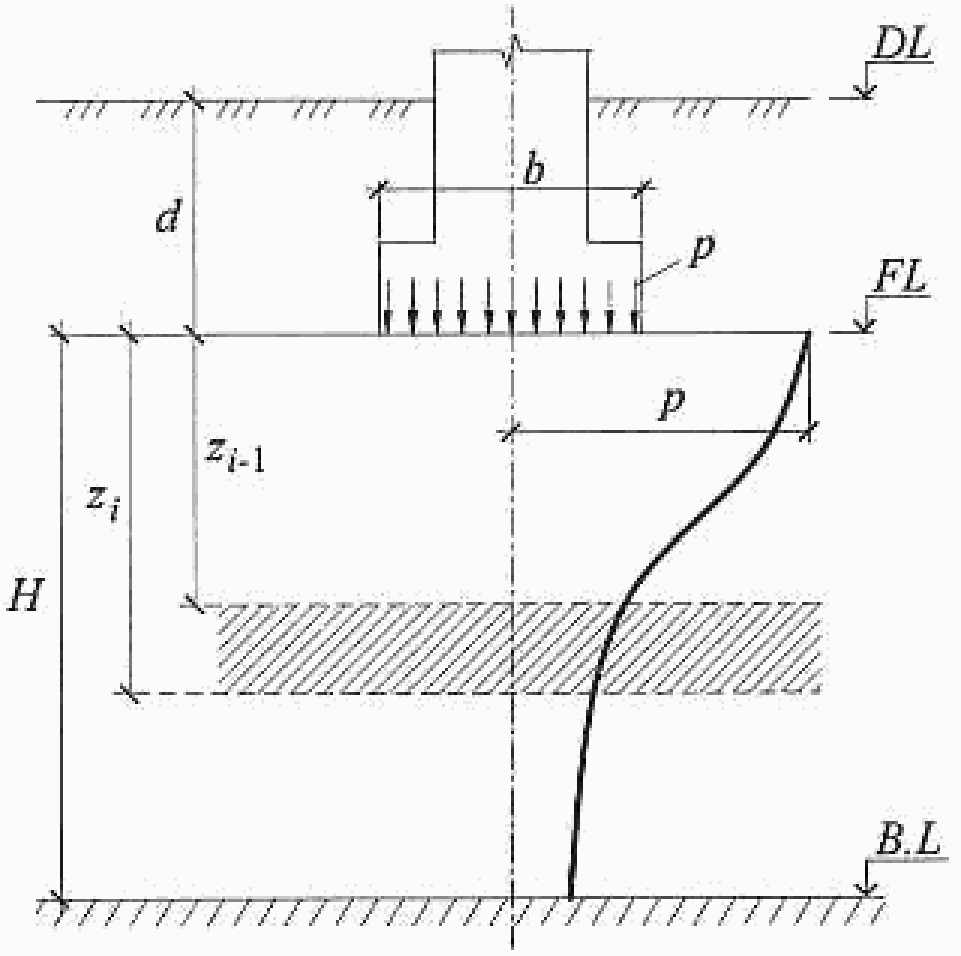

***Рисунок В.1*** **- Схема к расчету осадок**

**с использованием расчетной схемы основания**

**в виде линейно деформируемого слоя**
> [!warning] Опечатка в официальном тексте
> рисунок Г.1 отсутствует. Возможно, имеется в виду рисунок В.1.

Если основание сложено глинистыми и песчаными грунтами, значение *H*, м, вычисляют по формуле (рисунок В.1)

*H* = *H*$H_s$ + *h*$h_{cl}$/3, (В.3)

где *H*$H_s$ - толщина слоя, вычисленная по формуле (В.2) в предположении, что основание сложено только песчаными грунтами;

*h*$h_{cl}$ - суммарная толщина слоев глинистых грунтов в пределах от подошвы фундамента до глубины, равной *H*$H_{cl}$ - значению *H*, вычисленному по формуле (В.2) в предположении, что основание сложено только глинистыми грунтами.

# Приложение Г

*(в ред. Изменения N 3, утв. Приказом Минстроя России от 22.11.2019 N 722/пр)*

**ПРЕДЕЛЬНЫЕ ДЕФОРМАЦИИ ОСНОВАНИЯ ФУНДАМЕНТОВ**

**ОБЪЕКТОВ НОВОГО СТРОИТЕЛЬСТВА**

Таблица Г.1

<!-- sp-22-13330-2016-tbl058: нет подписи -->

<table>
<tr><th rowspan="2">Сооружения</th><th colspan="3">Предельные деформации основания фундаментов</th></tr>
<tr><td>Относительная разность осадок $(\Delta s/L)_u$</td><td>Крен *i**u*</td><td>Максимальная $s_u^{max}$ или средняя $\bar{s}_u$ осадка, см</td></tr>
<tr><td>1 Производственные и гражданские одноэтажные и многоэтажные здания с полным каркасом:</td><td></td><td></td><td></td></tr>
<tr><td>железобетонным</td><td>0,002</td><td>-</td><td>10</td></tr>
<tr><td>то же, с устройством железобетонных поясов или монолитных перекрытий, а также здания монолитной конструкции</td><td>0,003</td><td>-</td><td>15</td></tr>
<tr><td>стальным</td><td>0,004</td><td>-</td><td>15</td></tr>
<tr><td>то же, с устройством железобетонных поясов или монолитных перекрытий</td><td>0,005</td><td>-</td><td>18</td></tr>
<tr><td>2 Здания и сооружения, в конструкциях которых не возникают усилия от неравномерных осадок</td><td>0,006</td><td>-</td><td>20</td></tr>
<tr><td>3 Многоэтажные бескаркасные здания с несущими стенами из:</td><td></td><td></td><td></td></tr>
<tr><td>крупных панелей</td><td>0,0016</td><td>-</td><td>12</td></tr>
<tr><td>крупных блоков или кирпичной кладки без армирования</td><td>0,0020</td><td>-</td><td>12</td></tr>
<tr><td>то же, с армированием, в том числе с устройством железобетонных поясов или монолитных перекрытий, а также здания монолитной конструкции</td><td>0,0024</td><td>-</td><td>18</td></tr>
<tr><td>4 Сооружения элеваторов из железобетонных конструкций:</td><td></td><td></td><td></td></tr>
<tr><td>рабочее здание и силосный корпус монолитной конструкции на одной фундаментной плите</td><td>-</td><td>0,003</td><td>40</td></tr>
<tr><td>то же, сборной конструкции</td><td>-</td><td>0,003</td><td>30</td></tr>
<tr><td>отдельно стоящий силосный корпус монолитной конструкции</td><td>-</td><td>0,004</td><td>40</td></tr>
<tr><td>то же, сборной конструкции</td><td>-</td><td>0,004</td><td>30</td></tr>
<tr><td>5 Дымовые трубы высотой *H*, м:</td><td></td><td></td><td></td></tr>
<tr><td>*H* &lt;= 100</td><td>-</td><td>0,005</td><td>40</td></tr>
<tr><td>100 &lt; *H* &lt;= 200</td><td>-</td><td>1/(2*H*)</td><td>30</td></tr>
<tr><td>200 &lt; *H* &lt;= 300</td><td>-</td><td>1/(2*H*)</td><td>20</td></tr>
<tr><td>*H* &gt; 300</td><td>-</td><td>1/(2*H*)</td><td>10</td></tr>
<tr><td>6 Жесткие сооружения высотой до 100 м, кроме указанных в пунктах таблицы 4 и 5</td><td>-</td><td>0,004</td><td>20</td></tr>
<tr><td>7 Антенные сооружения связи:</td><td></td><td></td><td></td></tr>
<tr><td>стволы мачт заземленные</td><td>-</td><td>0,002</td><td>20</td></tr>
<tr><td>то же, электрически изолированные</td><td>-</td><td>0,001</td><td>10</td></tr>
<tr><td>башни радио</td><td>0,002</td><td>-</td><td>-</td></tr>
<tr><td>башни коротковолновых радиостанций</td><td>0,0025</td><td>-</td><td>-</td></tr>
<tr><td>башни (отдельные блоки)</td><td>0,001</td><td>-</td><td>-</td></tr>
<tr><td>8 Опоры воздушных линий электропередачи:</td><td></td><td></td><td></td></tr>
<tr><td>промежуточные прямые</td><td>0,003</td><td>-</td><td>-</td></tr>
<tr><td>анкерные и анкерно-угловые, промежуточные угловые, концевые, порталы открытых распределительных устройств</td><td>0,0025</td><td>-</td><td>-</td></tr>
<tr><td>специальные переходные</td><td>0,002</td><td>-</td><td>-</td></tr>
<tr><td colspan="4">Примечания 1 Значение предельной максимальной осадки основания фундаментов $s_u^{max}$ применяется к сооружениям, возводимым на отдельно стоящих фундаментах на естественном (искусственном) основании или на свайных фундаментах с отдельно стоящими ростверками (ленточные, столбчатые и т.п.). 2 Значение предельной средней осадки $\bar{s}_u$ основания фундаментов применяются к сооружениям, возводимым на едином монолитном железобетонном фундаменте неразрезной конструкции (перекрестные ленточные и плитные фундаменты на естественном или искусственном основании, свайные фундаменты с плитным ростверком, плитно-свайные фундаменты и т.п.). 3 Предельные значения относительного прогиба зданий, указанных в пункте 3 таблицы, принимают равными $0{,}5(\Delta s/L)_u$, а относительного выгиба - $0{,}2(\Delta s/L)_u$. 4 При определении относительной разности осадок $(\Delta s/L)$ в пункте 8 таблицы Г.1 за *L* принимают расстояние между осями блоков фундаментов в направлении горизонтальных нагрузок, а в опорах с оттяжками - расстояние между осями сжатого фундамента и анкера. 5 Если основание сложено горизонтальными (с уклоном не более 0,1), выдержанными по толщине слоями грунтов, предельные значения максимальных и средних осадок допускается увеличивать на 20%. 6 Предельные значения подъема основания, сложенного набухающими грунтами, допускается принимать: максимальный и средний подъем в размере 25% и относительную разность осадок в размере 50% соответствующих предельных значений деформаций, приведенных в настоящем приложении, а относительный выгиб - в размере $0{,}2(\Delta s/L)_u$. 7 На основе обобщения опыта проектирования, строительства и эксплуатации отдельных видов сооружений допускается принимать предельные значения деформаций основания фундаментов, отличающиеся от указанных в настоящем приложении.</td></tr>
</table>

# Приложение Д

*(в ред. Изменения N 3, утв. Приказом Минстроя России от 22.11.2019 N 722/пр)*

**КАТЕГОРИИ ТЕХНИЧЕСКОГО СОСТОЯНИЯ СУЩЕСТВУЮЩИХ СООРУЖЕНИЙ**

Таблица Д.1

<!-- sp-22-13330-2016-tbl059: нет подписи -->

<table>
<tr><th>Категория состояния сооружения</th><th>Характеристика состояния сооружения</th></tr>
<tr><td>I - нормативное</td><td>Количественные и качественные значения параметров всех критериев оценки технического состояния строительных конструкций зданий и сооружений, включая состояние грунтов основания, соответствуют установленным в проектной документации значениям с учетом пределов их изменения</td></tr>
<tr><td>II - работоспособное</td><td>Некоторые из числа оцениваемых контролируемых параметров не отвечают требованиям проекта или норм, но имеющиеся нарушения требований в конкретных условиях эксплуатации не приводят к нарушению работоспособности, и необходимая несущая способность конструкций и грунтов основания с учетом влияния имеющихся дефектов и повреждений обеспечивается</td></tr>
<tr><td>III - ограниченно-работоспособное</td><td>Имеются крены, дефекты и повреждения, приведшие к снижению несущей способности, но отсутствует опасность внезапного разрушения, потери устойчивости или опрокидывания, и функционирование конструкций и эксплуатация здания или сооружения возможны либо при контроле (мониторинге) технического состояния, либо при проведении необходимых мероприятий по восстановлению или усилению конструкций и (или) грунтов основания и последующем мониторинге технического состояния (при необходимости)</td></tr>
<tr><td>IV - аварийное</td><td>Наличие повреждений и деформаций, свидетельствующих об исчерпании несущей способности и опасности обрушения и (или) наличие кренов, вызывающие потерю устойчивости объекта</td></tr>
<tr><td colspan="2">*(в ред. Изменения N 5, утв. Приказом Минстроя России от 07.12.2023 N 884/пр)*</td></tr>
<tr><td colspan="2">Примечания 1 Категория технического состояния устанавливается по результатам технического обследования строительных конструкций сооружения, в т.ч. фундаментов, включая исследования грунтов основания, подстилающих фундаменты. 2 Категория технического состояния реконструируемого сооружения или сооружения, расположенного в зоне влияния нового строительства или реконструкции, может быть повышена, если проектом реконструкции или проектом защитных мероприятий (для окружающей застройки) предусмотрено выполнение работ по усилению фундаментов и надземной части сооружения, связанных в т.ч. с увеличением его жесткости.</td></tr>
<tr><td colspan="2">*(в ред. Изменения N 5, утв. Приказом Минстроя России от 07.12.2023 N 884/пр)*</td></tr>
<tr><td colspan="2">3 Категория технического состояния одноэтажных и многоэтажных зданий исторической застройки или памятников истории, архитектуры и культуры с несущими стенами из кирпичной кладки без армирования не может быть установлена (повышена) выше категории II - работоспособное. К исторической застройке относятся здания с указанной конструктивной схемой при сроке их эксплуатации более 100 лет. 4 Результаты технического обследования сооружений допускается использовать при сроке давности выполнения технического обследования, не превышающем: три года для сооружений с категориями технического состояния I - нормативное и II - работоспособное и 1,5 года для сооружений с категориями технического состояния III - ограниченно-работоспособное и IV - аварийное.</td></tr>
</table>

# Приложение Е

*(в ред. Изменения N 3, утв. Приказом Минстроя России от 22.11.2019 N 722/пр)*

**ПРЕДЕЛЬНЫЕ ДОПОЛНИТЕЛЬНЫЕ ДЕФОРМАЦИИ ОСНОВАНИЯ**

**ФУНДАМЕНТОВ РЕКОНСТРУИРУЕМЫХ СООРУЖЕНИЙ**

Таблица Е.1

<!-- sp-22-13330-2016-tbl060: нет подписи -->

<table>
<tr><th rowspan="2">Сооружения</th><th rowspan="2">Категории технического состояния зданий</th><th colspan="2">Предельные дополнительные деформации основания фундаментов</th></tr>
<tr><td>Относительная разность осадок $(\Delta s/L)_u$</td><td>Максимальная осадка $s_{ad,u}^{max}$, см</td></tr>
<tr><td rowspan="3">1 Одноэтажные и многоэтажные бескаркасные здания со стенами из крупных панелей</td><td>I</td><td>0,0020</td><td>4,0</td></tr>
<tr><td>II</td><td>0,0010</td><td>3,0</td></tr>
<tr><td>III</td><td>0,0007</td><td>2,0</td></tr>
<tr><td rowspan="3">2 Одноэтажные и многоэтажные бескаркасные здания со стенами из кирпича или крупных блоков без армирования</td><td>I</td><td>0,003</td><td>4,0</td></tr>
<tr><td>II</td><td>0,0015</td><td>3,0</td></tr>
<tr><td>III</td><td>0,001</td><td>2,0</td></tr>
<tr><td rowspan="3">3 Одноэтажные и многоэтажные бескаркасные здания со стенами из кирпича или крупных блоков с армированием или железобетонными поясами</td><td>I</td><td>0,0035</td><td>5,0</td></tr>
<tr><td>II</td><td>0,0018</td><td>4,0</td></tr>
<tr><td>III</td><td>0,0012</td><td>3,0</td></tr>
<tr><td rowspan="3">4 Многоэтажные и одноэтажные здания исторической застройки или памятники истории, архитектуры и культуры с несущими стенами из кирпичной кладки без армирования</td><td>I</td><td>-</td><td>-</td></tr>
<tr><td>II</td><td>0,0009</td><td>1,5</td></tr>
<tr><td>III</td><td>0,0007</td><td>1,0</td></tr>
<tr><td colspan="4">Примечания 1 $s_{ad,u}^{max}$ - значение предельной дополнительной максимальной осадки основания отдельно стоящих фундаментов реконструируемого сооружения на естественном основании или свайных ростверков, в т.ч. при усилении основания и фундаментов. 2 При подведении сплошной монолитной железобетонной фундаментной плиты под реконструируемое сооружение допускается принимать значения предельных дополнительных средних осадок $\bar{s}_{ad,h}$ равными $s_{ad,u}^{max}$. 3 Для сооружений с категорией технического состояния IV - аварийное дополнительные деформации основания фундаментов не допускаются. 4 Значения таблицы Е.1 допускается не применять, если в основании фундаментов реконструируемого сооружения в пределах сжимаемой толщи *H**c*, определенной с учетом требований 5.6.41, залегают грунты с модулем деформации *E* &lt;= 7 МПа или в основании залегают специфические грунты, указанные в разделе 6. Вместо указанных величин следует пользоваться значениями региональных таблиц, характерными для этих районов и приведенными в территориальных строительных нормах. В случае отсутствия соответствующих нормативных значений в территориальных строительных нормах необходимо руководствоваться данными таблицы Е.1. 5 Если конструктивная схема реконструируемого здания отличается от указанных в таблице Е.1, то для такого здания (в т.ч. исторической застройки или памятников истории, архитектуры и культуры) необходимо устанавливать предельные величины дополнительных деформаций основания путем проведения пространственных прочностных расчетов с учетом их технического состояния, конструктивной схемы, прогнозируемых деформаций основания и других требований. 6 Допустимые величины подъема зданий и сооружений определяются как половина указанных в таблице значений максимальных осадок, но не более 5 мм.</td></tr>
<tr><td colspan="4">(примечание 6 введено Изменением N 4, утв. Приказом Минстроя России от 27.12.2021 N 1022/пр)</td></tr>
</table>

# Приложение Ж

*(в ред. Изменения N 3, утв. Приказом Минстроя России от 22.11.2019 N 722/пр)*

**ФИЗИКО-МЕХАНИЧЕСКИЕ ХАРАКТЕРИСТИКИ**

**ОРГАНОМИНЕРАЛЬНЫХ И ОРГАНИЧЕСКИХ ГРУНТОВ**

**Ж.1** Значения характеристик грунтов, приведенные в таблицах Ж.1 - [6](#^biblio-6), допускается использовать для предварительной оценки оснований, сложенных из органоминеральных и органических грунтов (см. [7](#^biblio-7)). ^zh-1

Таблица Ж.1

**Средние значения физико-механических**

**характеристик открытого торфа**

<!-- sp-22-13330-2016-tbl061: нет подписи -->

<table>
<tr><th rowspan="3">Показатель</th><th colspan="7">Значение показателя при степени разложения *D**dp**,* %</th></tr>
<tr><td colspan="4">верхового</td><td colspan="3">низинного</td></tr>
<tr><td>5 - 20</td><td>21 - 30</td><td>31 - 40</td><td>&gt; 40</td><td>5 - 25</td><td>26 - 40</td><td>&gt; 40</td></tr>
<tr><td>Влажность, соответствующая полному водонасыщению *w**sat*, доли единицы</td><td>14,5</td><td>12,5</td><td>11,8</td><td>10,0</td><td>11,5</td><td>7,5</td><td>5,8</td></tr>
<tr><td>Плотность частиц торфа $\rho_s$, г/см3</td><td>1,62</td><td>1,56</td><td>1,49</td><td>1,40</td><td>1,58</td><td>1,51</td><td>1,5</td></tr>
<tr><td>Модуль деформации при полной влагоемкости *E*, МПа</td><td>0,11</td><td>0,15</td><td>0,23</td><td>0,25</td><td>0,15</td><td>0,24</td><td>0,31</td></tr>
<tr><td>Коэффициент бокового давления $\xi$</td><td>0,12</td><td>0,19</td><td>0,28</td><td>0,35</td><td>0,22</td><td>0,43</td><td>0,50</td></tr>
<tr><td>Коэффициент консолидации $c_v$, м2/год</td><td>10</td><td>5</td><td>2</td><td>1</td><td>5</td><td>2</td><td>1</td></tr>
</table>

Таблица Ж.2

**Средние значения физико-механических**

**характеристик погребенного торфа**

<!-- sp-22-13330-2016-tbl062: нет подписи -->

<table>
<tr><th rowspan="2">Показатель</th><th colspan="3">Значения показателя при степени разложения *D**dp*, %</th></tr>
<tr><td>20 - 30</td><td>31 - 40</td><td>41 - 60</td></tr>
<tr><td>Плотность грунта $\rho$, г/см3</td><td>1,0</td><td>1,05</td><td>1,2</td></tr>
<tr><td>Плотность частиц грунта $\rho_s$, г/см3</td><td>1,5</td><td>1,60</td><td>1,80</td></tr>
<tr><td>Природная влажность *w*, доли единицы</td><td>3,0</td><td>2,2</td><td>1,7</td></tr>
<tr><td>Коэффициент пористости *e*</td><td>5,5</td><td>4,0</td><td>3,0</td></tr>
<tr><td>Угол внутреннего трения $\varphi$, град.</td><td>22</td><td>12</td><td>10</td></tr>
<tr><td>Удельное сцепление *c*, кПа</td><td>20</td><td>25</td><td>30</td></tr>
<tr><td>Модуль деформации *E*, МПа</td><td>1,1</td><td>2,0</td><td>3,0</td></tr>
<tr><td>Коэффициент бокового давления $\xi$</td><td>0,24</td><td>0,28</td><td>0,32</td></tr>
</table>

Таблица Ж.3

**Средние значения модуля деформации илов**

<!-- sp-22-13330-2016-tbl063: нет подписи -->

<table>
<tr><th>Ил</th><th>Коэффициент пористости *e*</th><th>Модуль деформации *E*, МПа</th></tr>
<tr><td rowspan="2">Супесчаный</td><td>0,8</td><td>5,1</td></tr>
<tr><td>1,2</td><td>3,3</td></tr>
<tr><td rowspan="2">Суглинистый</td><td>0,9</td><td>2,0</td></tr>
<tr><td>1,6</td><td>1,2</td></tr>
<tr><td rowspan="2">Глинистый</td><td>1,2</td><td>1,6</td></tr>
<tr><td>2,0</td><td>0,8</td></tr>
</table>

Таблица Ж.4

**Значения физико-механических характеристик сапропелей**

<!-- sp-22-13330-2016-tbl064: нет подписи -->

<table>
<tr><td colspan="2" rowspan="2">Тип залегания</td><td rowspan="2">Разновидность сапропелей</td><td colspan="2">Содержание веществ</td><td rowspan="2">Влажность *w*, доли единицы</td><td rowspan="2">Плотность частиц грунта $\rho_s$, г/см3</td><td rowspan="2">Коэффициент пористости *e*</td><td rowspan="2">Модуль деформации *E*, МПа (при *p* = 0,05 МПа)</td><td rowspan="2">Сопротивление вращательному срезу $\tau$, кПа</td></tr>
<tr><td>Органических *I**r*, %</td><td>карбонатных CaCO3, %</td></tr>
<tr><td rowspan="6">Неуплотненные в природном залегании</td><td rowspan="3">Озерные под слоем воды</td><td>Высокоминеральные</td><td>10 - 30</td><td>30</td><td>1,5 - 4,5</td><td>2,0 - 2,5</td><td>5 - 12</td><td>0,25 - 0,6</td><td>4 - 6</td></tr>
<tr><td>Среднеминеральные</td><td>30 - 50</td><td>30</td><td>3 - 6</td><td>1,8 - 2,0</td><td>9 - 12</td><td>0,1 - 0,3</td><td>2 - 4</td></tr>
<tr><td>Низкоминеральные</td><td>&gt; 50</td><td>30</td><td>6 - 20</td><td>1,4 - 1,8</td><td>12 - 25</td><td>0,03 - 0,1</td><td>&lt; 2</td></tr>
<tr><td rowspan="3">Болотные под слоем торфа</td><td>Высокоминеральные</td><td>10 - 30</td><td>30</td><td>1,2 - 3,7</td><td>2,0 - 2,5</td><td>4 - 12</td><td>0,4 - 0,8</td><td>12 - 13</td></tr>
<tr><td>Среднеминеральные</td><td>30 - 50</td><td>30</td><td>3 - 6</td><td>1,8 - 2,0</td><td>8 - 12</td><td>0,25 - 0,5</td><td>7 - 12</td></tr>
<tr><td>Низкоминеральные</td><td>50 - 80</td><td>10 - 30</td><td>6 - 12</td><td>1,4 - 1,8</td><td>12 - 20</td><td>0,1 - 0,25</td><td>12 - 13</td></tr>
<tr><td colspan="2" rowspan="3">Уплотненные в природном залегании (озерно-болотные под слоем минеральных наносов)</td><td>Высокоминеральные</td><td>10 - 30</td><td>30</td><td>0,5 - 1,8</td><td>2,0 - 2,5</td><td>1,4 - 3</td><td>0,7 - 2</td><td>15 - 25</td></tr>
<tr><td>Среднеминеральные</td><td>30 - 50</td><td>30</td><td>1,5 - 2,5</td><td>1,8 - 2,0</td><td>3 - 5</td><td>0,4 - 1</td><td>10 - 20</td></tr>
<tr><td>Низкоминеральные</td><td>&gt; 50</td><td>30</td><td>1,5 - 3,0</td><td>1,4 - 1,8</td><td>4 - 6</td><td>0,3 - 0,5</td><td>2 - 15</td></tr>
</table>

# Приложение И

*(в ред. Изменения N 3, утв. Приказом Минстроя России от 22.11.2019 N 722/пр)*

**ФИЗИКО-МЕХАНИЧЕСКИЕ ХАРАКТЕРИСТИКИ ЭЛЮВИАЛЬНЫХ ГРУНТОВ**

**И.1** Значения характеристик грунтов, приведенные в таблицах И.1 - [7619?], допускается использовать для предварительной оценки оснований, сложенных из этих грунтов (см. [8](#^biblio-8) и [7](#^biblio-7)). ^i-1

Таблица И.1

**Средние значения физических характеристик и предела**

**прочности на одноосное сжатие в водонасыщенном состоянии**

***R***$R_c$ **элювия скальных грунтов магматических пород**

<!-- sp-22-13330-2016-tbl065: нет подписи -->

<table>
<tr><th rowspan="2">Разновидность элювия скальных грунтов по степени выветрелости</th><th colspan="4">Характеристики элювия скальных грунтов магматических пород</th></tr>
<tr><td>Плотность $\rho$, г/см3</td><td>Коэффициент пористости *e*</td><td>*R**c*, МПа</td><td>Степень размягчаемости в воде</td></tr>
<tr><td>Слабовыветрелые</td><td>Более 2,7</td><td>Менее 0,1</td><td>Более 15</td><td>Неразмягчаемые</td></tr>
<tr><td>Выветрелые</td><td>$25<\xi\le27$</td><td>0,1 &lt;= *e* &lt;= 0,2</td><td>5 &lt;= *R**c* &lt;= 15</td><td>Практически неразмягчаемые</td></tr>
<tr><td>Сильновыветрелые</td><td>$22<\xi\le25$</td><td>Более 0,2</td><td>Менее 5</td><td>Размягчаемые</td></tr>
</table>

Таблица И.2

**Значения предела прочности на одноосное сжатие**

**в водонасыщенном состоянии** ***R***$R_c$ **элювия скальных**

**грунтов осадочных сцементированных пород**

<!-- sp-22-13330-2016-tbl066: нет подписи -->

<table>
<tr><th rowspan="3">Степень выветрелости *K**wr*</th><th colspan="3">Значения *R**c*, МПа, для элювия осадочных скальных грунтов</th></tr>
<tr><td rowspan="2">Аргиллиты и алевролиты</td><td colspan="2">Песчаники с преобладанием цемента</td></tr>
<tr><td>глинистого</td><td>карбонатного</td></tr>
<tr><td>1 &gt; *K**wr* &gt;= 0,95</td><td>12 - 20</td><td>30 - 50</td><td>50 - 95</td></tr>
<tr><td>0,95 &gt; *K**wr* &gt;= 0,9</td><td>8 - 12</td><td>15 - 30</td><td>30 - 50</td></tr>
<tr><td>0,9 &gt; *K**wr* &gt;= 0,85</td><td>5 - 8</td><td>7,5 - 15</td><td>10 - 30</td></tr>
<tr><td>0,85 &gt; *K**wr* &gt;= 0,8</td><td>2,5 - 5,0</td><td>5,0 - 7,5</td><td>5 - 10</td></tr>
<tr><td>*K**wr* &lt; 0,8</td><td>Менее 2,5</td><td>Менее 5</td><td>Менее 5</td></tr>
</table>

Таблица И.3

**Значения модуля деформации разновидностей**

**элювиальных крупнообломочных грунтов**

<!-- sp-22-13330-2016-tbl067: нет подписи -->

<table>
<tr><th rowspan="3">Разновидность крупнообломочных грунтов</th><th colspan="4">Значения модуля деформации *E*, МПа, при исходных образующих породах</th></tr>
<tr><td colspan="2">магматических и метаморфических</td><td colspan="2">осадочных сцементированных</td></tr>
<tr><td>содержащих кварц</td><td>бескварцевых</td><td>песчаники</td><td>аргиллиты и алевролиты</td></tr>
<tr><td>Глыбовые</td><td>Не менее 60</td><td>Не менее 50</td><td>Не менее 50</td><td>Не менее 40</td></tr>
<tr><td>Щебенистые выветрелые</td><td>40 - 60</td><td>35 - 50</td><td>40 - 50</td><td>35 - 40</td></tr>
<tr><td>Щебенисто-дресвяные слабовыветрелые</td><td>30 - 40</td><td>25 - 35</td><td>30 - 40</td><td>20 - 35</td></tr>
<tr><td>Дресвяные сильновыветрелые</td><td>Менее 30</td><td>Менее 25</td><td>Менее 30</td><td>Менее 20</td></tr>
</table>

# Приложение К

*(в ред. Изменения N 3, утв. Приказом Минстроя России от 22.11.2019 N 722/пр)*

**ПРЕДЕЛЬНЫЕ ДОПОЛНИТЕЛЬНЫЕ ДЕФОРМАЦИИ ОСНОВАНИЯ ФУНДАМЕНТОВ**

**СООРУЖЕНИЙ ОКРУЖАЮЩЕЙ ЗАСТРОЙКИ, РАСПОЛОЖЕННЫХ В ЗОНЕ**

**ВЛИЯНИЯ НОВОГО СТРОИТЕЛЬСТВА ИЛИ РЕКОНСТРУКЦИИ**

Таблица К.1

<!-- sp-22-13330-2016-tbl068: нет подписи -->

<table>
<tr><th rowspan="2">Сооружения</th><th rowspan="2">Категории технического состояния зданий</th><th colspan="2">Предельные дополнительные деформации основания фундаментов</th></tr>
<tr><td>Относительная разность осадок $(\Delta s/L)_u$</td><td>Максимальная осадка $s_{ad,u}^{max}$, см</td></tr>
<tr><td rowspan="3">1 Гражданские и производственные одноэтажные и многоэтажные здания с полным железобетонным или стальным каркасом</td><td>I</td><td>0,0020</td><td>5,0</td></tr>
<tr><td>II</td><td>0,0010</td><td>3,0</td></tr>
<tr><td>III</td><td>0,0007</td><td>2,0</td></tr>
<tr><td rowspan="3">2 Многоэтажные бескаркасные здания с несущими стенами из крупных панелей</td><td>I</td><td>0,0016</td><td>4,0</td></tr>
<tr><td>II</td><td>0,0008</td><td>3,0</td></tr>
<tr><td>III</td><td>0,0005</td><td>2,0</td></tr>
<tr><td rowspan="3">3 Многоэтажные бескаркасные здания с несущими стенами из крупных блоков или кирпичной кладки без армирования</td><td>I</td><td>0,0020</td><td>4,0</td></tr>
<tr><td>II</td><td>0,0010</td><td>3,0</td></tr>
<tr><td>III</td><td>0,0007</td><td>1,0</td></tr>
<tr><td rowspan="3">4 Многоэтажные бескаркасные здания с несущими стенами из кирпича или бетонных блоков с арматурными или железобетонными поясами</td><td>I</td><td>0,0024</td><td>5,0</td></tr>
<tr><td>II</td><td>0,0015</td><td>3,0</td></tr>
<tr><td>III</td><td>0,0010</td><td>2,0</td></tr>
<tr><td rowspan="3">5 Многоэтажные и одноэтажные здания исторической застройки или памятники истории, архитектуры и культуры с несущими стенами из кирпичной кладки без армирования</td><td>I</td><td>-</td><td>-</td></tr>
<tr><td>II</td><td>0,0006</td><td>1,0</td></tr>
<tr><td>III</td><td>0,0004</td><td>0,5</td></tr>
<tr><td rowspan="3">6 Высокие жесткие сооружения и трубы</td><td>I</td><td>0,004</td><td>5,0</td></tr>
<tr><td>II</td><td>0,002</td><td>3,0</td></tr>
<tr><td>III</td><td>0,001</td><td>2,0</td></tr>
<tr><td colspan="4">Примечания 1 $s_{ad,u}^{max}$ - значение предельной дополнительной максимальной осадки основания отдельно стоящих фундаментов на естественном основании или свайных ростверков, в т.ч. при усилении оснований и фундаментов сооружения окружающей застройки. 2 Для сооружений с категорией технического состояния IV - аварийное дополнительные деформации основания фундаментов не допускаются. 3 Значения таблицы К.1 допускается не применять, если в основании фундаментов сооружения окружающей застройки в пределах сжимаемой толщи *H**c*, определенной с учетом требований 5.6.41, залегают грунты с модулем деформации *E* &lt;= 7 МПа или в основании залегают специфические грунты, указанные в 6. Вместо указанных величин следует пользоваться значениями региональных таблиц, характерными для этих районов и приведенными в территориальных строительных нормах. При отсутствии соответствующих нормативных значений в территориальных строительных нормах необходимо руководствоваться данными таблицы К.1.</td></tr>
<tr><td colspan="4">*(в ред. Изменения N 5, утв. Приказом Минстроя России от 07.12.2023 N 884/пр)*</td></tr>
<tr><td colspan="4">4 Если конструктивная схема здания окружающей застройки отличается от указанных в таблице К.1, то для такого здания (в т.ч. исторической застройки или памятников истории, архитектуры и культуры) необходимо устанавливать предельные величины дополнительных деформаций основания путем проведения пространственных прочностных расчетов с учетом их технического состояния, конструктивной схемы, прогнозируемых деформаций основания и других требований. 5 Для оценки допустимости дополнительных деформаций водонесущих напорных подземных коммуникаций допускается использовать требования СП Проектирование и строительство подземных коммуникаций закрытым и открытым способом. 6 Допустимые величины подъема зданий и сооружений определяются как половина указанных в таблице значений максимальных осадок, но не более 5 мм.</td></tr>
<tr><td colspan="4">(примечание 6 введено Изменением N 4, утв. Приказом Минстроя России от 27.12.2021 N 1022/пр)</td></tr>
</table>

# Приложение Л

*(в ред. Изменения N 3, утв. Приказом Минстроя России от 22.11.2019 N 722/пр)*

**КОНТРОЛИРУЕМЫЕ ПАРАМЕТРЫ ПРИ ГЕОТЕХНИЧЕСКОМ МОНИТОРИНГЕ**

**Л.1** В [4](#^biblio-4) - [2](#^biblio-2) знак "+" обозначает контролируемые параметры, которые необходимо фиксировать в процессе геотехнического мониторинга, знак "-" обозначает контролируемые параметры, которые не требуется фиксировать при выполнении геотехнического мониторинга. ^l-1

**Л.2** При геотехническом мониторинге уникальных вновь возводимых и реконструируемых сооружений по специальному заданию, в т.ч. научно-технического сопровождения (см. [6](#^biblio-6)), допускается дополнительно проводить фиксацию контролируемых параметров, не указанных в таблицах [6](#^biblio-6). ^l-2
> [!warning] Опечатка в официальном тексте
> таблица К.5 отсутствует. Возможно, имеется в виду таблица Л.5.

**Л.3** При геотехническом мониторинге сооружений окружающей застройки, в т.ч. уникальных сооружений и памятников истории, культуры и архитектуры по специальному заданию, в т.ч. научно-технического сопровождения (см. [6](#^biblio-6)), допускается проводить фиксацию иных контролируемых параметров, помимо указанных в [7969?], в т.ч. дополнительную разность углов наклона подошвы фундамента и др. ^l-3

Таблица Л.1

**Контролируемые параметры при геотехническом мониторинге**

**оснований (без учета массива грунта, окружающего**

**сооружение), фундаментов и конструкций**

**вновь возводимых сооружений**

(таблица Л.1 в ред. Изменения N 5, утв. Приказом

Минстроя России от 07.12.2023 N 884/пр)

<!-- sp-22-13330-2016-tbl069: нет подписи -->

<table>
<tr><th rowspan="4">Контролируемые параметры</th><th colspan="3">Вновь возводимые сооружения при высоте *H*, м</th></tr>
<tr><td>*H* &lt; 75</td><td>75 &lt;= *H* &lt; 150</td><td>*H* &gt; 150</td></tr>
<tr><td colspan="3">Геотехническая категория</td></tr>
<tr><td>2 - 3</td><td>3</td><td>3</td></tr>
<tr><td>1 Осадки фундаментов и относительная разность осадок</td><td>+</td><td>+</td><td>+</td></tr>
<tr><td>2 Крен</td><td>+ <4></td><td>+</td><td>+</td></tr>
<tr><td>3 Напряжения под подошвой фундаментов</td><td>-</td><td>+ <1></td><td>+ <2></td></tr>
<tr><td>4 Послойные осадки грунтов основания</td><td>-</td><td>+ <1></td><td>+</td></tr>
<tr><td>5 Напряжения в основании под пятой свай и в стволе свай</td><td>+ <5></td><td>+ <3></td><td>+</td></tr>
<tr><td>6 Напряжения в конструкциях подземной части (фундаменты, колонны, перекрытия)</td><td>+ <5></td><td>+ <5></td><td>+</td></tr>
<tr><td colspan="4">&lt;1&gt; Выполняется для плитных и плитно-свайных фундаментов при высоте сооружения более 100 м. &lt;2&gt; Выполняется для плитных и плитно-свайных фундаментов. &lt;3&gt; Выполняется при высоте сооружения более 100 м. &lt;4&gt; Выполняется для сооружений геотехнической категории 3. &lt;5&gt; Выполняется для промышленных сооружений класса КС3. Примечание - В пункте 1 настоящей таблицы к фундаментам относятся также несущие ограждающие конструкции котлованов, изготовленные из монолитного или сборно-монолитного железобетона (по технологии &quot;стена в грунте&quot;, буронабивные сваи и т.п.).</td></tr>
</table>

Таблица Л.2

**Контролируемые параметры при геотехническом мониторинге**

**оснований (без учета массива грунта, окружающего**

**сооружение), фундаментов и конструкций**

**реконструируемых сооружений**

<!-- sp-22-13330-2016-tbl070: нет подписи -->

<table>
<tr><th rowspan="3">Контролируемые параметры</th><th colspan="3">Реконструируемые сооружения</th></tr>
<tr><td colspan="2">Геотехническая категория</td><td rowspan="2">Уникальные, здания исторической застройки, памятники архитектуры, истории и культуры</td></tr>
<tr><td>2</td><td>3</td></tr>
<tr><td>1 Дополнительные осадки фундаментов и относительная разность дополнительных осадок</td><td>+</td><td>+</td><td>+</td></tr>
<tr><td>2 Дополнительный крен</td><td>-</td><td>+</td><td>+</td></tr>
<tr><td>3 Напряжения под подошвой фундаментов</td><td>-</td><td>-</td><td>+</td></tr>
<tr><td>4 Послойные осадки грунтов основания</td><td>-</td><td>-</td><td>+ <1></td></tr>
<tr><td>5 Напряжения в основании под пятой свай и в стволе свай</td><td>-</td><td>-</td><td>- <2></td></tr>
<tr><td>6 Напряжения в конструкциях подземной части (фундаменты, колонны, перекрытия)</td><td>-</td><td>-</td><td>+ &lt;1&gt;</td></tr>
<tr><td colspan="4">&lt;1&gt; Выполняется при высоте сооружения более 75 м. &lt;2&gt; Выполняется для свай усиления фундаментов. Примечание - В пункте 1 таблицы Л.2 к фундаментам относятся также несущие ограждающие конструкции котлованов, изготовленные из монолитного или сборно-монолитного железобетона (по технологии &quot;стена в грунте&quot;, буронабивные сваи и т.п.).</td></tr>
</table>

Таблица Л.3

**Контролируемые параметры при геотехническом**

**мониторинге конструкций ограждения котлована**

**вновь возводимых и реконструируемых сооружений**

<!-- sp-22-13330-2016-tbl071: нет подписи -->

<table>
<tr><th rowspan="4">Контролируемые параметры</th><th colspan="5">При глубине котлована *H*к, м</th></tr>
<tr><td colspan="2">5 &lt;= *H*к &lt; 10</td><td colspan="2">10 &lt;= *H*к &lt; 15</td><td>*H*к &gt;= 15</td></tr>
<tr><td colspan="5">Геотехническая категория</td></tr>
<tr><td>2</td><td>3</td><td>2</td><td>3</td><td>-</td></tr>
<tr><td>1 Горизонтальные перемещения верха ограждающей конструкции</td><td>+</td><td>+</td><td>+</td><td>+</td><td>+</td></tr>
<tr><td>2 Горизонтальные перемещения ограждающей конструкции по высоте</td><td>-</td><td>+</td><td>+</td><td>+</td><td>+</td></tr>
<tr><td>3 Напряжения в стальных распорках</td><td>-</td><td>-</td><td>+ <1></td><td>+ <1></td><td>+</td></tr>
<tr><td>4 Напряжения в тягах анкерных устройств</td><td>-</td><td>-</td><td>-</td><td>+</td><td>+</td></tr>
<tr><td>5 Напряжения в арматуре и бетоне ограждающей конструкции</td><td>-</td><td>-</td><td>-</td><td>-</td><td>+ <2></td></tr>
<tr><td>6 Напряжения в арматуре и бетоне перекрытий при разработке котлована под их защитой</td><td>-</td><td>-</td><td>-</td><td>-</td><td>+ <2></td></tr>
<tr><td>7 Температура и глубина промерзания грунтов за ограждающей конструкцией</td><td>+ <3></td><td>+ <3></td><td>+ <3></td><td>+ <3></td><td>+ <3></td></tr>
<tr><td colspan="6">&lt;1&gt; Выполняется при общей длине распорки более 25 м. &lt;2&gt; Выполняется при глубине котлована более 20 м. &lt;3&gt; Выполняется при наличии пучинистых грунтов за пределами ограждающей конструкции и выполнении работ в зимнее время.</td></tr>
</table>

Таблица Л.4

**Контролируемые параметры при геотехническом мониторинге**

**массива грунта, окружающего вновь возводимые**

**и реконструируемые сооружения**

<!-- sp-22-13330-2016-tbl072: нет подписи -->

<table>
<tr><th rowspan="4">Контролируемые параметры</th><th colspan="5">При глубине котлована *H*к, м</th></tr>
<tr><td colspan="2">5 &lt;= *H*к &lt; 10</td><td colspan="2">10 &lt;= *H*к &lt; 15</td><td>*H*к &gt;= 15</td></tr>
<tr><td colspan="5">Геотехническая категория</td></tr>
<tr><td>2</td><td>3</td><td>2</td><td>3</td><td>-</td></tr>
<tr><td>1 Вертикальные перемещения поверхностных грунтовых марок</td><td>+</td><td>+</td><td>+</td><td>+</td><td>+</td></tr>
<tr><td>2 Горизонтальные перемещения поверхностных грунтовых марок</td><td>-</td><td>+</td><td>+</td><td>+</td><td>+</td></tr>
<tr><td>3 Уровень подземных вод</td><td>-</td><td>+ <1></td><td>+ <1></td><td>+</td><td>+</td></tr>
<tr><td>4 Вертикальные перемещения массива грунта по глубине</td><td>-</td><td>-</td><td>-</td><td>+ <2></td><td>+ <2></td></tr>
<tr><td>5 Горизонтальные перемещения массива грунта по глубине</td><td>-</td><td>-</td><td>-</td><td>+ <2></td><td>+ <2></td></tr>
<tr><td>6 Температура и химический состав подземных вод</td><td>+ <3></td><td>+ <3></td><td>+ <3></td><td>+ <3></td><td>+ <3></td></tr>
<tr><td colspan="6">&lt;1&gt; Выполняется при прогнозируемом уровне подземных вод выше дна котлована. &lt;2&gt; Выполняется по специальному заданию. &lt;3&gt; Выполняется по специальному заданию.</td></tr>
</table>

Таблица Л.5

**Контролируемые параметры при геотехническом мониторинге**

**сооружений окружающей застройки (без учета подземных**

**инженерных коммуникаций), расположенных в зоне влияния**

**нового строительства (реконструкции) или прокладки**

**подземных инженерных коммуникаций**

<!-- sp-22-13330-2016-tbl073: нет подписи -->

<table>
<tr><th rowspan="4">Контролируемые параметры</th><th colspan="3">При глубине котлована *H*к, м</th></tr>
<tr><td colspan="2">*H*к &lt; 10</td><td rowspan="3">*H*к &gt;= 10</td></tr>
<tr><td colspan="2">Геотехническая категория</td></tr>
<tr><td>2</td><td>3</td></tr>
<tr><td>1 Дополнительные осадки фундаментов и их относительная разность</td><td>+</td><td>+</td><td>+</td></tr>
<tr><td>2 Ширина раскрытия и глубина образования трещин</td><td>+</td><td>+</td><td>+</td></tr>
<tr><td>3 Дополнительный крен</td><td>-</td><td>+ <1></td><td>+</td></tr>
<tr><td>4 Горизонтальные перемещения конструкций и фундаментов</td><td>-</td><td>+ <3></td><td>+</td></tr>
<tr><td>5 Измерение динамических воздействий</td><td>+ <2></td><td>+ <2></td><td>+ <2></td></tr>
<tr><td colspan="4">&lt;1&gt; Выполняется при высоте сооружений окружающей застройки более 75 м. &lt;2&gt; Выполняется по специальному заданию. &lt;3&gt; Следует выполнять для зданий, расположенных на расстоянии 5 м и менее от строительного котлована. Примечания 1 В процессе геотехнического мониторинга необходимо проводить периодические визуальные обследования сооружений окружающей застройки на предмет выявления повреждений их конструкций. 2 Если геотехническая категория для проектируемого линейного сооружения не установлена, то для I - II категории сложности инженерно-геологических условий следует принимать требования соответствующие геотехнической категории 2, а для III - геотехнической категории 3.</td></tr>
</table>

Таблица Л.6

**Контролируемые параметры при геотехническом мониторинге**

**подземных инженерных коммуникаций, расположенных**

**в зоне влияния нового строительства (реконструкции)**

**или прокладки инженерных подземных коммуникаций**

<!-- sp-22-13330-2016-tbl074: нет подписи -->

<table>
<tr><th rowspan="4">Контролируемые параметры</th><th colspan="3">При глубине котлована *H*к, м</th></tr>
<tr><td colspan="2">*H*к &lt; 10</td><td rowspan="3">*H*к &gt;= 10</td></tr>
<tr><td colspan="2">Геотехническая категория</td></tr>
<tr><td>2</td><td>3</td></tr>
<tr><td>1 Дополнительные осадки обечаек люков, колодцев и других конструкций, выступающих на поверхность</td><td>+</td><td>+</td><td>+</td></tr>
<tr><td>2 Дополнительные осадки конструкций обделок проходных и полупроходных коллекторов</td><td>-</td><td>+</td><td>+</td></tr>
<tr><td>3 Горизонтальные перемещения обечаек люков, колодцев и других конструкций, выступающих на поверхность</td><td>-</td><td>-</td><td>+</td></tr>
<tr><td>4 Деформации конструкций обделок проходных и полупроходных коллекторов, в т.ч. трещин в их обделке</td><td>-</td><td>+ <1></td><td>+</td></tr>
<tr><td>5 Горизонтальные перемещения конструкций обделок проходных и полупроходных коллекторов</td><td>-</td><td>-</td><td>+</td></tr>
<tr><td>6 Измерение динамических воздействий</td><td>+ &lt;1&gt;</td><td>+ &lt;1&gt;</td><td>+ &lt;1&gt;</td></tr>
<tr><td colspan="4">&lt;1&gt; Выполняется по специальному заданию. Примечания 1 В процессе геотехнического мониторинга подземных инженерных коммуникаций необходимо проводить периодические визуальные обследования состояния поверхности грунта вдоль трассы инженерных коммуникаций и конструкций обделок проходных и полупроходных коллекторов, конструкций камер и колодцев (по специальному заданию) коммуникаций непроходного типа. 2 Если геотехническая категория для проектируемого линейного сооружения не установлена, то для I - II категории сложности инженерно-геологических условий следует принимать требования соответствующие геотехнической категории 2, а для III - геотехнической категории 3.</td></tr>
</table>

# Приложение М

*(в ред. Изменения N 3, утв. Приказом Минстроя России от 22.11.2019 N 722/пр)*

**ОСНОВНЫЕ БУКВЕННЫЕ ОБОЗНАЧЕНИЯ**

**Коэффициенты надежности**

$\gamma_c$ - коэффициент условий работы;

$\gamma_f$ - по нагрузке;

$\gamma_g$ - по грунту;

$\gamma_m$ - по материалу;

$\gamma_n$ - по ответственности.

**Характеристики грунтов**

$\bar{X}$ - среднее значение характеристики;

*X*$X_n$ - нормативное значение;

*X* - расчетное значение;

$\alpha$ - доверительная вероятность (обеспеченность) расчетных значений;

$\rho$ - плотность;

$\rho_d$ - плотность в сухом состоянии;

$\rho_{bf}$ - плотность обратной засыпки;

*e* - коэффициент пористости;

*w* - влажность природная;

*w*$w_p$ - влажность на границе пластичности (раскатывания);

*w*$w_L$ - влажность на границе текучести;

*w*$w_{eq}$ - конечная (установившаяся) влажность;

*w*$w_{sat}$ - влажность, соответствующая полному водонасыщению;

*w*$w_{sl}$ - начальная просадочная влажность;

$w_{sv}$ - влажность набухания;

*w*$w_{sh}$ - влажность на пределе усадки;

*S*$S_r$ - коэффициент водонасыщения;

*I*$I_L$ - показатель текучести;

$\gamma$ - удельный вес;

$\gamma_{sb}$ - удельный вес с учетом взвешивающего действия воды;

*p*$p_{sl}$ - начальное просадочное давление;

*p*$p_{sw}$ - давление набухания;

$\varepsilon_{sl}$ - относительная просадочность (относительная деформация просадочности);

$\varepsilon_{sw}$ - относительное набухание;

$\varepsilon_d$ - относительная линейная деформация виброползучести;

$\varepsilon_{sh}$ - относительная линейная усадка;

*I*$I_r$ - относительное содержание органического вещества;

$\varepsilon_{sf}$ - относительное суффозионное сжатие;

*D*$D_{dp}$ - степень разложения (торфа);

*c* - удельное сцепление;

$\varphi$ - угол внутреннего трения;

*E* - модуль деформации;

$\nu$ - коэффициент поперечной деформации;

*R*$R_c$ - предел прочности на одноосное сжатие скальных грунтов;

$c_v$ - коэффициент консолидации;

*c*$c_u$ - сопротивление грунта недренированному сдвигу;

*K*$K_r$ - коэффициент релаксации;

$\sigma_r$ - начальное напряжение релаксации;

*(в ред. Изменения N 1, утв. Приказом Минстроя России от 20.11.2018 N 736/пр)*

*OCR -* коэффициент переуплотнения.

*(введено Изменением N 1, утв. Приказом Минстроя России от 20.11.2018 N 736/пр)*

**Нагрузки, напряжения, сопротивления**

*F* - сила, расчетное значение силы;

*f* - сила на единицу длины;

*F*$F_v$, *F*$F_h$ - вертикальная и горизонтальная составляющие силы;

*F*$F_{s,a}$, *F*$F_{s,r}$ - силы, действующие по плоскости скольжения, соответственно сдвигающие и удерживающие (активные и реактивные);

*N* - сила нормальная к подошве фундамента;

*n* - то же, на единицу длины;

*G* - собственный вес фундамента;

*q* - равномерно распределенная вертикальная пригрузка;

*p* - среднее давление под подошвой фундамента;

$\sigma$ - нормальное напряжение;

$\tau$ - касательное напряжение;

*u* - избыточное давление в поровой воде;

$\sigma_z$ - вертикальное нормальное напряжение суммарное;

$\sigma_{zg}$ - то же, от собственного веса грунта;

$\sigma_{zp}$ - то же, от внешней нагрузки (давления фундамента);

*R* - расчетное сопротивление грунта основания;

*R*$R_0$ - расчетное сопротивление грунта основания для предварительного назначения размеров фундаментов;

*F*$F_и$ - сила предельного сопротивления основания, соответствующая исчерпанию его несущей способности.

**Деформации оснований и сооружений**

$\bar{s}$ - средняя осадка основания фундамента;

*s*$s_{sl}$ - просадка основания;

*h*$h_{sw}$ - подъем основания при набухании грунта;

*s*$s_{sh}$ - осадка основания в результате высыхания набухшего грунта;

*s*$s_{sf}$ - суффозионная осадка;

$\Delta s$ - разность осадок (просадок) фундаментов;

*i* - крен фундамента (сооружения);

$\nu$ - относительный угол закручивания;

*u*$u_h$ - горизонтальное перемещение;

*s*$s_u$ - предельное значение деформации основания фундаментов;

*s*$s_{u,s}$ - то же, по технологическим требованиям;

*s*$s_{u,f}$ - то же, по условиям прочности, устойчивости и трещиностойкости конструкций.

**Геометрические характеристики**

*b* - ширина подошвы фундамента;

*B* - ширина подвала;

*B*$B_w$ - ширина источника замачивания (замачиваемой площади);

*l* - длина подошвы фундамента;

$\eta=l/b$ - соотношение сторон подошвы фундамента;

*A* - площадь подошвы фундамента;

*L* - длина здания;

*d*, *d*$d_n$, *d*$d_1$ - глубина заложения фундамента соответственно от уровня планировки, от поверхности природного рельефа и приведенная от пола подвала;

*d*$d_b$ - глубина подвала от уровня планировки;

*d*$d_f$, *d*$d_{fn}$ - глубина сезонного промерзания грунта соответственно расчетная и нормативная;

*d*$d_w$ - глубина расположения уровня подземных вод;

$\lambda=d'/b$ - относительное заглубление фундамента;

*h* - толщина слоя грунта;

*H*$H_c$ - глубина сжимаемой толщи;

*H*$H_{sl}$ - толщина слоя просадочных грунтов (просадочная толща);

*h*$h_{sl}$ - толщина зоны просадки;

*h*$h_{sl,p}$ - то же, от внешней нагрузки;

*h*$h_{sl,g}$ - то же, от собственного веса грунта;

*H*$H_{sw}$ - толщина зоны набухания;

*H*$H_{sh}$ - то же, усадки;

*H*$H_l$ - толщина выщелачиваемой зоны;

*z* - глубина (расстояние) от подошвы фундамента;

$\xi'=2z/b$ - относительная глубина;

*DL* - отметка планировки;

*NL* - отметка поверхности природного рельефа;

*FL* - отметка подошвы фундамента;

*B.C* - нижняя граница сжимаемой толщи;

*B.SL* - то же, просадочной толщи;

*B.SW* - нижняя граница зоны набухания;

*B.SH* - то же, зоны усадки;

*WL* - уровень подземных вод.

# Приложение Н

**МЕТОДИКА ОПРЕДЕЛЕНИЯ ЭКВИВАЛЕНТНОЙ ЖЕСТКОСТИ КАРКАСА ЗДАНИЯ**

(приложение Н введено Изменением N 1, утв. Приказом

Минстроя России от 20.11.2018 N 736/пр)

**Н.1** Для выполнения совместных расчетов системы "основание-фундамент-сооружение" для зданий с полным каркасом геотехнической категории 1, предварительных расчетов для зданий геотехнических категорий 2 и 3, на стадии разработки концептуальных предложений, а также при выполнении расчетов по оценке влияния допускается моделирование каркаса сооружения с использованием упрощенных расчетных схем. ^n-1

> **Примечание** — Для выполнения совместных расчетов системы "основание-фундамент-сооружение" допускается использование иных способов, основанных на использовании усилий на границе фундамента и надфундаментной конструкции.

(примечание введено Изменением N 4, утв. Приказом Минстроя России от 27.12.2021 N 1022/пр)

**Н.2** В качестве упрощенной расчетной схемы может использоваться методика эквивалентной замены всего каркаса здания одним этажом приведенной жесткости. ^n-2

**Н.3** Методика определения эквивалентной жесткости разделена на четыре этапа: сбор информации, определение жесткостных параметров, разработка модели и выполнение расчета и может применяться при расчетах каркаса с шагом колонн от 3 до 9 м при числе этажей от 3 до 40. ^n-3

**Н.4** На первом этапе осуществляются сбор всей необходимой информации, назначение проектного решения для фундаментных конструкций (или нескольких проектных решений в случае вариантного проектирования) и выбор модели основания для будущего расчета. ^n-4

**Н.5** На втором этапе осуществляется определение жесткостных параметров эквивалентного этажа. В качестве эквивалентного перекрытия следует выбирать ближайшую к фундаменту сплошную плиту. ^n-5

**Н.6** Для назначения жесткости эквивалентной плиты перекрытия здание по высоте следует разделить на участки, соответствующие изменению его высотности в плане (в случае однородности здания по высоте принимается один участок). Границы каждого из высотных участков проецируются на плиту перекрытия. Для каждого участка плиты производится определение жесткостных характеристик (для удобства представленных через толщину плиты) в соответствии с формулой ^n-6

$\\xi=\\frac{z}{b}$ (Н.1)

где $\delta_{up}$ - приведенная толщина участка плиты перекрытия, *D*$D_0$ = 10-4 м³, *N -* параметр, отвечающий за учет процесса возведения здания, связанный с числом этажей исходного здания следующей зависимостью (в случае выполнения расчета без учета процесса возведения конструкций здания *N -* число этажей исходного здания для рассматриваемой площади)

*N* = 0,6·*n* - 1, (Н.2)

здесь *n* - число этажей исходного здания для рассматриваемой площади,

*a* - коэффициент, зависящий от приведенной толщины плит перекрытия исходного здания, определяемый по формуле

$a=2\sqrt{\delta 02}$ (Н.3)

где $\delta$ - осредненная эквивалентная толщина плит перекрытия исходного здания, м, определяемая по формуле

$\bar{\delta}=\sqrt{\frac{1}{n}\sum\delta_\sigma}$ (Н.4)

здесь $\delta_{lev}$ - толщина перекрытия *n*-го этажа, м.

**Н.7** В качестве вертикальных несущих конструкций используются колонны исходного здания, опирающиеся непосредственно на фундаментную плиту с жесткостью, равной средней среди вышележащих. С целью учета податливости колонн, а также для корректировки перераспределения усилий между колоннами с увеличением высоты здания при определении жесткости эквивалентного этажа вводится следующее условие. При высоте здания от 45 до 90 м осевая жесткость каждой из колонн эквивалентного этажа снижается на четверть, при высоте здания более 90 м уменьшается вдвое. ^n-7

*(в ред. Изменения N 4, утв. Приказом Минстроя России от 27.12.2021 N 1022/пр)*

**Н.8** На третьем этапе выполняется моделирование основания, фундамента и каркаса здания приведенной жесткости [8](#^biblio-8). Каркас здания моделируется одним этажом с плитой перекрытия толщиной, равной $\delta_{up}$ для каждого участка плиты. Сопряжения колонн с фундаментной плитой и плитой перекрытия осуществляется через жесткие вставки. Нагрузка задается равномерно распределенной по поверхности плиты. При этом для каждого участка плиты она должна определяться отдельно с учетом числа этажей и действующей на нее средней нагрузки. ^n-8

> **Примечание** — В случае расположения в плане здания участков с повышенными значениями нагрузки, превышающими 30% среднего значения, ее следует назначать отдельно.

**Н.9** На четвертом этапе выполняется расчет фундамента и проверяется обеспечение конструктивных требований с учетом предельных состояний первой и второй групп. При необходимости конструктивные решения фундамента корректируют и расчет повторяют. ^n-9

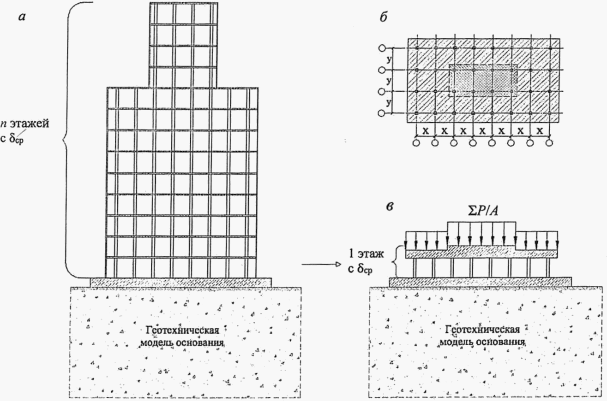

*а* - исходное здание с *n*-м числом этажей; *б -* план здания,

разбитый на высотные участки; *в -* вид эквивалентного

по жесткости этажа для выполнения расчетов

*n -* число этажей со средней толщиной плиты перекрытия $\delta_{cp}$;

$\delta_{up}$ - приведенная толщина плиты перекрытия; $\Sigma P$ - сумма сил,

действующих на участок площадью *A*

***Рисунок Н.1 -*** **Моделирование каркаса здания**

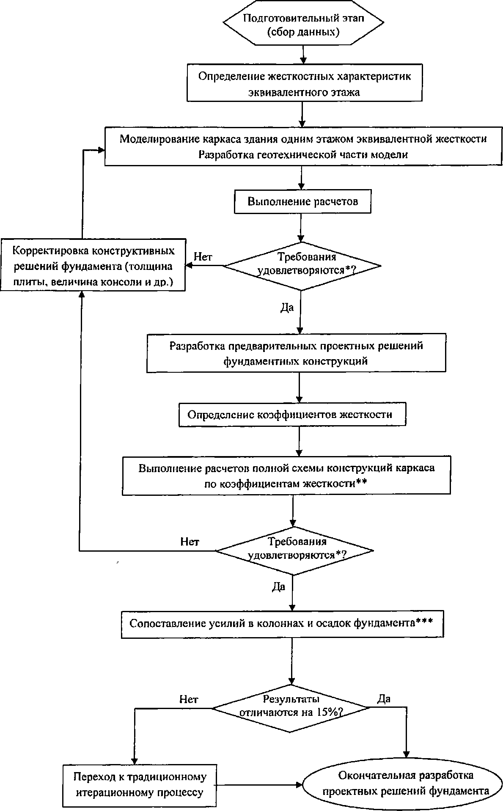

--------------------------------

* Конструктивные требования с учетом предельных состояний первой и второй группы.

** Расчеты выполняются конструкторами каркаса здания.

*** Сопоставление результатов расчета здания с полной и эквивалентной жесткостью.

***Рисунок Н.2 -*** **Алгоритм выполнения совместных расчетов**

**по разработанной методике**

# Приложение П

**РЕКОМЕНДАЦИИ ПО ОПРЕДЕЛЕНИЮ**

**НОРМАТИВНЫХ ЗНАЧЕНИЙ МОДУЛЯ ДЕФОРМАЦИИ НА ОСНОВЕ**

**КОМПРЕССИОННЫХ ИСПЫТАНИЙ ГРУНТОВ**

(приложение П в ред. Изменения N 5, утв. Приказом

Минстроя России от 07.12.2023 N 884/пр)

**П.1** Рекомендации по определению нормативных (штамповых) значений модуля деформации на основе компрессионных испытаний распространяются на неспецифические глинистые грунты четвертичных отложений. ^p-1

**П.2** Нормативное значение модуля деформации E, соответствующее значению штампового модуля деформации, определяют по формуле ^p-2

$E=mE^k_{\alpha\beta}$ (П.1)

где $E^k_{oed}$ - значение касательного одометрического модуля деформации, определяемое по [[ГОСТ 12248.4]], соответствующего величине природного вертикального эффективного напряжения $\sigma_{zg}$;

*m*$m_{ko}$ - переходной коэффициент, определяемый по таблицам П.1 - П.3 в зависимости от разновидности грунта, коэффициента пористости и показателя текучести.

Таблица П.1

**Коэффициенты перехода от касательного одометрического модуля**

**к штамповому модулю для глин**

<!-- sp-22-13330-2016-tbl075: нет подписи -->

<table>
<tr><td rowspan="2">Разновидности глин (показатель текучести *I**L*, д.е.)</td><td colspan="7">Значение коэффициента перехода *m**ko* при коэффициенте пористости *e*, равном</td></tr>
<tr><td>0,45</td><td>0,55</td><td>0,65</td><td>0,75</td><td>0,85</td><td>0,95</td><td>1,05</td></tr>
<tr><td>Мягкопластичные 0,50 &lt; *I**L* &lt;= 0,75</td><td></td><td></td><td>1,5</td><td>1,6</td><td>1,6</td><td>1,7</td><td>1,8</td></tr>
<tr><td>Тугопластичные 0,25 &lt; *I**L* &lt;= 0,50</td><td></td><td>1,9</td><td>2,0</td><td>2,1</td><td>2,2</td><td>2,3</td><td>2,4</td></tr>
<tr><td>Полутвердые 0 &lt;= *I**L* &lt;= 0,25</td><td></td><td>2,4</td><td>2,5</td><td>2,6</td><td>2,7</td><td>2,8</td><td>2,9</td></tr>
<tr><td>Твердые *I**L* &lt; 0</td><td>1,5</td><td>1,6</td><td>1,8</td><td>2,0</td><td>2,2</td><td>2,6</td><td>3,1</td></tr>
</table>

Таблица П.2

**Коэффициенты перехода от касательного одометрического модуля**

**к штамповому модулю для суглинков**

<!-- sp-22-13330-2016-tbl076: нет подписи -->

<table>
<tr><td rowspan="2">Разновидности суглинков (показатель текучести *I**L*, д.е.)</td><td colspan="7">Значение коэффициента перехода *m**ko* при коэффициенте пористости *e*, равном</td></tr>
<tr><td>0,45</td><td>0,55</td><td>0,65</td><td>0,75</td><td>0,85</td><td>0,95</td><td>1,05</td></tr>
<tr><td>Мягкопластичные 0,50 &lt; *I**L* &lt;= 0,75</td><td>2,2</td><td>2,2</td><td>2,1</td><td>2,0</td><td>2,0</td><td>1,9</td><td>1,8</td></tr>
<tr><td>Тугопластичные 0,25 &lt; *I**L* &lt;= 0,50</td><td>2,4</td><td>2,4</td><td>2,4</td><td>2,5</td><td>2,5</td><td>2,5</td><td>2,6</td></tr>
<tr><td>Полутвердые 0 &lt;= *I**L* &lt;= 0,25</td><td>2,5</td><td>2,6</td><td>2,7</td><td>2,8</td><td>2,9</td><td>3,1</td><td>3,3</td></tr>
<tr><td>Твердые *I**L* &lt; 0</td><td>2,7</td><td>2,9</td><td>3,0</td><td>3,2</td><td>3,4</td><td>3,7</td><td>4,0</td></tr>
</table>

Таблица П.3

**Коэффициенты перехода от касательного одометрического модуля**

**к штамповому модулю для супесей**

<!-- sp-22-13330-2016-tbl077: нет подписи -->

<table>
<tr><td rowspan="2">Разновидности супесей (показатель текучести *I**L*, д.е.)</td><td colspan="7">Значение коэффициента перехода *m**ko* при коэффициенте пористости *e*, равном</td></tr>
<tr><td>0,45</td><td>0,55</td><td>0,65</td><td>0,75</td><td>0,85</td><td>0,95</td><td>1,05</td></tr>
<tr><td>Пластичные 0 &lt; *I**L* &lt;= 1,0</td><td>2,4</td><td>2,4</td><td>2,3</td><td>2,3</td><td>2,2</td><td>2,2</td><td>-</td></tr>
<tr><td>Твердые *I**L* &lt; 0</td><td>3,1</td><td>3,1</td><td>3,2</td><td>3,2</td><td>3,3</td><td>3,4</td><td>-</td></tr>
</table>

# Приложение Р

**МЕТОДИЧЕСКИЕ РЕКОМЕНДАЦИИ ПО ОЦЕНКЕ**

**КОНСТРУКТИВНОЙ И ЭКОНОМИЧЕСКОЙ ЭФФЕКТИВНОСТИ**

**ТЕХНИЧЕСКИХ РЕШЕНИЙ ПО УСТРОЙСТВУ ОСНОВАНИЙ И ФУНДАМЕНТОВ**

(приложение Р в ред. Изменения N 5, утв. Приказом

Минстроя России от 07.12.2023 N 884/пр)

**Р.1** Оценка эффективности технических решений по настоящей методике выполняется на основании требований [1](#^biblio-1) по базовому критерию - механическая безопасность объекта - конструктивная эффективность и по дополнительному критерию - экономической эффективности. ^r-1

Оценка экономической эффективности должна выполняться только для вариантов технических решений, удовлетворяющих базовому критерию по конструктивной безопасности.

**Р.2** В качестве критериев конструктивной эффективности следует принимать показатели, определяемые как по 1-й группе, так и по 2-й группе предельных состояний: несущая способность, осадка, относительная разность осадок, крен и т.п. ^r-2

**Р.2.1** В качестве базового значения критерия эффективности принимают определяемые действующими документами по стандартизации или проектом предельные значения нормируемого параметра. ^r-2-1

В качестве базового критерия для учета конструктивной эффективности по 1-й группе предельных состояний следует выбирать параметр, связанный с несущей способностью основания.

В качестве базового критерия для учета конструктивной эффективности по 2-й группе предельных состояний следует выбирать показатель, отражающий параметры деформации основания.

**Р.2.2** Для возможных вариантов решений по устройству оснований и фундаментов определяют частный коэффициент конструктивной эффективности конкретного проектного варианта: ^r-2-2

- для показателей по 1-й группе предельных состояний - отношение полученного частного значения критерия к базовому;

- для показателей по 2-й группе предельных состояний - разность между 1 и отношением полученного частного значения критерия к базовому значению.

**Р.2.3** При необходимости учета нескольких критериев определяют соответствующие коэффициенты для каждого критерия. Обобщенный коэффициент для проектного варианта получают перемножением соответствующих коэффициентов для каждого критерия. ^r-2-3

**Р.2.4** Сравнение эффективности по конструктивному критерию выполняют сравнением обобщенных или частных коэффициентов - большее значение показывает преимущество данного варианта. ^r-2-4

**Р.3** В качестве критериев экономической эффективности принимают следующие показатели: ^r-3

- удельная стоимость устройства основания и фундаментов, выражаемая в стоимости 1 м² площади и (или) 1 кН нагрузки на основание, иной показатель, определяемый при проектировании (например, для искусственных оснований из закрепленных грунтов для объекта в целом/отдельных участков/удельную стоимость 1 м³ закрепленного грунта/удельную стоимость 1 м³ массива (основания) из элементов закрепленного грунта);

- продолжительность работ;

- возможность совмещения различных видов работ нулевого цикла друг с другом и другими работами по объекту (вынос сетей, демонтаж существующих конструкций при наличии, устройство ограждающих конструкций, работы по возведению подземной и надземной частей здания и т.п.);

- возможность выполнения работ в подготовительный период до начала работ основного периода по строительству объекта;

- возможность выполнения работ в рамках (противоаварийных мероприятий);

- возможность выполнения работ в стесненных условиях;

- иные критерии, определяемые заданием на проектирование.

# Приложение С

**ПРИМЕНЕНИЕ НЕЛИНЕЙНЫХ ГЕОМЕХАНИЧЕСКИХ МОДЕЛЕЙ**

**ПРИ ВЫПОЛНЕНИИ ГЕОТЕХНИЧЕСКИХ РАСЧЕТОВ**

(приложение С введено Изменением N 3, утв. Приказом

Минстроя России от 22.11.2019 N 722/пр)

**С.1** Нелинейные геомеханические модели (в том числе модели с "упрочнением") применяются для выполнения расчетов численными методами в апробированных геотехнических программных комплексах. ^s-1

**С.2** Нелинейная модель должна выбираться в зависимости от решаемой задачи, с учетом уровня ответственности сооружения по [[ГОСТ 27751]], применимости модели в данных грунтовых условиях, нагрузок и ожидаемых деформаций. Параметры моделей определяют и уточняют в рамках инженерно-геотехнических изысканий. ^s-2

**С.3** Для получения надежных и достоверных результатов при проведении геотехнических расчетов с применением нелинейных геомеханических моделей грунтов должна быть доказана адекватность их применения. ^s-3

При определении расчетного значения результата воздействий следует выполнять анализ чувствительности численной модели с учетом введения дополнительных коэффициентов надежности модели в соответствии с требованиями раздела 8 [[СП 248.1325800]]. При этом частные коэффициенты надежности модели применяются таким образом, чтобы погрешности результатов расчета были в запас надежности.

*(абзац введён Изменением N 4, утв. Приказом Минстроя России от 27.12.2021 N 1022/пр; в ред. Изменения N 5, утв. Приказом Минстроя России от 07.12.2023 N 884/пр)*

Оценку достоверности геомеханических моделей для конкретных грунтовых условий выполняют на основе сравнения результатов расчетов с данными геотехнического мониторинга, а при отсутствии таких данных - с результатами лабораторных и полевых испытаний грунтов.

**С.4** Оценка достоверности геомеханических моделей по данным геотехнического мониторинга выполняется путем сопоставления данных мониторинга (вертикальные и горизонтальные перемещения конструкций) с результатами обратных расчетов с учетом фактических конструкций и нагрузок. ^s-4

При оценке достоверности геомеханических моделей по данным испытаний грунтов выполняют обратные расчеты результатов испытаний и сравнение с результатами лабораторных и полевых испытаний грунтов.

На рисунке С.1 приведены примеры результатов оценки достоверности нелинейных геомеханических моделей для штамповых испытаний.

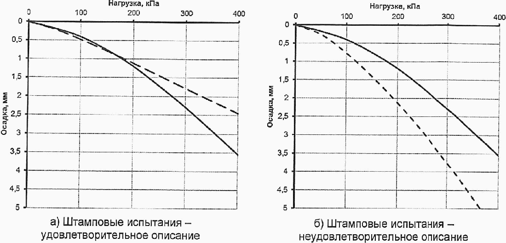

***Рисунок С.1 -*** **Характерные результаты оценки достоверности**

**нелинейных геомеханических моделей**

**С.5** Для предварительных расчетов деформационные параметры моделей нелинейного механического поведения дисперсных грунтов E 50 и E ur описываются линейными зависимостями от величины модуля деформации E. ^s-5

(п. С.5 в ред. Изменения N 5, утв. Приказом Минстроя России от 07.12.2023 N 884/пр)

**С.6** Применение откорректированных по результатам оценки достоверности параметров моделей допустимо только для расчетов по второму предельному состоянию. Для расчетов по первому предельному состоянию корректировка прочностных параметров не допускается. ^s-6

**БИБЛИОГРАФИЯ**

## Список использованных источников

[1] Федеральный закон от 29 декабря 2004 г. N 190-ФЗ "Градостроительный кодекс Российской Федерации" ^biblio-1

> [!warning] Опечатка в официальном тексте
> Федеральный закон N 384-ФЗ имеет дату 30.12.2009, а не 29.12.2009.

[2] Федеральный закон от 29 декабря 2009 г. N 384-ФЗ "Технический регламент о безопасности зданий и сооружений" ^biblio-2

[3] [[СП 11-102-97]] Инженерно-экологические изыскания для строительства ^biblio-3

[4] [[СП 11-104-97]] Инженерно-геодезические изыскания для строительства ^biblio-4

[5] [[СП 11-105-97]] Инженерно-геологические изыскания для строительства ^biblio-5

> [!warning] Опечатка в официальном тексте
> имеется в виду [[СНиП 12-04]], а не [[СНиП 12-04]].

[6] [[СНиП 12-04]] Безопасность труда в строительстве. Часть 2. Строительное производство ^biblio-6

[7] Рекомендации по проведению полевых испытаний виброустойчивости оснований фундаментов турбоагрегатов. М.: НИИОСП, 1986 ^biblio-7

[8] Методика оценки прочности и сжимаемости крупнообломочных грунтов с пылеватым и глинистым заполнителем и пылеватых и глинистых грунтов с крупнообломочными включениями / ДальНИИС. - М.: Стройиздат, 1989 ^biblio-8

(ссылка введена Изменением N 5, утв. Приказом Минстроя России от 07.12.2023 N 884/пр)
